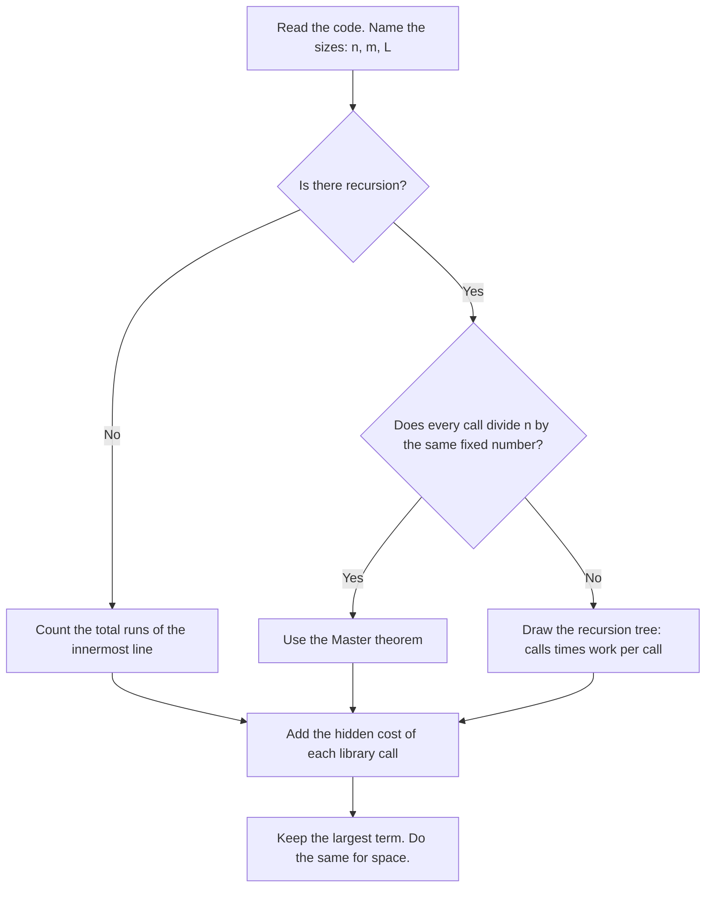

# Big-O From Zero

> **Level:** Beginner · **Priority:** T1 · **Time:** 240 min · **Read first:** [How to Use This Guide](01-how-to-use-this-guide.md) · **Next:** [C++ and the STL for Problem Solving](04-cpp-stl-for-problem-solving.md)

Big-O tells you how the work of your code grows when the input grows. You will use it in every interview: first to choose an algorithm before you code, then to explain its cost after you code.

**Short of time?** Read sections 3, 4, 5, 13 and 14, then do the [30 snippets](#17-guess-the-complexity-30-snippets). Come back for the rest later.

## Quick revision

- **Big-O** says how the number of steps grows with the input size `n`. It ignores fixed multipliers and small terms.
- **O** means "grows at most this fast". **Omega** means "at least this fast". **Theta** means "exactly this fast". In interviews, people say O and mean the tightest true answer.
- **Plan with 10^8 simple steps per second.** Put the largest n into your complexity. 10^7 steps is safe, 10^8 is risky, and 10^9 is too slow.
- **One after the other: add. One inside the other: multiply.** Different inputs get different letters: O(n + m), O(n * m).
- **Count how many times the innermost line runs in total.** Do not only count the loops.
- **Halving or doubling gives log n.** log2 of 1,000 is about 10. Of 1 million, about 20. Of 1 billion, about 30.
- **Sums to know:** `1 + 2 + ... + n` is about n^2 / 2. `1 + 2 + 4 + ... + n` is less than 2n. `n/1 + n/2 + ... + n/n` is about n log n.
- **Recursion time** is the number of calls times the work in each call. **Recursion space** is the depth of the deepest chain of calls.
- **Master theorem** for `T(n) = a T(n/b) + O(n^d)`: compare a with b^d. Smaller gives O(n^d). Equal gives O(n^d log n). Larger gives O(n^(log_b a)).
- **Amortized O(1)** means a rare slow step is paid for by many fast steps. A vector push is the classic case. A nested `while` is still O(n) if its pointer never moves back.
- **Space** counts extra memory, and that includes the call stack.
- **Best, average and worst case** are about which input you get. **O, Omega and Theta** are about the shape of the growth. They are separate ideas.
- **Hash map operations** are O(1) on average and O(n) in the worst case. `set` and `map` operations are O(log n).
- **Constraints:** n up to 10 allows n!. Up to 20 allows 2^n. Up to 100 allows n^4. Up to 500 allows n^3. Up to 10^4 allows n^2. Up to 10^5 allows n log n. Up to 10^6 allows n or n log n. Up to 10^9 allows only log n or sqrt(n).
- **Hidden costs:** `s = s + c`, `substr`, `erase`, `insert` and passing a vector by value are each O(n). Each one looks like a single step.

## How to recognize the complexity of code

Your goal is to look at any code and know its cost. Ask these five questions, in this order.

1. **What are the sizes?** Give each input size a letter: `n` for the array, `m` for a second array, `L` for the length of a string.
2. **Is there recursion?** If yes, count the calls and the work in each call.
3. **How many times does the innermost line run in total?** Add up all the rounds. Do not only multiply the loops.
4. **Does a pointer only move forward?** Here a pointer means an index variable, such as `left`. If it only moves forward, its total moves are limited, even if it sits inside another loop.
5. **What does each line really cost?** A library call can hide a whole loop.

Then keep only the largest term, and say what your letters mean.



| What you see in the code | Complexity | Explained in |
|---|---|---|
| No loop over the input, no recursion, no library call that walks the data | O(1) | [Section 3](#3-counting-steps-in-loops) |
| `i /= 2`, `i *= 2`, or a range cut in half each round | O(log n) | [Section 4](#4-log-explained-from-zero) |
| `i * i <= n` as the loop condition | O(sqrt(n)) | [Section 5](#5-halving-doubling-harmonic-and-root-loops) |
| One loop over the input | O(n) | [Section 3](#3-counting-steps-in-loops) |
| Two pointers that only move forward | O(n) | [Section 8](#8-amortized-analysis-with-the-doubling-array) |
| Hash map lookup inside one loop | O(n) on average | [Section 11](#11-complexity-of-all-stl-containers) |
| `sort`, then a loop | O(n log n) | [Section 11](#11-complexity-of-all-stl-containers) |
| `set`, `map` or heap operation inside a loop | O(n log n) | [Section 11](#11-complexity-of-all-stl-containers) |
| Binary search inside a loop | O(n log n) | [Section 4](#4-log-explained-from-zero) |
| `for d`, then `for multiple = d; multiple <= n; multiple += d` | O(n log n) | [Section 5](#5-halving-doubling-harmonic-and-root-loops) |
| Two nested loops over the input | O(n^2) | [Section 3](#3-counting-steps-in-loops) |
| Three nested loops over the input | O(n^3) | [Section 3](#3-counting-steps-in-loops) |
| Recursion on one half, no loop | O(log n) | [Section 6](#6-recursion-trees) |
| Recursion on both halves, no loop | O(n) | [Section 6](#6-recursion-trees) |
| Recursion on both halves, with a loop over the range | O(n log n) | [Section 6](#6-recursion-trees) |
| Recursion with two choices for each item | O(2^n) | [Section 6](#6-recursion-trees) |
| Recursion that picks the next item from all unused items | O(n!) | [Section 6](#6-recursion-trees) |
| Recursion with a memo table | states times work per state | [Section 6](#6-recursion-trees) |
| BFS or DFS on a graph | O(V + E), for V nodes and E edges | [Section 12](#12-common-complexity-classes-and-how-far-each-scales) |

**Not what it looks like:** these shapes fool people in interviews.

| You see | It looks like | It really is | Why |
|---|---|---|---|
| A `while` inside a `for`, and its pointer never resets | O(n^2) | O(n) | The pointer moves at most n times in total. See [section 8](#8-amortized-analysis-with-the-doubling-array). |
| Stack pops inside a `for` | O(n^2) | O(n) | Each item is popped at most once. See [section 8](#8-amortized-analysis-with-the-doubling-array). |
| `for size = 1, 2, 4, 8...` with an inner loop up to `size` | O(n log n) | O(n) | `1 + 2 + 4 + ... + n` is less than 2n. See [section 5](#5-halving-doubling-harmonic-and-root-loops). |
| Two nested loops, and the inner one jumps by `d` | O(n^2) | O(n log n) | This is the harmonic sum. See [section 5](#5-halving-doubling-harmonic-and-root-loops). |
| Two nested loops, and the inner limit is a fixed 26 | O(n^2) | O(n) | 26 is not an input. See [section 2](#2-big-o-omega-and-theta-in-plain-words). |
| One line, `s = s + c`, inside a loop | O(n) | O(n^2) | Each round copies the whole string. See [section 14](#14-hidden-costs). |
| One line, `v.erase(v.begin())`, inside a loop | O(n) | O(n^2) | Each round shifts every element. See [section 14](#14-hidden-costs). |
| A function that takes `vector<int> v`, called in a loop | O(n) | O(n^2) | Each call copies the vector. See [section 14](#14-hidden-costs). |
| A short recursion with two calls on `n - 1` | O(n) | O(2^n) | The calls double on every level. See [section 6](#6-recursion-trees). |
| A loop over all nodes, with a loop over each node's edges | O(V * E) | O(V + E) | Each edge is looked at once or twice in total, not once per node. See [section 12](#12-common-complexity-classes-and-how-far-each-scales). |

## 1. Why count steps

Think of a paper phone book with 1,000,000 names in sorted order. You want one name.

- **Way 1:** read from the first name, one by one. In the worst case, you read 1,000,000 names.
- **Way 2:** open the middle page. The name is in the left half or the right half. Throw away the other half, then repeat. You read about 20 names.

With a book of 10 names, both ways feel instant. With 1,000,000 names, Way 2 reads 50,000 times fewer names. It does not win because you read faster. It wins because its work **grows more slowly** when the book grows. Big-O describes exactly that growth.

**Why steps and not seconds?** Seconds depend on the machine, the compiler and what else is running. The same code can take 1 second on one machine and 3 seconds on another. Steps depend only on the code and the input, so everyone gets the same answer.

A **step** is one small action that takes a fixed time: an addition, a comparison, an assignment, or one array read.

Here is a tiny example. Count how often the line inside the loop runs.

```cpp compile
long long sumAll(const vector<int>& nums) {
    int n = (int)nums.size();
    long long total = 0;  // the sum of many ints may not fit in an int
    for (int i = 0; i < n; i++) {
        total += nums[i];  // this line runs n times
    }
    return total;
}
```

For 4 elements, the line runs 4 times. For 1,000 elements, it runs 1,000 times. When the input doubles, the work doubles. That pattern is the thing we care about.

The letter `n` usually means the size of the input: the length of the array, the length of the string, or the number of nodes in a graph. When the input is a single number, n can be the value of that number.

Now you can see why growth matters so much. A typical machine runs about 10^8 simple steps in one second. (`10^8` means 1 followed by 8 zeros, so 100 million.) Here is how long three growth rates take at that speed. (`n^2` means n times n. Section 4 explains `log n`.)

| n | n steps | n log n steps | n^2 steps |
|---|---|---|---|
| 1,000 | 0.00001 seconds | 0.0001 seconds | 0.01 seconds |
| 100,000 | 0.001 seconds | 0.017 seconds | 100 seconds |
| 1,000,000 | 0.01 seconds | 0.2 seconds | 2.8 hours |

At n = 1,000, all three feel instant. At n = 1,000,000, one finishes in a moment and another takes almost 3 hours. No faster machine can fix that gap. Only a better algorithm can.

## 2. Big-O, Omega and Theta in plain words

Imagine someone asks how tall your friend is.

- "Shorter than 10 meters" is true, but useless.
- "Shorter than 2 meters" is true and useful. It is an upper limit.
- "Taller than 1 meter" is also true. It is a lower limit.
- "About 1.75 meters" limits it from both sides.

The three symbols do the same thing for growth.

| Symbol | Say it as | Meaning | Like saying |
|---|---|---|---|
| O(g) | "Big-O of g" | Grows **no faster** than g. An upper limit. | "shorter than 2 meters" |
| Omega(g) | "Big-Omega of g" | Grows **no slower** than g. A lower limit. | "taller than 1 meter" |
| Theta(g) | "Big-Theta of g" | Grows **like** g. Both limits at once. | "about 1.75 meters" |

Here is a tiny example. Say some code takes `f(n) = 3n + 5` steps.

| n | 1 | 2 | 5 | 10 | 100 |
|---|---|---|---|---|---|
| 3n | 3 | 6 | 15 | 30 | 300 |
| f(n) = 3n + 5 | 8 | 11 | 20 | 35 | 305 |
| 4n | 4 | 8 | 20 | 40 | 400 |

Look at the columns from n = 5 onwards. `f(n)` is never above `4n`, and it is never below `3n`. So `f(n)` is trapped between two fixed multiples of `n`. That gives three facts:

- `f(n)` is O(n), because it stays at or below 4n.
- `f(n)` is Omega(n), because it stays at or above 3n.
- `f(n)` is Theta(n), because both of the above are true.

**The exact rule.** `f(n)` is O(g(n)) if you can pick a fixed positive number `c` and a starting point `n0` so that `f(n) <= c * g(n)` for every `n >= n0`. In our example, `c = 4` and `n0 = 5`. In words: after some point, f stays under a fixed multiple of g. The starting point exists because small inputs do not matter. Omega is the same rule with `>=`. Theta means both rules hold.

**Some true answers are useless.** `3n + 5` is also O(n^2), because it stays below n^2 for large n. That is true, but it is like saying "shorter than 10 meters". Always give the tightest answer you can.

**How people talk.** When an engineer says "this code is O(n)", they nearly always mean Theta(n). This guide follows that habit: O means the tightest bound you can state. (A **bound** is a limit. The **tightest** upper bound is the smallest one that is still true.) Say O(n^2) for a single loop in an interview and the interviewer will mark it wrong. It is true in the strict sense, but it is not what they asked.

### The rules for simplifying

**Rule 1: drop fixed multipliers.** `3n` becomes `n`, and `500n` also becomes `n`. A multiplier depends on the machine and on what you call one step. The shape does not: double n, and both 3n and 500n double. A fixed number of steps, such as 7, becomes **O(1)**. That means the work does not grow with n.

**Rule 2: keep only the largest term.** Take `n^2 + 10n + 100`.

| n | n^2 | 10n | 100 | Total | Share that is n^2 |
|---|---|---|---|---|---|
| 10 | 100 | 100 | 100 | 300 | 33% |
| 100 | 10,000 | 1,000 | 100 | 11,100 | 90% |
| 1,000 | 1,000,000 | 10,000 | 100 | 1,010,100 | 99% |

The small terms stop mattering as n grows, so `n^2 + 10n + 100` is O(n^2). This order tells you which term is largest. It goes from slowest growth to fastest:

```text
1  <  log n  <  sqrt(n)  <  n  <  n log n  <  n^2  <  n^3  <  2^n  <  n!
```

(`2^n` means n copies of 2 multiplied together. `n!` means `1 * 2 * 3 * ... * n`. `sqrt(n)` is the square root of n.)

**Careful with exponents.** Rule 1 does not work inside an exponent. `2^(2n)` is the same as `4^n`, and that grows far faster than `2^n`. Only a multiplier outside the power can go: `3 * 2^n` is O(2^n).

**Rule 3: different inputs get different letters.**

```cpp compile
long long countEqualPairs(const vector<int>& a, const vector<int>& b) {
    long long pairs = 0;  // two arrays of 100,000 equal values give 10^10 pairs
    for (int x : a) {
        for (int y : b) {
            if (x == y) pairs++;  // runs a.size() * b.size() times
        }
    }
    return pairs;
}
```

This is O(n * m), where n and m are the sizes of `a` and `b`. Calling it O(n^2) is wrong. If `b` has 3 items, the code is **linear** in `a`. Linear means the work grows in step with the size: double the size of `a` and the work doubles.

**Rule 4: only true constants can be dropped.** 26 letters, 4 grid directions and 32 bits are fixed numbers, so you drop them. O(26 * n) is O(n). But `k` is an input, so it stays. O(n * k) is not O(n).

**Rule 5: do not write a log base.** [Section 4](#4-log-explained-from-zero) shows why.

## 3. Counting steps in loops

One question solves almost every loop: **how many times does the innermost line run, in total?**

### Single loop

```cpp snippet
for (int i = 0; i < n; i++) {
    steps++;
}
```

For `n = 4`, `i` takes the values 0, 1, 2, 3. The line runs 4 times. In general it runs n times, so this is O(n).

Changing the step size does not change the class, as long as the step is a fixed number. With `i += 2` and `n = 8`, `i` takes the values 0, 2, 4, 6. That is 4 rounds, which is n/2. Drop the 1/2 and you still have O(n).

A loop with a fixed limit is O(1), even if the limit is big. `for (int i = 0; i < 1000; i++)` runs 1,000 times for any input. Its work does not grow with n.

### Two loops in a row: add

```cpp snippet
for (int i = 0; i < n; i++) steps++;
for (int j = 0; j < m; j++) steps++;
```

The first loop finishes, then the second one starts. The total is `n + m`, so this is O(n + m). If both loops run over the same array, the total is `2n`. That is still O(n), so two passes over an array are linear.

### Nested loops: multiply

```cpp snippet
for (int i = 0; i < n; i++) {
    for (int j = 0; j < m; j++) {
        steps++;
    }
}
```

For each of the n rounds of `i`, the inner loop runs all m rounds. Here it is for `n = 3` and `m = 3`, with each cell showing one run of `steps++`:

```text
        j=0     j=1     j=2
i=0   (0,0)   (0,1)   (0,2)
i=1   (1,0)   (1,1)   (1,2)
i=2   (2,0)   (2,1)   (2,2)
```

3 rows times 3 columns is 9 runs. In general it is `n * m` runs, or O(n^2) when both sizes are n.

Three nested loops over n give `n * n * n`, which is O(n^3).

### Dependent loops: add up the rounds

Often the inner loop depends on the outer one. This is the "compare every pair" shape:

```cpp snippet
for (int i = 0; i < n; i++) {
    for (int j = i + 1; j < n; j++) {
        steps++;
    }
}
```

You cannot multiply here, because the inner loop has a different size in each round. So write out the rounds. For `n = 4`:

| i | Values of j | Runs |
|---|---|---|
| 0 | 1, 2, 3 | 3 |
| 1 | 2, 3 | 2 |
| 2 | 3 | 1 |
| 3 | none | 0 |

The total is `3 + 2 + 1 + 0 = 6`. In general it is `1 + 2 + ... + (n - 1)`.

There is a neat way to add such a sum. Write it forwards and backwards, then add the two lines:

```text
  1 + 2 + 3
+ 3 + 2 + 1
-----------
  4 + 4 + 4  =  12, which is twice the sum, so the sum is 6
```

Each column adds to the same number. With k terms, there are k columns, and each one adds to k + 1. That total is twice the sum, so `1 + 2 + ... + k = k * (k + 1) / 2`. With `k = n - 1`, the total is `n * (n - 1) / 2`. For n = 4, that is `4 * 3 / 2 = 6`. This matches the table.

That total is about n^2 / 2. Drop the 1/2 and you get O(n^2). The picture makes it plain: the pairs fill half of a square.

```text
. x x x     each x is one (i, j) pair with j > i
. . x x     6 cells out of 16
. . . x     a triangle is about half of a square
. . . .
```

**The rule:** when the inner loop's size depends on the outer loop, add up the sizes of all the rounds.

The three-loop version with `i < j < k` works the same way. It picks every group of three. There are n ways to pick the first item, n - 1 for the second and n - 2 for the third. That counts each group 6 times, once for each order of its three items, so you divide by 6. The total is `n * (n - 1) * (n - 2) / 6` groups. For n = 4 that is `4 * 3 * 2 / 6 = 4`. It is O(n^3).

Here are all these shapes as a program. Each function returns how many times its innermost line ran.

```cpp
#include <bits/stdc++.h>
#include <cassert>
using namespace std;

long long singleLoop(int n) {
    long long steps = 0;
    for (int i = 0; i < n; i++) steps++;
    return steps;
}

long long stepByTwo(int n) {
    long long steps = 0;
    for (int i = 0; i < n; i += 2) steps++;
    return steps;
}

long long twoLoopsInARow(int n, int m) {
    long long steps = 0;
    for (int i = 0; i < n; i++) steps++;
    for (int j = 0; j < m; j++) steps++;
    return steps;
}

long long nestedLoops(int n, int m) {
    long long steps = 0;
    for (int i = 0; i < n; i++) {
        for (int j = 0; j < m; j++) {
            steps++;
        }
    }
    return steps;
}

long long everyPair(int n) {
    long long steps = 0;
    for (int i = 0; i < n; i++) {
        for (int j = i + 1; j < n; j++) {
            steps++;
        }
    }
    return steps;
}

long long everyTriple(int n) {
    long long steps = 0;
    for (int i = 0; i < n; i++) {
        for (int j = i + 1; j < n; j++) {
            for (int k = j + 1; k < n; k++) {
                steps++;
            }
        }
    }
    return steps;
}

int main() {
    assert(singleLoop(4) == 4);
    assert(singleLoop(0) == 0);         // an empty input does no work
    assert(stepByTwo(8) == 4);          // i = 0, 2, 4, 6
    assert(stepByTwo(7) == 4);          // i = 0, 2, 4, 6 again, so odd n rounds up
    assert(twoLoopsInARow(4, 3) == 7);  // 4 + 3
    assert(nestedLoops(3, 3) == 9);     // 3 * 3
    assert(nestedLoops(3, 4) == 12);    // 3 * 4
    assert(nestedLoops(0, 4) == 0);     // the inner loop never starts
    assert(everyPair(4) == 6);          // 3 + 2 + 1 + 0
    assert(everyPair(1) == 0);          // one item has no pair
    assert(everyPair(1000) == 499500);  // 1000 * 999 / 2
    assert(everyTriple(4) == 4);        // 4 * 3 * 2 / 6
    assert(everyTriple(2) == 0);        // two items have no triple
    cout << "All tests passed\n";
}
```

## 4. Log explained from zero

Start with a tiny question: **how many times can you cut 8 in half before you reach 1?**

```text
8 -> 4 -> 2 -> 1      that is 3 cuts
```

The answer, 3, has a name. It is the **logarithm of 8 in base 2**, written `log2(8)`. So `log2(8) = 3`.

You can read the same fact from the other side. Multiply three 2s together and you get 8, so `2^3 = 8`. A log is the reverse of a power. It answers the question "2 to what power gives n?"

| Power | Log | In words |
|---|---|---|
| 2^3 = 8 | log2(8) = 3 | Cut 8 in half 3 times to reach 1. |
| 2^5 = 32 | log2(32) = 5 | Cut 32 in half 5 times to reach 1. |
| 2^10 = 1,024 | log2(1,024) = 10 | Cut 1,024 in half 10 times to reach 1. |

Here are the first values. Look at how slowly the bottom row grows.

| n | 1 | 2 | 4 | 8 | 16 | 32 | 64 | 128 | 256 | 512 | 1,024 |
|---|---|---|---|---|---|---|---|---|---|---|---|
| log2(n) | 0 | 1 | 2 | 3 | 4 | 5 | 6 | 7 | 8 | 9 | 10 |

When n doubles, the log goes up by only 1. This is why log n is so powerful. Learn these four rows by heart:

| n | The nearest power of 2 | log2(n) |
|---|---|---|
| 1,000 | 2^10 = 1,024 | about 10 |
| 1 million | 2^20 = 1,048,576 | about 20 |
| 1 billion | 2^30 = 1,073,741,824 | about 30 |
| 10^18 | 2^60 = 1,152,921,504,606,846,976 | about 60 |

So each extra three zeros adds about 10 to the log. Even for the largest numbers in an interview, log n is at most about 60.

**What if n is not a power of 2?** `log2(10)` is about 3.32. Code counts whole steps, so 10 gives 3 cuts with integer division: `10 -> 5 -> 2 -> 1`. Big-O ignores this small rounding.

### Where log n comes from

Four shapes produce a log.

**1. A range cut in half.** Binary search on a sorted array throws away half of the range after each check. Here is a dry run on `[1, 3, 5, 7, 9, 11, 13, 15]` with target 15.

| Check | low | high | mid | nums[mid] | Result | Items left |
|---|---|---|---|---|---|---|
| 1 | 0 | 7 | 3 | 7 | too small, go right | 4 |
| 2 | 4 | 7 | 5 | 11 | too small, go right | 2 |
| 3 | 6 | 7 | 6 | 13 | too small, go right | 1 |
| 4 | 7 | 7 | 7 | 15 | found | |

The items left go 8, 4, 2, 1. So 8 items need at most 4 checks, which is `log2(8) + 1`. A sorted array of 1 million items needs at most 20 checks.

**2. A value that doubles.** `for (i = 1; i < n; i *= 2)` runs through 1, 2, 4, 8 and so on. It reaches n after log2(n) rounds. This is the halving loop read backwards.

**3. Digits and bits.** The number 12345 has 5 digits, and `n /= 10` removes one digit in each round. So a digit loop runs about log10(n) rounds. In the same way, `n /= 2` removes one bit. The number 13 is `1101` in binary, so it has 4 bits. The loop `13 -> 6 -> 3 -> 1 -> 0` takes 4 rounds.

**4. A balanced tree.** A **binary tree** is a structure where each item, called a **node**, has at most two children. A tree with full levels has 1 node, then 2, then 4, then 8.

```text
level 0:          o             1 node
level 1:      o       o         2 nodes
level 2:    o   o   o   o       4 nodes      3 levels hold 7 nodes
```

Each level doubles the node count, so 20 levels hold about 1 million nodes. The **height** of a tree is its number of levels. A tree is **balanced** when no path from top to bottom is much longer than the others, which keeps the height at O(log n). `set` and `map` are balanced trees. A **heap** is a balanced tree that keeps the largest or smallest item at the top. That is why `set`, `map` and heaps take O(log n): one operation walks one path from top to bottom.

### Why the base does not matter

Compare base 2 with base 10.

| n | log10(n) | log2(n) | log2(n) / log10(n) |
|---|---|---|---|
| 1,000 | 3 | 9.97 | 3.32 |
| 1,000,000 | 6 | 19.93 | 3.32 |
| 1,000,000,000 | 9 | 29.90 | 3.32 |

The ratio never changes. Any two log bases differ by a fixed multiplier, and Rule 1 drops fixed multipliers. So people write O(log n) with no base. When you need a real number, use base 2. It also means that cutting into 3 parts or 10 parts each round is still O(log n).

### The log rules you need

You only need three.

| Rule | Example | Why it matters |
|---|---|---|
| log(a * b) = log a + log b | log2(8 * 16) = 3 + 4 = 7, and 8 * 16 = 128 = 2^7 | Binary search on an n by m grid is O(log(n * m)), which is O(log n + log m). |
| log(n^k) = k * log n | log2(8^2) = 2 * 3 = 6, and 8^2 = 64 = 2^6 | O(log(n^2)) is the same as O(log n). |
| log(n!) is about n log n | log2(8!) = log2(40,320), which is about 15.3 and below 8 * 3 = 24 | The sum `log 1 + log 2 + ... + log n` has n terms, and most of them are close to log n. |

Here is every shape from this section as a program.

```cpp
#include <bits/stdc++.h>
#include <cassert>
using namespace std;

// How many times can n be cut in half before it reaches 1?
int halvings(long long n) {
    int steps = 0;
    while (n > 1) {
        n /= 2;
        steps++;
    }
    return steps;
}

// How many times must 1 be doubled to reach at least n?
int doublings(long long n) {
    int steps = 0;
    for (long long value = 1; value < n; value *= 2) steps++;
    return steps;
}

int decimalDigits(long long n) {
    if (n == 0) return 1;  // the loop would not run, but 0 is still one digit
    int digits = 0;
    while (n > 0) {  // each round removes the last digit
        n /= 10;
        digits++;
    }
    return digits;
}

// How many bits does n need? This is not the number of 1 bits: 13 needs 4 bits and has three 1s.
int bitLength(long long n) {
    int bits = 0;
    while (n > 0) {  // each round removes the last bit
        n /= 2;
        bits++;
    }
    return bits;
}

// Returns how many checks binary search makes before it stops.
int binarySearchChecks(const vector<int>& nums, int target) {
    int low = 0, high = (int)nums.size() - 1, checks = 0;
    while (low <= high) {
        int mid = low + (high - low) / 2;  // this form cannot overflow
        checks++;
        if (nums[mid] == target) break;
        if (nums[mid] < target) low = mid + 1;
        else high = mid - 1;
    }
    return checks;
}

int main() {
    assert(halvings(8) == 3);           // 8 -> 4 -> 2 -> 1
    assert(halvings(10) == 3);          // 10 -> 5 -> 2 -> 1
    assert(halvings(1) == 0);           // already at 1
    assert(halvings(1024) == 10);
    assert(halvings(1000000) == 19);    // 2^19 = 524,288 and 2^20 is above one million
    assert(doublings(8) == 3);          // 1, 2, 4 are below 8
    assert(doublings(9) == 4);          // 1, 2, 4, 8 are below 9
    assert(doublings(1) == 0);          // 1 is already there
    assert(decimalDigits(12345) == 5);
    assert(decimalDigits(1000) == 4);   // the zeros count as digits
    assert(decimalDigits(0) == 1);      // the one case the loop misses
    assert(bitLength(13) == 4);         // 13 is 1101 in binary
    assert(bitLength(8) == 4);          // 8 is 1000 in binary

    vector<int> nums = {1, 3, 5, 7, 9, 11, 13, 15};
    assert(binarySearchChecks(nums, 15) == 4);  // the dry run above
    assert(binarySearchChecks(nums, 7) == 1);   // the first mid is the target
    assert(binarySearchChecks({}, 7) == 0);     // an empty array needs no checks

    // One million items never need more than 20 checks, even for a missing value.
    vector<int> big(1000000);
    for (int i = 0; i < (int)big.size(); i++) big[i] = 2 * i;
    for (int target = -1; target < 2000000; target += 997) {
        assert(binarySearchChecks(big, target) <= 20);
    }
    cout << "All tests passed\n";
}
```

## 5. Halving, doubling, harmonic and root loops

Now that you know log, you can count the harder loop shapes.

### A plain halving or doubling loop

```cpp snippet
while (n > 1) {
    n /= 2;
    steps++;
}
```

Trace it for n = 8.

| Round | n before | n after |
|---|---|---|
| 1 | 8 | 4 |
| 2 | 4 | 2 |
| 3 | 2 | 1 |

That is 3 rounds, which is log2(8). So this loop is O(log n). A loop that doubles, such as `for (i = 1; i < n; i *= 2)`, is the same loop read backwards, so it is also O(log n).

The divisor does not matter, as long as it is fixed. `n /= 3` and `n /= 10` are also O(log n), because the log base does not change the class.

### A log loop inside a normal loop

```cpp snippet
for (int i = 0; i < n; i++) {
    for (int j = 1; j < n; j *= 2) {
        steps++;
    }
}
```

The inner loop has the same size in every round, so you can multiply. There are n rounds of log2(n) steps, which is O(n log n). For n = 8, that is `8 * 3 = 24`.

### A normal loop inside a doubling loop

This one is a trap.

```cpp snippet
for (long long size = 1; size <= n; size *= 2) {
    for (long long i = 0; i < size; i++) {
        steps++;
    }
}
```

The outer loop runs log n times and the inner loop goes up to n. So it looks like O(n log n). But most rounds of the inner loop are small. Write them out for n = 8:

| size | Runs of the inner loop |
|---|---|
| 1 | 1 |
| 2 | 2 |
| 4 | 4 |
| 8 | 8 |

The total is 15, which is less than `2 * 8 = 16`. A picture shows why.

```text
size 8:  ########
size 4:  ####
size 2:  ##
size 1:  #
```

The three small rows hold 7 marks, one fewer than the top row. So the whole sum is less than twice the top row. **A sum that doubles at each term is less than 2 times its last term.** This code is O(n).

Read the same picture from the top and you get a second shape: `n + n/2 + n/4 + ... + 1` is also less than 2n. So a loop that scans the input and then cuts the input in half each round is O(n), not O(n log n).

### The harmonic loop

```cpp snippet
for (int d = 1; d <= n; d++) {
    for (int multiple = d; multiple <= n; multiple += d) {
        steps++;
    }
}
```

The outer loop picks a number `d`. The inner loop walks over the multiples of `d` up to n. For n = 8:

| d | Values of multiple | Runs |
|---|---|---|
| 1 | 1, 2, 3, 4, 5, 6, 7, 8 | 8 |
| 2 | 2, 4, 6, 8 | 4 |
| 3 | 3, 6 | 2 |
| 4 | 4, 8 | 2 |
| 5 | 5 | 1 |
| 6 | 6 | 1 |
| 7 | 7 | 1 |
| 8 | 8 | 1 |

The total is 20. The rounds shrink fast, which is why this is far below `8 * 8 = 64`.

In general, the inner loop runs n/d times, rounded down. So the total is about `n/1 + n/2 + n/3 + ... + n/n`, which is n times this sum:

```text
1 + 1/2 + 1/3 + 1/4 + ... + 1/n
```

This is the **harmonic sum**. To see how big it is, group its terms into blocks whose sizes double:

```text
1                                   = 1
1/2 + 1/3               <= 2 * 1/2  = 1
1/4 + 1/5 + 1/6 + 1/7   <= 4 * 1/4  = 1
1/8 + ... + 1/15        <= 8 * 1/8  = 1
```

Each block adds at most 1. The block sizes double, so there are about log2(n) blocks. So the harmonic sum is at most about log2(n) + 1, and the loop is **O(n log n)**.

You will meet this shape whenever a problem walks over multiples, such as counting the divisors of every number up to n. The sieve in [Primes and the Sieve](../11-math-geometry-games/02-primes-and-sieve.md) has a similar shape. It walks only over multiples of primes, which makes it even faster: O(n log log n).

### The root loop

```cpp snippet
for (long long i = 1; i * i <= n; i++) {
    steps++;
}
```

For n = 36, the loop runs for i = 1, 2, 3, 4, 5, 6. At i = 7, `i * i` is 49, so it stops. That is 6 rounds, and 6 is sqrt(36). This is O(sqrt(n)).

Why stop there? Divisors come in pairs: if `i` divides n, then `n / i` also divides n. The pairs of 36 are (1, 36), (2, 18), (3, 12), (4, 9) and (6, 6). In every pair, the smaller number is at most sqrt(n). So to find all the divisors, you only test up to sqrt(n).

The square root of 1 billion is about 31,623. That is why an O(sqrt(n)) prime check is fast even for large numbers.

Use `long long` for `i`. An `int` can hold values up to about 2.1 billion. A larger result **overflows**, which means it turns into a wrong value. With `int`, `i * i` overflows once `i` passes 46,340.

### The sums to know

Most loops in this chapter reduce to one of these sums.

| Sum | Value | Big-O | Loop shape that makes it |
|---|---|---|---|
| 1 + 1 + ... + 1 (n terms) | n | O(n) | One loop |
| 1 + 2 + 3 + ... + n | n(n + 1) / 2 | O(n^2) | Inner limit is `i` |
| 1^2 + 2^2 + ... + n^2 | n(n + 1)(2n + 1) / 6 | O(n^3) | Inner limit is `i * i` |
| 1 + 2 + 4 + ... + n | less than 2n | O(n) | Doubling outer loop, inner limit is `size` |
| n + n/2 + n/4 + ... + 1 | less than 2n | O(n) | Scan, then cut in half, and repeat |
| n/1 + n/2 + n/3 + ... + n/n | about n ln n | O(n log n) | Walking over multiples |
| log 1 + log 2 + ... + log n | about n log n | O(n log n) | Inner loop halves from `i` |

(`ln n` is the log in base e, a number close to 2.72. It is a fixed multiple of log2(n), so it changes nothing in Big-O.)

```cpp
#include <bits/stdc++.h>
#include <cassert>
using namespace std;

long long logInsideLinear(int n) {
    long long steps = 0;
    for (int i = 0; i < n; i++) {
        for (int j = 1; j < n; j *= 2) {
            steps++;
        }
    }
    return steps;
}

long long linearInsideDoubling(int n) {
    long long steps = 0;
    for (long long size = 1; size <= n; size *= 2) {
        for (long long i = 0; i < size; i++) {
            steps++;
        }
    }
    return steps;
}

long long scanThenHalve(int n) {
    long long steps = 0;
    for (int size = n; size > 0; size /= 2) {
        for (int i = 0; i < size; i++) {
            steps++;
        }
    }
    return steps;
}

long long harmonic(int n) {
    long long steps = 0;
    for (int d = 1; d <= n; d++) {
        for (int multiple = d; multiple <= n; multiple += d) {
            steps++;
        }
    }
    return steps;
}

long long rootLoop(long long n) {
    long long steps = 0;
    for (long long i = 1; i * i <= n; i++) steps++;
    return steps;
}

int main() {
    assert(logInsideLinear(8) == 24);        // 8 * 3
    assert(logInsideLinear(1) == 0);         // the inner loop never starts
    assert(linearInsideDoubling(8) == 15);   // 1 + 2 + 4 + 8
    assert(linearInsideDoubling(9) == 15);   // size 16 is above 9, so it never runs
    assert(linearInsideDoubling(1) == 1);
    assert(linearInsideDoubling(1024) == 2047);  // always below 2n
    assert(scanThenHalve(8) == 15);          // 8 + 4 + 2 + 1
    assert(scanThenHalve(0) == 0);           // an empty input does no work
    assert(harmonic(8) == 20);               // the table above
    assert(harmonic(1) == 1);
    assert(harmonic(1000) <= 1000 * 11);     // n * (log2(n) + 1) is the upper limit
    assert(rootLoop(36) == 6);
    assert(rootLoop(35) == 5);               // 6 * 6 is above 35
    assert(rootLoop(1) == 1);
    assert(rootLoop(1000000000) == 31622);   // 31622^2 fits, 31623^2 passes one billion
    cout << "All tests passed\n";
}
```

## 6. Recursion trees

Think of a manager with a big job. She does a small part herself and hands the rest to two assistants. Each assistant does the same with their part. To find the total work of the whole company, you add up the work of every person. The easy way is to add one level of the company at a time.

A **recursive** function is a function that calls itself on a smaller input. It works the same way. Each call does some work of its own, then hands smaller jobs to other calls.

**The method:**

1. Draw each call as a box. Its children are the calls it makes.
2. Write down the work each box does itself, without its children.
3. Add the work on each level.
4. Add all the levels.

To write this down in short, people use a **recurrence**. A recurrence is a formula that gives the cost for size n using the cost of smaller sizes. `T(n)` means "the total work for input size n". So `T(n) = T(n - 1) + 1` means "the work for size n is the work for size n - 1, plus 1 more step".

### One call, smaller by 1: a long chain

```cpp snippet
void chain(int n, long long& calls) {
    calls++;
    if (n == 0) return;
    chain(n - 1, calls);
}
```

The recurrence is `T(n) = T(n - 1) + O(1)`. There is no branching, so the tree is a single line.

```text
chain(3) -> chain(2) -> chain(1) -> chain(0)
```

That is 4 calls for n = 3. In general it is n + 1 calls with O(1) work each, so **O(n)**.

If each call also runs a loop of size n, the recurrence is `T(n) = T(n - 1) + O(n)`. The work is `n + (n - 1) + ... + 1`, the triangle sum from section 3. That is **O(n^2)**.

### One call, half the size: a short chain

```text
halfChain(8) -> halfChain(4) -> halfChain(2) -> halfChain(1)
```

The recurrence is `T(n) = T(n / 2) + O(1)`. The size is cut in half at each call, so the chain has about log2(n) calls. That is **O(log n)**.

If each call also runs a loop of size n, the recurrence is `T(n) = T(n / 2) + O(n)`. The work is `n + n/2 + n/4 + ...`, which is less than 2n. That is **O(n)**.

### Two calls, half the size, no loop

The recurrence is `T(n) = 2 T(n / 2) + O(1)`. Here is the tree for n = 8.

```text
level 0:              [8]                   1 box
level 1:        [4]         [4]             2 boxes
level 2:     [2]   [2]   [2]   [2]          4 boxes
level 3:    [1][1][1][1][1][1][1][1]        8 boxes
```

Each box does O(1) work, so the total is the number of boxes. That is `1 + 2 + 4 + 8 = 15`. This is the doubling sum from section 5, so it is less than 2n. The answer is **O(n)**. This is the shape of any function that visits every node of a tree once.

### Two calls, half the size, with a loop

Now each box also loops over its whole range. The recurrence is `T(n) = 2 T(n / 2) + O(n)`.

```text
level 0:              [8]                   work 8
level 1:        [4]         [4]             work 4 + 4 = 8
level 2:     [2]   [2]   [2]   [2]          work 2 + 2 + 2 + 2 = 8
level 3:    [1][1][1][1][1][1][1][1]        work 1 * 8 = 8
```

Every level costs 8, because the boxes on a level together cover the whole array. There are 4 levels, which is `log2(8) + 1`. So the total is `8 * 4 = 32`. In general it is n work on each of about log n levels, so **O(n log n)**. This is the shape of [merge sort](../04-sorting-searching/02-merge-sort.md), which cuts the array in half, sorts each half, then merges the two sorted halves in one scan.

### Two calls, smaller by 1

The recurrence is `T(n) = 2 T(n - 1) + O(1)`. Here is the tree for n = 3.

```text
level 0:                 [3]                   1 box
level 1:          [2]           [2]            2 boxes
level 2:       [1]   [1]     [1]   [1]         4 boxes
level 3:     [0][0] [0][0] [0][0] [0][0]       8 boxes
```

The size drops by only 1, so the tree is n levels deep. Every level doubles. The total is `1 + 2 + 4 + 8 = 15`, which is `2^(n + 1) - 1`. The answer is **O(2^n)**. The last term is the biggest again, but now the last term is 2^n and not n.

Compare this tree with the one under "Two calls, half the size, no loop". Both have two calls. The only difference is `n / 2` against `n - 1`, and that changes O(n) into O(2^n). **Always check how fast the size shrinks.**

A useful shortcut for trees like this: the number of calls is about `branches ^ depth`. Three calls on `n - 1` give O(3^n).

### Uneven branches: Fibonacci

The classic slow Fibonacci calls `fib(n - 1)` and `fib(n - 2)`. Here is the tree for n = 4.

```text
                fib(4)
              /        \
         fib(3)        fib(2)
         /    \        /    \
     fib(2)  fib(1) fib(1)  fib(0)
     /    \
 fib(1)  fib(0)
```

That is 9 calls. Here is how the count grows.

| n | 1 | 2 | 3 | 4 | 5 | 6 | 10 | 20 | 30 |
|---|---|---|---|---|---|---|---|---|---|
| Calls | 1 | 3 | 5 | 9 | 15 | 25 | 177 | 21,891 | 2,692,537 |

Each extra n multiplies the calls by about 1.618. The left side of the tree goes down by 1 and the right side by 2, so the tree is not full. It still fits inside the tree above, so O(2^n) is a true upper limit. That is the normal answer in an interview. If you want to be exact, say "about O(1.618^n)".

### Backtracking: leaves times the cost of a leaf

[Backtracking](../06-recursion-backtracking-greedy/02-backtracking-subsets.md) tries every choice. A **leaf** is a box at the bottom of the tree, one that makes no more calls. Count the leaves, then multiply by the work at a leaf.

- **Subsets:** each of n items is either taken or skipped. That gives 2 choices on n levels, so 2^n leaves. Copying one subset costs up to n, so the total is **O(n * 2^n)**.
- **Permutations:** the first position has n choices, the next n - 1, and so on. That gives n! leaves. Copying one permutation costs n, so the total is **O(n * n!)**.

### Memoization: states times work per state

A **memo** is a table that saves the answer for each input. If the answer is already saved, the call returns at once. The tree collapses, because each different input does its real work only once.

| n | Calls without a memo | Calls with a memo |
|---|---|---|
| 5 | 15 | 9 |
| 10 | 177 | 19 |
| 30 | 2,692,537 | 59 |

So the rule changes: **time = number of different states * work per state**. A **state** is one different input to the function. Fibonacci has n + 1 states and O(1) work per state, so it is O(n). This rule covers all of [dynamic programming](../09-dynamic-programming/01-dp-from-zero.md), or DP, which solves a problem by saving the answers to its smaller parts. A DP on a grid with n * m states and O(1) work per state is O(n * m). A DP with n states and a loop of size n in each state is O(n^2).

### All the shapes in one table

| Recurrence | Shape | Big-O |
|---|---|---|
| T(n) = T(n - 1) + O(1) | Long chain | O(n) |
| T(n) = T(n - 1) + O(n) | Long chain, each call loops | O(n^2) |
| T(n) = T(n / 2) + O(1) | Short chain | O(log n) |
| T(n) = T(n / 2) + O(n) | Short chain, each call loops | O(n) |
| T(n) = 2 T(n / 2) + O(1) | Balanced tree, no loop | O(n) |
| T(n) = 2 T(n / 2) + O(n) | Balanced tree, each call loops | O(n log n) |
| T(n) = 2 T(n - 1) + O(1) | Full tree, n levels deep | O(2^n) |
| T(n) = T(n - 1) + T(n - 2) + O(1) | Uneven tree | O(2^n), or O(1.618^n) if you want it exact |
| T(n) = n T(n - 1) + O(1) | n branches, then n - 1, and so on | O(n!) |

Here are the shapes as a program. Each function adds to a counter, so you can check the numbers above.

```cpp
#include <bits/stdc++.h>
#include <cassert>
using namespace std;

void chain(int n, long long& calls) {  // T(n) = T(n - 1) + 1
    calls++;
    if (n == 0) return;
    chain(n - 1, calls);
}

void halfChain(int n, long long& calls) {  // T(n) = T(n / 2) + 1
    calls++;
    if (n <= 1) return;
    halfChain(n / 2, calls);
}

void bothHalves(int n, long long& calls) {  // T(n) = 2 T(n / 2) + 1
    calls++;
    if (n <= 1) return;
    bothHalves(n / 2, calls);
    bothHalves(n - n / 2, calls);  // n - n / 2 also works when n is odd
}

void bothHalvesWithLoop(int n, long long& work) {  // T(n) = 2 T(n / 2) + n
    for (int i = 0; i < n; i++) work++;
    if (n <= 1) return;
    bothHalvesWithLoop(n / 2, work);
    bothHalvesWithLoop(n - n / 2, work);
}

void twoSmallerByOne(int n, long long& calls) {  // T(n) = 2 T(n - 1) + 1
    calls++;
    if (n == 0) return;
    twoSmallerByOne(n - 1, calls);
    twoSmallerByOne(n - 1, calls);
}

int fib(int n, long long& calls) {  // T(n) = T(n - 1) + T(n - 2) + 1
    calls++;
    if (n <= 1) return n;
    return fib(n - 1, calls) + fib(n - 2, calls);
}

int fibMemo(int n, vector<int>& memo, long long& calls) {
    calls++;
    if (n <= 1) return n;
    if (memo[n] != -1) return memo[n];  // already solved, so the tree stops here
    memo[n] = fibMemo(n - 1, memo, calls) + fibMemo(n - 2, memo, calls);
    return memo[n];
}

long long countChain(int n) {
    long long calls = 0;
    chain(n, calls);
    return calls;
}

long long countHalfChain(int n) {
    long long calls = 0;
    halfChain(n, calls);
    return calls;
}

long long countBothHalves(int n) {
    long long calls = 0;
    bothHalves(n, calls);
    return calls;
}

long long countBothHalvesWithLoop(int n) {
    long long work = 0;
    bothHalvesWithLoop(n, work);
    return work;
}

long long countTwoSmallerByOne(int n) {
    long long calls = 0;
    twoSmallerByOne(n, calls);
    return calls;
}

long long countFib(int n) {
    long long calls = 0;
    fib(n, calls);
    return calls;
}

long long countFibMemo(int n) {
    vector<int> memo(n + 2, -1);
    long long calls = 0;
    fibMemo(n, memo, calls);
    return calls;
}

int main() {
    assert(countChain(3) == 4);
    assert(countChain(0) == 1);                  // the base case is still one call
    assert(countHalfChain(8) == 4);              // 8, 4, 2, 1
    assert(countBothHalves(8) == 15);            // 1 + 2 + 4 + 8
    assert(countBothHalves(1) == 1);
    assert(countBothHalvesWithLoop(8) == 32);    // 8 work on each of 4 levels
    assert(countBothHalvesWithLoop(1024) == 1024 * 11);  // 11 levels
    assert(countTwoSmallerByOne(3) == 15);       // 2^4 - 1
    assert(countTwoSmallerByOne(10) == 2047);    // 2^11 - 1
    assert(countFib(4) == 9);                    // the tree above
    assert(countFib(5) == 15);
    assert(countFib(30) == 2692537);             // 2 * fib(31) - 1
    assert(countFibMemo(5) == 9);                // 2n - 1 calls
    assert(countFibMemo(30) == 59);
    assert(countFibMemo(1) == 1);
    cout << "All tests passed\n";
}
```

## 7. The Master theorem

Drawing a tree always works, but it is slow. For the common "divide into equal parts" shape, there is a shortcut called the **Master theorem**.

It works for a recurrence of this form:

```text
T(n) = a T(n / b) + O(n^d)
```

- `a` is how many recursive calls each call makes.
- `b` is how much smaller each call is. The size goes from n to n / b.
- `d` is the power of the work outside the calls. O(1) means d = 0. O(n) means d = 1. O(n^2) means d = 2.

All three must be fixed numbers that do not depend on n.

Here is how to read them from code.

```cpp snippet
void bothHalvesWithLoop(int n, long long& work) {
    for (int i = 0; i < n; i++) work++;      // O(n) outside the calls, so d = 1
    if (n <= 1) return;
    bothHalvesWithLoop(n / 2, work);         // two calls, so a = 2
    bothHalvesWithLoop(n - n / 2, work);     // each on half the size, so b = 2
}
```

Now compare `a` with `b^d`. There are only three cases.

| Case | What happens in the tree | Answer |
|---|---|---|
| a < b^d | Work shrinks as you go down. The top level wins. | O(n^d) |
| a = b^d | Every level does the same work. | O(n^d log n) |
| a > b^d | Work grows as you go down. The bottom level wins. | O(n^(log_b a)) |

(`log_b a` means the log of a in base b: "b to what power gives a?" For example, `log_2 8 = 3`, and `log_2 3` is about 1.585. Keep the base here. Rule 5 covers only a plain `log n`. Inside an exponent the base changes the answer: `n^(log_2 4)` is n^2, but `n^(log_4 4)` is n.)

For the code above, a = 2, b = 2 and d = 1. Then `b^d = 2`, which equals a. That is the middle case. The answer is O(n^1 log n), which is O(n log n). The tree in section 6 gave the same answer.

**Why these three cases?** Look at level i of the tree. It has `a^i` calls. Each call has size `n / b^i`, so each does `(n / b^i)^d` work. Multiply them, and level i does this much work:

```text
n^d * (a / b^d)^i
```

So each level is the level above it, times the same number `r = a / b^d`. For merge sort, `r = 2 / 2 = 1`, so all levels are equal. For Karatsuba, `r = 3 / 2`, so each level does 1.5 times the work of the level above.

- If r < 1, each level is smaller than the last. As with `n + n/2 + n/4 + ...` in section 5, the sum is a fixed multiple of the top level, which is n^d.
- If r = 1, all levels equal n^d. There are about log n levels.
- If r > 1, each level is bigger than the last, so the bottom level wins. The tree is `log_b n` levels deep, so the bottom level has `a^(log_b n)` leaves. That number is equal to `n^(log_b a)`. For a = 4, b = 2 and n = 8, both give 64: `4^3 = 64` and `8^2 = 64`.

### Worked examples

| Example | Recurrence | a | b | d | b^d | Compare | Answer |
|---|---|---|---|---|---|---|---|
| Binary search | T(n / 2) + O(1) | 1 | 2 | 0 | 1 | a = b^d | O(log n) |
| Visit every node of a balanced tree | 2 T(n / 2) + O(1) | 2 | 2 | 0 | 1 | a > b^d | O(n^(log_2 2)) = O(n) |
| Scan, then recurse on one half | T(n / 2) + O(n) | 1 | 2 | 1 | 2 | a < b^d | O(n) |
| [Merge sort](../04-sorting-searching/02-merge-sort.md) | 2 T(n / 2) + O(n) | 2 | 2 | 1 | 2 | a = b^d | O(n log n) |
| [Karatsuba multiplication](../06-recursion-backtracking-greedy/05-divide-and-conquer.md) | 3 T(n / 2) + O(n) | 3 | 2 | 1 | 2 | a > b^d | O(n^(log_2 3)), about O(n^1.585) |
| Two half calls with a double loop | 2 T(n / 2) + O(n^2) | 2 | 2 | 2 | 4 | a < b^d | O(n^2) |
| Four half calls with a double loop | 4 T(n / 2) + O(n^2) | 4 | 2 | 2 | 4 | a = b^d | O(n^2 log n) |
| Strassen matrix multiplication | 7 T(n / 2) + O(n^2) | 7 | 2 | 2 | 4 | a > b^d | O(n^(log_2 7)), about O(n^2.807) |
| Nine calls on a third | 9 T(n / 3) + O(n) | 9 | 3 | 1 | 3 | a > b^d | O(n^(log_3 9)) = O(n^2) |

You can test the theorem on real numbers. The program below computes each recurrence exactly, for n = 1024 and n = 2048. Then it prints how much the work grew when n doubled. O(n) should double, O(n^2) should grow 4 times, and a log adds a little on top.

```cpp
#include <bits/stdc++.h>
#include <cassert>
using namespace std;

// Computes T(n) = a * T(n / b) + n^d, with T(1) = 1.
// All a calls have the same size, so one recursive call gives the cost of each of them.
long long recurrence(long long n, long long a, long long b, int d) {
    if (n <= 1) return 1;
    long long outside = 1;
    for (int i = 0; i < d; i++) outside *= n;
    return a * recurrence(n / b, a, b, d) + outside;
}

int main() {
    assert(recurrence(1024, 1, 2, 0) == 11);        // 10 halvings, plus the base case
    assert(recurrence(1024, 2, 2, 0) == 2047);      // 1 + 2 + 4 + ... + 1024
    assert(recurrence(1024, 1, 2, 1) == 2047);      // 1024 + 512 + ... + 2 + 1
    assert(recurrence(1024, 2, 2, 1) == 1024 * 11); // 1024 work on each of 11 levels
    assert(recurrence(1024, 4, 2, 2) == 1048576LL * 11);  // 1024^2 on each of 11 levels
    assert(recurrence(1, 7, 2, 2) == 1);            // the base case
    assert(recurrence(81, 3, 3, 1) == 405);         // 81 work on each of 5 levels

    struct Case {
        string name;
        long long a;
        int d;
        string answer;
    };
    vector<Case> cases = {
        {"T(n/2) + 1", 1, 0, "O(log n)"},
        {"2T(n/2) + 1", 2, 0, "O(n)"},
        {"T(n/2) + n", 1, 1, "O(n)"},
        {"2T(n/2) + n", 2, 1, "O(n log n)"},
        {"3T(n/2) + n", 3, 1, "O(n^1.585)"},
        {"2T(n/2) + n^2", 2, 2, "O(n^2)"},
        {"4T(n/2) + n^2", 4, 2, "O(n^2 log n)"},
    };

    printf("%-15s %10s %10s %7s  %s\n", "Recurrence", "T(1024)", "T(2048)", "Growth", "Answer");
    for (const Case& c : cases) {
        long long small = recurrence(1024, c.a, 2, c.d);
        long long large = recurrence(2048, c.a, 2, c.d);
        printf("%-15s %10lld %10lld %7.2f  %s\n", c.name.c_str(), small, large,
               (double)large / (double)small, c.answer.c_str());
    }
    cout << "All tests passed\n";
}
```

```text output
Recurrence         T(1024)    T(2048)  Growth  Answer
T(n/2) + 1              11         12    1.09  O(log n)
2T(n/2) + 1           2047       4095    2.00  O(n)
T(n/2) + n            2047       4095    2.00  O(n)
2T(n/2) + n          11264      24576    2.18  O(n log n)
3T(n/2) + n         175099     527345    3.01  O(n^1.585)
2T(n/2) + n^2      2096128    8386560    4.00  O(n^2)
4T(n/2) + n^2     11534336   50331648    4.36  O(n^2 log n)
All tests passed
```

Look at the Growth column. O(n) gives 2.00, and O(n^2) gives 4.00. The two rows with a log grow a little more than their partners, 2.18 and 4.36. The O(n^1.585) row gives 3.01, because `2^1.585` is 3. And O(log n) barely moves.

### When the Master theorem does not apply

Three common shapes do not fit. Use a recursion tree for them.

**The size goes down by subtraction.** `T(n) = T(n - 1) + O(n)` and `T(n) = 2 T(n - 1) + O(1)` have no `n / b`. Section 6 solved them: O(n^2) and O(2^n).

**The parts are not equal.** Take `T(n) = T(n / 3) + T(2n / 3) + O(n)`. The parts on any level add up to at most n, so each level costs at most n. The longest path shrinks by a factor of 1.5 each time, so there are O(log n) levels. The total is O(n log n). In fact, any fixed split ratio gives O(n log n), even 1 to 99. Quick sort splits around a chosen value called the **pivot**, so this is why it survives uneven splits. Only a split like `1` and `n - 1` gives O(n^2).

**The work outside is not a plain power of n.** Take `T(n) = 2 T(n / 2) + O(n log n)`, which is what you get when you sort inside each call. Each of the log n levels costs up to n log n, so the total is O(n log n * log n). People write this as O(n log^2 n).

## 8. Amortized analysis with the doubling array

Think of paying rent. You pay a large amount once a month and nothing on the other days. If someone asks what your room costs per day, you divide the rent by 30. Most days cost nothing and one day costs a lot, but the cost per day is small and fixed.

**Amortized analysis** does the same for operations. A rare expensive operation is shared out over the many cheap operations around it. "Amortized O(1)" means that any sequence of n operations takes O(n) time in total. So the cost per operation is O(1) when you average over the sequence. No luck is involved. It holds for every input.

### The doubling array

A `vector` must keep its elements side by side in memory, but it does not know how many you will add. So it keeps some spare room.

- **Size** is how many elements are in use.
- **Capacity** is how many elements fit before it must grow.

When the array is full, it asks for a new block with double the capacity. It copies every element into the new block, then frees the old one.

Here is the state after every operation, from the program below. `_` marks a free slot, and "copied" is the work done by the resize.

```text
push(10)  copied 0  [10]
push(20)  copied 1  [10, 20]
push(30)  copied 2  [10, 20, 30, _]
push(40)  copied 0  [10, 20, 30, 40]
push(50)  copied 4  [10, 20, 30, 40, 50, _, _, _]
push(60)  copied 0  [10, 20, 30, 40, 50, 60, _, _]
push(70)  copied 0  [10, 20, 30, 40, 50, 60, 70, _]
push(80)  copied 0  [10, 20, 30, 40, 50, 60, 70, 80]
push(90)  copied 8  [10, 20, 30, 40, 50, 60, 70, 80, 90, _, _, _, _, _, _, _]
```

One push can be slow. `push(90)` copied 8 elements. So a single push is O(n) in the worst case. But look at the whole sequence. The 9 pushes copied `1 + 2 + 4 + 8 = 15` elements in total. That is less than `2 * 9 = 18`.

This is the doubling sum from section 5 again. To push n elements, the resizes copy `1 + 2 + 4 + ...` elements, up to the last power of 2 below n. That sum is less than 2n. Each push also writes its own element once, which adds n more. So n pushes cost less than 3n steps. That is **3 steps per push on average, or O(1) amortized**.

Here is the same idea as a coin story. Charge every push 3 coins. One coin pays for writing the new element. The other two go into a savings box. When an array of capacity c fills up, c/2 pushes have happened since the last resize. Each of them saved 2 coins. That is c coins, which is exactly what copying c elements costs. For c = 8, the pushes of 50, 60, 70 and 80 saved 8 coins, and those coins pay for the 8 copies at `push(90)`. The box never goes below zero, so 3 coins per push is always enough.

```cpp
#include <bits/stdc++.h>
#include <cassert>
using namespace std;

class DynamicArray {
    int* data = nullptr;
    int count = 0;         // elements in use
    int slots = 0;         // elements that fit before the next resize
    long long copied = 0;  // elements copied by all resizes so far

    void grow() {
        int newSlots = (slots == 0) ? 1 : slots * 2;  // doubling keeps the total copies below 2n
        int* bigger = new int[newSlots];
        for (int i = 0; i < count; i++) {
            bigger[i] = data[i];
            copied++;
        }
        delete[] data;
        data = bigger;
        slots = newSlots;
    }

public:
    DynamicArray() = default;
    ~DynamicArray() { delete[] data; }
    DynamicArray(const DynamicArray&) = delete;  // two owners would free the same memory twice
    DynamicArray& operator=(const DynamicArray&) = delete;

    void pushBack(int value) {
        if (count == slots) grow();
        data[count] = value;
        count++;
    }

    void popBack() {
        if (count == 0) throw out_of_range("popBack on an empty array");
        count--;
    }

    int get(int index) const {
        if (index < 0 || index >= count) throw out_of_range("bad index");
        return data[index];
    }

    void set(int index, int value) {
        if (index < 0 || index >= count) throw out_of_range("bad index");
        data[index] = value;
    }

    int size() const { return count; }
    int capacity() const { return slots; }
    bool empty() const { return count == 0; }
    long long totalCopied() const { return copied; }

    string show() const {
        string text = "[";
        for (int i = 0; i < slots; i++) {
            if (i > 0) text += ", ";
            text += (i < count) ? to_string(data[i]) : string("_");
        }
        return text + "]";
    }
};

int main() {
    DynamicArray array;
    assert(array.empty());
    assert(array.capacity() == 0);  // no memory until the first push
    bool threw = false;
    try {
        array.popBack();
    } catch (const out_of_range&) {
        threw = true;
    }
    assert(threw);                  // popping from an empty array must fail loudly

    for (int value = 10; value <= 90; value += 10) {
        long long before = array.totalCopied();
        array.pushBack(value);
        cout << "push(" << value << ")  copied " << array.totalCopied() - before
             << "  " << array.show() << "\n";
    }
    array.popBack();
    cout << "pop()     copied 0  " << array.show() << "\n";

    assert(array.size() == 8);
    assert(array.capacity() == 16);        // pop does not give memory back
    assert(array.get(0) == 10);
    assert(array.get(7) == 80);
    array.set(0, 11);
    assert(array.get(0) == 11);
    assert(array.totalCopied() == 15);     // 1 + 2 + 4 + 8

    DynamicArray big;
    for (int i = 0; i < 1000; i++) big.pushBack(i);
    assert(big.totalCopied() == 1023);     // 1 + 2 + 4 + ... + 512, below 2 * 1000
    assert(big.capacity() == 1024);
    cout << "All tests passed\n";
}
```

```text output
push(10)  copied 0  [10]
push(20)  copied 1  [10, 20]
push(30)  copied 2  [10, 20, 30, _]
push(40)  copied 0  [10, 20, 30, 40]
push(50)  copied 4  [10, 20, 30, 40, 50, _, _, _]
push(60)  copied 0  [10, 20, 30, 40, 50, 60, _, _]
push(70)  copied 0  [10, 20, 30, 40, 50, 60, 70, _]
push(80)  copied 0  [10, 20, 30, 40, 50, 60, 70, 80]
push(90)  copied 8  [10, 20, 30, 40, 50, 60, 70, 80, 90, _, _, _, _, _, _, _]
pop()     copied 0  [10, 20, 30, 40, 50, 60, 70, 80, _, _, _, _, _, _, _, _]
All tests passed
```

**Complexity:** `get`, `set`, `popBack`, `size` and `empty` are O(1). `pushBack` is O(1) amortized and O(n) in the worst case. The space is O(n), where n is the largest size the array has reached. The capacity is always less than twice that size.

### Why double, and not add a fixed amount?

Suppose the capacity grew by 10 each time. Then the resizes copy `10 + 20 + 30 + ...` elements. That is the triangle sum, so the total is O(n^2) and each push costs O(n) on average.

| n pushes | Elements copied with capacity + 10 | Elements copied with capacity * 2 |
|---|---|---|
| 1,000 | 49,500 | 1,023 |
| 100,000 | 499,950,000 | 131,071 |

**Multiplying** the capacity by any fixed factor above 1 gives O(n) in total. **Adding** a fixed amount gives O(n^2). g++ uses a factor of 2, and Microsoft's compiler uses 1.5.

```cpp
#include <bits/stdc++.h>
#include <cassert>
using namespace std;

// Both functions return how many elements get copied while pushing n items.
long long copiesAddingFixed(int n, int extra) {
    long long copied = 0;
    int capacity = 0;
    for (int size = 0; size < n; size++) {
        if (size == capacity) {  // full, so this push must move everything
            copied += size;
            capacity += extra;
        }
    }
    return copied;
}

long long copiesDoubling(int n) {
    long long copied = 0;
    int capacity = 0;
    for (int size = 0; size < n; size++) {
        if (size == capacity) {
            copied += size;
            capacity = (capacity == 0) ? 1 : capacity * 2;
        }
    }
    return copied;
}

int main() {
    assert(copiesAddingFixed(1000, 10) == 49500);        // 10 + 20 + ... + 990
    assert(copiesAddingFixed(100000, 10) == 499950000);  // 10 + 20 + ... + 99990
    assert(copiesDoubling(1000) == 1023);                // 1 + 2 + 4 + ... + 512
    assert(copiesDoubling(100000) == 131071);            // 1 + 2 + 4 + ... + 65536
    assert(copiesDoubling(1) == 0);                      // the first push copies nothing
    assert(copiesDoubling(0) == 0);

    // Watch the real vector grow. Another compiler may print other numbers.
    vector<int> nums;
    size_t lastCapacity = nums.capacity();
    for (int i = 0; i < 17; i++) {
        nums.push_back(i);
        if (nums.capacity() != lastCapacity) {
            lastCapacity = nums.capacity();
            cout << "size " << nums.size() << ", capacity " << lastCapacity << "\n";
        }
    }

    // reserve makes all the room up front, so no push has to copy.
    vector<int> planned;
    planned.reserve(1000);
    size_t reserved = planned.capacity();
    for (int i = 0; i < 1000; i++) planned.push_back(i);
    assert(planned.capacity() == reserved);
    cout << "All tests passed\n";
}
```

```text output
size 1, capacity 1
size 2, capacity 2
size 3, capacity 4
size 5, capacity 8
size 9, capacity 16
size 17, capacity 32
All tests passed
```

### The same idea in nested loops

Amortized thinking is also how you count a loop inside a loop. Here is the longest window from [Sliding Window: Variable Size](../05-core-patterns/05-sliding-window-variable.md). (A **subarray** is a part of an array with no gaps.)

```cpp compile
// The longest subarray with sum at most limit. All values are positive.
int longestWithSumAtMost(const vector<int>& nums, int limit) {
    int left = 0, best = 0;
    long long sum = 0;  // limit plus one more value may not fit in an int
    for (int right = 0; right < (int)nums.size(); right++) {
        sum += nums[right];
        while (sum > limit) {  // this can run many times in one round
            sum -= nums[left];
            left++;            // but left never moves back
        }
        best = max(best, right - left + 1);
    }
    return best;
}
```

The inner `while` can run n times in one round, so it looks like O(n^2). Try `nums = [1, 1, 1, 1, 9]` with `limit = 4`.

| right | Added | Sum | Runs of the while | left after |
|---|---|---|---|---|
| 0 | 1 | 1 | 0 | 0 |
| 1 | 1 | 2 | 0 | 0 |
| 2 | 1 | 3 | 0 | 0 |
| 3 | 1 | 4 | 0 | 0 |
| 4 | 9 | 13, then 0 | 5 | 5 |

One round did 5 steps and the others did none. That looks just like the doubling array: a rare slow round, paid for by cheap rounds.

The real reason is that `left` only moves forward, and it stops at n. So the `while` body can run at most n times across the whole run. It does not matter how those runs are spread out. The total is at most 2n, which is O(n).

**The rule:** look for something that only moves one way. Its total movement is the budget for the inner loop.

| Code | What only moves one way | Total cost |
|---|---|---|
| [Sliding window](../05-core-patterns/05-sliding-window-variable.md) | `left` only goes up, at most n times | O(n) |
| [Monotonic stack](../05-core-patterns/12-monotonic-stack.md) | Each item is pushed once and popped at most once | O(n) |
| [Queue built from two stacks](../03-linked-lists-stacks-queues/07-queue-from-zero.md) | Each item moves from the input stack to the output stack once | O(1) amortized per operation |
| [Hash table](../02-arrays-strings-hashing/03-hash-tables-from-zero.md) growing | The same doubling as `vector` | O(1) amortized for the resizing part |

### Amortized is not the same as average

These words sound alike, but they promise different things.

| Term | What is averaged | Can bad luck hurt you? |
|---|---|---|
| Worst case | Nothing. It is the slowest single case. | It already assumes the worst. |
| Average case | Many possible inputs | Yes. One bad input can be slow on every operation. |
| Amortized | Many operations in one sequence | No. The total is guaranteed for every input. |

A **hash map** stores key and value pairs. A **hash function** turns each key into a slot number, and that slot is called a **bucket**. (A **hash set** is the same thing with keys only.) A good hash function spreads the keys evenly, so a hash map is **average** O(1). Two keys in the same bucket are called a **collision**. If all the keys land in one bucket, every operation is slow.

A vector push is **amortized** O(1). The total is always less than 3n steps, for any data.

A single amortized operation can still be slow. Some code must never pause, such as a game loop or a trading system. There, one O(n) resize can matter. Calling `reserve` up front avoids that.

## 9. Space complexity and the call stack

**Space complexity** says how the extra memory grows with n. Count what your code allocates, not the input you were given. The exact name for this extra memory is **auxiliary space**, but people just say "space". The output does not usually count, but say so if it is large.

| Code | Extra space | Why |
|---|---|---|
| A few variables | O(1) | The count does not depend on n. |
| `int count[26]` | O(1) | 26 is a fixed number. |
| `vector<int> copy = nums;` | O(n) | One slot for each element. |
| `unordered_set<int> seen;` holding all values | O(n) | One entry for each element. |
| `vector<vector<int>> dp(n, vector<int>(k));` | O(n * k) | n rows with k cells each. |
| `vector<vector<int>> grid(n, vector<int>(n));` | O(n^2) | n rows with n cells each. |
| Recursion that goes d levels deep | O(d) | One stack frame on each level. |

The last row is the one people forget. Here is why it costs memory.

### The call stack

Think of a pile of sticky notes. When a function calls another function, it writes down where it stopped and what its variables hold. It puts that note on the pile. When the called function returns, its note is thrown away and the caller carries on.

This pile is the **call stack**. Each note is a **stack frame**: a small block of memory with the parameters, the local variables and the place to return to.

Here is a small recursive function.

```cpp snippet
int sumDown(int n) {
    if (n == 0) return 0;
    return n + sumDown(n - 1);
}
```

Here is the stack for `sumDown(3)`, which adds 3 + 2 + 1 + 0.

```text
enter sumDown(3)    stack: [3]
enter sumDown(2)    stack: [3, 2]
enter sumDown(1)    stack: [3, 2, 1]
enter sumDown(0)    stack: [3, 2, 1, 0]    deepest point: 4 frames
return 0            stack: [3, 2, 1]
return 1            stack: [3, 2]
return 3            stack: [3]
return 6            stack: []
```

The code uses no arrays, but it needs n + 1 frames at its deepest point. So it uses **O(n) space**. A loop that does the same sum uses O(1).

**Space is the deepest chain, not the total calls.** A frame is freed when its call returns, so only the calls that are open at the same moment count. Slow Fibonacci makes 2,692,537 calls for n = 30, but it never holds more than 30 frames. It is O(2^n) time and O(n) space. Time adds up every call. Space only counts one path from the top to the bottom of the tree.

| Recursion | Deepest chain | Stack space |
|---|---|---|
| `sumDown(n)` | n | O(n) |
| Binary search written with recursion | log n | O(log n) |
| [Merge sort](../04-sorting-searching/02-merge-sort.md) | log n | O(log n), plus O(n) for the temporary arrays |
| Slow Fibonacci | n | O(n) |
| [Tree DFS](../07-trees/03-tree-dfs-problems.md) | the height h of the tree | O(h): log n if balanced, n if it is a line |
| Graph DFS | up to n | O(n) |
| [Quick sort](../04-sorting-searching/03-quick-sort-and-quickselect.md) | log n on average, n in the worst case | O(log n) on average |

(**DFS**, or depth-first search, walks a tree or a graph by going as deep as it can, then stepping back. Each step deeper is one more open call.)

If each level holds something large, multiply. A function that takes a `vector` by value and recurses n levels deep keeps a copy alive on every level. That is O(n) per level, so O(n^2) in total.

**Stack overflow.** The stack is small. It is often 8 MB on Linux and 1 or 2 MB on Windows. When a program uses it all up, it crashes with a **stack overflow**. In one test with g++ on a Windows laptop, the stack was 2 MB and each DFS frame took about 80 bytes. That is why a plain graph DFS crashed at a depth of about 26,000. Without the `-O2` speed flag the frames were larger, and it crashed at about 16,000. So if the input can make a chain 100,000 levels deep, say so in the interview. A graph shaped like a long line does this. The fix is to use a loop with your own `stack` variable. Its data lives in the program's large main memory and not on the small call stack.

### How much memory is that in real numbers?

An **online judge** is a site that runs your code against tests, such as LeetCode. Judges often allow about 256 MB of memory. These sizes tell you if your plan fits.

| Type | Bytes |
|---|---|
| `char`, `bool` | 1 |
| `int`, `float` | 4 |
| `long long`, `double`, any pointer | 8 |

| Data | Memory |
|---|---|
| `vector<int>` with 1 million items | 4 MB |
| `vector<long long>` with 1 million items | 8 MB |
| `vector<int>` with 100 million items | 400 MB, too much |
| `int` grid of 1,000 by 1,000 | 4 MB |
| `int` grid of 10,000 by 10,000 | 400 MB, too much |
| `map` or `unordered_map` with 1 million `int` keys | about 45 MB |

Look at the last row. A map costs roughly 10 times the memory of a plain `vector<int>` of the same length.

### Trading space for time

Many solutions spend memory to save time.

- A hash set turns the O(n^2) "compare every pair" into O(n) time on average, for O(n) extra space.
- A memo table turns O(2^n) into O(n) time, for O(n) extra space.

You can often also go the other way. A DP that only reads the last row can keep two rows instead of the whole table, so O(n * m) space becomes O(m). When an interviewer asks "can you do it in place?", they mean "with O(1) extra space".

```cpp
#include <bits/stdc++.h>
#include <cassert>
using namespace std;

// Follows the calls that are open right now, the same way the real call stack does.
struct StackTracker {
    int depth = 0;
    int deepest = 0;
    long long calls = 0;

    void enter() {
        calls++;
        depth++;
        deepest = max(deepest, depth);
    }

    void leave() { depth--; }
};

int sumDown(int n, StackTracker& stack) {
    stack.enter();
    int result = (n == 0) ? 0 : n + sumDown(n - 1, stack);
    stack.leave();
    return result;
}

int sumLoop(int n) {  // the same answer with O(1) space
    int total = 0;
    for (int i = 1; i <= n; i++) total += i;
    return total;
}

int fib(int n, StackTracker& stack) {
    stack.enter();
    int result = (n <= 1) ? n : fib(n - 1, stack) + fib(n - 2, stack);
    stack.leave();
    return result;
}

int findIndex(const vector<int>& nums, int target, int low, int high, StackTracker& stack) {
    stack.enter();
    int result = -1;
    if (low <= high) {
        int mid = low + (high - low) / 2;
        if (nums[mid] == target) result = mid;
        else if (nums[mid] < target) result = findIndex(nums, target, mid + 1, high, stack);
        else result = findIndex(nums, target, low, mid - 1, stack);
    }
    stack.leave();
    return result;
}

int main() {
    StackTracker sumStack;
    assert(sumDown(3, sumStack) == 6);
    assert(sumStack.deepest == 4);      // the trace above
    assert(sumStack.calls == 4);
    assert(sumStack.depth == 0);        // every frame is gone at the end
    assert(sumLoop(3) == 6);            // the same answer with no stack growth
    assert(sumLoop(0) == 0);

    StackTracker fibStack;
    assert(fib(30, fibStack) == 832040);
    assert(fibStack.calls == 2692537);  // time counts every call
    assert(fibStack.deepest == 30);     // space counts one path only

    vector<int> nums = {1, 3, 5, 7, 9, 11, 13, 15};
    StackTracker searchStack;
    assert(findIndex(nums, 15, 0, 7, searchStack) == 7);
    assert(searchStack.deepest == 4);   // log2(8) + 1

    StackTracker missingStack;
    assert(findIndex(nums, 16, 0, 7, missingStack) == -1);
    assert(missingStack.deepest == 5);  // one more frame finds the range empty
    cout << "All tests passed\n";
}
```

## 10. Best, average and worst case

Take a linear search through `[4, 7, 2, 9, 5, 1, 8, 3]`.

- **Best case:** the target is 4, the first item. That is 1 check.
- **Worst case:** the target is 3, the last item, or it is missing. That is 8 checks.
- **Average case:** if the target is equally likely at each position, the checks are `(1 + 2 + ... + 8) / 8 = 36 / 8 = 4.5`. That is about n/2, which is still O(n).

Best case means the fastest input of size n. Worst case means the slowest input of size n. Average case means the cost averaged over all inputs of size n.

**These are not the same idea as O, Omega and Theta.** Many people think O means worst case and Omega means best case. That is wrong. The **case** picks which input you are talking about. The **symbol** describes how that one cost grows.

| Input | Checks | Tight statement |
|---|---|---|
| Best case | 1 | Theta(1) |
| Average case | (n + 1) / 2 | Theta(n) |
| Worst case | n | Theta(n) |

So "the best case is O(1)" is a correct sentence, and "the worst case is Omega(n)" is correct too.

**Which case should you state?** Use the worst case by default. For hash maps and quick sort, people quote the average case, so say the word: "O(n) on average, because each hash lookup is O(1) on average."

**The best case is rarely useful.** Almost any algorithm can be fast on a lucky input. A bubble sort that stops after a pass with no swaps is O(n) on sorted data, but that is no reason to choose it.

| Algorithm | Best | Average | Worst | The worst case happens when |
|---|---|---|---|---|
| Linear search | O(1) | O(n) | O(n) | The target is last or missing |
| Binary search | O(1) | O(log n) | O(log n) | The target is missing |
| [Insertion sort](../04-sorting-searching/01-elementary-sorts.md) | O(n) | O(n^2) | O(n^2) | The input is in reverse order |
| [Merge sort](../04-sorting-searching/02-merge-sort.md) | O(n log n) | O(n log n) | O(n log n) | Every input costs the same |
| [Quick sort](../04-sorting-searching/03-quick-sort-and-quickselect.md) | O(n log n) | O(n log n) | O(n^2) | The pivot is always the smallest or largest |
| Heap sort | O(n log n) | O(n log n) | O(n log n) | Nearly every input costs the same |
| `std::sort` | O(n log n) | O(n log n) | O(n log n) | It switches to heap sort if quick sort goes badly |
| Hash map lookup | O(1) | O(1) | O(n) | All keys land in one bucket |
| Plain [binary search tree (BST)](../07-trees/06-bst-from-zero.md) lookup | O(1) | O(log n) | O(n) | Sorted inserts turn the tree into a line |
| Balanced BST lookup, as in `set` and `map` | O(1) | O(log n) | O(log n) | The target is at the bottom |

(A **binary search tree** is a binary tree that keeps smaller keys on the left and larger keys on the right. A lookup goes left or right at each node, so it walks one path.)

One more word you may hear is **expected** time. Quick sort with a random pivot takes O(n log n) expected time on every input. The luck is in your own random choices and not in the data, so no input is always bad.

```cpp
#include <bits/stdc++.h>
#include <cassert>
using namespace std;

int linearSearchChecks(const vector<int>& nums, int target) {
    int checks = 0;
    for (int value : nums) {
        checks++;
        if (value == target) break;
    }
    return checks;
}

// Returns how many comparisons insertion sort makes on this input.
long long insertionSortComparisons(vector<int> nums) {
    long long comparisons = 0;
    for (int i = 1; i < (int)nums.size(); i++) {
        for (int j = i; j > 0; j--) {
            comparisons++;
            if (nums[j - 1] <= nums[j]) break;  // already in place, so stop early
            swap(nums[j - 1], nums[j]);
        }
    }
    return comparisons;
}

int main() {
    vector<int> nums = {4, 7, 2, 9, 5, 1, 8, 3};
    assert(linearSearchChecks(nums, 4) == 1);  // best case
    assert(linearSearchChecks(nums, 3) == 8);  // worst case: the last item
    assert(linearSearchChecks(nums, 6) == 8);  // worst case: a missing item
    assert(linearSearchChecks({}, 6) == 0);    // an empty array needs no checks

    int totalChecks = 0;
    for (int value : nums) totalChecks += linearSearchChecks(nums, value);
    assert(totalChecks == 36);                 // so the average is 36 / 8 = 4.5

    assert(insertionSortComparisons({1, 2, 3, 4, 5, 6, 7, 8}) == 7);   // best case: n - 1
    assert(insertionSortComparisons({8, 7, 6, 5, 4, 3, 2, 1}) == 28);  // worst case: n(n - 1) / 2
    assert(insertionSortComparisons({5}) == 0);                        // one item is already sorted
    cout << "All tests passed\n";
}
```

## 11. Complexity of all STL containers

The STL is the C++ standard library of containers and algorithms. You pick a container by asking one question: **which operations must be fast?** In these tables, n is the number of elements in the container. To learn how to use each one, read [C++ and the STL for Problem Solving](04-cpp-stl-for-problem-solving.md).

An **iterator** is a small object that points to a position in a container. You will see it below.

### Sequence containers

These keep your elements in the order you put them.

| Operation | `vector` | `deque` | `list` | `forward_list` | `array` |
|---|---|---|---|---|---|
| Read or write by index | O(1) | O(1) | not available | not available | O(1) |
| Add or remove at the back | O(1) amortized | O(1) | O(1) | not available | not available |
| Add or remove at the front | O(n) | O(1) | O(1) | O(1) | not available |
| Add or remove in the middle | O(n) | O(n) | O(1) with an iterator | O(1) with an iterator, just after it | not available |
| Search for a value | O(n) | O(n) | O(n) | O(n) | O(n) |
| `size()` | O(1) | O(1) | O(1) | not available | O(1) |
| Copy the whole container | O(n) | O(n) | O(n) | O(n) | O(n) |
| `swap` with another one | O(1) | O(1) | O(1) | O(1) | O(n) |

- `vector` keeps its elements side by side, so it is the fastest in practice. Use it unless you have a reason not to. Erasing at position i costs O(n - i), because everything after it must shift.
- `deque` (a double-ended queue) is O(1) at both ends. In the middle it costs the distance to the nearer end.
- `list` is doubly linked and `forward_list` is singly linked. "O(1) with an iterator" means you already hold the spot. Walking to that spot is O(n).
- `list` also has `splice`, which moves nodes from one list to another. Moving one node or a whole list is O(1).
- `array` has a fixed size chosen when you write the code, such as `array<int, 26>`.
- `vector<bool>` is a special case. It stores one bit per item to save memory. Its costs are the same as `vector`.

### Container adapters

An adapter wraps another container and gives it a smaller set of operations. `stack` and `queue` use a `deque` inside. `priority_queue` keeps a binary heap in a `vector`.

| Operation | `stack` | `queue` | `priority_queue` |
|---|---|---|---|
| Add | `push`: O(1) | `push`: O(1) | `push`: O(log n) |
| Remove | `pop`: O(1) | `pop`: O(1) | `pop`: O(log n) |
| Look | `top`: O(1) | `front`, `back`: O(1) | `top`: O(1) |
| `size()`, `empty()` | O(1) | O(1) | O(1) |
| Search, or remove any other item | not available | not available | not available |

Building a `priority_queue` from a whole range in one go is O(n). Pushing n items one by one is O(n log n). [Heaps and Priority Queues From Zero](../07-trees/11-heap-from-zero.md) explains why.

### Ordered containers: `set`, `multiset`, `map`, `multimap`

All four are balanced binary search trees (red-black trees). Their height is about log n, so most operations walk one path. A `multi` version allows the same key more than once. In the table, k is the number of copies of a key.

| Operation | Cost | Note |
|---|---|---|
| `insert`, `emplace` | O(log n) | |
| `find` | O(log n) | |
| `count(key)` | O(log n + k) | k is at most 1 in `set` and `map` |
| `erase(key)` | O(log n + k) | In a `multi` version, this removes **all** copies |
| `erase(iterator)` | O(1) amortized | Removes one item |
| `lower_bound`, `upper_bound`, `equal_range` | O(log n) | Use the member function, not the free one |
| `m[key]` on `map` | O(log n) | Inserts the key if it is missing |
| `*s.begin()`, `*s.rbegin()` | O(1) | The smallest and largest item |
| `++it` | O(1) amortized | Moves to the next item in sorted order |
| Walk over all items | O(n) | In sorted order |
| `size()`, `empty()` | O(1) | |
| `distance(a, b)` | O(n) | There is no fast way to get a rank (a position in sorted order) |
| `clear()`, copy | O(n) | |

### Unordered containers: `unordered_set`, `unordered_multiset`, `unordered_map`, `unordered_multimap`

These four are hash tables. They have no sorted order, and they are the fastest way to answer "have I seen this key?"

| Operation | Average | Worst case |
|---|---|---|
| `insert`, `emplace` | O(1) | O(n) |
| `find`, `count` | O(1) | O(n) |
| `erase(key)` | O(1) | O(n) |
| `m[key]` on `unordered_map` | O(1) | O(n) |
| Walk over all items | O(n) | O(n) |
| `size()`, `empty()` | O(1) | O(1) |
| `reserve(n)`, `rehash` | O(n) | O(n^2) |
| `lower_bound`, smallest item | not available | not available |

The worst case happens when many keys land in the same bucket. In a `multi` version, `count(key)` costs O(k) on average. [Hash Tables From Zero](../02-arrays-strings-hashing/03-hash-tables-from-zero.md) shows how buckets work.

**O(1) assumes a small key.** Hashing a string of length L costs O(L). So one `unordered_map<string, int>` lookup is O(L) on average, and one `map<string, int>` lookup is O(L log n).

### `string`

A `string` works like a `vector<char>`. Here n is its length and m is the length of the other string.

| Operation | Cost | Note |
|---|---|---|
| `s[i]`, `s.size()`, `s.back()`, `s.empty()` | O(1) | |
| `s.push_back(c)`, `s += c` | O(1) amortized | |
| `s.pop_back()` | O(1) | |
| `s += t`, `s.append(t)` | O(m) amortized | Only copies t |
| `s + t` | O(n + m) | Builds a whole new string |
| `s.substr(i, k)` | O(k) | Builds a new string |
| `s.find(t)` | O(n * m) in the worst case | Usually fast on normal text |
| `s.insert(i, t)`, `s.erase(i, k)` | O(n) | The rest of the string shifts |
| `s == t`, `s < t` | O(min(n, m)) | Compares letter by letter |
| `stoi(s)`, `to_string(x)` | O(number of digits) | |

### `bitset`

`bitset<N>` stores N bits in blocks called **words**. A word is 64 bits on Linux, which is what judges such as LeetCode use. With g++ on Windows it is 32 bits. The size N is fixed when you write the code.

| Operation | Cost |
|---|---|
| Set, clear, flip or read one bit | O(1) |
| `count()`, `any()`, `none()`, shifts, and AND, OR, XOR of two bitsets | O(N / 64) |

The division by 64 is a real speed-up in practice, even though it is a constant.

### Common algorithms

| Algorithm | Cost | Note |
|---|---|---|
| `sort` | O(n log n) | Also in the worst case |
| `stable_sort` | O(n log n) | Keeps equal items in order. O(n log^2 n) if extra memory is not available |
| `reverse`, `rotate`, `unique`, `fill`, `iota` | O(n) | |
| `find`, `count`, `accumulate`, `min_element`, `max_element` | O(n) | Each one can scan the whole range |
| `lower_bound`, `upper_bound`, `binary_search` | O(log n) | On a sorted `vector` |
| `nth_element` | O(n) on average | Finds the k-th smallest |
| `partial_sort` | O(n log k) | Sorts only the smallest k items |
| `next_permutation` | O(n) | |
| `make_heap` | O(n) | |
| `push_heap`, `pop_heap` | O(log n) | |
| `merge`, `set_union`, `set_intersection` | O(n + m) | The inputs must be sorted |
| `gcd(a, b)` | O(log(min(a, b))) | |
| `__builtin_popcount` | O(1) | Counts the set bits |

### Which container should you pick?

| You need | Use | Why |
|---|---|---|
| Fast index, adding at the end | `vector` | O(1) to read, amortized O(1) to add |
| Adding and removing at both ends | `deque` | O(1) at both ends |
| Last in, first out | `stack` | O(1) |
| First in, first out | `queue` | O(1) |
| The largest or smallest item, again and again | `priority_queue` | O(log n) per item |
| "Have I seen this key?" | `unordered_set` | O(1) on average |
| A value for each key | `unordered_map` | O(1) on average |
| Sorted order, or the next larger or smaller item | `set` or `map` | O(log n), and hash tables cannot do this |
| Sorted order with repeated values | `multiset` | O(log n) |
| Removing from the middle while you hold the spot | `list` | O(1), as in [LRU and LFU Cache](../13-design-problems/01-lru-and-lfu-cache.md) |

The program below shows the traps from these tables.

```cpp
#include <bits/stdc++.h>
#include <cassert>
using namespace std;

int main() {
    // multiset: erase(value) removes every copy, erase(iterator) removes one.
    multiset<int> bag = {5, 5, 5, 7};
    assert(bag.count(5) == 3);
    bag.erase(bag.find(5));
    assert(bag.count(5) == 2);
    bag.erase(5);
    assert(bag.count(5) == 0);
    assert(bag.size() == 1);

    // map: reading with [] inserts a missing key, and count does not.
    map<string, int> ages;
    assert(ages.count("sam") == 0);
    assert(ages.empty());
    int age = ages["sam"];
    assert(age == 0);
    assert(ages.size() == 1);

    // set: both calls give the same answer, but the first one is O(n).
    set<int> values = {1, 3, 5, 7};
    assert(*lower_bound(values.begin(), values.end(), 4) == 5);  // avoid this on a set
    assert(*values.lower_bound(4) == 5);                         // O(log n)
    assert(values.lower_bound(8) == values.end());               // nothing is large enough
    assert(*values.begin() == 1);                                // the smallest, in O(1)
    assert(*values.rbegin() == 7);                               // the largest, in O(1)
    assert(distance(values.begin(), values.find(5)) == 2);       // a rank, but O(n)

    // priority_queue: building from a range is O(n).
    vector<int> data = {3, 1, 4, 1, 5};
    priority_queue<int> heap(data.begin(), data.end());
    assert(heap.top() == 5);
    heap.pop();
    assert(heap.top() == 4);

    // deque: O(1) at both ends, and index still works.
    deque<int> line = {2, 3};
    line.push_front(1);
    line.push_back(4);
    assert(line.front() == 1 && line.back() == 4);
    assert(line[2] == 3);

    // list: the erase is O(1), but walking to the spot is not.
    list<int> chain = {1, 2, 3};
    auto spot = next(chain.begin());
    chain.erase(spot);
    assert(chain.size() == 2);
    assert(chain.back() == 3);

    // bitset: one bit is O(1), and count looks at each word.
    bitset<128> bits;
    bits.set(3);
    bits.set(100);
    assert(bits.test(100));
    assert(!bits.test(4));
    assert(bits.count() == 2);
    cout << "All tests passed\n";
}
```

The free `lower_bound` trap is large. On a `set` of 200,000 values, one free call took about 5 milliseconds and one member call took less than 0.001 milliseconds. The free function makes few comparisons, but moving a `set` iterator takes one step per item.

## 12. Common complexity classes and how far each scales

Here is how each class grows on small inputs. Read each column from top to bottom.

| n | log2(n) | n | n log2(n) | n^2 | 2^n | n! |
|---|---|---|---|---|---|---|
| 1 | 0 | 1 | 0 | 1 | 2 | 1 |
| 2 | 1 | 2 | 2 | 4 | 4 | 2 |
| 4 | 2 | 4 | 8 | 16 | 16 | 24 |
| 8 | 3 | 8 | 24 | 64 | 256 | 40,320 |
| 16 | 4 | 16 | 64 | 256 | 65,536 | 20,922,789,888,000 |

The last two columns explode. That is why you cannot run them on large inputs, no matter how good the machine is.

This table is the one to remember. The last column uses a budget of 10^8 steps, which is about one second.

| Class | Name | Typical code | Largest n in about 1 second |
|---|---|---|---|
| O(1) | Constant | Array read, hash lookup on average | Any |
| O(log n) | Logarithmic | Binary search | Any |
| O(sqrt(n)) | Square root | Prime check by testing divisors | 10^16 |
| O(n) | Linear | One loop, two pointers | 100 million |
| O(n log n) | Linearithmic | Sorting, a heap over all items | About 4.5 million |
| O(n sqrt(n)) | | [Sqrt decomposition](../12-advanced-data-structures/05-sqrt-decomposition-and-mos-algorithm.md) | About 215,000 |
| O(n^2) | Quadratic | All pairs | 10,000 |
| O(n^3) | Cubic | [Floyd-Warshall](../08-graphs/10-floyd-warshall-and-all-pairs.md), [interval DP](../09-dynamic-programming/09-interval-dp.md) | About 460 |
| O(n^4) | | Four nested loops | 100 |
| O(2^n) | Exponential | All subsets | 26 |
| O(n * 2^n) | | [Bitmask DP](../09-dynamic-programming/12-bitmask-dp.md) | 22 |
| O(n!) | Factorial | All permutations | 11 |

These limits come from the program below. It finds each one with a binary search over n.

```cpp
#include <bits/stdc++.h>
#include <cassert>
using namespace std;

// Finds the largest n whose step count fits the budget.
// The step count must grow with n, and n = 1 must fit the budget.
long long largestN(const function<double(double)>& steps, double budget) {
    long long low = 1, high = 2;
    while (steps((double)high) <= budget) {  // double high until it is too large
        low = high;
        high *= 2;
    }
    while (high - low > 1) {  // low always fits, and high never fits
        long long mid = low + (high - low) / 2;
        if (steps((double)mid) <= budget) low = mid;
        else high = mid;
    }
    return low;
}

int main() {
    assert(largestN([](double n) { return n; }, 10) == 10);
    assert(largestN([](double n) { return n * n; }, 99) == 9);    // 9 * 9 fits, 10 * 10 does not
    assert(largestN([](double n) { return n * n; }, 100) == 10);  // an exact fit still counts

    struct Row {
        string name;
        function<double(double)> steps;
    };
    vector<Row> rows = {
        {"O(n!)", [](double n) { return tgamma(n + 1); }},
        {"O(n * 2^n)", [](double n) { return n * pow(2.0, n); }},
        {"O(2^n)", [](double n) { return pow(2.0, n); }},
        {"O(n^4)", [](double n) { return n * n * n * n; }},
        {"O(n^3)", [](double n) { return n * n * n; }},
        {"O(n^2)", [](double n) { return n * n; }},
        {"O(n sqrt n)", [](double n) { return n * sqrt(n); }},
        {"O(n log n)", [](double n) { return n * log2(n); }},
        {"O(n)", [](double n) { return n; }},
    };
    for (const Row& row : rows) {
        cout << left << setw(13) << row.name << largestN(row.steps, 1e8) << "\n";
    }
    cout << "All tests passed\n";
}
```

```text output
O(n!)        11
O(n * 2^n)   22
O(2^n)       26
O(n^4)       100
O(n^3)       464
O(n^2)       10000
O(n sqrt n)  215443
O(n log n)   4523071
O(n)         100000000
All tests passed
```

### Not all steps cost the same

The number 10^8 is a planning number, and real speed depends on the step. Here are rough numbers from one laptop, compiled with `-O2`. Yours will differ, but the order will not.

| Operation | About how many per second |
|---|---|
| Add numbers from a small array | 1,000,000,000 |
| Look up a key in an `unordered_map` with 1 million keys | 10,000,000 |
| Insert into an `unordered_map` that grows to 1 million keys | 2,000,000 |
| Insert into or look up in a `map` with 1 million keys | 1,000,000 |

A real step in your code is several machine steps, and reading memory that is spread out is slow. So 10^8 leaves a safe margin for plain array code. A `map` is different: each of its log n steps costs about 10 plain steps, because the nodes are spread out in memory. In these tests, sorting 1 million `int` values took about 0.1 seconds.

### Graphs and grids have two sizes

A **graph** is a set of nodes, and each **edge** joins two nodes. Graph code uses V for the number of nodes and E for the number of edges. **BFS** (breadth-first search) and **DFS** (depth-first search) are the two basic ways to walk through a graph. Look at the core of BFS:

```cpp snippet
while (!pending.empty()) {
    int node = pending.front();
    pending.pop();
    for (int next : graph[node]) {  // the inner loop
        checks++;
        if (!visited[next]) {
            visited[next] = true;
            pending.push(next);
        }
    }
}
```

There is a loop inside a loop, so it looks like O(V * E). But each node enters the queue once, so its neighbor list is read once. Add up the inner loop over all nodes. On the line `0 - 1 - 2 - 3`, which has 3 edges:

| Node | Neighbors | Inner loop runs |
|---|---|---|
| 0 | 1 | 1 |
| 1 | 0, 2 | 2 |
| 2 | 1, 3 | 2 |
| 3 | 2 | 1 |

The total is 6, which is `2 * E`. Each edge appears in the lists of its two ends, so the inner loop runs 2E times over the whole run. BFS and DFS are **O(V + E)**.

A grid with R rows and C columns has `R * C` cells, and each cell has at most 4 neighbors. So a grid search is **O(R * C)**.

```cpp
#include <bits/stdc++.h>
#include <cassert>
using namespace std;

// Runs BFS from every unvisited node, and counts the runs of the inner loop.
long long countEdgeChecks(const vector<vector<int>>& graph) {
    long long checks = 0;
    vector<bool> visited(graph.size(), false);
    queue<int> pending;
    for (int start = 0; start < (int)graph.size(); start++) {
        if (visited[start]) continue;
        visited[start] = true;
        pending.push(start);
        while (!pending.empty()) {
            int node = pending.front();
            pending.pop();
            for (int next : graph[node]) {
                checks++;
                if (!visited[next]) {
                    visited[next] = true;
                    pending.push(next);
                }
            }
        }
    }
    return checks;
}

int main() {
    vector<vector<int>> line = {{1}, {0, 2}, {1, 3}, {2}};
    assert(countEdgeChecks(line) == 6);      // 2 * 3 edges

    vector<vector<int>> noEdges = {{}, {}, {}};
    assert(countEdgeChecks(noEdges) == 0);   // only V work and no edges to read

    vector<vector<int>> complete = {{1, 2, 3}, {0, 2, 3}, {0, 1, 3}, {0, 1, 2}};
    assert(countEdgeChecks(complete) == 12);  // 2 * 6 edges

    vector<vector<int>> twoParts = {{1}, {0}, {3}, {2}};
    assert(countEdgeChecks(twoParts) == 4);  // the outer loop finds the second part
    assert(countEdgeChecks({}) == 0);        // an empty graph
    cout << "All tests passed\n";
}
```

Here are the costs of the main graph algorithms, for reference.

| Algorithm | Time |
|---|---|
| [BFS and DFS](../08-graphs/02-bfs-and-dfs.md) | O(V + E) |
| [Topological sort](../08-graphs/06-topological-sort.md) | O(V + E) |
| [Dijkstra with a heap](../08-graphs/08-dijkstra.md) | O(E log V) |
| [Bellman-Ford](../08-graphs/09-bellman-ford-and-spfa.md) | O(V * E) |
| [Floyd-Warshall](../08-graphs/10-floyd-warshall-and-all-pairs.md) | O(V^3) |
| [Kruskal's minimum spanning tree](../08-graphs/11-minimum-spanning-tree.md) | O(E log E) |

## 13. The constraints table

Problems print their limits, such as `1 <= nums.length <= 10^5`. Those limits tell you what speed the problem wants. Reading them first can save you from coding the wrong idea.

| Largest n | Complexity that fits | Steps at that n | Typical tools |
|---|---|---|---|
| 10 | O(n!) | 10! = 3.6 million | All permutations, plain backtracking |
| 20 | O(2^n), O(n * 2^n) | 20 * 2^20 = 21 million | All subsets, bitmask DP, backtracking with pruning (skipping choices that cannot work) |
| 100 | O(n^4) | 100 million | Four nested loops, DP with 3 dimensions and a loop inside |
| 500 | O(n^3) | 125 million | Floyd-Warshall, interval DP |
| 10^4 | O(n^2) | 100 million | All pairs, 2D DP |
| 10^5 | O(n log n), O(n sqrt(n)) | 1.7 million, 32 million | Sorting, heaps, binary search, segment tree |
| 10^6 | O(n), maybe O(n log n) | 1 million, 20 million | Hash map, two pointers, prefix sums, BFS |
| 10^9 | O(log n), O(sqrt(n)) | 30, 31,623 | Binary search on the answer, math |
| 10^18 | O(log n) | 60 | Fast power (x^n with O(log n) multiplications), math |

**How to use it:**

1. Find the largest limit in the problem.
2. Put it into the complexity you have in mind.
3. Compare the result with the budget. Up to 10^7 is safe. About 10^8 is risky, so it needs plain array code. 10^9 or more is too slow.

Here is a worked example with `n <= 200,000`.

| Your idea | Steps at n = 200,000 | Verdict |
|---|---|---|
| O(n^2) | 4 * 10^10 | Too slow, so look for something better |
| O(n sqrt(n)) | 9 * 10^7 | Risky |
| O(n log n) | 3.5 * 10^6 | Safe |
| O(n) | 2 * 10^5 | Safe |

So the problem wants O(n log n) or better. Now you know to think about sorting, a heap, binary search or a hash map.

**More things that limits tell you:**

- **Two sizes:** multiply them. With `n, m <= 1,000`, O(n * m) is 10^6 steps, which is fine.
- **Queries:** with `n, q <= 10^5`, an O(n) answer to each query costs 10^10 steps. So each query must take O(log n) or O(1), which means you need to prepare the data first. Think of [prefix sums](../05-core-patterns/06-prefix-sums.md) or a [segment tree](../12-advanced-data-structures/01-segment-tree.md).
- **Large values:** `values <= 10^9` means you cannot loop over the values. But [binary search on the answer](../04-sorting-searching/07-binary-search-on-answer.md) needs only about 30 rounds.
- **Small values:** `values <= 1,000` means a counting array may work.
- **A small second limit:** `k <= 10` next to a large n often points to O(n * k) or O(n * 2^k).
- **A low limit allows simple code:** if `n <= 100`, do not write a segment tree. Simple code that fits the limit is the better answer.

If an interviewer does not give limits, ask: "How large can the input be?" That one question shows that you think about scale. [Constraints Tell You the Algorithm](../01-pattern-recognition/02-constraints-tell-you-the-algorithm.md) goes much deeper, with many examples.

## 14. Hidden costs

Some lines look like one step but hide a whole loop. These lines turn a good O(n) plan into a slow O(n^2) program. This is one of the most common reasons for a "Time Limit Exceeded" result, which means the judge stopped your code because it ran too long.

| Code | It looks like | It really costs | Fix |
|---|---|---|---|
| `s = s + c` | O(1) | O(n) | `s += c` |
| `s.substr(i, k)` | O(1) | O(k) | `s.compare`, or `string_view` |
| `v.erase(v.begin())` | O(1) | O(n) | Move an index, or use `deque` |
| `v.insert(v.begin(), x)` | O(1) | O(n) | `push_back`, then `reverse` at the end |
| `void f(vector<int> v)` | O(1) | O(n) per call | `const vector<int>& v` |
| `for (auto row : grid)` | O(1) per row | O(m) per row | `for (const auto& row : grid)` |
| `find`, `count`, `accumulate` or `max_element` in a loop | O(1) | O(n) per round | Keep a running value, or use a hash set |
| `strlen(s)` in a loop condition | O(1) | O(n) per round | Store the length first |
| `lower_bound(s.begin(), s.end(), x)` on a `set` | O(log n) | O(n) | `s.lower_bound(x)` |
| `distance(a, b)` on a `set` or `list` | O(1) | O(n) | Rethink the data structure |
| A `string` as a key in a `map` | O(log n) | O(L log n) | Use it, but count the L |
| `a == b` on strings, or `sort` on strings | O(1) per compare | O(L) per compare | Use it, but count the L |

### String concatenation

```cpp snippet
string result;
for (int i = 0; i < n; i++) {
    result = result + 'a';  // builds a whole new string each round
}
```

`result + 'a'` makes a new string. It copies every character of `result`, then adds one. For n = 4:

| Round | `result` before | Characters copied |
|---|---|---|
| 1 | `""` | 0 |
| 2 | `"a"` | 1 |
| 3 | `"aa"` | 2 |
| 4 | `"aaa"` | 3 |

The total is `0 + 1 + 2 + 3 = 6`, the triangle sum. So this loop is O(n^2).

The fix is also shorter to write: `result += 'a'`. It adds to the same string in amortized O(1), as a `vector` does. So the loop is O(n).

### `substr`

`s.substr(i, k)` makes a new string and copies k characters into it. A loop over n positions then costs O(n * k), even if most comparisons fail at the first letter.

There are two fixes.

- `s.compare(i, k, word)` compares in place, and it can stop at the first difference.
- C++17 has `string_view`, which holds only a pointer and a length. So `view.substr(i, k)` is O(1). The original string must stay alive while you use the view.

### `erase` and `insert`

A `vector` keeps its elements side by side, so removing the first element means shifting all the others. For n = 4:

```text
erase first of [a, b, c, d]    3 moves    -> [b, c, d]
erase first of [b, c, d]       2 moves    -> [c, d]
erase first of [c, d]          1 move     -> [d]
erase first of [d]             0 moves    -> []
```

The total is 6, the triangle sum again. So emptying a vector from the front is O(n^2). Calling `v.insert(v.begin(), x)` in a loop has the same problem. The same goes for `s.erase(0, 1)` on a string.

The fix depends on what you need:

- If you are only reading in order, move an index forward and leave the vector alone.
- If you need real removal at the front, use a `deque` and `pop_front`.
- If you are building a result backwards, use `push_back`, then call `reverse` once at the end.

### Passing by value

`Tracked` is a small type that counts every copy made of it. The program below defines it.

```cpp snippet
int readByValue(vector<Tracked> items, int index) {  // copies all the items on every call
    return items[index].value;
}
```

A parameter without `&` is a copy. Calling this function n times on n items does n * n copies. Write `const vector<Tracked>& items` and the copies disappear. Use `&` when the function changes the vector, and `const &` when it only reads.

The same thing happens in a range-based loop. `for (auto row : grid)` copies each row. `for (const auto& row : grid)` does not.

Returning a vector from a function is fine. `return result;` moves it or builds it in place, so it does not copy the elements.

Here are all these traps as a test. The `Tracked` type counts every copy, so the costs are numbers you can check.

```cpp
#include <bits/stdc++.h>
#include <cassert>
using namespace std;

// A value that counts every copy made of it.
struct Tracked {
    int value;
    static long long copies;

    explicit Tracked(int v) : value(v) {}
    Tracked(const Tracked& other) : value(other.value) { copies++; }
    Tracked& operator=(const Tracked& other) {
        value = other.value;
        copies++;
        return *this;
    }
};
long long Tracked::copies = 0;

vector<Tracked> makeItems(int n) {
    vector<Tracked> items;
    items.reserve(n);
    for (int i = 0; i < n; i++) items.emplace_back(i);
    return items;
}

int readByValue(vector<Tracked> items, int index) {
    return items[index].value;
}

int readByReference(const vector<Tracked>& items, int index) {
    return items[index].value;
}

string buildSlow(int n) {  // O(n^2)
    string result;
    for (int i = 0; i < n; i++) result = result + 'a';
    return result;
}

string buildFast(int n) {  // O(n)
    string result;
    for (int i = 0; i < n; i++) result += 'a';
    return result;
}

int countMatchesCopying(const string& text, const string& word) {  // O(n * k), always
    int found = 0;
    for (int i = 0; i + (int)word.size() <= (int)text.size(); i++) {
        if (text.substr(i, word.size()) == word) found++;
    }
    return found;
}

int countMatchesInPlace(const string& text, const string& word) {  // no copies
    int found = 0;
    for (int i = 0; i + (int)word.size() <= (int)text.size(); i++) {
        if (text.compare(i, word.size(), word) == 0) found++;
    }
    return found;
}

int main() {
    vector<Tracked> items = makeItems(8);
    int total = 0;

    Tracked::copies = 0;
    for (int i = 0; i < 8; i++) total += readByValue(items, i);
    assert(Tracked::copies == 64);  // 8 calls, 8 copies in each call

    Tracked::copies = 0;
    for (int i = 0; i < 8; i++) total += readByReference(items, i);
    assert(Tracked::copies == 0);   // a reference copies nothing

    Tracked::copies = 0;
    for (auto item : items) total += item.value;
    assert(Tracked::copies == 8);   // one copy in each round

    Tracked::copies = 0;
    for (const auto& item : items) total += item.value;
    assert(Tracked::copies == 0);
    assert(total == 4 * 28);        // the four loops each add 0 + 1 + ... + 7

    vector<Tracked> line = makeItems(4);
    Tracked::copies = 0;
    while (!line.empty()) line.erase(line.begin());
    assert(Tracked::copies == 6);   // 3 + 2 + 1 + 0, the table above

    assert(buildSlow(4) == "aaaa");
    assert(buildSlow(4) == buildFast(4));
    assert(buildFast(0).empty());   // zero rounds give an empty string

    assert(countMatchesCopying("ababa", "aba") == 2);   // matches may overlap
    assert(countMatchesInPlace("ababa", "aba") == 2);
    assert(countMatchesInPlace("ab", "abc") == 0);      // the word is longer than the text
    assert(countMatchesInPlace("", "a") == 0);

    string text = "abcabc";
    string_view view(text);
    assert(view.substr(3, 3) == "abc");  // O(1), because no character is copied
    cout << "All tests passed\n";
}
```

### How much do these traps cost?

Here is one run with n = 200,000 on a laptop, compiled with `-O2`.

| Task | Slow version | Seconds | Fast version | Seconds |
|---|---|---|---|---|
| Build a string | `s = s + c` | about 0.7 | `s += c` | about 0.0003 |
| Read from the front | `v.erase(v.begin())` | about 6 | Move an index | about 0.00005 |
| Call a function n times | Pass by value | about 7 | Pass by `const` reference | about 0.00005 |

In each row, the two versions look almost the same. The gap between them is more than a factor of 1,000.

### A full example

Here is one function with several hidden costs. There are n words, each of length at most L. It counts how many groups of anagrams exist. (Two words are anagrams if they use the same letters, such as "eat" and "tea".)

```cpp
#include <bits/stdc++.h>
#include <cassert>
using namespace std;

int countAnagramGroups(vector<string> words) {   // line 1: a copy of every word
    set<string> groups;
    for (string word : words) {                  // line 2: a copy of this word
        sort(word.begin(), word.end());          // line 3: sort the letters
        groups.insert(word);                     // line 4: insert into the set
    }
    return (int)groups.size();
}

int main() {
    assert(countAnagramGroups({"eat", "tea", "tan", "ate", "nat", "bat"}) == 3);
    assert(countAnagramGroups({}) == 0);                // no words, no groups
    assert(countAnagramGroups({"a"}) == 1);
    assert(countAnagramGroups({"ab", "ba", "abc"}) == 2);  // different lengths never match
    cout << "All tests passed\n";
}
```

Go through it line by line.

| Line | Cost of one run | Runs | Total |
|---|---|---|---|
| 1. Pass `words` by value | O(n * L) | 1 | O(n * L) |
| 2. Copy `word` | O(L) | n | O(n * L) |
| 3. Sort the letters | O(L log L) | n | O(n * L log L) |
| 4. Insert into the set | O(log n) comparisons, each O(L) | n | O(n * L log n) |

Keep the largest terms. The time is **O(n * L * (log L + log n))**. The space is **O(n * L)**, because the set and the copy each hold up to n words of length L.

`const vector<string>&` removes line 1, and that cost is not the largest. But good habits cost nothing, so write it. An `unordered_set<string>` would replace `log n` with an average O(1) per insert, because hashing one word is O(L). That gives O(n * L log L) on average.

## 15. Check your answer with an experiment

When you are not sure of a complexity, test it. Add a counter to the innermost line. Run the code with n, then with 2n, then with 4n. The way the count grows tells you the class.

| Class | What happens to the steps when n doubles |
|---|---|
| O(1) | They stay the same |
| O(log n) | They go up by a small fixed amount |
| O(sqrt(n)) | They grow about 1.41 times |
| O(n) | They grow 2 times |
| O(n log n) | They grow a little more than 2 times |
| O(n^2) | They grow 4 times |
| O(n^3) | They grow 8 times |
| O(2^n) | They get squared, so a small step in n is a giant step in time |

Here is the test on five shapes from this chapter. The Growth column compares n = 4000 with n = 2000.

```cpp
#include <bits/stdc++.h>
#include <cassert>
using namespace std;

long long halving(long long n) {
    long long steps = 0;
    while (n > 1) {
        n /= 2;
        steps++;
    }
    return steps;
}

long long rootLoop(long long n) {
    long long steps = 0;
    for (long long i = 1; i * i <= n; i++) steps++;
    return steps;
}

long long doublingSum(long long n) {
    long long steps = 0;
    for (long long size = 1; size <= n; size *= 2) {
        for (long long i = 0; i < size; i++) steps++;
    }
    return steps;
}

long long harmonic(long long n) {
    long long steps = 0;
    for (long long d = 1; d <= n; d++) {
        for (long long multiple = d; multiple <= n; multiple += d) steps++;
    }
    return steps;
}

long long everyPair(long long n) {
    long long steps = 0;
    for (long long i = 0; i < n; i++) {
        for (long long j = i + 1; j < n; j++) steps++;
    }
    return steps;
}

int main() {
    assert(halving(1000) == 9);          // 2^9 = 512 fits, 2^10 = 1024 does not
    assert(rootLoop(1000) == 31);        // 31^2 = 961 fits, 32^2 = 1024 does not
    assert(doublingSum(1000) == 1023);   // 1 + 2 + 4 + ... + 512
    assert(everyPair(1000) == 499500);   // 1000 * 999 / 2
    assert(harmonic(1) == 1);            // the smallest input

    struct Row {
        string name;
        function<long long(long long)> countSteps;
    };
    vector<Row> rows = {
        {"halving", halving},
        {"root loop", rootLoop},
        {"doubling sum", doublingSum},
        {"harmonic", harmonic},
        {"every pair", everyPair},
    };

    printf("%-14s %9s %9s %9s %7s\n", "Code", "n=1000", "n=2000", "n=4000", "Growth");
    for (const Row& row : rows) {
        long long first = row.countSteps(1000);
        long long second = row.countSteps(2000);
        long long third = row.countSteps(4000);
        printf("%-14s %9lld %9lld %9lld %7.2f\n", row.name.c_str(), first, second, third,
               (double)third / (double)second);
    }
    cout << "All tests passed\n";
}
```

```text output
Code              n=1000    n=2000    n=4000  Growth
halving                9        10        11    1.10
root loop             31        44        63    1.43
doubling sum        1023      2047      4095    2.00
harmonic            7069     15518     33805    2.18
every pair        499500   1999000   7998000    4.00
All tests passed
```

Now read the Growth column. `halving` adds 1 each time, so it is O(log n). `root loop` gives 1.43, close to the square root of 2. `doubling sum` gives 2.00, so it is O(n). `harmonic` gives 2.18, a little over 2. That means O(n log n). `every pair` gives 4.00, so it is O(n^2).

Three warnings for this test:

- **Use the worst input.** A search that finds its target at once shows O(1).
- **Use a large enough n.** Small terms can hide the real growth when n is tiny.
- **It is a check, not a proof.** It tells you if your reasoning is wrong. In an interview you still need to explain why.

## 16. How to state complexity in an interview

Say it in this order: what the letters mean, the time and its reason, then the space and its reason.

> "This is O(n log n) time, where n is the length of the array. The sort is the slowest step, and the scan after it is O(n). It uses O(n) extra space for the hash set."

Here are phrases for each moment.

| Moment | What to say |
|---|---|
| Before you code | "The limit is 10^5, so O(n^2) is too slow. I will aim for O(n log n)." |
| Giving a brute force | "The simple way tries all pairs. That is O(n^2) time and O(1) space." |
| After you code | "It is O(n) time, because each element enters and leaves the window once." |
| A nested loop that is linear | "There are two loops, but `left` only moves forward, so the total is O(n)." |
| A hash map | "It is O(n) on average, because each lookup is O(1) on average. With many collisions it could reach O(n^2)." |
| Recursion | "There are n calls with O(1) work each, so O(n) time. The stack goes n levels deep, so O(n) space." |
| Two sizes | "It is O(n + m), where n and m are the lengths of the two arrays." |
| Thinking out loud | "Let me count. The outer loop runs n times. The inner loop is bounded by the total number of edges." |

Always state the space, even if nobody asks. Forgetting it is one of the most common small mistakes in interviews. For a full method to follow during an interview, read [How to Solve Any Problem](05-how-to-solve-any-problem.md).

## 17. Guess the complexity: 30 snippets

For each snippet, write down the time and the extra space, then open the answer. Do not skip the writing. A guess in your head feels more correct than it is.

Here, n is the size of the input unless the answer says otherwise. All these snippets compile.

### Level 1: warm-up

#### Snippet 1

```cpp compile
int countEven(const vector<int>& nums) {
    int count = 0;
    for (int value : nums) {
        if (value % 2 == 0) count++;
    }
    return count;
}
```

<details>
<summary><strong>Answer 1</strong></summary>

**O(n) time, O(1) space.** The loop visits each element once and does O(1) work each time.

</details>

#### Snippet 2

```cpp compile
int sumFirstTen(const vector<int>& nums) {
    int total = 0;
    for (int i = 0; i < 10 && i < (int)nums.size(); i++) {
        total += nums[i];
    }
    return total;
}
```

<details>
<summary><strong>Answer 2</strong></summary>

**O(1) time, O(1) space.** The loop stops after at most 10 rounds, however long the array is.

</details>

#### Snippet 3

```cpp compile
int maxOfBoth(const vector<int>& a, const vector<int>& b) {
    int best = INT_MIN;
    for (int value : a) best = max(best, value);
    for (int value : b) best = max(best, value);
    return best;
}
```

<details>
<summary><strong>Answer 3</strong></summary>

**O(n + m) time, O(1) space**, where n and m are the sizes of `a` and `b`. The loops run one after the other, so you add. It is not O(n), because the two sizes are unrelated. It is not O(n * m), because the loops are not nested.

</details>

#### Snippet 4

```cpp compile
int countShared(const vector<int>& a, const vector<int>& b) {
    int shared = 0;
    for (int x : a) {
        for (int y : b) {
            if (x == y) {
                shared++;
                break;
            }
        }
    }
    return shared;
}
```

<details>
<summary><strong>Answer 4</strong></summary>

**O(n * m) time, O(1) space.** The `break` helps when matches come early. But if no values match, the inner loop runs in full in every round. State the worst case.

</details>

#### Snippet 5

```cpp compile
bool hasDuplicate(const vector<int>& nums) {
    int n = (int)nums.size();
    for (int i = 0; i < n; i++) {
        for (int j = i + 1; j < n; j++) {
            if (nums[i] == nums[j]) return true;
        }
    }
    return false;
}
```

<details>
<summary><strong>Answer 5</strong></summary>

**O(n^2) time, O(1) space.** This checks every pair, which is `n * (n - 1) / 2` checks in the worst case. With 8 items and no duplicates, that is 28 checks. The best case is O(1), when the first two items match.

</details>

#### Snippet 6

```cpp compile
int countHalvings(int n) {
    int steps = 0;
    while (n > 1) {
        n /= 2;
        steps++;
    }
    return steps;
}
```

<details>
<summary><strong>Answer 6</strong></summary>

**O(log n) time, O(1) space.** Each round cuts n in half. For n = 8 there are 3 rounds.

</details>

#### Snippet 7

```cpp compile
int digitSum(int n) {
    int sum = 0;
    while (n > 0) {
        sum += n % 10;
        n /= 10;
    }
    return sum;
}
```

<details>
<summary><strong>Answer 7</strong></summary>

**O(log n) time, O(1) space.** Each round removes one digit, so 12345 takes 5 rounds. Here n is a value and not the size of an array. If you call the number of digits d, you can also say O(d).

</details>

#### Snippet 8

```cpp compile
int countDistinct(vector<int> nums) {
    sort(nums.begin(), nums.end());
    int distinct = 0;
    for (int i = 0; i < (int)nums.size(); i++) {
        if (i == 0 || nums[i] != nums[i - 1]) distinct++;
    }
    return distinct;
}
```

<details>
<summary><strong>Answer 8</strong></summary>

**O(n log n) time, O(n) space.** The sort is O(n log n) and the scan is O(n), and you keep the larger one. The space is O(n) because `nums` is passed by value, so the function holds its own copy.

</details>

#### Snippet 9

```cpp compile
int countFound(const vector<int>& queries, const vector<int>& sortedValues) {
    int found = 0;
    for (int query : queries) {
        if (binary_search(sortedValues.begin(), sortedValues.end(), query)) found++;
    }
    return found;
}
```

<details>
<summary><strong>Answer 9</strong></summary>

**O(n log m) time, O(1) space**, where n is the size of `queries` and m is the size of `sortedValues`. The loop runs n rounds, and each binary search costs O(log m).

</details>

#### Snippet 10

```cpp compile
int longestPrefixWithTwoLetters(const string& s) {
    int count[26] = {0};
    int best = 0;
    for (int i = 0; i < (int)s.size(); i++) {
        count[s[i] - 'a']++;
        int distinct = 0;
        for (int letter = 0; letter < 26; letter++) {
            if (count[letter] > 0) distinct++;
        }
        if (distinct <= 2) best = i + 1;
    }
    return best;
}
```

<details>
<summary><strong>Answer 10</strong></summary>

**O(n) time, O(1) space.** The inner loop always runs 26 rounds, so the total is `26 * n`. For a string of 8 letters, that is 208 inner steps. 26 is a fixed number, so you drop it. If the alphabet size were an input k, this would be O(n * k).

</details>

### Level 2: harder shapes

#### Snippet 11

```cpp compile
long long totalBits(int n) {
    long long total = 0;
    for (int value = 1; value <= n; value++) {
        for (int rest = value; rest > 0; rest /= 2) {
            total++;
        }
    }
    return total;
}
```

<details>
<summary><strong>Answer 11</strong></summary>

**O(n log n) time, O(1) space.** The inner loop runs once for each bit of `value`, which is about log2(value) rounds. So the total is `log 1 + log 2 + ... + log n`, which is about n log n. For n = 8 the total is `1 + 2 + 2 + 3 + 3 + 3 + 3 + 4 = 21`.

</details>

#### Snippet 12

```cpp compile
long long shrinkingScan(const vector<int>& nums) {
    long long total = 0;
    for (int size = (int)nums.size(); size > 0; size /= 2) {
        for (int i = 0; i < size; i++) {
            total += nums[i];
        }
    }
    return total;
}
```

<details>
<summary><strong>Answer 12</strong></summary>

**O(n) time, O(1) space.** It looks like O(n log n), but the inner loop shrinks too fast. The rounds cost `n + n/2 + n/4 + ... + 1`, which is less than 2n. For n = 8 the total is 15. See [section 5](#5-halving-doubling-harmonic-and-root-loops).

</details>

#### Snippet 13

```cpp compile
long long squareInner(int n) {
    long long steps = 0;
    for (int i = 0; i < n; i++) {
        for (long long j = 0; j < (long long)i * i; j++) {
            steps++;
        }
    }
    return steps;
}
```

<details>
<summary><strong>Answer 13</strong></summary>

**O(n^3) time, O(1) space.** The inner loop runs `i * i` times, so the total is `0 + 1 + 4 + 9 + ...`. That is the sum of squares, which is about n^3 / 3. For n = 4 the total is 14.

</details>

#### Snippet 14

```cpp compile
vector<int> divisorCounts(int n) {
    vector<int> count(n + 1, 0);
    for (int d = 1; d <= n; d++) {
        for (int multiple = d; multiple <= n; multiple += d) {
            count[multiple]++;
        }
    }
    return count;
}
```

<details>
<summary><strong>Answer 14</strong></summary>

**O(n log n) time, O(n) space.** The inner loop runs n/d times, so this is the harmonic sum. For n = 8 the total is 20. The space is the `count` array.

</details>

#### Snippet 15

```cpp compile
bool isPrime(long long n) {
    if (n < 2) return false;
    for (long long d = 2; d * d <= n; d++) {
        if (n % d == 0) return false;
    }
    return true;
}
```

<details>
<summary><strong>Answer 15</strong></summary>

**O(sqrt(n)) time, O(1) space.** The worst case is a prime n, because the early return never happens. For n = 1,000,000,007, which is prime, the loop runs 31,621 rounds.

</details>

#### Snippet 16

```cpp compile
int stepsToReach(long long n) {
    long long total = 0;
    int step = 0;
    while (total < n) {
        step++;
        total += step;
    }
    return step;
}
```

<details>
<summary><strong>Answer 16</strong></summary>

**O(sqrt(n)) time, O(1) space.** After k rounds, `total` is `1 + 2 + ... + k`, which is about k^2 / 2. That reaches n when k is about sqrt(2n). For n = 100, the loop runs 14 rounds.

</details>

#### Snippet 17

```cpp compile
int countPrimeFactors(long long n) {
    int factors = 0;
    for (long long d = 2; d * d <= n; d++) {
        while (n % d == 0) {
            n /= d;
            factors++;
        }
    }
    if (n > 1) factors++;  // what is left is a prime
    return factors;
}
```

<details>
<summary><strong>Answer 17</strong></summary>

**O(sqrt(n)) time, O(1) space.** The outer loop runs at most sqrt(n) rounds. The inner `while` looks like it multiplies the cost, but it does not. Each run of its body divides n by at least 2, so it can run at most log2(n) times in the whole function. The total is O(sqrt(n) + log n), which is O(sqrt(n)).

The worst case is a prime n. For n = 1024, the function does only 11 steps, because n shrinks fast and the outer loop ends early.

</details>

#### Snippet 18

```cpp compile
int rootSteps(double n) {
    int steps = 0;
    while (n > 2) {
        n = sqrt(n);
        steps++;
    }
    return steps;
}
```

<details>
<summary><strong>Answer 18</strong></summary>

**O(log log n) time, O(1) space.** Write n as a power of 2. 65536 is 2^16. A square root cuts the power in half: 2^16, 2^8, 2^4, 2^2, 2^1. That is 4 rounds. The power is log2(n), and you are halving it. So the number of rounds is log2(log2(n)).

</details>

#### Snippet 19

```cpp compile
int countSubsetsWithSum(const vector<int>& nums, int target) {
    int n = (int)nums.size();
    int found = 0;
    for (int mask = 0; mask < (1 << n); mask++) {
        int sum = 0;
        for (int bit = 0; bit < n; bit++) {
            if (mask & (1 << bit)) sum += nums[bit];
        }
        if (sum == target) found++;
    }
    return found;
}
```

<details>
<summary><strong>Answer 19</strong></summary>

**O(n * 2^n) time, O(1) space.** A **mask** is a number whose bits mark which items are in a subset. There are 2^n masks, one for each subset. Each mask loops over n bits. For n = 3 that is `8 * 3 = 24` steps.

</details>

#### Snippet 20

```cpp compile
int sumDown(int n) {
    if (n == 0) return 0;
    return n + sumDown(n - 1);
}
```

<details>
<summary><strong>Answer 20</strong></summary>

**O(n) time, O(n) space.** There are n + 1 calls with O(1) work each. The space is not O(1), because all the calls stay open until the base case. So the stack holds n + 1 frames.

</details>

### Level 3: recursion and traps

#### Snippet 21

```cpp compile
long long hanoiMoves(int n) {
    if (n == 0) return 0;
    return hanoiMoves(n - 1) + 1 + hanoiMoves(n - 1);
}
```

<details>
<summary><strong>Answer 21</strong></summary>

**O(2^n) time, O(n) space.** There are two calls on `n - 1`, so the calls double on every level. That gives `2^(n + 1) - 1` calls, which is 15 for n = 3. The deepest chain is only n + 1 calls, so the stack is O(n).

Both calls compute the same value. Write `return 2 * hanoiMoves(n - 1) + 1;` and there is only one call, which makes it O(n) time.

</details>

#### Snippet 22

```cpp compile
int maxInRange(const vector<int>& nums, int left, int right) {  // the range must not be empty
    if (left == right) return nums[left];
    int mid = left + (right - left) / 2;
    return max(maxInRange(nums, left, mid), maxInRange(nums, mid + 1, right));
}
```

<details>
<summary><strong>Answer 22</strong></summary>

**O(n) time, O(log n) space.** By the Master theorem, a = 2, b = 2 and d = 0. So a > b^d, and the answer is O(n^(log_2 2)) = O(n). For 8 items there are 15 calls. The range halves on each level, so the deepest chain is about log2(n).

</details>

#### Snippet 23

```cpp compile
long long levelSum(const vector<int>& nums, int left, int right) {
    if (left >= right) return 0;
    long long total = 0;
    for (int i = left; i <= right; i++) total += nums[i];
    int mid = left + (right - left) / 2;
    return total + levelSum(nums, left, mid) + levelSum(nums, mid + 1, right);
}
```

<details>
<summary><strong>Answer 23</strong></summary>

**O(n log n) time, O(log n) space.** Each level of the tree scans the whole range, and there are about log n levels. By the Master theorem, a = 2, b = 2 and d = 1, which is the middle case. With 8 items, the loops run `8 + 8 + 8 = 24` steps. Ranges of size 1 return before the loop.

</details>

#### Snippet 24

```cpp compile
long long countWays(int n, vector<long long>& memo) {
    if (n <= 1) return 1;
    if (memo[n] != -1) return memo[n];
    memo[n] = countWays(n - 1, memo) + countWays(n - 2, memo);
    return memo[n];
}
```

<details>
<summary><strong>Answer 24</strong></summary>

**O(n) time, O(n) space.** Without the memo this would be O(2^n). With it, each of the n + 1 values is computed once, and every later call returns at once. For n = 10 there are 19 calls. The space is the memo table plus a stack n levels deep.

</details>

#### Snippet 25

```cpp compile
void permute(vector<int>& nums, int start, vector<vector<int>>& out) {
    if (start == (int)nums.size()) {
        out.push_back(nums);
        return;
    }
    for (int i = start; i < (int)nums.size(); i++) {
        swap(nums[start], nums[i]);
        permute(nums, start + 1, out);
        swap(nums[start], nums[i]);
    }
}
```

<details>
<summary><strong>Answer 25</strong></summary>

**O(n * n!) time. O(n) extra space, plus O(n * n!) for the output.** There are n! leaves, and each one copies n numbers into `out`. The whole tree has about `2.72 * n!` calls, so the leaves set the class. For n = 3 there are 16 calls and 6 leaves.

</details>

#### Snippet 26

Both functions get a sorted array. How do their costs differ?

```cpp compile
long long countCloseA(const vector<int>& nums) {
    int n = (int)nums.size(), j = 0;
    long long total = 0;
    for (int i = 0; i < n; i++) {
        while (j < n && nums[j] <= nums[i] + 5) j++;
        total += j - i;
    }
    return total;
}

long long countCloseB(const vector<int>& nums) {
    int n = (int)nums.size();
    long long total = 0;
    for (int i = 0; i < n; i++) {
        int j = i;
        while (j < n && nums[j] <= nums[i] + 5) j++;
        total += j - i;
    }
    return total;
}
```

<details>
<summary><strong>Answer 26</strong></summary>

**A is O(n) time. B is O(n^2) time. Both use O(1) space.** The only change is where `j` starts. In A, `j` keeps its value between rounds, so it moves at most n times in total. In B, `j` starts again in each round. If all values are equal, B's `while` runs n times, then n - 1 times, and so on. With 8 equal values, A moves `j` 8 times and B moves it 36 times.

</details>

#### Snippet 27

```cpp compile
vector<int> nextGreater(const vector<int>& nums) {
    vector<int> answer(nums.size(), -1);
    vector<int> waiting;  // indexes that have not found a greater value yet
    for (int i = 0; i < (int)nums.size(); i++) {
        while (!waiting.empty() && nums[waiting.back()] < nums[i]) {
            answer[waiting.back()] = nums[i];
            waiting.pop_back();
        }
        waiting.push_back(i);
    }
    return answer;
}
```

<details>
<summary><strong>Answer 27</strong></summary>

**O(n) time, O(n) space.** The `while` can pop many items in one round. But each index is pushed once and popped at most once, so all the pops together are at most n. On `[5, 4, 3, 2, 1, 9]`, the last round pops 5 times and the other rounds pop none.

</details>

#### Snippet 28

```cpp compile
string repeatChar(char c, int n) {
    string result;
    for (int i = 0; i < n; i++) {
        result = result + c;
    }
    return result;
}
```

<details>
<summary><strong>Answer 28</strong></summary>

**O(n^2) time, O(n) space.** `result + c` builds a new string in each round, so round i copies i characters. That is the triangle sum. For n = 4, it copies 6 characters. Write `result += c` to get O(n).

</details>

#### Snippet 29

```cpp compile
long long sumByRemoving(vector<int> nums) {
    long long total = 0;
    while (!nums.empty()) {
        total += nums.front();
        nums.erase(nums.begin());
    }
    return total;
}
```

<details>
<summary><strong>Answer 29</strong></summary>

**O(n^2) time, O(n) space.** Each `erase` shifts every remaining element, so the moves are `(n - 1) + (n - 2) + ... + 0`. For n = 4, that is 6 moves. A plain `for` loop over a `const` reference gives O(n) time and O(1) space.

</details>

#### Snippet 30

This counts the subsets of `nums` that have exactly k items.

```cpp compile
int countSizeK(vector<int> path, const vector<int>& nums, int index, int k) {
    if (index == (int)nums.size()) return (int)path.size() == k ? 1 : 0;
    int without = countSizeK(path, nums, index + 1, k);
    path.push_back(nums[index]);
    int with = countSizeK(path, nums, index + 1, k);
    return without + with;
}
```

<details>
<summary><strong>Answer 30</strong></summary>

**O(n * 2^n) time, O(n^2) space.** The tree has `2^(n + 1) - 1` calls. Each call copies `path`, which holds up to n items. For n = 3, there are 15 calls that copy 17 integers in total. The stack is n levels deep and each frame holds up to n items, so the space is O(n^2).

To fix it, pass `path` by reference and call `path.pop_back()` after the second call. That gives O(2^n) time and O(n) space.

</details>

### How did you do?

| Correct answers | What to do next |
|---|---|
| 26 to 30 | You are ready. Move on. |
| 20 to 25 | Re-read the sections behind the ones you missed. |
| Below 20 | Re-read sections 3 to 8, then try again tomorrow. |

## Common pitfalls

1. **Counting loops instead of work.** "Two loops means O(n^2)" is wrong. A `while` inside a `for` is O(n) if its pointer never moves back. A doubling loop with an inner loop up to `size` is also O(n). Count the total runs of the innermost line.
2. **Counting on an early exit.** A `break` or `return` inside a loop only helps lucky inputs. A search that stops at the first match is still O(n), because the match may be last or missing. State the worst case.
3. **Using one letter for two sizes.** A loop over `a` inside a loop over `b` is not O(n^2). It is O(n * m). The two sizes can be very different.
4. **Ignoring what a library call costs.** `s = s + c`, `substr`, `erase`, `find`, `count` and passing by value each hide a loop. Read every line and ask what it costs. See [section 14](#14-hidden-costs).
5. **Forgetting the call stack.** "No arrays, so O(1) space" is wrong for recursion. A recursion n levels deep uses O(n) space.
6. **Using the total calls as the space.** Slow Fibonacci is O(2^n) time but O(n) space. Frames are freed when calls return, so only the deepest chain counts.
7. **Thinking O means worst case.** O is an upper limit on growth. Worst case is a choice of input. "The best case is O(1)" is a correct sentence.
8. **Saying O(1) for a hash map without "on average".** The worst case is O(n). Say the full sentence, because it shows that you know why.
9. **Dropping an input as if it were a constant.** O(26 * n) is O(n), because 26 is fixed. O(k * n) is not O(n), because k is an input.
10. **Mixing up a value with the size of the input.** `for (long long i = 2; i < n; i++)` with `n = 10^12` runs about 10^12 rounds. The input is only one number, but its value is huge. Check how large the value can be. The same goes for [0/1 knapsack](../09-dynamic-programming/04-zero-one-knapsack.md): O(n * W) depends on the value W.
11. **Trusting Big-O on tiny inputs.** Big-O describes growth. For small n, the fixed multipliers decide. Insertion sort beats merge sort on 20 items, which is why `std::sort` uses it for small ranges.
12. **Giving a loose answer.** A single loop is O(n^2) in the strict math sense, but saying so will cost you. Give the tightest bound you can.
13. **Overflowing while you estimate.** `int steps = n * n;` with `n = 100,000` overflows, because the true value is 10^10. An `int` stops at about 2 billion. Writing `long long steps = n * n;` does not fix it, because `n * n` is still computed as an `int` before the assignment. Write `long long steps = 1LL * n * n;`, or make `n` a `long long`.

## Practice list

For each problem, do this before you code. Read the limits, write down the complexity you can afford, and only then choose an idea. When you finish, say the time and the space out loud.

- [ ] [Two Sum](https://leetcode.com/problems/two-sum/) (LeetCode 1, Easy): the array has at most 10^4 items, so O(n^2) passes. Find the hash map version anyway, which is O(n) on average.
- [ ] [Contains Duplicate](https://leetcode.com/problems/contains-duplicate/) (LeetCode 217, Easy): with 10^5 items, all pairs is too slow. Compare sorting with a hash set.
- [ ] [Fibonacci Number](https://leetcode.com/problems/fibonacci-number/) (LeetCode 509, Easy): n is at most 30, so the slow recursion passes. Count its calls, then write O(n).
- [ ] [Climbing Stairs](https://leetcode.com/problems/climbing-stairs/) (LeetCode 70, Easy): n can be 45, so plain recursion makes billions of calls. Use a memo or a loop.
- [ ] [Power of Two](https://leetcode.com/problems/power-of-two/) (LeetCode 231, Easy): do it by halving in O(log n), then with a bit trick in O(1).
- [ ] [Sqrt(x)](https://leetcode.com/problems/sqrtx/) (LeetCode 69, Easy): counting up is O(sqrt(x)), and binary search makes it O(log x).
- [ ] [Maximum Subarray](https://leetcode.com/problems/maximum-subarray/) (LeetCode 53, Medium): with 10^5 items, O(n^2) is too slow. Aim for O(n).
- [ ] [Subsets](https://leetcode.com/problems/subsets/) (LeetCode 78, Medium): at most 10 items, so O(n * 2^n) fits.
- [ ] [Permutations](https://leetcode.com/problems/permutations/) (LeetCode 46, Medium): at most 6 items, so O(n * n!) fits.
- [ ] [Pow(x, n)](https://leetcode.com/problems/powx-n/) (LeetCode 50, Medium): n can be about 2 billion, so a loop is too slow. Halve n for O(log n).
- [ ] [Longest Consecutive Sequence](https://leetcode.com/problems/longest-consecutive-sequence/) (LeetCode 128, Medium): a `while` inside a `for` that is still O(n) on average. Explain why.
- [ ] [Count Primes](https://leetcode.com/problems/count-primes/) (LeetCode 204, Medium): n can be 5 million, so O(n sqrt(n)) is about 10^10 steps. Use a sieve.
- [ ] [Kth Largest Element in an Array](https://leetcode.com/problems/kth-largest-element-in-an-array/) (LeetCode 215, Medium): compare O(n log n) sorting, O(n log k) with a heap, and O(n) on average with quickselect.
- [ ] [Merge k Sorted Lists](https://leetcode.com/problems/merge-k-sorted-lists/) (LeetCode 23, Hard): compare O(n * k) with O(n log k), where n is the total number of nodes.
- [ ] [N-Queens](https://leetcode.com/problems/n-queens/) (LeetCode 51, Hard): n is at most 9, so a search with the shape of n! fits.
- [ ] [Median of Two Sorted Arrays](https://leetcode.com/problems/median-of-two-sorted-arrays/) (LeetCode 4, Hard): the problem demands O(log(m + n)), so merging the arrays is not enough.

## Interview questions

<details>
<summary><strong>Q1. What does it mean that an algorithm is O(n)?</strong></summary>

It means the number of steps grows at most in proportion to the input size. If the input doubles, the work roughly doubles. It says nothing about exact seconds. It only describes the shape of the growth, and it ignores fixed multipliers and small terms.

</details>

<details>
<summary><strong>Q2. What is the difference between O, Omega and Theta?</strong></summary>

O is an upper limit on growth, Omega is a lower limit, and Theta means both at once. So `3n + 5` is O(n), Omega(n) and Theta(n). It is also O(n^2), but that is loose. In everyday talk, engineers say O and mean the tight bound, which is really Theta.

</details>

<details>
<summary><strong>Q3. Why can you ignore constants, and when do they still matter?</strong></summary>

Constants depend on the machine and on how you count a step, while the growth shape does not. For large n, the growth decides everything. But between two solutions of the same class, constants decide. An array is much faster than a `map`, even when both fit the limit. They also matter near the time limit and on small inputs.

</details>

<details>
<summary><strong>Q4. Why is vector push_back O(1) if it sometimes copies everything?</strong></summary>

It is O(1) amortized. When the array is full, it doubles its capacity and copies all the elements. That costs O(n). But a resize can only happen after many cheap pushes. The copies add up to `1 + 2 + 4 + ...`, which is less than 2n over n pushes. So the total is less than 3n. One push can still take O(n), but the average over the sequence is O(1).

**Follow-up:** "What if the capacity grew by 10 each time?" Then the copies would be `10 + 20 + 30 + ...`, which is O(n^2) in total. The growth must be a multiplication.

</details>

<details>
<summary><strong>Q5. What is the difference between amortized and average?</strong></summary>

Average case averages over possible inputs, so one bad input can be slow every time. Amortized averages over a sequence of operations on any input, so the total is guaranteed. A hash map is average O(1), and a vector push is amortized O(1). Neither of them says that one single operation is fast.

</details>

<details>
<summary><strong>Q6. Why is a hash map O(1) on average but O(n) in the worst case?</strong></summary>

A good hash function spreads the keys evenly, so each bucket holds a few keys and a lookup checks only those. In the worst case, all the keys land in one bucket. Then a lookup must walk through all of them. This can happen with a bad hash function or with input built on purpose to cause collisions.

**Follow-up:** "How would you defend against that?" Use a hash function with a random seed. Or use a balanced tree such as `map`, which is always O(log n).

</details>

<details>
<summary><strong>Q7. What are the time and space of the slow recursive Fibonacci?</strong></summary>

The time is O(2^n), because each call makes two more calls and the tree is n levels deep. The exact growth is about 1.618^n. The space is O(n), not O(2^n), because frames are freed when calls return. Only one path from the top to the bottom is open at a time. With a memo, the time drops to O(n), because each of the n + 1 states is computed once.

</details>

<details>
<summary><strong>Q8. Can sorting ever be faster than O(n log n)?</strong></summary>

Not if it sorts by comparing items. There are n! possible orders, and one comparison has two outcomes. So it can at best cut the possibilities in half. That means you need at least log2(n!) comparisons, which is about n log n. [Counting sort and radix sort](../04-sorting-searching/04-non-comparison-sorts.md) can be faster, because they do not compare items. They use the values directly, so they need limits on the values. Counting sort is O(n + k) for values below k.

</details>

<details>
<summary><strong>Q9. Why is building a heap O(n), while n pushes cost O(n log n)?</strong></summary>

A push can climb the whole height of the heap. Most nodes sit near the bottom, so most pushes can cost log n. Building all at once works from the bottom up, so each node moves down only as far as the height below it. Half of the nodes are leaves and do not move. A quarter move at most 1 level, an eighth at most 2 levels, and so on. That sum, `n/4 + 2n/8 + 3n/16 + ...`, is less than n.

</details>

<details>
<summary><strong>Q10. When would you choose map over unordered_map?</strong></summary>

I choose `map` when I need sorted order, the next larger or smaller key, or a range of keys. A hash table cannot do those. I also choose it when I want a guaranteed O(log n) and cannot risk the O(n) worst case. Otherwise I use `unordered_map`, which is O(1) on average. On small inputs the difference rarely matters, so I pick what makes the code simplest.

</details>

<details>
<summary><strong>Q11. Is O(log n) always faster than O(n)?</strong></summary>

For large n, yes. For small n, not always. Binary search jumps around in memory, and the CPU cannot guess which way each `if` will go. A linear scan reads memory in order, which is fast. On an array of a few dozen items, the plain scan can win. Big-O only promises what happens as n grows.

</details>

<details>
<summary><strong>Q12. The limit is n = 10^5 and your solution is O(n^2). What do you do?</strong></summary>

I would not code it. That is 10^10 steps, about 100 seconds. I need O(n log n) or better, so I look for repeated work. Sorting can remove a loop. A hash map can replace a search. Two pointers can reuse earlier work. A heap can find the next item fast. I would say the O(n^2) idea out loud first, then explain why I am moving past it.

</details>

<details>
<summary><strong>Q13. Why is BFS O(V + E) and not O(V * E)?</strong></summary>

There is a loop over the edges inside a loop over the nodes. But the inner loop does not run over all edges each time. Each node enters the queue once, so its list of neighbors is read once. Added up over all the nodes, those lists hold 2E entries in an undirected graph. So the total is V for the nodes plus 2E for the edges, which is O(V + E).

</details>

<details>
<summary><strong>Q14. A prime check is O(sqrt(n)). Is that a polynomial algorithm?</strong></summary>

Not in the size of the input. A **polynomial** algorithm takes at most a fixed power of the input size, such as size^2 or size^3 steps. Here n is a value, and it takes only about log2(n) bits to write down. If the input has b bits, then sqrt(n) is about 2^(b / 2). That is exponential in b. This is called **pseudo-polynomial**: fast for small values, but slow as the number of digits grows. The O(n * W) knapsack has the same property. In practice, a limit like `n <= 10^18` makes sqrt(n) about 10^9. That is too slow.

</details>
