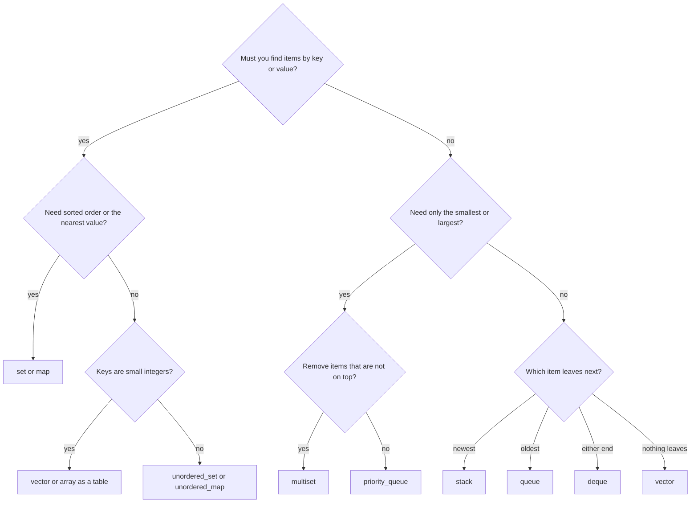
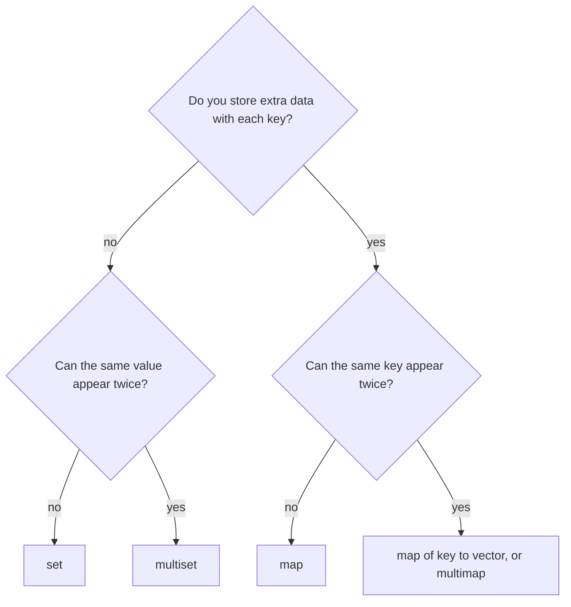

# C++ and the STL for Problem Solving

> **Level:** Beginner · **Priority:** T1 · **Time:** 180 min · **Read first:** [Big-O From Zero](03-big-o-from-zero.md) · **Next:** [How to Solve Any Problem](05-how-to-solve-any-problem.md)

This chapter teaches the C++ you need in a problem-solving round, and nothing more. The STL (Standard Template Library) is the set of ready-made containers and algorithms that comes with C++. Once you know a technique, the next question is which STL tool does the job, so this chapter also teaches you how to choose.

## Quick revision

- Start every program with `#include <bits/stdc++.h>`, `#include <cassert>` and `using namespace std;`.
- `int` holds about 2.1 billion. Use `long long` for sums, products and counts of pairs.
- `size()` is unsigned, so write `(int)v.size()` before you subtract from it or compare it.
- `/` on integers drops the decimal part, and it cuts toward zero. Never compare `double` values with `==`.
- Pass big containers by reference: `const vector<int>&` to read, `vector<int>&` to change.
- `priority_queue` is a max-heap by default. For a min-heap, write `priority_queue<int, vector<int>, greater<int>>`.
- `set` and `map` keep keys sorted, at O(log n) for each operation. They can find the nearest value.
- `unordered_set` and `unordered_map` cost O(1) on average and O(n) in the worst case. They have no order.
- `m[key]` inserts the key if it is missing. To check without inserting, use `m.count(key)` or `m.find(key)`.
- `ms.erase(value)` removes **all** copies from a multiset. `ms.erase(ms.find(value))` removes one.
- `s.lower_bound(x)` on a set is O(log n). `lower_bound(s.begin(), s.end(), x)` on a set is O(n).
- A sort comparator must use `<` or `>`, never `<=` or `>=`.
- `unique` needs sorted input, and you must call `erase` after it.
- Use `accumulate(begin, end, 0LL)`. With plain `0`, the sum is an `int`.
- After `cin >> n`, use `cin >> ws` before `getline`, or you read an empty line.

## How to recognize which tool you need

Do not start from the container. Start from the **operations** the problem needs, then pick the cheapest container that does all of them fast.

Ask these questions in order:

1. Must I find an item by its key or value? If yes, you want a hash table or a sorted container.
2. Do I need sorted order, or the nearest value to some x? If yes, the container must be sorted, so a hash table is out.
3. Do I need the smallest or largest item again and again, while new items arrive? If yes, a heap is enough, and a full sort is wasted work. If you need it only once, `max_element` or `min_element` is enough.
4. Which item leaves next: the newest, the oldest, or either end? That gives a stack, a queue or a deque. If nothing leaves, stay with `vector`.
5. Are the keys small integers, such as letters or values up to 1000? Then a plain `vector` or `array` is the fastest table.



Once you know you need a sorted container, this second tree picks the exact one.



| Words in the problem | What they tell you |
|---|---|
| "contains duplicate", "seen before", "two values that sum to" | Check membership: `unordered_set` or `unordered_map` |
| "frequency", "most common", "number of times" | Count: `unordered_map`, or a `vector` for small keys |
| "lowercase English letters" | The keys are 26 small integers: `array<int, 26>` |
| "group", "same letters", "same key" | `unordered_map` from a key to a `vector` |
| "the next larger value in the set", "closest", "smallest value at least x" | Nearest value: `set` or `map` with `lower_bound` |
| "in sorted order" with inserts and removals between the outputs | `set`, `map` or `multiset` |
| "k largest", "k-th", "most urgent", "lowest available" | `priority_queue` |
| "repeatedly take the two largest" | `priority_queue`, because each new item must find its place |
| "median" | Of a stream: two heaps. Of a window: a `multiset`, because old items must leave |
| "matching brackets", "undo", "most recent" | `stack` |
| "first come, first served", "level by level", "in the last t seconds" | `queue` |
| "maximum of each window" | `deque` as a monotonic queue |
| "update a past value", "correct an old record", then "highest" | `map` plus `multiset` |
| "cell (r, c) visited" | In a grid of known size: a 2D `vector` table. With no fixed bounds: `set` of `pair`, or `unordered_set` with a custom hash |

**Not this tool if:**

| You see | Tempting tool | Use instead | Why |
|---|---|---|---|
| Keys are `'a'` to `'z'` | `unordered_map<char, int>` | `array<int, 26>` | Hashing does extra work for no gain. A direct index is simpler. |
| "next larger value" | `unordered_set` | `set` with `upper_bound` | A hash table has no order, so it cannot find a neighbor. |
| "next greater element" to the right in an array | `set` | `stack` as a [monotonic stack](../05-core-patterns/12-monotonic-stack.md) | The question is about position, not only value. One pass is O(n). |
| "two values that sum to" in a sorted array | `unordered_map` | [Two pointers](../05-core-patterns/01-two-pointers-opposite-ends.md) | The order is already there, so you need no extra memory. |
| One k-th value from data that does not change | `priority_queue` | `nth_element` | It is O(n) on average, and it needs no heap. |
| Only the top item is removed | `set` | `priority_queue` | A heap has less code and handles duplicates. |
| Any item may be removed, not only the top | `priority_queue` | `multiset`, or [lazy deletion](../05-core-patterns/15-two-heaps.md) | A heap cannot remove from the middle. |
| Maximum of a moving window | `priority_queue` | `deque` as a [monotonic queue](../05-core-patterns/13-monotonic-queue.md) | Old items must leave, and a heap cannot remove them directly. The deque does this in O(n) in total. |
| The data never changes after sorting | `set` | sorted `vector` with `lower_bound` | Both are O(log n) for each search, but the vector needs no tree. |
| Repeated `find` on a `vector` | `vector` | `unordered_set` | Each `find` may scan the whole vector, so a loop of them is O(n^2) in the worst case. |

### What each container costs

Here n is the number of items in the container.

| Container | Add | Remove | Find a value | Min or max | Sorted walk |
|---|---|---|---|---|---|
| `vector` | end: O(1) amortized, middle: O(n) | end: O(1), middle: O(n) | O(n), or O(log n) if sorted | O(n), or O(1) if sorted | only after you sort it |
| `deque` | ends: O(1), middle: O(n) | ends: O(1), middle: O(n) | O(n) | O(n) | only after you sort it |
| `stack`, `queue` | O(1) | O(1), next item only | not possible | not possible | no |
| `priority_queue` | O(log n) | O(log n), top only | not possible | top only: O(1) | no |
| `set`, `multiset`, `map`, `multimap` | O(log n) | O(log n) | O(log n) | O(1) | yes |
| `unordered_set`, `unordered_map` | O(1) on average, O(n) worst | O(1) on average, O(n) worst | O(1) on average, O(n) worst | O(n) | no |

Amortized means that one call may be slow, but the average over many calls is O(1). See [Amortized Analysis](07-amortized-analysis.md).

## 1. Setup: compile and run on Windows

Install the g++ compiler once, from PowerShell:

```text
winget install BrechtSanders.WinLibs.POSIX.UCRT
```

Open a new terminal, so that it can find the new program. Then run `g++ --version`. You should see a version number.

Save this as `main.cpp`:

```cpp
#include <bits/stdc++.h>
#include <cassert>
using namespace std;

int main() {
    vector<int> nums = {3, 1, 2};
    sort(nums.begin(), nums.end());
    assert(nums[0] == 1);
    cout << "All tests passed\n";
}
```

Compile it and run it:

```text
g++ -std=c++17 -O2 -Wall -Wextra -o main.exe main.cpp
.\main.exe
```

| Part of the command | Why it is there |
|---|---|
| `-std=c++17` | Use the C++17 rules. All the code in this guide uses them. |
| `-O2` | Make the program run faster. Judges usually do this too. |
| `-Wall -Wextra` | Turn on warnings. A warning is often a real bug, so fix every one. |
| `-o main.exe` | Name the output file. |

Two more commands help you test:

```text
Get-Content input.txt | .\main.exe
g++ -std=c++17 -D_GLIBCXX_DEBUG -o main.exe main.cpp
```

The first feeds a file to your program as input. PowerShell has no `<` for this, so you use the pipe (`|`). The second builds a debug version. It stops with a clear message if you read outside a vector, so use it when your program crashes.

## 2. The first three lines

Every program in this guide starts the same way:

```cpp
#include <bits/stdc++.h>
#include <cassert>
using namespace std;

int main() {
    assert(max(2, 3) == 3);
    cout << "All tests passed\n";
}
```

**`#include <bits/stdc++.h>`** is one header that brings in most of the standard library. You do not need to remember whether `sort` lives in `<algorithm>`. It belongs to GCC and it is not part of standard C++, so some other compilers do not have it. In an interview on a shared editor, it is usually fine. Ask if you are not sure.

**`#include <cassert>`** gives you `assert(condition)`, which stops the program if the condition is false. With GCC 16, `bits/stdc++.h` alone does not give you `assert`. If you leave this line out, you get `'assert' was not declared in this scope`.

**`using namespace std;`** lets you write `vector` and not `std::vector`. It is fine for short interview code. It has one cost: a **global** variable named `count`, `next`, `prev`, `distance` or `hash` clashes with a library name. A local variable with such a name is safe. Keep your variables inside functions and the problem does not appear.

## 3. Numbers

### Integer sizes

| Type | Size on common judges | Largest value | Use it for |
|---|---|---|---|
| `int` | 32 bits | `INT_MAX` = 2,147,483,647 (about 2.1 * 10^9) | Indexes, sizes, small values |
| `long long` | 64 bits | `LLONG_MAX` = 9,223,372,036,854,775,807 (about 9.2 * 10^18) | Sums, products, counts of pairs |
| `size_t` | 64 bits, unsigned | never negative | What `size()` returns |
| `double` | 64 bits | about 15 correct decimal digits | Averages and geometry, only when you must |

Avoid plain `long`. With g++ on Windows it has 32 bits, and on Linux it has 64 bits.

**Overflow** means a value does not fit in its type. For signed types such as `int`, overflow is **undefined behavior**: the C++ rules do not say what happens. You may get a wrong number, or the program may seem to work on your machine and fail on the judge.

Use the constraints in the problem to decide. Say n is up to 10^5 and each value is up to 10^9:

| Quantity | Largest size | Type |
|---|---|---|
| One value | 10^9 | `int` |
| Sum of all values | 10^14 | `long long` |
| Product of two values | 10^18 | `long long` |
| Number of pairs, n * (n - 1) / 2 | about 5 * 10^9 | `long long` |

[Constraints Tell You the Algorithm](../01-pattern-recognition/02-constraints-tell-you-the-algorithm.md) uses the same habit to choose an algorithm.

Here is the classic mistake:

```cpp snippet
int a = 100000, b = 100000;
long long area = a * b;  // wrong: a * b overflows as int, before the assignment
```

The type on the left does not help, because C++ computes `a * b` first, using `int`. Make one side `long long` before you multiply:

```cpp
#include <bits/stdc++.h>
#include <cassert>
using namespace std;

int main() {
    int a = 100000, b = 100000;
    long long area = 1LL * a * b;  // 1LL forces the whole product into long long
    assert(area == 10000000000LL);

    assert(INT_MAX == 2147483647);
    assert(LLONG_MAX == 9223372036854775807LL);

    // left + right would overflow here, but right - left does not.
    int left = 2000000000, right = 2100000000;
    int mid = left + (right - left) / 2;
    assert(mid == 2050000000);

    // An "infinity" that is safe to add to itself: 2 * 10^9 still fits in int.
    const int INF = 1000000000;
    assert(INF + INF < INT_MAX);

    const int MOD = 1000000007;  // the usual modulus when answers are huge
    long long big = 1LL * (MOD - 1) * (MOD - 1) % MOD;
    assert(big == 1);  // (-1) * (-1) = 1 when you work modulo MOD
    cout << "All tests passed\n";
}
```

### The unsigned `size_t` trap

`size()` returns `size_t`, which can never be negative. If you go below zero, it wraps around to a huge number.

```cpp
#include <bits/stdc++.h>
#include <cassert>
using namespace std;

int main() {
    vector<int> empty;
    // 0 - 1 wraps to the largest size_t, not -1.
    assert(empty.size() - 1 == numeric_limits<size_t>::max());
    // Casting first gives the -1 you wanted.
    assert((int)empty.size() - 1 == -1);

    // A loop over neighbors that is safe on an empty vector.
    int loops = 0;
    for (int i = 0; i < (int)empty.size() - 1; i++) loops++;
    assert(loops == 0);
    cout << "All tests passed\n";
}
```

With `i < empty.size() - 1`, that loop would run far past the end of the vector.

### Division and remainder

```cpp
#include <bits/stdc++.h>
#include <cassert>
using namespace std;

int main() {
    assert(7 / 2 == 3);     // the decimal part is dropped
    assert(-7 / 2 == -3);   // cut toward zero, not down to -4
    assert(-7 % 3 == -1);   // the remainder takes the sign of the left number

    // Python-style remainder, always in 0 to m - 1.
    int m = 3;
    assert(((-7 % m) + m) % m == 2);

    // Round up: how many boxes of 3 hold 7 items? Positive numbers only.
    int items = 7, perBox = 3;
    assert((items + perBox - 1) / perBox == 3);

    assert((double)7 / 2 == 3.5);  // cast before dividing, or you divide integers
    cout << "All tests passed\n";
}
```

### Comparing floating point numbers

A `double` stores most decimals only roughly, so `0.1 + 0.2` is not exactly `0.3`. Compare with a small tolerance. When you can, stay with integers: write `1LL * i * i <= n` and not `i <= sqrt(n)`. The `1LL` stops the product from overflowing.

```cpp
#include <bits/stdc++.h>
#include <cassert>
using namespace std;

int main() {
    double x = 0.1 + 0.2;
    assert(x != 0.3);               // a direct compare fails
    assert(fabs(x - 0.3) < 1e-9);   // close enough counts as equal
    cout << "All tests passed\n";
}
```

## 4. vector, string, array, pair and tuple

### vector

A `vector` is an array that can grow. It is your default container. Reach for another one only when a section of this chapter gives you a reason.

```cpp
#include <bits/stdc++.h>
#include <cassert>
using namespace std;

int main() {
    vector<int> nums = {4, 2, 7};
    nums.push_back(9);                 // [4, 2, 7, 9]
    nums.pop_back();                   // [4, 2, 7]
    assert(nums.front() == 4 && nums.back() == 7);

    nums.insert(nums.begin() + 1, 5);  // [4, 5, 2, 7], O(n): items shift right
    nums.erase(nums.begin());          // [5, 2, 7], O(n): items shift left
    assert(nums == vector<int>({5, 2, 7}));

    vector<int> table(3, 0);           // [0, 0, 0]
    table.resize(5, 1);                // [0, 0, 0, 1, 1]
    assert(table == vector<int>({0, 0, 0, 1, 1}));

    int rows = 2, cols = 3;
    vector<vector<int>> grid(rows, vector<int>(cols, 0));
    grid[1][2] = 8;
    assert(grid[1][2] == 8 && grid[0][2] == 0);
    assert((int)grid.size() == 2 && (int)grid[0].size() == 3);

    nums.clear();
    assert(nums.empty());
    cout << "All tests passed\n";
}
```

### string

A `string` works like a `vector<char>` with extra helpers. [Section 11](#11-string-helpers) lists those helpers.

```cpp
#include <bits/stdc++.h>
#include <cassert>
using namespace std;

int main() {
    string s = "cab";
    s += 'd';                  // "cabd", O(1) amortized
    s.pop_back();              // "cab"
    assert(s.back() == 'b' && (int)s.size() == 3);

    // Letters and digits are small integers, so they can be indexes.
    assert('c' - 'a' == 2);
    assert('7' - '0' == 7);

    assert(string("apple") < string("banana"));  // dictionary order
    cout << "All tests passed\n";
}
```

Write `s += c`, not `s = s + c`. The second form builds a whole new string, so a loop of them costs O(n^2).

### array

`array<int, 26>` has a fixed size, known when you compile. The `{}` sets every entry to zero. It compares with `==`, and it can be a `map` key. That makes it a good frequency table for words, as in [Valid Anagram](https://leetcode.com/problems/valid-anagram/) and [Group Anagrams](https://leetcode.com/problems/group-anagrams/).

```cpp
#include <bits/stdc++.h>
#include <cassert>
using namespace std;

int main() {
    array<int, 26> first{}, second{};
    for (char c : string("listen")) first[c - 'a']++;
    for (char c : string("silent")) second[c - 'a']++;
    assert(first == second);  // same letters, same counts

    map<array<int, 26>, vector<string>> groups;
    groups[first].push_back("listen");
    groups[second].push_back("silent");
    assert((int)groups.size() == 1 && (int)groups[first].size() == 2);
    cout << "All tests passed\n";
}
```

### pair, tuple and structured bindings

A `pair` holds two values and a `tuple` holds any fixed number. Both compare by the first item, then the second, and so on. This is why a `vector<pair<int, int>>` sorts with no extra code. A **structured binding** unpacks one into named variables.

```cpp
#include <bits/stdc++.h>
#include <cassert>
using namespace std;

int main() {
    vector<pair<int, string>> scores = {{90, "cat"}, {70, "bob"}, {90, "amy"}};
    sort(scores.begin(), scores.end());  // by number, then by name for ties
    assert(scores[0].second == "bob" && scores[1].second == "amy");

    auto [points, name] = scores[2];
    assert(points == 90 && name == "cat");

    tuple<int, int, int> cell = {5, 1, 2};  // {distance, row, col}
    assert(get<0>(cell) == 5);
    auto [distance, row, col] = cell;
    assert(distance + row + col == 8);
    cout << "All tests passed\n";
}
```

## 5. Pass by reference

Passing a container by value copies all of it. Passing it by reference gives the function the same container, with no copy.

| Parameter | Copies? | Can it change the caller's data? | Use it when |
|---|---|---|---|
| `vector<int> nums` | yes, O(n) | no | You need your own copy |
| `vector<int>& nums` | no | yes | The function must change it |
| `const vector<int>& nums` | no | no | The function only reads it |

```cpp
#include <bits/stdc++.h>
#include <cassert>
using namespace std;

void changeCopy(vector<int> nums) {
    nums[0] = 99;  // changes the copy, which disappears when the function ends
}

void changeReal(vector<int>& nums) {
    nums[0] = 99;
}

int main() {
    vector<int> nums = {1, 2, 3};
    changeCopy(nums);
    assert(nums[0] == 1);
    changeReal(nums);
    assert(nums[0] == 99);

    for (int& x : nums) x *= 2;  // x is the real item, so nums changes
    assert(nums[1] == 4);
    cout << "All tests passed\n";
}
```

The same rule applies in a loop. With `for (int x : nums)`, each `x` is a copy, so changing it does not change `nums`. With `for (int& x : nums)`, each `x` is the real item. For strings, write `for (const string& word : words)`, so that you read each word with no copy.

This matters most in recursion. A recursive binary search that takes the vector by value copies it at every call. It becomes O(n log n) when it should be O(log n).

## 6. stack, queue, deque and priority_queue

### stack: the newest item leaves first

Think of a stack of plates. You add to the top and you take from the top.

```text
push(1)     bottom [1] top
push(2)     bottom [1, 2] top
top() -> 2  no change
pop()       bottom [1] top
```

```cpp
#include <bits/stdc++.h>
#include <cassert>
using namespace std;

int main() {
    stack<int> plates;
    plates.push(1);
    plates.push(2);
    assert(plates.top() == 2);

    // pop() returns nothing, so read top() first.
    int newest = plates.top();
    plates.pop();
    assert(newest == 2 && plates.top() == 1 && (int)plates.size() == 1);

    plates.pop();
    assert(plates.empty());  // calling top() now would be undefined behavior
    cout << "All tests passed\n";
}
```

The clue is "the most recent thing that is still open". [Valid Parentheses](https://leetcode.com/problems/valid-parentheses/) and [Evaluate Reverse Polish Notation](https://leetcode.com/problems/evaluate-reverse-polish-notation/) both have it. See [Stack From Zero](../03-linked-lists-stacks-queues/05-stack-from-zero.md).

### queue: the oldest item leaves first

Think of a line at a bank. People join at the back and leave from the front.

```text
push(1)       front [1] back
push(2)       front [1, 2] back
front() -> 1  no change
pop()         front [2] back
```

```cpp
#include <bits/stdc++.h>
#include <cassert>
using namespace std;

int main() {
    queue<int> line;
    line.push(1);
    line.push(2);
    assert(line.front() == 1 && line.back() == 2);
    line.pop();
    assert(line.front() == 2);
    cout << "All tests passed\n";
}
```

The clue is "in arrival order". [Number of Recent Calls](https://leetcode.com/problems/number-of-recent-calls/) drops the oldest times, and [Rotting Oranges](https://leetcode.com/problems/rotting-oranges/) spreads level by level, which is [BFS](../08-graphs/02-bfs-and-dfs.md). See [Queue From Zero](../03-linked-lists-stacks-queues/07-queue-from-zero.md).

### deque: both ends

A `deque` (say "deck") adds and removes at both ends in O(1). It also lets you read any index.

```cpp
#include <bits/stdc++.h>
#include <cassert>
using namespace std;

int main() {
    deque<int> dq = {2, 3};
    dq.push_front(1);  // [1, 2, 3]
    dq.push_back(4);   // [1, 2, 3, 4]
    dq.pop_front();    // [2, 3, 4]
    dq.pop_back();     // [2, 3]
    assert(dq.front() == 2 && dq.back() == 3 && dq[1] == 3);
    cout << "All tests passed\n";
}
```

The clue is "items leave from both sides". [Sliding Window Maximum](https://leetcode.com/problems/sliding-window-maximum/) removes old items from the front and useless items from the back. See [Deque: Double-Ended Queue](../03-linked-lists-stacks-queues/09-deque.md).

### priority_queue: the most important item leaves first

Think of a hospital emergency room. The most urgent patient goes first, not the one who came first. A `priority_queue` is a **heap**: a structure that always keeps its top item ready. [Heaps and Priority Queues From Zero](../07-trees/11-heap-from-zero.md) shows how it works inside.

By default, the largest value is on top (a **max-heap**). For the smallest on top (a **min-heap**), you must spell out three types.

```cpp
#include <bits/stdc++.h>
#include <cassert>
using namespace std;

struct Task {
    int deadline;
    string name;
};

int main() {
    priority_queue<int> maxHeap;
    for (int x : {3, 8, 5}) maxHeap.push(x);
    assert(maxHeap.top() == 8);
    maxHeap.pop();
    assert(maxHeap.top() == 5);

    priority_queue<int, vector<int>, greater<int>> minHeap;
    for (int x : {3, 8, 5}) minHeap.push(x);
    assert(minHeap.top() == 3);

    // Pairs compare by first, so {distance, node} gives the nearest node.
    priority_queue<pair<int, int>, vector<pair<int, int>>, greater<pair<int, int>>> nearest;
    nearest.push({5, 1});
    nearest.push({2, 7});
    assert(nearest.top().second == 7);

    // true means "a has lower priority than b", so a later deadline sinks.
    auto lowerPriority = [](const Task& a, const Task& b) { return a.deadline > b.deadline; };
    priority_queue<Task, vector<Task>, decltype(lowerPriority)> tasks(lowerPriority);
    tasks.push({30, "report"});
    tasks.push({10, "email"});
    assert(tasks.top().name == "email");
    cout << "All tests passed\n";
}
```

The comparator feels backwards. The heap keeps the item that your comparator calls largest on top. So `a.deadline > b.deadline` calls a later deadline smaller, and the earliest deadline rises.

A heap can only show the top item. It cannot search, and it cannot remove from the middle. To keep the k largest values, keep a min-heap of size k: the smallest of the k is on top, ready to be pushed out. That is the idea in [Top K With Heaps](../05-core-patterns/14-top-k-and-heaps.md), used in [Kth Largest Element in an Array](https://leetcode.com/problems/kth-largest-element-in-an-array/).

## 7. Sorted containers: set, multiset, map and multimap

These four keep their keys sorted, using a balanced tree. See [Binary Search Trees From Zero](../07-trees/06-bst-from-zero.md) for the idea. Every insert, erase and search costs O(log n). What you get for that cost is order, so you can ask "what is the nearest value?". There is one exception to that cost. On a `multiset` or `multimap`, `count(x)` and `erase(x)` also pay for each copy of x, so they cost O(log n + k), where k is the number of copies.

Use these three questions on the set `{1, 5, 9}`:

```text
lower_bound(5)  -> 5    first value >= 5
upper_bound(5)  -> 9    first value >  5
lower_bound(6)  -> 9    first value >= 6
lower_bound(10) -> end  no such value
```

### set and multiset

A `set` keeps one copy of each value. A `multiset` keeps every copy.

```cpp
#include <bits/stdc++.h>
#include <cassert>
using namespace std;

int main() {
    set<int> values = {5, 1, 9};
    values.insert(5);  // already there, so nothing changes
    assert((int)values.size() == 3);
    assert(*values.begin() == 1);   // smallest
    assert(*values.rbegin() == 9);  // largest

    assert(*values.lower_bound(5) == 5);
    assert(*values.upper_bound(5) == 9);
    assert(values.lower_bound(10) == values.end());  // check this before you use *

    // Largest value <= 6: find the first value above 6, then step back one.
    auto above = values.upper_bound(6);
    assert(above != values.begin());  // if equal, no value is <= 6
    assert(*prev(above) == 5);

    values.erase(1);
    assert(values.count(1) == 0);

    multiset<int> copies = {2, 2, 2, 7};
    copies.erase(copies.find(2));  // removes one copy
    assert(copies.count(2) == 2);
    copies.erase(2);               // removes every copy
    assert(copies.count(2) == 0 && (int)copies.size() == 1);
    cout << "All tests passed\n";
}
```

To remove one copy safely when the value may be missing, check first. Calling `erase` on `end()` is undefined behavior.

```cpp snippet
auto it = copies.find(value);
if (it != copies.end()) copies.erase(it);
```

### map and multimap

A `map` stores key and value pairs, sorted by key. Each key appears once. The walk goes from the smallest key to the largest.

```cpp
#include <bits/stdc++.h>
#include <cassert>
using namespace std;

int main() {
    map<string, int> ages;
    ages["bob"] = 30;
    ages["amy"] = 25;
    assert(ages.begin()->first == "amy");  // sorted by key

    assert(ages.count("zed") == 0);        // count() does not insert
    assert((int)ages.size() == 2);

    int missing = ages["zed"];             // [] creates "zed" with value 0
    assert(missing == 0 && (int)ages.size() == 3);

    auto it = ages.find("bob");            // find() does not insert either
    assert(it != ages.end() && it->second == 30);

    vector<string> names;
    for (const auto& [name, age] : ages) {
        if (age > 0) names.push_back(name);
    }
    assert(names == vector<string>({"amy", "bob"}));

    // Remove while you walk: erase returns the next position.
    for (auto pos = ages.begin(); pos != ages.end();) {
        if (pos->second == 0) pos = ages.erase(pos);
        else ++pos;
    }
    assert(ages.count("zed") == 0);

    multimap<int, string> byScore;  // no [] here, because a key is not unique
    byScore.insert({90, "amy"});
    byScore.insert({70, "cat"});
    byScore.insert({90, "bob"});
    assert(byScore.count(90) == 2);

    auto [first, last] = byScore.equal_range(90);
    vector<string> top;
    for (auto pos = first; pos != last; ++pos) top.push_back(pos->second);
    assert(top == vector<string>({"amy", "bob"}));  // equal keys keep insertion order
    cout << "All tests passed\n";
}
```

A `map<int, vector<string>>` does the same job as a `multimap` and is often easier to read.

The classic use is a problem that mixes updates with "nearest" or "largest" questions. [My Calendar I](https://leetcode.com/problems/my-calendar-i/) checks the bookings on each side of a new one. [Stock Price Fluctuation](https://leetcode.com/problems/stock-price-fluctuation/) and [Sliding Window Median](https://leetcode.com/problems/sliding-window-median/) can both use a multiset, and they must remove only one copy of a value. See [Ordered Set Patterns](../05-core-patterns/19-ordered-set-patterns.md).

## 8. Hash containers: unordered_set and unordered_map

These use a hash table. A **hash table** turns each key into a position with a formula, so it can jump straight to the key. [Hash Tables From Zero](../02-arrays-strings-hashing/03-hash-tables-from-zero.md) explains it. Operations cost O(1) on average and O(n) in the worst case. The order of the keys is not useful, so you must not depend on it.

```cpp
#include <bits/stdc++.h>
#include <cassert>
using namespace std;

int main() {
    unordered_set<int> seen;
    assert(seen.insert(4).second == true);   // .second says whether it was new
    assert(seen.insert(4).second == false);  // a duplicate
    assert(seen.count(4) == 1 && seen.count(5) == 0);

    unordered_map<string, int> counts;
    vector<string> words = {"a", "b", "a"};
    for (const string& word : words) {
        counts[word]++;  // here [] is what you want: a new key starts at 0
    }
    assert(counts["a"] == 2 && counts["b"] == 1);
    cout << "All tests passed\n";
}
```

The two uses you will meet most are "have I seen this?", as in [Contains Duplicate](https://leetcode.com/problems/contains-duplicate/), and "where did I see it?", as in [Two Sum](https://leetcode.com/problems/two-sum/).

### Custom hash for a pair

C++ has no built-in hash for `pair`. If you write `unordered_set<pair<int, int>>`, you get a long error that includes `use of deleted function`. You have three ways out.

1. Use `set<pair<int, int>>`. It needs no hash, and the code is shortest.
2. Turn the cell into one number: `row * cols + col`. This works only when `col` is always from 0 to `cols - 1`. Otherwise two cells can share a number. Use `long long` if the product can pass 2 billion.
3. Write a hash, as shown here.

```cpp
#include <bits/stdc++.h>
#include <cassert>
using namespace std;

struct PairHash {
    size_t operator()(const pair<int, int>& p) const {
        // Place the two 32-bit parts side by side, so that {1, 2} and {2, 1} differ.
        unsigned long long high = (unsigned int)p.first;
        unsigned long long low = (unsigned int)p.second;
        return hash<unsigned long long>()((high << 32) | low);
    }
};

int main() {
    unordered_set<pair<int, int>, PairHash> visited;
    visited.insert({1, 2});
    visited.insert({2, 1});
    visited.insert({1, 2});  // a duplicate
    assert((int)visited.size() == 2);
    assert(visited.count(make_pair(1, 2)) == 1);
    assert(visited.count(make_pair(-1, 5)) == 0);  // negative numbers work too

    unordered_map<pair<int, int>, int, PairHash> steps;
    pair<int, int> cell = {0, 3};
    steps[cell] = 7;
    assert(steps[cell] == 7);
    cout << "All tests passed\n";
}
```

### Which one: hash or sorted?

| Question | Choose |
|---|---|
| Do you need order, or the nearest value? | `set` or `map`. A hash table cannot do this. |
| Do you need only "is it there?" or "how many?" | `unordered_set` or `unordered_map` |
| Is the key a `pair`, a `vector` or an `array`? | `set` or `map` work with no extra code |
| Does the judge report Time Limit Exceeded on an `unordered_map`? | Try `map`. The tests may be built so that many keys land in one position, which causes the O(n) worst case. |
| Are the keys small integers? | `vector<int>`. No hashing is needed. |

Your own `struct` needs extra code in both kinds. A `set` or `map` needs an `operator<`. An unordered container needs a hash and an `operator==`.

## 9. Algorithms

Most of these take a **range**: two positions, `begin` and `end`. The range includes `begin` and stops just before `end`. So `nums.begin() + 2` means "index 2", and a function that returns a position gives an index when you subtract `begin()`.

### Sorting and removing duplicates

```cpp
#include <bits/stdc++.h>
#include <cassert>
using namespace std;

int main() {
    vector<int> nums = {5, 2, 9, 2};
    sort(nums.begin(), nums.end());                  // [2, 2, 5, 9]
    sort(nums.begin(), nums.end(), greater<int>());  // [9, 5, 2, 2]
    reverse(nums.begin(), nums.end());               // [2, 2, 5, 9]

    // unique only removes neighbors, so sort first. It moves the kept items
    // forward and returns where they end, so erase the leftovers.
    nums.erase(unique(nums.begin(), nums.end()), nums.end());
    assert(nums == vector<int>({2, 5, 9}));

    // The lambda answers: must a come before b?
    vector<pair<string, int>> people = {{"amy", 30}, {"bob", 25}, {"cat", 30}};
    stable_sort(people.begin(), people.end(), [](const auto& a, const auto& b) {
        return a.second > b.second;  // older first
    });
    // amy and cat tie. stable_sort keeps their original order.
    assert(people[0].first == "amy" && people[1].first == "cat" && people[2].first == "bob");

    // Two rules: more uses first, then dictionary order for ties.
    vector<pair<string, int>> words = {{"pear", 2}, {"fig", 5}, {"apple", 2}};
    sort(words.begin(), words.end(), [](const auto& a, const auto& b) {
        if (a.second != b.second) return a.second > b.second;
        return a.first < b.first;
    });
    assert(words[0].first == "fig" && words[1].first == "apple" && words[2].first == "pear");
    cout << "All tests passed\n";
}
```

`sort` costs O(n log n). It may reorder equal items, and `stable_sort` will not. The comparator must be strict: it returns false for two equal items. [Sorting With a Custom Order](../04-sorting-searching/05-custom-sorting.md) goes deeper. Try it on [Top K Frequent Words](https://leetcode.com/problems/top-k-frequent-words/) and [Largest Number](https://leetcode.com/problems/largest-number/).

### Searching a sorted range

```text
nums       = [1, 3, 3, 5]
index        0  1  2  3
lower_bound(3) -> index 1   first value >= 3
upper_bound(3) -> index 3   first value >  3
```

```cpp
#include <bits/stdc++.h>
#include <cassert>
using namespace std;

int main() {
    vector<int> nums = {1, 3, 3, 5};
    auto low = lower_bound(nums.begin(), nums.end(), 3);
    auto high = upper_bound(nums.begin(), nums.end(), 3);
    assert(low - nums.begin() == 1);
    assert(high - nums.begin() == 3);
    assert(high - low == 2);  // how many 3s there are

    assert(binary_search(nums.begin(), nums.end(), 5));
    assert(!binary_search(nums.begin(), nums.end(), 4));
    assert(lower_bound(nums.begin(), nums.end(), 9) == nums.end());  // nothing >= 9
    cout << "All tests passed\n";
}
```

All three cost O(log n) on a sorted `vector`. They give wrong answers on unsorted data, with no error. The two positions above nearly solve [Find First and Last Position of Element in Sorted Array](https://leetcode.com/problems/find-first-and-last-position-of-element-in-sorted-array/). If the value is present, the first position is `low` and the last is `high - 1`. [Binary Search Basics](../04-sorting-searching/06-binary-search-basics.md) shows how to write them by hand.

### Scanning and filling

```cpp
#include <bits/stdc++.h>
#include <cassert>
using namespace std;

int main() {
    vector<int> nums = {4, 9, 1, 9};
    assert(*max_element(nums.begin(), nums.end()) == 9);  // returns a position, so use *
    assert(*min_element(nums.begin(), nums.end()) == 1);
    assert(max_element(nums.begin(), nums.end()) - nums.begin() == 1);  // first 9

    long long total = accumulate(nums.begin(), nums.end(), 0LL);  // 0LL sets the sum type
    assert(total == 23);

    assert(count(nums.begin(), nums.end(), 9) == 2);
    assert(find(nums.begin(), nums.end(), 1) - nums.begin() == 2);
    assert(find(nums.begin(), nums.end(), 7) == nums.end());  // not found

    vector<int> order(4);
    iota(order.begin(), order.end(), 0);  // [0, 1, 2, 3]

    // Sort indexes by their values, and leave nums itself alone.
    stable_sort(order.begin(), order.end(), [&](int a, int b) { return nums[a] < nums[b]; });
    assert(order == vector<int>({2, 0, 1, 3}));

    fill(order.begin(), order.end(), -1);
    assert(order == vector<int>({-1, -1, -1, -1}));
    cout << "All tests passed\n";
}
```

All of these are O(n), apart from the sort. On an empty range, `max_element` returns `end()`, so using `*` on it is undefined behavior. Check `empty()` first.

### Rearranging

```cpp
#include <bits/stdc++.h>
#include <cassert>
using namespace std;

int main() {
    // next_permutation steps through orders in dictionary order.
    // It returns false after the last one, so start from the sorted order.
    string word = "abc";
    vector<string> orders;
    do {
        orders.push_back(word);
    } while (next_permutation(word.begin(), word.end()));
    assert((int)orders.size() == 6);
    assert(orders[1] == "acb" && orders[5] == "cba");

    // Puts the value that a full sort would place at index 2 there. Sorted: 1 3 5 7 9.
    vector<int> nums = {7, 1, 5, 3, 9};
    nth_element(nums.begin(), nums.begin() + 2, nums.end());
    assert(nums[2] == 5);

    // Sorts only the first 2 places.
    vector<int> front = {7, 1, 5, 3, 9};
    partial_sort(front.begin(), front.begin() + 2, front.end());
    assert(front[0] == 1 && front[1] == 3);

    // The item at the middle position becomes the new first item.
    vector<int> ring = {1, 2, 3, 4, 5};
    rotate(ring.begin(), ring.begin() + 2, ring.end());
    assert(ring == vector<int>({3, 4, 5, 1, 2}));

    // Moves items that pass the test to the front. Returns where the rest begin.
    vector<int> mixed = {1, 2, 3, 4, 5, 6};
    auto rest = partition(mixed.begin(), mixed.end(), [](int x) { return x % 2 == 0; });
    assert(rest - mixed.begin() == 3);
    for (int i = 0; i < 3; i++) assert(mixed[i] % 2 == 0);
    cout << "All tests passed\n";
}
```

| Function | Cost | Use it for |
|---|---|---|
| `next_permutation` | O(n) per step, at most n! steps in all | Trying every order when n is about 10 or less |
| `nth_element` | O(n) on average | The k-th smallest, or the median. See [Quickselect](../04-sorting-searching/03-quick-sort-and-quickselect.md) |
| `partial_sort` | O(n log k) | The smallest k items, in order |
| `rotate` | O(n) | [Rotate Array](https://leetcode.com/problems/rotate-array/). To rotate right by k, first do `k %= n`, then pass `end() - k` as the middle |
| `partition` | O(n) | Splitting items in two groups. Order inside a group may change |

### gcd and lcm

`gcd` (greatest common divisor) is the largest number that divides both inputs. `lcm` (least common multiple) is the smallest positive number that both inputs divide. The result of `lcm` can be much bigger than the inputs, so pass `long long`.

```cpp
#include <bits/stdc++.h>
#include <cassert>
using namespace std;

int main() {
    assert(gcd(12, 18) == 6);
    assert(gcd(0, 5) == 5);  // every number divides 0
    assert(lcm(4, 6) == 12);
    assert(lcm(100000LL, 99999LL) == 9999900000LL);  // too big for int
    cout << "All tests passed\n";
}
```

[Number Basics](../11-math-geometry-games/01-number-basics.md) explains how `gcd` works.

## 10. Bit helpers

A **bit** is a 0 or a 1, and a number is stored as a row of bits. For example, 13 is `1101` in binary. These helpers answer common questions about that row. The ones that start with `__builtin` belong to GCC and Clang, not to standard C++.

```cpp
#include <bits/stdc++.h>
#include <cassert>
using namespace std;

int main() {
    assert(__builtin_popcount(13) == 3);       // 1101 has three 1 bits
    assert(__builtin_ctz(12) == 2);            // 1100 has two 0 bits on the right
    assert(__builtin_clz(1) == 31);            // 31 zeros on the left, in 32 bits
    assert(31 - __builtin_clz(13) == 3);       // the highest 1 bit of 1101 is bit 3

    // For long long, add ll to the name.
    assert(__builtin_popcountll(1LL << 40) == 1);
    assert(__builtin_ctzll(1LL << 40) == 40);

    bitset<8> bits(13);
    assert(bits.to_string() == "00001101");
    assert(bits.count() == 3);
    assert(bits.test(0) && !bits.test(1));     // bit 0 is the rightmost
    bits.set(1);                               // 00001111
    assert(bits.to_ulong() == 15);
    cout << "All tests passed\n";
}
```

`__builtin_clz(0)` and `__builtin_ctz(0)` are undefined, so check for zero first. [Number of 1 Bits](https://leetcode.com/problems/number-of-1-bits/) is a one-line `__builtin_popcount`, although an interviewer may ask you to write it by hand. See [Bit Manipulation](../05-core-patterns/17-bit-manipulation.md).

## 11. String helpers

```cpp
#include <bits/stdc++.h>
#include <cassert>
using namespace std;

vector<string> splitBySpace(const string& line) {
    stringstream stream(line);
    vector<string> words;
    string word;
    while (stream >> word) words.push_back(word);  // >> skips any number of spaces
    return words;
}

vector<string> splitBy(const string& line, char separator) {
    stringstream stream(line);
    vector<string> parts;
    string part;
    while (getline(stream, part, separator)) parts.push_back(part);
    return parts;
}

int main() {
    string s = "hello world";
    assert(s.substr(6) == "world");            // from index 6 to the end
    assert(s.substr(0, 5) == "hello");         // start and LENGTH, not start and end
    assert(s.find("o") == 4);
    assert(s.find("o", 5) == 7);               // search from index 5
    assert(s.find("xyz") == string::npos);     // npos means not found

    assert(stoi("42") == 42);
    assert(stoi("-7") == -7);
    assert(stoll("10000000000") == 10000000000LL);
    assert(to_string(305) == "305");

    // These helpers expect an unsigned char.
    assert(isdigit((unsigned char)'5'));
    assert(isalpha((unsigned char)'x'));
    assert(!isalpha((unsigned char)'5'));
    assert(tolower((unsigned char)'A') == 'a');

    assert(splitBySpace("  the  sky is ") == vector<string>({"the", "sky", "is"}));
    assert(splitBy("a,b,,c", ',') == vector<string>({"a", "b", "", "c"}));  // keeps the empty part
    assert(splitBy("a,", ',') == vector<string>({"a"}));  // but not one at the very end
    cout << "All tests passed\n";
}
```

- `substr` copies the text, so it costs O(length). A loop of `substr` calls can make your code O(n^2).
- `stoi` throws an error on text such as `"abc"`, and on a number too big for `int`. It also stops at the first bad character, so `stoi("12abc")` gives 12 with no error. So it is the wrong tool for [String to Integer (atoi)](https://leetcode.com/problems/string-to-integer-atoi/), where you must handle bad input yourself.
- `stringstream` makes [Reverse Words in a String](https://leetcode.com/problems/reverse-words-in-a-string/) short, because `>>` deals with the extra spaces.

More in [Strings From Zero](../02-arrays-strings-hashing/02-strings-from-zero.md) and [String Parsing and Log Processing](../02-arrays-strings-hashing/07-string-parsing-and-log-processing.md).

## 12. Lambdas

A **lambda** is a small function that you write inside another function. You have already seen them as sort comparators. The part in square brackets says what it can use from outside.

| Capture | Meaning |
|---|---|
| `[]` | Uses nothing from outside |
| `[&]` | Uses outside variables by reference, so it can change them |
| `[base]` | Takes a copy of `base`, at the moment the lambda is made |

A lambda cannot call itself by name if you declare it with `auto`. You get `use of 'dfs' before deduction of 'auto'`, because its type is not known yet. For recursion, declare it as a `std::function` and capture with `[&]`. The type `function<int(int)>` means "takes an int, returns an int".

```cpp
#include <bits/stdc++.h>
#include <cassert>
using namespace std;

int main() {
    auto square = [](int x) { return x * x; };
    assert(square(4) == 16);

    int calls = 0;
    auto record = [&]() { calls++; };
    record();
    record();
    assert(calls == 2);

    int base = 10;
    auto addBase = [base](int x) { return x + base; };
    base = 100;                  // the lambda keeps its own copy, which is 10
    assert(addBase(1) == 11);

    // A tree: node 0 has children 1 and 2, and node 1 has child 3.
    vector<vector<int>> children = {{1, 2}, {3}, {}, {}};
    function<int(int)> subtreeSize = [&](int node) {
        int total = 1;
        for (int child : children[node]) total += subtreeSize(child);
        return total;
    };
    assert(subtreeSize(0) == 4);
    assert(subtreeSize(1) == 2);
    assert(subtreeSize(3) == 1);
    cout << "All tests passed\n";
}
```

This is handy in DFS, because the lambda can see the graph and the visited table with no long parameter list. Calling a `std::function` costs a little more than calling a normal function, so if a deep recursion is too slow, move it to a normal member function.

## 13. Fast input and output

By default, `cin` and `cout` are slow when you read or print a lot, such as 10^5 lines or more. Two lines at the top of `main` fix this.

```cpp
#include <bits/stdc++.h>
#include <cassert>
using namespace std;

int main() {
    ios::sync_with_stdio(false);  // stop keeping cin and cout in step with scanf and printf
    cin.tie(nullptr);             // stop flushing cout before each read from cin
    for (int i = 1; i <= 3; i++) cout << i << '\n';
}
```

```text output
1
2
3
```

- After these lines, do not mix `cin` or `cout` with `scanf` or `printf`.
- Print `'\n'`, not `endl`. `endl` also flushes the output each time, which is slow in a big loop.
- On LeetCode you do not need any of this, because you only write a function.
- In [interactive problems](../05-core-patterns/23-interactive-problems.md), you must flush after each question, so `endl` is right there.

## 14. Reading every input format

On LeetCode, you write a function and the input arrives as parameters. Many HackerRank tasks work the same way. Other tasks, and many online assessments, give you an empty `main` and text on standard input, so you must read it yourself.

There is a neat habit that makes this testable: write your reader as a function that takes an `istream&`. An **istream** is anything you can read from, such as `cin` or a string. On the judge you pass `cin`. While you test, you pass a string with `istringstream`, so you do not need to type the input each time.

These programs show the common formats. `>>` skips spaces and line ends, so the layout of the numbers does not matter to it.

```cpp
#include <bits/stdc++.h>
#include <cassert>
using namespace std;

// Format 1: a count, then that many numbers.
long long readListAndSum(istream& in) {
    int n;
    in >> n;
    long long total = 0;
    for (int i = 0; i < n; i++) {
        long long value;
        in >> value;
        total += value;
    }
    return total;
}

// Format 2: t test cases, each with its own count and numbers.
vector<int> readCasesAndMax(istream& in) {
    int testCases;
    in >> testCases;
    vector<int> answers;
    while (testCases--) {
        int n;
        in >> n;
        int best = INT_MIN;
        for (int i = 0; i < n; i++) {
            int value;
            in >> value;
            best = max(best, value);
        }
        answers.push_back(best);
    }
    return answers;
}

// Format 3: no count. Read until the input ends.
int countUntilEnd(istream& in) {
    int value, howMany = 0;
    while (in >> value) howMany++;  // >> fails at the end of input, which stops the loop
    return howMany;
}

// Format 4: a grid of numbers.
vector<vector<int>> readGrid(istream& in) {
    int rows, cols;
    in >> rows >> cols;
    vector<vector<int>> grid(rows, vector<int>(cols));
    for (auto& row : grid) {
        for (int& cell : row) in >> cell;
    }
    return grid;
}

// Format 5: a grid of characters, one row on each line with no spaces.
vector<string> readCharGrid(istream& in) {
    int rows;
    in >> rows;
    vector<string> grid(rows);
    for (string& row : grid) in >> row;
    return grid;
}

// Format 6: an undirected graph as a list of edges.
vector<vector<int>> readGraph(istream& in) {
    int nodes, edges;
    in >> nodes >> edges;
    vector<vector<int>> adjacent(nodes);
    for (int i = 0; i < edges; i++) {
        int a, b;
        in >> a >> b;
        a--;  // the input counts from 1, but indexes count from 0
        b--;
        adjacent[a].push_back(b);
        adjacent[b].push_back(a);
    }
    return adjacent;
}

int main() {
    istringstream list("3\n10 20 30\n");
    assert(readListAndSum(list) == 60);
    istringstream emptyList("0\n");
    assert(readListAndSum(emptyList) == 0);

    istringstream cases("2\n3\n1 5 2\n1\n7\n");
    assert(readCasesAndMax(cases) == vector<int>({5, 7}));

    istringstream untilEnd("4 8\n15\n");
    assert(countUntilEnd(untilEnd) == 3);
    istringstream nothing("");
    assert(countUntilEnd(nothing) == 0);

    istringstream numbers("2 3\n1 2 3\n4 5 6\n");
    assert(readGrid(numbers)[1][2] == 6);

    istringstream chars("2\n#.\n.#\n");
    assert(readCharGrid(chars)[1] == ".#");

    istringstream edges("3 2\n1 2\n2 3\n");
    vector<vector<int>> graph = readGraph(edges);
    assert(graph[1] == vector<int>({0, 2}));  // node 2 in the input is index 1
    cout << "All tests passed\n";
}
```

Lines need `getline`, and there is one famous trap. `>>` stops right after the number and leaves the line end unread. If `getline` runs next, it reads that leftover line end and returns an empty string. Write `in >> ws` first, which skips the spaces and line ends. It also skips blank lines and leading spaces. If those matter, call `getline` once to throw away the rest of the number's line.

```cpp
#include <bits/stdc++.h>
#include <cassert>
using namespace std;

// The trap: this returns an empty line, not the name.
string readNameWrongly(istream& in) {
    int n;
    in >> n;
    string name;
    getline(in, name);
    return name;
}

// Format 7: a count, then whole lines that contain spaces.
vector<string> readNames(istream& in) {
    int n;
    in >> n >> ws;  // ws skips the line end that >> left behind
    vector<string> names(n);
    for (string& name : names) getline(in, name);
    return names;
}

// Format 8: numbers separated by commas on one line.
long long sumCommaLine(istream& in) {
    string line;
    getline(in, line);
    stringstream stream(line);
    string part;
    long long total = 0;
    while (getline(stream, part, ',')) total += stoll(part);
    return total;
}

// Format 9: lines until the input ends.
vector<string> readAllLines(istream& in) {
    vector<string> lines;
    string line;
    while (getline(in, line)) {
        // A file made on Windows may end each line with \r.
        if (!line.empty() && line.back() == '\r') line.pop_back();
        lines.push_back(line);
    }
    return lines;
}

int main() {
    istringstream trap("1\nJohn Smith\n");
    assert(readNameWrongly(trap) == "");

    istringstream names("2\nJohn Smith\nAda Lovelace\n");
    assert(readNames(names) == vector<string>({"John Smith", "Ada Lovelace"}));

    istringstream commas("10,-2,7\n");
    assert(sumCommaLine(commas) == 15);

    istringstream lines("one\r\ntwo\n");
    assert(readAllLines(lines) == vector<string>({"one", "two"}));
    istringstream noLines("");
    assert(readAllLines(noLines).empty());
    cout << "All tests passed\n";
}
```

If a line holds numbers with no count and more lines follow, read the line with `getline`. Then read its numbers from a `stringstream` with `>>`.

Here is the full shape of a submission. Paste your reader and logic into `solve`.

```cpp compile
#include <bits/stdc++.h>
using namespace std;

void solve(istream& in, ostream& out) {
    int n;
    in >> n;
    long long total = 0;
    for (int i = 0; i < n; i++) {
        long long value;
        in >> value;
        total += value;
    }
    out << total << '\n';
}

int main() {
    ios::sync_with_stdio(false);
    cin.tie(nullptr);
    solve(cin, cout);
}
```

## 15. Common errors and what they mean

### Compile errors

Read the **first** error only. Later ones are often caused by the first. A long error from the library usually has one line in your own file, so look for your file name.

| Message | What it means | Fix |
|---|---|---|
| `expected ',' or ';' before 'cout'` | The line before has no `;` | Add the `;` on the line above the one named |
| `'total' was not declared in this scope` | A typing mistake, or a variable declared inside another `{ }` block | Fix the name, or declare it in an outer block |
| `'assert' was not declared in this scope` | The `<cassert>` include is missing | Add `#include <cassert>` |
| `reference to 'count' is ambiguous` | A global variable clashes with `std::count` | Move it inside a function, or rename it |
| `void value not ignored as it ought to be` | You used the result of a function that returns nothing, as in `int x = st.pop();` | Read `st.top()`, then call `pop()` |
| `passing 'const std::map<int, int>' as 'this' argument discards qualifiers` | You used `m[key]` on a `const` map. `[]` may insert, so it is not allowed | Use `m.find(key)` |
| `no matching function for call to 'max(int&, long long int&)'` | Both arguments of `max` must have the same type | Write `max<long long>(a, b)` |
| `use of deleted function` that mentions `unordered_set` or `hash` | The key type has no hash | See [Custom hash for a pair](#custom-hash-for-a-pair) |
| `no match for 'operator<'` | A `set`, `map` or `sort` needs to compare your `struct` | Write `operator<` or pass a comparator |
| `no match for 'operator-'` deep inside `sort` | `sort` needs index jumps, so it works only on `vector`, `string`, `array` and `deque` | Copy the items to a `vector`, then sort it |
| `no match for 'operator==' (operand types are 'std::string' ... and 'char')` | You compared a string with `'a'` | Use `"a"` for a string, or compare `s[0]` |
| `use of 'dfs' before deduction of 'auto'` | A recursive lambda declared with `auto` | Use `function`, as in [Section 12](#12-lambdas) |
| `control reaches end of non-void function` (a warning) | Some path through the function has no `return` | Add the missing `return`. It is undefined behavior at run time |

### Runtime errors

| What you see | Usual cause | What to do |
|---|---|---|
| `Segmentation fault` on Linux, or exit code `-1073741819` in PowerShell | Bad memory: an index out of range, `top()` on an empty stack, `*end()` | Build with `-D_GLIBCXX_DEBUG` and run again |
| `AddressSanitizer: heap-buffer-overflow` on LeetCode | An index outside a vector | Check every `i + 1`, `i - 1` and empty input |
| `Error: attempt to subscript container with out-of-bounds index 5` | The `-D_GLIBCXX_DEBUG` build caught the bad index | The message gives you the index |
| `terminate called after throwing an instance of 'std::out_of_range'` | `.at()` with a bad index, `substr` with a start past the end, or `stoi` on a number that is too big | Check the value first |
| `terminate called after throwing an instance of 'std::invalid_argument'`, then `what(): stoi` | `stoi` got text that is not a number, such as an empty part | Print the text you passed |
| `Floating point exception` on Linux, or exit code `-1073741676` in PowerShell | An integer division or `%` by zero | Check the divisor. Despite the name, it is not about `double` |
| Exit code `-1073741571` in PowerShell (`Segmentation fault` on Linux) | Stack overflow: recursion with no base case, or too deep | Check the base case |
| Time Limit Exceeded | The algorithm is too slow, an endless loop, or big copies | Compare n with your [complexity](03-big-o-from-zero.md). Then look for pass by value and `s = s + c` |
| Memory Limit Exceeded | A table that is too big, or a container that keeps growing | Check the size of each table against the constraints |
| Wrong Answer on big tests only | Often overflow | Look for `int` in sums and products |

`.at()` is `[]` with a bounds check. It costs a little, but while you debug it turns a silent bug into a clear error.

```cpp
#include <bits/stdc++.h>
#include <cassert>
using namespace std;

int main() {
    vector<int> nums(2);
    bool caughtIndex = false;
    try {
        nums.at(5) = 1;  // [] here would damage memory with no message
    } catch (const out_of_range&) {
        caughtIndex = true;
    }
    assert(caughtIndex);

    bool caughtText = false;
    try {
        int value = stoi("abc");
        assert(value == 0);  // never reached, because stoi throws
    } catch (const invalid_argument&) {
        caughtText = true;
    }
    assert(caughtText);
    cout << "All tests passed\n";
}
```

[Common Bugs and How to Find Them](../14-interview-practice/06-common-bugs-in-cpp.md) goes further.

## 16. Drills: which tool fits?

Cover the answer. Say the operations the problem needs, then name the container. Each one is a real problem in a short story, and some stories hide what is really being asked.

**1.** A delivery robot starts at the origin and follows a string of moves: north, south, east, west. Did it ever stand on the same spot twice?

<details>
<summary>Answer</summary>

**`set<pair<int, int>>`** of visited spots, or `unordered_set` with `PairHash`. The clue is "seen before", and the key is two numbers. A 2D table is the lookalike, but it must cover every spot the robot could reach, which wastes memory. This is [Path Crossing](https://leetcode.com/problems/path-crossing/). See [Hash Tables From Zero](../02-arrays-strings-hashing/03-hash-tables-from-zero.md).

</details>

**2.** You have a pile of rocks. Each turn you smash the two heaviest together, and the difference (if not zero) goes back in the pile. What is left at the end?

<details>
<summary>Answer</summary>

**`priority_queue`**, a max-heap. You need "the largest" again and again, and new items keep arriving. Sorting once is not enough, because each new rock must find its place. This is [Last Stone Weight](https://leetcode.com/problems/last-stone-weight/). See [Top K With Heaps](../05-core-patterns/14-top-k-and-heaps.md).

</details>

**3.** A support desk logs the time of each ping, and the times only go up. After each ping, say how many pings came in the last 3000 ms.

<details>
<summary>Answer</summary>

**`queue`**. The times arrive in order, so the oldest ping is always the first to expire. A `multiset` also works, but it pays O(log n) for order that you already have. This is [Number of Recent Calls](https://leetcode.com/problems/number-of-recent-calls/). See [Queue From Zero](../03-linked-lists-stacks-queues/07-queue-from-zero.md).

</details>

**4.** A stock ticker receives (time, price) records, and a later record may correct the price at an old time. At any moment you must report the latest price, the highest and the lowest.

<details>
<summary>Answer</summary>

**`map<int, int>` from time to price, plus a `multiset<int>` of prices.** "Correct an old record, then ask for the highest" means items leave from the middle, so a plain heap does not fit. When you correct a price, remove **one** copy of the old price with `erase(find(old))`. Two times may share a price. This is [Stock Price Fluctuation](https://leetcode.com/problems/stock-price-fluctuation/). See [Ordered Set Patterns](../05-core-patterns/19-ordered-set-patterns.md).

</details>

**5.** A word game puts words in the same bucket if one can be rearranged into the other. Build the buckets.

<details>
<summary>Answer</summary>

**`unordered_map<string, vector<string>>`.** "Same bucket" means group by key. The key is the sorted word, so "eat" and "tea" both become "aet". No order is needed between groups, so a hash map beats `map`. This is [Group Anagrams](https://leetcode.com/problems/group-anagrams/). See [Hashing Patterns](../02-arrays-strings-hashing/04-hashing-patterns.md).

</details>

**6.** A camera gives a brightness value per frame. For every run of k frames in a row, report the brightest value.

<details>
<summary>Answer</summary>

**`deque`**, as a monotonic queue. The words mean "maximum of each window". A plain heap cannot remove the frame that leaves the window. A heap of (value, index) pairs can drop old tops late, at O(n log n). A `multiset` works too, at O(n log k). The deque drops useless values from the back, for O(n) in total. This is [Sliding Window Maximum](https://leetcode.com/problems/sliding-window-maximum/). See [Monotonic Queue](../05-core-patterns/13-monotonic-queue.md).

</details>

**7.** A hotel door logs each guest ID. Does any ID appear twice?

<details>
<summary>Answer</summary>

**`unordered_set<int>`.** You only need "have I seen this?". It costs O(n) on average in total. Sorting and comparing neighbors also works, in O(n log n) with almost no extra memory, if you may reorder the input. This is [Contains Duplicate](https://leetcode.com/problems/contains-duplicate/). See [Hash Tables From Zero](../02-arrays-strings-hashing/03-hash-tables-from-zero.md).

</details>

**8.** A meeting room accepts a new booking only if it overlaps no accepted booking. Bookings arrive one by one.

<details>
<summary>Answer</summary>

**`map<int, int>` from start time to end time.** A new booking can only clash with its nearest neighbors in time, so you need "the first booking that starts after this one". That is `upper_bound`, and one step back gives the booking before it. A hash map cannot do this. This is [My Calendar I](https://leetcode.com/problems/my-calendar-i/). See [Ordered Set Patterns](../05-core-patterns/19-ordered-set-patterns.md).

</details>

**9.** A cinema always gives the lowest free seat number, and customers may hand a seat back at any time.

<details>
<summary>Answer</summary>

**A min-heap**, `priority_queue` with `greater<int>`. "Lowest available" means you only need the smallest item, and only the top leaves. A plain `queue` fails, because a returned seat must come out by its number, not by when it came back. A `set` also works. This is [Seat Reservation Manager](https://leetcode.com/problems/seat-reservation-manager/). See [Heaps and Priority Queues From Zero](../07-trees/11-heap-from-zero.md).

</details>

**10.** A code editor must warn you if the brackets `()`, `[]` and `{}` in a line do not close in the right order.

<details>
<summary>Answer</summary>

**`stack<char>`.** A closing bracket must match the most recent open one, and "most recent still open" is the stack clue. A counter fails here: `([)]` has equal counts but the wrong order. This is [Valid Parentheses](https://leetcode.com/problems/valid-parentheses/). See [Stack From Zero](../03-linked-lists-stacks-queues/05-stack-from-zero.md).

</details>

**11.** A settings store keeps every old value of each key, saved with a time, and new times are always larger. A read gives the value that was current at time t.

<details>
<summary>Answer</summary>

**`unordered_map<string, vector<pair<int, string>>>`, then `upper_bound`** on the times. "Current at time t" means the last save at or before t, which is a nearest-value question. Since times only grow, each vector is already sorted, so a tree is not needed. A `map` inside the hash map also works. This is [Time Based Key-Value Store](https://leetcode.com/problems/time-based-key-value-store/). See [Hashing and Randomized Design](../13-design-problems/04-hashing-and-randomized-design.md).

</details>

**12.** A word cloud shows the k most used words. Words with equal use go in dictionary order.

<details>
<summary>Answer</summary>

**`unordered_map<string, int>` to count, then `sort` with a two-rule comparator.** "Most used" means count first, and the tie rule means the comparator needs two levels. A heap of size k also works, but you must flip the tie rule inside it. This is [Top K Frequent Words](https://leetcode.com/problems/top-k-frequent-words/). See [Top K With Heaps](../05-core-patterns/14-top-k-and-heaps.md).

</details>

**13.** A sports league has a list of (winner, loser) results. List the players who never lost and those who lost once, each list in increasing order.

<details>
<summary>Answer</summary>

**`map<int, int>` from player to number of losses.** The output must be sorted, and a `map` walks in key order at no extra effort. Use `losses[winner] += 0` to add a winner who never lost. Here the inserting `[]` is what you want. An `unordered_map` and two sorts also work. This is [Find Players With Zero or One Losses](https://leetcode.com/problems/find-players-with-zero-or-one-losses/). See [Hashing Patterns](../02-arrays-strings-hashing/04-hashing-patterns.md).

</details>

**14.** A teacher has one list of exam scores and wants only the score that ranks k-th from the top.

<details>
<summary>Answer</summary>

**`nth_element`**, at O(n) on average, or a min-heap of size k at O(n log k). You need one rank from data that does not change, so a full sort does more work than needed. It is still a fine first answer to say out loud. This is [Kth Largest Element in an Array](https://leetcode.com/problems/kth-largest-element-in-an-array/). See [Quick Sort and Quickselect](../04-sorting-searching/03-quick-sort-and-quickselect.md).

</details>

## Common pitfalls

1. **`int` sums.** `accumulate(v.begin(), v.end(), 0)` adds up in `int`, because the type comes from the `0`. It overflows when the sum passes about 2 billion. Write `0LL`, and store the result in `long long`.

2. **Subtracting from `size()`.** `for (int i = 0; i < v.size() - 1; i++)` on an empty vector makes `size() - 1` a huge number, so the loop reads past the end. Write `(int)v.size() - 1`.

3. **`[]` used as a check.** `if (m[key] > 0)` adds `key` to the map if it was missing. Now the map is bigger, and later loops over it see extra entries. On an `unordered_map`, an insert can also rebuild the table, which makes a walk over it unsafe at that moment. Write `m.count(key)` or `m.find(key)`.

4. **`erase` on a multiset value.** `ms.erase(5)` removes every 5, when you usually mean one. In a sliding window this silently loses items. Write `ms.erase(ms.find(5))`, after you check that `find` did not return `end()`.

5. **The slow `lower_bound`.** `lower_bound(s.begin(), s.end(), x)` compiles on a `set`, but it must walk the tree step by step, so it costs O(n). Write `s.lower_bound(x)`, which is O(log n). The same goes for `map`.

6. **`<=` in a comparator.** With `return a <= b;`, two equal items each claim to come first. `sort` relies on this being false, so it may run past the end of the range and crash. Write `return a < b;`.

7. **`unique` alone.** `unique` only removes neighbors, and it does not shrink the vector. Write `sort(...)`, then `v.erase(unique(v.begin(), v.end()), v.end());`.

8. **A `vector` copied at every recursive call.** `void dfs(int node, vector<bool> visited)` copies the table each time, and it loses the marks when the call returns. Write `vector<bool>& visited`.

## Practice list

Each of these is mostly about choosing the right tool.

- [ ] [Valid Anagram](https://leetcode.com/problems/valid-anagram/) (LeetCode 242, Easy): compare two `array<int, 26>` tables.
- [ ] [Number of Good Pairs](https://leetcode.com/problems/number-of-good-pairs/) (LeetCode 1512, Easy): add the current count of a value before you raise it.
- [ ] [Sort Array by Increasing Frequency](https://leetcode.com/problems/sort-array-by-increasing-frequency/) (LeetCode 1636, Easy): count, then sort with a lambda that captures the counts.
- [ ] [Sort Characters By Frequency](https://leetcode.com/problems/sort-characters-by-frequency/) (LeetCode 451, Medium): count, then sort the characters by count.
- [ ] [Top K Frequent Elements](https://leetcode.com/problems/top-k-frequent-elements/) (LeetCode 347, Medium): count, then keep a min-heap of size k.
- [ ] [K Closest Points to Origin](https://leetcode.com/problems/k-closest-points-to-origin/) (LeetCode 973, Medium): use `nth_element`, or a max-heap of size k, on squared distance.
- [ ] [Merge Intervals](https://leetcode.com/problems/merge-intervals/) (LeetCode 56, Medium): `sort` needs no comparator, because vectors compare item by item, starting with the first.
- [ ] [Longest Consecutive Sequence](https://leetcode.com/problems/longest-consecutive-sequence/) (LeetCode 128, Medium): put all values in an `unordered_set`, and start counting only at a run's first value.
- [ ] [Smallest Number in Infinite Set](https://leetcode.com/problems/smallest-number-in-infinite-set/) (LeetCode 2336, Medium): a `set` of returned numbers plus a counter.
- [ ] [Design Underground System](https://leetcode.com/problems/design-underground-system/) (LeetCode 1396, Medium): two hash maps, one with a string made from both station names as its key.
- [ ] [Single-Threaded CPU](https://leetcode.com/problems/single-threaded-cpu/) (LeetCode 1834, Medium): sort tasks by start time, and use a min-heap of pairs for the ones that are ready.
- [ ] [Contains Duplicate III](https://leetcode.com/problems/contains-duplicate-iii/) (LeetCode 220, Hard): a `set` of the recent values, with `lower_bound` to find the nearest.
- [ ] [Find Median from Data Stream](https://leetcode.com/problems/find-median-from-data-stream/) (LeetCode 295, Hard): a max-heap for the low half and a min-heap for the high half.
- [ ] [Sliding Window Median](https://leetcode.com/problems/sliding-window-median/) (LeetCode 480, Hard): a `multiset`, or two of them, and erase one copy at a time.

## Interview questions

<details>
<summary><strong>Q1. When do you choose map over unordered_map?</strong></summary>

When I need order: a sorted walk, the smallest or largest key, or the nearest key with `lower_bound`. A hash table cannot answer those. If I only need lookups, I choose `unordered_map`, which is O(1) on average. A `map` is also easier when the key is a `pair`, because it needs no custom hash.

</details>

<details>
<summary><strong>Q2. Why is unordered_map O(n) in the worst case?</strong></summary>

Two different keys can land in the same bucket, which is one position in the table. In the worst case, all n keys land in one bucket, so a search must check all of them. A good hash function makes this unlikely, which is why the average is O(1). A follow-up may ask how to avoid it. A `map` gives O(log n) for every operation, even in the worst case.

</details>

<details>
<summary><strong>Q3. How can push_back be O(1) if the vector sometimes copies everything?</strong></summary>

The vector keeps spare room. When it is full, it moves to a new block that is a fixed factor bigger, for example 2 times. The full copies are rare, and their sizes add up to about O(n) over n pushes, so each push costs O(1) amortized. One single push can still cost O(n). [Amortized Analysis](07-amortized-analysis.md) has the full argument.

</details>

<details>
<summary><strong>Q4. How do you remove an item from the middle of a priority_queue?</strong></summary>

You cannot, because it only gives access to the top. There are two common ways around this. A `multiset` gives you the min and max and also removes any value in O(log n). Lazy deletion keeps the heap as it is, records which items are dead, and throws them away when they reach the top.

</details>

<details>
<summary><strong>Q5. Why must a sort comparator be strict?</strong></summary>

`sort` needs a **strict weak ordering**. Among other rules, `comp(a, a)` must be false, and if `comp(a, b)` is true then `comp(b, a)` must be false. With `<=`, both are true for equal items, so that rule is broken. The behavior is then undefined. In practice it can give a wrong order, or read outside the range and crash.

</details>

<details>
<summary><strong>Q6. Your code passes small tests but fails big ones. What do you check first?</strong></summary>

I first check overflow: any sum, product or pair count stored in `int`. I also check for an `int` product that is assigned to a `long long`, because the product overflows before the assignment. Then I compare the time complexity with the constraints, and I look for vectors passed by value. If it crashes, I build with `-D_GLIBCXX_DEBUG` to find the bad index.

</details>
