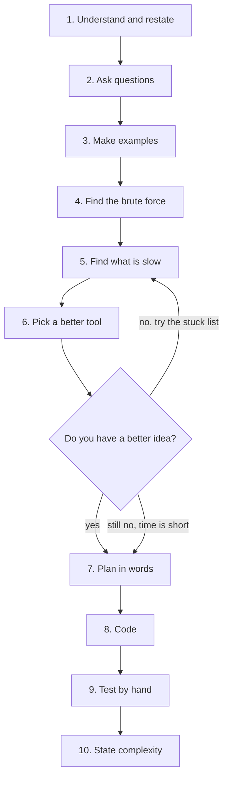
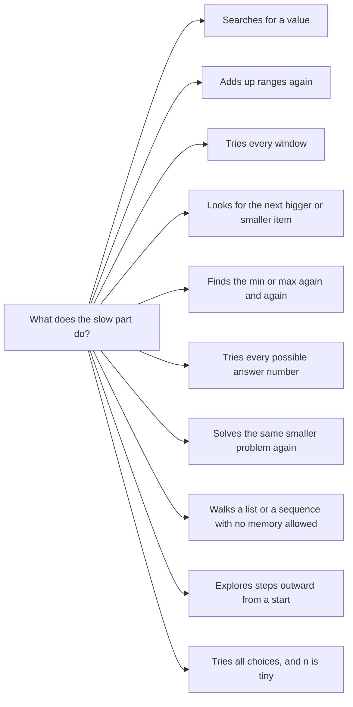

# How to Solve Any Problem

> **Level:** Beginner · **Priority:** T1 · **Time:** 90 min · **Read first:** [Big-O From Zero](03-big-o-from-zero.md), [C++ and the STL for Problem Solving](04-cpp-stl-for-problem-solving.md) · **Next:** [Logic Building Warm-Ups](06-logic-building-warm-ups.md)

This chapter gives you ten steps to follow in a live interview, from the moment you hear the problem to the moment you state the complexity. Interviewers score how you think and how you talk, not only your final code. These steps show both.

**Short of time?** Read the Quick revision, "Step 5: Find what is slow", "Step 6: Pick a better tool" and one worked session. Come back for the rest later.

## Quick revision

- **The ten steps:** understand and restate, ask questions, make examples, find the brute force, find what is slow, pick a better tool, plan in words, code, test by hand, state complexity.
- **Restate first.** Say the problem back in your own words. A wrong understanding costs more than anything else.
- **Ask only questions that can change your solution:** sorted? negative numbers? duplicates? empty input? how large? what if there is no answer?
- **Make your own example.** Use 4 to 6 small values, and work out the answer by hand before you think about code.
- **Always say the brute force,** with its cost. It proves that you understand the problem, and it is your safety net.
- **Three kinds of slowness:** the **bottleneck** (the one part that sets the total cost), **unnecessary work** (work that cannot change the answer) and **repeated work** (the same thing computed again).
- **Pick the tool from what is slow.** A slow search needs a hash map or binary search. A repeated range sum needs prefix sums. A repeated smaller problem needs dynamic programming.
- **Let `n` set your target.** Up to 10^4 allows n^2. Up to 10^5 needs n log n or better. A single number up to 10^9 needs log n or sqrt n.
- **Reject the lookalike out loud.** "A window needs the sum to only rise. With negative numbers it can fall, so I use prefix sums."
- **Plan in words, then get a yes.** Then code.
- **Talk while you code.** Explain why, not what. Silence makes the interviewer guess.
- **Test by hand.** Walk through your example line by line, then run the edge cases. Do this before you say "done".
- **Say complexity with a reason.** "O(n) time on average, because each element does one hash lookup."
- **When stuck,** say what you know, solve a small case by hand, then walk down the stuck list. Ask for a hint with a specific question.
- **45-minute plan:** start coding by about minute 20. If you have no better idea by minute 25, code the brute force.

## The ten steps at a glance

Think of a doctor with a new patient. The doctor does not write a prescription the moment you walk in. The doctor listens, asks questions, examines you, thinks of what it could be, rules out the lookalikes, and only then prescribes. Then the doctor checks that the treatment worked.

A problem works the same way. Many failed interviews do not fail at the coding step. They fail because the person started coding at the first idea, and that idea was wrong.



| Step | What you do | What you have at the end |
|---|---|---|
| 1. Understand and restate | Say the problem in your own words | You and the interviewer agree on the problem |
| 2. Ask questions | Find the limits and the special cases | The rules are exact |
| 3. Make examples | Solve one small case by hand | You know what the correct answer looks like |
| 4. Find the brute force | Say the simplest correct method | A safe answer and its cost |
| 5. Find what is slow | Name the exact wasted work | A target for improvement |
| 6. Pick a better tool | Match the waste and the clues to a technique | The approach |
| 7. Plan in words | List the steps, get a yes | The code is already decided |
| 8. Code | Write it and explain it | A full solution |
| 9. Test by hand | Trace an example and the edge cases | Your bugs are found by you |
| 10. State complexity | Give time and space, each with a reason | A clean finish |

Steps 1 to 7 come before any code. That is on purpose. Code is the cheap part once you know what to write.

## Step 1: Understand and restate

Listen to the whole problem. Write down the input and the output. Then say the problem back in your own words.

Here is a tiny example. The interviewer says: "Return the indexes of two numbers that add up to a target." You say: "I get an array and a target. I return two positions, not the two values. Is that right?"

That one sentence has already caught a common mistake: returning values instead of positions.

Watch for words that change the problem:

| Word in the problem | Exact meaning | What goes wrong if you miss it |
|---|---|---|
| "subarray", "substring" | A part with no gaps | You pick items that are not next to each other |
| "subsequence" | Items in the same order, gaps allowed | You use a window, which cannot skip items |
| "distinct" or "unique" | Each value counts once | You count duplicates |
| "at most k" and "exactly k" | Two different rules | You solve the easier one |
| "return the count" and "return the list" | Different output | Listing can cost far more than counting |
| "in place" | Change the input, with O(1) extra memory | You build a second array |

## Step 2: Ask clarifying questions

Interview problems are often vague on purpose. The interviewer wants to see if you notice. Ask about 3 to 6 questions, and ask only those that can change your solution.

| Topic | Question | Why it matters |
|---|---|---|
| Size | How large can `n` be? | It tells you the complexity you need. See Step 6. |
| Values | How large can the values be? | A sum or product of large values can overflow `int`, so you need `long long`. |
| Values | Can there be negative numbers or zeros? | A sliding window on sums fails with negative numbers. |
| Values | Can there be duplicates? | It changes hash map design and how you skip repeats. |
| Order | Is the input sorted? | Sorted input invites binary search or two pointers. |
| Empty | Can the input be empty? | Your code may read `nums[0]` and crash. |
| Output | What do I return if there is no answer? | -1, an empty list and false are all common. |
| Output | Can there be more than one answer? Which one do you want? | It may change the method, and the tests. |
| Output | Does the order of the output matter? | If it does not, you may be free to sort. |
| Rules | May I change the input? | Sorting or marking in place needs a yes. |
| Rules | Is there a memory limit? | "O(1) extra space" removes any hash map that grows with `n`. |
| Strings | Which characters can appear? Do upper and lower case count as the same? | A table of 26 counts fails on other characters. |
| Trees | Is it a binary tree? A binary search tree? Can it be empty? | A binary search tree gives you sorted order. |
| Graphs | Directed? Weighted? Connected? Can it have cycles? | These pick the algorithm, as in BFS against Dijkstra. |

Say why you are asking. "Are there negative numbers? I ask because that decides if a sliding window can work." This shows that you are already thinking about tools.

## Step 3: Make examples

The interviewer's example is often too easy. Make your own, with 4 to 6 small values, and solve it by hand.

Two things happen when you do this. First, you check that you understood the problem. Second, you watch how your own brain finds the answer, and that is often the algorithm.

Try this. Find the largest gap between a value and any **earlier** smaller value in `[7, 1, 5, 3, 6, 4]`.

You probably did not check all pairs. You saw that 1 is the lowest so far, then you compared later values with it: 5 - 1 = 4, then 6 - 1 = 5. Your brain was keeping "the smallest value so far". That is the whole algorithm.

Good examples are not random. Make one normal case, and one case that tests a special rule. For a problem about duplicates, put a duplicate in it. For a problem with negative numbers, put one in.

## Step 4: Find the brute force

The **brute force** is the most direct method that is correct, even if it is slow. It usually tries every candidate answer.

Say it out loud, with its cost, even if you already see a better way. There are three reasons:

1. It proves that you understand the problem.
2. It gives you a working answer if time runs out. A working slow solution scores better than a broken fast one.
3. It is the starting point for Step 5. You cannot find wasted work in a method you have not described.

Ask: "what are all the possible answers, and how would I check one?" That question gives you the brute force for most problems:

| Problem asks for | Candidates to try | Usual cost |
|---|---|---|
| A pair | Every pair | O(n^2) |
| A subarray or substring | Every start and every end | O(n^2) to O(n^3) |
| A subset | Every subset | O(2^n * n) |
| An ordering | Every permutation | O(n! * n) |
| A number, like a speed or a size | Every possible value | O(range * cost of one check) |

Count all the work. If you check every subarray and add up each one from scratch, that is O(n^3), not O(n^2).

## Step 5: Find what is slow

This is the step many people skip. "Make it faster" is not a thought you can act on. "The inner loop searches for one value" is. Look at your brute force and search for three things.

### The bottleneck

The **bottleneck** is the one part that sets the total cost. Improving any other part does not help.

Example: to check if an array has a duplicate, you sort it and then compare neighbours. Sorting is O(n log n). The scan is O(n). The sort is the bottleneck, so a faster scan changes nothing. Your thinking should go to the sort: can you avoid it? Yes. A hash set checks each value in O(1) on average, so the total is O(n) on average.

### Unnecessary work

**Unnecessary work** is work that cannot change the answer. Find a fact that lets you skip it.

Example: find a pair that sums to 5 in the sorted array `[1, 3, 4, 6]`. Start with the two ends: 1 + 6 = 7, which is too big. 1 is the smallest value, so 6 with any other value is also too big. You can throw away 6 without checking those pairs. This fact is why [two pointers](../05-core-patterns/01-two-pointers-opposite-ends.md) work.

The question to ask: **"after this check fails, what else can I rule out?"**

### Repeated work

**Repeated work** is the same computation done more than once. Save the result the first time.

Example 1: you want the sum of index 1 to 3, then of index 1 to 4. The second sum is the first one plus one more value. Adding from scratch repeats all of it. This fact leads to [prefix sums](../05-core-patterns/06-prefix-sums.md).

Example 2: to count the ways to climb 5 stairs, you compute `ways(4)` and `ways(3)`. But `ways(4)` also computes `ways(3)`. Saving each result leads to [dynamic programming](../09-dynamic-programming/01-dp-from-zero.md).

The question to ask: **"have I already computed this, or something close to it?"**

## Step 6: Pick a better tool

Now you choose a technique. Do not try to remember a list of 50 patterns. Ask three questions, in this order. This is the short version. The [recognition guide](../01-pattern-recognition/01-how-to-recognize-any-problem.md) teaches it in full.

### Question 1: how big is the input?

The limit on `n` tells you how fast your solution must be. Plan with about 10^8 simple steps per second, and put the largest `n` into your cost.

| Largest n | Largest cost that fits | Usually points to |
|---|---|---|
| up to 10 | O(n!) | [Permutations](../06-recursion-backtracking-greedy/03-backtracking-permutations-combinations.md) |
| up to 20 | O(2^n) | [Subsets](../06-recursion-backtracking-greedy/02-backtracking-subsets.md), [bitmask DP](../09-dynamic-programming/12-bitmask-dp.md) |
| up to 100 | O(n^4) | Several nested loops |
| up to 500 | O(n^3) | [Interval DP](../09-dynamic-programming/09-interval-dp.md), [Floyd-Warshall](../08-graphs/10-floyd-warshall-and-all-pairs.md) |
| up to 10^4 | O(n^2) | [Simple DP](../09-dynamic-programming/02-one-dimensional-dp.md), checking all pairs |
| up to 10^5 | O(n log n) | [Sorting](../04-sorting-searching/05-custom-sorting.md), [heaps](../05-core-patterns/14-top-k-and-heaps.md), [binary search](../04-sorting-searching/06-binary-search-basics.md) |
| up to 10^6 | O(n) or O(n log n) | [Hashing](../02-arrays-strings-hashing/04-hashing-patterns.md), [two pointers](../05-core-patterns/01-two-pointers-opposite-ends.md), [sliding window](../05-core-patterns/05-sliding-window-variable.md), [prefix sums](../05-core-patterns/06-prefix-sums.md) |
| up to 10^9 (`n` is one number, not an array length) | O(log n) or O(sqrt n) | [Binary search](../04-sorting-searching/06-binary-search-basics.md), [math](../11-math-geometry-games/01-number-basics.md) |

Read it in both directions. If `n` is 10^5, then an O(n^2) brute force does about 10^10 steps, so you must beat it. If `n` is only 20, the problem is often telling you that trying all subsets is fine. Do not hunt for a clever O(n) method that may not exist. The full method is in [Constraints Tell You the Algorithm](../01-pattern-recognition/02-constraints-tell-you-the-algorithm.md).

### Question 2: what does the slow part do?

Go back to the waste you found in Step 5. Say what it does in one short sentence. Then follow this tree, and use the table below it.



| Slow part | Tool | Words and shapes that give it away | Lookalike, and why it does not fit |
|---|---|---|---|
| Searches for a value | [Hash map](../02-arrays-strings-hashing/04-hashing-patterns.md), or [two pointers](../05-core-patterns/01-two-pointers-opposite-ends.md) and [binary search](../04-sorting-searching/06-binary-search-basics.md) if sorted | "find a pair", "seen before", "sorted array" | Opposite-end two pointers need sorted input. Sorting first loses the original indexes, unless you store them with the values. |
| Adds up ranges again | [Prefix sums](../05-core-patterns/06-prefix-sums.md) | "sum of a subarray equals k", "many range sum queries" | A sliding window needs the sum to only rise. Negative numbers break that. If values change between queries, use a [Fenwick tree](../12-advanced-data-structures/03-fenwick-tree.md). |
| Tries every window | [Variable window](../05-core-patterns/05-sliding-window-variable.md), or [fixed window](../05-core-patterns/04-sliding-window-fixed.md) if the size is given | "longest substring", "shortest subarray", "contiguous", "at most k" | A "subsequence" may skip items, and a window cannot. That usually needs [DP](../09-dynamic-programming/06-longest-increasing-subsequence.md). The maximum subarray sum with negative numbers needs [Kadane](../05-core-patterns/08-kadane-and-subarray-dp.md). |
| Looks for the next bigger or smaller item | [Monotonic stack](../05-core-patterns/12-monotonic-stack.md) | "next greater", "days until warmer", "nearest smaller" | A heap gives the largest of everything, not the nearest one. |
| Finds the min or max again and again | [Heap](../05-core-patterns/14-top-k-and-heaps.md), or [monotonic queue](../05-core-patterns/13-monotonic-queue.md) for a window | "k largest", "top k", "maximum of each window" | If the data does not change, one sort also works, in O(n log n). A heap of size k takes O(n log k). |
| Tries every possible answer number | [Binary search on the answer](../04-sorting-searching/07-binary-search-on-answer.md) | "smallest speed so that", "minimize the maximum", "maximize the minimum" | The answers must flip only once. To minimize, "x works" must mean "every larger x works". To maximize, it must mean "every smaller x works". Check that first. |
| Solves the same smaller problem again | [Dynamic programming](../09-dynamic-programming/01-dp-from-zero.md) | "number of ways", "minimum cost", "can you reach" | [Greedy](../06-recursion-backtracking-greedy/06-greedy-foundations.md) is simpler, but you must be able to prove that the local choice is safe. |
| Walks a list or a sequence with no memory allowed | [Fast and slow pointers](../05-core-patterns/03-fast-and-slow-pointers.md) | "cycle in a linked list", "middle of the list", "O(1) extra space" on a list | A hash set of visited items also finds a cycle, but it uses O(n) memory. Fast and slow pointers need exactly one next item for each item. A cycle in a general graph needs [DFS](../08-graphs/05-cycle-detection-and-bipartite.md). |
| Explores steps outward from a start | [BFS](../08-graphs/02-bfs-and-dfs.md) | "shortest path", "minimum steps", "each move costs 1" | DFS finds a path, not the shortest one. Non-negative weights need [Dijkstra](../08-graphs/08-dijkstra.md). Negative weights need [Bellman-Ford](../08-graphs/09-bellman-ford-and-spfa.md). |
| Tries all choices, and n is tiny | [Backtracking](../06-recursion-backtracking-greedy/02-backtracking-subsets.md) | "all subsets", "all permutations", "list every" | If it asks for a count, not the list, DP may be enough. |

### Question 3: does the lookalike really fit?

Two problems can look the same and need different tools. So test your tool before you commit to it. Each tool depends on one fact. Check that fact.

| Problem | First thought | The test | Result |
|---|---|---|---|
| [Longest Substring Without Repeating Characters](https://leetcode.com/problems/longest-substring-without-repeating-characters/) | Sliding window | If a window has a repeat, does a bigger window keep it? Yes. | The window fits. |
| [Subarray Sum Equals K](https://leetcode.com/problems/subarray-sum-equals-k/) | Sliding window | If a sum is too big, does adding more keep it too big? No, a negative number lowers it. | Use prefix sums and a hash map. |
| [Two Sum](https://leetcode.com/problems/two-sum/) | Two pointers | Is the input sorted? No, and you must return the original indexes. | Use a hash map. |
| [Two Sum II](https://leetcode.com/problems/two-sum-ii-input-array-is-sorted/) | Hash map | Is the input sorted? Yes. Does a hash map still work? Yes, but it uses O(n) memory that you do not need. | Two pointers are better. |
| [Linked List Cycle](https://leetcode.com/problems/linked-list-cycle/) | Hash set | Can I use O(n) memory? The follow-up says no. | Use fast and slow pointers. |

For a full comparison of every pair, see [Lookalike Patterns](../01-pattern-recognition/07-lookalike-patterns.md). If nothing fits, go to [What to do when stuck](#what-to-do-when-stuck).

## Step 7: Plan in words

Before you type, list your steps in plain words. Then ask if the interviewer agrees. A bad idea costs 30 seconds here, and 15 minutes after you code it.

A plan is 3 to 5 short lines. It says what you store and what you do with each item:

```text
1. Make a hash map from value to index.
2. Walk the array from left to right.
3. For each value, work out the partner it needs.
4. If the partner is in the map, return both indexes.
5. Otherwise, store this value and its index.
```

Your plan should also state the reason for any order that matters. Here, you check the map before you store the value, so that an element cannot pair with itself.

If your plan is the brute force, that is fine. Say so: "I do not have a better idea yet. I will code the brute force, and then look for improvements."

## Step 8: Code

If the plan is good, this step is mostly typing. Keep these habits:

- **Use clear names.** `left`, `windowSum` and `indexOf` explain themselves. A name such as `m` or `tmp` forces you to explain it.
- **Say why, not what.** Do not say "now I add one to i". Say "I move left here because the window is broken."
- **Use helper functions.** If one piece is long, such as a check for one candidate, name it and write it after the main logic.
- **Do not get stuck on small syntax.** Say "I do not remember the exact method name, so I will write it like this and fix it if needed." Most interviewers accept that.
- **Do not debug in silence.** If you see a problem, say what you see.

## Step 9: Test by hand

Never say "done" before this step. Finding your own bug scores points. Having the interviewer find it loses them.

Do it in this order:

1. **Trace your example.** Go line by line through your code, as the computer would. Write down each variable. Do not trace what you meant to write. Trace what you wrote.
2. **Run the edge cases** from the list below.
3. **Fix a bug calmly.** Say what caused it, change the one line, and trace again.

Here is a small example. This function should return the largest value:

```cpp
#include <bits/stdc++.h>
#include <cassert>
using namespace std;

// Wrong: it assumes that the largest value is at least 0.
int largestWrong(const vector<int>& nums) {
    int best = 0;
    for (int value : nums) {
        if (value > best) best = value;
    }
    return best;
}

// Needs a non-empty array. Starting from a real element allows any value to win.
int largestFixed(const vector<int>& nums) {
    int best = nums[0];
    for (int value : nums) {
        if (value > best) best = value;
    }
    return best;
}

int main() {
    assert(largestWrong({3, 8, 2}) == 8);  // the normal example hides the bug
    assert(largestFixed({3, 8, 2}) == 8);
    assert(largestFixed({5}) == 5);        // one element
    assert(largestWrong({-3, -1}) == 0);   // the bug: 0 is not even in the array
    assert(largestFixed({-3, -1}) == -1);  // all values are negative
    cout << "All tests passed\n";
}
```

The example `[3, 8, 2]` works. Now trace `largestWrong` on the edge case "all values are negative", with `[-3, -1]`. The correct answer is -1.

| Step | value | value > best? | best |
|---|---|---|---|
| Start | | | 0 |
| First loop | -3 | no | 0 |
| Second loop | -1 | no | 0 |
| Return | | | 0, which is wrong |

The trace shows the cause: `best` began at a value that is not in the array.

### The edge-case list

Pick the row for your input. You do not need to test everything out loud. Test the ones that can break your code. A longer list is in [Edge Cases and Testing Checklist](../14-interview-practice/05-edge-cases-and-testing-checklist.md).

| Input | Cases to try |
|---|---|
| Array | Empty. One element. Two elements. All the same. Already sorted. Sorted in reverse. Negative numbers. Zeros. Duplicates. |
| Answer position | The answer is at the very start. At the very end. There is no answer. Everything is an answer. |
| Numbers | 0. Negative numbers. Very large values that overflow `int` when you add or multiply them. |
| String | Empty. One character. All the same character. Spaces. Upper and lower case. |
| Linked list | No nodes. One node. Two nodes. A cycle. |
| Tree | No nodes. One node. Every node has only a left child. |
| Graph | Not connected. Has a cycle. Has one node. An edge from a node to itself. |
| Matrix | One row. One column. One cell. |
| Loops and windows | The window size equals `n`. `k` is 0. `k` is larger than `n`. |

## Step 10: State complexity

Say time and space, each with a reason. Do not wait for the interviewer to ask.

- Good: "O(n) time on average, because I do one pass and each hash lookup is O(1) on average. O(n) space, because the map can hold every element."
- Weak: "It is O(n)."

Check these before you speak:

- Did you count everything inside the loops, such as a `substr` or a copy?
- Did you say "on average" for hash operations? They are O(1) on average and O(n) in the worst case.
- Did you count the recursion stack as space?
- Do you have two inputs? Use two letters: O(n + m), not O(n).

[Big-O From Zero](03-big-o-from-zero.md) teaches this in full.

## Exact phrases to say out loud

You do not have to invent these under stress. Learn them.

| Moment | Say this |
|---|---|
| After you hear the problem | "Let me say it back to check that I understood." |
| Starting questions | "Before I start, I have a few questions about the input." |
| Asking with a reason | "Can the values be negative? That decides which approach works." |
| Making an example | "Let me try a small example by hand." |
| Giving the brute force | "The simple way is to try every pair. That is O(n^2) time and O(1) space." |
| Moving on | "That works, but it is slow. Let me see what work it wastes." |
| Naming the waste | "The inner loop only searches for one value, so a faster search should help." |
| Comparing options | "I see two options. Sorting uses less memory. A hash map is faster. Is memory a concern?" |
| Rejecting a tool | "A sliding window will not work here, because negative numbers can lower the sum." |
| Before you code | "Here is my plan. Does this sound good, or should I think more?" |
| While you code | "I check the map first, so that an element cannot pair with itself." |
| Forgot a detail | "I do not remember the exact name of this method. I will use this, and fix it if needed." |
| Starting the test | "Now let me trace my code on the example." |
| Finding a bug | "I see a bug. The loop stops one step early. Let me fix that line." |
| Finishing | "This is O(n) time on average and O(n) space, because..." |
| Thinking | "Let me think for a moment." Then, after about 30 seconds, say what you are thinking. |
| Stuck | "I am stuck on this part. Here is what I know so far." |
| Asking for a hint | "I am thinking about a hash map, but I cannot handle duplicates. Am I going the right way?" |

## What to do when stuck

Being stuck is normal, and interviewers expect it. What they watch is what you do next. Silence is the only bad move. Walk down this list, and say each step out loud.

1. **Say what you know.** "The brute force is O(n^2). The waste is in the inner loop. I need a faster way to do that part." Saying it often shows you the gap.
2. **Solve a small case by hand.** Use 4 values, and watch what you do. Your hands often find the algorithm before your head does.
3. **Solve an easier version.** Try it with a sorted array. Or with no duplicates. Or for only two items. Then add the rule back.
4. **Sort the input.** If the order does not matter, sorting costs only O(n log n) and it can open up two pointers, binary search or a greedy method.
5. **Walk through the tools.** Ask of each one: hash map? Two pointers? Sliding window? Prefix sum? Stack? Heap? Binary search? BFS or DFS? DP?
6. **Work backwards.** Start from the answer or the end of the input. Some problems are easier in reverse.
7. **Code the brute force.** At about half of your time, stop looking. A working slow solution beats nothing, and writing it may show you the improvement.
8. **Ask for a hint.** Be specific. Say what you tried, and why it failed. Then take the hint. Do not argue with it.

If a bug is what stopped you, do not change the code at random. Take a small input, go line by line, and find the first line where a value differs from what you expect. That line is the bug, or it is close to it.

Later, read [When You Do Not Recognize the Problem](../01-pattern-recognition/12-when-you-do-not-recognize-it.md) for more on this.

## Time plan for 30, 45 and 60 minutes

Use these as a guide, not as a law. They assume one problem. If the interviewer plans two problems, split the time, and keep the first one short.

| Stage | 30 min | 45 min | 60 min |
|---|---|---|---|
| Introductions | 2 | 5 | 5 |
| Steps 1 to 3: understand, ask, examples | 4 | 5 | 8 |
| Steps 4 to 6: brute force, what is slow, tool | 6 | 8 | 12 |
| Step 7: plan | 2 | 2 | 3 |
| Step 8: code | 10 | 15 | 20 |
| Step 9: test by hand | 4 | 6 | 7 |
| Step 10 and follow-up questions | 2 | 4 | 5 |
| **Start coding by minute** | **14** | **20** | **28** |

Two warning signs:

- **In a 45-minute round, it is minute 25 and you have no better idea.** Code the brute force now. Say why.
- **It is 5 minutes before the end and your code is not finished.** Stop adding details. Say in words what the remaining part does, then trace what you have.

## Worked sessions

These are full interviews, written as scripts. Read the candidate's lines out loud. The italic lines show which step is happening, and you would not say those.

### P1. Two Sum ([LeetCode 1](https://leetcode.com/problems/two-sum/), Easy)

**Problem:** Given an array of integers and a target, return the indexes of two different positions whose values add up to the target. Exactly one answer exists.

**Example:** `nums = [3, 2, 4]`, `target = 6` gives `[1, 2]`, because 2 + 4 = 6.

**Pattern:** Hash map lookup

**How to recognize it:** "Find a pair" in unsorted input, and the brute force has an inner loop that only searches for one known value. A slow search of a known value calls for a hash map.

**Key idea:** For each value, you know exactly which partner you need: `target - value`. So the question changes from "which pair?" to "have I seen this one number before?"

**The session:**

*Step 1: understand and restate*

**Interviewer:** You get an array of integers and a target. Return the indexes of two numbers that add up to the target.

**Candidate:** Let me say it back. I get an array and a number. I find two positions whose values add up to that number. I return the positions, not the values. Is that right?

**Interviewer:** Yes.

*Step 2: ask questions*

**Candidate:** I have a few questions. Is the array sorted?

**Interviewer:** No.

**Candidate:** Can there be negative numbers or duplicates?

**Interviewer:** Yes, both.

**Candidate:** Can I use the same position twice? I mean, if the target is 6 and there is one 3, can I use it as 3 + 3?

**Interviewer:** No. Two different positions. They may hold equal values, though.

**Candidate:** Is there always an answer, and can there be more than one?

**Interviewer:** Exactly one answer always exists.

**Candidate:** How large can the input be?

**Interviewer:** Up to 10,000 elements. Values and the target are between -10^9 and 10^9.

**Candidate:** Can I return the two indexes in any order?

**Interviewer:** Yes.

*Step 3: make examples*

**Candidate:** Let me try `[3, 2, 4]` with target 6. 3 + 3 would give 6, but there is only one 3, so that is not allowed. 2 + 4 = 6, so the answer is indexes 1 and 2. A second example is `[3, 3]` with target 6. The values are equal, but the positions differ, so the answer is 0 and 1.

*Step 4: find the brute force*

**Candidate:** The simple way is to try every pair with two loops. There are about n^2 / 2 pairs, so it is O(n^2) time and O(1) extra space. For 10,000 elements that is about 50 million pairs, which is fine for the limit. Do you want me to look for something faster before I code?

**Interviewer:** Yes, please.

*Step 5: find what is slow*

**Candidate:** The outer loop picks one value. Then the inner loop does only one job. It searches for `target - value`. That search is the bottleneck, because it costs O(n) and it runs n times.

*Step 6: pick a better tool*

**Candidate:** So I need a faster search. I see two options. I could sort and use two pointers, but sorting moves the elements, so I would have to carry the original indexes with them. That is O(n log n). Or I could use a hash map, with an O(1) lookup on average. That gives O(n) time on average, but it uses O(n) memory. I prefer the hash map, unless memory is a concern.

**Interviewer:** Memory is fine.

*Step 7: plan in words*

**Candidate:** I walk from left to right, with a map from value to index. For each value, I compute what I need. If it is in the map, I return both indexes. If not, I store the current value. I check before I store, so that an element cannot pair with itself. Does that sound good?

**Interviewer:** Go ahead.

*Step 8: code*

**Candidate:** The difference `target - value` can reach 2 * 10^9. That just fits in `int`, but I will use `long long` so that I do not have to think about it.

```cpp
#include <bits/stdc++.h>
#include <cassert>
using namespace std;

class Solution {
public:
    vector<int> twoSum(vector<int>& nums, int target) {
        unordered_map<long long, int> indexOf;  // value of an earlier element -> its index
        for (int i = 0; i < (int)nums.size(); i++) {
            long long need = (long long)target - nums[i];
            auto found = indexOf.find(need);
            if (found != indexOf.end()) return {found->second, i};
            // Store after the check, so that an element cannot pair with itself.
            indexOf[nums[i]] = i;
        }
        return {};  // not reached, because an answer always exists
    }
};

int main() {
    Solution solution;
    vector<int> example = {3, 2, 4};
    assert(solution.twoSum(example, 6) == vector<int>({1, 2}));

    vector<int> smallest = {1, 2};  // the shortest legal input
    assert(solution.twoSum(smallest, 3) == vector<int>({0, 1}));

    vector<int> equalValues = {3, 3};  // same value, different positions
    assert(solution.twoSum(equalValues, 6) == vector<int>({0, 1}));

    vector<int> negatives = {-1, -2, -3, -4, -5};  // -3 + -5 = -8
    assert(solution.twoSum(negatives, -8) == vector<int>({2, 4}));

    vector<int> extremes = {-1000000000, 5, 999999995};  // at index 0, need is 2 * 10^9
    assert(solution.twoSum(extremes, 1000000000) == vector<int>({1, 2}));

    cout << "All tests passed\n";
}
```

*Step 9: test by hand*

**Candidate:** Let me trace it on `[3, 2, 4]` with target 6.

**Dry run:** on `nums = [3, 2, 4]`, `target = 6`.

| i | nums[i] | need | In the map? | Map after this step |
|---|---|---|---|---|
| 0 | 3 | 3 | no, the map is empty | {3: 0} |
| 1 | 2 | 4 | no | {3: 0, 2: 1} |
| 2 | 4 | 2 | yes, at index 1 | return [1, 2] |

**Candidate:** At index 0, the need is 3, and the map is empty. That is the case where a value could pair with itself, and the order of my lines stops it. Now the edge cases. For `[3, 3]`, index 0 stores 3, and index 1 finds it, so I return 0 and 1. The input has at least two elements, so I do not need to handle an empty array. Negative numbers work, because I only compute a difference.

*Step 10: state complexity*

**Candidate:** It is O(n) time on average, because I do one pass and each map operation is O(1) on average. In the worst case, map operations are O(n), so the total is O(n^2), but that is rare. Space is O(n), because the map can hold almost every element.

**Interviewer:** What if the array were sorted?

**Candidate:** Then I would use two pointers from both ends. If the sum is too big, I move the right pointer in. If it is too small, I move the left pointer in. That is O(n) time and O(1) extra space, so I would not need the map.

**Interviewer:** Good.

**Complexity:** O(n) time on average and O(n^2) in the worst case, as the candidate says. O(n) space, for the map.

**Edge cases:** equal values such as `[3, 3]`, negative values, and a value that equals half of the target, as in `[3, 2, 4]`.

### P2. Subarray Sum Equals K ([LeetCode 560](https://leetcode.com/problems/subarray-sum-equals-k/), Medium)

**Problem:** Given an array of integers and a number `k`, count the subarrays whose sum is exactly `k`. A subarray is a part of the array with no gaps. The array has at least one element.

**Example:** `nums = [1, -1, 1, 1]`, `k = 1` gives `5`. The subarrays are `[1]` at index 0, `[1, -1, 1]`, `[-1, 1, 1]`, `[1]` at index 2 and `[1]` at index 3.

**Pattern:** Prefix sum with hash map

**How to recognize it:** "Subarray" and "sum" together point to a sum of a range. The word "exactly", with negative numbers allowed, rules out a sliding window. That leaves prefix sums, and looking up an earlier prefix is a search, so a hash map joins it.

**Key idea:** The sum of a subarray is the difference of two prefix sums. So "subarrays ending here with sum k" means "earlier prefix sums equal to `current - k`". You can count those with a hash map.

**The session:**

*Step 1: understand and restate*

**Interviewer:** You get an array of integers and a number k. Count the subarrays whose sum equals k.

**Candidate:** Let me say it back. A subarray has no gaps. I return how many subarrays have a sum of exactly k. I count the subarrays, so two equal subarrays at different positions count twice. Is that right?

**Interviewer:** Yes.

*Step 2: ask questions*

**Candidate:** Can the values be negative? I ask because that decides if a sliding window can work.

**Interviewer:** Yes. Values are between -1000 and 1000.

**Candidate:** Can k be zero or negative?

**Interviewer:** Yes, both.

**Candidate:** How long is the array, and can it be empty?

**Interviewer:** Between 1 and 20,000 elements.

**Candidate:** An empty subarray does not count, right?

**Interviewer:** Right.

*Step 3: make examples*

**Candidate:** Let me try `[1, -1, 1, 1]` with k = 1. By hand, I find `[1]` three times, then `[1, -1, 1]` and `[-1, 1, 1]`. That is 5. A second example is `[0, 0]` with k = 0. That gives 3: each zero alone, and both together.

*Step 4: find the brute force*

**Candidate:** The simple way is to try every start. For each start, I extend the end and keep a running sum. That is O(n^2) time and O(1) space. With 20,000 elements, that is about 200 million steps, which is risky.

*Step 5: find what is slow*

**Candidate:** For each end position, I am really asking one question: how many starts give a sum of k? I answer it by trying all the starts again. Each new start adds up the same elements again, so this is repeated work.

*Step 6: pick a better tool*

**Candidate:** "Subarray" and "sum" make me think of a sliding window first, but let me test it. A window needs this fact: if a sum is too big, adding more keeps it too big. Here that is false. In my example, the sum goes 1, 0, 1, 2. It falls when the -1 comes in. So I cannot know which way to move the left end. A window is out.

**Interviewer:** What would you use instead?

**Candidate:** A subarray sum is a difference of prefix sums. A prefix sum is the sum of all elements from the start up to some position. Say the prefix sum up to here is `p`. A subarray ending here has sum k exactly when the prefix that I remove has sum `p - k`. So for each position, I need the number of earlier prefixes with the value `p - k`. That is a search for a value, so a hash map fits, as in Two Sum.

*Step 7: plan in words*

**Candidate:** I keep a map from prefix sum to how many times I have seen it. It starts with 0 seen once, for the empty prefix. For each element, I add it to `prefix`. I add `seen[prefix - k]` to the count. Then I store `prefix` in the map.

**Interviewer:** Why does the map start with 0?

**Candidate:** Take `[1]` with k = 1. The prefix is 1, and I need an earlier prefix of 0. That earlier prefix is the empty one, which removes nothing. Without it, I would miss every subarray that starts at index 0.

**Interviewer:** Good. Go ahead.

*Step 8: code*

**Candidate:** I look up before I store. If I stored first and k were 0, the current prefix would match itself. That would count an empty subarray.

```cpp
#include <bits/stdc++.h>
#include <cassert>
using namespace std;

class Solution {
public:
    int subarraySum(vector<int>& nums, int k) {
        unordered_map<long long, int> seen;  // prefix sum -> how many earlier prefixes have it
        seen[0] = 1;  // the empty prefix, so that a subarray can start at index 0
        long long prefix = 0;
        long long count = 0;
        for (int value : nums) {
            prefix += value;
            auto found = seen.find(prefix - k);
            if (found != seen.end()) count += found->second;
            // Store after the lookup, so that k = 0 cannot count an empty subarray.
            seen[prefix]++;
        }
        return (int)count;  // at most n * (n + 1) / 2, about 2 * 10^8 here, so it fits
    }
};

int main() {
    Solution solution;
    vector<int> example = {1, -1, 1, 1};
    assert(solution.subarraySum(example, 1) == 5);

    vector<int> positive = {1, 2, 3};  // [1, 2] and [3]
    assert(solution.subarraySum(positive, 3) == 2);

    vector<int> single = {1};  // one element, with no subarray that sums to 0
    assert(solution.subarraySum(single, 0) == 0);
    assert(solution.subarraySum(single, 1) == 1);  // needs the empty prefix

    vector<int> zeros = {0, 0};  // tricky: k = 0, and each zero alone also counts
    assert(solution.subarraySum(zeros, 0) == 3);

    vector<int> negatives = {-1, -1, 1};  // only [-1, 1] sums to 0
    assert(solution.subarraySum(negatives, 0) == 1);

    cout << "All tests passed\n";
}
```

*Step 9: test by hand*

**Candidate:** Let me trace `[1, -1, 1, 1]` with k = 1. The map starts as {0: 1}.

**Dry run:** on `nums = [1, -1, 1, 1]`, `k = 1`.

| Index | Value | prefix | prefix - k | Times seen | count | Map after this step |
|---|---|---|---|---|---|---|
| 0 | 1 | 1 | 0 | 1 | 1 | {0: 1, 1: 1} |
| 1 | -1 | 0 | -1 | 0 | 1 | {0: 2, 1: 1} |
| 2 | 1 | 1 | 0 | 2 | 3 | {0: 2, 1: 2} |
| 3 | 1 | 2 | 1 | 2 | 5 | {0: 2, 1: 2, 2: 1} |

**Candidate:** The count is 5, which matches my hand answer. Now `[0, 0]` with k = 0. The map starts as {0: 1}. At the first zero, the prefix is 0, I find it once, and the count is 1. The map becomes {0: 2}. At the second zero, I find it twice, and the count is 3. That matches too.

*Step 10: state complexity*

**Candidate:** It is O(n) time on average, because I do one pass with one lookup and one store for each element, and each is O(1) on average. In the worst case, map operations are O(n), so the total is O(n^2). Space is O(n), because all the prefix sums can differ.

**Interviewer:** What if all the values were positive?

**Candidate:** Then the sum only rises as a window grows, so a sliding window works. That needs O(n) time and O(1) extra space. I would drop the map.

**Interviewer:** Good.

**Complexity:** O(n) time on average and O(n^2) in the worst case. O(n) space, for the map.

**Edge cases:** a subarray that starts at index 0, which needs the empty prefix; `k = 0` with zeros in the array; and a negative `k`.

## Drill: what is slow, and which tool?

For each story, do Steps 4, 5 and 6 on paper before you open the answer. Say the brute force, name the waste, pick a tool and reject one lookalike. The stories hide the real question, and the order is mixed on purpose.

**D1.** A van has a fixed number of seats. Each booking says how many people get on at one kilometre mark and get off at a later one. Can the van take all bookings without ever being overloaded?

<details>
<summary>Answer</summary>

[Car Pooling](https://leetcode.com/problems/car-pooling/) (LeetCode 1094, Medium). **Brute force:** keep a load for each kilometre, and add each booking to every kilometre it covers. **Waste:** repeated work, because you add the same number across a whole range. **Tool:** [difference array](../05-core-patterns/07-difference-array-and-sweep-line.md). Add the people at the start mark, subtract them at the end mark, then walk with a running total. **Lookalike:** [merge intervals](../05-core-patterns/09-merge-intervals.md) joins overlapping ranges into one and loses the counts. Here, overlaps must add up.

</details>

**D2.** Take a number. Replace it with the sum of the squares of its digits. Keep going. Will you ever reach 1?

<details>
<summary>Answer</summary>

[Happy Number](https://leetcode.com/problems/happy-number/) (LeetCode 202, Easy). **Brute force:** repeat the step until you reach 1. **Waste:** there is no stop rule, because the numbers may loop forever. **Tool:** [fast and slow pointers](../05-core-patterns/03-fast-and-slow-pointers.md). Each number leads to exactly one next number, so this is a hidden linked list. For a 32-bit number, one step gives at most 10 * 81 = 810. The values stay small, so they must repeat if they never reach 1. **Lookalike:** a hash set of seen numbers also works, but it uses extra memory. Plain simulation may never stop.

</details>

**D3.** Houses stand in a row, each with some money inside. A thief cannot enter two neighbouring houses in one night. What is the largest total? There are at most 100 houses.

<details>
<summary>Answer</summary>

[House Robber](https://leetcode.com/problems/house-robber/) (LeetCode 198, Medium). **Brute force:** try every subset of houses, which is about 2^n subsets. With 100 houses, that is far too many. **Waste:** repeated work, because "the best total up to this house" is computed many times. **Tool:** [1D dynamic programming](../09-dynamic-programming/02-one-dimensional-dp.md). `best[i]` is the largest total from houses 0 to i, so `best[i] = max(best[i - 1], best[i - 2] + money[i])`. **Lookalike:** greedy. Taking the largest house first fails on `[4, 5, 4]`. It takes 5, but the best is 4 + 4 = 8.

</details>

**D4.** All the numbers in an array are positive. Find the length of the shortest run of neighbouring numbers whose sum reaches a target. The array can have 100,000 elements.

<details>
<summary>Answer</summary>

[Minimum Size Subarray Sum](https://leetcode.com/problems/minimum-size-subarray-sum/) (LeetCode 209, Medium). **Brute force:** try every start and extend it, O(n^2), which is too slow for this `n`. **Waste:** unnecessary work. Once a window reaches the target, a longer window with the same start cannot be shorter. **Tool:** [variable sliding window](../05-core-patterns/05-sliding-window-variable.md). **Lookalike:** P2 looked the same but needed prefix sums. The difference is the word "positive". Here the sum only rises as a window grows, so the window test passes.

</details>

**D5.** An array holds n + 1 numbers, each from 1 to n, so at least one value repeats. Exactly one value repeats, maybe many times. Find it. You may not change the array, and you may use only O(1) extra memory.

<details>
<summary>Answer</summary>

[Find the Duplicate Number](https://leetcode.com/problems/find-the-duplicate-number/) (LeetCode 287, Medium). **Brute force:** compare every pair, O(n^2). **Waste:** you search for a value, but the usual tools are banned by the rules. **Tool:** [fast and slow pointers](../05-core-patterns/03-fast-and-slow-pointers.md). Treat each index `i` as a node that points to `nums[i]`. No value is 0, so nothing points to index 0, and index 0 is not on a cycle. At least two indexes point to the repeated value, so the path from index 0 enters a cycle exactly at that value. **Lookalikes:** a hash set uses O(n) memory. Sorting and [cyclic sort](../05-core-patterns/10-cyclic-sort.md) both change the array. The limits rule out each of them, and that is the clue.

</details>

**D6.** A grid holds empty cells, fresh fruit and rotten fruit. Each minute, every fresh fruit next to a rotten one (up, down, left or right) goes rotten. How many minutes until no fresh fruit is left? Return -1 if that can never happen.

<details>
<summary>Answer</summary>

[Rotting Oranges](https://leetcode.com/problems/rotting-oranges/) (LeetCode 994, Medium). **Brute force:** each minute, scan the whole grid and update it. **Waste:** unnecessary work, because you rescan cells that cannot change. **Tool:** [multi-source BFS](../08-graphs/04-bfs-shortest-path-patterns.md). Put every rotten fruit in the queue at the start. Each BFS level is one minute. **Lookalike:** DFS follows one path deep, so it does not visit cells in time order. "Minimum minutes" with equal steps means BFS.

</details>

**D7.** A worker must finish several piles of tasks in `h` hours. Each hour, the worker picks one pile and does up to `s` tasks from it, and any spare time in that hour is lost. What is the smallest `s` that finishes on time? A pile can hold up to 10^9 tasks.

<details>
<summary>Answer</summary>

[Koko Eating Bananas](https://leetcode.com/problems/koko-eating-bananas/) (LeetCode 875, Medium). **Brute force:** try `s` = 1, 2, 3 and so on, with an O(n) check for each. That is up to 10^9 checks. **Waste:** unnecessary work. If a speed works, every faster speed also works, so the answers flip from "no" to "yes" only once. **Tool:** [binary search on the answer](../04-sorting-searching/07-binary-search-on-answer.md), O(n log m), where m is the largest pile. **Lookalike:** the average. `[1, 1, 10]` with `h = 4` is 12 tasks in 4 hours, an average of 3 each hour. But speed 3 needs 1 + 1 + 4 = 6 hours. The smallest speed that works is 5.

</details>

**D8.** You have a list of daily temperatures. For each day, say how many days you must wait for a warmer one. Use 0 if no warmer day comes. The list can have 100,000 days.

<details>
<summary>Answer</summary>

[Daily Temperatures](https://leetcode.com/problems/daily-temperatures/) (LeetCode 739, Medium). **Brute force:** for each day, scan forward, O(n^2) in the worst case. **Waste:** repeated work, because many days wait for the same warm day and each one scans the same cold days. **Tool:** [monotonic stack](../05-core-patterns/12-monotonic-stack.md). Keep the days that are still waiting. A warmer day answers them from the top of the stack. Each day is pushed once and popped at most once, so it is O(n). **Lookalike:** a heap gives the hottest day overall, not the nearest warmer one.

</details>

## Common pitfalls

These are mistakes in communication. Good coders fail interviews because of them.

1. **Coding in silence.** The interviewer cannot see your thinking, so they cannot give you credit or help. Fix: say why before each block of code, and say what you are checking when you pause.
2. **Coding the first idea.** "I know this one" and typing at once often solves the wrong problem. Fix: do Steps 1 to 3, and get a yes on your plan, even if you are sure.
3. **Naming a pattern without a reason.** "This is a sliding window" tells the interviewer nothing, and it may be wrong. Fix: give the fact that makes it work. "The rule is monotonic, which means it changes in only one direction: a repeat stays in a bigger window."
4. **Asking too much, or nothing.** Fifteen questions waste time, and none makes you look careless. Fix: ask the 3 to 6 that can change your solution, and say why you ask.
5. **Fighting a hint.** If the interviewer asks "what about duplicates?", that is a gift, not an attack. Fix: stop, take the hint, and think out loud. "You are right. Duplicates break this line. Let me fix it."
6. **Saying "done" without a test.** The interviewer then finds your bug, and you lose the points for finding it. Fix: trace an example and the edge cases before you say anything is finished.
7. **Vague complexity.** "It is fast" or "O(n)" with no reason shows nothing. Fix: give time and space, a reason for each, and "on average" for hash operations.
8. **Long speeches.** Talking for five minutes without a pause means you may go far in the wrong direction. Fix: after each step, check in. "Does that make sense so far?"

## Practice list

Do all ten steps out loud, with a timer. Record yourself, or use a friend as the interviewer. The hints name the waste to look for.

- [ ] [Contains Duplicate](https://leetcode.com/problems/contains-duplicate/) (LeetCode 217, Easy): the bottleneck is the sort, so ask if you need one.
- [ ] [Valid Anagram](https://leetcode.com/problems/valid-anagram/) (LeetCode 242, Easy): ask which characters can appear, then count them.
- [ ] [Best Time to Buy and Sell Stock](https://leetcode.com/problems/best-time-to-buy-and-sell-stock/) (LeetCode 121, Easy): the inner loop rescans for an earlier minimum, so keep it in a variable.
- [ ] [Group Anagrams](https://leetcode.com/problems/group-anagrams/) (LeetCode 49, Medium): comparing every pair is the waste, so find a shared key.
- [ ] [Product of Array Except Self](https://leetcode.com/problems/product-of-array-except-self/) (LeetCode 238, Medium): repeated work on the left and right sides of each index.
- [ ] [Top K Frequent Elements](https://leetcode.com/problems/top-k-frequent-elements/) (LeetCode 347, Medium): a full sort does more work than you need.
- [ ] [Merge Intervals](https://leetcode.com/problems/merge-intervals/) (LeetCode 56, Medium): after sorting by start, you only need to compare with the last merged interval.
- [ ] [Trapping Rain Water](https://leetcode.com/problems/trapping-rain-water/) (LeetCode 42, Hard): each bar rescans for the tallest bar on both sides.
- [ ] [Minimum Window Substring](https://leetcode.com/problems/minimum-window-substring/) (LeetCode 76, Hard): test the window rule first. Does a window that contains everything stay good as it grows?

## Interview questions

These are questions about your thinking that interviewers often ask during a round. The answers use Two Sum from P1.

<details>
<summary><strong>Q1. Can you do better than this?</strong></summary>

First work out the limit. "Any solution must read every element in the worst case, so O(n) time is the best possible. My solution is O(n) on average, so time cannot improve by more than a constant factor. The cost I could still reduce is memory." If you are not at the limit, go back to Step 5 and name the waste out loud.

</details>

<details>
<summary><strong>Q2. Why did you choose a hash map and not sorting?</strong></summary>

"Sorting moves the elements, and I must return the original indexes, so I would need to carry them along. That costs O(n log n) time. A hash map gives O(n) time on average, and it uses O(n) memory, which you said was fine." The form of this answer works for any choice: name the option you rejected, and give the exact reason.

</details>

<details>
<summary><strong>Q3. What if you can only use O(1) extra memory?</strong></summary>

"If I must return the original indexes and cannot change the array, I would go back to the brute force: O(n^2) time and O(1) extra space. If I only need the values and may change the array, I can sort it in place and use two pointers, which is O(n log n) time." This shows that you see the trade between time and memory, and that you asked what the rules allow.

</details>

<details>
<summary><strong>Q4. How would you test this code?</strong></summary>

"I would start with a normal case, then the limits: the shortest legal input, equal values, negative values, and the largest values for overflow. For this code, the case I care about most is a value that equals half of the target, because it could pair with itself. I check the map before I store, so it cannot." Name the case most likely to break your code, not only a general list.

</details>

<details>
<summary><strong>Q5. You have been quiet for a while. What are you thinking?</strong></summary>

Do not say "nothing" or "I am stuck." Say your state: "I have the brute force, and I know the inner search is the slow part. I am trying to see if sorting helps, but I would lose the indexes." This gives the interviewer something to work with, and they may give you a useful hint.

</details>
