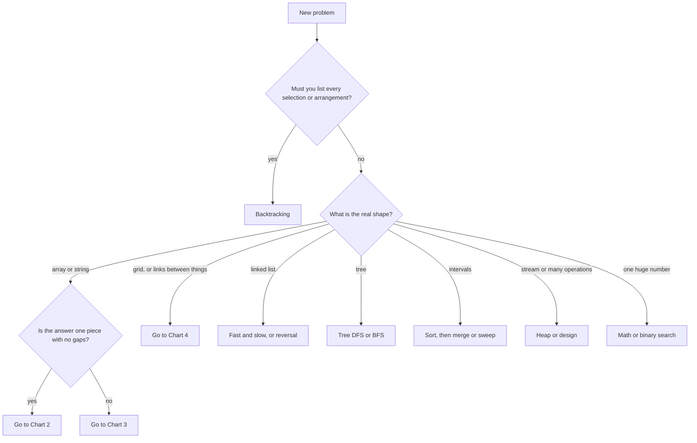
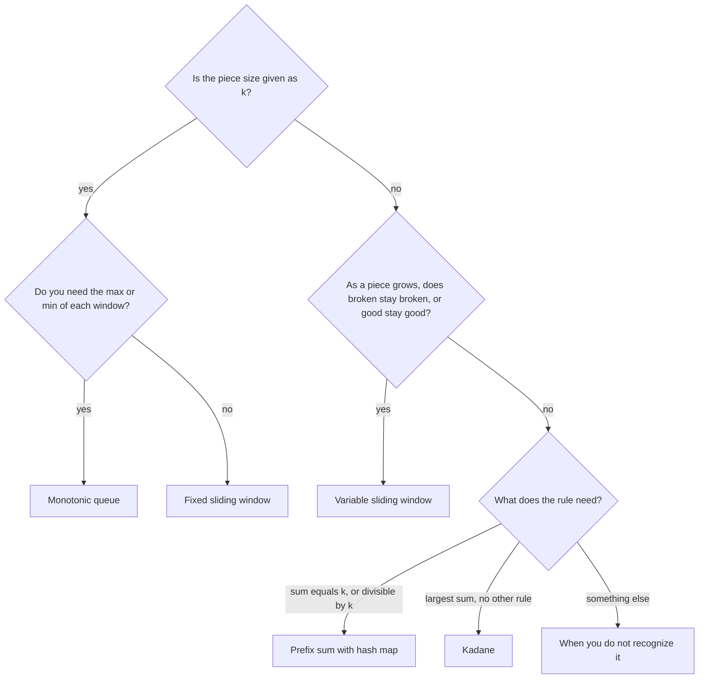
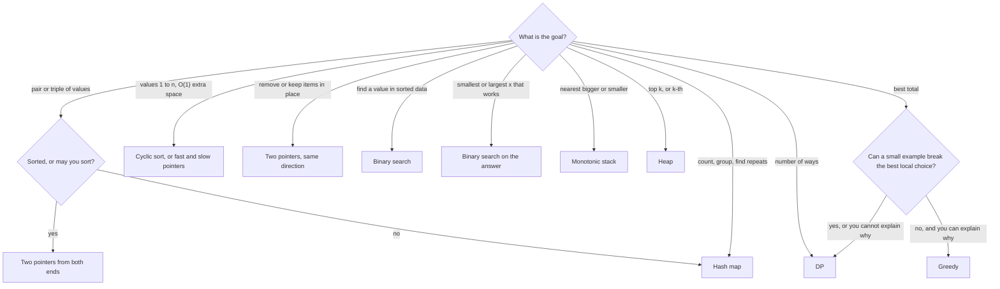
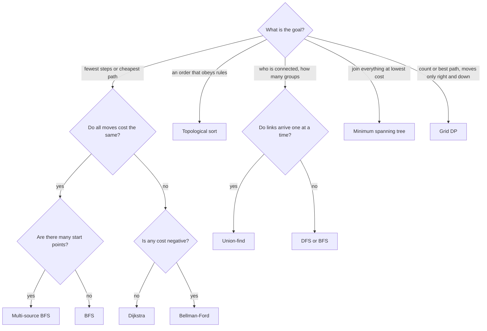

# How to Recognize Any Problem

> **Level:** Beginner · **Priority:** T1 · **Time:** 75 min · **Read first:** [Big-O From Zero](../00-start-here/03-big-o-from-zero.md) · **Next:** [Constraints Tell You the Algorithm](02-constraints-tell-you-the-algorithm.md)

You will meet problems in an interview that you have never seen. This chapter gives you one fixed procedure for them. Six steps turn "I have no idea" into a short list of techniques, and a test that picks the right one.

## Quick revision

- Do not guess from the first sentence. Run the six steps in order.
- **Step 1, constraints:** the input size gives your time budget.
- Rough budget: n up to 20 allows O(2^n). n up to 500 allows O(n^3). n up to 5,000 allows O(n^2). n up to 10^6 allows O(n log n). n of 10^9 or more needs O(log n) or O(sqrt n).
- Also read the other limits: "positive", "sorted", "O(1) extra space", "do not modify", "values from 1 to n".
- **Step 2, input shape:** array, linked list, tree, grid, graph, intervals. Look for a shape hidden in the story.
- **Step 3, output:** list all, count, best value, fewest steps, an order, top k.
- **Step 4, keywords:** a keyword is a hint, never a proof.
- **Step 5, candidates:** write 2 or 3 techniques, and always include the brute force.
- **Step 6, test:** each technique has one question that must be yes. This step decides.
- No gaps, all values positive, a rule where broken stays broken (or good stays good) as the piece grows: **sliding window**.
- No gaps, negative values, a sum target: **prefix sums**.
- Following "next" can loop, or you need the middle of a list: **fast and slow pointers**.
- "Smallest x that works", and if x works then x + 1 works: **binary search on the answer**.
- Fewest steps with equal costs: **BFS**. Different costs, none negative: **Dijkstra**.
- List every selection: **backtracking**. Best total or number of ways: **DP**. **Greedy** only if you cannot break it with a small example and can explain why it works.
- If nothing survives Step 6, go to [When You Do Not Recognize the Problem](12-when-you-do-not-recognize-it.md).

## 1. The idea in plain English

Think of a doctor with a new patient. The doctor does not guess the disease from the first sentence. The doctor measures first: temperature, blood pressure. Then the doctor looks at the patient, asks about the complaint and lists two or three possible diseases. Last, the doctor orders a test that proves or rules out each one.

You do the same with a problem. The constraints are the measurements. The input shape and the output are the complaint. The keywords are the symptoms. Each technique has its own test.

Here is a tiny example. It shows why the test matters more than the words.

**Problem A:** find the longest subarray with a sum of at most 5. All values are positive. (A **subarray** is a part of an array with no gaps.)

```text
nums = [2, 1, 3, 1, 1]
```

The words "longest subarray" point to a [variable sliding window](../05-core-patterns/05-sliding-window-variable.md). The window is the current piece, marked by a `left` and a `right` index. When the sum is too big, you remove items from the left. This is safe here, because all values are positive. Once a window is too big, every longer window with the same start is too big as well.

**Problem B:** the same question, but values may be negative.

```text
nums = [6, -2, 1], limit = 5
```

The words are the same. The answer changes.

| Window from index 0 | Sum | At most 5? |
|---|---|---|
| `[6]` | 6 | no |
| `[6, -2]` | 4 | yes |
| `[6, -2, 1]` | 5 | yes |

Growing the window **fixed** a broken window. A sliding window would see `[6]`, call it broken, and throw away the 6. It would then answer 2, from `[-2, 1]`. The real answer is 3, the whole array.

So the words matched, and the technique still failed. The keyword gave you an idea. Only the test showed whether the idea was right. This is the thinking the rest of this chapter teaches.

## 2. How to recognize a problem: the six steps

| Step | Ask yourself | What you get |
|---|---|---|
| 1. Constraints | How big is the input? What other limits are there? | A time budget, and some techniques ruled out |
| 2. Input shape | What is the data, really? | A family of techniques |
| 3. Output | What exactly must I return? | A smaller family |
| 4. Keywords | Which words point to a technique? | Hints |
| 5. Candidates | Which 2 or 3 techniques could fit? | A short list that includes the brute force |
| 6. Test | Does each candidate pass its question? | The technique to use |

The steps take about two minutes in an interview. Say them out loud. The interviewer can then see how you think, and can correct you early.

## 3. Step 1: Read the constraints

Constraints are the limits written below the problem. They tell you how slow your solution may be. Your **time budget** is the slowest time complexity that will still finish in time.

A rough rule: plan for at most about 10^8 simple steps. This is a planning number, not a measurement. Real speed depends on the machine and the code.

Try it. Say `n` can be 10^5. O(n^2) is 10^10 steps, which is far too many. O(n log n) is about 1.7 million steps, which is fine. So before you think about any technique, you know that one loop inside another over the whole input will fail.

| Largest input size | Budget | Steps at that size | Techniques that fit |
|---|---|---|---|
| 10 | O(n!) | 10! = 3,628,800 | All [permutations](../06-recursion-backtracking-greedy/03-backtracking-permutations-combinations.md) |
| 20 | O(2^n) | 2^20 = 1,048,576 | [Subsets](../06-recursion-backtracking-greedy/02-backtracking-subsets.md), [bitmask DP](../09-dynamic-programming/12-bitmask-dp.md) (an extra n^2 factor lowers the limit to about 16) |
| 40 | O(2^(n/2)) | 2^20 = 1,048,576 | [Meet in the middle](../06-recursion-backtracking-greedy/08-meet-in-the-middle.md) |
| 500 | O(n^3) | 125 million | [Interval DP](../09-dynamic-programming/09-interval-dp.md), [Floyd-Warshall](../08-graphs/10-floyd-warshall-and-all-pairs.md) |
| 5,000 | O(n^2) | 25 million | Two nested loops, [2D DP](../09-dynamic-programming/07-lcs-and-edit-distance.md) |
| 10^5 to 10^6 | O(n log n) or O(n) | About 20 million for n log n at 10^6 | Sorting, heaps, hash maps, windows, two pointers |
| 10^9 or more | O(log n) or O(sqrt n) | At 10^9: log2 is about 30, sqrt is about 31,623 | [Binary search](../04-sorting-searching/06-binary-search-basics.md), [math](../11-math-geometry-games/01-number-basics.md) |

The table gives a ceiling, not a target. A faster solution is always allowed. A small limit also does not prove that an exponential solution is expected. Sometimes the writers only kept the input small.

In an interview, the constraints are often not written. Ask: "How large can the input be? Can values be negative?" Interviewers expect this question.

### Look at every limit, not only n

Find the largest number that your loops would have to walk over. It may not be the array length. In [Koko Eating Bananas](https://leetcode.com/problems/koko-eating-bananas/), the array has at most 10^4 items, but the values go up to 10^9. The value limit is what rules out trying every speed.

Other limits decide even more. Each one below opens a technique or closes one.

| Limit in the problem | What it tells you |
|---|---|
| "all values are positive" | A growing sum only rises, so a [sliding window](../05-core-patterns/05-sliding-window-variable.md) can work on sums |
| "values may be negative" | A growing sum can fall. Think of [prefix sums](../05-core-patterns/06-prefix-sums.md) (a prefix sum is the total of the first i items) or [Kadane](../05-core-patterns/08-kadane-and-subarray-dp.md) |
| "sorted" | [Binary search](../04-sorting-searching/06-binary-search-basics.md) or [two pointers from both ends](../05-core-patterns/01-two-pointers-opposite-ends.md) |
| "O(1) extra space" | A hash map that grows with n is out. Think of pointers or [bit tricks](../05-core-patterns/17-bit-manipulation.md) |
| "do not modify the array" | Sorting in place is out, and so is [cyclic sort](../05-core-patterns/10-cyclic-sort.md) |
| "values from 1 to n" | A value can be used as an index. Think of [cyclic sort](../05-core-patterns/10-cyclic-sort.md) or of `i -> nums[i]` as a link (`i -> nums[i] - 1` if there are only n items) |
| "only lowercase letters" | A count table of 26 entries is enough, and it counts as O(1) space |
| "return the answer modulo 10^9 + 7" | The answer is huge, so you must count without listing. Think of [DP](../09-dynamic-programming/14-counting-and-probability-dp.md), [combinatorics](../11-math-geometry-games/04-combinatorics.md) or the [contribution technique](../05-core-patterns/18-contribution-technique.md) |
| The total of all values is small | [DP over the sum](../09-dynamic-programming/04-zero-one-knapsack.md) can be possible, even when subsets are too many to try |

[Constraints Tell You the Algorithm](02-constraints-tell-you-the-algorithm.md) is the next chapter, and it covers this step in depth.

## 4. Step 2: Name the input shape

Ask what the data really is. Each shape has its own family of techniques.

| Shape | First techniques to think of |
|---|---|
| Array or string, not sorted | [Hash map](../02-arrays-strings-hashing/04-hashing-patterns.md), [sliding window](../05-core-patterns/05-sliding-window-variable.md), [prefix sums](../05-core-patterns/06-prefix-sums.md), or sort first |
| Sorted array | [Binary search](../04-sorting-searching/06-binary-search-basics.md), [two pointers from both ends](../05-core-patterns/01-two-pointers-opposite-ends.md) |
| Linked list | [Fast and slow pointers](../05-core-patterns/03-fast-and-slow-pointers.md), [in-place reversal](../05-core-patterns/11-in-place-linked-list-reversal.md) |
| Intervals (each item has a start and an end) | [Merge intervals](../05-core-patterns/09-merge-intervals.md), [sweep line](../05-core-patterns/07-difference-array-and-sweep-line.md) |
| Binary tree | [Tree DFS](../07-trees/03-tree-dfs-problems.md), [tree BFS](../07-trees/04-tree-bfs-problems.md) |
| Grid | [Grid graphs](../08-graphs/03-grid-graphs.md), [grid DP](../09-dynamic-programming/03-grid-dp.md) |
| Graph (things joined by links) | [BFS and DFS](../08-graphs/02-bfs-and-dfs.md), [topological sort](../08-graphs/06-topological-sort.md), [union-find](../08-graphs/07-union-find.md), [Dijkstra](../08-graphs/08-dijkstra.md) |
| A stream, or many operations in a row | [Heaps](../05-core-patterns/14-top-k-and-heaps.md), [design problems](../13-design-problems/02-stack-and-queue-design.md) |
| One number | [Math](../11-math-geometry-games/01-number-basics.md), [bit tricks](../05-core-patterns/17-bit-manipulation.md) |

### The shape is often hidden

Many hard problems are easy problems with a story around them. Ask: **are there things, and links between them?** If yes, you have a graph, even if the word "graph" never appears.

| Story | The real shape | Real problem |
|---|---|---|
| "Course A needs course B first" | A directed graph. Courses are points, needs are arrows | [Course Schedule](https://leetcode.com/problems/course-schedule/) |
| "Change one letter at a time to reach the target word" | A graph of words. Each change is a link | [Word Ladder](https://leetcode.com/problems/word-ladder/) |
| n + 1 items with values from 1 to n | A linked list: each index `i` points to index `nums[i]` | [Find the Duplicate Number](https://leetcode.com/problems/find-the-duplicate-number/) |
| "Repeat this rule on the number" | A chain: each number has exactly one next number | [Happy Number](https://leetcode.com/problems/happy-number/) |
| Friends of friends, cities joined by roads | Groups of connected points | [Number of Provinces](https://leetcode.com/problems/number-of-provinces/) |

[Decision Tree by Input Type](03-decision-tree-by-input-type.md) goes through each shape in more detail.

## 5. Step 3: Read what the output asks for

Two problems can share the same input and need different techniques, because they ask for different things. Read the return value before you think about how to solve the problem.

| The output asks for | First techniques to think of |
|---|---|
| The best piece with no gaps | [Sliding window](../05-core-patterns/05-sliding-window-variable.md), [Kadane](../05-core-patterns/08-kadane-and-subarray-dp.md) |
| How many pieces with no gaps | [Sliding window counting](../05-core-patterns/05-sliding-window-variable.md), [prefix sums](../05-core-patterns/06-prefix-sums.md) |
| Every selection or arrangement | [Backtracking](../06-recursion-backtracking-greedy/02-backtracking-subsets.md) |
| The number of ways | [Counting DP](../09-dynamic-programming/14-counting-and-probability-dp.md), [combinatorics](../11-math-geometry-games/04-combinatorics.md) |
| The best total from many choices | [DP](../09-dynamic-programming/01-dp-from-zero.md) or [greedy](../06-recursion-backtracking-greedy/06-greedy-foundations.md) |
| The smallest or largest x that works | [Binary search on the answer](../04-sorting-searching/07-binary-search-on-answer.md) |
| The fewest steps | [BFS](../08-graphs/04-bfs-shortest-path-patterns.md) |
| The cheapest path, with costs | [Dijkstra](../08-graphs/08-dijkstra.md) |
| An order that obeys rules | [Topological sort](../08-graphs/06-topological-sort.md) |
| The k-th item, or the top k | [Heap](../05-core-patterns/14-top-k-and-heaps.md), [quickselect](../04-sorting-searching/03-quick-sort-and-quickselect.md) |
| For each item, the nearest bigger or smaller item | [Monotonic stack](../05-core-patterns/12-monotonic-stack.md) |
| Many range questions on an array | If the array never changes: [prefix sums](../05-core-patterns/06-prefix-sums.md) for sums, a [sparse table](../12-advanced-data-structures/04-sparse-table-and-rmq.md) for min or max. If it changes: a [segment tree](../12-advanced-data-structures/01-segment-tree.md) |

The most useful split is **list** against **count**. To list every answer, you must spend at least one step on each answer. So if the answers can be many, the input must be tiny, and backtracking fits. To count them, you do not need to visit each one. That is why a huge count usually means DP.

[Decision Tree by Question Goal](04-decision-tree-by-question-goal.md) covers this step in depth.

## 6. Step 4: Spot the keywords

Some words appear again and again, and they point to a technique. Learn the common ones. The last column shows what you must still check.

| Words in the problem | Points to | Still check |
|---|---|---|
| "subarray", "substring", "contiguous" (no gaps) | [Sliding window](../05-core-patterns/05-sliding-window-variable.md), [prefix sums](../05-core-patterns/06-prefix-sums.md), [Kadane](../05-core-patterns/08-kadane-and-subarray-dp.md) | Are negative values allowed? |
| "subsequence" (items may be skipped, order stays) | [LIS](../09-dynamic-programming/06-longest-increasing-subsequence.md), [LCS](../09-dynamic-programming/07-lcs-and-edit-distance.md) | A window cannot skip items. To test if one string is a subsequence of another, [two pointers](../05-core-patterns/02-two-pointers-same-direction.md) are enough |
| "at most k", "longest with" | [Variable window](../05-core-patterns/05-sliding-window-variable.md) | Does the rule stay broken as the piece grows? |
| "every window of size k" | [Fixed window](../05-core-patterns/04-sliding-window-fixed.md) | Do you need the max of each window? Then use a [monotonic queue](../05-core-patterns/13-monotonic-queue.md) |
| "pair with sum", "sorted" | [Two pointers](../05-core-patterns/01-two-pointers-opposite-ends.md) | If not sorted and you need indexes, use a [hash map](../02-arrays-strings-hashing/04-hashing-patterns.md) |
| "cycle", "middle of the list", "repeats forever" | [Fast and slow pointers](../05-core-patterns/03-fast-and-slow-pointers.md) | Does each item have exactly one next item? If not, use [graph cycle detection](../08-graphs/05-cycle-detection-and-bipartite.md) |
| "minimum x such that", "maximize the minimum" | [Binary search on the answer](../04-sorting-searching/07-binary-search-on-answer.md) | If x works, does x + 1 work? For "maximize", does x - 1 work? |
| "next greater", "previous smaller" | [Monotonic stack](../05-core-patterns/12-monotonic-stack.md) | Is it the nearest one you need? |
| "top k", "k-th largest", "k most frequent" | [Heap](../05-core-patterns/14-top-k-and-heaps.md) | Does the data change while you work? If not, sorting or [quickselect](../04-sorting-searching/03-quick-sort-and-quickselect.md) also works |
| "overlap", "meeting", "intervals" | [Merge intervals](../05-core-patterns/09-merge-intervals.md) | Do you need merged ranges, or a count at each moment? For a count, use a [sweep line](../05-core-patterns/07-difference-array-and-sweep-line.md) |
| "fewest moves", "shortest path" | [BFS](../08-graphs/04-bfs-shortest-path-patterns.md) or [Dijkstra](../08-graphs/08-dijkstra.md) | Do all moves cost the same? |
| "prerequisite", "depends on", "must come before" | [Topological sort](../08-graphs/06-topological-sort.md) | Can the links form a loop? Then no valid order exists |
| "connected", "groups", "same group" | [Union-find](../08-graphs/07-union-find.md) or [DFS](../08-graphs/02-bfs-and-dfs.md) | Do links arrive one at a time? |
| "number of ways", "modulo" | [Counting DP](../09-dynamic-programming/14-counting-and-probability-dp.md) | Does a big case reuse smaller cases? |
| "all subsets", "all permutations" | [Backtracking](../06-recursion-backtracking-greedy/02-backtracking-subsets.md) | Is n tiny? |
| "words with this prefix" | [Trie](../07-trees/13-trie.md) | Do you need prefixes, or only whole words? A hash set is enough for whole words |
| "appears once, the others twice" | [XOR](../05-core-patterns/17-bit-manipulation.md) | Is it exactly twice? |

A keyword is a hint, not a proof. All three problems below ask for a minimum, and each one needs a different technique:

- "The **minimum** number of minutes until all oranges rot" is [BFS](../08-graphs/04-bfs-shortest-path-patterns.md).
- "The **minimum** eating speed" is [binary search on the answer](../04-sorting-searching/07-binary-search-on-answer.md).
- "The **fewest** number of coins" is [DP](../09-dynamic-programming/05-unbounded-knapsack.md).

You will work through all three in [Five worked problems](#10-five-worked-problems). The full word list is in the [Keyword Dictionary](05-keyword-dictionary.md).

## 7. Step 5: List your candidates

Write down 2 or 3 techniques before you test any of them. If you stop at the first idea, you will defend it even when it is wrong.

Always include the brute force, which is the plain way of trying everything. It helps in three ways:

1. It may already fit the budget. Then you have a working answer, though the interviewer may want better.
2. It gives you something to say while you think.
3. The repeated work in it shows you what to speed up.

**Example:** [Two Sum](https://leetcode.com/problems/two-sum/). Find two indexes whose values add up to a target. The array is not sorted, and n is at most 10^4.

| Candidate | Cost | Note |
|---|---|---|
| Try every pair | O(n^2), about 50 million pairs | It fits the budget, but the interviewer will want better |
| Sort, then two pointers | O(n log n) | Sorting moves the items, so you must keep the original indexes as well |
| Hash map | O(n) on average | For each value, you know the exact partner to look for |

The repeated work in the brute force is the search for the partner. A hash map removes that search. This is how the brute force leads you to the better idea.

Now cross out what fails Step 1. A candidate that is too slow, or that breaks a limit such as "O(1) extra space", is gone. Do this before you think about details.

## 8. Step 6: Test each candidate

This is the step that decides. Each technique has one question that must be yes. If the answer is no, the technique is wrong, even if every keyword matches.

| Technique | The question that must be yes |
|---|---|
| [Variable sliding window](../05-core-patterns/05-sliding-window-variable.md) | Is the answer contiguous? If a window breaks the rule, does growing it keep it broken? (For an "at least" rule: if a window is good, does growing it keep it good?) |
| [Fixed sliding window](../05-core-patterns/04-sliding-window-fixed.md) | Is the size k given, and can you update the window when one item enters and one leaves? |
| [Prefix sum with hash map](../05-core-patterns/06-prefix-sums.md) | Can the piece be written as `prefix[right] - prefix[left]`, with an exact value to look up? |
| [Kadane](../05-core-patterns/08-kadane-and-subarray-dp.md) | Do you want the best contiguous sum, with no other rule? |
| [Two pointers from both ends](../05-core-patterns/01-two-pointers-opposite-ends.md) | Does moving one pointer safely rule out a whole group of pairs? Sorted data is the usual reason, but [Container With Most Water](https://leetcode.com/problems/container-with-most-water/) is not sorted |
| [Fast and slow pointers](../05-core-patterns/03-fast-and-slow-pointers.md) | Does each item have exactly one next item, so that the path is a chain that may loop? |
| [Hash map](../02-arrays-strings-hashing/04-hashing-patterns.md) | Do you know the exact value you are looking for? |
| [Binary search on the answer](../04-sorting-searching/07-binary-search-on-answer.md) | If x works, does every larger x work (or every smaller x)? Can you check one x quickly? |
| [Monotonic stack](../05-core-patterns/12-monotonic-stack.md) | For each item, do you need the nearest item that is bigger or smaller? |
| [Heap](../05-core-patterns/14-top-k-and-heaps.md) | Do you need the smallest or largest item again and again, while items are added? |
| [Greedy](../06-recursion-backtracking-greedy/06-greedy-foundations.md) | Can you explain why the best choice now never hurts later? Did your small counterexamples fail to break it? |
| [DP](../09-dynamic-programming/01-dp-from-zero.md) | Can a big answer be built from smaller answers of the same kind? Do those smaller cases repeat? Are there few enough of them to fit the budget? |
| [Backtracking](../06-recursion-backtracking-greedy/02-backtracking-subsets.md) | Must you list every answer, or is n small enough to try them all? |
| [BFS](../08-graphs/04-bfs-shortest-path-patterns.md) | Do you want the fewest steps, and do all steps cost the same? |
| [Dijkstra](../08-graphs/08-dijkstra.md) | Do you want the cheapest path, and are all costs zero or more? |
| [Topological sort](../08-graphs/06-topological-sort.md) | Are the links one-way rules of the form "A before B"? |
| [Union-find](../08-graphs/07-union-find.md) | Do you only need to know who is connected to whom, and are links only added? |

The best test is a **small counterexample**: a tiny input that breaks the idea. `[6, -2, 1]` was the counterexample for the window in [Section 1](#1-the-idea-in-plain-english). Spend a minute trying to break your candidate before you code it.

Two candidates may both pass. Then choose the one that is simpler to code within the budget, and name the other one to the interviewer. If none pass, go to [When You Do Not Recognize the Problem](12-when-you-do-not-recognize-it.md). The tricky pairs are compared in [Lookalike Patterns](07-lookalike-patterns.md).

## 9. The master flowchart

Use this after you have read the problem. Start with Chart 1. It sends you to a chapter or to one of the smaller charts. Each chart has a table that links each result to its chapter.

### Chart 1: start here



| Result | Chapters |
|---|---|
| Backtracking | [Subsets](../06-recursion-backtracking-greedy/02-backtracking-subsets.md), [permutations and combinations](../06-recursion-backtracking-greedy/03-backtracking-permutations-combinations.md), [constraint search](../06-recursion-backtracking-greedy/04-backtracking-constraint-search.md) |
| Fast and slow, or reversal | [Fast and slow pointers](../05-core-patterns/03-fast-and-slow-pointers.md), [in-place reversal](../05-core-patterns/11-in-place-linked-list-reversal.md), [linked list problems](../03-linked-lists-stacks-queues/04-linked-list-problems.md) |
| Tree DFS or BFS | [Tree DFS problems](../07-trees/03-tree-dfs-problems.md), [tree BFS problems](../07-trees/04-tree-bfs-problems.md) |
| Sort, then merge or sweep | [Merge intervals](../05-core-patterns/09-merge-intervals.md), [sweep line](../05-core-patterns/07-difference-array-and-sweep-line.md) |
| Heap or design | [Top k and heaps](../05-core-patterns/14-top-k-and-heaps.md), [two heaps](../05-core-patterns/15-two-heaps.md), [stack and queue design](../13-design-problems/02-stack-and-queue-design.md) |
| Math or binary search | [Number basics](../11-math-geometry-games/01-number-basics.md), [binary search on the answer](../04-sorting-searching/07-binary-search-on-answer.md) |

### Chart 2: one piece with no gaps



| Result | Chapter |
|---|---|
| Monotonic queue | [Monotonic Queue](../05-core-patterns/13-monotonic-queue.md) |
| Fixed sliding window | [Sliding Window: Fixed Size](../05-core-patterns/04-sliding-window-fixed.md) |
| Variable sliding window | [Sliding Window: Variable Size](../05-core-patterns/05-sliding-window-variable.md) |
| Prefix sum with hash map | [Prefix Sums](../05-core-patterns/06-prefix-sums.md) |
| Kadane | [Kadane's Algorithm](../05-core-patterns/08-kadane-and-subarray-dp.md) |
| When you do not recognize it | [When You Do Not Recognize the Problem](12-when-you-do-not-recognize-it.md) |

### Chart 3: array or string, not one piece



| Result | Chapter |
|---|---|
| Two pointers from both ends | [Two Pointers: Opposite Ends](../05-core-patterns/01-two-pointers-opposite-ends.md) |
| Cyclic sort, or fast and slow pointers | [Cyclic Sort and Index as Hash](../05-core-patterns/10-cyclic-sort.md), [Fast and Slow Pointers](../05-core-patterns/03-fast-and-slow-pointers.md) |
| Hash map | [Hashing Patterns](../02-arrays-strings-hashing/04-hashing-patterns.md) |
| Two pointers, same direction | [Two Pointers: Same Direction](../05-core-patterns/02-two-pointers-same-direction.md) |
| Binary search | [Binary Search Basics](../04-sorting-searching/06-binary-search-basics.md) |
| Binary search on the answer | [Binary Search on the Answer](../04-sorting-searching/07-binary-search-on-answer.md) |
| Monotonic stack | [Monotonic Stack](../05-core-patterns/12-monotonic-stack.md) |
| Heap | [Top K With Heaps](../05-core-patterns/14-top-k-and-heaps.md) |
| Greedy | [Greedy Foundations](../06-recursion-backtracking-greedy/06-greedy-foundations.md) |
| DP | [DP From Zero](../09-dynamic-programming/01-dp-from-zero.md) |

### Chart 4: grid, or links between things



| Result | Chapter |
|---|---|
| Multi-source BFS, BFS | [BFS Shortest Path Patterns](../08-graphs/04-bfs-shortest-path-patterns.md) |
| Dijkstra | [Dijkstra](../08-graphs/08-dijkstra.md) |
| Bellman-Ford | [Bellman-Ford and SPFA](../08-graphs/09-bellman-ford-and-spfa.md) |
| Topological sort | [Topological Sort](../08-graphs/06-topological-sort.md) |
| Union-find | [Union-Find](../08-graphs/07-union-find.md) |
| DFS or BFS | [BFS and DFS](../08-graphs/02-bfs-and-dfs.md), [grid graphs](../08-graphs/03-grid-graphs.md) |
| Minimum spanning tree | [Minimum Spanning Tree](../08-graphs/11-minimum-spanning-tree.md) |
| Grid DP | [Grid DP](../09-dynamic-programming/03-grid-dp.md) |

A chart cannot cover every problem. It gives you a first answer. Step 6 still decides.

## 10. Five worked problems

Each problem below goes through all six steps. Try each one yourself before you read the tables. These sections show only how to recognize the technique. The full solutions are in the chapters they link to.

### Walkthrough 1: Minimum Size Subarray Sum ([LeetCode 209](https://leetcode.com/problems/minimum-size-subarray-sum/), Medium)

**Problem:** You get an array of positive integers and a target. Find the length of the shortest subarray whose sum is at least the target. Return 0 if there is none.

**Example:** `target = 7`, `nums = [2, 3, 1, 2, 4, 3]` gives `2`, from `[4, 3]`.

| Step | What you see | What it tells you |
|---|---|---|
| 1. Constraints | n up to 10^5, all values at least 1 | About 5 billion subarrays, so trying all of them fails. Budget: O(n log n). "Positive" is the most important word here |
| 2. Shape | Array, not sorted | Hash map, window, prefix sums |
| 3. Output | The length of the shortest piece | A best piece with no gaps |
| 4. Keywords | "subarray", "at least" | Variable window, prefix sums |

| Step 5: candidate | Step 6: test | Result |
|---|---|---|
| Brute force | Fits the budget? No | Out |
| Prefix sum with hash map | Is there an exact value to look up? No. "At least" is a range of values, and a hash map finds only exact keys | Out |
| Prefix sums with binary search | Positive values make the prefix sums rise, so you can search them. O(n log n) | Works, but it is slower than the window |
| Variable sliding window | If a window is good, does growing it keep it good? Yes, because every new value is positive | **Use this** |

**Answer:** [Variable sliding window](../05-core-patterns/05-sliding-window-variable.md), O(n) time and O(1) space.

**The lookalike:** [Subarray Sum Equals K](https://leetcode.com/problems/subarray-sum-equals-k/) sounds almost the same, but it allows negative values and wants an exact sum. Take `[1, -1, 1]` and k = 1. The sums from index 0 are 1, 0, 1, so the window goes from good to not good and back to good. The test fails, so that problem needs [prefix sums with a hash map](../05-core-patterns/06-prefix-sums.md).

### Walkthrough 2: Find the Duplicate Number ([LeetCode 287](https://leetcode.com/problems/find-the-duplicate-number/), Medium)

**Problem:** An array has n + 1 integers, and each value is between 1 and n. Exactly one value is repeated, and it may appear more than twice. Find it. You may not change the array, and you may use only O(1) extra space.

**Example:** `nums = [1, 3, 4, 2, 2]` gives `2`.

| Step | What you see | What it tells you |
|---|---|---|
| 1. Constraints | n up to 10^5, O(1) extra space, do not modify | Budget: O(n log n). A hash set is out. Sorting in place is out, and sorting a copy needs O(n) space |
| 2. Shape | Array, with values from 1 to n | A value can be used as an index. There may be a hidden linked list |
| 3. Output | One value | Nothing special |
| 4. Keywords | "duplicate", "repeated" | These words suggest a hash set, but Step 1 has already ruled it out. Keywords can mislead |

Draw the hidden shape. Treat each index `i` as a node, and let it point to index `nums[i]`.

```text
index:   0  1  2  3  4
nums:    1  3  4  2  2

0 -> 1 -> 3 -> 2 -> 4
               ^    |
               |____|
```

The path from index 0 is 0, 1, 3, 2, 4, 2, 4, and so on. It has a loop, and the loop starts at index 2. Two arrows enter index 2: one from index 3 and one from index 4. That means `nums[3]` and `nums[4]` are both 2. So **the start of the loop is the duplicate**.

| Step 5: candidate | Step 6: test | Result |
|---|---|---|
| Hash set | O(1) extra space? No | Out |
| Sort | Is the array left unchanged? No | Out |
| [Cyclic sort](../05-core-patterns/10-cyclic-sort.md) | Is the array left unchanged? No, it swaps items | Out |
| XOR of all values | Does it work if the duplicate appears three times? No | Out |
| [Binary search](../04-sorting-searching/07-binary-search-on-answer.md) on the value | Count the values at most x. If that count is more than x, the duplicate is at most x. O(n log n) time, O(1) space | Works, but it is slower |
| Fast and slow pointers | Does each item have exactly one next item? Yes, each index points to `nums[i]`. Does the walk loop? Yes, each value is a valid index, so the walk never ends, and it has only n + 1 nodes | **Use this** |

There is one more check. Index 0 can never be a value, so no arrow enters it, and it is not on the loop. So the walk from index 0 has a tail before the loop. The node that starts the loop therefore has two arrows into it, one from the tail and one from the loop. This is why starting at index 0 finds the duplicate.

**Answer:** [Fast and slow pointers](../05-core-patterns/03-fast-and-slow-pointers.md), O(n) time and O(1) space. The input is an array, and the technique is a linked list technique. The hidden shape is the whole trick.

### Walkthrough 3: Koko Eating Bananas ([LeetCode 875](https://leetcode.com/problems/koko-eating-bananas/), Medium)

**Problem:** There are piles of bananas, and you have `h` hours. Each hour, Koko picks one pile and eats up to `k` bananas from it. If the pile has fewer, she finishes it and waits for the next hour. Find the smallest whole number `k` that lets her finish in time. `h` is at least the number of piles, so an answer always exists.

**Example:** `piles = [3, 6, 7, 11]`, `h = 8` gives `4`. At speed 4 she needs 1 + 2 + 2 + 3 = 8 hours. At speed 3 she needs 1 + 2 + 3 + 4 = 10 hours, which is too many.

| Step | What you see | What it tells you |
|---|---|---|
| 1. Constraints | Up to 10^4 piles, each up to 10^9 | The large limit is on the values. Trying every speed costs up to 10^9 times 10^4 steps. Too slow |
| 2. Shape | Array, not sorted | Order does not matter here, because each pile is handled alone |
| 3. Output | One smallest number that works | "Smallest x that works" |
| 4. Keywords | "minimum speed", "within h hours" | Binary search on the answer |

| Step 5: candidate | Step 6: test | Result |
|---|---|---|
| Try every speed | Fits the budget? No | Out |
| Greedy | Is there a choice to make at each step? No. The one speed applies to every pile | Out |
| DP | Is a big answer built from smaller answers? No. There is only one number to find | Out |
| Binary search on the answer | If speed k works, does k + 1 work? Yes, because no pile takes longer at a higher speed. Can you check one speed quickly? Yes, with one pass over the piles | **Use this** |

The answer lies between 1 and the largest pile. About 30 guesses cover 10^9 values, and each guess costs 10^4 steps. That is about 300,000 steps in total.

**Answer:** [Binary search on the answer](../04-sorting-searching/07-binary-search-on-answer.md), O(n log m) time, where m is the largest pile, and O(1) space.

**How to spot this type again:** the array is not sorted, so plain binary search looks wrong. But you are not searching the array. You are searching the possible answers, and those answers are in order: not working, not working, then working forever.

```text
speed:   1   2   3   4   5   6  ...
works:   no  no  no  yes yes yes ...
```

### Walkthrough 4: Rotting Oranges ([LeetCode 994](https://leetcode.com/problems/rotting-oranges/), Medium)

**Problem:** A grid has empty cells, fresh oranges and rotten oranges. Each minute, every fresh orange next to a rotten one (up, down, left or right) becomes rotten. Find the number of minutes until no fresh orange is left, or return -1 if that can never happen.

**Example:** `grid = [[2,1,1],[1,1,0],[0,1,1]]` gives `4`. Here 2 is rotten, 1 is fresh and 0 is empty.

| Step | What you see | What it tells you |
|---|---|---|
| 1. Constraints | The grid is at most 10 by 10 | The budget is very large, so it decides nothing. Go on to the other steps |
| 2. Shape | Grid. Each cell links to its 4 neighbours | A graph |
| 3. Output | The fewest minutes until everything is reached | Fewest steps |
| 4. Keywords | "minimum number of minutes", "every minute", "adjacent" | BFS. Several rotten oranges start at the same time |

| Step 5: candidate | Step 6: test | Result |
|---|---|---|
| Scan the grid once per minute | Fits the budget? Yes, at most about 100 scans of 100 cells. It is correct | Works, but it does repeated work |
| DFS from each rotten orange | Does the first visit give the fewest steps? No. DFS goes deep, so it can reach a cell by a long path first | Out |
| Plain BFS from one rotten orange | Does it handle many starts? No. All rotten oranges spread at once | Out |
| Multi-source BFS | Do all steps cost the same? Yes, one minute. Put all rotten oranges in the queue at the start | **Use this** |

**Answer:** [Multi-source BFS](../08-graphs/04-bfs-shortest-path-patterns.md), O(rows times columns) time and space. Each cell enters the queue at most once.

**What to learn:** Step 1 was silent, and that is normal. When the limits are small, the shape and the output do the work. A rule like "every minute, each neighbour changes" describes BFS layer by layer: all cells at distance 1, then all cells at distance 2, and so on.

### Walkthrough 5: Coin Change ([LeetCode 322](https://leetcode.com/problems/coin-change/), Medium)

**Problem:** You get coin values and an amount. You may use each coin value as many times as you like. Find the fewest coins that add up to the amount, or return -1 if it cannot be done.

**Example:** `coins = [1, 2, 5]`, `amount = 11` gives `3`, from 5 + 5 + 1.

| Step | What you see | What it tells you |
|---|---|---|
| 1. Constraints | Up to 12 coin values, amount up to 10^4 | The amount is small enough to be a table index. Coins times amount is 120,000 steps |
| 2. Shape | Array of coin values | Order does not matter |
| 3. Output | The fewest coins, a best total from many choices | DP or greedy |
| 4. Keywords | "fewest", "infinite number of each kind of coin" | "Fewest" suggests greedy or BFS. "Infinite number" suggests an unbounded knapsack |

| Step 5: candidate | Step 6: test | Result |
|---|---|---|
| Greedy: take the largest coin first | Try to break it. `coins = [1, 3, 4]`, `amount = 6`. Greedy takes 4 + 1 + 1, which is 3 coins. The best is 3 + 3, which is 2 coins | Out |
| Backtracking | Must you list every way? No. And with a coin of value 1, the ways are far too many | Out |
| BFS over amounts | Does each coin count as one step? Yes. Each amount is a point | Works |
| DP over amounts | Can the answer for amount `a` be built from smaller amounts? Yes: 1 + the best answer for `a - c`, over each coin `c`. Do the smaller cases repeat? Yes. Are there few enough? Yes, 10,001 amounts | **Use this** |

**Answer:** [Unbounded knapsack DP](../09-dynamic-programming/05-unbounded-knapsack.md), O(coins times amount) time and O(amount) space.

**What to learn:** greedy looks right, and it even works on `[1, 2, 5]`. One small counterexample was enough to reject it. "Unbounded" means that each item can be used again. If each coin could be used only once, you would need [0/1 knapsack](../09-dynamic-programming/04-zero-one-knapsack.md).

## 11. Try it yourself

Run the six steps on each problem below. Decide on your answer before you open it. The order is mixed on purpose, and some stories hide the real question. There are many more in [Recognition Drills: Easy](09-recognition-drills-easy.md).

**1.** You walk along a row of trees, and each tree gives one type of fruit. You have two baskets, and each basket holds one type only. You start at any tree and take one fruit from each tree, moving right. You must stop at the first tree whose fruit fits neither basket. Find the most fruit you can collect. There are up to 10^5 trees.

<details>
<summary><strong>Answer</strong></summary>

[Fruit Into Baskets](https://leetcode.com/problems/fruit-into-baskets/): **variable sliding window**. Remove the story, and the question is this: find the longest subarray with at most 2 distinct values. A window that has 3 types still has 3 types when it grows, so the test passes. See [Sliding Window: Variable Size](../05-core-patterns/05-sliding-window-variable.md).

</details>

**2.** You must finish n tasks. Some tasks can start only after another task is done. Can you finish them all? n is at most 2,000.

<details>
<summary><strong>Answer</strong></summary>

[Course Schedule](https://leetcode.com/problems/course-schedule/): **topological sort**. Tasks are points, and each rule is an arrow. You can finish all tasks exactly when the arrows have no loop. If there is a loop, each task in it waits for another one in it, so none can start. If there is no loop, some task always has nothing to wait for, so you can always do one more. See [Topological Sort](../08-graphs/06-topological-sort.md).

</details>

**3.** Two friends want to split a bag of coins so that both hold the same total. Each coin goes to one friend. There are at most 200 coins, and each coin is worth at most 100. Is it possible?

<details>
<summary><strong>Answer</strong></summary>

[Partition Equal Subset Sum](https://leetcode.com/problems/partition-equal-subset-sum/): **0/1 knapsack DP**. The question is whether some coins add up to exactly half of the total. Trying all subsets of 200 coins is impossible. But the total is at most 20,000, so half of it is at most 10,000. A DP table over the sum fits the budget. Greedy fails: with `[3, 3, 2, 2, 2]`, giving each coin to the poorer friend, largest first, ends at 7 and 5, but 3 + 3 and 2 + 2 + 2 is a fair split. See [0/1 Knapsack](../09-dynamic-programming/04-zero-one-knapsack.md).

</details>

**4.** Take a positive number and replace it with the sum of the squares of its digits. Repeat. Does the number ever become 1? The start is at most 2^31 - 1, and you should use O(1) extra space.

<details>
<summary><strong>Answer</strong></summary>

[Happy Number](https://leetcode.com/problems/happy-number/): **fast and slow pointers**. There is no list here, but each number has exactly one next number, so the numbers form a chain. A start with at most 10 digits gives at most 10 times 81 = 810 after one step, and after that the values stay at or below 810. So the chain must repeat, and it either reaches 1 or loops. A hash set would also work, but it uses extra space. See [Fast and Slow Pointers](../05-core-patterns/03-fast-and-slow-pointers.md).

</details>

**5.** Count the subarrays whose sum is exactly k. Values may be negative, and n is at most 20,000.

<details>
<summary><strong>Answer</strong></summary>

[Subarray Sum Equals K](https://leetcode.com/problems/subarray-sum-equals-k/): **prefix sum with hash map**. Negative values fail the window test. The sum you need is exact, so a hash map can look it up. Trying every subarray means about 200 million sums, which is too risky. See [Prefix Sums](../05-core-patterns/06-prefix-sums.md).

</details>

**6.** You get one temperature for each day. For each day, find how many days you must wait for a warmer day. There are up to 10^5 days.

<details>
<summary><strong>Answer</strong></summary>

[Daily Temperatures](https://leetcode.com/problems/daily-temperatures/): **monotonic stack**. For each item, you want the nearest later item that is bigger. Comparing every pair costs O(n^2), about 5 billion comparisons. A stack holds the days that are still waiting, and each day enters and leaves it at most once. See [Monotonic Stack](../05-core-patterns/12-monotonic-stack.md).

</details>

**7.** A ship must carry packages within d days. The packages must stay in the given order, and the ship loads some of them each day. Find the smallest ship capacity that makes this possible.

<details>
<summary><strong>Answer</strong></summary>

[Capacity To Ship Packages Within D Days](https://leetcode.com/problems/capacity-to-ship-packages-within-d-days/): **binary search on the answer**. If capacity c works, then c + 1 works too, because the same loading plan still fits. You can check one capacity with one pass, by loading each day until the next package does not fit. The answer lies between the heaviest package and the total weight. See [Binary Search on the Answer](../04-sorting-searching/07-binary-search-on-answer.md).

</details>

## Common pitfalls

1. **Choosing from one keyword.** You read "subarray" and write a window. It fails on negative values, as `[6, -2, 1]` showed. Always run the Step 6 test.

2. **Reading only n.** You see "n up to 10^5" and miss "values may be negative" or "O(1) extra space". In [Find the Duplicate Number](https://leetcode.com/problems/find-the-duplicate-number/), the extra limits decide the whole answer. Read every limit.

3. **Trusting greedy without trying to break it.** Largest coin first feels right, and it fails on `[1, 3, 4]` with amount 6. Try two or three small inputs against any greedy idea. If you cannot break it, explain why it works.

4. **Taking the story at face value.** You see an array and think only of array techniques. The real shape may be a graph or a chain. Ask: are there things and links between them? Does each item have exactly one next item?

5. **Mixing up subarray and subsequence.** A subarray has no gaps. A subsequence may skip items. "Longest increasing subsequence" is not a window problem, because the answer can skip items. Check this word every time.

6. **Using binary search only on sorted arrays.** In Koko, the input is not sorted and binary search still works, because the answers are in order. Ask whether "x works" flips only once as x grows.

7. **Using a hard technique when a simple one fits.** If n is at most 1,000, two nested loops may be fine. A simple correct solution is better than a clever one with a bug. Step 1 tells you when simple is enough.

## Interview questions

<details>
<summary><strong>Q1. You have not seen this problem before. How do you start?</strong></summary>

I ask about the input size and the limits, because they give my time budget. Then I name the input shape and what the output asks for. I list two or three techniques, including the brute force, and test each one with a small example. This takes a minute or two, and it stops me from coding the wrong idea.

</details>

<details>
<summary><strong>Q2. How do you choose between a sliding window and prefix sums?</strong></summary>

I ask whether the rule is monotonic: if a window breaks the rule, does growing it keep it broken? With positive values and a limit on the sum, yes, so a window works in O(n). With negative values, a growing window can become good again, so I use prefix sums. A hash map on prefix sums fits an exact target, and it costs O(n) time on average. For "sum at least k" with negative values, I use a monotonic queue over the prefix sums.

</details>

<details>
<summary><strong>Q3. How do you decide between greedy and DP?</strong></summary>

I try to break the greedy idea with a small input. If I find a counterexample, as with coins `[1, 3, 4]` and amount 6, I move to DP. If I cannot break it, I still need a reason why the best choice now never hurts later. DP is the safe choice when the answer builds on smaller answers and the states fit the budget, but it is often slower than a correct greedy.

</details>

<details>
<summary><strong>Q4. Why is DFS not safe for fewest steps in a graph?</strong></summary>

DFS follows one path as deep as it can go, so its first visit to a point can be by a long path. BFS visits all points at distance 1, then distance 2, and so on. So when all steps cost the same, the first visit in BFS is by a shortest path. If steps have different costs, BFS is no longer enough, and I would use Dijkstra if no cost is negative.

</details>

<details>
<summary><strong>Q5. Can binary search work on an unsorted array?</strong></summary>

Plain binary search for a value cannot. Binary search on the answer can, because it searches the possible answers, not the array. It needs one property: as x grows, "x works" flips only once. In Koko Eating Bananas, a higher speed never makes things worse, so the search is valid.

</details>

<details>
<summary><strong>Q6. What do you do if no technique seems to fit?</strong></summary>

I say so, and I write the brute force in words. Then I look for the repeated work in it, because the speed-up usually removes that work. I also try a smaller version of the problem and look for a hidden shape, such as a graph. The interviewer can often give a useful hint at this point. [When You Do Not Recognize the Problem](12-when-you-do-not-recognize-it.md) has the full plan for this.

</details>
