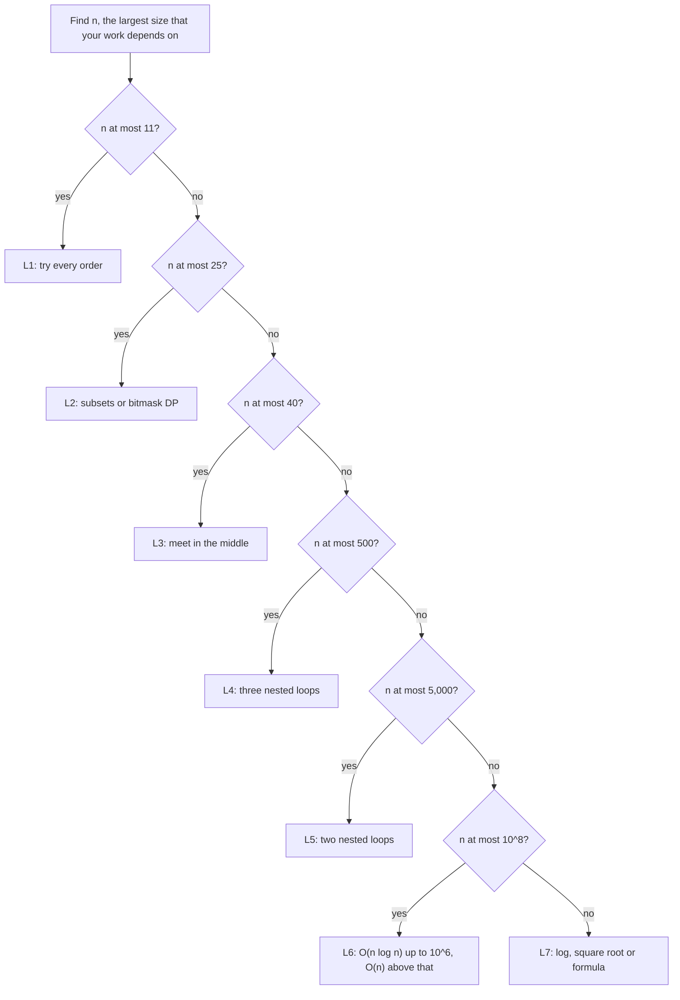
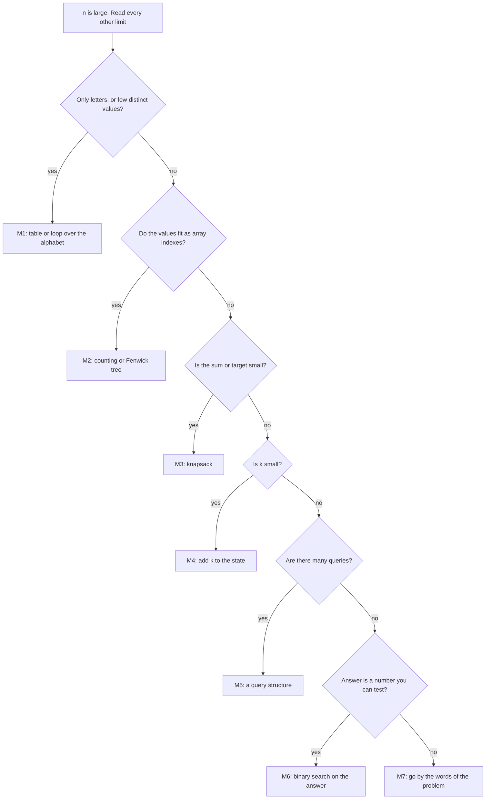

# Constraints Tell You the Algorithm

> **Level:** Beginner · **Priority:** T1 · **Time:** 75 min · **Read first:** [How to recognize any problem](01-how-to-recognize-any-problem.md), [Big-O from zero](../00-start-here/03-big-o-from-zero.md) · **Next:** [Decision tree by input type](03-decision-tree-by-input-type.md)

The limits printed under a problem are a strong hint. A line such as `1 <= n <= 20` tells you how much work your code may do, and that removes most wrong techniques before you write any code. This chapter teaches you to read those limits and turn them into a short list of techniques.

## Quick revision

- A **constraint** is a limit on the input, such as `1 <= n <= 10^5`.
- Planning budget: about 10^8 simple steps, a rough number and not a promise. Put the largest n into each complexity and keep the ones that fit.
- n up to about 11: try every order, O(n!).
- n up to about 20: try every subset or use bitmask DP, O(2^n * n).
- n from 30 to 40: meet in the middle, O(2^(n/2) * n).
- n from 100 to 500: three nested loops, O(n^3), such as interval DP or Floyd-Warshall.
- n from 1,000 to 5,000: O(n^2), such as a DP table with two indexes.
- n from 10^5 to 10^6: O(n log n) or O(n). You cannot compare every pair.
- n at 10^9 or more: O(log n), O(sqrt n) or a formula. You cannot loop to n.
- Then look for a **second, smaller number**: k, a small sum, a small alphabet, few distinct values. The biggest number is not always the real size.
- A small sum means knapsack. Values up to about 10^6 can be array indexes, which means counting or a Fenwick tree.
- Look at what the values allow. Negative numbers break a sliding window on sums. Values from 1 to n can act as indexes.
- "Return it modulo 10^9 + 7" means the answer is too large to list. Usually you count with DP or math. If it is a maximum, compare before you take the modulo.
- The limit makes the list short. The words of the problem pick the technique from that list.
- In an interview, limits are often not given. Ask for them.

## How to recognize it

Do this before you think about any technique. Ask these five questions in order.

1. What is the largest size in the limits? Call it n.
2. Which complexities fit the budget for that n?
3. Is there a second, smaller number, such as k, a sum, an alphabet or a count of distinct values?
4. What do the values allow: negatives, sorted order, the range 1 to n?
5. Does the statement add a rule, such as "modulo 10^9 + 7", "O(1) extra space" or "must run in O(n)"?

| What you see | What it tells you |
|---|---|
| `n <= 10` or so | Try every order or placement. Backtracking is fine. |
| `n <= 20` | Try every subset, or use a bitmask as a DP state. |
| `n <= 40` | If you must choose a subset, 2^40 is too many, but 2^20 is fine. Split the input in half. |
| `n <= 100` to `n <= 500` | O(n^3) fits. Think of interval DP or Floyd-Warshall. |
| `n <= 5000` | O(n^2) fits. A table with two indexes is likely. |
| `n <= 10^5` | O(n log n) fits. Comparing every pair does not. A nested `while` is fine if its total work is O(n), as in a sliding window. |
| `n <= 10^9` or larger | Any loop to n is too slow. Binary search on the answer, fast power or a formula. |
| "lowercase English letters" | A table of 26 costs O(1) space, and a loop over the alphabet is cheap. |
| `nums[i] <= 10^5` | A value can be an array index. Counting array or Fenwick tree. |
| `sum(nums) <= 2 * 10^4`, `target <= 1000` | A DP table indexed by the sum fits. Think knapsack. |
| `k <= 10`, `k <= 100` | Add k to the DP state. If k counts items to collect and is about 10, use a mask. |
| `m * n <= 10^5` | The grid has at most 10^5 cells in total. Ignore the separate limits on m and n. |
| `1 <= nums[i]` | All positive. A sum only grows, so a sliding window can work. |
| `1 <= nums[i] <= n` | Each value can point to an index. Cyclic sort, or fast and slow pointers. |
| "modulo 10^9 + 7" | The answer is huge, so do not list it. It is often a count, but it can be a maximum, as in [Maximum Subarray Min-Product](https://leetcode.com/problems/maximum-subarray-min-product/). |
| "O(1) extra space" | No hash set. Think two pointers, XOR, or fast and slow pointers. |

**Do not stop at the first number if:**

| You see | Wrong conclusion | What is true |
|---|---|---|
| `n <= 10^6` but also `cuts <= 100` | "n log n, then" | The real size is 100. See [Minimum Cost to Cut a Stick](https://leetcode.com/problems/minimum-cost-to-cut-a-stick/) in [section 8](#8-reading-the-limits-out-loud). |
| `n <= 30` and values up to 100 | "Meet in the middle" | The sum is at most 3,000, so [knapsack](../09-dynamic-programming/04-zero-one-knapsack.md) is simpler. |
| `n <= 40`, only neighbours can join | "Meet in the middle" | Every group is a range, and there are only about n^2 ranges. Think [interval DP](../09-dynamic-programming/09-interval-dp.md), as in D10. |
| `n <= 500`, Medium | "It must be O(n^3)" | The limit is the most you may spend. [Edit Distance](https://leetcode.com/problems/edit-distance/) has limit 500 and costs O(n * m). |
| `n <= 10^4` | "O(n^2) passes, so I am done" | About 10^8 steps is on the edge, so it may pass the judge. An interviewer usually wants better, as in [Two Sum](https://leetcode.com/problems/two-sum/). |
| `n <= 10^5` | "It must be sorting" | The limit only rules out O(n^2). Many O(n) techniques also fit. |
| `n` is `10^5` and `q` is `10^5` | "O(n) is fine" | The cost is per query, so n and q multiply. See [section 6](#6-limits-that-multiply). |

## 1. The idea in plain English

Think of going shopping with a fixed amount of money. Before you walk into a shop, you look at your wallet. If you have 500 rupees, you do not look at cars.

Your wallet is the time limit. Prices are complexities. The limit on n tells you the price of each complexity for this problem.

Here is a tiny example. The problem is: **does the array have two numbers with a sum of `k`?** The simple way checks every pair, which is about n^2 / 2 pairs. Now look at the same problem with two limits. (10^5 means 100,000.)

| Limit | n^2 steps | Does it fit in 10^8? | What you should do |
|---|---|---|---|
| `n <= 1000` | 10^6 | Yes | The simple way is allowed. |
| `n <= 10^5` | 10^10 | No, 100 times too many | Use a hash set, or sort and use two pointers. |

The problem did not change. Only the limit changed, and that was enough to rule out the simple way. That is the whole idea of this chapter.

**The budget.** Many engineers plan with this rule: about 10^8 simple steps fit in a time limit of one second. This is a rough number. Real speed depends on the machine, the language and how heavy each step is. Use it to compare options, not to predict a running time.

**How to do the sums in your head.** You only need these facts.

| Fact | Use |
|---|---|
| 2^10 is about 1,000 | So 2^20 is about 10^6, and 2^30 is about 10^9. |
| log2(10^5) is about 17 | So n log n for n = 10^5 is about 1.7 * 10^6. |
| log2(10^6) is about 20 | So n log n for n = 10^6 is about 2 * 10^7. |
| log2(10^9) is about 30 | Binary search over 1 to 10^9 takes about 30 rounds. |
| sqrt(10^9) is about 31,623 | Trial division (trying each divisor up to the square root) is cheap. |
| 10! is about 3.6 * 10^6 | 12! is already about 4.8 * 10^8. |

## 2. The master table

Read this table from left to right. Find the largest n. The second column is the slowest complexity that still fits. The last column lists what usually has that complexity.

| Largest n | Slowest that fits | Steps at that n | Likely techniques |
|---|---|---|---|
| 10 to 11 | O(n!) | 11! is about 4 * 10^7 | [Permutations](../06-recursion-backtracking-greedy/03-backtracking-permutations-combinations.md), [constraint search](../06-recursion-backtracking-greedy/04-backtracking-constraint-search.md) |
| 12 to 16 | O(2^n * n^2) | At 16: about 1.7 * 10^7 | [Bitmask DP](../09-dynamic-programming/12-bitmask-dp.md) |
| 15 | O(3^n) | About 1.4 * 10^7 | [Bitmask DP](../09-dynamic-programming/12-bitmask-dp.md) with submasks |
| 20 to 25 | O(2^n * n) at 20, O(2^n) at 25 | About 2.1 * 10^7, about 3.4 * 10^7 | [Subsets](../06-recursion-backtracking-greedy/02-backtracking-subsets.md), [bitmask DP](../09-dynamic-programming/12-bitmask-dp.md) |
| 30 to 40 | O(2^(n/2) * n) | At 40: about 4 * 10^7 | [Meet in the middle](../06-recursion-backtracking-greedy/08-meet-in-the-middle.md) |
| 100 | O(n^4) with a small constant | 10^8 | [Interval DP](../09-dynamic-programming/09-interval-dp.md) with an extra index |
| 200 to 500 | O(n^3) | At 500: 1.25 * 10^8 | [Interval DP](../09-dynamic-programming/09-interval-dp.md), [Floyd-Warshall](../08-graphs/10-floyd-warshall-and-all-pairs.md) |
| 1,000 to 5,000 | O(n^2) | At 5,000: 2.5 * 10^7 | [Grid DP](../09-dynamic-programming/03-grid-dp.md), [LCS](../09-dynamic-programming/07-lcs-and-edit-distance.md), [two pointers inside a loop](../05-core-patterns/01-two-pointers-opposite-ends.md) |
| 10^5 to 10^6 | O(n log n) | At 10^6: about 2 * 10^7 | [Sorting](../04-sorting-searching/05-custom-sorting.md), [heaps](../05-core-patterns/14-top-k-and-heaps.md), [binary search](../04-sorting-searching/06-binary-search-basics.md), [sliding window](../05-core-patterns/05-sliding-window-variable.md), [Fenwick tree](../12-advanced-data-structures/03-fenwick-tree.md) |
| 10^7 to 10^8 | O(n) | 10^8 at the top | One tight loop, a [sieve](../11-math-geometry-games/02-primes-and-sieve.md) |
| 10^9 to 10^12 | O(sqrt n) | At 10^12: 10^6 | [Trial division](../11-math-geometry-games/02-primes-and-sieve.md), a loop to the square root |
| 10^9 to 10^18 | O(log n) or O(1) | At 10^18: about 60 | [Binary search on the answer](../04-sorting-searching/07-binary-search-on-answer.md), [fast power](../11-math-geometry-games/03-modular-arithmetic.md), [matrix power](../11-math-geometry-games/05-matrix-exponentiation.md), [digit DP](../09-dynamic-programming/13-digit-dp.md), a formula |

Two rules for using this table:

1. **The limit is a ceiling, not the price.** Problem setters usually pick a limit where the intended solution fits and the next slower one does not. But some limits are loose. [House Robber](https://leetcode.com/problems/house-robber/) has `n <= 100` and needs only O(n).
2. **Count everything inside the loops.** O(2^n * n^2) at n = 20 is about 4 * 10^8. So bitmask DP with two nested loops over n needs n at about 16, not 20.

## 3. The small limits: n up to 40

All limits in this chapter are from the problem pages when this guide was written. LeetCode can change them, so check the page.

### n up to about 11: try every order

**Why this limit?** The number of orders of n items is n!. It grows so fast that only tiny n survive. A setter who gives `n <= 8` is often telling you that no fast method is expected.

| Problem | Limit | Why it fits |
|---|---|---|
| [Permutations](https://leetcode.com/problems/permutations/) | `n <= 6` | Listing all orders is the task itself. |
| [N-Queens](https://leetcode.com/problems/n-queens/) | `n <= 9` | Search board placements and stop early on a conflict. |
| [Generate Parentheses](https://leetcode.com/problems/generate-parentheses/) | `n <= 8` | The output itself is large, so the time must be too. |
| [Word Search](https://leetcode.com/problems/word-search/) | Grid at most 6 by 6 | Walk from each cell and undo each step. |
| [Fair Distribution of Cookies](https://leetcode.com/problems/fair-distribution-of-cookies/) | 8 bags, up to 8 children | Each bag has up to 8 choices: 8^8 is about 1.7 * 10^7. |

**Why not greedy?** If a greedy rule worked, the setter could give n = 10^5. A tiny limit suggests the choices depend on each other, so you have to search them. Go to [backtracking with constraints](../06-recursion-backtracking-greedy/04-backtracking-constraint-search.md).

### n from 12 to about 25: subsets as a number

A **bitmask** is an integer whose bits mark a set of items. Bit i is 1 when item i is in the set. So all subsets of 16 items are just the numbers from 0 to 65,535.

**Why this limit?** Each item is in or out, which gives 2^n subsets. That fits up to about n = 25 for a plain loop. Each extra loop over n costs more, so bitmask DP often stops at n = 16.

| Problem | Limit | Cost |
|---|---|---|
| [Shortest Path Visiting All Nodes](https://leetcode.com/problems/shortest-path-visiting-all-nodes/) | `n <= 12` | BFS over (node, visited set): 12 * 2^12 states |
| [Find the Shortest Superstring](https://leetcode.com/problems/find-the-shortest-superstring/) | `n <= 12` | O(2^n * n^2) DP |
| [Find Minimum Time to Finish All Jobs](https://leetcode.com/problems/find-minimum-time-to-finish-all-jobs/) | `n <= 12` | Submasks: O(3^n * k) |
| [Beautiful Arrangement](https://leetcode.com/problems/beautiful-arrangement/) | `n <= 15` | O(2^n * n) DP over used numbers |
| [Partition to K Equal Sum Subsets](https://leetcode.com/problems/partition-to-k-equal-sum-subsets/) | `n <= 16` | O(2^n * n) DP |
| [Can I Win](https://leetcode.com/problems/can-i-win/) | Up to 20 numbers | Memoize on the set of used numbers: 2^20 states |

**Backtracking or bitmask DP?** Ask this: **does the future depend only on which items are used (and maybe which one was last), and not on the full order?** If yes, many paths reach the same state, so you store one result per state. That is [bitmask DP](../09-dynamic-programming/12-bitmask-dp.md). If you must list every result, as in [Subsets](https://leetcode.com/problems/subsets/), use [backtracking](../06-recursion-backtracking-greedy/02-backtracking-subsets.md).

### n from 30 to 40: meet in the middle

**Why this limit?** 2^40 is about 10^12, which is far too many. But 2^20 is about 10^6. So you split the items into two halves. You list the subset sums of each half, then join the two lists with sorting and binary search. [Section 7](#7-one-problem-three-limits) shows the code.

| Problem | Limit |
|---|---|
| [Closest Subsequence Sum](https://leetcode.com/problems/closest-subsequence-sum/) | `n <= 40`, values up to 10^7 in size |
| [Partition Array Into Two Arrays to Minimize Sum Difference](https://leetcode.com/problems/partition-array-into-two-arrays-to-minimize-sum-difference/) | 30 numbers in total |
| [Split Array With Same Average](https://leetcode.com/problems/split-array-with-same-average/) | `n <= 30` |

**Why not knapsack?** Knapsack needs a table indexed by the sum. In Closest Subsequence Sum the possible sums go from about -4 * 10^8 to 4 * 10^8, and the values can be negative. That table is too big. Always check the sum first, because a small sum gives you the easier tool.

## 4. The larger limits: n from 100 to 10^18

### n from about 100 to 500: three nested loops

**Why this limit?** n^3 fits at n = 500, but n^4 does not. Two shapes of solution have exactly three loops.

**Shape 1: interval DP.** You compute the best answer for each range `[i, j]`. To do that, you try every split point inside the range. The three loops are the range length, the start and the split. The signal is a process where each step changes the neighbours: merging, bursting, cutting.

| Problem | Limit | Note |
|---|---|---|
| [Minimum Cost Tree From Leaf Values](https://leetcode.com/problems/minimum-cost-tree-from-leaf-values/) | `n <= 40` | Pick where to split the leaves. A rare exception: a greedy monotonic stack also works, in O(n). |
| [Minimum Score Triangulation of Polygon](https://leetcode.com/problems/minimum-score-triangulation-of-polygon/) | `n <= 50` | Pick the third corner of a triangle |
| [Strange Printer](https://leetcode.com/problems/strange-printer/) | `n <= 100` | O(n^3) |
| [Burst Balloons](https://leetcode.com/problems/burst-balloons/) | `n <= 300` | Pick the last balloon to burst in a range |
| [Remove Boxes](https://leetcode.com/problems/remove-boxes/) | `n <= 100` | An extra index makes it O(n^4), so the limit is lower |

**Why not greedy?** A choice changes who is next to whom, so you usually cannot judge one step alone. Go to [interval DP](../09-dynamic-programming/09-interval-dp.md).

**Shape 2: Floyd-Warshall.** It finds the shortest distance between every pair of nodes. Its three loops all run over the nodes. [Find the City With the Smallest Number of Neighbors at a Threshold Distance](https://leetcode.com/problems/find-the-city-with-the-smallest-number-of-neighbors-at-a-threshold-distance/) has `n <= 100` and needs all pairs.

**Why not Dijkstra?** Dijkstra from each node also fits there, because no edge is negative. Floyd-Warshall is just shorter to write. Go to [Floyd-Warshall](../08-graphs/10-floyd-warshall-and-all-pairs.md).

### n from 1,000 to 5,000: two nested loops

**Why this limit?** n^2 fits, and n^3 does not. There are two usual shapes.

| Shape | Problem | Limit |
|---|---|---|
| Table with two indexes | [Longest Common Subsequence](https://leetcode.com/problems/longest-common-subsequence/) | Both strings at most 1,000 |
| Table with two indexes | [Longest Palindromic Subsequence](https://leetcode.com/problems/longest-palindromic-subsequence/) | `n <= 1000` |
| For each end, look at all earlier items | [Longest Increasing Subsequence](https://leetcode.com/problems/longest-increasing-subsequence/) | `n <= 2500` |
| Sort, fix one item, scan the rest | [3Sum](https://leetcode.com/problems/3sum/) | `n <= 3000` |
| Grow from each center | [Longest Palindromic Substring](https://leetcode.com/problems/longest-palindromic-substring/) | `n <= 1000` |

Now see how one limit changes the method. Longest Increasing Subsequence has `n <= 2500`, so the O(n^2) DP passes. [Russian Doll Envelopes](https://leetcode.com/problems/russian-doll-envelopes/) uses the same idea after sorting, but it has `n <= 10^5`. The O(n^2) DP would take 10^10 steps, so you need the [O(n log n) version](../09-dynamic-programming/06-longest-increasing-subsequence.md).

**Memory matters too.** A table of 5,000 by 5,000 `int` values holds 2.5 * 10^7 numbers, which is about 100 MB. If each row needs only the row before it, keep two rows.

### n from 10^4 to 10^6: no O(n^2)

This is the most common limit, and it tells you the least. It says only this: **you cannot compare every pair.** Many techniques are left, so now the words of the problem decide.

| Words in the problem | Technique | Example |
|---|---|---|
| "longest substring", a rule on the window | [Variable sliding window](../05-core-patterns/05-sliding-window-variable.md) | [Longest Substring Without Repeating Characters](https://leetcode.com/problems/longest-substring-without-repeating-characters/) |
| "subarray sum equals k", negatives allowed | [Prefix sum with a hash map](../05-core-patterns/06-prefix-sums.md) | [Subarray Sum Equals K](https://leetcode.com/problems/subarray-sum-equals-k/) |
| "k-th largest", "top k" | [Heap](../05-core-patterns/14-top-k-and-heaps.md) or [quickselect](../04-sorting-searching/03-quick-sort-and-quickselect.md) | [Kth Largest Element in an Array](https://leetcode.com/problems/kth-largest-element-in-an-array/) |
| "largest rectangle", "next greater" | [Monotonic stack](../05-core-patterns/12-monotonic-stack.md) | [Largest Rectangle in Histogram](https://leetcode.com/problems/largest-rectangle-in-histogram/) |
| "maximum of each window" | [Monotonic queue](../05-core-patterns/13-monotonic-queue.md) | [Sliding Window Maximum](https://leetcode.com/problems/sliding-window-maximum/) |
| "maximum sum subarray" | [Kadane's algorithm](../05-core-patterns/08-kadane-and-subarray-dp.md) | [Maximum Subarray](https://leetcode.com/problems/maximum-subarray/) |
| "maximize the minimum distance" | [Binary search on the answer](../04-sorting-searching/07-binary-search-on-answer.md) | [Magnetic Force Between Two Balls](https://leetcode.com/problems/magnetic-force-between-two-balls/) |

The next chapters of this part help you choose from this list: [by input type](03-decision-tree-by-input-type.md) and [by question goal](04-decision-tree-by-question-goal.md).

### n from 10^7 to 10^8: one tight loop

These limits are rare in interviews. Only O(n) with a small constant fits, and memory becomes the first problem. [Count Primes](https://leetcode.com/problems/count-primes/) has `n <= 5 * 10^6`, which points to a [sieve](../11-math-geometry-games/02-primes-and-sieve.md). A sieve costs O(n log log n), which is almost linear.

### n at 10^9 or more: you cannot loop to n

**Why this limit?** At this size, even one pass is too many steps, and an array of size n does not fit in memory. So n must not be the length of a list. It is one number. You need one of these families.

| Family | The clue | Problems | Go to |
|---|---|---|---|
| Binary search on the answer | The answer is a number. "Is x enough?" is easy to check, and a larger x never makes it worse. | [Sqrt(x)](https://leetcode.com/problems/sqrtx/), [Koko Eating Bananas](https://leetcode.com/problems/koko-eating-bananas/), [Nth Magical Number](https://leetcode.com/problems/nth-magical-number/), [Ugly Number III](https://leetcode.com/problems/ugly-number-iii/) | [Binary search on the answer](../04-sorting-searching/07-binary-search-on-answer.md) |
| Fast power | One step repeats n times, and each step multiplies. | [Pow(x, n)](https://leetcode.com/problems/powx-n/), [Count Good Numbers](https://leetcode.com/problems/count-good-numbers/) (`n <= 10^15`), [Count Collisions of Monkeys on a Polygon](https://leetcode.com/problems/count-collisions-of-monkeys-on-a-polygon/) | [Modular arithmetic](../11-math-geometry-games/03-modular-arithmetic.md) |
| A formula | Small answers show a pattern when you write them out. | [Nim Game](https://leetcode.com/problems/nim-game/), [Bulb Switcher](https://leetcode.com/problems/bulb-switcher/) | [Brainteasers](../02-arrays-strings-hashing/06-simulation-and-enumeration.md), [game theory](../11-math-geometry-games/08-game-theory.md) |
| Loop to the square root | Factors or a pair of squares. | [Closest Divisors](https://leetcode.com/problems/closest-divisors/), [Sum of Square Numbers](https://leetcode.com/problems/sum-of-square-numbers/) | [Primes and sieve](../11-math-geometry-games/02-primes-and-sieve.md) |
| Digit by digit | "Count numbers up to n with a property". n has only about 10 decimal digits, or 30 bits. | [Number of Digit One](https://leetcode.com/problems/number-of-digit-one/), [Non-negative Integers without Consecutive Ones](https://leetcode.com/problems/non-negative-integers-without-consecutive-ones/) | [Digit DP](../09-dynamic-programming/13-digit-dp.md) |
| n shrinks fast | Each step divides n, so few values are ever reached. | [Minimum Number of Days to Eat N Oranges](https://leetcode.com/problems/minimum-number-of-days-to-eat-n-oranges/) | [Memoization in DP](../09-dynamic-programming/01-dp-from-zero.md) |
| Matrix power | A rule such as f(n) = f(n-1) + f(n-2), with n up to 10^18. | Classic: Fibonacci with a huge n | [Matrix exponentiation](../11-math-geometry-games/05-matrix-exponentiation.md) |

**When you are stuck here,** write the answers for n = 1 to 8 by hand. A pattern often appears. In Bulb Switcher the answers are 1, 1, 1, 2, 2, 2, 2, 2, and the answer jumps at each perfect square. The answer is the square root of n, rounded down.

**Why not DP?** A DP table has one cell for each value from 1 to n, so a limit of 10^9 rules it out. The exceptions are the digit DP and "n shrinks fast" rows, because those reach only a few states.

## 5. Limits on values, not on length

So far n was the length of the input. Now look at the limits on the values. This is where many hidden hints are.

### A small alphabet

"Consists of lowercase English letters" is a real limit: there are only 26 possible values. This gives you two powers.

**Power 1: a table of 26 is O(1) space.** This is why [Valid Anagram](https://leetcode.com/problems/valid-anagram/) and [Permutation in String](https://leetcode.com/problems/permutation-in-string/) need no hash map.

**Power 2: you may loop over the alphabet.** The cost is 26 * n, which is still linear.

- [Unique Length-3 Palindromic Subsequences](https://leetcode.com/problems/unique-length-3-palindromic-subsequences/): for each of 26 letters, find its first and last position. Then count the different letters between them.
- [Longest Repeating Character Replacement](https://leetcode.com/problems/longest-repeating-character-replacement/): the window needs the count of each letter, and there are only 26 counts.
- [Minimum Cost to Convert String I](https://leetcode.com/problems/minimum-cost-to-convert-string-i/): the string has 10^5 letters, but the graph has only 26 nodes. Floyd-Warshall costs 26^3 steps.

**Even fewer letters, and the word "even" or "odd":** use a mask of odd counts. [Number of Wonderful Substrings](https://leetcode.com/problems/number-of-wonderful-substrings/) uses only the letters a to j, so there are 2^10 = 1,024 masks. [Find the Longest Substring Containing Vowels in Even Counts](https://leetcode.com/problems/find-the-longest-substring-containing-vowels-in-even-counts/) has 5 vowels, so there are 32 masks. Both join a [prefix idea](../05-core-patterns/06-prefix-sums.md) with a [bit mask](../05-core-patterns/17-bit-manipulation.md).

### Values up to about 10^6: a value can be an index

If values are small, you can use them as positions in an array. There are four common uses.

| Use | The clue | Problem and limit | Go to |
|---|---|---|---|
| Count each value | "How many are smaller?" or sorting by a small range | [How Many Numbers Are Smaller Than the Current Number](https://leetcode.com/problems/how-many-numbers-are-smaller-than-the-current-number/): values at most 100. [Relative Sort Array](https://leetcode.com/problems/relative-sort-array/): values at most 1,000. | [Counting sort](../04-sorting-searching/04-non-comparison-sorts.md) |
| Add over a range of positions | Many "add to everyone from a to b" events | [Car Pooling](https://leetcode.com/problems/car-pooling/): stops at most 1,000. [Maximum Population Year](https://leetcode.com/problems/maximum-population-year/): years 1950 to 2050. | [Difference array](../05-core-patterns/07-difference-array-and-sweep-line.md) |
| Count smaller values seen so far | "How many earlier or later items are smaller?" | [Count of Smaller Numbers After Self](https://leetcode.com/problems/count-of-smaller-numbers-after-self/): values between -10^4 and 10^4, so add 10,001 to each and there are 20,001 slots. | [Fenwick tree](../12-advanced-data-structures/03-fenwick-tree.md), or [merge sort](../04-sorting-searching/02-merge-sort.md) |
| Loop over multiples | "gcd" with values up to about 10^5 | [Number of Different Subsequences GCDs](https://leetcode.com/problems/number-of-different-subsequences-gcds/): values at most 2 * 10^5. For each g, visit its multiples. The total is about M log M steps, where M is the largest value. | [GCD counting](../11-math-geometry-games/11-gcd-counting-and-mobius.md) |

**What if values go up to 10^9 but n is 10^5?** You cannot index by value, because the array would have 10^9 slots. But at most n different values exist. So you can **compress** them: sort the distinct values and replace each with its rank (0 for the smallest, 1 for the next, and so on). The ranks are small indexes, and they keep the same order. Then a Fenwick tree works, as in [Reverse Pairs](https://leetcode.com/problems/reverse-pairs/) and [Count of Range Sum](https://leetcode.com/problems/count-of-range-sum/).

**Values from 1 to n are a gift.** Each value can point to an index in the same array.

- [Find All Numbers Disappeared in an Array](https://leetcode.com/problems/find-all-numbers-disappeared-in-an-array/) and [First Missing Positive](https://leetcode.com/problems/first-missing-positive/): put each value at its own index. This is [cyclic sort](../05-core-patterns/10-cyclic-sort.md). First Missing Positive allows any values, but its answer is at most n + 1, so you ignore values outside 1 to n.
- [Find the Duplicate Number](https://leetcode.com/problems/find-the-duplicate-number/): you may not change the array. So treat `i -> nums[i]` as a linked list and use [fast and slow pointers](../05-core-patterns/03-fast-and-slow-pointers.md).

### A small k

If k is small and it counts something, put it in the DP state. The cost is multiplied by k.

| Problem | Limit | State |
|---|---|---|
| [Greatest Sum Divisible by Three](https://leetcode.com/problems/greatest-sum-divisible-by-three/) | Remainder is 0, 1 or 2 | Best sum for each remainder |
| [Best Time to Buy and Sell Stock IV](https://leetcode.com/problems/best-time-to-buy-and-sell-stock-iv/) | `k <= 100` | Day, trades used, holding or not. See [state machine DP](../09-dynamic-programming/10-state-machine-dp.md). |
| [Number of Dice Rolls With Target Sum](https://leetcode.com/problems/number-of-dice-rolls-with-target-sum/) | `n, k <= 30`, `target <= 1000` | Dice used and sum so far. See [counting DP](../09-dynamic-programming/14-counting-and-probability-dp.md). |
| [Paint House III](https://leetcode.com/problems/paint-house-iii/) | 100 houses, 20 colors, target at most 100 | House, last color, groups so far |

If k counts **items you must collect**, and k is at most about 10, use a mask instead of a number. See [Shortest Path to Get All Keys](https://leetcode.com/problems/shortest-path-to-get-all-keys/) in [section 6](#6-limits-that-multiply).

If k can be as large as n, it is not a hint for the state. A heap of size k then costs O(n log k), which in the worst case is the same as sorting.

### A small sum or target

**Knapsack** is a DP with one cell for each possible sum. So its cost is n times the sum, and it does not care how many subsets exist. It works only when the sum is small.

| Problem | Limit | Steps |
|---|---|---|
| [Partition Equal Subset Sum](https://leetcode.com/problems/partition-equal-subset-sum/) | `n <= 200`, values at most 100 | Half of the sum is at most 10^4, so 2 * 10^6 |
| [Last Stone Weight II](https://leetcode.com/problems/last-stone-weight-ii/) | `n <= 30`, values at most 100 | The sum is at most 3,000, so 9 * 10^4 |
| [Target Sum](https://leetcode.com/problems/target-sum/) | `n <= 20`, sum at most 1,000 | Both 2^20 and the DP fit |
| [Coin Change](https://leetcode.com/problems/coin-change/) | `amount <= 10^4`, at most 12 coins | 1.2 * 10^5 |
| [Coin Change II](https://leetcode.com/problems/coin-change-ii/) | `amount <= 5000`, at most 300 coins | 1.5 * 10^6 |

Go to [0/1 knapsack](../09-dynamic-programming/04-zero-one-knapsack.md) when each item is used once, and [unbounded knapsack](../09-dynamic-programming/05-unbounded-knapsack.md) when items can repeat.

**Why not greedy?** Take coins 1, 3, 4 and amount 6. Greedy takes 4 + 1 + 1, which is 3 coins. The best is 3 + 3, which is 2 coins.

## 6. Limits that multiply

One number alone is not the full cost. These four cases show when numbers must be multiplied or combined.

### A limit on the product

`m * n <= 10^5` means the grid has at most 10^5 cells, in any shape. So m may be 10^5 when n is 1. Do not treat them as two separate limits.

- [Minimum Obstacle Removal to Reach Corner](https://leetcode.com/problems/minimum-obstacle-removal-to-reach-corner/): visit each cell a small number of times, with [0-1 BFS](../08-graphs/04-bfs-shortest-path-patterns.md).
- [01 Matrix](https://leetcode.com/problems/01-matrix/): `m * n <= 10^4`. Start one [BFS](../08-graphs/04-bfs-shortest-path-patterns.md) from all zeros at once.
- [Maximum Number of Points with Cost](https://leetcode.com/problems/maximum-number-of-points-with-cost/): a row may have 5 * 10^4 cells, so comparing all pairs of columns between rows is too slow. Use a [left and right scan](../05-core-patterns/22-left-and-right-scans.md) instead.

### A limit on the total length

[Sum of Prefix Scores of Strings](https://leetcode.com/problems/sum-of-prefix-scores-of-strings/) has 1,000 words of up to 1,000 letters. The total is 10^6 letters. So work that touches each letter once fits, which suggests a [trie](../07-trees/13-trie.md). Comparing every pair of words does not fit: that is about 5 * 10^5 pairs, and each pair may need 1,000 letter checks.

### Many queries

If the input has n items and q queries, your cost is any setup work, plus the cost of one query times q.

| Problem | Limits | Slow way | Better way |
|---|---|---|---|
| [Range Sum Query - Immutable](https://leetcode.com/problems/range-sum-query-immutable/) | `n, q <= 10^4`, no updates | Add up the range: 10^8 | [Prefix sums](../05-core-patterns/06-prefix-sums.md): O(1) per query |
| [Range Sum Query - Mutable](https://leetcode.com/problems/range-sum-query-mutable/) | `n, q <= 3 * 10^4`, with updates | Prefix sums need O(n) per update: 9 * 10^8 | [Fenwick tree](../12-advanced-data-structures/03-fenwick-tree.md) or [segment tree](../12-advanced-data-structures/01-segment-tree.md): O(log n) per call |

### The size of a state

For a DP or a BFS, a **state** is everything you must remember at one moment. To test a state, multiply the range of each part. If the result fits the budget, the state is probably right.

| Problem | Limits | State | Number of states |
|---|---|---|---|
| [Minimum Number of Flips to Convert Binary Matrix to Zero Matrix](https://leetcode.com/problems/minimum-number-of-flips-to-convert-binary-matrix-to-zero-matrix/) | Grid at most 3 by 3 | The whole board | 2^9 = 512 |
| [Sliding Puzzle](https://leetcode.com/problems/sliding-puzzle/) | Board is 2 by 3 | The whole board | 6! = 720 |
| [Shortest Path to Get All Keys](https://leetcode.com/problems/shortest-path-to-get-all-keys/) | 30 by 30, at most 6 keys | Row, column, keys held | 30 * 30 * 2^6 = 57,600 |
| [Shortest Path in a Grid with Obstacles Elimination](https://leetcode.com/problems/shortest-path-in-a-grid-with-obstacles-elimination/) | 40 by 40, `k <= 1600` | Row, column, removals left | 40 * 40 * 1600 = 2.56 * 10^6 |
| [Cherry Pickup II](https://leetcode.com/problems/cherry-pickup-ii/) | 70 by 70 | Row, column of robot 1, column of robot 2 | 70^3 = 343,000, with 9 moves each |

The first four are [state-space BFS](../08-graphs/04-bfs-shortest-path-patterns.md). The last one is [grid DP](../09-dynamic-programming/03-grid-dp.md).

## 7. One problem, three limits

This section shows the whole chapter in one problem. **Subset sum:** given a list of numbers, can you pick some of them so that they add up to exactly `target`? Picking nothing gives a sum of 0.

The question stays the same. Only the limits change, and each set of limits picks a different method.

| Version | Limits | All subsets, 2^n * n | Meet in the middle | Knapsack, n * target |
|---|---|---|---|---|
| A | `n <= 20`, values up to 10^9 | About 2 * 10^7, fits | Fits, not needed | Target can reach 2 * 10^10, too big |
| B | `n <= 40`, values up to 10^9 | About 4 * 10^13, too slow | About 4 * 10^7, fits | Target can reach 4 * 10^10, too big |
| C | `n <= 200`, sum at most 2 * 10^4 | 2^200, far too slow | 2^100, far too slow | At most 4 * 10^6, fits |

**Version A: try all subsets.** Each number from 0 to 2^n - 1 is one subset. Bit i says whether you take item i.

**Version B: meet in the middle.** Here is a tiny trace with `nums = [3, 4, 5, 2]` and `target = 9`. Split the list into `[3, 4]` and `[5, 2]`. List the subset sums of each half.

```text
left half  [3, 4]   sums: 0, 3, 4, 7
right half [5, 2]   sums: 0, 5, 2, 7   sorted: 0, 2, 5, 7
```

For each left sum, search the sorted right list for the rest of the target.

| Left sum | Need from the right | Found? |
|---|---|---|
| 0 | 9 | No |
| 3 | 6 | No |
| 4 | 5 | Yes, so 4 + 5 = 9 |

You compared 4 sums with 4 sums, instead of checking all 16 subsets. For n = 40, this means two lists of about 10^6 sums instead of 10^12 subsets.

**Version C: knapsack.** Keep one yes or no for each sum from 0 to `target`. Add the items one at a time. Each item can make new sums from the old ones. The loop runs from high sums to low sums, so that one item is not used twice.

The values must be zero or more here, because the table has no cells for negative sums.

```cpp
#include <bits/stdc++.h>
#include <cassert>
using namespace std;

// Version A: fits n up to about 20. Works with any values.
bool byAllSubsets(const vector<long long>& nums, long long target) {
    int n = (int)nums.size();
    for (int mask = 0; mask < (1 << n); mask++) {
        long long sum = 0;
        for (int i = 0; i < n; i++) {
            if (mask & (1 << i)) sum += nums[i];
        }
        if (sum == target) return true;
    }
    return false;
}

// Every subset sum of nums[from..to-1]. Each item doubles the list.
vector<long long> allSums(const vector<long long>& nums, int from, int to) {
    vector<long long> sums = {0};
    for (int i = from; i < to; i++) {
        int count = (int)sums.size();
        for (int j = 0; j < count; j++) sums.push_back(sums[j] + nums[i]);
    }
    return sums;
}

// Version B: fits n up to about 40. Works with any values.
bool byMeetInTheMiddle(const vector<long long>& nums, long long target) {
    int n = (int)nums.size();
    vector<long long> leftSums = allSums(nums, 0, n / 2);
    vector<long long> rightSums = allSums(nums, n / 2, n);
    sort(rightSums.begin(), rightSums.end());  // so that each search is O(log) of the list size
    for (long long sum : leftSums) {
        if (binary_search(rightSums.begin(), rightSums.end(), target - sum)) return true;
    }
    return false;
}

// Version C: fits any n when target is small. All values must be zero or more.
bool byKnapsack(const vector<long long>& nums, int target) {
    if (target < 0) return false;
    vector<char> reachable(target + 1, 0);
    reachable[0] = 1;  // picking nothing gives a sum of 0
    for (long long value : nums) {
        // High to low, so that this item is not counted twice in one pass.
        for (long long sum = target; sum >= value; sum--) {
            if (reachable[sum - value]) reachable[sum] = 1;
        }
    }
    return reachable[target] == 1;
}

int main() {
    // Example: 4 + 5 = 9. Target 30 fails: without 34 the total is 26, and 34 alone is too big.
    vector<long long> nums = {3, 34, 4, 12, 5, 2};
    assert(byAllSubsets(nums, 9) && byMeetInTheMiddle(nums, 9) && byKnapsack(nums, 9));
    assert(!byAllSubsets(nums, 30) && !byMeetInTheMiddle(nums, 30) && !byKnapsack(nums, 30));

    // The trace from the text.
    vector<long long> small = {3, 4, 5, 2};
    assert(byMeetInTheMiddle(small, 9));

    // Edge case: an empty list can only make 0.
    vector<long long> empty;
    assert(byAllSubsets(empty, 0) && byMeetInTheMiddle(empty, 0) && byKnapsack(empty, 0));
    assert(!byAllSubsets(empty, 5) && !byMeetInTheMiddle(empty, 5) && !byKnapsack(empty, 5));

    // Tricky: the sum passes the range of int, so everything must be long long.
    vector<long long> big(6, 1000000000LL);
    assert(byMeetInTheMiddle(big, 3000000000LL));
    assert(!byMeetInTheMiddle(big, 3000000001LL));

    // Tricky: negative values. The subset sums of {-7, 3, 5} are -7, -4, -2, 0, 1, 3, 5, 8.
    vector<long long> mixed = {-7, 3, 5};
    assert(byAllSubsets(mixed, 1) && byMeetInTheMiddle(mixed, 1));
    assert(!byAllSubsets(mixed, 2) && !byMeetInTheMiddle(mixed, 2));

    // All three methods must agree on random small inputs.
    mt19937 rng(42);
    for (int trial = 0; trial < 500; trial++) {
        int n = rng() % 9;
        vector<long long> values(n);
        for (long long& value : values) value = rng() % 10;
        int target = rng() % 30;
        bool expected = byAllSubsets(values, target);
        assert(byMeetInTheMiddle(values, target) == expected);
        assert(byKnapsack(values, target) == expected);
    }
    cout << "All tests passed\n";
}
```

Costs, with n items:

| Method | Time | Space |
|---|---|---|
| All subsets | O(2^n * n), because each of the 2^n masks checks n bits | O(1) |
| Meet in the middle | O(2^(n/2) * n), because sorting and searching each cost about n/2 per item in a list of 2^(n/2) sums | O(2^(n/2)) |
| Knapsack | O(n * target), because each item visits each sum once | O(target) |

Go deeper in [meet in the middle](../06-recursion-backtracking-greedy/08-meet-in-the-middle.md) and [0/1 knapsack](../09-dynamic-programming/04-zero-one-knapsack.md).

## 8. Reading the limits out loud

Here are three real problems, read the way you should read them in an interview. In each one, the first number you see is not the whole story.

### Koko Eating Bananas

[Koko Eating Bananas](https://leetcode.com/problems/koko-eating-bananas/): each hour, Koko eats up to `k` bananas from one pile. Find the smallest `k` that finishes all piles within `h` hours.

Limits: at most 10^4 piles, each pile up to 10^9, `h` up to 10^9.

1. The array is small, 10^4, so O(n log n) is easy. But what can I do with it?
2. The answer `k` lies between 1 and 10^9. Trying every `k` costs 10^9 * 10^4 steps. No.
3. If speed `k` is enough, then any bigger speed is also enough. So the yes and no answers form one line: no, no, no, yes, yes, yes.
4. So I can [binary search on the answer](../04-sorting-searching/07-binary-search-on-answer.md). That is 30 rounds of a 10^4 check, or 3 * 10^5 steps.
5. The total hours can reach 10^13 when `k` is 1, so the count must be `long long`.

### Minimum Cost to Cut a Stick

[Minimum Cost to Cut a Stick](https://leetcode.com/problems/minimum-cost-to-cut-a-stick/): you cut a stick at marked points, in any order. Each cut costs the length of the piece being cut. Find the lowest total cost.

Limits: stick length `n <= 10^6`, number of cuts at most 100.

1. 10^6 looks like O(n log n). But does my work depend on the length? No. Only the marked points matter.
2. So the real size is 100, and O(n^3) is about 10^6 steps. That points to [interval DP](../09-dynamic-programming/09-interval-dp.md).
3. Check with the shape: each cut splits a piece, and the cost depends on earlier cuts. That is the "neighbours change" signal.
4. Why not try all orders? There are 100! orders. Why not greedy? The cost of a cut depends on what the earlier cuts left.

### Number of Ways to Wear Different Hats to Each Other

[Number of Ways to Wear Different Hats to Each Other](https://leetcode.com/problems/number-of-ways-to-wear-different-hats-to-each-other/): each person likes some hats. Count the ways for all people to wear different hats.

Limits: at most 10 people, 40 hat types. Return the count modulo 10^9 + 7.

1. "Modulo" means the count is huge. So I count, and I do not list.
2. A person picks a hat, so I first think of a mask over hats. 2^40 is too big.
3. There are only 10 people, and 2^10 = 1,024. So I make the mask over **people**, and I loop over hats instead.
4. State: hats handled so far, and which people already have a hat. Steps: 40 * 1,024 * 10, which is about 4 * 10^5. It fits.

The lesson is that a [bitmask](../09-dynamic-programming/12-bitmask-dp.md) goes on the smaller side. [Smallest Sufficient Team](https://leetcode.com/problems/smallest-sufficient-team/) is the same: 60 people but 16 skills, so the mask is over skills. [Distribute Repeating Integers](https://leetcode.com/problems/distribute-repeating-integers/) has 10^5 numbers, but at most 50 different values and 10 customers, so the mask is over customers.

## 9. Limits that are not sizes

Some lines in a problem are about **what the input is like**, or **what your code may use**. They decide between techniques that have the same speed.

| The line in the problem | What it means | Example | Go to |
|---|---|---|---|
| `1 <= nums[i]`, all positive | A sum only grows as a window grows, so a window works | [Minimum Size Subarray Sum](https://leetcode.com/problems/minimum-size-subarray-sum/) | [Variable sliding window](../05-core-patterns/05-sliding-window-variable.md) |
| Negative values allowed, exact sum | Growing can lower the sum, so a window fails | [Subarray Sum Equals K](https://leetcode.com/problems/subarray-sum-equals-k/) | [Prefix sums](../05-core-patterns/06-prefix-sums.md) |
| Negative values allowed, "at least k" | Same reason, and you also need the shortest piece | [Shortest Subarray with Sum at Least K](https://leetcode.com/problems/shortest-subarray-with-sum-at-least-k/) | [Monotonic queue](../05-core-patterns/13-monotonic-queue.md) |
| Every edge costs the same | Levels of BFS are distances | [Shortest Path in Binary Matrix](https://leetcode.com/problems/shortest-path-in-binary-matrix/) | [BFS](../08-graphs/02-bfs-and-dfs.md) |
| Edge costs are only 0 or 1 | A deque keeps the order that a heap would give | [Minimum Cost to Make at Least One Valid Path in a Grid](https://leetcode.com/problems/minimum-cost-to-make-at-least-one-valid-path-in-a-grid/) | [0-1 BFS](../08-graphs/04-bfs-shortest-path-patterns.md) |
| Edge costs are zero or more | A node's distance is final when it leaves the heap | [Network Delay Time](https://leetcode.com/problems/network-delay-time/) | [Dijkstra](../08-graphs/08-dijkstra.md) |
| A limit on the number of edges in the path | Each round can add one more edge | [Cheapest Flights Within K Stops](https://leetcode.com/problems/cheapest-flights-within-k-stops/) | [Bellman-Ford](../08-graphs/09-bellman-ford-and-spfa.md) |
| Each node has at most one outgoing edge | From each node there is only one path to follow | [Longest Cycle in a Graph](https://leetcode.com/problems/longest-cycle-in-a-graph/) | [Functional graphs](../08-graphs/12-strongly-connected-components.md) |
| "O(1) extra memory" on a linked list | No visited set | [Linked List Cycle](https://leetcode.com/problems/linked-list-cycle/) | [Fast and slow pointers](../05-core-patterns/03-fast-and-slow-pointers.md) |
| "O(1) extra space", every value appears twice but one | No counting table | [Single Number](https://leetcode.com/problems/single-number/) | [XOR](../05-core-patterns/17-bit-manipulation.md) |
| "O(1) space" for a value that appears more than n/2 times | No counting table | [Majority Element](https://leetcode.com/problems/majority-element/) | [Boyer-Moore voting](../02-arrays-strings-hashing/01-arrays-from-zero.md) |
| "Must run in O(n)" | Comparison sorting is ruled out. Counting or radix sort can still fit, as in [Maximum Gap](https://leetcode.com/problems/maximum-gap/). | [Longest Consecutive Sequence](https://leetcode.com/problems/longest-consecutive-sequence/), [Product of Array Except Self](https://leetcode.com/problems/product-of-array-except-self/) | [Hashing patterns](../02-arrays-strings-hashing/04-hashing-patterns.md), [left and right scans](../05-core-patterns/22-left-and-right-scans.md) |
| "Must run in O(log n)" | A loop over the array is ruled out | [Search in Rotated Sorted Array](https://leetcode.com/problems/search-in-rotated-sorted-array/) | [Binary search](../04-sorting-searching/06-binary-search-basics.md) |

## 10. Decision trees

Use these two trees when you read a new problem. Each leaf has a label, and the table below it gives the chapters.

### Tree 1: from n to a shortlist



| Leaf | Go to |
|---|---|
| L1 | [Permutations and combinations](../06-recursion-backtracking-greedy/03-backtracking-permutations-combinations.md), [constraint search](../06-recursion-backtracking-greedy/04-backtracking-constraint-search.md) |
| L2 | [Subsets](../06-recursion-backtracking-greedy/02-backtracking-subsets.md), [bitmask DP](../09-dynamic-programming/12-bitmask-dp.md) |
| L3 | [Meet in the middle](../06-recursion-backtracking-greedy/08-meet-in-the-middle.md) |
| L4 | [Interval DP](../09-dynamic-programming/09-interval-dp.md), [Floyd-Warshall](../08-graphs/10-floyd-warshall-and-all-pairs.md) |
| L5 | [Grid DP](../09-dynamic-programming/03-grid-dp.md), [LCS and edit distance](../09-dynamic-programming/07-lcs-and-edit-distance.md), [longest increasing subsequence](../09-dynamic-programming/06-longest-increasing-subsequence.md), [two pointers](../05-core-patterns/01-two-pointers-opposite-ends.md) |
| L6 | Too many to choose by size. Use [Tree 2](#tree-2-look-for-a-smaller-number) first, then the [question goal tree](04-decision-tree-by-question-goal.md). |
| L7 | [Binary search on the answer](../04-sorting-searching/07-binary-search-on-answer.md), [primes and sieve](../11-math-geometry-games/02-primes-and-sieve.md), [modular arithmetic](../11-math-geometry-games/03-modular-arithmetic.md), [digit DP](../09-dynamic-programming/13-digit-dp.md), [matrix exponentiation](../11-math-geometry-games/05-matrix-exponentiation.md) |

### Tree 2: look for a smaller number

Use this tree whenever n is large. A yes is only a candidate, and a problem can have more than one yes. Stop at the first yes that also fits the words of the problem. In D1 the box weights fit as indexes, but the answer is binary search.



| Leaf | Go to |
|---|---|
| M1 | [Frequency tables in hash tables](../02-arrays-strings-hashing/03-hash-tables-from-zero.md), [sliding window](../05-core-patterns/05-sliding-window-variable.md), [Floyd-Warshall on letters](../08-graphs/10-floyd-warshall-and-all-pairs.md) |
| M2 | [Counting sort](../04-sorting-searching/04-non-comparison-sorts.md), [difference arrays](../05-core-patterns/07-difference-array-and-sweep-line.md), [Fenwick tree](../12-advanced-data-structures/03-fenwick-tree.md) |
| M3 | [0/1 knapsack](../09-dynamic-programming/04-zero-one-knapsack.md), [unbounded knapsack](../09-dynamic-programming/05-unbounded-knapsack.md) |
| M4 | [State machine DP](../09-dynamic-programming/10-state-machine-dp.md), [DP state design](../09-dynamic-programming/16-dp-state-design-tricks.md), [state-space BFS](../08-graphs/04-bfs-shortest-path-patterns.md) |
| M5 | [Prefix sums](../05-core-patterns/06-prefix-sums.md), [Fenwick tree](../12-advanced-data-structures/03-fenwick-tree.md), [segment tree](../12-advanced-data-structures/01-segment-tree.md) |
| M6 | [Binary search on the answer](../04-sorting-searching/07-binary-search-on-answer.md) |
| M7 | [Decision tree by question goal](04-decision-tree-by-question-goal.md), [keyword dictionary](05-keyword-dictionary.md) |

## Common pitfalls

1. **Using the biggest number without thinking.** Wrong idea: "`n <= 10^6`, so O(n log n)." In [Minimum Cost to Cut a Stick](https://leetcode.com/problems/minimum-cost-to-cut-a-stick/) your work does not depend on that n. Fix: ask which number your loops actually run over.
2. **Forgetting that numbers multiply.** Wrong idea: "Each query is O(n), and n is 10^5, so it is fine." With 10^5 queries that is 10^10 steps. Fix: multiply the cost of one query by the number of queries.
3. **Dropping a factor.** Wrong idea: "`n <= 20`, so bitmask DP fits." That is true for O(2^n * n). But O(2^n * n^2) at n = 20 is about 4 * 10^8. Fix: write the full complexity, with every loop, before you compare it with the budget.
4. **Ignoring what the limits say about types.** Wrong code: `int total = 0;` with 10^5 values of up to 10^9 each. The total can reach 10^14, and `int` stops at about 2.1 * 10^9. Fix: multiply the largest count by the largest value. If the result passes 2 * 10^9, use `long long`.
5. **Checking time but not memory.** Wrong code: a table of size n by n when n is 10^5. That is 10^10 cells. Recursion uses memory too: a chain of 10^5 nodes means 10^5 stack frames, and that may overflow the stack. Fix: count memory the same way you count time. Include the recursion stack.
6. **Not asking in an interview.** Interviewers often leave the limits out on purpose. Fix: ask "How large can n be? Can values be negative? Is the input sorted?" Then say what those answers allow.

## Drills

Read each one and say four things out loud: the real size, the steps allowed, the technique, and why the lookalike fails. Then open the answer. Some of these hide the real problem inside a story.

**D1.** A factory has up to 50,000 boxes on a belt, each weighing at most 500. Boxes must leave in order. One truck makes one trip each day, and all boxes must leave within `D` days. Find the smallest truck capacity that works.

<details>
<summary>Answer</summary>

**Binary search on the answer**, [Capacity To Ship Packages Within D Days](https://leetcode.com/problems/capacity-to-ship-packages-within-d-days/). The capacity lies between the heaviest box and the total weight, which is at most 2.5 * 10^7. A check with a given capacity is one O(n) pass, and a larger capacity never makes it worse. That is about 25 rounds of 5 * 10^4 steps. A DP over box and day would need far more steps at this n. Go to [binary search on the answer](../04-sorting-searching/07-binary-search-on-answer.md).

</details>

**D2.** A hall has `n` lights, all off, and `n <= 10^9`. In round 1 you flip every light, in round 2 every second light, in round 3 every third light, and so on for `n` rounds. How many lights are on at the end?

<details>
<summary>Answer</summary>

**A formula**, [Bulb Switcher](https://leetcode.com/problems/bulb-switcher/). 10^9 rounds cannot be simulated. Light i is flipped once for each divisor of i, so it ends on when i has an odd number of divisors. Divisors come in pairs d and i/d. The two parts of a pair differ, except when d = i/d. So the count is odd when i is a perfect square, and even when it is not. The answer is the number of squares up to n, which is the square root of n rounded down. Go to [brainteasers](../02-arrays-strings-hashing/06-simulation-and-enumeration.md).

</details>

**D3.** A hostel has `numSlots` rooms with `numSlots <= 9`, and each room has two beds. Up to 18 students must each get a bed. A student with number x in room r gives a score of `x AND r` (bitwise AND). Find the highest total score.

<details>
<summary>Answer</summary>

**Bitmask DP**, [Maximum AND Sum of Array](https://leetcode.com/problems/maximum-and-sum-of-array/). There are at most 18 beds, so a mask over beds has 2^18 values, about 2.6 * 10^5. For each mask, you try up to 18 beds. Greedy fails because one student's best bed may be the only good bed for someone else. Plain backtracking repeats the same sets of used beds many times. Go to [bitmask DP](../09-dynamic-programming/12-bitmask-dp.md).

</details>

**D4.** A shop has up to 10^5 days of sales, and every day's sales are at least 1. Find the shortest run of consecutive days with total sales of at least `target`.

<details>
<summary>Answer</summary>

**Variable sliding window**, [Minimum Size Subarray Sum](https://leetcode.com/problems/minimum-size-subarray-sum/). "Consecutive" means one piece. All values are positive, so a growing window only raises the sum. Once the window is good, you can shrink it safely. O(n) time. Go to [variable sliding window](../05-core-patterns/05-sliding-window-variable.md).

</details>

**D5.** You must turn one string into another of the same length, up to 10^5 lowercase letters. A price list has up to 2,000 rules, each "change letter x into letter y for cost c". You may use rules many times, one after another. Find the lowest total cost, or -1 if it cannot be done.

<details>
<summary>Answer</summary>

**Floyd-Warshall on 26 nodes**, [Minimum Cost to Convert String I](https://leetcode.com/problems/minimum-cost-to-convert-string-i/). Chains of rules are paths in a graph, and the nodes are letters. There are only 26 nodes, so all pairs cost 26^3 steps, whatever the string length. Then add up the cost for each position, using `long long`. Running [Dijkstra](../08-graphs/08-dijkstra.md) for each position would repeat the same work. Go to [Floyd-Warshall](../08-graphs/10-floyd-warshall-and-all-pairs.md).

</details>

**D6.** Up to 10^5 students stand in a line, with scores between -10^4 and 10^4. For each student, count how many students behind them have a lower score.

<details>
<summary>Answer</summary>

**Fenwick tree over values**, or merge sort, [Count of Smaller Numbers After Self](https://leetcode.com/problems/count-of-smaller-numbers-after-self/). Comparing all pairs is 5 * 10^9 steps. The scores have only 20,001 possible values, so they can be indexes. Walk from the back of the line. For each student, count the smaller scores seen so far, then add this score. O(n log V), where V is the number of possible values. Go to [Fenwick tree](../12-advanced-data-structures/03-fenwick-tree.md).

</details>

**D7.** You have up to 30 rocks, each weighing at most 100. Take any two rocks and smash them. If they are equal, both vanish. If not, one rock remains, with a weight equal to the difference. Repeat until at most one rock is left. Find the smallest possible weight of the last rock.

<details>
<summary>Answer</summary>

**0/1 knapsack**, [Last Stone Weight II](https://leetcode.com/problems/last-stone-weight-ii/). Here is the hidden question. Each smash puts one rock on the plus side and one on the minus side, so the result is always the difference between two groups. In the other direction, take the best split and smash one rock from each group until a group is empty. If several rocks remain, keep smashing: the weight can only fall, and it cannot fall below the best split. So the task is: split the rocks into two groups with totals as close as possible. n = 30 looks like meet in the middle, but the sum is at most 3,000, so a knapsack table is simpler. Go to [0/1 knapsack](../09-dynamic-programming/04-zero-one-knapsack.md).

</details>

**D8.** You have up to 14 tasks, each taking at most 10 hours. You work in sessions of a fixed length, at most 15 hours, and you may not split a task. Find the smallest number of sessions that finishes all tasks.

<details>
<summary>Answer</summary>

**Bitmask DP**, [Minimum Number of Work Sessions to Finish the Tasks](https://leetcode.com/problems/minimum-number-of-work-sessions-to-finish-the-tasks/). n = 14 gives 2^14 masks. For each set of finished tasks, keep the fewest sessions and then the most free time in the last session. Taking the largest task first is a tempting greedy, but it has no proof here, and the tiny limit warns you against it. Go to [bitmask DP](../09-dynamic-programming/12-bitmask-dp.md).

</details>

**D9.** An array has `n + 1` numbers with `n <= 10^5`, and each value is between 1 and n. One value repeats. Find it. You may not change the array, and you may use only O(1) extra space.

<details>
<summary>Answer</summary>

**Fast and slow pointers**, [Find the Duplicate Number](https://leetcode.com/problems/find-the-duplicate-number/). The rule on space rules out a hash set. The rule on changes rules out sorting and cyclic sort. Values from 1 to n can act as next pointers, so `i -> nums[i]` is a linked list. Two indexes point to the same place at the duplicate, so a cycle starts there. Go to [fast and slow pointers](../05-core-patterns/03-fast-and-slow-pointers.md).

</details>

**D10.** A factory has up to 30 crates in a row, each with a weight. In one move you join exactly `k` crates that are next to each other into one crate, and the cost is their total weight. Find the lowest cost to end with one crate, or -1 if that cannot be done.

<details>
<summary>Answer</summary>

**Interval DP**, [Minimum Cost to Merge Stones](https://leetcode.com/problems/minimum-cost-to-merge-stones/). n = 30 looks like meet in the middle or a mask. But only neighbours can join, so every group is one range, and there are only about n^2 ranges. Splitting ranges takes three loops, so about 30^3 = 27,000 steps. Greedy fails because a cheap join now can force a costly one later. Go to [interval DP](../09-dynamic-programming/09-interval-dp.md).

</details>

**D11.** Count digit strings of length `n`, with `n <= 10^15`. Digits at even indexes must be even, and digits at odd indexes must be prime. Return the count modulo 10^9 + 7.

<details>
<summary>Answer</summary>

**Fast power**, [Count Good Numbers](https://leetcode.com/problems/count-good-numbers/). Even indexes have 5 choices (0, 2, 4, 6, 8). Odd indexes have 4 choices (2, 3, 5, 7). The positions do not affect each other, so you multiply. The answer is 5 to the power of (n + 1) / 2 rounded down, times 4 to the power of n / 2 rounded down. A loop to 10^15 is impossible, and fast power takes about 50 rounds. Go to [modular arithmetic](../11-math-geometry-games/03-modular-arithmetic.md).

</details>

**D12.** A list has up to 3 * 10^4 numbers. You get up to 3 * 10^4 calls. Each call either sets one number or asks for the sum of a range.

<details>
<summary>Answer</summary>

**Fenwick tree** or segment tree, [Range Sum Query - Mutable](https://leetcode.com/problems/range-sum-query-mutable/). Prefix sums give fast queries, but each update costs O(n), so the worst case is 9 * 10^8 steps. A plain array has the same cost on queries. Both call types must be O(log n). Go to [Fenwick tree](../12-advanced-data-structures/03-fenwick-tree.md).

</details>

**D13.** A shop has up to 10^5 days of results. A day can be a profit or a loss, so values can be negative. Find the shortest run of consecutive days with a total of at least `k`.

<details>
<summary>Answer</summary>

**Prefix sums and a monotonic queue**, [Shortest Subarray with Sum at Least K](https://leetcode.com/problems/shortest-subarray-with-sum-at-least-k/). This looks like D4, but one word in the limits changes everything. A negative day lowers the sum, so a good window can turn bad, and a bad one can turn good later. A window can skip the answer. You compare prefix sums instead, and a queue keeps only the useful ones. Go to [monotonic queue](../05-core-patterns/13-monotonic-queue.md).

</details>

**D14.** You have up to 40 numbers, each between -10^7 and 10^7. Pick any of them so that their sum is as close as possible to `goal`.

<details>
<summary>Answer</summary>

**Meet in the middle**, [Closest Subsequence Sum](https://leetcode.com/problems/closest-subsequence-sum/). 2^40 subsets is too many. Sums range over about 8 * 10^8 values, so a knapsack table is too big. Split into two halves of 20, list the 2^20 sums of each, sort one list, and for each sum in the other list, binary search for the closest partner. Go to [meet in the middle](../06-recursion-backtracking-greedy/08-meet-in-the-middle.md).

</details>

**D15.** A shuttle has a fixed number of seats. Up to 1,000 trips each say "p people get on at stop a and off at stop b". Stops are numbered from 0 to 1,000. Can it carry everyone without passing the seat limit?

<details>
<summary>Answer</summary>

**Difference array**, [Car Pooling](https://leetcode.com/problems/car-pooling/). Stops are small numbers, so they can be indexes. Add p at stop a and subtract p at stop b, then take a running total and compare it with the seats. Updating each stop for each trip would also fit here (10^6 steps), but the difference array is the idea that survives larger limits. Go to [difference arrays](../05-core-patterns/07-difference-array-and-sweep-line.md).

</details>

**D16.** You have up to 10^5 boxes, each with a width and a height. One box fits inside another if it is smaller in both width and height. You may not rotate boxes. Find the largest number of boxes you can nest.

<details>
<summary>Answer</summary>

**Longest increasing subsequence in O(n log n)**, [Russian Doll Envelopes](https://leetcode.com/problems/russian-doll-envelopes/). Sort by width from small to large. For equal widths, sort by height from large to small, so that two boxes of the same width cannot chain. The task is now LIS on the heights. n = 10^5 rules out the O(n^2) DP. Go to [longest increasing subsequence](../09-dynamic-programming/06-longest-increasing-subsequence.md).

</details>

**D17.** A word has up to 10^5 letters, using only the letters a to j. Count the substrings in which at most one letter appears an odd number of times.

<details>
<summary>Answer</summary>

**Prefix mask**, [Number of Wonderful Substrings](https://leetcode.com/problems/number-of-wonderful-substrings/). "Odd number of times" is about parity, and ten letters give 1,024 masks. Keep a mask of odd counts for each prefix. A substring is good when its two prefix masks differ in at most one bit. So for each position, look up the current mask and its 10 one-bit changes in a table of 1,024 counts. A sliding window fails because adding a letter can fix the rule as well as break it. Go to [prefix sums](../05-core-patterns/06-prefix-sums.md) and [bit manipulation](../05-core-patterns/17-bit-manipulation.md).

</details>

**D18.** A shop has up to 10^5 items, but at most 50 different types. Up to 10 customers each want a certain number of items, all of one type. Can all customers be served?

<details>
<summary>Answer</summary>

**Bitmask DP over customers**, [Distribute Repeating Integers](https://leetcode.com/problems/distribute-repeating-integers/). 10^5 does not matter. Only the count of each type matters, so the real sizes are 50 types and 10 customers. For each type, choose a subset of the remaining customers it can serve. That gives about 50 * 3^10, or 3 * 10^6 steps. Go to [bitmask DP](../09-dynamic-programming/12-bitmask-dp.md).

</details>

**D19.** A list has up to 1,000 numbers, each up to 10^6. Cut it into `k` contiguous parts, with `k <= 50`, so that the largest part sum is as small as possible.

<details>
<summary>Answer</summary>

**Binary search on the answer**, [Split Array Largest Sum](https://leetcode.com/problems/split-array-largest-sum/). Two methods fit here. A DP over position and parts costs O(n^2 * k), or 5 * 10^7 steps. "Make the largest as small as possible" points to binary search: test a limit with one greedy pass. That is about 30 rounds of 1,000 steps, so it is much cheaper. Go to [binary search on the answer](../04-sorting-searching/07-binary-search-on-answer.md).

</details>

**D20.** A grid has `m * n <= 10^5`. You pick one cell in each row and gain its points. Between two rows, you lose the distance between the two chosen columns. Find the highest total.

<details>
<summary>Answer</summary>

**Row DP with left and right scans**, [Maximum Number of Points with Cost](https://leetcode.com/problems/maximum-number-of-points-with-cost/). The product limit means total cells, but a grid of 2 rows and 5 * 10^4 columns is allowed. Trying all pairs of columns would cost 2.5 * 10^9 steps. Instead, for each column, compute the best value coming from the left and from the right in one pass each. Then each row costs O(n). Go to [left and right scans](../05-core-patterns/22-left-and-right-scans.md) and [grid DP](../09-dynamic-programming/03-grid-dp.md).

</details>

## Practice list

For each one, read only the limits first. Guess the technique before you read the story.

- [ ] [Nim Game](https://leetcode.com/problems/nim-game/) (LeetCode 292, Easy): n up to 2^31 - 1, so write small answers and find the pattern.
- [ ] [Relative Sort Array](https://leetcode.com/problems/relative-sort-array/) (LeetCode 1122, Easy): values at most 1,000, so a counting array is enough.
- [ ] [Maximum Population Year](https://leetcode.com/problems/maximum-population-year/) (LeetCode 1854, Easy): only about 100 years, so index by year.
- [ ] [Count Primes](https://leetcode.com/problems/count-primes/) (LeetCode 204, Medium): n up to 5 * 10^6 means one sieve pass.
- [ ] [Sum of Square Numbers](https://leetcode.com/problems/sum-of-square-numbers/) (LeetCode 633, Medium): c up to 2^31 - 1, so loop only to its square root.
- [ ] [Closest Divisors](https://leetcode.com/problems/closest-divisors/) (LeetCode 1362, Medium): start at the square root and walk down.
- [ ] [Corporate Flight Bookings](https://leetcode.com/problems/corporate-flight-bookings/) (LeetCode 1109, Medium): range updates with one read at the end mean a difference array.
- [ ] [Greatest Sum Divisible by Three](https://leetcode.com/problems/greatest-sum-divisible-by-three/) (LeetCode 1262, Medium): three remainders make a tiny DP state.
- [ ] [Beautiful Arrangement](https://leetcode.com/problems/beautiful-arrangement/) (LeetCode 526, Medium): n at most 15 means a mask of used numbers.
- [ ] [Coin Change II](https://leetcode.com/problems/coin-change-ii/) (LeetCode 518, Medium): the amount is small, so index the DP by amount.
- [ ] [Longest Palindromic Subsequence](https://leetcode.com/problems/longest-palindromic-subsequence/) (LeetCode 516, Medium): n at most 1,000 means a table with two indexes.
- [ ] [Sliding Puzzle](https://leetcode.com/problems/sliding-puzzle/) (LeetCode 773, Hard): only 720 boards, so BFS over boards.
- [ ] [Paint House III](https://leetcode.com/problems/paint-house-iii/) (LeetCode 1473, Hard): multiply the three small limits to size the state.
- [ ] [Find the Shortest Superstring](https://leetcode.com/problems/find-the-shortest-superstring/) (LeetCode 943, Hard): n at most 12 and an order to choose means bitmask DP.
- [ ] [Split Array With Same Average](https://leetcode.com/problems/split-array-with-same-average/) (LeetCode 805, Hard): n at most 30 points to meet in the middle.
- [ ] [Number of Digit One](https://leetcode.com/problems/number-of-digit-one/) (LeetCode 233, Hard): n up to 10^9 and "count up to n" means digit by digit.
- [ ] [Nth Magical Number](https://leetcode.com/problems/nth-magical-number/) (LeetCode 878, Hard): n up to 10^9, so binary search on the value.

## Interview questions

<details>
<summary><strong>Q1. The interviewer gives no limits. What do you do?</strong></summary>

I ask for them: how large n can be, whether values can be negative, and whether the input is sorted. If the answer is "as large as you like", I give the simple solution with its cost, then improve it. Asking also shows that I connect input size to the choice of algorithm.

</details>

<details>
<summary><strong>Q2. Why does `n <= 20` often mean exponential time, and `n <= 40` mean meet in the middle?</strong></summary>

2^20 is about 10^6, so trying every subset fits. 2^40 is about 10^12, so it does not fit. But two halves of 20 items give two lists of about 10^6 sums, and you can join them by sorting. The cost becomes the square root of the full search, times a small factor.

</details>

<details>
<summary><strong>Q3. Why is knapsack O(n * target) still slow on some inputs?</strong></summary>

The cost depends on the value of the target, not on how many digits it has. If the target is 10^4, that is fine. If the target is 10^12, the table cannot fit. So when values are large, I switch to methods that depend on n instead, such as meet in the middle for n up to 40.

Follow-up: can you reduce the space? Yes. One row is enough if you loop from high sums to low sums.

</details>

<details>
<summary><strong>Q4. The limit is 10^5 and your solution is O(n sqrt n). Is it acceptable?</strong></summary>

It is about 3 * 10^7 steps, so it fits in the budget. I would say so, then check if an O(n log n) solution exists. If the steps inside are heavy, such as hash map calls, I would count that too, because the rough budget assumes simple steps.

</details>

<details>
<summary><strong>Q5. When would you choose O(n log n) over an O(n) hash map solution?</strong></summary>

A hash map is O(1) on average, but O(n) per call in the worst case. Sorting gives a firm O(n log n), and it often needs less extra memory. If the input is untrusted or memory is tight, I may prefer sorting. For a normal interview problem, I give the hash map and mention this trade-off.

</details>

<details>
<summary><strong>Q6. n is 10^9. What are your first thoughts?</strong></summary>

I cannot loop to n, and I cannot store an array of size n. So I look for binary search on the answer, fast power, a formula, or digit DP. I also write the answers for small n by hand, because a pattern often appears. If n is a value range and the array is short, I work on the array and ignore n.

</details>
