# Decision Tree by Input Type

> **Level:** Intermediate · **Priority:** T1 · **Time:** 150 min · **Read first:** [How to Recognize Any Problem](01-how-to-recognize-any-problem.md), [Constraints Tell You the Algorithm](02-constraints-tell-you-the-algorithm.md) · **Next:** [Decision Tree by Question Goal](04-decision-tree-by-question-goal.md)

This chapter starts from the one thing you always know: the shape of the input. Each input type has a small decision tree. Follow the tree, and you reach the technique and the chapter that teaches it.

## Quick revision

- The input type **narrows** the choice. The question and the [constraints](02-constraints-tell-you-the-algorithm.md) finish the choice.
- **Unsorted array:** ask if the original order matters. If it does not, use a hash map, a heap or sort first. If it does, ask if the answer is contiguous (one piece with no gaps).
- **Sorted array:** binary search for one value, two pointers for a pair.
- **Binary search on the answer** does not need a sorted input. It needs a yes or no test that flips only once.
- **String:** a window for a substring with a monotonic rule, a stack for nesting, DP for cutting into pieces. **Two strings:** if you must line them up, the answer is usually a 2D DP on `i` and `j`.
- **Linked list:** there is no index, so use fast and slow pointers, reversal or a dummy node.
- **Stack-like input:** the newest open item must close first.
- **Binary tree:** DFS for facts that move up or down, BFS for levels. **BST:** inorder gives sorted order.
- **Graph:** BFS for equal edges, Dijkstra for non-negative weights, topological sort for dependencies, Union-Find for merging groups.
- **Grid:** right and down only means DP. All four directions means a graph.
- **Intervals:** sort by start to merge, sort by end to keep the most, sweep to count overlaps.
- **Stream:** you cannot look back, so ask what small summary you must keep. **Design:** list the operations, then pick a structure for each.
- **List of queries:** first ask if the data changes between queries.
- **Number:** check the limit on `n` first. **Points:** ask what the coordinates are for. **Tree as edges:** build an adjacency list and pick a root.
- **Permutation:** every value has a home, so think of cycles. **Implied graph:** if the problem says "one move", the states are nodes and the moves are edges.

## How to use these trees

Do three things, in this order.

1. **Name the input.** Use the table in the next section.
2. **Follow the tree.** Answer each question from the problem text.
3. **Check the leaf.** A leaf is a suggestion. Test it against the [question goal](04-decision-tree-by-question-goal.md) and the constraints.

Here is why the input comes first. Look at the same goal on two inputs: find two values that add up to 7.

```text
Input A: [3, 1, 4, 2]    unsorted
Input B: [1, 2, 3, 4]    sorted
```

For Input A, you know nothing about where a value sits. So each item asks a hash map: "have I seen my partner?" The item 3 needs 4. This is [Two Sum](https://leetcode.com/problems/two-sum/), and it takes O(n) time on average.

For Input B, the sorted order gives you more. Put one pointer on 1 and one on 4. The sum is 5, which is too small. The right pointer already holds the largest value, so 1 cannot reach 7 with any partner. You can drop 1 and move on. This is [Two Sum II - Input Array Is Sorted](https://leetcode.com/problems/two-sum-ii-input-array-is-sorted/), and it needs only O(1) extra space.

The goal was the same. A small fact about the input changed the tool. Always ask what the input gives you for free.

## Find your input type

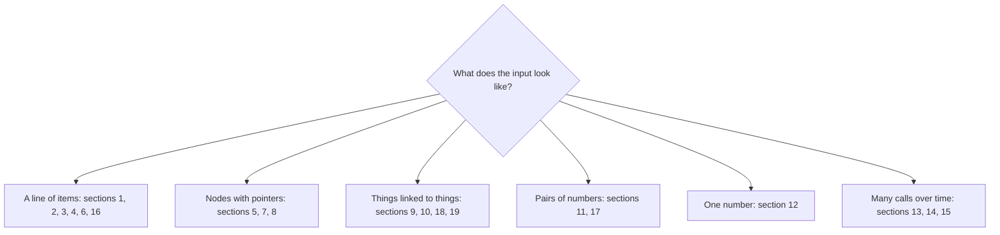

| What you see in the problem | Input type |
|---|---|
| `nums` with no promise about order | [1. Unsorted array](#1-unsorted-array) |
| "sorted", "non-decreasing", "rotated sorted" | [2. Sorted array](#2-sorted-array) |
| One `s` | [3. String](#3-string) |
| `s` and `t`, or `text1` and `text2` | [4. Two strings](#4-two-strings) |
| `ListNode* head` | [5. Linked list](#5-linked-list) |
| Brackets, an expression, a path, "undo", collisions | [6. Stack-like input](#6-stack-like-input) |
| `TreeNode* root` | [7. Binary tree](#7-binary-tree) |
| `root`, and the words "binary search tree" | [8. Binary search tree](#8-binary-search-tree) |
| `n` and `edges`, or an adjacency list | [9. Graph](#9-graph) |
| `grid`, `board`, `matrix` | [10. Grid](#10-grid) |
| `[start, end]` pairs | [11. Intervals](#11-intervals) |
| A single `n`, or digits | [12. A number or digits](#12-a-number-or-digits) |
| `add(x)` called again and again, "so far" | [13. A stream of data](#13-a-stream-of-data) |
| "Implement the class..." | [14. A design request](#14-a-design-request) |
| An array plus `queries[i]` | [15. A list of queries](#15-a-list-of-queries) |
| "values in the range 1 to n" | [16. A permutation of 1 to n](#16-a-permutation-of-1-to-n) |
| `[x, y]` pairs on a plane | [17. Points on a plane](#17-points-on-a-plane) |
| `n` nodes and `n - 1` edges, "no cycles" | [18. A tree given as edges](#18-a-tree-given-as-edges) |
| "in one move", "transform", and no edge list | [19. A graph implied by the rules](#19-a-graph-implied-by-the-rules) |

Some inputs fit two rows. An array of `[start, end]` pairs is also an array, but use the more specific row. If nothing fits, read [Inputs in disguise](#inputs-in-disguise).

## 1. Unsorted array

**Spot it:** an array with no promise about order. First check three special cases. Values from 1 to n go to [section 16](#16-a-permutation-of-1-to-n). `[start, end]` pairs go to [section 11](#11-intervals). A list of queries goes to [section 15](#15-a-list-of-queries).

A word you need: a rule is **monotonic** if it can flip only one way as a window grows. "Sum at most 5, with positive values" is monotonic, because once the sum passes 5 it stays above 5.

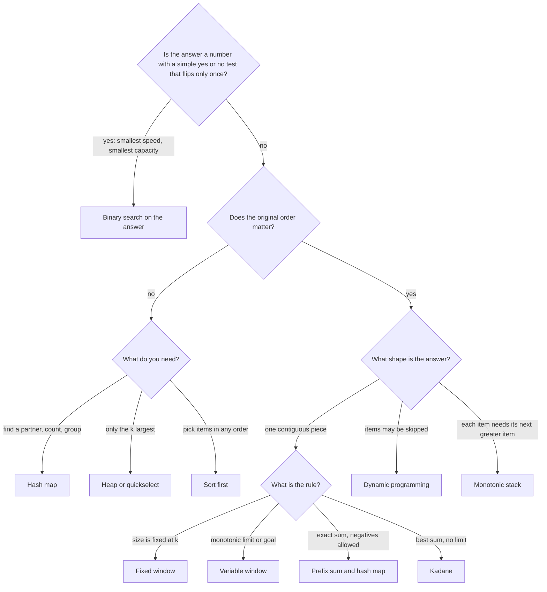

| Leaf | Go to | Real problems | Why it fits, and why the lookalike does not |
|---|---|---|---|
| Binary search on the answer | [Binary Search on the Answer](../04-sorting-searching/07-binary-search-on-answer.md) | [Koko Eating Bananas](https://leetcode.com/problems/koko-eating-bananas/), [Capacity To Ship Packages Within D Days](https://leetcode.com/problems/capacity-to-ship-packages-within-d-days/) | The piles are unsorted, but the speeds are in order. If a speed works, every faster speed works too. You search the speeds, not the array. |
| Hash map | [Hashing Patterns](../02-arrays-strings-hashing/04-hashing-patterns.md) | [Two Sum](https://leetcode.com/problems/two-sum/), [Longest Consecutive Sequence](https://leetcode.com/problems/longest-consecutive-sequence/) | Each item needs one lookup, O(1) on average. Sorting also finds pairs, but it costs O(n log n), and you must store each original index, because Two Sum asks for indexes. |
| Heap or quickselect | [Top K With Heaps](../05-core-patterns/14-top-k-and-heaps.md), [Quick Sort and Quickselect](../04-sorting-searching/03-quick-sort-and-quickselect.md) | [Kth Largest Element in an Array](https://leetcode.com/problems/kth-largest-element-in-an-array/), [Top K Frequent Elements](https://leetcode.com/problems/top-k-frequent-elements/) | You need k items, not the full order. A full sort does work that nobody asked for. |
| Sort first | [Two Pointers: Opposite Ends](../05-core-patterns/01-two-pointers-opposite-ends.md), [Greedy Foundations](../06-recursion-backtracking-greedy/06-greedy-foundations.md) | [3Sum](https://leetcode.com/problems/3sum/) | You may pick any three items, so the order does not matter. Sorting allows two pointers, and it puts duplicates side by side so that you can skip them. |
| Fixed window | [Sliding Window: Fixed Size](../05-core-patterns/04-sliding-window-fixed.md) | [Maximum Average Subarray I](https://leetcode.com/problems/maximum-average-subarray-i/) | The size is given, so there is nothing to shrink. Add one item and remove one item. |
| Variable window | [Sliding Window: Variable Size](../05-core-patterns/05-sliding-window-variable.md) | [Minimum Size Subarray Sum](https://leetcode.com/problems/minimum-size-subarray-sum/) | The values are positive, so a bigger window has a bigger sum. That makes the rule monotonic. |
| Prefix sum and hash map | [Prefix Sums](../05-core-patterns/06-prefix-sums.md) | [Subarray Sum Equals K](https://leetcode.com/problems/subarray-sum-equals-k/) | Negative values let a broken window become good again, so a window cannot decide when to shrink. A prefix sum turns the question into "two running totals differ by k". |
| Kadane | [Kadane's Algorithm](../05-core-patterns/08-kadane-and-subarray-dp.md) | [Maximum Subarray](https://leetcode.com/problems/maximum-subarray/) | There is no limit that says when to shrink. At each item you only ask: extend the old piece, or start again here? |
| Dynamic programming | [One-Dimensional DP](../09-dynamic-programming/02-one-dimensional-dp.md), [Longest Increasing Subsequence](../09-dynamic-programming/06-longest-increasing-subsequence.md) | [House Robber](https://leetcode.com/problems/house-robber/), [Longest Increasing Subsequence](https://leetcode.com/problems/longest-increasing-subsequence/) | Skipped items mean a window cannot hold the answer. Each choice depends on earlier choices, so you store the best result for each index. |
| Monotonic stack | [Monotonic Stack](../05-core-patterns/12-monotonic-stack.md) | [Daily Temperatures](https://leetcode.com/problems/daily-temperatures/) | Each item waits for a later item. The stack holds the items that are still waiting. The answer is one item, not a piece, so a window does not fit. |

**Trap:** do not sort when the order matters. A subarray depends on which items sit next to each other, so sorting [Subarray Sum Equals K](https://leetcode.com/problems/subarray-sum-equals-k/) destroys the thing you are counting.

## 2. Sorted array

**Spot it:** the words "sorted", "ascending" or "non-decreasing". If you see them, use that order. A scan that ignores the order is probably wasting a gift. Rotated arrays count too: a rotated sorted array is a sorted array cut once and swapped, such as `[4, 5, 1, 2, 3]`.

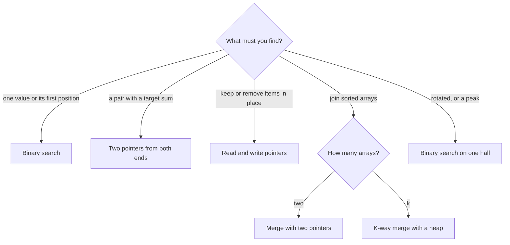

| Leaf | Go to | Real problems | Why it fits, and why the lookalike does not |
|---|---|---|---|
| Binary search | [Binary Search Basics](../04-sorting-searching/06-binary-search-basics.md) | [Find First and Last Position of Element in Sorted Array](https://leetcode.com/problems/find-first-and-last-position-of-element-in-sorted-array/) | Each check removes half of the array. A hash map finds a value, but it needs O(n) time and space to build. It also cannot find the nearest value above x. |
| Two pointers from both ends | [Two Pointers: Opposite Ends](../05-core-patterns/01-two-pointers-opposite-ends.md) | [Two Sum II - Input Array Is Sorted](https://leetcode.com/problems/two-sum-ii-input-array-is-sorted/) | If the sum is too small, the left value cannot work with anything, so you drop it. Each step removes one value. |
| Read and write pointers | [Two Pointers: Same Direction](../05-core-patterns/02-two-pointers-same-direction.md) | [Remove Duplicates from Sorted Array](https://leetcode.com/problems/remove-duplicates-from-sorted-array/) | Equal values sit together, so one pass finds them. One pointer reads and the other writes. |
| Merge with two pointers | [Two Pointers: Same Direction](../05-core-patterns/02-two-pointers-same-direction.md) | [Merge Sorted Array](https://leetcode.com/problems/merge-sorted-array/) | The smallest remaining value is always at one of two fronts. In this problem you compare from the back and write the largest value first, so that you do not overwrite unread values. |
| K-way merge | [K-Way Merge](../05-core-patterns/16-k-way-merge.md) | [Merge k Sorted Lists](https://leetcode.com/problems/merge-k-sorted-lists/) | With k fronts, comparing them all costs O(k) per item. A heap of the fronts costs O(log k). |
| Binary search on one half | [Binary Search Basics](../04-sorting-searching/06-binary-search-basics.md) | [Search in Rotated Sorted Array](https://leetcode.com/problems/search-in-rotated-sorted-array/), [Find Peak Element](https://leetcode.com/problems/find-peak-element/) | The array is not fully sorted, but each check still tells you which half to throw away. That is the real need of binary search. If a rotated array has duplicates, a check may not tell you, and the worst case becomes O(n). |

**Trap:** sorted by value is not sorted by what you compute. In [Squares of a Sorted Array](https://leetcode.com/problems/squares-of-a-sorted-array/), `[-4, -1, 0, 3]` is sorted, but the squares `[16, 1, 0, 9]` are not. The largest square sits at one of the two ends, so use two pointers from both ends.

## 3. String

**Spot it:** one string. A string is an array of characters, so every array idea still works. Two terms matter here. A **substring** has no gaps. A **subsequence** may skip characters but keeps their order. In `"abcd"`, `"bc"` is a substring and `"ad"` is only a subsequence.

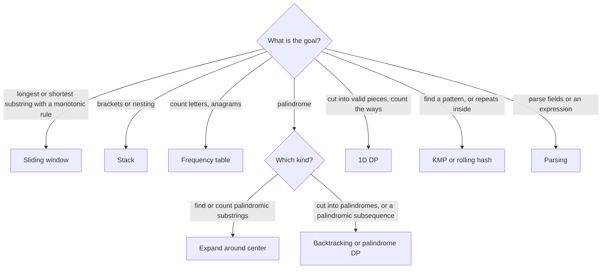

| Leaf | Go to | Real problems | Why it fits, and why the lookalike does not |
|---|---|---|---|
| Sliding window | [Sliding Window: Variable Size](../05-core-patterns/05-sliding-window-variable.md) | [Longest Substring Without Repeating Characters](https://leetcode.com/problems/longest-substring-without-repeating-characters/) | A substring is one piece, and "has a repeat" stays true as the window grows. So the rule is monotonic. |
| Stack | [Stack From Zero](../03-linked-lists-stacks-queues/05-stack-from-zero.md) | [Decode String](https://leetcode.com/problems/decode-string/) | The inner bracket must finish first. See [section 6](#6-stack-like-input). |
| Frequency table | [Hashing Patterns](../02-arrays-strings-hashing/04-hashing-patterns.md) | [Group Anagrams](https://leetcode.com/problems/group-anagrams/) | Anagrams have equal letter counts, so the counts can be the key. Comparing every pair of words is much slower. |
| Expand around center | [Palindromes and Manacher](../10-string-algorithms/01-palindromes-and-manacher.md) | [Longest Palindromic Substring](https://leetcode.com/problems/longest-palindromic-substring/) | Every palindrome grows from a center. There are about 2n centers, and that gives O(n^2) time with O(1) extra space. |
| Backtracking or palindrome DP | [Backtracking: Constraint Search](../06-recursion-backtracking-greedy/04-backtracking-constraint-search.md), [Palindrome DP](../09-dynamic-programming/08-palindrome-dp.md) | [Palindrome Partitioning](https://leetcode.com/problems/palindrome-partitioning/) | "Return all the ways" means you must list them, so use backtracking. "How few cuts" asks for one number, so use DP. The longest palindromic subsequence may skip letters, so it also needs DP. |
| 1D DP | [One-Dimensional DP](../09-dynamic-programming/02-one-dimensional-dp.md) | [Word Break](https://leetcode.com/problems/word-break/), [Decode Ways](https://leetcode.com/problems/decode-ways/) | The answer for a prefix depends on shorter prefixes. A greedy cut can fail, because taking the longest word first may leave a tail that cannot be cut. |
| KMP or rolling hash | [KMP](../10-string-algorithms/02-kmp.md), [Rabin-Karp and Rolling Hash](../10-string-algorithms/04-rabin-karp-and-rolling-hash.md) | [Longest Happy Prefix](https://leetcode.com/problems/longest-happy-prefix/) | The string compares with itself. Plain comparison repeats work, and these tools avoid that. |
| Parsing | [String Parsing and Log Processing](../02-arrays-strings-hashing/07-string-parsing-and-log-processing.md), [Stacks for Expressions](../03-linked-lists-stacks-queues/06-stack-expressions-and-parentheses.md) | [Basic Calculator II](https://leetcode.com/problems/basic-calculator-ii/) | There is no clever idea here. Read one token at a time and follow the rules with care. |

**Trap:** "longest palindromic substring" sounds like a sliding window, but it is not one. Being a palindrome is not monotonic. `"aba"` is a palindrome, `"abac"` is not, and `"abacaba"` is one again. A window cannot know that a broken string might become good later.

## 4. Two strings

**Spot it:** two strings, and the question is how they relate. Two arrays work the same way. First ask: must the order of letters match, and may letters be skipped?

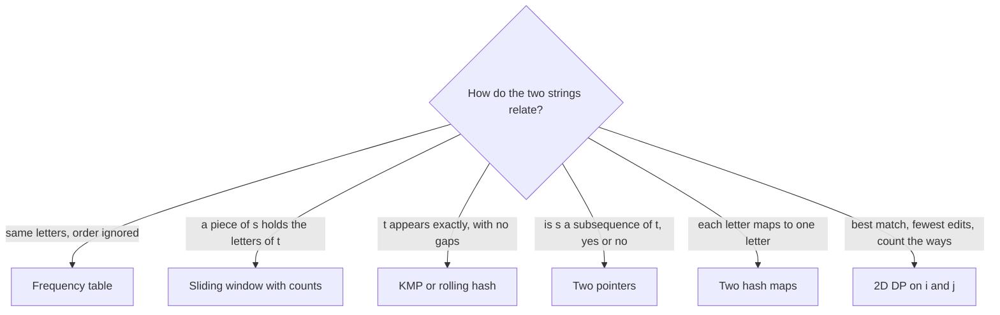

| Leaf | Go to | Real problems | Why it fits, and why the lookalike does not |
|---|---|---|---|
| Frequency table | [Hashing Patterns](../02-arrays-strings-hashing/04-hashing-patterns.md) | [Valid Anagram](https://leetcode.com/problems/valid-anagram/) | Order does not matter, so only the counts matter. |
| Sliding window with counts | [Sliding Window: Fixed Size](../05-core-patterns/04-sliding-window-fixed.md), [Sliding Window: Variable Size](../05-core-patterns/05-sliding-window-variable.md) | [Permutation in String](https://leetcode.com/problems/permutation-in-string/) (fixed), [Minimum Window Substring](https://leetcode.com/problems/minimum-window-substring/) (variable) | One piece of `s` must hold letters, in any order. A permutation of `t` has the exact length of `t`, so its window is fixed. "Contains all letters" has no fixed length, so its window varies. |
| KMP or rolling hash | [KMP](../10-string-algorithms/02-kmp.md) | [Find the Index of the First Occurrence in a String](https://leetcode.com/problems/find-the-index-of-the-first-occurrence-in-a-string/) | The order is exact, so counts are useless. KMP reuses what it has already matched. |
| Two pointers | [Two Pointers: Same Direction](../05-core-patterns/02-two-pointers-same-direction.md) | [Is Subsequence](https://leetcode.com/problems/is-subsequence/) | Match each letter of `s` as early as you can. An early match never hurts, because it leaves more of `t` for the later letters. |
| Two hash maps | [Hashing Patterns](../02-arrays-strings-hashing/04-hashing-patterns.md) | [Isomorphic Strings](https://leetcode.com/problems/isomorphic-strings/) | The mapping must work in both directions, so one map is not enough. |
| 2D DP on i and j | [LCS and Edit Distance](../09-dynamic-programming/07-lcs-and-edit-distance.md) | [Longest Common Subsequence](https://leetcode.com/problems/longest-common-subsequence/), [Edit Distance](https://leetcode.com/problems/edit-distance/), [Interleaving String](https://leetcode.com/problems/interleaving-string/) | When letters differ, you do not know which side to skip, so you must try both. The state is "the first i letters and the first j letters". |

**Trap:** [Is Subsequence](https://leetcode.com/problems/is-subsequence/) and [Longest Common Subsequence](https://leetcode.com/problems/longest-common-subsequence/) look alike. The first has a fixed target: every letter of `s` must match, so there is never a choice. The second may drop letters from both sides, so each mismatch is a real choice, and that needs DP.

## 5. Linked list

**Spot it:** you get `ListNode* head`. A linked list has no index, so you cannot jump to the middle. This rules out binary search and most tricks that use positions. You can only walk forward, so the tools are about how you walk.

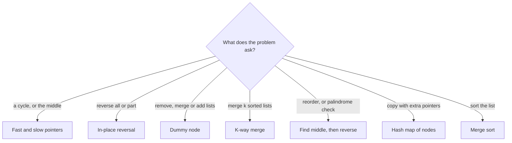

| Leaf | Go to | Real problems | Why it fits, and why the lookalike does not |
|---|---|---|---|
| Fast and slow pointers | [Fast and Slow Pointers](../05-core-patterns/03-fast-and-slow-pointers.md) | [Linked List Cycle](https://leetcode.com/problems/linked-list-cycle/), [Middle of the Linked List](https://leetcode.com/problems/middle-of-the-linked-list/) | A hash set of nodes also finds a cycle, but it costs O(n) space. Two speeds use O(1) space. |
| In-place reversal | [In-Place Linked List Reversal](../05-core-patterns/11-in-place-linked-list-reversal.md) | [Reverse Linked List](https://leetcode.com/problems/reverse-linked-list/), [Reverse Nodes in k-Group](https://leetcode.com/problems/reverse-nodes-in-k-group/) | Copying the values to an array works, but the problem usually wants O(1) extra space. |
| Dummy node | [Linked List Problems](../03-linked-lists-stacks-queues/04-linked-list-problems.md) | [Remove Nth Node From End of List](https://leetcode.com/problems/remove-nth-node-from-end-of-list/), [Merge Two Sorted Lists](https://leetcode.com/problems/merge-two-sorted-lists/), [Add Two Numbers](https://leetcode.com/problems/add-two-numbers/) | The head itself may change. A fake node before the head removes that special case. |
| K-way merge | [K-Way Merge](../05-core-patterns/16-k-way-merge.md) | [Merge k Sorted Lists](https://leetcode.com/problems/merge-k-sorted-lists/) | Same idea as in [section 2](#2-sorted-array): a heap holds the k fronts. |
| Find middle, then reverse | [Fast and Slow Pointers](../05-core-patterns/03-fast-and-slow-pointers.md) | [Reorder List](https://leetcode.com/problems/reorder-list/), [Palindrome Linked List](https://leetcode.com/problems/palindrome-linked-list/) | You need the back half in reverse, but you cannot walk backwards. So you reverse the back half first. |
| Hash map of nodes | [Linked List Problems](../03-linked-lists-stacks-queues/04-linked-list-problems.md) | [Copy List with Random Pointer](https://leetcode.com/problems/copy-list-with-random-pointer/) | A random pointer may point to a copy that does not exist yet. A map from old node to new node solves this. |
| Merge sort | [Merge Sort](../04-sorting-searching/02-merge-sort.md) | [Sort List](https://leetcode.com/problems/sort-list/) | Merging needs only forward walks, with no index jumps. Fast and slow pointers find the middle for the split. |

**Trap:** the problem may not show a list at all. [Happy Number](https://leetcode.com/problems/happy-number/) gives you a number, but each number leads to exactly one next number. That is a linked list, and it may have a cycle. See [Inputs in disguise](#inputs-in-disguise).

## 6. Stack-like input

**Spot it:** the newest item is the first one to be finished. This is what "last in, first out" means. Look for brackets, nested parts, "undo", "backspace", file paths, and items that collide with the item just before them.

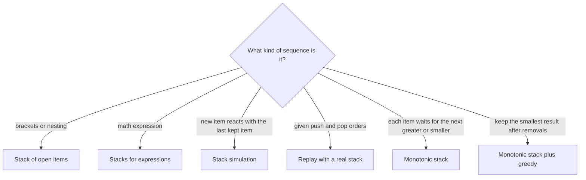

| Leaf | Go to | Real problems | Why it fits, and why the lookalike does not |
|---|---|---|---|
| Stack of open items | [Stack From Zero](../03-linked-lists-stacks-queues/05-stack-from-zero.md) | [Valid Parentheses](https://leetcode.com/problems/valid-parentheses/), [Decode String](https://leetcode.com/problems/decode-string/) | A counter works for one bracket type only. With `([)]` the counts are fine, but the order is wrong. Only a stack sees that. |
| Stacks for expressions | [Stacks for Expressions](../03-linked-lists-stacks-queues/06-stack-expressions-and-parentheses.md) | [Evaluate Reverse Polish Notation](https://leetcode.com/problems/evaluate-reverse-polish-notation/), [Basic Calculator II](https://leetcode.com/problems/basic-calculator-ii/) | An operator uses the most recent values, and the stack holds them. |
| Stack simulation | [Stack From Zero](../03-linked-lists-stacks-queues/05-stack-from-zero.md) | [Asteroid Collision](https://leetcode.com/problems/asteroid-collision/), [Remove All Adjacent Duplicates In String](https://leetcode.com/problems/remove-all-adjacent-duplicates-in-string/), [Simplify Path](https://leetcode.com/problems/simplify-path/) | After a removal, the new item meets an older item. The stack brings that older item back to the top. |
| Replay with a real stack | [Stack From Zero](../03-linked-lists-stacks-queues/05-stack-from-zero.md) | [Validate Stack Sequences](https://leetcode.com/problems/validate-stack-sequences/) | There is only one way to play the moves, so run them and see. No formula is needed. |
| Monotonic stack | [Monotonic Stack](../05-core-patterns/12-monotonic-stack.md) | [Next Greater Element I](https://leetcode.com/problems/next-greater-element-i/), [Largest Rectangle in Histogram](https://leetcode.com/problems/largest-rectangle-in-histogram/) | The stack keeps only the items that are still waiting. Each item enters and leaves once, so it is O(n). |
| Monotonic stack plus greedy | [Monotonic Stack](../05-core-patterns/12-monotonic-stack.md) | [Remove K Digits](https://leetcode.com/problems/remove-k-digits/) | For numbers of equal length, a smaller digit further left always wins, so you pop larger digits while removals remain. |

**Trap:** [Largest Rectangle in Histogram](https://leetcode.com/problems/largest-rectangle-in-histogram/) has contiguous bars, so a window seems natural. But no rule tells you when to shrink, because a wider rectangle may be shorter and still have more area. Change the question: for each bar, how far can it stretch? That needs the nearest smaller bar on each side, and that is a monotonic stack.

## 7. Binary tree

**Spot it:** you get `TreeNode* root`, and each node has at most two children. Nothing is promised about the values. Ask one question at each node: **what does this node need from its children, or what do the children need from it?** If the node needs its children's results, the facts move up. If the children need something from above, the facts move down.

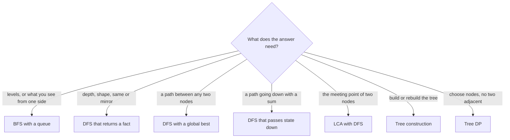

| Leaf | Go to | Real problems | Why it fits, and why the lookalike does not |
|---|---|---|---|
| BFS with a queue | [Tree BFS Problems](../07-trees/04-tree-bfs-problems.md) | [Binary Tree Level Order Traversal](https://leetcode.com/problems/binary-tree-level-order-traversal/), [Binary Tree Right Side View](https://leetcode.com/problems/binary-tree-right-side-view/) | A queue visits nodes in level order on its own. DFS can do it too, but it must carry the depth by hand. |
| DFS that returns a fact | [Tree DFS Problems](../07-trees/03-tree-dfs-problems.md) | [Maximum Depth of Binary Tree](https://leetcode.com/problems/maximum-depth-of-binary-tree/), [Invert Binary Tree](https://leetcode.com/problems/invert-binary-tree/) | The answer for a node comes from the answers of its children. |
| DFS with a global best | [Tree DFS Problems](../07-trees/03-tree-dfs-problems.md) | [Diameter of Binary Tree](https://leetcode.com/problems/diameter-of-binary-tree/), [Binary Tree Maximum Path Sum](https://leetcode.com/problems/binary-tree-maximum-path-sum/) | The best path may bend at any node. So return one fact (the best downward arm) and record another (the best bent path). |
| DFS that passes state down | [Tree DFS Problems](../07-trees/03-tree-dfs-problems.md), [Prefix Sums](../05-core-patterns/06-prefix-sums.md) | [Path Sum III](https://leetcode.com/problems/path-sum-iii/) | A path going down is an array in disguise. So the prefix sum and hash map idea from [section 1](#1-unsorted-array) works along the path. Remove a prefix from the map when the DFS leaves its node, because that node is no longer on the path. |
| LCA with DFS | [Tree DFS Problems](../07-trees/03-tree-dfs-problems.md) | [Lowest Common Ancestor of a Binary Tree](https://leetcode.com/problems/lowest-common-ancestor-of-a-binary-tree/) | The lowest common ancestor (LCA) is the deepest node that has both targets below it or equal to it. Each subtree reports what it found. |
| Tree construction | [Tree Construction and Serialization](../07-trees/05-tree-construction-and-serialization.md) | [Construct Binary Tree from Preorder and Inorder Traversal](https://leetcode.com/problems/construct-binary-tree-from-preorder-and-inorder-traversal/), [Serialize and Deserialize Binary Tree](https://leetcode.com/problems/serialize-and-deserialize-binary-tree/) | Preorder gives the root, and inorder splits left from right. This needs distinct values. To serialize a tree, also write null markers, so that the shape is saved. |
| Tree DP | [Tree DP](../09-dynamic-programming/11-tree-dp.md) | [House Robber III](https://leetcode.com/problems/house-robber-iii/) | Each node returns two values: the best with it, and the best without it. One value cannot carry the "not adjacent" rule. |

**Trap:** a binary tree is not a binary search tree. If the problem does not say "BST", you cannot use the values to choose left or right. You must look at both sides, as in [Lowest Common Ancestor of a Binary Tree](https://leetcode.com/problems/lowest-common-ancestor-of-a-binary-tree/).

## 8. Binary search tree

**Spot it:** the problem says "binary search tree" or "BST". In a BST, for every node, all values in the left subtree are smaller and all values in the right subtree are larger. Two gifts follow. You can walk down one side only. And inorder traversal (left, node, right) gives the values in sorted order.

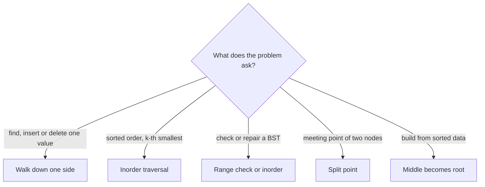

| Leaf | Go to | Real problems | Why it fits, and why the lookalike does not |
|---|---|---|---|
| Walk down one side | [BST From Zero](../07-trees/06-bst-from-zero.md) | [Search in a Binary Search Tree](https://leetcode.com/problems/search-in-a-binary-search-tree/), [Delete Node in a BST](https://leetcode.com/problems/delete-node-in-a-bst/) | Each comparison rules out a whole subtree. The cost is O(h), where h is the height. |
| Inorder traversal | [Tree Traversals](../07-trees/02-tree-traversals.md) | [Kth Smallest Element in a BST](https://leetcode.com/problems/kth-smallest-element-in-a-bst/), [Convert BST to Greater Tree](https://leetcode.com/problems/convert-bst-to-greater-tree/) | The sorted order is already there, so a heap adds nothing. Stop after k nodes. For "greater tree", walk right to left. |
| Range check or inorder | [BST From Zero](../07-trees/06-bst-from-zero.md) | [Validate Binary Search Tree](https://leetcode.com/problems/validate-binary-search-tree/), [Recover Binary Search Tree](https://leetcode.com/problems/recover-binary-search-tree/) | Each node must fit a range set by all of its ancestors. Inorder must be strictly increasing. |
| Split point | [BST From Zero](../07-trees/06-bst-from-zero.md) | [Lowest Common Ancestor of a Binary Search Tree](https://leetcode.com/problems/lowest-common-ancestor-of-a-binary-search-tree/) | Walk down from the root. The LCA is the first node whose value lies between the two targets, or equals one of them. You do not need to search both sides. |
| Middle becomes root | [Tree Construction and Serialization](../07-trees/05-tree-construction-and-serialization.md) | [Convert Sorted Array to Binary Search Tree](https://leetcode.com/problems/convert-sorted-array-to-binary-search-tree/) | The middle splits the rest into two halves whose sizes differ by at most 1, so the tree stays balanced. |

**Trap:** comparing a node with its two children does not prove a BST. Take root 5 with left child 1 and right child 6, where 6 has children 3 and 7. Each node looks fine beside its own children. But 3 sits in the right subtree of 5, and 3 is smaller than 5. You must pass a range down.

## 9. Graph

**Spot it:** you get `n` and a list of `edges`, or an adjacency list (for each node, a list of its neighbours). Edges may be directed (one way) or undirected (both ways). They may have weights. Check these facts before you follow the tree.

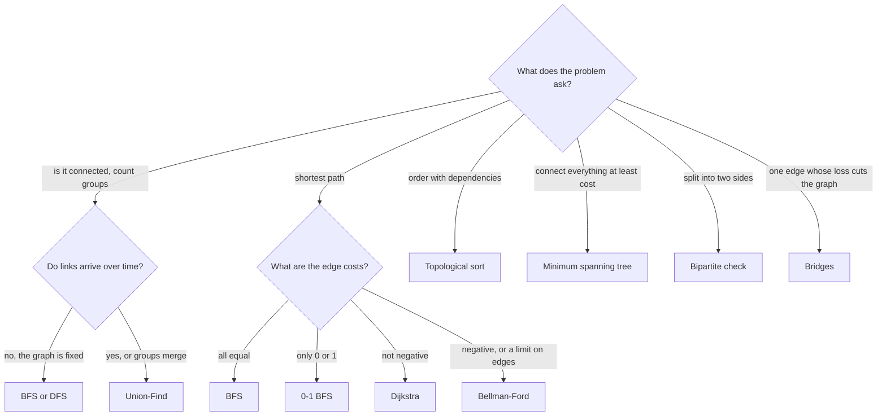

| Leaf | Go to | Real problems | Why it fits, and why the lookalike does not |
|---|---|---|---|
| BFS or DFS | [BFS and DFS](../08-graphs/02-bfs-and-dfs.md) | [Find if Path Exists in Graph](https://leetcode.com/problems/find-if-path-exists-in-graph/), [Clone Graph](https://leetcode.com/problems/clone-graph/) | Reachability needs only a visited set. For "does a path exist", either order works. |
| Union-Find | [Union-Find](../08-graphs/07-union-find.md) | [Redundant Connection](https://leetcode.com/problems/redundant-connection/), [Number of Operations to Make Network Connected](https://leetcode.com/problems/number-of-operations-to-make-network-connected/) | Each new edge either joins two groups or is extra. Running a new DFS after each edge repeats work. |
| BFS | [BFS Shortest Path Patterns](../08-graphs/04-bfs-shortest-path-patterns.md) | [Shortest Path with Alternating Colors](https://leetcode.com/problems/shortest-path-with-alternating-colors/) | BFS reaches nodes in order of distance, so the first visit is the shortest. DFS gives no such promise. In this problem the BFS state is (node, last edge color), because the next color depends on the last one. |
| 0-1 BFS | [BFS Shortest Path Patterns](../08-graphs/04-bfs-shortest-path-patterns.md) | [Minimum Obstacle Removal to Reach Corner](https://leetcode.com/problems/minimum-obstacle-removal-to-reach-corner/) | A deque keeps the nodes in order of distance, so no heap is needed. |
| Dijkstra | [Dijkstra](../08-graphs/08-dijkstra.md) | [Network Delay Time](https://leetcode.com/problems/network-delay-time/) | Plain BFS counts edges, not cost. A heap picks the nearest unfinished node. Dijkstra is correct only when costs are not negative. |
| Bellman-Ford | [Bellman-Ford and SPFA](../08-graphs/09-bellman-ford-and-spfa.md) | [Cheapest Flights Within K Stops](https://leetcode.com/problems/cheapest-flights-within-k-stops/) | Each round allows one more edge, so k stops means k + 1 rounds. Each round must read from a copy of the last round, or one round may use two edges. |
| Topological sort | [Topological Sort](../08-graphs/06-topological-sort.md) | [Course Schedule](https://leetcode.com/problems/course-schedule/), [Course Schedule II](https://leetcode.com/problems/course-schedule-ii/) | "A before B" gives directed edges. Union-Find ignores direction, so it cannot find a directed cycle. |
| Minimum spanning tree | [Minimum Spanning Tree](../08-graphs/11-minimum-spanning-tree.md) | [Min Cost to Connect All Points](https://leetcode.com/problems/min-cost-to-connect-all-points/) | You pay for a set of edges, not for one route. A shortest path tree from one node can cost more in total. |
| Bipartite check | [Cycle Detection and Bipartite](../08-graphs/05-cycle-detection-and-bipartite.md) | [Is Graph Bipartite](https://leetcode.com/problems/is-graph-bipartite/) | Paint neighbours with opposite colors. Two neighbours with the same color mean an odd cycle. |
| Bridges | [Bridges and Articulation Points](../08-graphs/13-bridges-and-articulation-points.md) | [Critical Connections in a Network](https://leetcode.com/problems/critical-connections-in-a-network/) | Removing each edge and running a DFS costs O(E * (V + E)). One DFS that records how high each subtree can climb back costs O(V + E). |

**Trap:** in [Cheapest Flights Within K Stops](https://leetcode.com/problems/cheapest-flights-within-k-stops/), plain Dijkstra with one distance per city fails. The cheapest way into a city may use too many stops. A more expensive way with fewer stops may be the only one that can finish. The state must include the stops, or you use limited rounds of Bellman-Ford.

## 10. Grid

**Spot it:** a 2D array. A grid is not always a graph problem, so the first question is how you move, and whether you move at all.

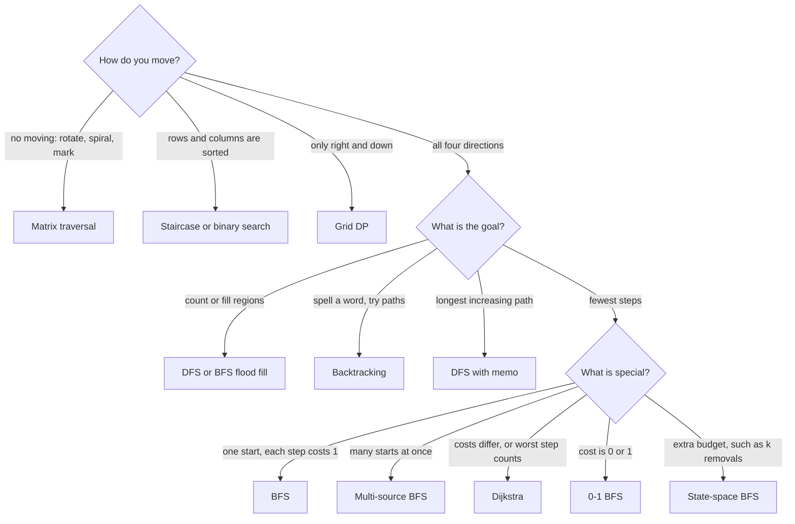

| Leaf | Go to | Real problems | Why it fits, and why the lookalike does not |
|---|---|---|---|
| Matrix traversal | [Matrix Problems](../02-arrays-strings-hashing/05-matrix-problems.md) | [Rotate Image](https://leetcode.com/problems/rotate-image/), [Spiral Matrix](https://leetcode.com/problems/spiral-matrix/), [Set Matrix Zeroes](https://leetcode.com/problems/set-matrix-zeroes/) | There is no path to find. Only index math matters. |
| Staircase or binary search | [Matrix Problems](../02-arrays-strings-hashing/05-matrix-problems.md) | [Search a 2D Matrix II](https://leetcode.com/problems/search-a-2d-matrix-ii/) | Start at the top right. Each check removes a row or a column. |
| Grid DP | [Grid DP](../09-dynamic-programming/03-grid-dp.md) | [Unique Paths](https://leetcode.com/problems/unique-paths/), [Minimum Path Sum](https://leetcode.com/problems/minimum-path-sum/) | Each cell depends only on the cell above and the cell to the left. Those are already solved when you reach it. |
| Flood fill | [Grid Graphs](../08-graphs/03-grid-graphs.md) | [Number of Islands](https://leetcode.com/problems/number-of-islands/), [Surrounded Regions](https://leetcode.com/problems/surrounded-regions/) | Each region is one connected component. Mark cells so that each is visited once. |
| Backtracking | [Backtracking: Constraint Search](../06-recursion-backtracking-greedy/04-backtracking-constraint-search.md) | [Word Search](https://leetcode.com/problems/word-search/) | A cell may be free on one path and used on another. So you must unmark it on the way back, unlike flood fill. |
| DFS with memo | [Dynamic Programming From Zero](../09-dynamic-programming/01-dp-from-zero.md) | [Longest Increasing Path in a Matrix](https://leetcode.com/problems/longest-increasing-path-in-a-matrix/) | Each step must go to a larger value, so a path can never come back. There are no cycles, and that makes DP safe. |
| BFS | [BFS Shortest Path Patterns](../08-graphs/04-bfs-shortest-path-patterns.md) | [Shortest Path in Binary Matrix](https://leetcode.com/problems/shortest-path-in-binary-matrix/) | All steps cost the same, so the first arrival is the shortest. This problem also allows diagonal steps, and BFS works the same way. |
| Multi-source BFS | [BFS Shortest Path Patterns](../08-graphs/04-bfs-shortest-path-patterns.md) | [Rotting Oranges](https://leetcode.com/problems/rotting-oranges/), [01 Matrix](https://leetcode.com/problems/01-matrix/) | Put all the starts in the queue at time 0. One BFS from each start repeats work. |
| Dijkstra | [Dijkstra](../08-graphs/08-dijkstra.md) | [Path With Minimum Effort](https://leetcode.com/problems/path-with-minimum-effort/), [Swim in Rising Water](https://leetcode.com/problems/swim-in-rising-water/) | The cost of a path is its worst step, not the step count. Dijkstra still works if you store the worst step so far. |
| 0-1 BFS | [BFS Shortest Path Patterns](../08-graphs/04-bfs-shortest-path-patterns.md) | [Minimum Obstacle Removal to Reach Corner](https://leetcode.com/problems/minimum-obstacle-removal-to-reach-corner/) | A free cell costs 0 and an obstacle costs 1, so a deque is enough. |
| State-space BFS | [Graph Modeling Tricks](../08-graphs/18-graph-modeling-tricks.md) | [Shortest Path in a Grid with Obstacles Elimination](https://leetcode.com/problems/shortest-path-in-a-grid-with-obstacles-elimination/) | The same cell with more removals left is a better position. So the node is (row, column, removals left), not only the cell. |

**Trap:** with all four directions, a plain DP table fails. Cell A may depend on cell B, and B on A, so there is no order in which to fill the table. That is why right-and-down grids are DP, and four-direction grids are graphs. The increasing path is the exception, because its values give you an order.

## 11. Intervals

**Spot it:** each item is a `[start, end]` pair: meetings, bookings, trips. Look at the word in the goal. "Merge", "remove the fewest" and "how many at once" all lead to different sort orders.

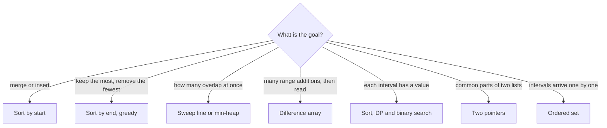

| Leaf | Go to | Real problems | Why it fits, and why the lookalike does not |
|---|---|---|---|
| Sort by start | [Merge Intervals](../05-core-patterns/09-merge-intervals.md) | [Merge Intervals](https://leetcode.com/problems/merge-intervals/), [Insert Interval](https://leetcode.com/problems/insert-interval/) | After sorting, an interval can only touch the group just before it. |
| Sort by end, greedy | [Merge Intervals](../05-core-patterns/09-merge-intervals.md) | [Non-overlapping Intervals](https://leetcode.com/problems/non-overlapping-intervals/), [Minimum Number of Arrows to Burst Balloons](https://leetcode.com/problems/minimum-number-of-arrows-to-burst-balloons/) | The interval that ends first leaves the most room for the rest. |
| Sweep line or min-heap | [Difference Arrays and Sweep Line](../05-core-patterns/07-difference-array-and-sweep-line.md) | [Meeting Rooms II](https://leetcode.com/problems/meeting-rooms-ii/) (Premium), [Divide Intervals Into Minimum Number of Groups](https://leetcode.com/problems/divide-intervals-into-minimum-number-of-groups/) | The answer is the largest number of intervals open at one moment. Walk through the starts and ends in time order. |
| Difference array | [Difference Arrays and Sweep Line](../05-core-patterns/07-difference-array-and-sweep-line.md) | [Corporate Flight Bookings](https://leetcode.com/problems/corporate-flight-bookings/), [Car Pooling](https://leetcode.com/problems/car-pooling/) | Adding to each position costs O(n) per range. Marking only the two edges costs O(1) per range. |
| Sort, DP and binary search | [One-Dimensional DP](../09-dynamic-programming/02-one-dimensional-dp.md), [Binary Search Basics](../04-sorting-searching/06-binary-search-basics.md) | [Maximum Profit in Job Scheduling](https://leetcode.com/problems/maximum-profit-in-job-scheduling/) | With values, greedy fails. One long job may pay more than ten short jobs. Binary search finds the last job that does not clash. |
| Two pointers | [Merge Intervals](../05-core-patterns/09-merge-intervals.md) | [Interval List Intersections](https://leetcode.com/problems/interval-list-intersections/) | Both lists are sorted. The interval that ends first cannot meet anything else, so move past it. |
| Ordered set | [Ordered Set Patterns](../05-core-patterns/19-ordered-set-patterns.md) | [My Calendar I](https://leetcode.com/problems/my-calendar-i/) | You cannot sort input that has not arrived. A `std::map` stays sorted, and only the two neighbours of a new interval can clash with it. |

**Trap:** sorting by start fails for "keep the most". Take `[1, 10], [2, 3], [4, 5]`. A greedy pass in start order keeps `[1, 10]` first, and that blocks the other two. Sorted by end, it keeps `[2, 3]` and `[4, 5]`, which is two intervals. Also check if touching ends overlap. `[1, 2]` and `[2, 3]` merge in Merge Intervals, but they do not clash in Non-overlapping Intervals.

## 12. A number or digits

**Spot it:** the input is one integer `n`, or a string of digits. Look at the limit on `n` first. If `n` can reach 10^9 or more, a loop up to `n` is usually too slow, so the answer must come from a formula, a loop over digits, or a method that halves `n`.

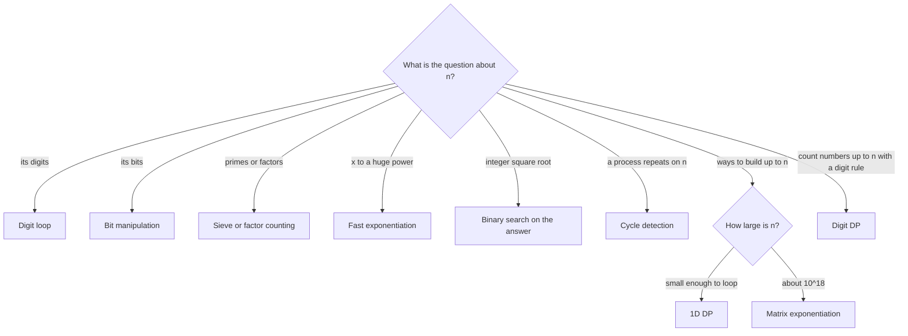

| Leaf | Go to | Real problems | Why it fits, and why the lookalike does not |
|---|---|---|---|
| Digit loop | [Number Basics](../11-math-geometry-games/01-number-basics.md) | [Palindrome Number](https://leetcode.com/problems/palindrome-number/), [Reverse Integer](https://leetcode.com/problems/reverse-integer/) | `n % 10` gives the last digit, and `n / 10` removes it. The loop runs once per digit. |
| Bit manipulation | [Bit Manipulation](../05-core-patterns/17-bit-manipulation.md) | [Number of 1 Bits](https://leetcode.com/problems/number-of-1-bits/), [Counting Bits](https://leetcode.com/problems/counting-bits/) | `n & (n - 1)` clears the lowest set bit, so the loop runs once per set bit. |
| Sieve or factor counting | [Primes and Sieve](../11-math-geometry-games/02-primes-and-sieve.md), [Number Basics](../11-math-geometry-games/01-number-basics.md) | [Count Primes](https://leetcode.com/problems/count-primes/), [Factorial Trailing Zeroes](https://leetcode.com/problems/factorial-trailing-zeroes/) | Testing each number alone repeats work. A sieve crosses out the multiples of each prime instead. A sieve needs memory for every number up to n, so for one huge n, use trial division up to the square root of n. |
| Fast exponentiation | [Modular Arithmetic](../11-math-geometry-games/03-modular-arithmetic.md) | [Pow(x, n)](https://leetcode.com/problems/powx-n/), [Count Good Numbers](https://leetcode.com/problems/count-good-numbers/) | Squaring halves the exponent, so it takes O(log n) steps. A plain loop takes n steps. |
| Binary search on the answer | [Binary Search on the Answer](../04-sorting-searching/07-binary-search-on-answer.md) | [Sqrt(x)](https://leetcode.com/problems/sqrtx/) | Test `mid * mid <= x`. Use `long long`, because the product can overflow `int`. |
| Cycle detection | [Fast and Slow Pointers](../05-core-patterns/03-fast-and-slow-pointers.md) | [Happy Number](https://leetcode.com/problems/happy-number/) | Each number has one next number, so this is a hidden linked list. |
| 1D DP | [One-Dimensional DP](../09-dynamic-programming/02-one-dimensional-dp.md) | [Climbing Stairs](https://leetcode.com/problems/climbing-stairs/), [Integer Break](https://leetcode.com/problems/integer-break/) | The answer for n depends on smaller n. |
| Matrix exponentiation | [Matrix Exponentiation](../11-math-geometry-games/05-matrix-exponentiation.md) | Classic: the n-th Fibonacci number with n up to 10^18 | A linear recurrence is a matrix power. The DP loop is too long at this size. |
| Digit DP | [Digit DP](../09-dynamic-programming/13-digit-dp.md) | [Numbers With Repeated Digits](https://leetcode.com/problems/numbers-with-repeated-digits/), [Non-negative Integers without Consecutive Ones](https://leetcode.com/problems/non-negative-integers-without-consecutive-ones/) | You build the number digit by digit, so you never visit each number from 1 to n. |

**Trap:** do not compute a huge value only to read a small fact from it. In [Factorial Trailing Zeroes](https://leetcode.com/problems/factorial-trailing-zeroes/), n! overflows very soon. A trailing zero needs a factor of 10, and factors of 5 are the rare part. So you count the factors of 5.

## 13. A stream of data

**Spot it:** a stream is data that arrives one item at a time. You must answer after each item, without seeing the future. Look for "so far", "after each call", or a class with `add(x)`. Sorting everything again after each item costs too much. So ask: **what is the smallest summary that still answers the question?**

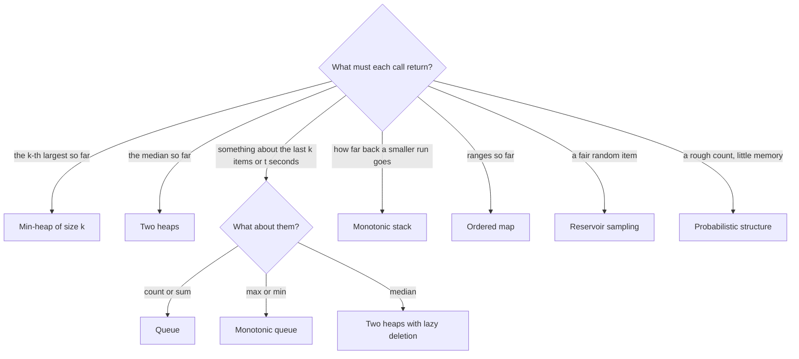

| Leaf | Go to | Real problems | Why it fits, and why the lookalike does not |
|---|---|---|---|
| Min-heap of size k | [Top K With Heaps](../05-core-patterns/14-top-k-and-heaps.md) | [Kth Largest Element in a Stream](https://leetcode.com/problems/kth-largest-element-in-a-stream/) | The heap holds the k largest items. Its top is the smallest of them, which is the answer and also the next item to throw out. |
| Two heaps | [Two Heaps](../05-core-patterns/15-two-heaps.md) | [Find Median from Data Stream](https://leetcode.com/problems/find-median-from-data-stream/) | The median sits between the low half and the high half. A max-heap and a min-heap show both edges. |
| Queue | [Queue From Zero](../03-linked-lists-stacks-queues/07-queue-from-zero.md) | [Number of Recent Calls](https://leetcode.com/problems/number-of-recent-calls/), [Moving Average from Data Stream](https://leetcode.com/problems/moving-average-from-data-stream/) (Premium) | Old items leave first, in arrival order. |
| Monotonic queue | [Monotonic Queue](../05-core-patterns/13-monotonic-queue.md) | [Sliding Window Maximum](https://leetcode.com/problems/sliding-window-maximum/) | When the current max leaves, you need the next max. A plain queue cannot tell you that. |
| Two heaps with lazy deletion | [Two Heaps](../05-core-patterns/15-two-heaps.md) | [Sliding Window Median](https://leetcode.com/problems/sliding-window-median/) | A heap cannot remove an item from the middle. So you mark it and remove it when it reaches the top. |
| Monotonic stack | [Monotonic Stack](../05-core-patterns/12-monotonic-stack.md) | [Online Stock Span](https://leetcode.com/problems/online-stock-span/) | Each new price needs the last price above it. Older prices at or below the new price can never be that price again. |
| Ordered map | [Ordered Set Patterns](../05-core-patterns/19-ordered-set-patterns.md) | [Data Stream as Disjoint Intervals](https://leetcode.com/problems/data-stream-as-disjoint-intervals/) | A new value touches at most the two ranges beside it, and a sorted map finds them fast. |
| Reservoir sampling | [Randomized Algorithms](../11-math-geometry-games/06-randomized-algorithms.md) | [Linked List Random Node](https://leetcode.com/problems/linked-list-random-node/) | The length is not known in advance. Keep the i-th item with chance 1/i, and each item ends with the same chance. |
| Probabilistic structure | [Probabilistic Data Structures](../12-advanced-data-structures/11-probabilistic-data-structures.md) | Classic: count the distinct visitors of a site with little memory | An exact set grows with the data. These structures give up some accuracy to save memory. |

**Trap:** the k-th **largest** needs a **min**-heap. A max-heap of all the items also works, but it keeps everything, and reading the k-th item costs k pops. The small min-heap uses O(k) memory.

## 14. A design request

**Spot it:** the problem gives a class and a list of methods. There is no single algorithm to find. Work in three steps. List each method. Write the speed it needs. Then find a structure, or two structures, that make every method fast at once.

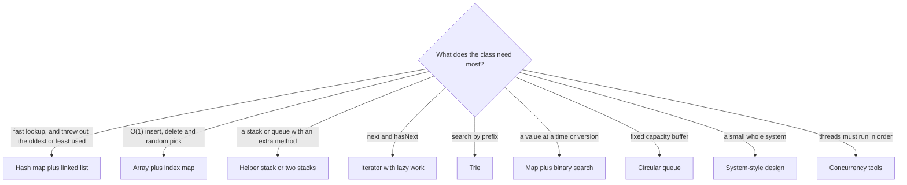

| Leaf | Go to | Real problems | Why it fits, and why the lookalike does not |
|---|---|---|---|
| Hash map plus linked list | [LRU and LFU Cache](../13-design-problems/01-lru-and-lfu-cache.md) | [LRU Cache](https://leetcode.com/problems/lru-cache/), [LFU Cache](https://leetcode.com/problems/lfu-cache/) | A hash map finds a key but cannot tell which key is oldest. A list knows the order but cannot find a key. Together they do both. |
| Array plus index map | [Hashing and Randomized Design](../13-design-problems/04-hashing-and-randomized-design.md) | [Insert Delete GetRandom O(1)](https://leetcode.com/problems/insert-delete-getrandom-o1/) | A fair random pick needs indexes, and a hash set has none. To delete, swap the item with the last one, then pop. |
| Helper stack or two stacks | [Stack and Queue Design](../13-design-problems/02-stack-and-queue-design.md) | [Min Stack](https://leetcode.com/problems/min-stack/), [Implement Queue using Stacks](https://leetcode.com/problems/implement-queue-using-stacks/) | The min changes when you pop. So store the min for each depth. |
| Iterator with lazy work | [Iterators](../13-design-problems/03-iterators.md) | [Flatten Nested List Iterator](https://leetcode.com/problems/flatten-nested-list-iterator/), [Binary Search Tree Iterator](https://leetcode.com/problems/binary-search-tree-iterator/) | Do only what the next call needs. Flattening everything in the constructor uses more memory. |
| Trie | [Trie](../07-trees/13-trie.md) | [Implement Trie (Prefix Tree)](https://leetcode.com/problems/implement-trie-prefix-tree/), [Design Add and Search Words Data Structure](https://leetcode.com/problems/design-add-and-search-words-data-structure/) | A hash set finds whole words only. A trie shares prefixes. |
| Map plus binary search | [Hashing and Randomized Design](../13-design-problems/04-hashing-and-randomized-design.md), [Persistent Data Structures](../12-advanced-data-structures/06-persistent-data-structures.md) | [Time Based Key-Value Store](https://leetcode.com/problems/time-based-key-value-store/), [Snapshot Array](https://leetcode.com/problems/snapshot-array/) | Each key keeps a sorted history. Copying the whole array at each snapshot costs too much. |
| Circular queue | [Circular Queue and Ring Buffer](../03-linked-lists-stacks-queues/08-circular-queue.md) | [Design Circular Queue](https://leetcode.com/problems/design-circular-queue/) | Indexes wrap around with `%`, so nothing needs to shift. |
| System-style design | [System-Style Design Problems](../13-design-problems/05-system-style-design.md) | [Design Twitter](https://leetcode.com/problems/design-twitter/) | Model the data first, then write each method. The feed is a k-way merge of recent posts. |
| Concurrency tools | [Concurrency Basics](../13-design-problems/06-concurrency-basics.md) | [Print in Order](https://leetcode.com/problems/print-in-order/) | Threads run in no fixed order, so you must block them until it is their turn. |

**Trap:** do not start from a structure you like. Start from the methods. If one method stays slow, you need a second structure, and the two must stay in sync. Many design bugs come from updating only one of the two.

## 15. A list of queries

**Spot it:** you get some data and also `queries`, and you must return one answer per query. Look at the limits. If `n` and the number of queries `q` both reach 10^5, then O(n) per query means about 10^10 steps. So you must prepare the data once, and then answer each query fast. The first question is always the same.

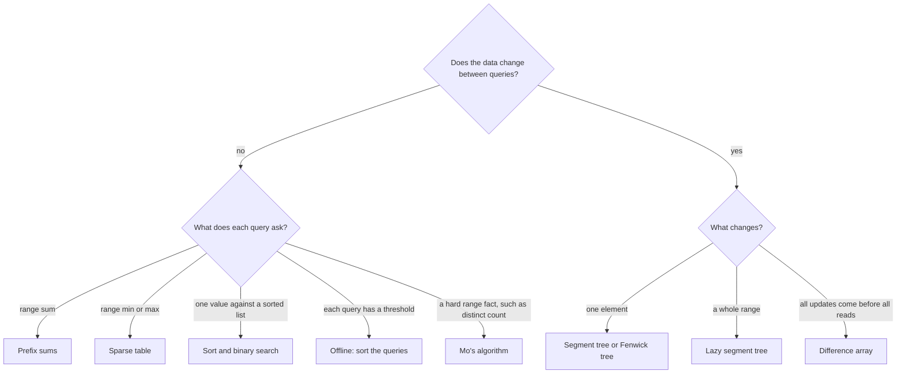

| Leaf | Go to | Real problems | Why it fits, and why the lookalike does not |
|---|---|---|---|
| Prefix sums | [Prefix Sums](../05-core-patterns/06-prefix-sums.md) | [Range Sum Query - Immutable](https://leetcode.com/problems/range-sum-query-immutable/), [Range Sum Query 2D - Immutable](https://leetcode.com/problems/range-sum-query-2d-immutable/) | A range sum is the difference of two running totals, so each query is O(1). |
| Sparse table | [Sparse Table and RMQ](../12-advanced-data-structures/04-sparse-table-and-rmq.md) | Classic: minimum of a range in a fixed array | You cannot "subtract" a minimum, so prefix sums fail. Two overlapping blocks work, because `min(x, x) = x`. |
| Sort and binary search | [Binary Search Basics](../04-sorting-searching/06-binary-search-basics.md) | [Longest Subsequence With Limited Sum](https://leetcode.com/problems/longest-subsequence-with-limited-sum/) | Sort, build running totals, then binary search once per query. |
| Offline | [Offline Query Processing](../05-core-patterns/20-offline-query-processing.md) | [Most Beautiful Item for Each Query](https://leetcode.com/problems/most-beautiful-item-for-each-query/), [Minimum Interval to Include Each Query](https://leetcode.com/problems/minimum-interval-to-include-each-query/), [Checking Existence of Edge Length Limited Paths](https://leetcode.com/problems/checking-existence-of-edge-length-limited-paths/) | All queries are known up front. In threshold order, each item joins once and leaves at most once, so one sweep answers them all. |
| Mo's algorithm | [Sqrt Decomposition and Mo's Algorithm](../12-advanced-data-structures/05-sqrt-decomposition-and-mos-algorithm.md) | Classic: number of distinct values in a range | Distinct counts do not combine by subtraction or by merging two numbers. Reordering the queries keeps the range moves small. |
| Segment tree or Fenwick tree | [Segment Tree](../12-advanced-data-structures/01-segment-tree.md), [Fenwick Tree](../12-advanced-data-structures/03-fenwick-tree.md) | [Range Sum Query - Mutable](https://leetcode.com/problems/range-sum-query-mutable/) | One update can change O(n) prefix sums. These trees cost O(log n) for both operations. A Fenwick tree suits sums. For range min or max, use a segment tree. |
| Lazy segment tree | [Segment Tree Lazy Propagation](../12-advanced-data-structures/02-segment-tree-lazy-propagation.md) | [Handling Sum Queries After Update](https://leetcode.com/problems/handling-sum-queries-after-update/) | A range update touches many elements. A lazy tag saves the work until a query needs it. |
| Difference array | [Difference Arrays and Sweep Line](../05-core-patterns/07-difference-array-and-sweep-line.md) | [Corporate Flight Bookings](https://leetcode.com/problems/corporate-flight-bookings/) | The reads come after all the writes, so one pass at the end gives every value. |

**Trap:** when you sort queries, each query loses its place. Store its original index, and write each answer to that index. Offline work also needs all the queries in advance. If a later query depends on an earlier answer, you cannot reorder them.

## 16. A permutation of 1 to n

**Spot it:** the words "values in the range 1 to n", or "each number from 1 to n appears once". A **permutation** holds every value exactly once, in some order. LeetCode often uses 0 to n - 1, and the idea is the same. This fact changes everything, because **a value is also an index**. Each value has a home.

A tiny picture. Take `p = [2, 0, 1]`, and draw an arrow from `i` to `p[i]`.

```text
0 -> 2 -> 1 -> 0
```

Every index has one arrow out and one arrow in, because each value appears once. So every permutation breaks into cycles.

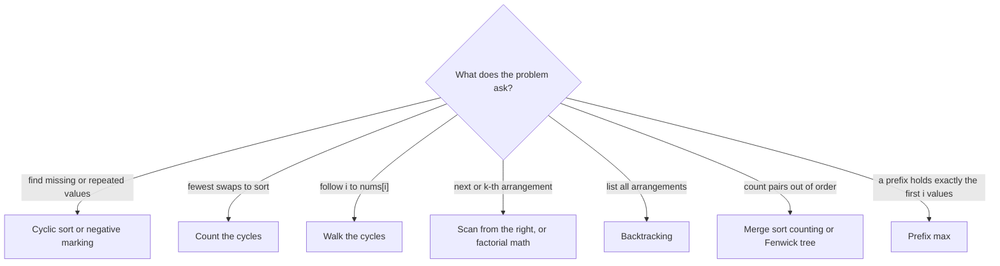

| Leaf | Go to | Real problems | Why it fits, and why the lookalike does not |
|---|---|---|---|
| Cyclic sort or negative marking | [Cyclic Sort](../05-core-patterns/10-cyclic-sort.md) | [Find All Numbers Disappeared in an Array](https://leetcode.com/problems/find-all-numbers-disappeared-in-an-array/), [Find All Duplicates in an Array](https://leetcode.com/problems/find-all-duplicates-in-an-array/), [First Missing Positive](https://leetcode.com/problems/first-missing-positive/) | A hash set also works, but it needs O(n) extra space. The array itself can store the marks. In First Missing Positive the values are free, but the answer lies in 1 to n + 1, so the same trick applies. |
| Count the cycles | [Cyclic Sort](../05-core-patterns/10-cyclic-sort.md) | Classic: fewest swaps to sort a permutation | Each swap changes the number of cycles by exactly 1, and a sorted array has n cycles. A swap inside a cycle splits it, so you can always gain one. So the answer is n minus the number of cycles. For `[2, 0, 1]` that is 3 - 1 = 2. This is for swaps of any two items. If only neighbours may swap, count the pairs out of order. |
| Walk the cycles | [Cyclic Sort](../05-core-patterns/10-cyclic-sort.md) | [Array Nesting](https://leetcode.com/problems/array-nesting/) | Cycles do not share indexes, so you mark what you visit, and the total work is O(n). |
| Scan from the right, or factorial math | [Permutations and Combinations](../06-recursion-backtracking-greedy/03-backtracking-permutations-combinations.md) | [Next Permutation](https://leetcode.com/problems/next-permutation/), [Permutation Sequence](https://leetcode.com/problems/permutation-sequence/) | Listing all arrangements costs n! steps. For the next arrangement, scan from the right for the first value that can grow, then fix the tail. For the k-th, each first value covers (n - 1)! arrangements, so you can compute each position directly. |
| Backtracking | [Permutations and Combinations](../06-recursion-backtracking-greedy/03-backtracking-permutations-combinations.md) | [Permutations](https://leetcode.com/problems/permutations/) | The output itself has n! items, so nothing faster can exist. |
| Merge sort counting or Fenwick tree | [Merge Sort](../04-sorting-searching/02-merge-sort.md), [Fenwick Tree](../12-advanced-data-structures/03-fenwick-tree.md) | [Count of Smaller Numbers After Self](https://leetcode.com/problems/count-of-smaller-numbers-after-self/) | Checking every pair costs O(n^2). In a permutation, the values are already valid Fenwick tree indexes. This problem allows negative values, so shift them first. |
| Prefix max | [Left and Right Scans](../05-core-patterns/22-left-and-right-scans.md) | [Max Chunks To Make Sorted](https://leetcode.com/problems/max-chunks-to-make-sorted/) | Values 0 to n - 1 are distinct. So the first i + 1 values are exactly 0 to i, if and only if their maximum is i. If they are exactly 0 to i, the maximum is i. If the maximum is i, then i + 1 distinct values all lie in 0 to i, so they fill it. |

**Trap:** [Find the Duplicate Number](https://leetcode.com/problems/find-the-duplicate-number/) looks like cyclic sort, but it is not. It has n + 1 values in the range 1 to n. You may not change the array, and you may use only O(1) extra space. So you treat `i -> nums[i]` as a linked list with a cycle, and use [fast and slow pointers](../05-core-patterns/03-fast-and-slow-pointers.md).

## 17. Points on a plane

**Spot it:** the input is a list of `[x, y]` pairs. Do not start with geometry formulas. First ask what the points are for. Often the coordinates are only a way to give distances, and the real problem is a heap, a hash map or a graph.

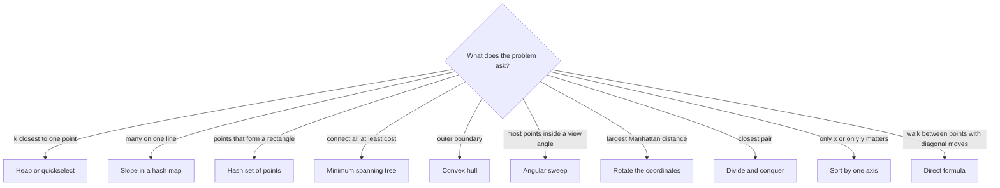

| Leaf | Go to | Real problems | Why it fits, and why the lookalike does not |
|---|---|---|---|
| Heap or quickselect | [Top K With Heaps](../05-core-patterns/14-top-k-and-heaps.md) | [K Closest Points to Origin](https://leetcode.com/problems/k-closest-points-to-origin/) | This is "top k", with distance as the key. No geometry is needed. |
| Slope in a hash map | [Computational Geometry](../11-math-geometry-games/07-computational-geometry.md) | [Max Points on a Line](https://leetcode.com/problems/max-points-on-a-line/) | Fix one point, and count the slopes to all the others. Equal slopes mean one line. |
| Hash set of points | [Hashing Patterns](../02-arrays-strings-hashing/04-hashing-patterns.md) | [Minimum Area Rectangle](https://leetcode.com/problems/minimum-area-rectangle/) | The sides are parallel to the axes, so two opposite corners fix the other two corners. Look those up. Trying all groups of four is far slower. |
| Minimum spanning tree | [Minimum Spanning Tree](../08-graphs/11-minimum-spanning-tree.md) | [Min Cost to Connect All Points](https://leetcode.com/problems/min-cost-to-connect-all-points/) | Every pair is an edge, so the graph has n(n - 1) / 2 edges. Prim's algorithm in O(n^2) suits this dense graph. |
| Convex hull | [Computational Geometry](../11-math-geometry-games/07-computational-geometry.md) | [Erect the Fence](https://leetcode.com/problems/erect-the-fence/) | The sign of a cross product tells you which way a corner turns. Comparing angles with floating point is less safe. |
| Angular sweep | [Computational Geometry](../11-math-geometry-games/07-computational-geometry.md) | [Maximum Number of Visible Points](https://leetcode.com/problems/maximum-number-of-visible-points/) | Turn each point into an angle, sort the angles, and then use a sliding window. The view can wrap past 360 degrees, so add a copy of each angle plus 360. |
| Rotate the coordinates | [Computational Geometry](../11-math-geometry-games/07-computational-geometry.md) | [Minimize Manhattan Distances](https://leetcode.com/problems/minimize-manhattan-distances/) | With `u = x + y` and `v = x - y`, the Manhattan distance becomes the larger of the `u` gap and the `v` gap. Then only the largest and smallest `u` and `v` matter. |
| Divide and conquer | [Divide and Conquer](../06-recursion-backtracking-greedy/05-divide-and-conquer.md) | Classic: closest pair of points | Checking all pairs costs O(n^2). Splitting by x means only a thin middle strip needs more work. |
| Sort by one axis | [Sorting With a Custom Order](../04-sorting-searching/05-custom-sorting.md) | [Widest Vertical Area Between Two Points Containing No Points](https://leetcode.com/problems/widest-vertical-area-between-two-points-containing-no-points/) | The y values play no part here. Sort by x, and take the largest gap. |
| Direct formula | [Computational Geometry](../11-math-geometry-games/07-computational-geometry.md) | [Minimum Time Visiting All Points](https://leetcode.com/problems/minimum-time-visiting-all-points/) | A diagonal step changes x and y together, so one leg takes as many steps as the larger of the x gap and the y gap. It looks like BFS, but no search is needed. |

**Trap:** avoid `double` where you can. To compare distances, compare `1LL * x * x + 1LL * y * y`, with no square root. The `1LL` stops `int` overflow. To store a slope, keep `dy / g` and `dx / g` with `g = gcd(dx, dy)`, and fix the sign. Two slopes that are equal as fractions may differ slightly as `double`.

## 18. A tree given as edges

**Spot it:** `n` nodes, `n - 1` edges, and the words "connected" or "no cycles". This is a tree, but it is not a binary tree. It has no `left` or `right`, and often no root. Build an adjacency list, pick any node as the root (node 0 is usual), and run a DFS that remembers the parent. The parent check stops you from walking back up.

```text
edges: 0-1, 1-2, 1-3      rooted at 0:

                               0
                               |
                               1
                              / \
                             2   3
```

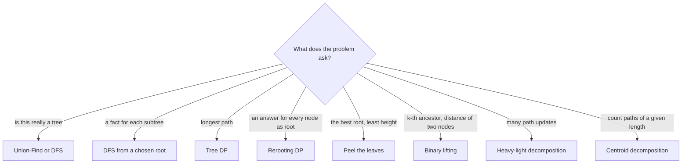

| Leaf | Go to | Real problems | Why it fits, and why the lookalike does not |
|---|---|---|---|
| Union-Find or DFS | [Union-Find](../08-graphs/07-union-find.md) | [Graph Valid Tree](https://leetcode.com/problems/graph-valid-tree/) (Premium), [Redundant Connection](https://leetcode.com/problems/redundant-connection/) | An edge inside one group makes a cycle. |
| DFS from a chosen root | [N-ary Trees](../07-trees/14-n-ary-trees.md) | [Minimum Time to Collect All Apples in a Tree](https://leetcode.com/problems/minimum-time-to-collect-all-apples-in-a-tree/), [Reorder Routes to Make All Paths Lead to the City Zero](https://leetcode.com/problems/reorder-routes-to-make-all-paths-lead-to-the-city-zero/) | There is only one path between two nodes, so no shortest path algorithm is needed. |
| Tree DP | [Tree DP](../09-dynamic-programming/11-tree-dp.md) | [Longest Path With Different Adjacent Characters](https://leetcode.com/problems/longest-path-with-different-adjacent-characters/) | The best path bends at some node. It joins the two longest arms below that node. |
| Rerooting DP | [Tree DP](../09-dynamic-programming/11-tree-dp.md) | [Sum of Distances in Tree](https://leetcode.com/problems/sum-of-distances-in-tree/) | A DFS from each node costs O(n^2). When the root moves to a child, its subtree gets 1 closer and all other nodes get 1 farther. So `ans[child] = ans[parent] + n - 2 * size[child]`. |
| Peel the leaves | [Topological Sort](../08-graphs/06-topological-sort.md) | [Minimum Height Trees](https://leetcode.com/problems/minimum-height-trees/) | Remove all the leaves, layer by layer. The last one or two nodes are the center. A DFS from each node costs O(n^2). |
| Binary lifting | [LCA and Binary Lifting](../12-advanced-data-structures/09-lca-and-binary-lifting.md) | [Kth Ancestor of a Tree Node](https://leetcode.com/problems/kth-ancestor-of-a-tree-node/) | Store jumps of 1, 2, 4, 8 steps. Any k is a sum of these powers, so a query takes O(log n) jumps. |
| Heavy-light decomposition | [Heavy-Light and Centroid Decomposition](../12-advanced-data-structures/10-heavy-light-and-centroid-decomposition.md) | Classic: path sum with point updates | It cuts each path into O(log n) array ranges, and a segment tree handles those ranges. |
| Centroid decomposition | [Heavy-Light and Centroid Decomposition](../12-advanced-data-structures/10-heavy-light-and-centroid-decomposition.md) | Classic: count the paths of length k | A centroid is a node whose removal leaves pieces of at most n / 2 nodes. Every path passes through some centroid, so you split the work at centroids. |

**Trap:** `n - 1` edges alone do not make a tree. With n = 4, the edges 0-1, 1-2 and 2-0 make a cycle, and node 3 sits alone. A tree needs `n - 1` edges **and** a connected graph. Also watch the depth. A tree can be one long chain, so recursion may go as deep as n.

## 19. A graph implied by the rules

**Spot it:** there is no edge list, yet the problem says "in one move", "you may change", "transform x into y", "minimum steps", or "a and b are linked". Stop looking for edges, and ask three questions.

1. **What is a node?** It is one full state of the puzzle.
2. **What is an edge?** It is one legal move.
3. **How many states are there?** If that number is small enough, search them. If it is too large, look for a greedy rule or a formula, as in [Broken Calculator](https://leetcode.com/problems/broken-calculator/).

A tiny example, based on [Open the Lock](https://leetcode.com/problems/open-the-lock/). A lock has two wheels, and it shows `00`. One move turns one wheel by one step, and the digits wrap around. Reach `12`.

```text
Node:   a two-digit string, so there are at most 100 nodes
Edges:  00 -> 10, 90, 01, 09
Path:   00 -> 10 -> 11 -> 12, which is 3 moves
```

Each move costs the same, so BFS finds the fewest moves.

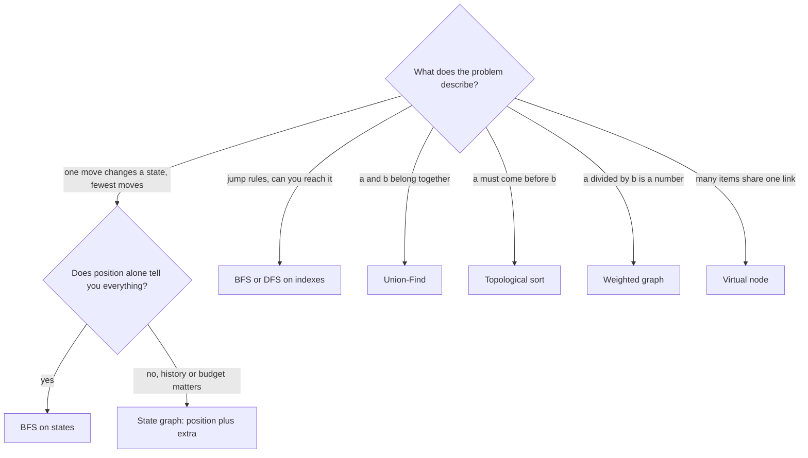

| Leaf | Go to | Real problems | Why it fits, and why the lookalike does not |
|---|---|---|---|
| BFS on states | [BFS Shortest Path Patterns](../08-graphs/04-bfs-shortest-path-patterns.md) | [Word Ladder](https://leetcode.com/problems/word-ladder/), [Sliding Puzzle](https://leetcode.com/problems/sliding-puzzle/), [Minimum Genetic Mutation](https://leetcode.com/problems/minimum-genetic-mutation/) | Moves can undo each other, so states form cycles and DP has no order. In Sliding Puzzle a state is a board, and there are at most 6! = 720 boards. |
| State graph | [Graph Modeling Tricks](../08-graphs/18-graph-modeling-tricks.md) | [Minimum Jumps to Reach Home](https://leetcode.com/problems/minimum-jumps-to-reach-home/) | You may not jump back twice in a row. So the node is (position, was the last jump backward). |
| BFS or DFS on indexes | [BFS and DFS](../08-graphs/02-bfs-and-dfs.md) | [Jump Game III](https://leetcode.com/problems/jump-game-iii/), [Keys and Rooms](https://leetcode.com/problems/keys-and-rooms/) | Each index or room is a node. The question is only whether you can reach something. |
| Union-Find | [Union-Find](../08-graphs/07-union-find.md) | [Most Stones Removed with Same Row or Column](https://leetcode.com/problems/most-stones-removed-with-same-row-or-column/), [Satisfiability of Equality Equations](https://leetcode.com/problems/satisfiability-of-equality-equations/) | Only the groups matter, not the paths. "Linked to a linked item" means the same group. |
| Topological sort | [Topological Sort](../08-graphs/06-topological-sort.md) | [Alien Dictionary](https://leetcode.com/problems/alien-dictionary/) (Premium) | Two neighbouring words give one rule, from their first different letter. Each rule is a directed edge. |
| Weighted graph | [Graph Modeling Tricks](../08-graphs/18-graph-modeling-tricks.md) | [Evaluate Division](https://leetcode.com/problems/evaluate-division/) | `a / b = 2` gives an edge a to b with weight 2, and b to a with weight 1/2. A query multiplies the weights along a path. |
| Virtual node | [Graph Modeling Tricks](../08-graphs/18-graph-modeling-tricks.md) | [Jump Game IV](https://leetcode.com/problems/jump-game-iv/) | A value shared by n items makes about n^2 edges. One extra node per value avoids them. You can also clear that value's list after its first use. |

**Trap:** position is not always the full state. In [Minimum Jumps to Reach Home](https://leetcode.com/problems/minimum-jumps-to-reach-home/), the same position may allow different moves, depending on the last jump. If your visited set stores only the position, BFS may wrongly refuse a path that was still possible.

## Inputs in disguise

Sometimes the input looks like one type and behaves like another. The trees above still work, once you see the real shape.

| It looks like | It really is | Real problem | The clue |
|---|---|---|---|
| An array of values in 1 to n | A linked list with a cycle | [Find the Duplicate Number](https://leetcode.com/problems/find-the-duplicate-number/) | Each value can be read as a pointer to an index. |
| One number | A linked list | [Happy Number](https://leetcode.com/problems/happy-number/) | Each number has exactly one next number. |
| A matrix of 0s and 1s | A graph, not a grid | [Number of Provinces](https://leetcode.com/problems/number-of-provinces/) | `isConnected[i][j]` is about cities i and j, not about a cell. Rows are not neighbours of each other. |
| A sorted matrix | k sorted lists | [Kth Smallest Element in a Sorted Matrix](https://leetcode.com/problems/kth-smallest-element-in-a-sorted-matrix/) | Each row is a sorted list, so [k-way merge](../05-core-patterns/16-k-way-merge.md) fits. [Binary search on the answer](../04-sorting-searching/07-binary-search-on-answer.md) fits too. |
| An array, with `edges[i]` as one number | A graph where each node has at most one outgoing edge | [Find Closest Node to Given Two Nodes](https://leetcode.com/problems/find-closest-node-to-given-two-nodes/) | There is one next node, so a plain walk gives all the distances. |
| An array of parents | A rooted tree | [Longest Path With Different Adjacent Characters](https://leetcode.com/problems/longest-path-with-different-adjacent-characters/) | `parent[i]` gives the edges. Build the child lists first. |
| An array of heights | Two pointers without sorting | [Container With Most Water](https://leetcode.com/problems/container-with-most-water/) | The width is the sorted part: it can only shrink as the two ends move in. |
| Rectangles | Sorted events | [The Skyline Problem](https://leetcode.com/problems/the-skyline-problem/) | Only the left and right edges can change the outline, so [sweep](../05-core-patterns/07-difference-array-and-sweep-line.md) over them and keep the live heights in a multiset. |

## Drills

Cover each answer. Name the input type first, then the technique, then say why the lookalike fails. The problems are stories on purpose, because real questions often hide the shape.

**D1.** Toy cars drive on one straight track at the same speed. Each car has a size. A positive size drives right, and a negative size drives left. When two cars meet, the smaller one is destroyed. Equal cars both go. Which cars remain?

<details>
<summary>Answer</summary>

Stack-like input. Use a [stack](../03-linked-lists-stacks-queues/05-stack-from-zero.md). A new car may destroy the last survivor and then meet the one before it, so the newest item is handled first. A single pass with a counter cannot bring old cars back. This is [Asteroid Collision](https://leetcode.com/problems/asteroid-collision/).

</details>

**D2.** Seats are numbered 1 to n. A list has n seat numbers, one for each guest. By mistake, one seat appears twice, and one seat is missing. Find both.

<details>
<summary>Answer</summary>

A permutation with one error. Use [cyclic sort](../05-core-patterns/10-cyclic-sort.md) or negative marking. Each value has a home, so the array can store its own marks with O(1) extra space. A hash set works too, but it uses O(n) space. This is [Set Mismatch](https://leetcode.com/problems/set-mismatch/).

</details>

**D3.** Guests give their check-in day and check-out day. What is the smallest number of rooms that the hotel needs, so that no two guests share a room at the same time?

<details>
<summary>Answer</summary>

Intervals, with the goal "how many at once". Use a [sweep line](../05-core-patterns/07-difference-array-and-sweep-line.md) or a min-heap of end times. The answer is the largest number of open intervals at one moment. Merging is wrong, because it loses how many stays overlap. This is [Meeting Rooms II](https://leetcode.com/problems/meeting-rooms-ii/) (Premium).

</details>

**D4.** There are n towns and n - 1 roads, and you can reach every town. For every town, find the total distance to all other towns. n can reach 30,000.

<details>
<summary>Answer</summary>

A tree given as edges. Use [rerooting DP](../09-dynamic-programming/11-tree-dp.md). One BFS per town costs O(n^2), which is too slow here. Moving the root from a parent to a child changes the total by a simple formula. This is [Sum of Distances in Tree](https://leetcode.com/problems/sum-of-distances-in-tree/).

</details>

**D5.** A row of solar panels is written as 1 for working and 0 for broken. You may repair at most k panels. Find the longest unbroken run of working panels that you can get.

<details>
<summary>Answer</summary>

Unsorted array, and the order matters. The run is contiguous. "At most k zeros" is monotonic, so use a [variable sliding window](../05-core-patterns/05-sliding-window-variable.md). The story says "repair", but you only count zeros in the window. This is [Max Consecutive Ones III](https://leetcode.com/problems/max-consecutive-ones-iii/).

</details>

**D6.** A spell checker measures how far a typed word is from a real word. One change inserts, deletes or replaces one letter. Find the fewest changes.

<details>
<summary>Answer</summary>

Two strings that must be lined up. Use a [2D DP on i and j](../09-dynamic-programming/07-lcs-and-edit-distance.md). When two letters differ, you do not know which change is best, so you try all three. Letter counts are useless here, because order matters. This is [Edit Distance](https://leetcode.com/problems/edit-distance/).

</details>

**D7.** A board game has 100 squares. A die moves you 1 to 6 squares forward. Some squares send you to another square, and some of those send you backward. Find the fewest throws to reach the end.

<details>
<summary>Answer</summary>

A graph implied by the rules. Each square is a node, and each die result is an edge of cost 1, so use [BFS](../08-graphs/04-bfs-shortest-path-patterns.md). Plain DP fails, because backward squares create cycles. Greedy fails, because the largest jump may land on a bad square. This is [Snakes and Ladders](https://leetcode.com/problems/snakes-and-ladders/).

</details>

**D8.** A shop screen shows the middle price of all sales so far. It must update after every sale.

<details>
<summary>Answer</summary>

A stream. Use [two heaps](../05-core-patterns/15-two-heaps.md). A max-heap holds the low half and a min-heap holds the high half, so the middle is at the two tops. Sorting after each sale repeats work. This is [Find Median from Data Stream](https://leetcode.com/problems/find-median-from-data-stream/).

</details>

**D9.** A bank lists daily balance changes, and some are negative. How many runs of consecutive days have a total change of exactly k?

<details>
<summary>Answer</summary>

Unsorted array, contiguous, exact sum, negatives allowed. Use a [prefix sum with a hash map](../05-core-patterns/06-prefix-sums.md). A window fails, because a negative day can repair a sum that was too large. This is [Subarray Sum Equals K](https://leetcode.com/problems/subarray-sum-equals-k/).

</details>

**D10.** A music app plays songs by following a "next song" link. After some songs, a link leads back to a song that was already played. Find the first song that plays twice, with O(1) extra memory.

<details>
<summary>Answer</summary>

A linked list with a cycle. Use [fast and slow pointers](../05-core-patterns/03-fast-and-slow-pointers.md). A hash set finds it too, but the O(1) memory limit rules that out. After the two pointers meet, one restarts from the head. Both then move one step at a time, and they meet again at the cycle start. This is [Linked List Cycle II](https://leetcode.com/problems/linked-list-cycle-ii/).

</details>

**D11.** A hiker crosses a height map from the top left corner to the bottom right corner, moving in four directions. The difficulty of a route is its hardest single step, measured as a height difference. Find the easiest route.

<details>
<summary>Answer</summary>

A grid with four directions and costs that differ. Use [Dijkstra](../08-graphs/08-dijkstra.md), and store the worst step so far instead of a sum. Grid DP fails, because four directions have no fill order. Plain BFS fails, because steps do not cost the same. [Binary search on the answer](../04-sorting-searching/07-binary-search-on-answer.md) with a BFS also works. This is [Path With Minimum Effort](https://leetcode.com/problems/path-with-minimum-effort/).

</details>

**D12.** A ship carries parcels in the given order. It sails once a day, and all parcels must arrive within d days. Find the smallest ship capacity that works.

<details>
<summary>Answer</summary>

Unsorted array, but the answer is a number with a yes or no test. If a capacity works, every larger capacity works. So use [binary search on the answer](../04-sorting-searching/07-binary-search-on-answer.md). The test itself is a simple greedy pass. This is [Capacity To Ship Packages Within D Days](https://leetcode.com/problems/capacity-to-ship-packages-within-d-days/).

</details>

**D13.** Offices sit at `[x, y]` points. A cable between two offices costs their Manhattan distance. All offices must be joined. Find the least total cost.

<details>
<summary>Answer</summary>

Points on a plane, but the real shape is a dense graph. Use a [minimum spanning tree](../08-graphs/11-minimum-spanning-tree.md). Shortest path is the lookalike, but you pay for the whole set of cables, not for one route. This is [Min Cost to Connect All Points](https://leetcode.com/problems/min-cost-to-connect-all-points/).

</details>

**D14.** You have a string and a list of index pairs. You may swap the characters at any listed pair, as many times as you like. Find the smallest string in dictionary order.

<details>
<summary>Answer</summary>

A graph implied by the rules. Indexes are nodes, and pairs are edges. Use [Union-Find](../08-graphs/07-union-find.md). Inside one connected group, repeated swaps can put the letters in any order, so sort each group and place its letters back in order. This is [Smallest String With Swaps](https://leetcode.com/problems/smallest-string-with-swaps/).

</details>

**D15.** A browser saves the last 100 pages. Opening a saved page must be O(1) on average. When the store is full, the page that was unused for the longest time is dropped.

<details>
<summary>Answer</summary>

A design request. List the methods: find by key, move to newest, drop the oldest. A [hash map plus a doubly linked list](../13-design-problems/01-lru-and-lfu-cache.md) makes all three fast. A hash map alone cannot find the oldest page. This is [LRU Cache](https://leetcode.com/problems/lru-cache/).

</details>

**D16.** How many numbers from 1 to n have at least one repeated digit? n can reach 10^9.

<details>
<summary>Answer</summary>

A number with a digit rule. Use [digit DP](../09-dynamic-programming/13-digit-dp.md), or careful counting. A loop to n is too long. Count the numbers with all different digits, then subtract them from n. This is [Numbers With Repeated Digits](https://leetcode.com/problems/numbers-with-repeated-digits/).

</details>

**D17.** A fence has posts of different heights. You pick two posts and stretch a sheet between them. Water fills up to the shorter post, and the width is the distance between the posts. Find the most water.

<details>
<summary>Answer</summary>

Looks like an unsorted array, but use [two pointers from both ends](../05-core-patterns/01-two-pointers-opposite-ends.md). Start with the widest pair. Moving the taller post cannot help, because the width falls and the shorter post still sets the height. So you move the shorter post. Sorting would destroy the distances. This is [Container With Most Water](https://leetcode.com/problems/container-with-most-water/).

</details>

**D18.** A forest is a grid. Each minute, fire spreads from every burning tree to the four neighbouring trees. How many minutes until all trees burn? Some trees may be out of reach.

<details>
<summary>Answer</summary>

A grid, all four directions, many starts at once. Use [multi-source BFS](../08-graphs/04-bfs-shortest-path-patterns.md). Put all the burning trees in the queue at minute 0. One BFS from each fire would repeat work and is harder to combine. This is [Rotting Oranges](https://leetcode.com/problems/rotting-oranges/) with a new story.

</details>

**D19.** There are 10^5 sensors in a row, and 10^5 requests in a mixed order. A request either corrects one reading or asks for the total of a range.

<details>
<summary>Answer</summary>

A list of queries, and the data changes one element at a time. Use a [Fenwick tree](../12-advanced-data-structures/03-fenwick-tree.md) or a [segment tree](../12-advanced-data-structures/01-segment-tree.md). Prefix sums fail, because one correction can change O(n) totals. This is [Range Sum Query - Mutable](https://leetcode.com/problems/range-sum-query-mutable/).

</details>

**D20.** Two DNA strands are given as arrays. Find the longest stretch that appears in both, with no gaps.

<details>
<summary>Answer</summary>

Two sequences that must line up. Use a [2D DP](../09-dynamic-programming/07-lcs-and-edit-distance.md) where each cell holds the common run ending at i and j, and a mismatch resets it to 0. Longest common subsequence is the lookalike, but it allows gaps. Binary search on the length with [rolling hash](../10-string-algorithms/04-rabin-karp-and-rolling-hash.md) also works. This is [Maximum Length of Repeated Subarray](https://leetcode.com/problems/maximum-length-of-repeated-subarray/).

</details>

**D21.** A factory has n tasks. Some tasks must finish before others can start. Give any valid order, or say that none exists.

<details>
<summary>Answer</summary>

A directed graph. Use [topological sort](../08-graphs/06-topological-sort.md). If some tasks are never freed, there is a cycle, and no order exists. Union-Find fails, because it ignores direction. This is [Course Schedule II](https://leetcode.com/problems/course-schedule-ii/).

</details>

**D22.** A company gives `manager[i]` for each employee, and the head has -1. Employee i needs `informTime[i]` minutes to pass news to their direct reports. How long until everyone knows the news?

<details>
<summary>Answer</summary>

A tree given as a parent array. Build the child lists, and run a [DFS from the head](../07-trees/14-n-ary-trees.md). The answer is the largest total along a path from the head down. There is only one path to each person, so Dijkstra is not needed. This is [Time Needed to Inform All Employees](https://leetcode.com/problems/time-needed-to-inform-all-employees/).

</details>

**D23.** A height map touches one sea on its north and west edges, and another sea on its south and east edges. Rain flows from a cell to neighbours of equal or lower height. Find the cells whose rain can reach both seas.

<details>
<summary>Answer</summary>

A grid with four directions. Use [flood fill](../08-graphs/03-grid-graphs.md), but start from the seas and walk uphill. A search from each cell repeats work. Do one fill for each sea, then take the cells marked by both. This is [Pacific Atlantic Water Flow](https://leetcode.com/problems/pacific-atlantic-water-flow/).

</details>

**D24.** Each row in a list has a name and some email addresses. Two rows that share any email belong to one person. Combine the rows.

<details>
<summary>Answer</summary>

A graph implied by the rules. Emails are nodes, and each row links its emails together. Use [Union-Find](../08-graphs/07-union-find.md). Comparing all pairs of rows is too slow, and it misses chains where A meets B and B meets C. This is [Accounts Merge](https://leetcode.com/problems/accounts-merge/).

</details>

**D25.** A class has `book(start, end)`. It returns false if the booking clashes with an earlier one. Otherwise it saves the booking and returns true.

<details>
<summary>Answer</summary>

Intervals that arrive over time, inside a design request. Use an [ordered map](../05-core-patterns/19-ordered-set-patterns.md). You cannot sort in advance, and a new booking can only clash with its two neighbours in sorted order. So each call costs O(log n). This is [My Calendar I](https://leetcode.com/problems/my-calendar-i/).

</details>

## Common pitfalls

1. **Stopping at the input type.** "It is a grid, so use BFS" is wrong for [Minimum Path Sum](https://leetcode.com/problems/minimum-path-sum/), where you move only right and down. Check how you move. The same input can lead to very different tools.
2. **Sorting when the order matters.** Sorting breaks subarrays and substrings. It is safe only when you may pick items in any order, or when you store each item's original index.
3. **Thinking binary search needs a sorted array.** It needs a test that lets you discard half. Peak problems, rotated arrays and "smallest capacity" problems all use it without a sorted input.
4. **Using a variable window on a sum with negative numbers.** A negative value breaks the monotonic rule. Use [prefix sums](../05-core-patterns/06-prefix-sums.md) instead. A fixed window still works, and so does a rule that ignores the sign, such as "at most k distinct values".
5. **Using DFS for the shortest path.** DFS finds a path, not the shortest one. Use BFS when all steps cost the same.
6. **Looking for an edge list.** If you see "one move" and "fewest moves", build the graph in your head, if the states are few enough. See [section 19](#19-a-graph-implied-by-the-rules).
7. **Treating every tree as a binary tree.** A tree given as edges has no `left` and `right`. Build an adjacency list, and pass the parent in your DFS.

Next, read [Decision Tree by Question Goal](04-decision-tree-by-question-goal.md). It starts from what the problem asks, and that is the second half of the same decision.
