# Decision Tree by Question Goal

> **Level:** Intermediate · **Priority:** T1 · **Time:** 120 min · **Read first:** [How to Recognize Any Problem](01-how-to-recognize-any-problem.md), [Decision Tree by Input Type](03-decision-tree-by-input-type.md) · **Next:** [Keyword Dictionary](05-keyword-dictionary.md)

The input tells you what you have. The goal tells you what you must produce, and the goal usually decides the technique. This guide gives you one decision tree for each goal, so that you can walk from the question to the right chapter. Read the last sentence of a problem first, because it holds the goal.

## Quick revision

- **Find a value:** sorted means binary search. A number whose yes or no test flips only once means binary search on the answer. Otherwise use a hash set.
- **Find a pair or triple:** unsorted with indexes means a hash map. Otherwise sort and use two pointers. For a triple, fix one item first.
- **Contiguous subarray:** fixed length means a fixed window. A monotonic rule means a variable window. A sum with negative values means prefix sums.
- **Subsequence:** gaps are allowed, so think DP. A window cannot skip items.
- **Count the ways:** "modulo 10^9 + 7" means the answer is too big to list. Use DP or a formula, not backtracking.
- **Min or max cost:** "minimize the largest" usually means binary search on the answer. Use greedy only when you can prove the local choice is safe. Otherwise use DP.
- **Is it possible:** often the same technique as min or max, but you can stop at the first yes.
- **List all solutions:** if the number of answers can grow exponentially, use backtracking.
- **Top k:** a heap of size k. A min-heap keeps the k largest.
- **Next greater or smaller:** nearest by position means a monotonic stack. Nearest by value means an ordered set.
- **Shortest path:** same cost per step means BFS. Costs of 0 and 1 mean 0-1 BFS. Non-negative costs mean Dijkstra. Negative costs or a step limit mean Bellman-Ford.
- **Ordering with dependencies:** "A before B" means topological sort.
- **Connectivity:** edges that arrive over time mean Union-Find. A fixed grid or graph means DFS or BFS.
- **Range queries:** with no updates, a sum means prefix sums and a minimum means a sparse table. Updates mean a Fenwick tree or a segment tree.
- **Palindromes:** first ask if gaps are allowed. Substring means expand around centres. Subsequence means palindrome DP.

## How to use these trees

Here is one array and five questions. Only the question changes.

```text
nums = [4, 2, 1, 2], target = 5
```

| The question asks | Goal | Technique | Answer |
|---|---|---|---|
| Two indexes whose values add to 5 | Find a pair | Hash map | Indexes 0 and 2 (4 + 1) |
| Longest contiguous piece with sum 5 | Contiguous subarray | Variable sliding window, because all values are positive | `[2, 1, 2]`, length 3 |
| Can some items, at any positions, add to 5? | Is it possible | 0/1 knapsack | Yes |
| How many groups of items add to 5? | Count the ways | 0/1 knapsack, counting | 2 |
| List every group that adds to 5 | List all | Backtracking | `{4, 1}` and `{2, 1, 2}` |

Same data. Different chapters. So do these four steps:

1. **Name the goal.** Read the last sentence. Say the goal in one short phrase, using the table below.
2. **Walk the tree.** Answer each question with yes or no. Check the real input. Do not guess from the problem's story.
3. **Check the lookalike.** Each tree has a table that says why its neighbours do not fit. Read that row.
4. **Check the constraints.** Use [Constraints Tell You the Algorithm](02-constraints-tell-you-the-algorithm.md) to confirm the speed you need.

A problem can pass through two trees. For example, "minimum cost" can send you to the shortest path tree. That is normal.

| The last sentence asks for | Go to |
|---|---|
| One item, one position, one missing number | [1. Find a value](#1-find-a-value) |
| Two or three items with a rule | [2. Find a pair or triple](#2-find-a-pair-or-triple) |
| A subarray or substring | [3. Contiguous subarray questions](#3-contiguous-subarray-questions) |
| A subsequence | [4. Subsequence questions](#4-subsequence-questions) |
| "How many ways", "number of" | [5. Count the ways](#5-count-the-ways) |
| "Minimum cost", "maximum profit", "fewest" | [6. Min or max cost](#6-min-or-max-cost) |
| "Can you", "return true if" | [7. Is it possible](#7-is-it-possible) |
| "Return all", "generate all" | [8. List all solutions](#8-list-all-solutions) |
| "k largest", "kth smallest", "k most frequent" | [9. Top k](#9-top-k) |
| "Next greater", "previous smaller", "days until" | [10. Next greater or smaller](#10-next-greater-or-smaller) |
| "Shortest path", "minimum steps", "cheapest route" | [11. Shortest path](#11-shortest-path) |
| "Prerequisite", "depends on", "a valid order" | [12. Ordering with dependencies](#12-ordering-with-dependencies) |
| "Connected", "same group", "islands" | [13. Connectivity](#13-connectivity) |
| "For each query", "sum from l to r" | [14. Range queries](#14-range-queries) |
| "Palindrome" | [15. Palindromes](#15-palindromes) |

## 1. Find a value

**Words that show this goal:** "find the index", "does it exist", "first position", "missing", "duplicate", "smallest speed that".

Looking at every item costs O(n). Each branch below is a reason to skip work, so ask: what lets me avoid looking at everything?

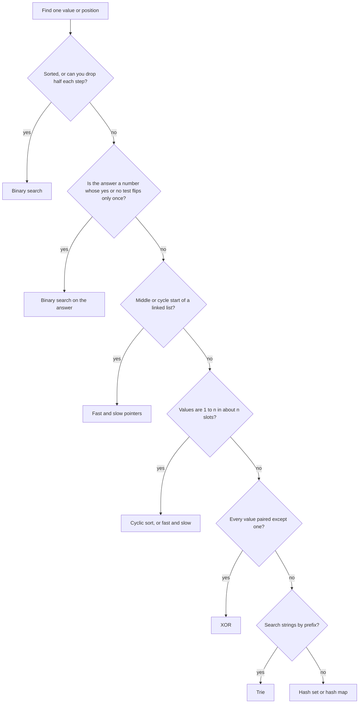

| Leaf | Chapter | Real problems | Why this leaf and not its neighbour |
|---|---|---|---|
| Binary search | [Binary Search Basics](../04-sorting-searching/06-binary-search-basics.md) | [Binary Search](https://leetcode.com/problems/binary-search/), [Search in Rotated Sorted Array](https://leetcode.com/problems/search-in-rotated-sorted-array/), [Find Peak Element](https://leetcode.com/problems/find-peak-element/) | The real test is "can one check drop half?", not "is it sorted?". A rotated array is not sorted, but one half always is. |
| Binary search on the answer | [Binary Search on the Answer](../04-sorting-searching/07-binary-search-on-answer.md) | [Koko Eating Bananas](https://leetcode.com/problems/koko-eating-bananas/) | The speed is not an item in the array. But if a speed works, every faster speed works too. You search that one-way flip. |
| Fast and slow pointers | [Fast and Slow Pointers](../05-core-patterns/03-fast-and-slow-pointers.md) | [Middle of the Linked List](https://leetcode.com/problems/middle-of-the-linked-list/), [Linked List Cycle II](https://leetcode.com/problems/linked-list-cycle-ii/) | A list has no index, so binary search cannot jump. Two speeds find a position without knowing the length. |
| Cyclic sort | [Cyclic Sort](../05-core-patterns/10-cyclic-sort.md) | [Find All Numbers Disappeared in an Array](https://leetcode.com/problems/find-all-numbers-disappeared-in-an-array/), [First Missing Positive](https://leetcode.com/problems/first-missing-positive/) | Each value has one home slot, so the array works as its own hash table. This saves the O(n) extra space. |
| Fast and slow, on an array | [Fast and Slow Pointers](../05-core-patterns/03-fast-and-slow-pointers.md) | [Find the Duplicate Number](https://leetcode.com/problems/find-the-duplicate-number/) | You may not change the array, so cyclic sort is out. Treat `i -> nums[i]` as a linked list. The duplicate is the cycle start. |
| XOR | [Bit Manipulation](../05-core-patterns/17-bit-manipulation.md) | [Single Number](https://leetcode.com/problems/single-number/) | `x ^ x` is 0, so pairs cancel. A hash set also works, but it uses O(n) space. |
| Trie | [Trie](../07-trees/13-trie.md) | [Implement Trie (Prefix Tree)](https://leetcode.com/problems/implement-trie-prefix-tree/) | A hash set only answers "is this whole word here?". Prefixes need a shared path. |
| Hash set or map | [Hash Tables From Zero](../02-arrays-strings-hashing/03-hash-tables-from-zero.md) | [Contains Duplicate](https://leetcode.com/problems/contains-duplicate/) | There is no order to use, so you need O(1) lookups on average. |

**Trap:** "kth smallest" sounds like one value, but it is a ranking question. Go to [9. Top k](#9-top-k).

## 2. Find a pair or triple

**Words that show this goal:** "two numbers that add to", "triplet", "pair", "closest to target", "i < j".

Trying all pairs costs O(n^2). For each item, the question is: can I find its partner without a loop?

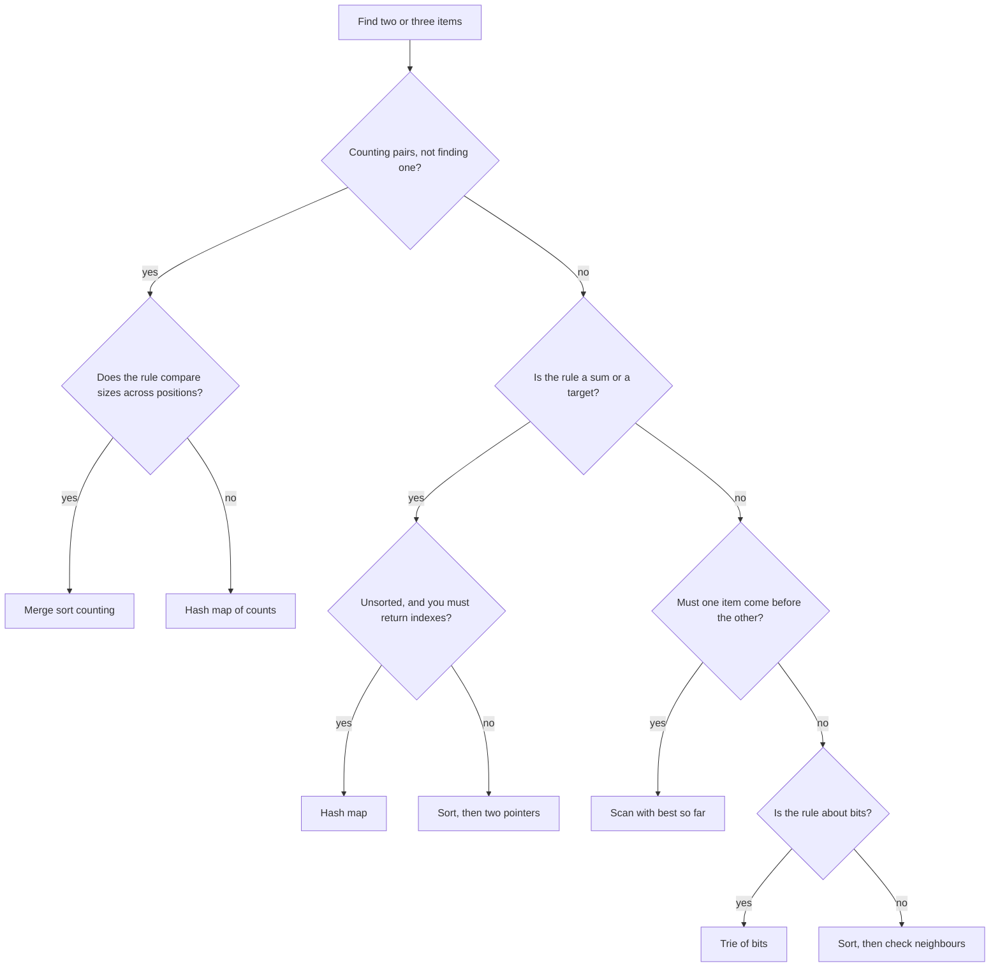

| Leaf | Chapter | Real problems | Why this leaf and not its neighbour |
|---|---|---|---|
| Hash map | [Hashing Patterns](../02-arrays-strings-hashing/04-hashing-patterns.md) | [Two Sum](https://leetcode.com/problems/two-sum/) | Sorting moves the items, so you would have to store each index too. A map finds the partner in O(1) on average. |
| Sort, then two pointers | [Two Pointers: Opposite Ends](../05-core-patterns/01-two-pointers-opposite-ends.md) | [Two Sum II - Input Array Is Sorted](https://leetcode.com/problems/two-sum-ii-input-array-is-sorted/), [3Sum](https://leetcode.com/problems/3sum/), [Container With Most Water](https://leetcode.com/problems/container-with-most-water/) | Order tells you which pointer to move, so you need no extra memory. In 3Sum, sorting also makes duplicates easy to skip. Container With Most Water is not a sum, and you must not sort it, because positions matter. But its rule still tells you which end to move: the shorter line. |
| Hash map of counts | [Hashing Patterns](../02-arrays-strings-hashing/04-hashing-patterns.md) | [Pairs of Songs With Total Durations Divisible by 60](https://leetcode.com/problems/pairs-of-songs-with-total-durations-divisible-by-60/) | You need how many partners exist, not where they are. Group by remainder. If the rule is an inequality, as in [Count Pairs Whose Sum is Less than Target](https://leetcode.com/problems/count-pairs-whose-sum-is-less-than-target/), sort and use two pointers. |
| Merge sort counting | [Merge Sort](../04-sorting-searching/02-merge-sort.md) | [Reverse Pairs](https://leetcode.com/problems/reverse-pairs/), [Count of Smaller Numbers After Self](https://leetcode.com/problems/count-of-smaller-numbers-after-self/) | A hash map cannot answer "how many earlier values are bigger?". During a merge, both halves are sorted, so you can count across them. |
| Scan with best so far | [Left and Right Scans](../05-core-patterns/22-left-and-right-scans.md) | [Best Time to Buy and Sell Stock](https://leetcode.com/problems/best-time-to-buy-and-sell-stock/) | You cannot sort, because the buy day must come first. Each day's best partner is the lowest earlier price, and one number holds that. |
| Trie of bits | [Trie](../07-trees/13-trie.md) | [Maximum XOR of Two Numbers in an Array](https://leetcode.com/problems/maximum-xor-of-two-numbers-in-an-array/) | A big XOR depends on bits, not on size. A trie walks one bit at a time from the top. |
| Sort, then check neighbours | [Sorting With a Custom Order](../04-sorting-searching/05-custom-sorting.md) | [Minimum Absolute Difference](https://leetcode.com/problems/minimum-absolute-difference/) | After sorting, the closest values sit side by side. |

**For a triple:** fix one item, and the rest is a pair problem. 3Sum becomes "for each `nums[i]`, find a pair that adds to `-nums[i]`". That costs O(n^2) after sorting.

**Trap:** "pair" does not always mean this tree. If the two items mark the ends of a piece and you care about what is between them, go to [3. Contiguous subarray questions](#3-contiguous-subarray-questions).

## 3. Contiguous subarray questions

**Words that show this goal:** "subarray", "substring", "contiguous", "consecutive positions", "window".

A **subarray** is a part of an array with no gaps. A **substring** is the same for a string. There are about n^2 / 2 of them, so you need a way to avoid checking each one.

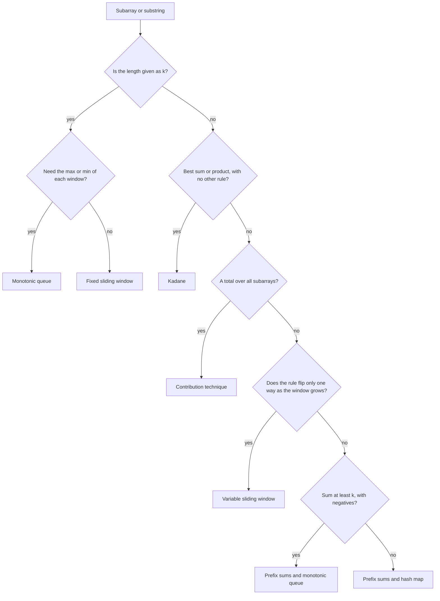

| Leaf | Chapter | Real problems | Why this leaf and not its neighbour |
|---|---|---|---|
| Fixed sliding window | [Sliding Window: Fixed Size](../05-core-patterns/04-sliding-window-fixed.md) | [Maximum Average Subarray I](https://leetcode.com/problems/maximum-average-subarray-i/), [Find All Anagrams in a String](https://leetcode.com/problems/find-all-anagrams-in-a-string/) | Every window has the same size, so you need no shrink rule. An anagram of `p` always has the length of `p`. |
| Monotonic queue | [Monotonic Queue](../05-core-patterns/13-monotonic-queue.md) | [Sliding Window Maximum](https://leetcode.com/problems/sliding-window-maximum/) | A running sum can subtract the leaving item. A maximum cannot. When the max leaves, you need the next best one. |
| Kadane | [Kadane's Algorithm](../05-core-patterns/08-kadane-and-subarray-dp.md) | [Maximum Subarray](https://leetcode.com/problems/maximum-subarray/), [Maximum Product Subarray](https://leetcode.com/problems/maximum-product-subarray/) | No rule tells a window when to shrink. Kadane asks one thing at each index: extend the old piece, or start again? A product also tracks the smallest value, because a negative flips it. |
| Contribution technique | [Contribution Technique](../05-core-patterns/18-contribution-technique.md) | [Sum of Subarray Minimums](https://leetcode.com/problems/sum-of-subarray-minimums/), [Sum of Subarray Ranges](https://leetcode.com/problems/sum-of-subarray-ranges/) | Do not visit each subarray. Ask how many subarrays each item affects. |
| Variable sliding window | [Sliding Window: Variable Size](../05-core-patterns/05-sliding-window-variable.md) | [Longest Substring Without Repeating Characters](https://leetcode.com/problems/longest-substring-without-repeating-characters/), [Minimum Window Substring](https://leetcode.com/problems/minimum-window-substring/), [Minimum Size Subarray Sum](https://leetcode.com/problems/minimum-size-subarray-sum/) | A monotonic rule lets you throw away a start for good. Monotonic means the rule flips only one way as the window grows. |
| Prefix sums and hash map | [Prefix Sums](../05-core-patterns/06-prefix-sums.md) | [Subarray Sum Equals K](https://leetcode.com/problems/subarray-sum-equals-k/), [Subarray Sums Divisible by K](https://leetcode.com/problems/subarray-sums-divisible-by-k/), [Contiguous Array](https://leetcode.com/problems/contiguous-array/) | With negative values, or a rule like "divisible by k", a window has no safe move. The map finds earlier prefixes that match. |
| Prefix sums and monotonic queue | [Monotonic Queue](../05-core-patterns/13-monotonic-queue.md) | [Shortest Subarray with Sum at Least K](https://leetcode.com/problems/shortest-subarray-with-sum-at-least-k/) | A hash map only finds exact values, and "at least" needs the best earlier prefix. |

**Why negative values break the window.** Take `nums = [2, -1, 2]` and count subarrays with sum 2. The answer is 2: the first `[2]` and the last `[2]`. A window adds all three and reaches sum 3, which is too big. It shrinks by removing the first 2, and the sum is now 1. The window is `[-1, 2]`, and it never tries the last `[2]` alone. The sum 1 is too small, so the window does not shrink again. But removing the `-1` would raise the sum. With negative values, neither move is safe.

**The same words, three different answers:**

| Problem | Values | Rule | Technique |
|---|---|---|---|
| [Minimum Size Subarray Sum](https://leetcode.com/problems/minimum-size-subarray-sum/) | All positive | Sum at least target | Variable window |
| [Subarray Sum Equals K](https://leetcode.com/problems/subarray-sum-equals-k/) | May be negative | Sum exactly k | Prefix sums and hash map |
| [Shortest Subarray with Sum at Least K](https://leetcode.com/problems/shortest-subarray-with-sum-at-least-k/) | May be negative | Sum at least k | Prefix sums and monotonic queue |

**Negative numbers alone do not ban the window.** The real test is whether the rule is monotonic. In [Longest Continuous Subarray With Absolute Diff Less Than or Equal to Limit](https://leetcode.com/problems/longest-continuous-subarray-with-absolute-diff-less-than-or-equal-to-limit/), a new item can never shrink the gap between largest and smallest, even with negative values. So the window still works, with two [monotonic queues](../05-core-patterns/13-monotonic-queue.md) holding the largest and smallest.

**Trap:** [Longest Consecutive Sequence](https://leetcode.com/problems/longest-consecutive-sequence/) says "consecutive", but it means consecutive values such as 4, 5, 6 at any positions. It is not a subarray. Use a [hash set](../02-arrays-strings-hashing/04-hashing-patterns.md).

## 4. Subsequence questions

**Words that show this goal:** "subsequence", "delete some characters", "without changing the order", "not necessarily contiguous".

A **subsequence** keeps the items in their original order, but gaps are allowed. `ace` is a subsequence of `abcde`. Each item is a choice of keep or skip, so trying all of them costs O(2^n) choices. A window cannot help, because it cannot skip an item in the middle. DP can help, because the future only depends on a small summary of the past.

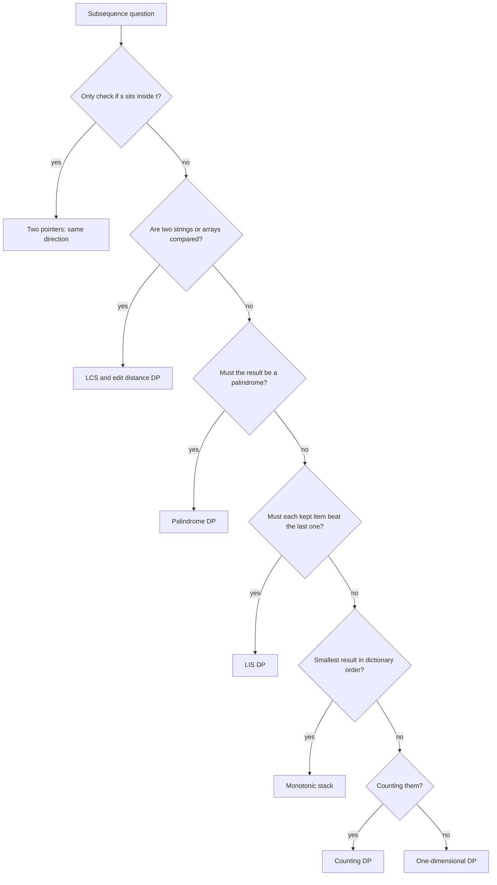

| Leaf | Chapter | Real problems | Why this leaf and not its neighbour |
|---|---|---|---|
| Two pointers: same direction | [Two Pointers: Same Direction](../05-core-patterns/02-two-pointers-same-direction.md) | [Is Subsequence](https://leetcode.com/problems/is-subsequence/) | A yes or no check needs no table. Matching each letter as early as possible is always safe. |
| LCS and edit distance DP | [LCS and Edit Distance](../09-dynamic-programming/07-lcs-and-edit-distance.md) | [Longest Common Subsequence](https://leetcode.com/problems/longest-common-subsequence/), [Delete Operation for Two Strings](https://leetcode.com/problems/delete-operation-for-two-strings/), [Distinct Subsequences](https://leetcode.com/problems/distinct-subsequences/) | Two inputs mean the state is two indexes: `dp[i][j]` covers the first `i` and first `j` items. This holds when you count, too. |
| Palindrome DP | [Palindrome DP](../09-dynamic-programming/08-palindrome-dp.md) | [Longest Palindromic Subsequence](https://leetcode.com/problems/longest-palindromic-subsequence/) | One string, but the state is a range `[i, j]`, because a palindrome grows from both ends. |
| LIS DP | [Longest Increasing Subsequence](../09-dynamic-programming/06-longest-increasing-subsequence.md) | [Longest Increasing Subsequence](https://leetcode.com/problems/longest-increasing-subsequence/), [Longest String Chain](https://leetcode.com/problems/longest-string-chain/) | The rule links each kept item to the last kept one. So the state is "best chain that ends at this item". |
| Monotonic stack | [Monotonic Stack](../05-core-patterns/12-monotonic-stack.md) | [Remove K Digits](https://leetcode.com/problems/remove-k-digits/), [Find the Most Competitive Subsequence](https://leetcode.com/problems/find-the-most-competitive-subsequence/) | Dictionary order is decided by the first position that differs. So a smaller item should remove a bigger one before it, while removals remain. |
| Counting DP | [Counting and Probability DP](../09-dynamic-programming/14-counting-and-probability-dp.md) | [Distinct Subsequences II](https://leetcode.com/problems/distinct-subsequences-ii/) | The count is huge, so listing is impossible. Count by the last item chosen. |
| One-dimensional DP | [One-Dimensional DP](../09-dynamic-programming/02-one-dimensional-dp.md) | [House Robber](https://leetcode.com/problems/house-robber/) | The rule is a gap rule: no two neighbours. Each index only needs the best answers for the two indexes before it. |

**Trap:** if the order of chosen items does not matter, it is a subset, not a subsequence. Go to the knapsack leaf in [6. Min or max cost](#6-min-or-max-cost).

## 5. Count the ways

**Words that show this goal:** "how many ways", "number of", "count the", "modulo 10^9 + 7".

**The key thought:** backtracking visits every answer once, so it takes at least as many steps as the count. When a problem says "return it modulo 10^9 + 7", it is telling you that the count can be far too big to visit. So you must add up counts without visiting each way.

If you count subarrays, go to [tree 3](#3-contiguous-subarray-questions). If you count pairs, go to [tree 2](#2-find-a-pair-or-triple). Otherwise use this tree.

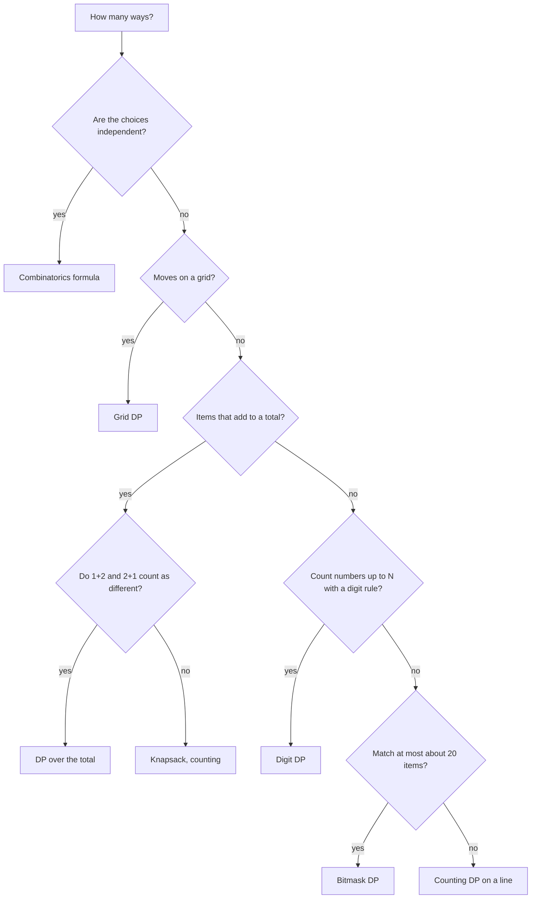

| Leaf | Chapter | Real problems | Why this leaf and not its neighbour |
|---|---|---|---|
| Combinatorics formula | [Combinatorics](../11-math-geometry-games/04-combinatorics.md) | [Unique Paths](https://leetcode.com/problems/unique-paths/) | With no obstacles, a path is a choice of which moves go down. That is a single formula. |
| Grid DP | [Grid DP](../09-dynamic-programming/03-grid-dp.md) | [Unique Paths II](https://leetcode.com/problems/unique-paths-ii/) | One obstacle breaks the formula, because the choices are no longer independent. Each cell adds the counts from above and from the left. |
| DP over the total | [One-Dimensional DP](../09-dynamic-programming/02-one-dimensional-dp.md), [Unbounded Knapsack](../09-dynamic-programming/05-unbounded-knapsack.md), [Counting and Probability DP](../09-dynamic-programming/14-counting-and-probability-dp.md) | [Combination Sum IV](https://leetcode.com/problems/combination-sum-iv/), [Climbing Stairs](https://leetcode.com/problems/climbing-stairs/), [Number of Dice Rolls With Target Sum](https://leetcode.com/problems/number-of-dice-rolls-with-target-sum/) | Each order is a different way, so the state holds the total reached so far. Dice Rolls also tracks how many dice are used. |
| Knapsack, counting | [Unbounded Knapsack](../09-dynamic-programming/05-unbounded-knapsack.md), [0/1 Knapsack](../09-dynamic-programming/04-zero-one-knapsack.md) | [Coin Change II](https://leetcode.com/problems/coin-change-ii/), [Target Sum](https://leetcode.com/problems/target-sum/) | Each group counts once in any order. Handle one item type at a time, so that the same group cannot be counted twice. |
| Digit DP | [Digit DP](../09-dynamic-programming/13-digit-dp.md) | [Number of Digit One](https://leetcode.com/problems/number-of-digit-one/), [Numbers At Most N Given Digit Set](https://leetcode.com/problems/numbers-at-most-n-given-digit-set/) | N can be near 10^9, so you cannot loop over numbers. Build them digit by digit. |
| Bitmask DP | [Bitmask DP](../09-dynamic-programming/12-bitmask-dp.md) | [Beautiful Arrangement](https://leetcode.com/problems/beautiful-arrangement/), [Number of Ways to Wear Different Hats to Each Other](https://leetcode.com/problems/number-of-ways-to-wear-different-hats-to-each-other/) | The state must remember which items are used. A small n lets a bitmask hold that. A bitmask is an integer whose bits mark a set. |
| Counting DP on a line | [One-Dimensional DP](../09-dynamic-programming/02-one-dimensional-dp.md), [Counting and Probability DP](../09-dynamic-programming/14-counting-and-probability-dp.md) | [Decode Ways](https://leetcode.com/problems/decode-ways/), [Count Vowels Permutation](https://leetcode.com/problems/count-vowels-permutation/) | Each position adds up the counts of the few states it can come from. |

**Same words, different count.** With items 1 and 2 and a total of 3, [Coin Change II](https://leetcode.com/problems/coin-change-ii/) says 2 ways: `1+1+1` and `1+2`. [Combination Sum IV](https://leetcode.com/problems/combination-sum-iv/) says 3 ways, because `1+2` and `2+1` differ. Always check which one the examples show.

**Two rarer cases.** To count the shortest paths in a graph, use [Dijkstra](../08-graphs/08-dijkstra.md) and keep a count next to each distance, as in [Number of Ways to Arrive at Destination](https://leetcode.com/problems/number-of-ways-to-arrive-at-destination/). If n is near 10^18, even O(n) is too slow. A fixed rule such as Fibonacci then needs [matrix exponentiation](../11-math-geometry-games/05-matrix-exponentiation.md).

## 6. Min or max cost

**Words that show this goal:** "minimum cost", "maximum profit", "fewest", "at least how many", "best".

This goal has two steps. The first tree picks the family. The second tree picks the kind of DP.

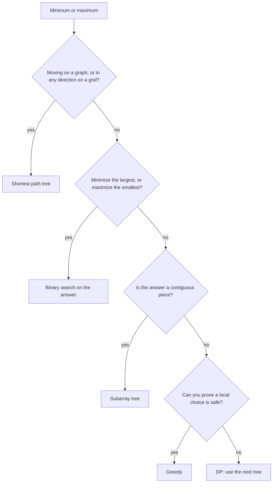

| Leaf | Chapter | Real problems | Why this leaf and not its neighbour |
|---|---|---|---|
| Shortest path tree | [11. Shortest path](#11-shortest-path) | [Network Delay Time](https://leetcode.com/problems/network-delay-time/) | The cost is paid along a route, so the structure is a graph. |
| Binary search on the answer | [Binary Search on the Answer](../04-sorting-searching/07-binary-search-on-answer.md) | [Split Array Largest Sum](https://leetcode.com/problems/split-array-largest-sum/), [Magnetic Force Between Two Balls](https://leetcode.com/problems/magnetic-force-between-two-balls/) | "Can every part stay at or below x?" is easy to test, and a larger x only makes it easier. That is much simpler than building the best split. Check that one-way rule first: [Minimize Maximum Pair Sum in Array](https://leetcode.com/problems/minimize-maximum-pair-sum-in-array/) only needs a sort. |
| Subarray tree | [3. Contiguous subarray questions](#3-contiguous-subarray-questions) | [Maximum Subarray](https://leetcode.com/problems/maximum-subarray/) | "Contiguous" decides the technique before "maximum" does. |
| Greedy | [Greedy Foundations](../06-recursion-backtracking-greedy/06-greedy-foundations.md) | [Non-overlapping Intervals](https://leetcode.com/problems/non-overlapping-intervals/), [Assign Cookies](https://leetcode.com/problems/assign-cookies/) | There is one best move, and it never hurts later moves. Keeping the interval that ends first leaves the most room. |

**How to test a greedy idea.** Try to break it with three or four small items. With coins `[1, 3, 4]` and amount 6, "take the largest coin" gives `4 + 1 + 1`, which is 3 coins. The best is `3 + 3`, which is 2 coins. So [Coin Change](https://leetcode.com/problems/coin-change/) needs DP. If you cannot break it, try an exchange argument: take any best answer that differs from your choice, swap in your choice, and show that the answer does not get worse. If that swap always works, greedy is correct.

**Which DP?** Start at the top and take the first yes.

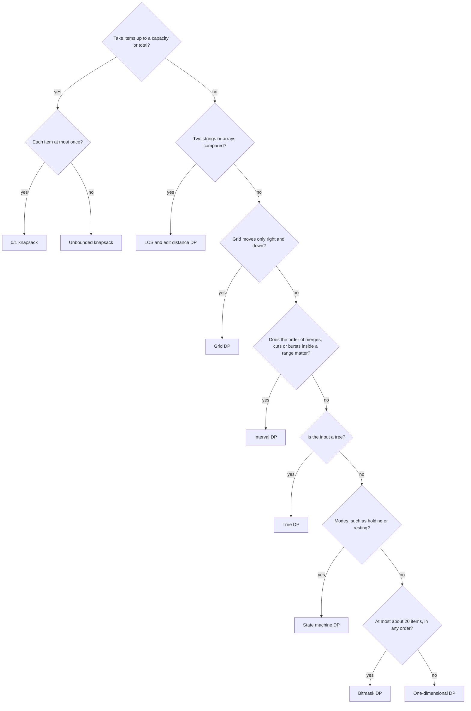

| Leaf | Chapter | Real problems | The state you need |
|---|---|---|---|
| 0/1 knapsack | [0/1 Knapsack](../09-dynamic-programming/04-zero-one-knapsack.md) | [Ones and Zeroes](https://leetcode.com/problems/ones-and-zeroes/), [Last Stone Weight II](https://leetcode.com/problems/last-stone-weight-ii/) | Items seen so far, and capacity used. |
| Unbounded knapsack | [Unbounded Knapsack](../09-dynamic-programming/05-unbounded-knapsack.md) | [Coin Change](https://leetcode.com/problems/coin-change/), [Perfect Squares](https://leetcode.com/problems/perfect-squares/) | Only the total, because an item can be used again. |
| LCS and edit distance DP | [LCS and Edit Distance](../09-dynamic-programming/07-lcs-and-edit-distance.md) | [Edit Distance](https://leetcode.com/problems/edit-distance/) | One index in each string. |
| Grid DP | [Grid DP](../09-dynamic-programming/03-grid-dp.md) | [Minimum Path Sum](https://leetcode.com/problems/minimum-path-sum/), [Dungeon Game](https://leetcode.com/problems/dungeon-game/) | The row and the column. Moves never go back, so no shortest path tool is needed. |
| Interval DP | [Interval DP](../09-dynamic-programming/09-interval-dp.md) | [Burst Balloons](https://leetcode.com/problems/burst-balloons/), [Minimum Cost to Cut a Stick](https://leetcode.com/problems/minimum-cost-to-cut-a-stick/) | A range `[i, j]`, split at the last or first action inside it. |
| Tree DP | [Tree DP](../09-dynamic-programming/11-tree-dp.md) | [House Robber III](https://leetcode.com/problems/house-robber-iii/), [Binary Tree Maximum Path Sum](https://leetcode.com/problems/binary-tree-maximum-path-sum/) | A result for each node, built from its children. |
| State machine DP | [State Machine DP](../09-dynamic-programming/10-state-machine-dp.md) | [Best Time to Buy and Sell Stock with Cooldown](https://leetcode.com/problems/best-time-to-buy-and-sell-stock-with-cooldown/), [Best Time to Buy and Sell Stock IV](https://leetcode.com/problems/best-time-to-buy-and-sell-stock-iv/) | The day, and the current mode. Stock IV also tracks the transactions used. |
| Bitmask DP | [Bitmask DP](../09-dynamic-programming/12-bitmask-dp.md) | [Smallest Sufficient Team](https://leetcode.com/problems/smallest-sufficient-team/), [Minimum XOR Sum of Two Arrays](https://leetcode.com/problems/minimum-xor-sum-of-two-arrays/) | The set of items already used or covered. |
| One-dimensional DP | [One-Dimensional DP](../09-dynamic-programming/02-one-dimensional-dp.md) | [Min Cost Climbing Stairs](https://leetcode.com/problems/min-cost-climbing-stairs/) | Only the current position. |

## 7. Is it possible

**Words that show this goal:** "can you", "return true if", "is it possible", "determine whether".

A yes or no question is often a min or max question with the number removed. Finding one good answer is enough, so you can stop early. Ask first: **is there a rule between pairs of items?** The kind of rule picks the graph tool.

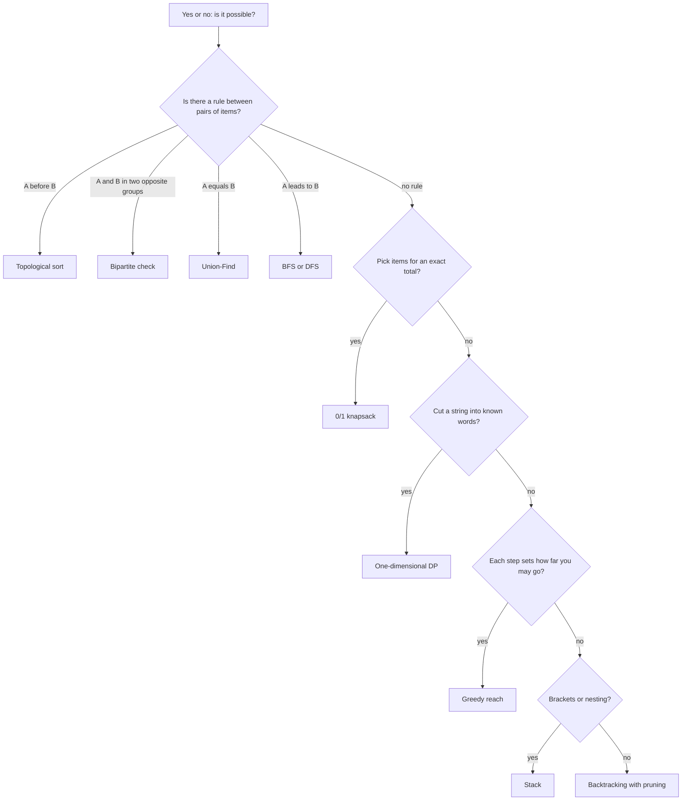

| Leaf | Chapter | Real problems | Why this leaf and not its neighbour |
|---|---|---|---|
| Topological sort | [Topological Sort](../08-graphs/06-topological-sort.md) | [Course Schedule](https://leetcode.com/problems/course-schedule/) | The answer is yes exactly when the rules have no cycle. A cycle blocks every task in it. With no cycle, some task always has no waiting rule, so you can always go on. |
| Bipartite check | [Cycle Detection and Bipartite](../08-graphs/05-cycle-detection-and-bipartite.md) | [Is Graph Bipartite](https://leetcode.com/problems/is-graph-bipartite/), [Possible Bipartition](https://leetcode.com/problems/possible-bipartition/) | "Different" rules split items into two groups. Color the graph with two colors and look for a clash. |
| Union-Find | [Union-Find](../08-graphs/07-union-find.md) | [Satisfiability of Equality Equations](https://leetcode.com/problems/satisfiability-of-equality-equations/) | "Equal" spreads through chains, so merge all equal items first. Then check each "not equal" rule. |
| BFS or DFS | [BFS and DFS](../08-graphs/02-bfs-and-dfs.md) | [Find if Path Exists in Graph](https://leetcode.com/problems/find-if-path-exists-in-graph/), [Keys and Rooms](https://leetcode.com/problems/keys-and-rooms/), [Jump Game III](https://leetcode.com/problems/jump-game-iii/) | In Jump Game III each jump has one exact length. There is no "as far as you can", so greedy has nothing to use. Each index is a node. |
| 0/1 knapsack | [0/1 Knapsack](../09-dynamic-programming/04-zero-one-knapsack.md) | [Partition Equal Subset Sum](https://leetcode.com/problems/partition-equal-subset-sum/) | Each item is used at most once, and an exact total must be hit. The state is "which totals can I reach?". |
| One-dimensional DP | [One-Dimensional DP](../09-dynamic-programming/02-one-dimensional-dp.md) | [Word Break](https://leetcode.com/problems/word-break/) | Many cuts reach the same position, so remember "can I reach this position?". |
| Greedy reach | [Greedy Foundations](../06-recursion-backtracking-greedy/06-greedy-foundations.md) | [Jump Game](https://leetcode.com/problems/jump-game/) | Every jump length up to the limit is allowed, so all positions up to the furthest reach are reachable. One number is enough. |
| Stack | [Stacks for Expressions and Parentheses](../03-linked-lists-stacks-queues/06-stack-expressions-and-parentheses.md) | [Valid Parentheses](https://leetcode.com/problems/valid-parentheses/) | The last bracket opened must close first. That is the order of a stack. |
| Backtracking with pruning | [Backtracking: Constraint Search](../06-recursion-backtracking-greedy/04-backtracking-constraint-search.md) | [Word Search](https://leetcode.com/problems/word-search/), [Matchsticks to Square](https://leetcode.com/problems/matchsticks-to-square/) | No small state describes the past, and n is small. Stop each branch as soon as it cannot work. |

**Trap:** "can you finish within h hours?" with a number to choose is the test inside [binary search on the answer](../04-sorting-searching/07-binary-search-on-answer.md). If the problem then asks for the smallest such number, go to [tree 6](#6-min-or-max-cost).

## 8. List all solutions

**Words that show this goal:** "return all", "generate all", "list every", "all possible".

Do not jump to backtracking when you see "all". First ask how many answers there can be. [3Sum](https://leetcode.com/problems/3sum/) says "all triplets", but there are at most about n^2 of them. So a smart scan can find them without trying every group. Backtracking is for answers that can grow exponentially, such as 2^n. In those problems n is small, because just printing the output takes that long.

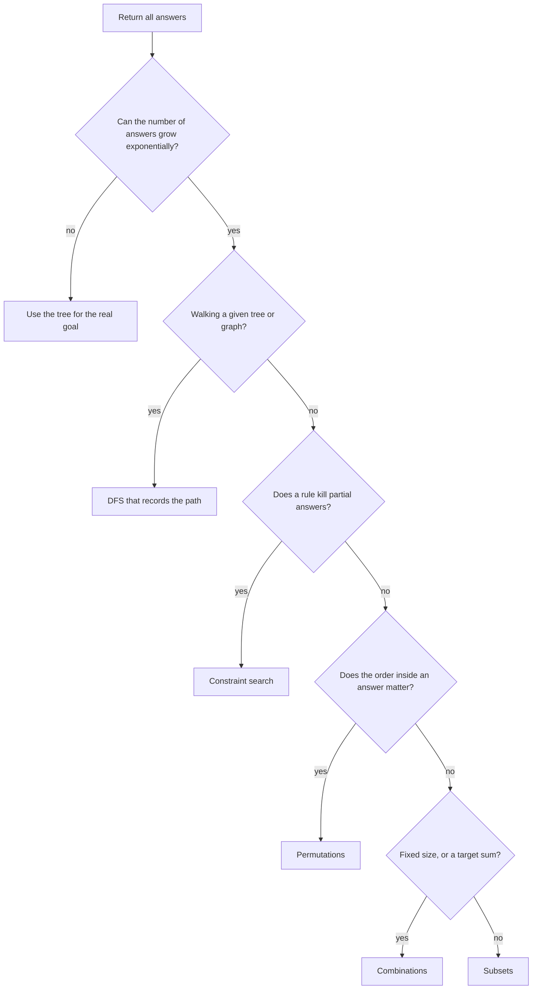

| Leaf | Chapter | Real problems | Why this leaf and not its neighbour |
|---|---|---|---|
| Use the tree for the real goal | [2. Find a pair or triple](#2-find-a-pair-or-triple), [3. Contiguous subarray questions](#3-contiguous-subarray-questions) | [3Sum](https://leetcode.com/problems/3sum/), [Find All Anagrams in a String](https://leetcode.com/problems/find-all-anagrams-in-a-string/) | "All start indexes" gives at most n answers. A window finds them in one pass. |
| DFS that records the path | [Tree DFS Problems](../07-trees/03-tree-dfs-problems.md), [BFS and DFS](../08-graphs/02-bfs-and-dfs.md) | [Path Sum II](https://leetcode.com/problems/path-sum-ii/), [All Paths From Source to Target](https://leetcode.com/problems/all-paths-from-source-to-target/) | The input already gives the choices. Add a node on the way in and remove it on the way out. |
| Constraint search | [Backtracking: Constraint Search](../06-recursion-backtracking-greedy/04-backtracking-constraint-search.md) | [N-Queens](https://leetcode.com/problems/n-queens/), [Sudoku Solver](https://leetcode.com/problems/sudoku-solver/), [Generate Parentheses](https://leetcode.com/problems/generate-parentheses/) | Most partial answers fail early, so the check at each step is the main work. |
| Permutations | [Permutations and Combinations](../06-recursion-backtracking-greedy/03-backtracking-permutations-combinations.md) | [Permutations](https://leetcode.com/problems/permutations/), [Permutations II](https://leetcode.com/problems/permutations-ii/) | `[1, 2]` and `[2, 1]` are different answers, so you must track which items are used. |
| Combinations | [Permutations and Combinations](../06-recursion-backtracking-greedy/03-backtracking-permutations-combinations.md) | [Combinations](https://leetcode.com/problems/combinations/), [Combination Sum](https://leetcode.com/problems/combination-sum/), [Letter Combinations of a Phone Number](https://leetcode.com/problems/letter-combinations-of-a-phone-number/) | `[1, 2]` and `[2, 1]` are the same answer. A start index stops you from going back, so each group appears once. Letter Combinations has no start index: each digit picks one letter, in the given order. |
| Subsets | [Backtracking: Subsets](../06-recursion-backtracking-greedy/02-backtracking-subsets.md) | [Subsets](https://leetcode.com/problems/subsets/), [Subsets II](https://leetcode.com/problems/subsets-ii/) | Every group of any size is valid. Each item is in or out. |

**Trap:** [Palindrome Partitioning](https://leetcode.com/problems/palindrome-partitioning/) asks for all ways to cut a string. Each gap between letters is "cut" or "no cut", so it has the shape of subsets. If it asked only for the fewest cuts, it would be [DP](../09-dynamic-programming/08-palindrome-dp.md). Listing and optimizing use different tools, even on the same input.

## 9. Top k

**Words that show this goal:** "k largest", "k smallest", "kth", "k most frequent", "k closest", "median".

Sorting everything costs O(n log n). You often need far less than a full order. Each branch below keeps only what the question asks for.

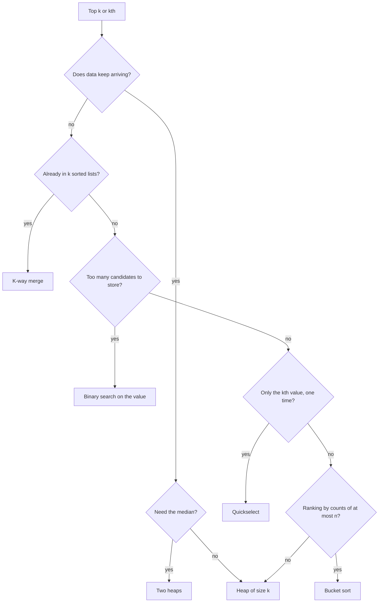

| Leaf | Chapter | Real problems | Why this leaf and not its neighbour |
|---|---|---|---|
| Heap of size k | [Top K With Heaps](../05-core-patterns/14-top-k-and-heaps.md) | [Kth Largest Element in a Stream](https://leetcode.com/problems/kth-largest-element-in-a-stream/), [K Closest Points to Origin](https://leetcode.com/problems/k-closest-points-to-origin/) | A min-heap keeps the k largest, because its top is the smallest kept item and the first to be thrown out. A max-heap keeps the k smallest, as in K Closest Points. It costs O(n log k) time. |
| Two heaps | [Two Heaps](../05-core-patterns/15-two-heaps.md) | [Find Median from Data Stream](https://leetcode.com/problems/find-median-from-data-stream/) | The median sits between a lower half and an upper half. One max-heap and one min-heap show both middle values. |
| K-way merge | [K-Way Merge](../05-core-patterns/16-k-way-merge.md) | [Merge k Sorted Lists](https://leetcode.com/problems/merge-k-sorted-lists/), [Kth Smallest Element in a Sorted Matrix](https://leetcode.com/problems/kth-smallest-element-in-a-sorted-matrix/) | The next smallest item is always at the front of some list. A heap holds only those fronts. |
| Binary search on the value | [Binary Search on the Answer](../04-sorting-searching/07-binary-search-on-answer.md) | [Find K-th Smallest Pair Distance](https://leetcode.com/problems/find-k-th-smallest-pair-distance/), [Kth Smallest Number in Multiplication Table](https://leetcode.com/problems/kth-smallest-number-in-multiplication-table/) | There are too many values to store. But "how many values are at most x?" can be counted quickly, and that count never falls as x rises. |
| Quickselect | [Quick Sort and Quickselect](../04-sorting-searching/03-quick-sort-and-quickselect.md) | [Kth Largest Element in an Array](https://leetcode.com/problems/kth-largest-element-in-an-array/) | It is O(n) on average, and O(n^2) in the worst case. A stream cannot use it, because all the data must be present. |
| Bucket sort | [Counting, Radix and Bucket Sort](../04-sorting-searching/04-non-comparison-sorts.md) | [Top K Frequent Elements](https://leetcode.com/problems/top-k-frequent-elements/), [Sort Characters By Frequency](https://leetcode.com/problems/sort-characters-by-frequency/) | A count can never pass n, so counts can be used as array indexes. |

**Trap 1:** [Find K Closest Elements](https://leetcode.com/problems/find-k-closest-elements/) gives a sorted array, so the k closest values form one contiguous block. [Binary search](../04-sorting-searching/06-binary-search-basics.md) finds the block, and a heap would ignore the order you were given.

**Trap 2:** [Sliding Window Median](https://leetcode.com/problems/sliding-window-median/) looks like a stream, but items also leave. A plain heap cannot remove from the middle. Use an [ordered set](../05-core-patterns/19-ordered-set-patterns.md), or [two heaps](../05-core-patterns/15-two-heaps.md) that skip removed items when they reach the top.

## 10. Next greater or smaller

**Words that show this goal:** "next greater", "previous smaller", "first taller to the right", "days until warmer", "span".

**A tiny example.** Take the temperatures `[3, 1, 2, 4]`. Day 0 waits. Day 1 waits. Day 2 is warmer than day 1, so day 1 has its answer. Day 3 is warmer than day 2 and day 0, so both have their answers. The temperatures of waiting days never rise from bottom to top, so a stack can hold them. A **monotonic stack** is a stack whose values stay in sorted order. It costs O(n), because each index is pushed once and popped at most once.

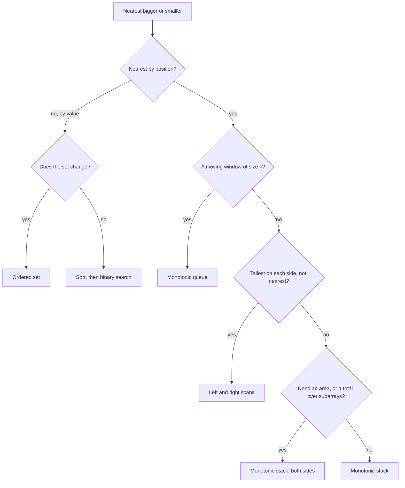

| Leaf | Chapter | Real problems | Why this leaf and not its neighbour |
|---|---|---|---|
| Monotonic stack | [Monotonic Stack](../05-core-patterns/12-monotonic-stack.md) | [Daily Temperatures](https://leetcode.com/problems/daily-temperatures/), [Next Greater Element I](https://leetcode.com/problems/next-greater-element-i/), [Next Greater Element II](https://leetcode.com/problems/next-greater-element-ii/), [Online Stock Span](https://leetcode.com/problems/online-stock-span/) | Items wait on the stack until a bigger item answers them. Once answered, they are never needed again. For a circular array, walk it twice. |
| Monotonic stack, both sides | [Monotonic Stack](../05-core-patterns/12-monotonic-stack.md), [Contribution Technique](../05-core-patterns/18-contribution-technique.md) | [Largest Rectangle in Histogram](https://leetcode.com/problems/largest-rectangle-in-histogram/), [Sum of Subarray Minimums](https://leetcode.com/problems/sum-of-subarray-minimums/) | Each bar needs its nearest smaller bar on both sides. Those two limits say how far it can stretch. |
| Monotonic queue | [Monotonic Queue](../05-core-patterns/13-monotonic-queue.md) | [Sliding Window Maximum](https://leetcode.com/problems/sliding-window-maximum/) | Old items expire from the front, so you need removal at both ends. |
| Left and right scans | [Left and Right Scans](../05-core-patterns/22-left-and-right-scans.md) | [Trapping Rain Water](https://leetcode.com/problems/trapping-rain-water/) | Water depends on the tallest wall on each side, not the nearest taller one. A running maximum gives that. |
| Ordered set | [Ordered Set Patterns](../05-core-patterns/19-ordered-set-patterns.md) | [Contains Duplicate III](https://leetcode.com/problems/contains-duplicate-iii/) | You need the closest value among the last k items, wherever it sits. A stack only knows about positions. |
| Sort, then binary search | [Binary Search Basics](../04-sorting-searching/06-binary-search-basics.md) | [Find Right Interval](https://leetcode.com/problems/find-right-interval/) | The set never changes, so a sorted array is enough. |

## 11. Shortest path

**Words that show this goal:** "shortest path", "minimum number of steps", "fewest moves", "cheapest", "minimum time to reach".

The cost of each edge picks the tool. BFS visits nodes in order of steps, so it works only if every step costs the same. With different costs, a route with more edges can be cheaper, and that is why Dijkstra exists.

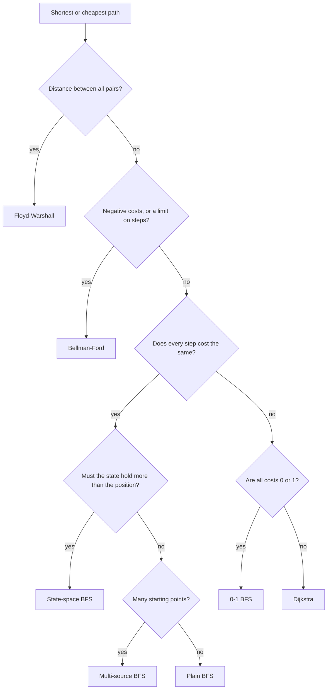

| Leaf | Chapter | Real problems | Why this leaf and not its neighbour |
|---|---|---|---|
| Plain BFS | [BFS and DFS](../08-graphs/02-bfs-and-dfs.md), [BFS Shortest Path Patterns](../08-graphs/04-bfs-shortest-path-patterns.md) | [Shortest Path in Binary Matrix](https://leetcode.com/problems/shortest-path-in-binary-matrix/), [Word Ladder](https://leetcode.com/problems/word-ladder/), [Open the Lock](https://leetcode.com/problems/open-the-lock/) | No graph is given in Word Ladder or Open the Lock. Each word or lock code is a node, and one change is an edge. |
| Multi-source BFS | [BFS Shortest Path Patterns](../08-graphs/04-bfs-shortest-path-patterns.md) | [Rotting Oranges](https://leetcode.com/problems/rotting-oranges/), [01 Matrix](https://leetcode.com/problems/01-matrix/) | Put every start in the queue at the beginning. One BFS from each start would repeat the work. |
| State-space BFS | [BFS Shortest Path Patterns](../08-graphs/04-bfs-shortest-path-patterns.md) | [Shortest Path in a Grid with Obstacles Elimination](https://leetcode.com/problems/shortest-path-in-a-grid-with-obstacles-elimination/), [Shortest Path Visiting All Nodes](https://leetcode.com/problems/shortest-path-visiting-all-nodes/) | The same cell can be worth visiting twice with different removals left. So a node must be (cell, extra info). |
| 0-1 BFS | [BFS Shortest Path Patterns](../08-graphs/04-bfs-shortest-path-patterns.md) | [Minimum Obstacle Removal to Reach Corner](https://leetcode.com/problems/minimum-obstacle-removal-to-reach-corner/), [Minimum Cost to Make at Least One Valid Path in a Grid](https://leetcode.com/problems/minimum-cost-to-make-at-least-one-valid-path-in-a-grid/) | A deque replaces the heap. Cost 0 goes to the front and cost 1 goes to the back. |
| Dijkstra | [Dijkstra](../08-graphs/08-dijkstra.md) | [Network Delay Time](https://leetcode.com/problems/network-delay-time/), [Path With Minimum Effort](https://leetcode.com/problems/path-with-minimum-effort/), [Path with Maximum Probability](https://leetcode.com/problems/path-with-maximum-probability/) | It needs one fact: going further never makes a route better. Costs of 0 or more keep that true. So does taking the largest step, as in Minimum Effort, and multiplying by probabilities of at most 1. |
| Bellman-Ford | [Bellman-Ford and SPFA](../08-graphs/09-bellman-ford-and-spfa.md) | [Cheapest Flights Within K Stops](https://leetcode.com/problems/cheapest-flights-within-k-stops/) | Plain Dijkstra keeps only the cheapest way to each city, and that way may use too many stops. Bellman-Ford adds one edge per round, so rounds count stops. |
| Floyd-Warshall | [Floyd-Warshall and All Pairs](../08-graphs/10-floyd-warshall-and-all-pairs.md) | [Find the City With the Smallest Number of Neighbors at a Threshold Distance](https://leetcode.com/problems/find-the-city-with-the-smallest-number-of-neighbors-at-a-threshold-distance/) | It costs O(V^3) time, where V is the number of nodes. So it fits only small graphs, up to a few hundred nodes. For a big graph with few edges, run Dijkstra from each node. |

**Trap 1:** "shortest subarray" is not a graph problem. Go to [tree 3](#3-contiguous-subarray-questions).

**Trap 2:** if the graph has no cycles, you can process nodes in [topological order](../08-graphs/06-topological-sort.md). The longest path is then as easy as the shortest one, which is false in general graphs.

## 12. Ordering with dependencies

**Words that show this goal:** "prerequisite", "must come before", "depends on", "valid order", "schedule".

**The idea:** do any task that is not waiting for anything, then remove it, and repeat. That is topological sort. The **in-degree** of a node is the number of edges coming into it, so a free task has in-degree 0. If tasks remain but none is free, there is a cycle, and no valid order exists.

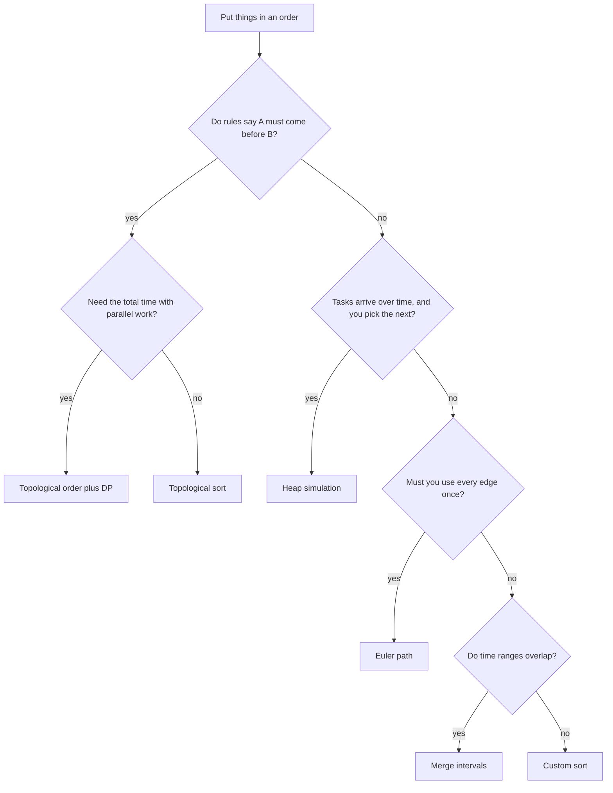

| Leaf | Chapter | Real problems | Why this leaf and not its neighbour |
|---|---|---|---|
| Topological sort | [Topological Sort](../08-graphs/06-topological-sort.md) | [Course Schedule II](https://leetcode.com/problems/course-schedule-ii/), [Alien Dictionary](https://leetcode.com/problems/alien-dictionary/) (Premium) | The rules link only some pairs, so plain sorting has no full comparison to use. |
| Topological order plus DP | [Topological Sort](../08-graphs/06-topological-sort.md) | [Parallel Courses III](https://leetcode.com/problems/parallel-courses-iii/) | A task starts when its slowest prerequisite ends. Topological order makes those times ready first. |
| Custom sort | [Sorting With a Custom Order](../04-sorting-searching/05-custom-sorting.md) | [Largest Number](https://leetcode.com/problems/largest-number/) | Any two items can be compared directly: `a + b` against `b + a`. No graph is needed. |
| Heap simulation | [Top K With Heaps](../05-core-patterns/14-top-k-and-heaps.md) | [Single-Threaded CPU](https://leetcode.com/problems/single-threaded-cpu/) | The best next task changes as time moves, so one sort is not enough. |
| Euler path | [Euler and Hamiltonian Paths](../08-graphs/14-euler-and-hamiltonian-paths.md) | [Reconstruct Itinerary](https://leetcode.com/problems/reconstruct-itinerary/) | Tickets look like rules, but they are edges to use, not nodes to order. A city can appear many times. |
| Merge intervals | [Merge Intervals](../05-core-patterns/09-merge-intervals.md) | [Merge Intervals](https://leetcode.com/problems/merge-intervals/) | Times overlap, but nothing depends on anything else. Sort by start and sweep. |

## 13. Connectivity

**Words that show this goal:** "connected", "same group", "islands", "provinces", "friends of friends", "merge accounts".

Two items are **connected** if a path of edges joins them. A **component** is a group of items that are all connected. The main question is whether the graph is fixed, or grows while you answer.

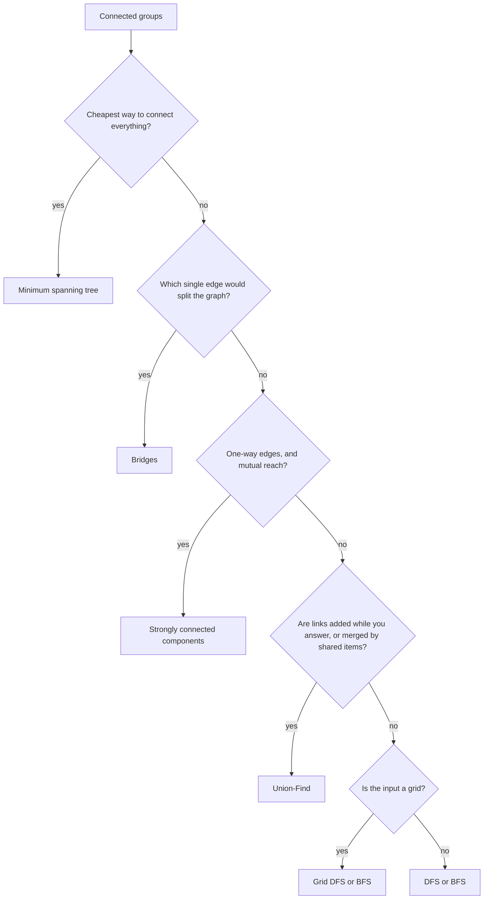

| Leaf | Chapter | Real problems | Why this leaf and not its neighbour |
|---|---|---|---|
| Minimum spanning tree | [Minimum Spanning Tree](../08-graphs/11-minimum-spanning-tree.md) | [Min Cost to Connect All Points](https://leetcode.com/problems/min-cost-to-connect-all-points/) | The goal is the cheapest set of edges, not the cheapest route between two nodes. So this is not Dijkstra. |
| Bridges | [Bridges and Articulation Points](../08-graphs/13-bridges-and-articulation-points.md) | [Critical Connections in a Network](https://leetcode.com/problems/critical-connections-in-a-network/) | Removing each edge and running DFS again is too slow. One DFS can find them all. |
| Strongly connected components | [Strongly Connected Components](../08-graphs/12-strongly-connected-components.md) | Classic: find groups of cities on one-way roads where each city can reach every other | With one-way edges, A reaching B says nothing about B reaching A. Union-Find cannot show that. |
| Union-Find | [Union-Find](../08-graphs/07-union-find.md) | [Redundant Connection](https://leetcode.com/problems/redundant-connection/), [Accounts Merge](https://leetcode.com/problems/accounts-merge/), [Number of Islands II](https://leetcode.com/problems/number-of-islands-ii/) (Premium) | Running DFS after each new edge repeats the whole search. Union-Find merges two groups in nearly O(1) time per operation, averaged over many operations. |
| Grid DFS or BFS | [Grid Graphs](../08-graphs/03-grid-graphs.md) | [Number of Islands](https://leetcode.com/problems/number-of-islands/), [Max Area of Island](https://leetcode.com/problems/max-area-of-island/), [Surrounded Regions](https://leetcode.com/problems/surrounded-regions/) | Each cell is a node, and its four neighbours are edges. The grid does not change, so a single flood fill is enough. |
| DFS or BFS | [BFS and DFS](../08-graphs/02-bfs-and-dfs.md) | [Number of Provinces](https://leetcode.com/problems/number-of-provinces/) | The graph is fixed. Start a search from each unvisited node, and count the starts. Union-Find also works here. |

**Trap:** if edges are removed over time, Union-Find seems useless, because it cannot split a group. Process the events in reverse, so that removals become additions. [Bricks Falling When Hit](https://leetcode.com/problems/bricks-falling-when-hit/) works this way.

## 14. Range queries

**Words that show this goal:** "for each query", "sum from l to r", "update", "range", "between index".

A **range query** asks about one part of the data, and there are many such questions. A loop per query costs O(n), so with n queries the total is O(n^2). The first question is: does each query bring its own limit? If so, you can sort the queries. The next question is: does the data change?

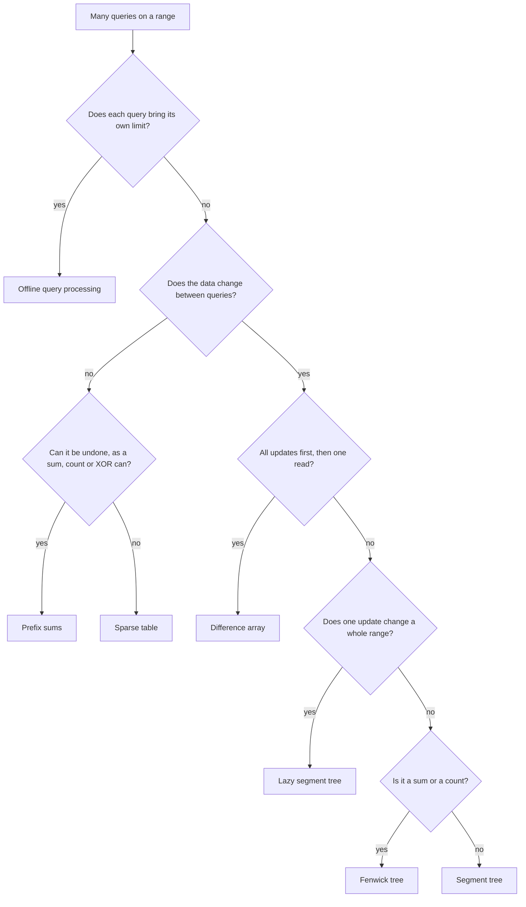

| Leaf | Chapter | Real problems | Why this leaf and not its neighbour |
|---|---|---|---|
| Offline query processing | [Offline Query Processing](../05-core-patterns/20-offline-query-processing.md) | [Checking Existence of Edge Length Limited Paths](https://leetcode.com/problems/checking-existence-of-edge-length-limited-paths/) | Each query has its own limit. Sort queries by limit, so that the data only grows as you answer. |
| Prefix sums | [Prefix Sums](../05-core-patterns/06-prefix-sums.md) | [Range Sum Query - Immutable](https://leetcode.com/problems/range-sum-query-immutable/), [Range Sum Query 2D - Immutable](https://leetcode.com/problems/range-sum-query-2d-immutable/) | Sums can be subtracted, so `prefix[r + 1] - prefix[l]` answers in O(1). |
| Sparse table | [Sparse Table and RMQ](../12-advanced-data-structures/04-sparse-table-and-rmq.md) | Classic: smallest value from l to r, with no updates | A minimum cannot be subtracted, so prefix sums fail. Two overlapping blocks can cover any range. That works for min, max and gcd, where seeing an item twice changes nothing. |
| Difference array | [Difference Arrays and Sweep Line](../05-core-patterns/07-difference-array-and-sweep-line.md) | [Corporate Flight Bookings](https://leetcode.com/problems/corporate-flight-bookings/), [Car Pooling](https://leetcode.com/problems/car-pooling/), [Range Addition](https://leetcode.com/problems/range-addition/) (Premium) | Mark only the two ends of each update, then do one prefix sum at the end. You never read in the middle. |
| Fenwick tree | [Fenwick Tree](../12-advanced-data-structures/03-fenwick-tree.md) | [Range Sum Query - Mutable](https://leetcode.com/problems/range-sum-query-mutable/), [Count of Smaller Numbers After Self](https://leetcode.com/problems/count-of-smaller-numbers-after-self/) | One update would make all later prefix sums wrong. A Fenwick tree does both update and query in O(log n). |
| Segment tree | [Segment Tree](../12-advanced-data-structures/01-segment-tree.md) | Classic: largest value from l to r, with single-value updates | A Fenwick tree works best when the operation can be undone, as a sum can. A segment tree can merge any two neighbouring results. |
| Lazy segment tree | [Segment Tree With Lazy Propagation](../12-advanced-data-structures/02-segment-tree-lazy-propagation.md) | [Handling Sum Queries After Update](https://leetcode.com/problems/handling-sum-queries-after-update/), [Falling Squares](https://leetcode.com/problems/falling-squares/) | An update touches a whole range, and reads come between updates. "Lazy" means the tree saves the update and pushes it down only when needed. |

**Trap:** the word "range" alone is not this tree. "Longest range with a rule" is one question, not many, so it belongs to [tree 3](#3-contiguous-subarray-questions).

## 15. Palindromes

**Words that show this goal:** "palindrome", "reads the same forwards and backwards".

A **palindrome** reads the same in both directions, such as `racecar`. The word "palindrome" does not pick the technique. The tree first asks what you may do with the letters.

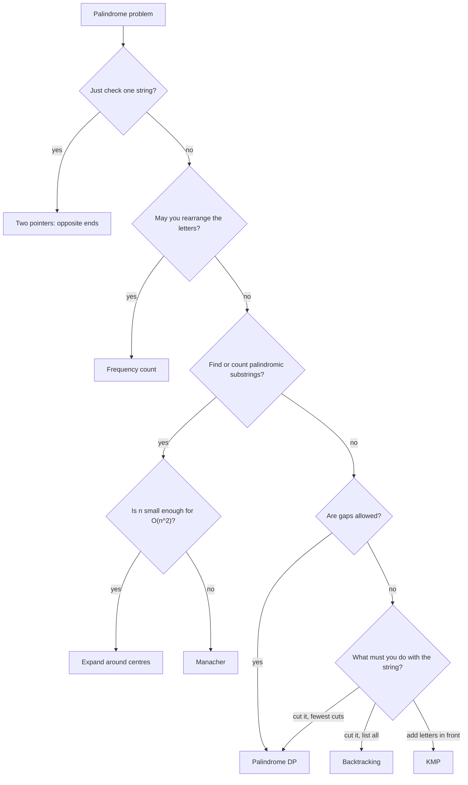

| Leaf | Chapter | Real problems | Why this leaf and not its neighbour |
|---|---|---|---|
| Two pointers: opposite ends | [Two Pointers: Opposite Ends](../05-core-patterns/01-two-pointers-opposite-ends.md) | [Valid Palindrome](https://leetcode.com/problems/valid-palindrome/), [Valid Palindrome II](https://leetcode.com/problems/valid-palindrome-ii/) | Compare from both ends and stop at the first mismatch. In Valid Palindrome II, at that mismatch, try skipping either letter. No table is needed. |
| Frequency count | [Hashing Patterns](../02-arrays-strings-hashing/04-hashing-patterns.md) | [Longest Palindrome](https://leetcode.com/problems/longest-palindrome/), [Palindrome Permutation](https://leetcode.com/problems/palindrome-permutation/) (Premium) | Order does not matter here. A palindrome can be built exactly when at most one letter has an odd count. Every letter in a palindrome is mirrored, except perhaps the middle one. In the other direction, such counts let you place pairs on both sides and put the odd letter in the middle. |
| Expand around centres | [Palindromes and Manacher](../10-string-algorithms/01-palindromes-and-manacher.md) | [Longest Palindromic Substring](https://leetcode.com/problems/longest-palindromic-substring/), [Palindromic Substrings](https://leetcode.com/problems/palindromic-substrings/) | Every palindrome has a centre, and there are 2n - 1 centres. O(n^2) time and O(1) space, so it beats a DP table on memory. |
| Manacher | [Palindromes and Manacher](../10-string-algorithms/01-palindromes-and-manacher.md) | Classic: longest palindromic substring when n is near 10^6 | It reuses earlier results to reach O(n). Use it only when O(n^2) is too slow. |
| Palindrome DP | [Palindrome DP](../09-dynamic-programming/08-palindrome-dp.md) | [Longest Palindromic Subsequence](https://leetcode.com/problems/longest-palindromic-subsequence/), [Minimum Insertion Steps to Make a String Palindrome](https://leetcode.com/problems/minimum-insertion-steps-to-make-a-string-palindrome/), [Palindrome Partitioning II](https://leetcode.com/problems/palindrome-partitioning-ii/) | Expanding from a centre needs no gaps. With gaps, each end letter is kept or skipped, so you need the range state `[i, j]`. Palindrome Partitioning II has no gaps: it is a DP over cut points, with a table of which ranges are palindromes. |
| Backtracking | [Backtracking: Constraint Search](../06-recursion-backtracking-greedy/04-backtracking-constraint-search.md) | [Palindrome Partitioning](https://leetcode.com/problems/palindrome-partitioning/) | You must list every cutting, so counting tables cannot produce them. |
| KMP | [KMP](../10-string-algorithms/02-kmp.md), [Palindromes and Manacher](../10-string-algorithms/01-palindromes-and-manacher.md) | [Shortest Palindrome](https://leetcode.com/problems/shortest-palindrome/) | The real question is "what is the longest palindrome that starts at index 0?". KMP compares the string with its reverse in O(n). |

**Trap:** [Palindrome Linked List](https://leetcode.com/problems/palindrome-linked-list/) is a check, but a list cannot walk backwards. Find the middle with [fast and slow pointers](../05-core-patterns/03-fast-and-slow-pointers.md), then [reverse the second half](../05-core-patterns/11-in-place-linked-list-reversal.md).

## 16. When two trees seem to fit

Some words appear in many trees. This table gives the one question that separates them.

| The word | Ask | One way | The other way |
|---|---|---|---|
| "k" | What is k? | A window size: [Maximum Average Subarray I](https://leetcode.com/problems/maximum-average-subarray-i/) | A rank: [Kth Largest Element in an Array](https://leetcode.com/problems/kth-largest-element-in-an-array/). A budget: [Max Consecutive Ones III](https://leetcode.com/problems/max-consecutive-ones-iii/) |
| "longest" | Are gaps allowed? | No gaps, use a window: [Longest Substring Without Repeating Characters](https://leetcode.com/problems/longest-substring-without-repeating-characters/) | Gaps, use DP: [Longest Increasing Subsequence](https://leetcode.com/problems/longest-increasing-subsequence/) |
| "sum equals" | Is the group contiguous? | Yes, use prefix sums: [Subarray Sum Equals K](https://leetcode.com/problems/subarray-sum-equals-k/) | No, use knapsack: [Partition Equal Subset Sum](https://leetcode.com/problems/partition-equal-subset-sum/) |
| "all" | Can the answers grow exponentially? | No, scan: [Find All Anagrams in a String](https://leetcode.com/problems/find-all-anagrams-in-a-string/) | Yes, backtrack: [Subsets](https://leetcode.com/problems/subsets/) |
| "minimum steps" | Can moves form cycles? | Yes, use BFS: [Open the Lock](https://leetcode.com/problems/open-the-lock/) | No, only forward, use DP: [2 Keys Keyboard](https://leetcode.com/problems/2-keys-keyboard/) |
| "minimum cost" | One route, or connect everything? | One route: [Minimum Cost to Make at Least One Valid Path in a Grid](https://leetcode.com/problems/minimum-cost-to-make-at-least-one-valid-path-in-a-grid/) | Everything: [Min Cost to Connect All Points](https://leetcode.com/problems/min-cost-to-connect-all-points/) |
| "range" | One question, or many? | One, use a window: [Minimum Size Subarray Sum](https://leetcode.com/problems/minimum-size-subarray-sum/) | Many, use tree 14: [Range Sum Query - Immutable](https://leetcode.com/problems/range-sum-query-immutable/) |
| "next greater" | By position, or by value? | Position, use a stack: [Daily Temperatures](https://leetcode.com/problems/daily-temperatures/) | Value, use an ordered set: [Contains Duplicate III](https://leetcode.com/problems/contains-duplicate-iii/) |

## 17. Drills

The problems below are in mixed order, and some hide the real question inside a story. For each one, say three things out loud before you open the answer: the goal, the words that show it, and the leaf. Then say why the closest lookalike does not fit.

**D1.** A row of trees. Each tree gives one kind of fruit. You carry two bags, and each bag holds one kind only. You pick a start tree, walk right, and take one fruit from every tree. You stop at the first tree whose fruit fits no bag. What is the most fruit you can take?

<details>
<summary>Answer</summary>

[Fruit Into Baskets](https://leetcode.com/problems/fruit-into-baskets/) is a contiguous subarray question. "Walk right, take from every tree" means no gaps. The story hides this: longest subarray with at most 2 distinct values. A new tree can only keep or raise the distinct count, so the rule is monotonic. Use a [variable sliding window](../05-core-patterns/05-sliding-window-variable.md). DP is not needed, because you can never skip a tree.

</details>

**D2.** 2n people must fly to an interview. Half go to city A and half go to city B. Each person has a price for each city. Find the lowest total price.

<details>
<summary>Answer</summary>

[Two City Scheduling](https://leetcode.com/problems/two-city-scheduling/) is a min cost question with a safe local choice. What matters for each person is the difference between the two prices. Sort by `costA - costB`, and send the first n people to A. A swap argument proves it: swapping any A person with a B person who has a smaller difference cannot raise the total. See [Sorting With a Custom Order](../04-sorting-searching/05-custom-sorting.md). A knapsack DP also works, but it is more work than this needs.

</details>

**D3.** A town has n people. You get a list of "a trusts b". At most one person is trusted by everyone else and trusts nobody. Find that person, or return -1 if there is none.

<details>
<summary>Answer</summary>

[Find the Town Judge](https://leetcode.com/problems/find-the-town-judge/) is a find-a-value question that looks like a graph search. No path matters, only direct edges. Count edges in and out of each person. The judge has in-degree n - 1 and out-degree 0. See [Graphs From Zero](../08-graphs/01-graph-from-zero.md). BFS would do extra work and answer nothing more.

</details>

**D4.** Packages must go onto a ship in the given order, and the ship leaves once a day. Find the smallest daily weight limit that delivers everything within D days.

<details>
<summary>Answer</summary>

[Capacity To Ship Packages Within D Days](https://leetcode.com/problems/capacity-to-ship-packages-within-d-days/) is a "minimize the largest" question. The answer is a number that you can test: "does limit x finish in D days?". A larger limit is never worse, so use [binary search on the answer](../04-sorting-searching/07-binary-search-on-answer.md). Greedy is only the test inside, not the whole solution.

</details>

**D5.** Take a number and replace it with the sum of the squares of its digits. Repeat. Does it ever reach 1?

<details>
<summary>Answer</summary>

[Happy Number](https://leetcode.com/problems/happy-number/) looks like math, but it is a cycle question. The values stay small, so they must repeat if they never reach 1. Each number points to one next number, which is the shape of a linked list. Use [fast and slow pointers](../05-core-patterns/03-fast-and-slow-pointers.md). A hash set also works, but it uses extra space.

</details>

**D6.** A grid holds fresh and rotten fruit. Each minute, rot spreads to the four neighbours of every rotten fruit. How many minutes until no fresh fruit remains? Return -1 if some fruit stays fresh.

<details>
<summary>Answer</summary>

[Rotting Oranges](https://leetcode.com/problems/rotting-oranges/) is a shortest path in disguise. The time for one fruit is its distance from the nearest rotten fruit. All rotten fruit start together, so use [multi-source BFS](../08-graphs/04-bfs-shortest-path-patterns.md). DFS fails, because it does not visit cells in order of time.

</details>

**D7.** Insert the fewest letters, at any positions, to turn a string into a palindrome.

<details>
<summary>Answer</summary>

[Minimum Insertion Steps to Make a String Palindrome](https://leetcode.com/problems/minimum-insertion-steps-to-make-a-string-palindrome/) is a palindrome question with gaps. Letters in the longest palindromic subsequence need no new partner. Every other letter needs exactly one. So n minus that length is enough. You also cannot do better: in any final palindrome, the original letters that mirror each other form a palindromic subsequence, and every other original letter needs its own inserted partner. Use [palindrome DP](../09-dynamic-programming/08-palindrome-dp.md). Expanding around centres fails, because the kept letters need not touch.

</details>

**D8.** A van has c seats. You get a list of groups, each with a size, a pickup point and a drop point. All groups travel in one direction. Can the van carry them all?

<details>
<summary>Answer</summary>

[Car Pooling](https://leetcode.com/problems/car-pooling/) asks yes or no, but the real work is range updates with one read at the end. Each group adds to a range of road. Use a [difference array](../05-core-patterns/07-difference-array-and-sweep-line.md): add at pickup, subtract at the drop point, then scan and compare with c. Merging intervals fails, because you need the load at each point, not the joined spans.

</details>

**D9.** Each record has a name and some email addresses. Two records that share an email belong to one person. Combine the records.

<details>
<summary>Answer</summary>

[Accounts Merge](https://leetcode.com/problems/accounts-merge/) is connectivity. "Share an email" links records, and links chain: A with B and B with C puts all three together. Use [Union-Find](../08-graphs/07-union-find.md) on the emails. Comparing the name is a trap, because two different people can have the same name.

</details>

**D10.** You have coin types and unlimited coins of each. How many different mixes make a given amount? `1+2` and `2+1` are the same mix.

<details>
<summary>Answer</summary>

[Coin Change II](https://leetcode.com/problems/coin-change-ii/) is count the ways, and order does not matter. Use [unbounded knapsack](../09-dynamic-programming/05-unbounded-knapsack.md), with the coin loop outside the amount loop. That way each mix is built in one order only. Greedy has no meaning here, because you are counting, not choosing.

</details>

**D11.** Take every contiguous piece of an array, and find the smallest value in each. Add all those smallest values together.

<details>
<summary>Answer</summary>

[Sum of Subarray Minimums](https://leetcode.com/problems/sum-of-subarray-minimums/) is a total over all subarrays. Do not visit them. For each item, ask how many pieces have it as the minimum. Its nearest smaller item on each side sets that count. Use the [contribution technique](../05-core-patterns/18-contribution-technique.md) with a [monotonic stack](../05-core-patterns/12-monotonic-stack.md). A sliding window fails, because no shrink rule exists.

</details>

**D12.** Cards lie in a row. You take exactly k cards, and each one must come from the left end or the right end. What is the largest total you can take?

<details>
<summary>Answer</summary>

[Maximum Points You Can Obtain from Cards](https://leetcode.com/problems/maximum-points-you-can-obtain-from-cards/) looks like two pointers or DP. Flip the view. The cards you leave form one contiguous block of size n - k. So find the block with the smallest sum, using a [fixed sliding window](../05-core-patterns/04-sliding-window-fixed.md). The answer is the total minus that sum.

</details>

**D13.** Cities are joined by priced flights. Find the cheapest way from city A to city B with at most k stops in between.

<details>
<summary>Answer</summary>

[Cheapest Flights Within K Stops](https://leetcode.com/problems/cheapest-flights-within-k-stops/) is a shortest path with a step limit. Plain Dijkstra keeps only the cheapest way to each city, and that way may use too many stops. Use [Bellman-Ford](../08-graphs/09-bellman-ford-and-spfa.md) for k + 1 rounds, and read from the previous round's copy so that each round adds one flight only.

</details>

**D14.** A grid holds letters. Can you spell a word by moving between neighbouring cells, using no cell twice?

<details>
<summary>Answer</summary>

[Word Search](https://leetcode.com/problems/word-search/) is a yes or no question on a grid. BFS fails, because "no cell twice" depends on the current path, so one shared visited set is wrong. Use [backtracking](../06-recursion-backtracking-greedy/04-backtracking-constraint-search.md): mark a cell on the way in, and unmark it on the way out.

</details>

**D15.** Numbers arrive one at a time. After each number, report the middle value of all numbers so far.

<details>
<summary>Answer</summary>

[Find Median from Data Stream](https://leetcode.com/problems/find-median-from-data-stream/) is top k with changing k. "Arrive one at a time" rules out sorting once. Use [two heaps](../05-core-patterns/15-two-heaps.md): a max-heap for the lower half and a min-heap for the upper half. Keeping their sizes within one puts the middle at the tops.

</details>

**D16.** You get a string and a list of index pairs. You may swap the letters at any listed pair, as often as you like. Find the smallest string in dictionary order.

<details>
<summary>Answer</summary>

[Smallest String With Swaps](https://leetcode.com/problems/smallest-string-with-swaps/) looks like sorting, but it is connectivity. If a swaps with b and b swaps with c, then all three can reach any order. So each connected group of indexes can be sorted freely. Use [Union-Find](../08-graphs/07-union-find.md), then sort the letters inside each group.

</details>

**D17.** Stations sit on a circle. Each station gives some fuel, and each leg to the next station uses some fuel. Find a start from which you can drive the full circle. You start with an empty tank.

<details>
<summary>Answer</summary>

[Gas Station](https://leetcode.com/problems/gas-station/) is a find-a-value question solved by greedy. If total fuel is below total cost, no start works. Otherwise scan once. If the tank drops below zero at station i, then no station from the current start through i can be the start, so restart at i + 1. Trying each start costs O(n^2). See [Greedy Foundations](../06-recursion-backtracking-greedy/06-greedy-foundations.md).

</details>

**D18.** Each envelope has a width and a height. One fits inside another only if both sizes are strictly smaller. What is the largest number of envelopes you can nest?

<details>
<summary>Answer</summary>

[Russian Doll Envelopes](https://leetcode.com/problems/russian-doll-envelopes/) is a subsequence in disguise, because you may pick items in any order. Sort by width, and for equal widths sort by height from high to low. That stops two envelopes of the same width from chaining. Then find the [longest increasing subsequence](../09-dynamic-programming/06-longest-increasing-subsequence.md) of the heights. n can be 10^5, so use the O(n log n) version.

</details>

**D19.** A string has plates and candles on a table. For each query range, count the plates that sit between two candles inside that range.

<details>
<summary>Answer</summary>

[Plates Between Candles](https://leetcode.com/problems/plates-between-candles/) is a range query with no updates. Find the first candle inside the range and the last candle inside the range, using [left and right scans](../05-core-patterns/22-left-and-right-scans.md) done before any query. Then count plates between them with [prefix sums](../05-core-patterns/06-prefix-sums.md). A window per query would be too slow.

</details>

**D20.** You get a list of words sorted by the rules of an unknown alphabet. Find a possible order of its letters.

<details>
<summary>Answer</summary>

[Alien Dictionary](https://leetcode.com/problems/alien-dictionary/) (Premium) is ordering with dependencies. Each pair of neighbouring words gives one rule, at their first different letter. The rules cover only some letters, so a custom sort cannot work. Use [topological sort](../08-graphs/06-topological-sort.md). A cycle means no valid alphabet exists. So does a longer word placed before its own prefix.

</details>

**D21.** An array has positive and negative integers. How many contiguous pieces have a sum of exactly k?

<details>
<summary>Answer</summary>

[Subarray Sum Equals K](https://leetcode.com/problems/subarray-sum-equals-k/) is a contiguous question, but negative values break the window. Use [prefix sums and a hash map](../05-core-patterns/06-prefix-sums.md). A piece ending here has sum k exactly when an earlier prefix equals the current prefix minus k. It costs O(n) on average.

</details>

**D22.** A spell checker can insert, delete or replace one letter at a time. Find the fewest edits that turn one word into another.

<details>
<summary>Answer</summary>

[Edit Distance](https://leetcode.com/problems/edit-distance/) is a min cost question on two strings. The state is two indexes, so use [LCS and edit distance DP](../09-dynamic-programming/07-lcs-and-edit-distance.md). BFS over all words would have far too many states. Greedy fails, because the best edit now can depend on letters much later.

</details>

**D23.** An array holds n + 1 numbers, each from 1 to n, and one value repeats. Find that value. You may not change the array, and you may use only O(1) extra memory.

<details>
<summary>Answer</summary>

[Find the Duplicate Number](https://leetcode.com/problems/find-the-duplicate-number/) gives two limits that remove the easy tools. "May not change" removes cyclic sort and sorting. "O(1) memory" removes a hash set. Read each value as a pointer to an index, and a repeat becomes a cycle start. Use [fast and slow pointers](../05-core-patterns/03-fast-and-slow-pointers.md).

</details>

**D24.** A grid has empty cells and walls, and you may break any wall. Find the fewest walls to break on a route from the top-left cell to the bottom-right cell.

<details>
<summary>Answer</summary>

[Minimum Obstacle Removal to Reach Corner](https://leetcode.com/problems/minimum-obstacle-removal-to-reach-corner/) is a shortest path where the cost is not steps. Entering an empty cell costs 0, and entering a wall costs 1. Use [0-1 BFS](../08-graphs/04-bfs-shortest-path-patterns.md). Dijkstra also works, but its heap adds a log factor. Plain BFS fails, because it counts steps.

</details>

**D25.** An array has positive numbers. In one move you remove the first or last item, and subtract it from x. Find the fewest moves that bring x to exactly 0.

<details>
<summary>Answer</summary>

[Minimum Operations to Reduce X to Zero](https://leetcode.com/problems/minimum-operations-to-reduce-x-to-zero/) looks like a choice at each end. Flip the view. The items you keep form one contiguous block with sum `total - x`. Fewest moves means the longest such block. All values are positive, so a [variable sliding window](../05-core-patterns/05-sliding-window-variable.md) is safe.

</details>

**D26.** You get plane tickets, each from one airport to another. Use every ticket exactly once, starting from a given airport. If several routes work, return the smallest in dictionary order.

<details>
<summary>Answer</summary>

[Reconstruct Itinerary](https://leetcode.com/problems/reconstruct-itinerary/) looks like ordering, but cities can repeat, so it is not topological sort. "Use every ticket once" means every edge once. That is an [Euler path](../08-graphs/14-euler-and-hamiltonian-paths.md).

</details>

**D27.** Write out every number from 1 to n, where n can be near 10^9. How many times do you write the digit 1?

<details>
<summary>Answer</summary>

[Number of Digit One](https://leetcode.com/problems/number-of-digit-one/) is a count over numbers up to n. A loop is too slow for this n, so count digit by digit. Use [digit DP](../09-dynamic-programming/13-digit-dp.md).

</details>

For more practice, go to [Recognition Drills: Easy](09-recognition-drills-easy.md), [Medium](10-recognition-drills-medium.md) and [Hard](11-recognition-drills-hard.md).

## Common mistakes

1. **Picking from the title or the story.** "Rotting" says nothing about the technique. Rewrite the problem in plain words first, then name the goal.
2. **Seeing "sum" and starting a window.** Check for negative values first. Then ask if the rule is monotonic. If not, use [prefix sums](../05-core-patterns/06-prefix-sums.md).
3. **Trusting greedy with no test.** Try small inputs that break it, as with coins `[1, 3, 4]` and amount 6. If you cannot prove it, use DP.
4. **Seeing "all" and starting backtracking.** Check how many answers can exist. A small answer count means a scan is enough.
5. **Using BFS when costs differ.** BFS finds the fewest edges, not the lowest cost. Check the edges, then use [tree 11](#11-shortest-path).
6. **Answering "how many" by listing.** If the answer can be huge, listing cannot finish. Use DP or a formula.
7. **Stopping at the first leaf.** A leaf is a guess. Check it against the constraints, and read why the neighbour fails. If no tree fits, use [When You Do Not Recognize the Problem](12-when-you-do-not-recognize-it.md).
