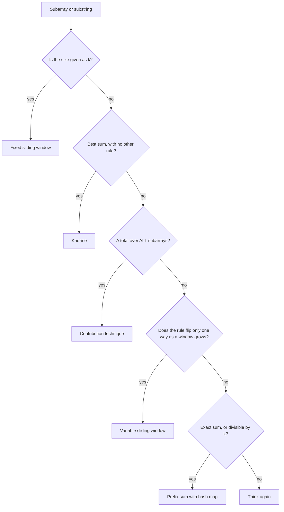
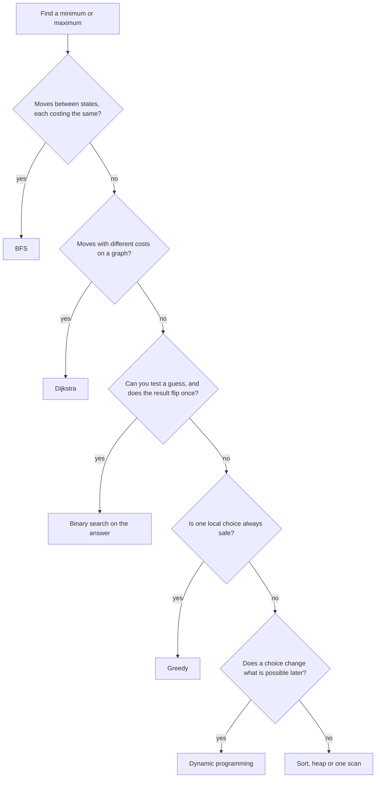
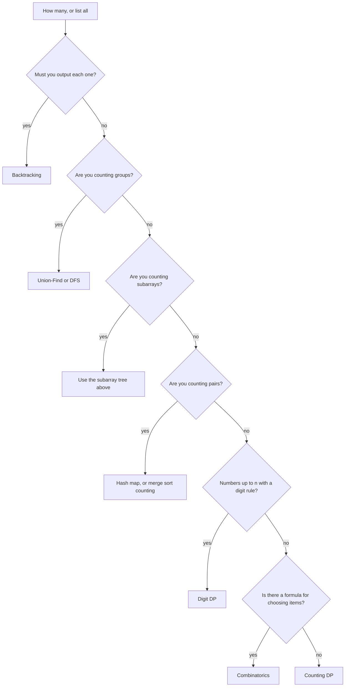

# Keyword Dictionary

> **Level:** Beginner · **Priority:** T1 · **Time:** 60 min · **Read first:** [Decision Tree by Question Goal](../01-pattern-recognition/04-decision-tree-by-question-goal.md) · **Next:** [Pattern Cards](../01-pattern-recognition/06-pattern-cards.md)

Problem statements use the same words again and again. This dictionary lists more than 270 of those phrases in alphabetical order. For each phrase it gives the likely pattern, the reason, and the case where the phrase misleads you.

## Quick revision

- A keyword is a clue, not a proof. It gives you a first guess. The constraints and the rule of the problem must confirm it.
- **Three steps:** find the phrase, check what the pattern needs, then reject the lookalike.
- "Subarray" and "substring" mean no gaps, so think of windows and prefix sums. "Subsequence" allows gaps, so think of DP or two pointers.
- **Negative numbers** remove the variable sliding window for sum rules.
- "Sorted" points to binary search or two pointers. If the input is not sorted, ask if sorting it helps.
- "All combinations" or "list every arrangement" means backtracking. "All" alone proves nothing: Find All Anagrams is a window. "How many" with a modulo means DP or counting.
- "Minimum steps" between states means BFS when every step costs the same. Different non-negative costs mean Dijkstra.
- "Minimize the maximum" and "maximize the minimum" usually mean binary search on the answer. Check that the test flips once.
- "Next greater" and "previous smaller" mean a monotonic stack.
- "K-th largest" and "top k" mean a heap or quickselect, not a window.
- "Prerequisites", "depends on" and "order of tasks" mean topological sort.
- "Stream" means the data keeps arriving, so you cannot sort it all first. Think of a heap.
- "Cycle" has four meanings. It depends on whether you are in a linked list, a directed graph, an undirected graph or a repeated function.
- "In place" and "without extra space" are limits on memory. They remove some solutions, such as a hash set. They do not name a pattern alone.
- A story hides the question. Rewrite the story in plain terms first, then use this dictionary.

## How to use this dictionary

A phrase gives you a guess. A guess needs a check. Use these three steps on every problem.

1. **Find the phrase.** Look up the most specific words in the problem. "Longest substring" tells you more than "string".
2. **Check what the pattern needs.** Each pattern depends on one fact. A window needs a rule that flips one way. Binary search needs an order. Greedy needs a safe choice.
3. **Reject the lookalike.** Ask which other pattern fits the same words, and which fact separates them.

Here is one worked example, from [Subarray Sum Equals K](https://leetcode.com/problems/subarray-sum-equals-k/). You must count the subarrays whose sum is k.

```text
nums = [1, -1, 1], k = 1
```

**Step 1.** "Subarray" and "sum" suggest a sliding window.

**Step 2.** A window needs the sum to move in one direction as the window grows. Grow a window from index 0. The sums are 1, then 0, then 1. The sum falls and rises again. So a window cannot know when to shrink.

**Step 3.** The value `-1` broke the check. The entry **negative numbers** sends you to [prefix sums with a hash map](../05-core-patterns/06-prefix-sums.md). The answer is 3: `[1]`, `[1]` and `[1, -1, 1]`.

One word can change the pattern. Compare these problems on the same topic.

| The problem asks for | Pattern | The word that decides it |
|---|---|---|
| Largest sum of a subarray of size k | [Fixed sliding window](../05-core-patterns/04-sliding-window-fixed.md) | "size k" |
| Largest sum of any subarray | [Kadane](../05-core-patterns/08-kadane-and-subarray-dp.md) | No size and no rule |
| Longest subarray with sum at most k, positive values | [Variable sliding window](../05-core-patterns/05-sliding-window-variable.md) | "at most" and "positive" |
| Number of subarrays with sum exactly k, negative values allowed | [Prefix sum with hash map](../05-core-patterns/06-prefix-sums.md) | "exactly" and "negative" |
| Longest increasing subsequence | [LIS DP](../09-dynamic-programming/06-longest-increasing-subsequence.md) | "subsequence" |

## Short meanings of the words used below

You do not need to know these patterns yet. These lines are enough to read the tables.

- **Subarray, substring:** a part of an array or string with no gaps.
- **Subsequence:** items taken in the original order, with gaps allowed.
- **Window:** a subarray marked by two indexes, `left` and `right`.
- **Monotonic rule:** a rule that can flip only one way as a window grows. "Sum at most 5" with positive numbers can go from true to false, but never back.
- **Hash map:** a table that finds a key in O(1) time on average.
- **Heap:** a structure that gives you the largest or smallest item fast.
- **Stack:** last in, first out. **Queue:** first in, first out.
- **BFS:** breadth-first search. It visits nodes in order of distance, layer by layer.
- **DFS:** depth-first search. It goes as deep as it can, then comes back.
- **DP:** dynamic programming. You solve small versions of the problem and save the results.
- **Greedy:** you make the best choice now and never undo it.
- **Binary search on the answer:** you guess an answer, test it, and halve the range of guesses.

## Words with many meanings

Four words appear in so many problems that one table row is not enough. Use these small trees and tables for them. For a wider view, use [the question goal trees](../01-pattern-recognition/04-decision-tree-by-question-goal.md) or [the input type trees](../01-pattern-recognition/03-decision-tree-by-input-type.md).

### "Subarray" or "substring"



Where each leaf leads:

- Fixed sliding window: [Sliding Window: Fixed Size](../05-core-patterns/04-sliding-window-fixed.md). For the max or min of each window, use [Monotonic Queue](../05-core-patterns/13-monotonic-queue.md).
- Kadane: [Kadane's Algorithm](../05-core-patterns/08-kadane-and-subarray-dp.md).
- Contribution technique: [Contribution Technique](../05-core-patterns/18-contribution-technique.md).
- Variable sliding window: [Sliding Window: Variable Size](../05-core-patterns/05-sliding-window-variable.md). "Exactly k distinct" also goes here, through `atMost(k) - atMost(k - 1)`.
- Prefix sum with hash map: [Prefix Sums](../05-core-patterns/06-prefix-sums.md).
- Think again: with negative values, "sum at least k" needs [prefix sums with a monotonic queue](../05-core-patterns/13-monotonic-queue.md). Otherwise try [Divide and Conquer](../06-recursion-backtracking-greedy/05-divide-and-conquer.md) or [When You Do Not Recognize the Problem](../01-pattern-recognition/12-when-you-do-not-recognize-it.md).

### "Minimum" or "maximum"



Where each leaf leads:

- BFS: [BFS Shortest Path Patterns](../08-graphs/04-bfs-shortest-path-patterns.md).
- Dijkstra: [Dijkstra's Algorithm](../08-graphs/08-dijkstra.md). It needs non-negative costs. With negative costs, use [Bellman-Ford](../08-graphs/09-bellman-ford-and-spfa.md).
- Binary search on the answer: [Binary Search on the Answer](../04-sorting-searching/07-binary-search-on-answer.md).
- Greedy: [Greedy Foundations](../06-recursion-backtracking-greedy/06-greedy-foundations.md).
- Dynamic programming: [Dynamic Programming From Zero](../09-dynamic-programming/01-dp-from-zero.md).
- Sort, heap or one scan: [Sorting With a Custom Order](../04-sorting-searching/05-custom-sorting.md), [Top K With Heaps](../05-core-patterns/14-top-k-and-heaps.md) or [Left and Right Scans](../05-core-patterns/22-left-and-right-scans.md).

### "How many" or "list all"



Where each leaf leads:

- Backtracking: [Backtracking: Subsets](../06-recursion-backtracking-greedy/02-backtracking-subsets.md) or [Backtracking: Permutations and Combinations](../06-recursion-backtracking-greedy/03-backtracking-permutations-combinations.md).
- Union-Find or DFS: [Union-Find](../08-graphs/07-union-find.md) or [BFS and DFS](../08-graphs/02-bfs-and-dfs.md).
- Hash map, or merge sort counting: [Hashing Patterns](../02-arrays-strings-hashing/04-hashing-patterns.md) or [Merge Sort](../04-sorting-searching/02-merge-sort.md).
- Digit DP: [Digit DP](../09-dynamic-programming/13-digit-dp.md).
- Combinatorics: [Combinatorics](../11-math-geometry-games/04-combinatorics.md).
- Counting DP: [Counting and Probability DP](../09-dynamic-programming/14-counting-and-probability-dp.md).

### "K"

The letter k means different things. Read what it counts.

| k counts | Pattern |
|---|---|
| The size of a window | [Fixed sliding window](../05-core-patterns/04-sliding-window-fixed.md) |
| A limit on bad items in a window | [Variable sliding window](../05-core-patterns/05-sliding-window-variable.md) |
| The rank of an item, as in "k-th largest" | [Top K with heap](../05-core-patterns/14-top-k-and-heaps.md) or [Quickselect](../04-sorting-searching/03-quick-sort-and-quickselect.md) |
| The number of sorted lists | [K-way merge](../05-core-patterns/16-k-way-merge.md) |
| The number of groups you must split into | [Binary search on the answer](../04-sorting-searching/07-binary-search-on-answer.md) to minimize the largest group, otherwise [partition DP](../09-dynamic-programming/02-one-dimensional-dp.md) |
| The number of edges you may use | [Bellman-Ford](../08-graphs/09-bellman-ford-and-spfa.md) |
| The number of transactions you may make | [State machine DP](../09-dynamic-programming/10-state-machine-dp.md) |

## The dictionary

Phrases are in alphabetical order. Each pattern name links to the chapter that teaches it. "Classic idea" means that the idea is well known, and this guide names no single problem for it.

### A

| Phrase | Likely pattern | Why, and when it is not | Real example |
|---|---|---|---|
| **absolute difference at most a limit** | [Variable window with monotonic queues](../05-core-patterns/13-monotonic-queue.md) | The largest minus the smallest can only grow as a window grows, so the rule is monotonic. You need the current max and min, so keep two queues. Not when you may pick any items: then sort first. | [Longest Continuous Subarray With Absolute Diff Less Than or Equal to Limit](https://leetcode.com/problems/longest-continuous-subarray-with-absolute-diff-less-than-or-equal-to-limit/) |
| **adjacent swaps** | [Merge sort counting](../04-sorting-searching/02-merge-sort.md) | The fewest adjacent swaps that sort an array equals its number of inversions. An inversion is a pair of items in the wrong order. This holds only when the goal is to sort. For other goals, work out where each item must end up. | Classic idea |
| **alien language** | [Topological sort](../08-graphs/06-topological-sort.md) | Neighbouring words in a sorted word list tell you "this letter comes before that letter". Each fact is a directed edge. Not when the alphabet is given: then you only compare neighbours. | [Alien Dictionary](https://leetcode.com/problems/alien-dictionary/) (Premium), [Verifying an Alien Dictionary](https://leetcode.com/problems/verifying-an-alien-dictionary/) |
| **all combinations** | [Backtracking: combinations](../06-recursion-backtracking-greedy/03-backtracking-permutations-combinations.md) | "All" means you must build each answer, so no formula helps. Order does not matter, so move only forward in the array. Not when only the count is asked: try DP. | [Combination Sum](https://leetcode.com/problems/combination-sum/), [Letter Combinations of a Phone Number](https://leetcode.com/problems/letter-combinations-of-a-phone-number/) |
| **all paths** | [Graph DFS with backtracking](../08-graphs/02-bfs-and-dfs.md) | You must output each path, so walk it, save it, and step back. Not when you want the shortest path (BFS) or only the count (DP). | [All Paths From Source to Target](https://leetcode.com/problems/all-paths-from-source-to-target/) |
| **all permutations** | [Backtracking: permutations](../06-recursion-backtracking-greedy/03-backtracking-permutations-combinations.md) | Every item is used once and order matters. There are n! results, so n is small. Not when you need only the next arrangement: see **next permutation**. | [Permutations](https://leetcode.com/problems/permutations/) |
| **all subsets** | [Backtracking: subsets](../06-recursion-backtracking-greedy/02-backtracking-subsets.md) | Each item is in or out, so there are 2^n results. "Power set" means the same thing. | [Subsets](https://leetcode.com/problems/subsets/) |
| **alternating** | [State machine DP](../09-dynamic-programming/10-state-machine-dp.md) | You switch between two modes, such as "add the next item" and "subtract the next item". Keep one best value for each mode. Not for a contiguous alternating stretch: use a [sliding window](../05-core-patterns/05-sliding-window-variable.md). | [Maximum Alternating Subsequence Sum](https://leetcode.com/problems/maximum-alternating-subsequence-sum/) |
| **anagram, find in a string** | [Fixed sliding window](../05-core-patterns/04-sliding-window-fixed.md) | An anagram has the same length as the pattern, so the window size is fixed. Compare letter counts. "Permutation in a string" is the same idea. | [Find All Anagrams in a String](https://leetcode.com/problems/find-all-anagrams-in-a-string/), [Permutation in String](https://leetcode.com/problems/permutation-in-string/) |
| **anagram, group them** | [Group by key](../02-arrays-strings-hashing/04-hashing-patterns.md) | Two words are anagrams exactly when their sorted letters are equal. So the sorted word is a good hash key. | [Group Anagrams](https://leetcode.com/problems/group-anagrams/) |
| **any order, in the output** | No signal | "Return the answer in any order" only describes the output. Ignore it when you look for the pattern. | Classic idea |
| **any order, you may rearrange** | [Sorting](../04-sorting-searching/05-custom-sorting.md) | If you may reorder or pick items freely, the position of each item does not matter. Sorting often turns the choice into a window or a greedy scan. | [Frequency of the Most Frequent Element](https://leetcode.com/problems/frequency-of-the-most-frequent-element/), [Array Partition](https://leetcode.com/problems/array-partition/) |
| **at least k** | [Variable sliding window](../05-core-patterns/05-sliding-window-variable.md) | With non-negative values, a good window stays good as it grows. So shrink while it is good. Not with negative values: use [prefix sums](../05-core-patterns/06-prefix-sums.md) with [a monotonic queue](../05-core-patterns/13-monotonic-queue.md). | [Minimum Size Subarray Sum](https://leetcode.com/problems/minimum-size-subarray-sum/), [Shortest Subarray with Sum at Least K](https://leetcode.com/problems/shortest-subarray-with-sum-at-least-k/) |
| **at most k** | [Variable sliding window](../05-core-patterns/05-sliding-window-variable.md) | This is a limit on a contiguous piece. Grow the window, and shrink when you pass k. Not for a sum with negative values, and not when k limits stops or transactions: see those entries. | [Longest Substring with At Most K Distinct Characters](https://leetcode.com/problems/longest-substring-with-at-most-k-distinct-characters/) (Premium) |
| **at most k operations** | [Sort, then variable window](../05-core-patterns/05-sliding-window-variable.md) | If an operation raises any item, the chosen items need not be neighbours. Sort, and the best group becomes a window. | [Frequency of the Most Frequent Element](https://leetcode.com/problems/frequency-of-the-most-frequent-element/) |
| **at most k stops** | [Bellman-Ford](../08-graphs/09-bellman-ford-and-spfa.md) | The limit counts edges, so run k + 1 rounds. Each round must read the costs from the round before, or one round can use two edges. Plain Dijkstra keeps only the cheapest way to each node, and that way may use too many stops. | [Cheapest Flights Within K Stops](https://leetcode.com/problems/cheapest-flights-within-k-stops/) |
| **at most k transactions** | [State machine DP](../09-dynamic-programming/10-state-machine-dp.md) | Your state is "holding or not" and "how many used". One scan cannot track a limit like this. | [Best Time to Buy and Sell Stock IV](https://leetcode.com/problems/best-time-to-buy-and-sell-stock-iv/) |
| **autocomplete** | [Trie](../07-trees/13-trie.md) | Every typed letter walks one step down a prefix tree. A sorted list with binary search also works. | [Search Suggestions System](https://leetcode.com/problems/search-suggestions-system/) |
| **average of a subarray of size k** | [Fixed sliding window](../05-core-patterns/04-sliding-window-fixed.md) | The size is given, so add one item and remove one item at each step. Not when the length is only "at least k": then try [binary search on the answer](../04-sorting-searching/07-binary-search-on-answer.md). | [Maximum Average Subarray I](https://leetcode.com/problems/maximum-average-subarray-i/) |

### B

| Phrase | Likely pattern | Why, and when it is not | Real example |
|---|---|---|---|
| **backspace** | [Stack](../03-linked-lists-stacks-queues/05-stack-from-zero.md) | A backspace removes the latest letter. Latest first is the rule of a stack. Two pointers from the end also work if you need O(1) space. | [Backspace String Compare](https://leetcode.com/problems/backspace-string-compare/) |
| **balanced tree** | [Tree DFS](../07-trees/03-tree-dfs-problems.md) | Each node needs the heights of its children, so return the height upward. | [Balanced Binary Tree](https://leetcode.com/problems/balanced-binary-tree/) |
| **binary array, equal zeros and ones** | [Prefix sum with hash map](../05-core-patterns/06-prefix-sums.md) | Change each 0 to -1. "Equal counts" then becomes "sum is 0". The new values are negative, so a window fails. | [Contiguous Array](https://leetcode.com/problems/contiguous-array/) |
| **binary search tree** | [BST property](../07-trees/06-bst-from-zero.md) | An inorder walk gives sorted order. At each node you know which side to search. Not for a plain binary tree: it has no order. | [Validate Binary Search Tree](https://leetcode.com/problems/validate-binary-search-tree/) |
| **binary tree** | [Tree DFS](../07-trees/03-tree-dfs-problems.md) or [Tree BFS](../07-trees/04-tree-bfs-problems.md) | Use DFS when a node's answer comes from its children. Use BFS when the question is about levels. | [Maximum Depth of Binary Tree](https://leetcode.com/problems/maximum-depth-of-binary-tree/), [Binary Tree Level Order Traversal](https://leetcode.com/problems/binary-tree-level-order-traversal/) |
| **bipartite** | [Bipartite check](../08-graphs/05-cycle-detection-and-bipartite.md) | Try to color each node with one of two colors. The graph is bipartite exactly when you can do this so that no edge joins two nodes of the same color. | [Is Graph Bipartite](https://leetcode.com/problems/is-graph-bipartite/) |
| **bitwise OR of a subarray** | [Subarray bitwise states](../05-core-patterns/17-bit-manipulation.md) | As a subarray grows, OR can only turn bits on. So each end has few different OR values. Keep the set of values for the current end. | [Bitwise ORs of Subarrays](https://leetcode.com/problems/bitwise-ors-of-subarrays/) |
| **brackets** | [Stack](../03-linked-lists-stacks-queues/05-stack-from-zero.md) | The latest open bracket must close first. See the **parentheses** entries for the variants. | [Valid Parentheses](https://leetcode.com/problems/valid-parentheses/) |
| **bridge or critical connection** | [Bridges and articulation points](../08-graphs/13-bridges-and-articulation-points.md) | An edge whose removal splits the graph. Plain DFS cannot find it. You need discovery times and low-link values. | [Critical Connections in a Network](https://leetcode.com/problems/critical-connections-in-a-network/) |
| **build order** | [Topological sort](../08-graphs/06-topological-sort.md) | Some items must come before others. A valid order exists exactly when the graph has no directed cycle. | [Course Schedule II](https://leetcode.com/problems/course-schedule-ii/) |
| **burst** | [Interval DP](../09-dynamic-programming/09-interval-dp.md) | After a removal the neighbours change, so the problem looks messy. Ask which item goes last in a range. That splits the range into two independent parts. Not for arrows that pop many balloons: see **non-overlapping**. | [Burst Balloons](https://leetcode.com/problems/burst-balloons/) |
| **buy and sell once** | [One scan with the best so far](../02-arrays-strings-hashing/01-arrays-from-zero.md) | For each day, the best sale uses the lowest price before it. Keep that one number. | [Best Time to Buy and Sell Stock](https://leetcode.com/problems/best-time-to-buy-and-sell-stock/) |
| **buy and sell with cooldown or fee** | [State machine DP](../09-dynamic-programming/10-state-machine-dp.md) | Each day you are in one state: holding, not holding, or cooling down. Each state has its own best value. | [Best Time to Buy and Sell Stock with Cooldown](https://leetcode.com/problems/best-time-to-buy-and-sell-stock-with-cooldown/), [Best Time to Buy and Sell Stock with Transaction Fee](https://leetcode.com/problems/best-time-to-buy-and-sell-stock-with-transaction-fee/) |

### C

| Phrase | Likely pattern | Why, and when it is not | Real example |
|---|---|---|---|
| **calculator** | [Expression parsing](../03-linked-lists-stacks-queues/06-stack-expressions-and-parentheses.md) | Operator order and brackets mean you must wait before you compute. A stack holds what waits. | [Basic Calculator](https://leetcode.com/problems/basic-calculator/), [Basic Calculator II](https://leetcode.com/problems/basic-calculator-ii/) |
| **cancel adjacent pairs** | [Stack](../03-linked-lists-stacks-queues/05-stack-from-zero.md) | Removing a pair can make a new pair touch. A stack compares each item with the latest one kept. | [Remove All Adjacent Duplicates In String](https://leetcode.com/problems/remove-all-adjacent-duplicates-in-string/) |
| **capacity of a bag** | [0/1 knapsack](../09-dynamic-programming/04-zero-one-knapsack.md) | Each item is taken once or not at all, and the total has a limit. If items can repeat, use [unbounded knapsack](../09-dynamic-programming/05-unbounded-knapsack.md). Greedy by value per weight fails here. It works only if you may take part of an item. | [Ones and Zeroes](https://leetcode.com/problems/ones-and-zeroes/) |
| **capacity of a cache** | [Design: hash map plus linked list](../13-design-problems/01-lru-and-lfu-cache.md) | You need fast lookup and a fast way to drop the least recently used entry. No single structure gives you both. | [LRU Cache](https://leetcode.com/problems/lru-cache/) |
| **capacity, smallest that works** | [Binary search on the answer](../04-sorting-searching/07-binary-search-on-answer.md) | A bigger capacity never hurts. So the test "does this capacity work?" flips once. | [Capacity To Ship Packages Within D Days](https://leetcode.com/problems/capacity-to-ship-packages-within-d-days/) |
| **celebrity** | [Candidate elimination](../05-core-patterns/23-interactive-problems.md) | Each "does a know b?" question rules out one person. So n - 1 questions leave one candidate, and you then verify that person. | [Find the Celebrity](https://leetcode.com/problems/find-the-celebrity/) (Premium) |
| **cheapest path** | [Dijkstra](../08-graphs/08-dijkstra.md) | Edges have different non-negative costs, so BFS order is wrong. The heap always opens the cheapest known node. | [Network Delay Time](https://leetcode.com/problems/network-delay-time/) |
| **circular array** | [Index modulo n](../05-core-patterns/12-monotonic-stack.md) or [two runs](../09-dynamic-programming/02-one-dimensional-dp.md) | Loop over the array twice, and use `i % n` as the index. For a DP, solve two cases: one without the first item and one without the last. | [Next Greater Element II](https://leetcode.com/problems/next-greater-element-ii/), [House Robber II](https://leetcode.com/problems/house-robber-ii/) |
| **circular route** | [Greedy](../06-recursion-backtracking-greedy/06-greedy-foundations.md) | If the total gas covers the total cost, a start exists. When your tank goes below 0, no station in that stretch can be the start. | [Gas Station](https://leetcode.com/problems/gas-station/) |
| **clone or deep copy** | Hash map from old to new, in a [graph](../08-graphs/02-bfs-and-dfs.md) or a [list](../03-linked-lists-stacks-queues/04-linked-list-problems.md) | A deep copy has new nodes for everything. The map stops you from copying a shared node twice, and it stops loops. | [Clone Graph](https://leetcode.com/problems/clone-graph/), [Copy List with Random Pointer](https://leetcode.com/problems/copy-list-with-random-pointer/) |
| **closest sum, sorted** | [Two pointers: opposite ends](../05-core-patterns/01-two-pointers-opposite-ends.md) | If the sum is too big, move the right pointer. If it is too small, move the left pointer. Keep the best seen. | [3Sum Closest](https://leetcode.com/problems/3sum-closest/) |
| **closest values, sorted** | [Binary search](../04-sorting-searching/06-binary-search-basics.md) | The order tells you where the target would sit. Then the closest items are next to that spot. | [Find K Closest Elements](https://leetcode.com/problems/find-k-closest-elements/) |
| **coins** | [Unbounded knapsack](../09-dynamic-programming/05-unbounded-knapsack.md) | Each coin can be used many times. Greedy (largest coin first) fails on some coin sets. Check: coins 1, 3, 4 and amount 6. Greedy uses 3 coins, the best is 2. | [Coin Change](https://leetcode.com/problems/coin-change/), [Coin Change II](https://leetcode.com/problems/coin-change-ii/) |
| **collinear or points on a line** | [Geometry](../11-math-geometry-games/07-computational-geometry.md) | Fix one point and group the others by slope. Store the slope as a reduced fraction, because floating point values can differ. | [Max Points on a Line](https://leetcode.com/problems/max-points-on-a-line/) |
| **connect everything at minimum cost** | [Minimum spanning tree](../08-graphs/11-minimum-spanning-tree.md) | You want a set of edges that joins all nodes at the lowest total. That is not the same as shortest paths from one node. | [Min Cost to Connect All Points](https://leetcode.com/problems/min-cost-to-connect-all-points/) |
| **connected components** | [Graph DFS](../08-graphs/02-bfs-and-dfs.md) or [Union-Find](../08-graphs/07-union-find.md) | Each DFS from an unvisited node finds one group. Use Union-Find when edges arrive one at a time. | [Number of Provinces](https://leetcode.com/problems/number-of-provinces/) |
| **consecutive items** | [Sliding window](../05-core-patterns/05-sliding-window-variable.md) | Here "consecutive" means next to each other in the array. Read the sentence to see which meaning it has. | [Max Consecutive Ones III](https://leetcode.com/problems/max-consecutive-ones-iii/) |
| **consecutive values** | [Hash set](../02-arrays-strings-hashing/04-hashing-patterns.md) | Here "consecutive" means values such as 4, 5, 6 in any position. Sorting costs O(n log n). A hash set gives O(n) on average, if you start only at the first value of a run. | [Longest Consecutive Sequence](https://leetcode.com/problems/longest-consecutive-sequence/) |
| **contains duplicate** | [Hash set](../02-arrays-strings-hashing/04-hashing-patterns.md) | Remember what you have seen. Each check is O(1) on average. | [Contains Duplicate](https://leetcode.com/problems/contains-duplicate/) |
| **contiguous** | [Sliding window](../05-core-patterns/05-sliding-window-variable.md), [prefix sums](../05-core-patterns/06-prefix-sums.md) or [Kadane](../05-core-patterns/08-kadane-and-subarray-dp.md) | "Contiguous" means no gaps. It says the answer is a subarray or substring. It does not pick the method yet. Use the subarray tree above. | [Maximum Subarray](https://leetcode.com/problems/maximum-subarray/) |
| **convex hull or fence** | [Geometry](../11-math-geometry-games/07-computational-geometry.md) | You want the outer boundary of a set of points. Sort the points, then remove every point that makes a wrong turn. | [Erect the Fence](https://leetcode.com/problems/erect-the-fence/) |
| **cooldown between equal tasks** | [Greedy](../06-recursion-backtracking-greedy/07-greedy-classics.md) | The most frequent task decides the idle time. A heap can simulate this as well. | [Task Scheduler](https://leetcode.com/problems/task-scheduler/) |
| **count of smaller items after each item** | [Merge sort counting](../04-sorting-searching/02-merge-sort.md) or [Fenwick tree](../12-advanced-data-structures/03-fenwick-tree.md) | A plain double loop is O(n^2). Merge sort sees each right-side item pass a left-side item, and it can count those events. | [Count of Smaller Numbers After Self](https://leetcode.com/problems/count-of-smaller-numbers-after-self/) |
| **count pairs** | [Pair counting](../02-arrays-strings-hashing/04-hashing-patterns.md) | For each item, ask how many earlier items pair with it. Use `long long`, because the count can pass the range of `int`. | [Number of Good Pairs](https://leetcode.com/problems/number-of-good-pairs/) |
| **cycle in a directed graph** | [Topological sort](../08-graphs/06-topological-sort.md) or [DFS with colors](../08-graphs/05-cycle-detection-and-bipartite.md) | A topological order exists exactly when there is no directed cycle. Union-Find does not work here, because it ignores direction. | [Course Schedule](https://leetcode.com/problems/course-schedule/) |
| **cycle in a linked list** | [Fast and slow pointers](../05-core-patterns/03-fast-and-slow-pointers.md) | Inside a loop, the fast pointer gains one step on the slow pointer at each move. So they meet. A hash set works too, but it uses O(n) space. | [Linked List Cycle](https://leetcode.com/problems/linked-list-cycle/), [Linked List Cycle II](https://leetcode.com/problems/linked-list-cycle-ii/) |
| **cycle in an undirected graph** | [Union-Find](../08-graphs/07-union-find.md) or [DFS](../08-graphs/05-cycle-detection-and-bipartite.md) | An edge that joins two nodes already in one group closes a cycle. In DFS, a visited neighbour that is not the parent closes a cycle. | [Redundant Connection](https://leetcode.com/problems/redundant-connection/) |
| **cycle in repeated values** | [Fast and slow pointers](../05-core-patterns/03-fast-and-slow-pointers.md) | If x leads to f(x), then the values form a hidden linked list. Any such list on a finite set must loop. | [Happy Number](https://leetcode.com/problems/happy-number/), [Find the Duplicate Number](https://leetcode.com/problems/find-the-duplicate-number/) |

### D

| Phrase | Likely pattern | Why, and when it is not | Real example |
|---|---|---|---|
| **decode a digit string** | [1D DP](../09-dynamic-programming/02-one-dimensional-dp.md) | The count at position i depends only on the one-letter and two-letter choices before it. | [Decode Ways](https://leetcode.com/problems/decode-ways/) |
| **decode a nested string** | [Stack](../03-linked-lists-stacks-queues/05-stack-from-zero.md) | "3[a2[c]]" has levels inside levels. The inner level must finish first, so use a stack. | [Decode String](https://leetcode.com/problems/decode-string/) |
| **depends on** | [Topological sort](../08-graphs/06-topological-sort.md) | Same as **prerequisites**. Draw an edge from each task to the task that needs it. | [Parallel Courses III](https://leetcode.com/problems/parallel-courses-iii/) |
| **design a class** | [Design: data structure](../13-design-problems/04-hashing-and-randomized-design.md) | List the operations and the speed each one needs. Then pick the structure, or two structures, that gives those speeds. | [Insert Delete GetRandom O(1)](https://leetcode.com/problems/insert-delete-getrandom-o1/) |
| **digits, count numbers up to n** | [Digit DP](../09-dynamic-programming/13-digit-dp.md) | You cannot test numbers one by one when n is huge. Build the number digit by digit, and remember if you are still tight against n. | [Numbers At Most N Given Digit Set](https://leetcode.com/problems/numbers-at-most-n-given-digit-set/), [Number of Digit One](https://leetcode.com/problems/number-of-digit-one/) |
| **disjoint intervals in a stream** | [Ordered set](../05-core-patterns/19-ordered-set-patterns.md) | You must find the neighbours of a new item while the data changes. An ordered set gives that in O(log n) time. | [Data Stream as Disjoint Intervals](https://leetcode.com/problems/data-stream-as-disjoint-intervals/) |
| **distance, sum to all nodes in a tree** | [Rerooting DP](../09-dynamic-programming/11-tree-dp.md) | Solve for one root. Moving the root by one edge changes the total in a simple way. | [Sum of Distances in Tree](https://leetcode.com/problems/sum-of-distances-in-tree/) |
| **distance to the nearest source** | [Multi-source BFS](../08-graphs/04-bfs-shortest-path-patterns.md) | Start BFS from all sources at once. The first time BFS reaches a cell gives its nearest source. | [01 Matrix](https://leetcode.com/problems/01-matrix/) |
| **divisible by k** | [Prefix sum with hash map](../05-core-patterns/06-prefix-sums.md) | A subarray sum is divisible by k exactly when two prefix sums have the same remainder. A window fails, because the remainder has no direction. In C++, `%` can return a negative value, so correct the remainder first. | [Subarray Sums Divisible by K](https://leetcode.com/problems/subarray-sums-divisible-by-k/), [Continuous Subarray Sum](https://leetcode.com/problems/continuous-subarray-sum/) |
| **duplicate results not allowed** | [Backtracking](../06-recursion-backtracking-greedy/03-backtracking-permutations-combinations.md) | Sort first. Then at one level, skip a value equal to the one before it. | [Subsets II](https://leetcode.com/problems/subsets-ii/), [Permutations II](https://leetcode.com/problems/permutations-ii/) |
| **duplicate, values from 1 to n** | [Fast and slow pointers](../05-core-patterns/03-fast-and-slow-pointers.md) or [Cyclic sort](../05-core-patterns/10-cyclic-sort.md) | Values that are valid indexes give you a free map. Use it instead of a hash set. Floyd's method needs no change to the array. | [Find the Duplicate Number](https://leetcode.com/problems/find-the-duplicate-number/), [Find All Duplicates in an Array](https://leetcode.com/problems/find-all-duplicates-in-an-array/) |

### E

| Phrase | Likely pattern | Why, and when it is not | Real example |
|---|---|---|---|
| **edit operations** | [LCS DP](../09-dynamic-programming/07-lcs-and-edit-distance.md) | Compare two strings letter by letter. Each cell of the table is a pair of prefixes. | [Edit Distance](https://leetcode.com/problems/edit-distance/) |
| **equal sum partition** | [0/1 knapsack](../09-dynamic-programming/04-zero-one-knapsack.md) | Two piles with equal sums means one pile with half of the total. That is a subset sum. An odd total has no answer. | [Partition Equal Subset Sum](https://leetcode.com/problems/partition-equal-subset-sum/) |
| **exactly k** | [Variable sliding window](../05-core-patterns/05-sliding-window-variable.md) | "Exactly" is not monotonic, but "at most" is. Use `atMost(k) - atMost(k - 1)`. Not for sums with negative values: use [a prefix sum map](../05-core-patterns/06-prefix-sums.md). | [Subarrays with K Different Integers](https://leetcode.com/problems/subarrays-with-k-different-integers/), [Count Number of Nice Subarrays](https://leetcode.com/problems/count-number-of-nice-subarrays/) |
| **except self** | [Prefix and suffix scan](../05-core-patterns/22-left-and-right-scans.md) | Each answer needs everything to the left and everything to the right. Two scans give you both. | [Product of Array Except Self](https://leetcode.com/problems/product-of-array-except-self/) |
| **expression in postfix form** | [Stack](../03-linked-lists-stacks-queues/06-stack-expressions-and-parentheses.md) | Numbers wait on a stack until an operator arrives. | [Evaluate Reverse Polish Notation](https://leetcode.com/problems/evaluate-reverse-polish-notation/) |

### F

| Phrase | Likely pattern | Why, and when it is not | Real example |
|---|---|---|---|
| **first and last position** | [Binary search](../04-sorting-searching/06-binary-search-basics.md) | Search for the first index with value at least x, and the first with value above x. | [Find First and Last Position of Element in Sorted Array](https://leetcode.com/problems/find-first-and-last-position-of-element-in-sorted-array/) |
| **first missing positive** | [Cyclic sort](../05-core-patterns/10-cyclic-sort.md) | The answer is at most n + 1. So you can use the array as its own table: put each value v at index v - 1. | [First Missing Positive](https://leetcode.com/problems/first-missing-positive/) |
| **first unique** | [Frequency counting](../02-arrays-strings-hashing/04-hashing-patterns.md) | Count every item, then scan again in order. | [First Unique Character in a String](https://leetcode.com/problems/first-unique-character-in-a-string/) |
| **flatten nested data** | [Iterator with a stack](../13-design-problems/03-iterators.md) | You stop halfway and continue later, so the stack keeps your place. | [Flatten Nested List Iterator](https://leetcode.com/problems/flatten-nested-list-iterator/) |
| **flip at most k zeros** | [Variable sliding window](../05-core-patterns/05-sliding-window-variable.md) | A window may hold at most k zeros. You do not need to do the flips. | [Max Consecutive Ones III](https://leetcode.com/problems/max-consecutive-ones-iii/) |
| **flood fill** | [Grid DFS or BFS](../08-graphs/03-grid-graphs.md) | Every cell is a node, and neighbours are edges. Mark a cell when you visit it. | [Flood Fill](https://leetcode.com/problems/flood-fill/) |
| **frequency** | [Frequency counting](../02-arrays-strings-hashing/04-hashing-patterns.md) | Count with a hash map. Then the question is often about the counts, not the items. See **top k frequent** and **sort by frequency**. | [Ransom Note](https://leetcode.com/problems/ransom-note/) |
| **from either end** | [Fixed sliding window](../05-core-patterns/04-sliding-window-fixed.md) | Taking k items from the two ends leaves one window of size n - k in the middle. Search for that window. If two players take turns, see **game**. | [Maximum Points You Can Obtain from Cards](https://leetcode.com/problems/maximum-points-you-can-obtain-from-cards/) |

### G

| Phrase | Likely pattern | Why, and when it is not | Real example |
|---|---|---|---|
| **game, two players play optimally** | [Game theory](../11-math-geometry-games/08-game-theory.md) or [Interval DP](../09-dynamic-programming/09-interval-dp.md) | "Optimally" means each player makes the best move for themselves. Your score is the total minus what the other player can get. Some games have a math answer. | [Predict the Winner](https://leetcode.com/problems/predict-the-winner/), [Nim Game](https://leetcode.com/problems/nim-game/) |
| **gcd** | [Number basics](../11-math-geometry-games/01-number-basics.md) | Use the Euclid method. Also think of it when a problem asks for a common step size or the largest equal share. | [Greatest Common Divisor of Strings](https://leetcode.com/problems/greatest-common-divisor-of-strings/) |
| **getRandom in O(1)** | [Hash map plus array](../13-design-problems/04-hashing-and-randomized-design.md) | An array gives a random pick. The hash map finds where an item sits. To delete, swap the item with the last one. | [Insert Delete GetRandom O(1)](https://leetcode.com/problems/insert-delete-getrandom-o1/) |
| **grid, four directions** | [Grid DFS or BFS](../08-graphs/03-grid-graphs.md) | Moves can go back and forth, so the grid is a graph with cycles. You need a visited mark. Plain DP does not fit, because moves can loop, so no order of cells is safe. | [Number of Islands](https://leetcode.com/problems/number-of-islands/) |
| **grid, only right and down** | [Grid DP](../09-dynamic-programming/03-grid-dp.md) | Moves go one way, so no cycle exists. Each cell depends only on the cell above and the cell to its left. | [Unique Paths](https://leetcode.com/problems/unique-paths/), [Minimum Path Sum](https://leetcode.com/problems/minimum-path-sum/) |
| **groups that share an item** | [Union-Find](../08-graphs/07-union-find.md) | Sharing is transitive. If A shares with B and B shares with C, all three are one group. | [Accounts Merge](https://leetcode.com/problems/accounts-merge/) |
| **guess, higher or lower** | [Binary search with an API](../05-core-patterns/23-interactive-problems.md) | A hidden value and a compare function give you a sorted range. | [Guess Number Higher or Lower](https://leetcode.com/problems/guess-number-higher-or-lower/) |

### H

| Phrase | Likely pattern | Why, and when it is not | Real example |
|---|---|---|---|
| **hamming distance** | [Bit manipulation](../05-core-patterns/17-bit-manipulation.md) | XOR marks the positions that differ. Then count the 1 bits. | [Hamming Distance](https://leetcode.com/problems/hamming-distance/) |
| **histogram** | [Monotonic stack](../05-core-patterns/12-monotonic-stack.md) | For each bar, find the first shorter bar on each side. A stack gives both in O(n) time. | [Largest Rectangle in Histogram](https://leetcode.com/problems/largest-rectangle-in-histogram/) |
| **how many rooms** | [Sweep line](../05-core-patterns/07-difference-array-and-sweep-line.md) | Sort the start and end events. The answer is the most meetings open at once. A min-heap of end times also works. | [Meeting Rooms II](https://leetcode.com/problems/meeting-rooms-ii/) (Premium) |

### I

| Phrase | Likely pattern | Why, and when it is not | Real example |
|---|---|---|---|
| **immutable** | [Prefix sum](../05-core-patterns/06-prefix-sums.md) | The data never changes, so a table built once answers every query. If values change, see **range sum, with updates**. | [Range Sum Query - Immutable](https://leetcode.com/problems/range-sum-query-immutable/) |
| **in place** | [Two pointers: same direction](../05-core-patterns/02-two-pointers-same-direction.md) | "In place" means you change the input itself, usually with O(1) extra space. One pointer reads and one pointer writes. For lists, see **reverse a linked list**. For matrices, swap the cells. | [Move Zeroes](https://leetcode.com/problems/move-zeroes/), [Rotate Image](https://leetcode.com/problems/rotate-image/) |
| **in the last N seconds** | [Queue](../03-linked-lists-stacks-queues/07-queue-from-zero.md) | Old items leave from the front and new items join at the back. | [Number of Recent Calls](https://leetcode.com/problems/number-of-recent-calls/) |
| **increasing subsequence** | [LIS DP](../09-dynamic-programming/06-longest-increasing-subsequence.md) | Gaps are allowed, so a window fails. A faster method with binary search gives O(n log n) time. | [Longest Increasing Subsequence](https://leetcode.com/problems/longest-increasing-subsequence/) |
| **increasing triplet** | [Greedy, a small case of LIS](../09-dynamic-programming/06-longest-increasing-subsequence.md) | Keep the smallest value and the smallest value that has something smaller before it. | [Increasing Triplet Subsequence](https://leetcode.com/problems/increasing-triplet-subsequence/) |
| **inorder** | [BST property](../07-trees/06-bst-from-zero.md) | Inorder on a BST visits values in sorted order. Use that fact for "k-th smallest" and "validate". | [Kth Smallest Element in a BST](https://leetcode.com/problems/kth-smallest-element-in-a-bst/) |
| **intersection of interval lists** | [Merge intervals](../05-core-patterns/09-merge-intervals.md) | Both lists are sorted, so use one pointer on each. Move the pointer whose interval ends first. | [Interval List Intersections](https://leetcode.com/problems/interval-list-intersections/) |
| **intersection of linked lists** | [Two pointers](../03-linked-lists-stacks-queues/01-singly-linked-list.md) | Let each pointer walk both lists. Both then walk the same total length, so they meet at the join. | [Intersection of Two Linked Lists](https://leetcode.com/problems/intersection-of-two-linked-lists/) |
| **inversions** | [Merge sort counting](../04-sorting-searching/02-merge-sort.md) | An inversion is a pair with i < j and a[i] > a[j]. Merging two sorted halves counts them in O(n log n) time. Reverse Pairs changes the test to a[i] > 2 * a[j]. Use `long long` for the count and for the doubled value. | [Reverse Pairs](https://leetcode.com/problems/reverse-pairs/) |
| **is it possible within a limit** | [Binary search on the answer](../04-sorting-searching/07-binary-search-on-answer.md) | "Can you finish in D days?" is a yes or no test. If a larger limit keeps a yes, search for the smallest limit that works. | [Koko Eating Bananas](https://leetcode.com/problems/koko-eating-bananas/) |
| **island** | [Grid DFS or BFS](../08-graphs/03-grid-graphs.md) | Each island is one connected group of land cells. Start a DFS from each unvisited land cell. Use [Union-Find](../08-graphs/07-union-find.md) if land appears over time. | [Number of Islands](https://leetcode.com/problems/number-of-islands/), [Max Area of Island](https://leetcode.com/problems/max-area-of-island/) |
| **iterator** | [Design: iterator](../13-design-problems/03-iterators.md) | `next()` must return one item and stop. Save the state between calls, usually in a stack. | [Binary Search Tree Iterator](https://leetcode.com/problems/binary-search-tree-iterator/) |
| **itinerary** | [Euler path](../08-graphs/14-euler-and-hamiltonian-paths.md) | You must use every ticket exactly once. That means every edge once, not every node once. | [Reconstruct Itinerary](https://leetcode.com/problems/reconstruct-itinerary/) |

### J

| Phrase | Likely pattern | Why, and when it is not | Real example |
|---|---|---|---|
| **job scheduling with profit** | [1D DP with binary search](../09-dynamic-programming/02-one-dimensional-dp.md) | Sort by end time. For each job, take it or skip it. Binary search finds the last job that does not overlap. Greedy fails, because of the profits. | [Maximum Profit in Job Scheduling](https://leetcode.com/problems/maximum-profit-in-job-scheduling/) |
| **jump** | [Greedy reach extension](../06-recursion-backtracking-greedy/06-greedy-foundations.md) | Keep the farthest index you can reach. Each position only pushes that limit forward. DP also works, but it costs more. This needs jumps of any length up to a limit. With exact jumps, use [BFS](../08-graphs/04-bfs-shortest-path-patterns.md), as in [Jump Game IV](https://leetcode.com/problems/jump-game-iv/). | [Jump Game](https://leetcode.com/problems/jump-game/), [Jump Game II](https://leetcode.com/problems/jump-game-ii/) |

### K

| Phrase | Likely pattern | Why, and when it is not | Real example |
|---|---|---|---|
| **k closest** | [Top K with heap](../05-core-patterns/14-top-k-and-heaps.md) | Keep a max-heap of size k. The worst of the k best sits on top, ready to be dropped. | [K Closest Points to Origin](https://leetcode.com/problems/k-closest-points-to-origin/) |
| **k smallest pairs** | [K-way merge](../05-core-patterns/16-k-way-merge.md) | Each row of pairs is a sorted list, so the heap needs to hold only one candidate from each. | [Find K Pairs with Smallest Sums](https://leetcode.com/problems/find-k-pairs-with-smallest-sums/) |
| **k sorted lists** | [K-way merge](../05-core-patterns/16-k-way-merge.md) | The next item is the head of one list. A heap of the k heads finds it in O(log k) time. | [Merge k Sorted Lists](https://leetcode.com/problems/merge-k-sorted-lists/) |
| **knight moves** | [BFS shortest path](../08-graphs/04-bfs-shortest-path-patterns.md) | Each move costs the same, so BFS gives the fewest moves. For a count of paths on a phone pad, use [DP](../09-dynamic-programming/02-one-dimensional-dp.md). | [Minimum Knight Moves](https://leetcode.com/problems/minimum-knight-moves/), [Knight Dialer](https://leetcode.com/problems/knight-dialer/) |
| **k-th ancestor** | [Binary lifting](../12-advanced-data-structures/09-lca-and-binary-lifting.md) | Walking up costs O(n) per query. Saving jumps of 1, 2, 4 and so on makes it O(log n). | [Kth Ancestor of a Tree Node](https://leetcode.com/problems/kth-ancestor-of-a-tree-node/) |
| **k-th largest** | [Top K with heap](../05-core-patterns/14-top-k-and-heaps.md) or [Quickselect](../04-sorting-searching/03-quick-sort-and-quickselect.md) | A min-heap of size k takes O(n log k) time. Quickselect takes O(n) time on average. It is not a window: k is a rank here. | [Kth Largest Element in an Array](https://leetcode.com/problems/kth-largest-element-in-an-array/) |
| **k-th largest in a stream** | [Top K with heap](../05-core-patterns/14-top-k-and-heaps.md) | New items keep coming, so quickselect does not fit. Keep a min-heap of size k. | [Kth Largest Element in a Stream](https://leetcode.com/problems/kth-largest-element-in-a-stream/) |
| **k-th permutation** | [Combinatorics](../06-recursion-backtracking-greedy/03-backtracking-permutations-combinations.md) | Do not generate them all. (n - 1)! permutations start with each first digit, so you can jump. | [Permutation Sequence](https://leetcode.com/problems/permutation-sequence/) |
| **k-th smallest in a BST** | [BST property](../07-trees/06-bst-from-zero.md) | An inorder walk visits items in sorted order, so stop at the k-th visit. | [Kth Smallest Element in a BST](https://leetcode.com/problems/kth-smallest-element-in-a-bst/) |
| **k-th smallest in a sorted matrix** | [K-th by counting](../04-sorting-searching/07-binary-search-on-answer.md) | Guess a value. Count the items at most that value. The count rises with the guess, so binary search works. A heap also works. | [Kth Smallest Element in a Sorted Matrix](https://leetcode.com/problems/kth-smallest-element-in-a-sorted-matrix/) |

### L

| Phrase | Likely pattern | Why, and when it is not | Real example |
|---|---|---|---|
| **ladder** | [BFS shortest path](../08-graphs/04-bfs-shortest-path-patterns.md) | Each word is a node, and one changed letter is an edge. "Shortest sequence" with equal steps means BFS. | [Word Ladder](https://leetcode.com/problems/word-ladder/) |
| **largest number by joining numbers** | [Sorting with custom order](../04-sorting-searching/05-custom-sorting.md) | Compare two numbers by which joined string is bigger: a + b or b + a. | [Largest Number](https://leetcode.com/problems/largest-number/) |
| **largest rectangle** | [Monotonic stack](../05-core-patterns/12-monotonic-stack.md) | Each bar is the height of one best rectangle, limited by the nearest shorter bars. In a binary matrix, build a histogram for each row. | [Largest Rectangle in Histogram](https://leetcode.com/problems/largest-rectangle-in-histogram/), [Maximal Rectangle](https://leetcode.com/problems/maximal-rectangle/) |
| **level by level** | [Tree BFS](../07-trees/04-tree-bfs-problems.md) | A queue visits nodes in order of depth. Take one whole level of nodes at a time. | [Binary Tree Level Order Traversal](https://leetcode.com/problems/binary-tree-level-order-traversal/), [Binary Tree Right Side View](https://leetcode.com/problems/binary-tree-right-side-view/) |
| **lexicographically smallest** | [Monotonic stack](../05-core-patterns/12-monotonic-stack.md) or [Greedy](../06-recursion-backtracking-greedy/07-greedy-classics.md) | Lexicographic means dictionary order. An early letter matters most, so remove a bigger letter when a smaller one follows and you are allowed to. | [Remove K Digits](https://leetcode.com/problems/remove-k-digits/), [Remove Duplicate Letters](https://leetcode.com/problems/remove-duplicate-letters/) |
| **linked list, middle** | [Fast and slow pointers](../05-core-patterns/03-fast-and-slow-pointers.md) | The fast pointer moves two steps for each step of the slow one. When fast ends, slow is halfway. | [Middle of the Linked List](https://leetcode.com/problems/middle-of-the-linked-list/) |
| **log file** | [String parsing](../02-arrays-strings-hashing/07-string-parsing-and-log-processing.md) | Split each line, turn it into fields, then apply the real pattern. Nested start and end events need a stack. | [Reorder Data in Log Files](https://leetcode.com/problems/reorder-data-in-log-files/), [Exclusive Time of Functions](https://leetcode.com/problems/exclusive-time-of-functions/) |
| **longest common prefix** | [String scan](../02-arrays-strings-hashing/02-strings-from-zero.md) | Compare the same position in all words. Stop at the first mismatch. A trie also works. | [Longest Common Prefix](https://leetcode.com/problems/longest-common-prefix/) |
| **longest common subsequence** | [LCS DP](../09-dynamic-programming/07-lcs-and-edit-distance.md) | Gaps are allowed in both strings. So the state is a pair of positions, one in each string. | [Longest Common Subsequence](https://leetcode.com/problems/longest-common-subsequence/) |
| **longest common substring** | [LCS DP](../09-dynamic-programming/07-lcs-and-edit-distance.md) | This is like LCS with no gaps. If two letters differ, the cell resets to 0. | [Maximum Length of Repeated Subarray](https://leetcode.com/problems/maximum-length-of-repeated-subarray/) |
| **longest increasing path in a matrix** | [DFS with memo](../08-graphs/06-topological-sort.md) | Strictly increasing moves cannot loop, so the grid is a DAG (a directed graph with no cycles). Save the best answer for each cell. | [Longest Increasing Path in a Matrix](https://leetcode.com/problems/longest-increasing-path-in-a-matrix/) |
| **longest palindromic subsequence** | [Palindrome DP](../09-dynamic-programming/08-palindrome-dp.md) | Gaps are allowed. The state is a range `[i, j]`. Expanding from a center does not work here. | [Longest Palindromic Subsequence](https://leetcode.com/problems/longest-palindromic-subsequence/) |
| **longest palindromic substring** | [Expand around center](../10-string-algorithms/01-palindromes-and-manacher.md) | There are 2n - 1 centers, and each one expands in O(n) time. Manacher's algorithm gives O(n) time in total. | [Longest Palindromic Substring](https://leetcode.com/problems/longest-palindromic-substring/) |
| **longest repeated substring** | [Rolling hash with binary search](../10-string-algorithms/04-rabin-karp-and-rolling-hash.md) | If a repeat of length L exists, a repeat of length L - 1 exists too. So the test flips once. | [Longest Duplicate Substring](https://leetcode.com/problems/longest-duplicate-substring/) |
| **longest substring** | [Variable sliding window](../05-core-patterns/05-sliding-window-variable.md) | A substring has no gaps, and rules such as "no repeats" are monotonic. Not when the rule can be fixed by adding more letters: see [divide and conquer](../06-recursion-backtracking-greedy/05-divide-and-conquer.md). | [Longest Substring Without Repeating Characters](https://leetcode.com/problems/longest-substring-without-repeating-characters/), [Longest Repeating Character Replacement](https://leetcode.com/problems/longest-repeating-character-replacement/) |
| **lowest common ancestor** | [Tree DFS](../07-trees/03-tree-dfs-problems.md) | A node gets a result from each side. If both sides find a target, this node is the answer. In a BST, compare values. With many queries, use [binary lifting](../12-advanced-data-structures/09-lca-and-binary-lifting.md). | [Lowest Common Ancestor of a Binary Tree](https://leetcode.com/problems/lowest-common-ancestor-of-a-binary-tree/), [Lowest Common Ancestor of a Binary Search Tree](https://leetcode.com/problems/lowest-common-ancestor-of-a-binary-search-tree/) |
| **LRU or LFU** | [Design: hash map plus linked list](../13-design-problems/01-lru-and-lfu-cache.md) | Hash map for finding, linked list for order. Each operation is O(1) on average. | [LRU Cache](https://leetcode.com/problems/lru-cache/), [LFU Cache](https://leetcode.com/problems/lfu-cache/) |

### M

| Phrase | Likely pattern | Why, and when it is not | Real example |
|---|---|---|---|
| **majority** | [Frequency counting](../02-arrays-strings-hashing/04-hashing-patterns.md) or [Boyer-Moore voting](../02-arrays-strings-hashing/01-arrays-from-zero.md) | A value that fills more than half of the array survives when you cancel pairs of different values. So voting needs only O(1) space. If a majority may not exist, count the last candidate in a second pass. | [Majority Element](https://leetcode.com/problems/majority-element/) |
| **Manhattan distance** | [Removing absolute values](../05-core-patterns/21-transform-the-input.md) | `abs(x1 - x2) + abs(y1 - y2)` has absolute values. Try each sign pattern, and the absolute values go away. | [Maximum of Absolute Value Expression](https://leetcode.com/problems/maximum-of-absolute-value-expression/) |
| **matrix, rotate** | [Matrix traversal](../02-arrays-strings-hashing/05-matrix-problems.md) | Transpose, then reverse each row. That uses O(1) extra space. | [Rotate Image](https://leetcode.com/problems/rotate-image/) |
| **matrix, sorted** | [Binary search](../02-arrays-strings-hashing/05-matrix-problems.md) | If the matrix reads as one sorted list, search it as one array. If only rows and columns are sorted, start at a corner and drop one row or column at each step. | [Search a 2D Matrix](https://leetcode.com/problems/search-a-2d-matrix/), [Search a 2D Matrix II](https://leetcode.com/problems/search-a-2d-matrix-ii/) |
| **max of every window** | [Monotonic queue](../05-core-patterns/13-monotonic-queue.md) | After a removal you need the next largest item. One number cannot give you that. A queue of decreasing values can. | [Sliding Window Maximum](https://leetcode.com/problems/sliding-window-maximum/) |
| **maximize the minimum** | [Binary search on the answer](../04-sorting-searching/07-binary-search-on-answer.md) | Guess the minimum. Check it with a greedy pass. A smaller guess is easier, so the test flips once. | [Magnetic Force Between Two Balls](https://leetcode.com/problems/magnetic-force-between-two-balls/) |
| **maximum product subarray** | [Kadane](../05-core-patterns/08-kadane-and-subarray-dp.md) | A negative number swaps the best and the worst. So track both the max and the min that end here. | [Maximum Product Subarray](https://leetcode.com/problems/maximum-product-subarray/) |
| **maximum subarray** | [Kadane](../05-core-patterns/08-kadane-and-subarray-dp.md) | At each index, extend the current sum or start again. No rule tells a window when to shrink. | [Maximum Subarray](https://leetcode.com/problems/maximum-subarray/) |
| **maximum XOR of two numbers** | [Trie](../07-trees/13-trie.md) | Store bits from high to low. At each bit, walk to the opposite bit if it exists. | [Maximum XOR of Two Numbers in an Array](https://leetcode.com/problems/maximum-xor-of-two-numbers-in-an-array/) |
| **median, make all values equal** | [Median minimizes distance](../04-sorting-searching/03-quick-sort-and-quickselect.md) | The total distance to one point is smallest at the median. It is not the mean. | [Minimum Moves to Equal Array Elements II](https://leetcode.com/problems/minimum-moves-to-equal-array-elements-ii/) |
| **median of a stream** | [Two heaps](../05-core-patterns/15-two-heaps.md) | A max-heap holds the lower half and a min-heap holds the upper half. The middle sits at their tops. | [Find Median from Data Stream](https://leetcode.com/problems/find-median-from-data-stream/) |
| **median of a window** | [Two heaps with lazy deletion](../05-core-patterns/15-two-heaps.md) | Items must leave as the window moves. A heap cannot remove from the middle, so mark items and delete them later. An ordered multiset also works. | [Sliding Window Median](https://leetcode.com/problems/sliding-window-median/) |
| **median of two sorted arrays** | [Binary search](../04-sorting-searching/06-binary-search-basics.md) | "O(log(m + n))" rules out merging. Binary search for the cut that splits both arrays into equal halves. | [Median of Two Sorted Arrays](https://leetcode.com/problems/median-of-two-sorted-arrays/) |
| **merge intervals** | [Merge intervals](../05-core-patterns/09-merge-intervals.md) | Sort by start. Each interval then overlaps the last merged one, or it starts a new one. | [Merge Intervals](https://leetcode.com/problems/merge-intervals/) |
| **merge two sorted** | [Two pointers](../05-core-patterns/02-two-pointers-same-direction.md) | Each step takes the smaller head. To merge inside one array, fill it from the back. | [Merge Two Sorted Lists](https://leetcode.com/problems/merge-two-sorted-lists/), [Merge Sorted Array](https://leetcode.com/problems/merge-sorted-array/) |
| **min stack** | [Stack with extra state](../03-linked-lists-stacks-queues/05-stack-from-zero.md) | A second stack stores the minimum at each depth. | [Min Stack](https://leetcode.com/problems/min-stack/) |
| **minimize the maximum** | [Binary search on the answer](../04-sorting-searching/07-binary-search-on-answer.md) | Guess the limit, then test it with a greedy pass. A bigger limit is easier, so the test flips once. Not always: [Minimize Maximum Pair Sum in Array](https://leetcode.com/problems/minimize-maximum-pair-sum-in-array/) needs only a sort, then smallest paired with largest. | [Split Array Largest Sum](https://leetcode.com/problems/split-array-largest-sum/) |
| **minimum number of steps** | [BFS](../08-graphs/04-bfs-shortest-path-patterns.md) | Equal steps between states mean BFS gives the fewest. Not when steps have costs (Dijkstra), or when the steps are a choice of amounts that fit a DP such as [coin change](../09-dynamic-programming/05-unbounded-knapsack.md). Not when a count gives the answer directly, as in [Minimum Number of Steps to Make Two Strings Anagram](https://leetcode.com/problems/minimum-number-of-steps-to-make-two-strings-anagram/). | [Open the Lock](https://leetcode.com/problems/open-the-lock/), [Shortest Path in Binary Matrix](https://leetcode.com/problems/shortest-path-in-binary-matrix/) |
| **minimum window** | [Variable sliding window](../05-core-patterns/05-sliding-window-variable.md) | A bigger window keeps all the letters it held. So shrink while it is good, and record inside the shrink loop. | [Minimum Window Substring](https://leetcode.com/problems/minimum-window-substring/) |
| **missing number** | [Bit manipulation](../05-core-patterns/17-bit-manipulation.md) | XOR of all indexes and values leaves the missing one, because equal values cancel. The sum formula also works. | [Missing Number](https://leetcode.com/problems/missing-number/) |
| **modulo 1e9+7** | [Counting DP](../09-dynamic-programming/14-counting-and-probability-dp.md) | The count can be too big even for 64 bits. So you cannot list each way, and you must add counts instead. Add [modular arithmetic](../11-math-geometry-games/03-modular-arithmetic.md) at each step. The modulo says only that the answer is huge. It can also come from [combinatorics](../11-math-geometry-games/04-combinatorics.md) or a [contribution](../05-core-patterns/18-contribution-technique.md) sum. | [Number of Dice Rolls With Target Sum](https://leetcode.com/problems/number-of-dice-rolls-with-target-sum/) |
| **mountain** | [Binary search](../04-sorting-searching/06-binary-search-basics.md) | The array rises and then falls, so compare `mid` with `mid + 1` to know your side. | [Peak Index in a Mountain Array](https://leetcode.com/problems/peak-index-in-a-mountain-array/), [Find in Mountain Array](https://leetcode.com/problems/find-in-mountain-array/) |

### N

| Phrase | Likely pattern | Why, and when it is not | Real example |
|---|---|---|---|
| **n is at most 20** | [Bitmask DP](../09-dynamic-programming/12-bitmask-dp.md) | 2^20 is about one million, so a mask of chosen items fits. Two loops over n inside each mask cost about 4 * 10^8 at n = 20, so that form needs n near 16. Use [backtracking](../06-recursion-backtracking-greedy/02-backtracking-subsets.md) if you must list results. | [Partition to K Equal Sum Subsets](https://leetcode.com/problems/partition-to-k-equal-sum-subsets/) |
| **n is at most 40** | [Meet in the middle](../06-recursion-backtracking-greedy/08-meet-in-the-middle.md) | 2^40 is too big, but 2^20 is not. Solve each half and combine. | [Closest Subsequence Sum](https://leetcode.com/problems/closest-subsequence-sum/) |
| **n is up to 10^18** | [Matrix exponentiation](../11-math-geometry-games/05-matrix-exponentiation.md) | A loop to n is impossible. You need O(log n) time, so think of repeated squaring, [binary search on the answer](../04-sorting-searching/07-binary-search-on-answer.md) or a formula. | Classic idea |
| **n is up to 10^5** | [Constraints guide](../01-pattern-recognition/02-constraints-tell-you-the-algorithm.md) | O(n^2) is too slow. You need about O(n log n), so think of sorting, heaps, binary search, or a linear scan. | Classic idea |
| **negative edge weights** | [Bellman-Ford](../08-graphs/09-bellman-ford-and-spfa.md) | Dijkstra assumes a closed node cannot improve. A negative edge breaks that. | Classic idea |
| **negative numbers** | [Prefix sum with hash map](../05-core-patterns/06-prefix-sums.md) | Negative values let a sum fall as a window grows. So a variable window fails for sum rules. Kadane still works for maximum sum. | [Subarray Sum Equals K](https://leetcode.com/problems/subarray-sum-equals-k/) |
| **next greater** | [Monotonic stack](../05-core-patterns/12-monotonic-stack.md) | An item waits on the stack until a bigger one arrives and answers it. Each item is pushed and popped once, so the scan is O(n). | [Next Greater Element I](https://leetcode.com/problems/next-greater-element-i/), [Daily Temperatures](https://leetcode.com/problems/daily-temperatures/) |
| **next permutation** | [Scan from the right](../02-arrays-strings-hashing/01-arrays-from-zero.md) | Find the last index i with a[i] < a[i + 1]. Swap a[i] with the rightmost value larger than it. Then reverse everything after i. | [Next Permutation](https://leetcode.com/problems/next-permutation/) |
| **next smaller** | [Monotonic stack](../05-core-patterns/12-monotonic-stack.md) | This is **next greater** with the comparison reversed. | [Final Prices With a Special Discount in a Shop](https://leetcode.com/problems/final-prices-with-a-special-discount-in-a-shop/) |
| **no two adjacent** | [1D DP](../09-dynamic-programming/02-one-dimensional-dp.md) | A choice blocks the next item, so greedy fails. Keep the best with and without the current item. On a tree, use [tree DP](../09-dynamic-programming/11-tree-dp.md). | [House Robber](https://leetcode.com/problems/house-robber/), [House Robber III](https://leetcode.com/problems/house-robber-iii/) |
| **non-decreasing** | [Binary search](../04-sorting-searching/06-binary-search-basics.md) or [two pointers](../05-core-patterns/01-two-pointers-opposite-ends.md) | This means sorted, with equal values allowed. Be careful with duplicates at the ends of a search. | [Squares of a Sorted Array](https://leetcode.com/problems/squares-of-a-sorted-array/) |
| **non-overlapping** | [Greedy by end time](../05-core-patterns/09-merge-intervals.md) | To keep the most intervals, always take the one that ends first. It leaves the most room. With profits, see **job scheduling with profit**. | [Non-overlapping Intervals](https://leetcode.com/problems/non-overlapping-intervals/), [Minimum Number of Arrows to Burst Balloons](https://leetcode.com/problems/minimum-number-of-arrows-to-burst-balloons/) |
| **n-th from the end** | [Two pointers with a gap](../03-linked-lists-stacks-queues/01-singly-linked-list.md) | Move one pointer n steps first. When it reaches the end, the other pointer is in place. | [Remove Nth Node From End of List](https://leetcode.com/problems/remove-nth-node-from-end-of-list/) |
| **number of subarrays** | [Prefix sum with hash map](../05-core-patterns/06-prefix-sums.md) or [Variable sliding window](../05-core-patterns/05-sliding-window-variable.md) | Exact sum means a prefix map. A monotonic rule means a window, which adds `right - left + 1` at each step. Use the subarray tree above. | [Subarray Sum Equals K](https://leetcode.com/problems/subarray-sum-equals-k/), [Subarray Product Less Than K](https://leetcode.com/problems/subarray-product-less-than-k/) |
| **number of ways** | [Counting DP](../09-dynamic-programming/14-counting-and-probability-dp.md) | You need a total, not each way. So add the counts of smaller cases. Not when a closed formula exists: see [combinatorics](../11-math-geometry-games/04-combinatorics.md). | [Climbing Stairs](https://leetcode.com/problems/climbing-stairs/), [Decode Ways](https://leetcode.com/problems/decode-ways/) |

### O

| Phrase | Likely pattern | Why, and when it is not | Real example |
|---|---|---|---|
| **O(1) on average for each operation** | [Hash map plus another structure](../13-design-problems/04-hashing-and-randomized-design.md) | This asks for a design. Find which operation a hash map cannot do alone. Then add a list or an array for it. | [Insert Delete GetRandom O(1)](https://leetcode.com/problems/insert-delete-getrandom-o1/) |
| **offline queries** | [Offline query processing](../05-core-patterns/20-offline-query-processing.md) | If you may answer queries in any order, sort them. Then one sweep answers them all. | [Most Beautiful Item for Each Query](https://leetcode.com/problems/most-beautiful-item-for-each-query/) |
| **O(log n) required** | [Binary search](../04-sorting-searching/06-binary-search-basics.md) | You cannot read all items in O(log n) time. So you must drop half of the work at each step. | [Search in Rotated Sorted Array](https://leetcode.com/problems/search-in-rotated-sorted-array/), [Pow(x, n)](https://leetcode.com/problems/powx-n/) |
| **only values 0, 1 and 2** | [Three-way partition](../04-sorting-searching/03-quick-sort-and-quickselect.md) | A full sort is not needed. A three-way partition places each value in one pass. | [Sort Colors](https://leetcode.com/problems/sort-colors/) |
| **overlapping intervals** | [Merge intervals](../05-core-patterns/09-merge-intervals.md) | Sort by start. The next interval overlaps when it starts at or before the last end. Check if the problem counts touching ends as an overlap: Merge Intervals does. | [Merge Intervals](https://leetcode.com/problems/merge-intervals/) |

### P

| Phrase | Likely pattern | Why, and when it is not | Real example |
|---|---|---|---|
| **pair with target sum, sorted** | [Two pointers: opposite ends](../05-core-patterns/01-two-pointers-opposite-ends.md) | If the sum is too big, the largest item cannot help, so drop it. The same logic drops the smallest. | [Two Sum II - Input Array Is Sorted](https://leetcode.com/problems/two-sum-ii-input-array-is-sorted/) |
| **pair with target sum, unsorted** | [Hash map lookup](../02-arrays-strings-hashing/04-hashing-patterns.md) | For each item, look up the partner you need. That is O(n) time on average. Sorting needs extra work to keep the original indexes. | [Two Sum](https://leetcode.com/problems/two-sum/) |
| **palindrome check** | [Two pointers: opposite ends](../05-core-patterns/01-two-pointers-opposite-ends.md) | Compare the two ends and move inward. For a linked list, reverse the second half first. | [Valid Palindrome](https://leetcode.com/problems/valid-palindrome/), [Palindrome Linked List](https://leetcode.com/problems/palindrome-linked-list/) |
| **palindrome partition** | [Backtracking](../06-recursion-backtracking-greedy/04-backtracking-constraint-search.md) or [Palindrome DP](../09-dynamic-programming/08-palindrome-dp.md) | Listing all splits needs backtracking. "Fewest cuts" needs DP. | [Palindrome Partitioning](https://leetcode.com/problems/palindrome-partitioning/), [Palindrome Partitioning II](https://leetcode.com/problems/palindrome-partitioning-ii/) |
| **parentheses, generate** | [Backtracking](../06-recursion-backtracking-greedy/03-backtracking-permutations-combinations.md) | Build the string letter by letter. You may add ")" only when it stays valid. | [Generate Parentheses](https://leetcode.com/problems/generate-parentheses/) |
| **parentheses, longest valid** | [Stack](../03-linked-lists-stacks-queues/06-stack-expressions-and-parentheses.md) | Keep indexes on the stack, so that you can measure lengths. DP also works. | [Longest Valid Parentheses](https://leetcode.com/problems/longest-valid-parentheses/) |
| **parentheses, remove the fewest** | [Stack](../03-linked-lists-stacks-queues/06-stack-expressions-and-parentheses.md) | A stack finds the items with no partner. To list all valid results, use BFS or [backtracking](../06-recursion-backtracking-greedy/04-backtracking-constraint-search.md). | [Minimum Remove to Make Valid Parentheses](https://leetcode.com/problems/minimum-remove-to-make-valid-parentheses/), [Remove Invalid Parentheses](https://leetcode.com/problems/remove-invalid-parentheses/) |
| **parentheses, valid** | [Stack](../03-linked-lists-stacks-queues/05-stack-from-zero.md) | The latest open bracket must close first. If there is only one bracket type, a counter is enough. | [Valid Parentheses](https://leetcode.com/problems/valid-parentheses/) |
| **partition labels** | [Greedy](../06-recursion-backtracking-greedy/06-greedy-foundations.md) | Record the last position of each letter. A part can end only where every letter in it has ended. | [Partition Labels](https://leetcode.com/problems/partition-labels/) |
| **path in a tree, any start** | [Tree DP](../09-dynamic-programming/11-tree-dp.md) | A best path bends at one node. Each node returns one straight arm upward and records the bent path. | [Binary Tree Maximum Path Sum](https://leetcode.com/problems/binary-tree-maximum-path-sum/), [Diameter of Binary Tree](https://leetcode.com/problems/diameter-of-binary-tree/) |
| **path sum, root to leaf** | [Tree DFS](../07-trees/03-tree-dfs-problems.md) | Pass the remaining sum down. For downward paths that start at any node, use a prefix map during the DFS. | [Path Sum](https://leetcode.com/problems/path-sum/), [Path Sum III](https://leetcode.com/problems/path-sum-iii/) |
| **pattern in a text** | [KMP](../10-string-algorithms/02-kmp.md) | The naive search can cost O(n * m). KMP never moves back in the text. | [Find the Index of the First Occurrence in a String](https://leetcode.com/problems/find-the-index-of-the-first-occurrence-in-a-string/) |
| **peak** | [Binary search](../04-sorting-searching/06-binary-search-basics.md) | The array is not sorted, but a rising slope must lead to a peak. So one half can be dropped. | [Find Peak Element](https://leetcode.com/problems/find-peak-element/) |
| **permutation of 0 to n - 1** | [Permutation cycles](../05-core-patterns/10-cyclic-sort.md) | Each index points to one index, and each index is pointed to once. So the array splits into cycles. | [Array Nesting](https://leetcode.com/problems/array-nesting/) |
| **power, x to the n** | [Fast exponentiation](../11-math-geometry-games/03-modular-arithmetic.md) | For even n, x^n = (x^(n/2))^2. So n halves at each step. | [Pow(x, n)](https://leetcode.com/problems/powx-n/) |
| **prefix of a word** | [Trie](../07-trees/13-trie.md) | Words with a shared start share a path. If you need only sorted lookups, binary search also works. | [Implement Trie (Prefix Tree)](https://leetcode.com/problems/implement-trie-prefix-tree/) |
| **prefix or running total of an array** | [Prefix sum](../05-core-patterns/06-prefix-sums.md) | `sum(l, r) = prefix[r + 1] - prefix[l]`. So any range sum takes O(1) time after one pass. | [Range Sum Query - Immutable](https://leetcode.com/problems/range-sum-query-immutable/) |
| **prerequisites** | [Topological sort](../08-graphs/06-topological-sort.md) | "A before B" is a directed edge. You can finish all tasks exactly when the graph has no directed cycle. | [Course Schedule](https://leetcode.com/problems/course-schedule/), [Course Schedule II](https://leetcode.com/problems/course-schedule-ii/) |
| **previous greater or smaller** | [Monotonic stack](../05-core-patterns/12-monotonic-stack.md) | Keep the stack in sorted order. When a new item arrives, pop every item that cannot be its answer. The item left on top is the answer. | [Online Stock Span](https://leetcode.com/problems/online-stock-span/) |
| **prime** | [Sieve](../11-math-geometry-games/02-primes-and-sieve.md) | For many numbers, use the sieve. For one number, test divisors up to its square root. | [Count Primes](https://leetcode.com/problems/count-primes/) |
| **probability** | [Probability DP](../09-dynamic-programming/14-counting-and-probability-dp.md) | Each state's chance is a weighted sum of the states it comes from. Not for "most probable path": that is [Dijkstra](../08-graphs/08-dijkstra.md). | [Knight Probability in Chessboard](https://leetcode.com/problems/knight-probability-in-chessboard/) |
| **product less than k** | [Variable sliding window](../05-core-patterns/05-sliding-window-variable.md) | With positive integers, a product never falls as a window grows. With zeros or negative values, this fails. | [Subarray Product Less Than K](https://leetcode.com/problems/subarray-product-less-than-k/) |

### Q

| Phrase | Likely pattern | Why, and when it is not | Real example |
|---|---|---|---|
| **queens on a board** | [Backtracking: constraint search](../06-recursion-backtracking-greedy/04-backtracking-constraint-search.md) | Place one queen in each row. Undo a choice when no column is safe. | [N-Queens](https://leetcode.com/problems/n-queens/) |
| **queue using stacks** | [Queue From Zero](../03-linked-lists-stacks-queues/07-queue-from-zero.md) | One stack takes pushes and one gives pops. Each item moves once, so each operation is O(1) amortized (on average over many operations). | [Implement Queue using Stacks](https://leetcode.com/problems/implement-queue-using-stacks/) |

### R

| Phrase | Likely pattern | Why, and when it is not | Real example |
|---|---|---|---|
| **random pick from a stream** | [Reservoir sampling](../11-math-geometry-games/06-randomized-algorithms.md) | You do not know the length. Keep the i-th item with chance 1/i, and every item ends up with an equal chance. | [Linked List Random Node](https://leetcode.com/problems/linked-list-random-node/) |
| **random pick with weights** | [Prefix sum](../05-core-patterns/06-prefix-sums.md) | Each weight fills a stretch of the running total. Pick a random point, then use binary search. | [Random Pick with Weight](https://leetcode.com/problems/random-pick-with-weight/) |
| **range add** | [Difference array](../05-core-patterns/07-difference-array-and-sweep-line.md) | Mark the start and the end of each update. One prefix sum at the end applies all of them. | [Corporate Flight Bookings](https://leetcode.com/problems/corporate-flight-bookings/), [Car Pooling](https://leetcode.com/problems/car-pooling/) |
| **range add and range query, mixed** | [Lazy segment tree](../12-advanced-data-structures/02-segment-tree-lazy-propagation.md) | Both must be fast and they arrive in any order, so a difference array is not enough. | Classic idea |
| **range minimum, no updates** | [Sparse table](../12-advanced-data-structures/04-sparse-table-and-rmq.md) | Two overlapping blocks of length 2^p cover any range, so each query takes O(1) time. | Classic idea |
| **range sum, no updates** | [Prefix sum](../05-core-patterns/06-prefix-sums.md) | Build the running total once. | [Range Sum Query - Immutable](https://leetcode.com/problems/range-sum-query-immutable/) |
| **range sum, with updates** | [Fenwick tree](../12-advanced-data-structures/03-fenwick-tree.md) or [segment tree](../12-advanced-data-structures/01-segment-tree.md) | A prefix table would cost O(n) for each update. Either tree makes both operations O(log n). | [Range Sum Query - Mutable](https://leetcode.com/problems/range-sum-query-mutable/) |
| **rearrange so that no two equal items touch** | [Greedy with a heap](../05-core-patterns/14-top-k-and-heaps.md) | Always place the most frequent item left, as long as it differs from the last one placed. | [Reorganize String](https://leetcode.com/problems/reorganize-string/) |
| **rectangle** | [Sweep line](../05-core-patterns/07-difference-array-and-sweep-line.md) | For the area of many rectangles, sweep across one axis. For the largest in a matrix, see **largest rectangle**. For a square, see **square of ones**. | [Rectangle Area II](https://leetcode.com/problems/rectangle-area-ii/) |
| **remove duplicates from sorted** | [Two pointers: same direction](../05-core-patterns/02-two-pointers-same-direction.md) | Equal items sit together. One pointer reads and one pointer writes. | [Remove Duplicates from Sorted Array](https://leetcode.com/problems/remove-duplicates-from-sorted-array/) |
| **removed one by one** | [Union-Find in reverse](../08-graphs/07-union-find.md) | Union-Find can join but not split. So process the removals backwards, as additions. | [Last Day Where You Can Still Cross](https://leetcode.com/problems/last-day-where-you-can-still-cross/) |
| **repeated pattern in a string** | [KMP](../10-string-algorithms/02-kmp.md) | The failure table tells you the smallest period of a string. | [Repeated Substring Pattern](https://leetcode.com/problems/repeated-substring-pattern/) |
| **repeatedly take the largest** | [Heap simulation](../05-core-patterns/14-top-k-and-heaps.md) | The set changes after each step, so one sort is not enough. A heap keeps the largest on top. | [Last Stone Weight](https://leetcode.com/problems/last-stone-weight/) |
| **reverse a linked list** | [In-place linked list reversal](../05-core-patterns/11-in-place-linked-list-reversal.md) | Three pointers (previous, current, next) flip one link at a time. | [Reverse Linked List](https://leetcode.com/problems/reverse-linked-list/), [Reverse Nodes in k-Group](https://leetcode.com/problems/reverse-nodes-in-k-group/) |
| **rotate an array** | [In-place array manipulation](../02-arrays-strings-hashing/01-arrays-from-zero.md) | Reverse the whole array, then reverse each part. | [Rotate Array](https://leetcode.com/problems/rotate-array/) |
| **rotated sorted** | [Binary search](../04-sorting-searching/06-binary-search-basics.md) | After a rotation, at least one half is still sorted. That half tells you where to go. With duplicates, you may not know which half is sorted, so the worst case is O(n). | [Search in Rotated Sorted Array](https://leetcode.com/problems/search-in-rotated-sorted-array/), [Find Minimum in Rotated Sorted Array](https://leetcode.com/problems/find-minimum-in-rotated-sorted-array/) |

### S

| Phrase | Likely pattern | Why, and when it is not | Real example |
|---|---|---|---|
| **scheduling by arrival time** | [Heap simulation](../05-core-patterns/14-top-k-and-heaps.md) | Sort by arrival. A heap holds the tasks that are ready to run. | [Single-Threaded CPU](https://leetcode.com/problems/single-threaded-cpu/) |
| **serialize** | [Tree construction](../07-trees/05-tree-construction-and-serialization.md) | Write the tree as text, with markers for missing children. Then one traversal rebuilds it. | [Serialize and Deserialize Binary Tree](https://leetcode.com/problems/serialize-and-deserialize-binary-tree/) |
| **shortest path, all pairs** | [Floyd-Warshall](../08-graphs/10-floyd-warshall-and-all-pairs.md) | If n is at most a few hundred, O(n^3) fits, and you get every pair. | [Find the City With the Smallest Number of Neighbors at a Threshold Distance](https://leetcode.com/problems/find-the-city-with-the-smallest-number-of-neighbors-at-a-threshold-distance/) |
| **shortest path, costs 0 or 1** | [0-1 BFS](../08-graphs/04-bfs-shortest-path-patterns.md) | Use a deque. A 0-cost edge goes to the front and a 1-cost edge goes to the back. | [Minimum Cost to Make at Least One Valid Path in a Grid](https://leetcode.com/problems/minimum-cost-to-make-at-least-one-valid-path-in-a-grid/) |
| **shortest path, unweighted** | [BFS shortest path](../08-graphs/04-bfs-shortest-path-patterns.md) | BFS visits nodes in order of distance. DFS does not. | [Shortest Path in Binary Matrix](https://leetcode.com/problems/shortest-path-in-binary-matrix/) |
| **shortest path, visit all nodes** | [BFS with a bitmask](../08-graphs/04-bfs-shortest-path-patterns.md) | The set of visited nodes is part of the state. It fits in a mask when n is small. | [Shortest Path Visiting All Nodes](https://leetcode.com/problems/shortest-path-visiting-all-nodes/) |
| **shortest path, weighted** | [Dijkstra](../08-graphs/08-dijkstra.md) | Non-negative weights mean a closed node is final. With negative weights, use [Bellman-Ford](../08-graphs/09-bellman-ford-and-spfa.md). | [Network Delay Time](https://leetcode.com/problems/network-delay-time/) |
| **shortest subarray** | [Variable sliding window](../05-core-patterns/05-sliding-window-variable.md) | With non-negative values, shrink while the window is good, and record the answer in the shrink loop. With negative values, see **at least k**. | [Minimum Size Subarray Sum](https://leetcode.com/problems/minimum-size-subarray-sum/) |
| **simulate** | [Simulation](../02-arrays-strings-hashing/06-simulation-and-enumeration.md) | Follow the rules step by step. Check the size first: the steps must fit the time limit. | [Game of Life](https://leetcode.com/problems/game-of-life/) |
| **single number** | [Bit manipulation](../05-core-patterns/17-bit-manipulation.md) | XOR cancels pairs, so the lone value stays. If others appear three times, count each bit modulo 3. | [Single Number](https://leetcode.com/problems/single-number/), [Single Number II](https://leetcode.com/problems/single-number-ii/) |
| **size k** | [Fixed sliding window](../05-core-patterns/04-sliding-window-fixed.md) | Every window has the same length. "Length k" and "k consecutive" mean the same thing. | [Maximum Average Subarray I](https://leetcode.com/problems/maximum-average-subarray-i/) |
| **skyline** | [Sweep line](../05-core-patterns/07-difference-array-and-sweep-line.md) | The outline changes only at building edges. Sweep over the edges and keep the tallest active height in a multiset or a heap. | [The Skyline Problem](https://leetcode.com/problems/the-skyline-problem/) |
| **smallest range covering k lists** | [K-way merge](../05-core-patterns/16-k-way-merge.md) | Hold one item from each list. To shrink the range, move the smallest item forward. | [Smallest Range Covering Elements from K Lists](https://leetcode.com/problems/smallest-range-covering-elements-from-k-lists/) |
| **snapshot** | [Binary search](../04-sorting-searching/06-binary-search-basics.md) | Keep a sorted history of changes for each index. Find the last change at or before the version you want. | [Snapshot Array](https://leetcode.com/problems/snapshot-array/) |
| **sort by frequency** | [Bucket sort](../04-sorting-searching/04-non-comparison-sorts.md) | Counts are at most n, so they can be bucket indexes. A heap also works. | [Sort Characters By Frequency](https://leetcode.com/problems/sort-characters-by-frequency/) |
| **sorted** | [Binary search](../04-sorting-searching/06-binary-search-basics.md) or [two pointers](../05-core-patterns/01-two-pointers-opposite-ends.md) | Order lets you drop half or one end safely. One value: binary search. A pair: two pointers. If the input is not sorted, ask what sorting would give you. | [Binary Search](https://leetcode.com/problems/binary-search/), [Two Sum II - Input Array Is Sorted](https://leetcode.com/problems/two-sum-ii-input-array-is-sorted/) |
| **span** | [Monotonic stack](../05-core-patterns/12-monotonic-stack.md) | Count the run of days back to the previous higher price. Popped items merge into the new item. | [Online Stock Span](https://leetcode.com/problems/online-stock-span/) |
| **spiral** | [Matrix traversal](../02-arrays-strings-hashing/05-matrix-problems.md) | Keep four borders. After each side, move that border in. | [Spiral Matrix](https://leetcode.com/problems/spiral-matrix/) |
| **split into k parts** | [Binary search on the answer](../04-sorting-searching/07-binary-search-on-answer.md) | "Minimize the largest part" lets you test a limit with one greedy pass. If the cost of a part is not a simple sum, try [partition DP](../09-dynamic-programming/02-one-dimensional-dp.md). | [Split Array Largest Sum](https://leetcode.com/problems/split-array-largest-sum/) |
| **spreading** | [Multi-source BFS](../08-graphs/04-bfs-shortest-path-patterns.md) | Rot, fire and infection move one layer each minute. Each BFS layer is one minute. | [Rotting Oranges](https://leetcode.com/problems/rotting-oranges/) |
| **square of ones** | [Grid DP](../09-dynamic-programming/03-grid-dp.md) | A cell's square is limited by its left, top and top-left neighbours. | [Maximal Square](https://leetcode.com/problems/maximal-square/) |
| **stairs** | [1D DP](../09-dynamic-programming/02-one-dimensional-dp.md) | To reach a step, you came from one or two steps below. So the count adds the two earlier counts. | [Climbing Stairs](https://leetcode.com/problems/climbing-stairs/) |
| **stream** | [Heap](../05-core-patterns/14-top-k-and-heaps.md) or [two heaps](../05-core-patterns/15-two-heaps.md) | Data keeps arriving, so you must answer after each item. Sorting each time is too slow. Not every stream needs a heap: see **disjoint intervals in a stream** and **random pick from a stream**. | [Kth Largest Element in a Stream](https://leetcode.com/problems/kth-largest-element-in-a-stream/), [Find Median from Data Stream](https://leetcode.com/problems/find-median-from-data-stream/) |
| **strictly increasing** | [LIS DP](../09-dynamic-programming/06-longest-increasing-subsequence.md) | "Strictly" rules out equal values. In the O(n log n) method, use `lower_bound`. | [Russian Doll Envelopes](https://leetcode.com/problems/russian-doll-envelopes/) |
| **strongly connected** | [Strongly connected components](../08-graphs/12-strongly-connected-components.md) | Every node in a group can reach every other node, and direction matters. Plain DFS or Union-Find is not enough. | Classic idea |
| **subarray** | [Sliding window](../05-core-patterns/05-sliding-window-variable.md), [prefix sums](../05-core-patterns/06-prefix-sums.md) or [Kadane](../05-core-patterns/08-kadane-and-subarray-dp.md) | It means no gaps. The rule and the values decide the pattern. Use the subarray tree above. | [Maximum Subarray](https://leetcode.com/problems/maximum-subarray/), [Subarray Sum Equals K](https://leetcode.com/problems/subarray-sum-equals-k/) |
| **subsequence** | [LIS DP](../09-dynamic-programming/06-longest-increasing-subsequence.md) or [LCS DP](../09-dynamic-programming/07-lcs-and-edit-distance.md) | Gaps are allowed, so a window fails. Not always DP: checking if one string is a subsequence of another needs only [two pointers](../05-core-patterns/02-two-pointers-same-direction.md). | [Longest Increasing Subsequence](https://leetcode.com/problems/longest-increasing-subsequence/), [Is Subsequence](https://leetcode.com/problems/is-subsequence/) |
| **subset sum** | [0/1 knapsack](../09-dynamic-programming/04-zero-one-knapsack.md) | Each item is in or out, and you must hit a total. A DP over totals avoids 2^n time when the total is small. With huge values, see **n is at most 40**. | [Partition Equal Subset Sum](https://leetcode.com/problems/partition-equal-subset-sum/) |
| **substring** | [Sliding window](../05-core-patterns/05-sliding-window-variable.md) | It means no gaps. Think of a window, then check if the rule is monotonic. For an exact match of a pattern, see [KMP](../10-string-algorithms/02-kmp.md). | [Longest Substring Without Repeating Characters](https://leetcode.com/problems/longest-substring-without-repeating-characters/) |
| **subtree** | [Tree DFS](../07-trees/03-tree-dfs-problems.md) | A subtree answer is computed once, at its root. Return it to the parent. | [Subtree of Another Tree](https://leetcode.com/problems/subtree-of-another-tree/) |
| **sudoku** | [Backtracking: constraint search](../06-recursion-backtracking-greedy/04-backtracking-constraint-search.md) | To solve one, try values and undo. To only check one, use [hash sets](../02-arrays-strings-hashing/04-hashing-patterns.md). | [Sudoku Solver](https://leetcode.com/problems/sudoku-solver/), [Valid Sudoku](https://leetcode.com/problems/valid-sudoku/) |
| **sum equals k** | [Prefix sum with hash map](../05-core-patterns/06-prefix-sums.md) | You need `prefix[j] - prefix[i] = k`, so look up `prefix[j] - k`. This handles negative values. | [Subarray Sum Equals K](https://leetcode.com/problems/subarray-sum-equals-k/) |
| **sum of all subarray minimums** | [Contribution technique](../05-core-patterns/18-contribution-technique.md) | Do not visit each subarray. Ask how many subarrays each item is the minimum of. A [monotonic stack](../05-core-patterns/12-monotonic-stack.md) finds that. | [Sum of Subarray Minimums](https://leetcode.com/problems/sum-of-subarray-minimums/) |

### T

| Phrase | Likely pattern | Why, and when it is not | Real example |
|---|---|---|---|
| **target with plus and minus signs** | [0/1 knapsack](../09-dynamic-programming/04-zero-one-knapsack.md) | Items with a plus sign form one group and items with a minus sign form the other. So it reduces to a subset sum. | [Target Sum](https://leetcode.com/problems/target-sum/) |
| **three numbers sum** | [Two pointers: opposite ends](../05-core-patterns/01-two-pointers-opposite-ends.md) | Sort. Fix one number, then run two pointers on the rest. Skip equal values to avoid repeats. | [3Sum](https://leetcode.com/problems/3sum/) |
| **tiling** | [1D DP](../09-dynamic-programming/02-one-dimensional-dp.md) | The last column can be filled in only a few ways. Each way leads to a smaller board. | [Domino and Tromino Tiling](https://leetcode.com/problems/domino-and-tromino-tiling/) |
| **time based lookup** | [Binary search](../04-sorting-searching/06-binary-search-basics.md) | Timestamps arrive in order, so each key has a sorted list. Find the last entry at or before the time. | [Time Based Key-Value Store](https://leetcode.com/problems/time-based-key-value-store/) |
| **top k frequent** | [Top K with heap](../05-core-patterns/14-top-k-and-heaps.md) or [bucket sort](../04-sorting-searching/04-non-comparison-sorts.md) | Count first. A heap of size k takes O(n log k) time. Buckets take O(n) time on average, with the hash map. | [Top K Frequent Elements](https://leetcode.com/problems/top-k-frequent-elements/) |
| **trapping water** | [Left and right scans](../05-core-patterns/22-left-and-right-scans.md) | Water above an index depends on the tallest bar on each side. Two pointers remove the extra arrays. | [Trapping Rain Water](https://leetcode.com/problems/trapping-rain-water/) |
| **triangle** | [Grid DP](../09-dynamic-programming/03-grid-dp.md) | Each row depends on the row below it. Go from the bottom up. Not for counting triangles from side lengths: see [Valid Triangle Number](https://leetcode.com/problems/valid-triangle-number/), which uses [sort and two pointers](../05-core-patterns/01-two-pointers-opposite-ends.md). | [Triangle](https://leetcode.com/problems/triangle/) |
| **two groups** | [Bipartite check](../08-graphs/05-cycle-detection-and-bipartite.md) | "Split people into two groups so that no enemies share one" is two-coloring. If the rule is about equal sums, see **equal sum partition**. | [Possible Bipartition](https://leetcode.com/problems/possible-bipartition/) |

### U

| Phrase | Likely pattern | Why, and when it is not | Real example |
|---|---|---|---|
| **unique characters** | [Variable sliding window](../05-core-patterns/05-sliding-window-variable.md) | Keep a table of the last position of each character. Then a repeat moves `left` forward. | [Longest Substring Without Repeating Characters](https://leetcode.com/problems/longest-substring-without-repeating-characters/) |
| **unique paths** | [Grid DP](../09-dynamic-programming/03-grid-dp.md) | With only right and down moves, each cell adds the two before it. A formula from [combinatorics](../11-math-geometry-games/04-combinatorics.md) also works. | [Unique Paths](https://leetcode.com/problems/unique-paths/) |
| **unweighted graph** | [BFS shortest path](../08-graphs/04-bfs-shortest-path-patterns.md) | No weights means each edge costs the same. So layers of BFS are distances. | [Shortest Path in Binary Matrix](https://leetcode.com/problems/shortest-path-in-binary-matrix/) |

### V

| Phrase | Likely pattern | Why, and when it is not | Real example |
|---|---|---|---|
| **validate a BST** | [BST property](../07-trees/06-bst-from-zero.md) | Checking only a node and its children is wrong. Pass down a low and a high limit. | [Validate Binary Search Tree](https://leetcode.com/problems/validate-binary-search-tree/) |
| **visible** | [Monotonic stack](../05-core-patterns/12-monotonic-stack.md) | Who can a person see before a taller person blocks the view? That is next greater, with a count. | [Number of Visible People in a Queue](https://leetcode.com/problems/number-of-visible-people-in-a-queue/) |

### W

| Phrase | Likely pattern | Why, and when it is not | Real example |
|---|---|---|---|
| **wildcard or regex** | [DP on two strings](../09-dynamic-programming/07-lcs-and-edit-distance.md) | A `*` can match many letters. So each cell is a pair of positions, and it tries each choice. | [Wildcard Matching](https://leetcode.com/problems/wildcard-matching/), [Regular Expression Matching](https://leetcode.com/problems/regular-expression-matching/) |
| **within k positions** | [Fixed sliding window](../05-core-patterns/04-sliding-window-fixed.md) | Keep a set of the last k items. Each new item checks the set. | [Contains Duplicate II](https://leetcode.com/problems/contains-duplicate-ii/) |
| **without division** | [Prefix and suffix scan](../05-core-patterns/22-left-and-right-scans.md) | Multiply what is on the left by what is on the right. | [Product of Array Except Self](https://leetcode.com/problems/product-of-array-except-self/) |
| **without extra space** | [Two pointers](../05-core-patterns/02-two-pointers-same-direction.md) or [cyclic sort](../05-core-patterns/10-cyclic-sort.md) | A hash set is out. Ask if the input can act as the table: write inside it, or mark it. If you may not change it, think of [fast and slow pointers](../05-core-patterns/03-fast-and-slow-pointers.md) or [XOR](../05-core-patterns/17-bit-manipulation.md). | [Find All Numbers Disappeared in an Array](https://leetcode.com/problems/find-all-numbers-disappeared-in-an-array/), [Find the Duplicate Number](https://leetcode.com/problems/find-the-duplicate-number/) |
| **without plus or minus** | [Bit manipulation](../05-core-patterns/17-bit-manipulation.md) | XOR adds without carry, and AND finds the carry bits. | [Sum of Two Integers](https://leetcode.com/problems/sum-of-two-integers/) |
| **word break** | [1D DP](../09-dynamic-programming/02-one-dimensional-dp.md) | Position i is reachable if some dictionary word ends there from a reachable position. | [Word Break](https://leetcode.com/problems/word-break/) |
| **word search in a grid** | [Backtracking](../06-recursion-backtracking-greedy/04-backtracking-constraint-search.md) | Walk the grid, mark a cell, and unmark it when you step back. For many words, add a [trie](../07-trees/13-trie.md). | [Word Search](https://leetcode.com/problems/word-search/), [Word Search II](https://leetcode.com/problems/word-search-ii/) |

### X

| Phrase | Likely pattern | Why, and when it is not | Real example |
|---|---|---|---|
| **XOR of a subarray** | [Prefix XOR](../05-core-patterns/06-prefix-sums.md) | XOR cancels itself, so a range XOR is two prefix values joined by XOR. | [XOR Queries of a Subarray](https://leetcode.com/problems/xor-queries-of-a-subarray/) |

### Z

| Phrase | Likely pattern | Why, and when it is not | Real example |
|---|---|---|---|
| **zero sum subarray** | [Prefix sum with hash map](../05-core-patterns/06-prefix-sums.md) | A repeated prefix sum means the part between the two is 0. | [Remove Zero Sum Consecutive Nodes from Linked List](https://leetcode.com/problems/remove-zero-sum-consecutive-nodes-from-linked-list/) |
| **zeroes, move** | [Two pointers: same direction](../05-core-patterns/02-two-pointers-same-direction.md) | A write pointer places each non-zero item. The order of the other items stays the same. | [Move Zeroes](https://leetcode.com/problems/move-zeroes/) |
| **zigzag** | [Tree BFS](../07-trees/04-tree-bfs-problems.md) | This is level order. Reverse every second level. | [Binary Tree Zigzag Level Order Traversal](https://leetcode.com/problems/binary-tree-zigzag-level-order-traversal/) |

## Words that fool you

Some titles point to the wrong pattern. Read what the problem asks, not what it is called.

| The word | It looks like | It is really | Why |
|---|---|---|---|
| "Schedule" in [Course Schedule](https://leetcode.com/problems/course-schedule/) | Intervals | [Topological sort](../08-graphs/06-topological-sort.md) | There are no start and end times. There are only "before" rules. |
| "Window" in [Sliding Window Median](https://leetcode.com/problems/sliding-window-median/) | Plain sliding window | [Two heaps](../05-core-patterns/15-two-heaps.md) | The window is the easy part. The middle value is the hard part. |
| "Sort" in [Sort Colors](https://leetcode.com/problems/sort-colors/) | A full sort | [Three-way partition](../04-sorting-searching/03-quick-sort-and-quickselect.md) | There are only three values, so one pass is enough. |
| "Probability" in [Path with Maximum Probability](https://leetcode.com/problems/path-with-maximum-probability/) | Probability DP | [Dijkstra](../08-graphs/08-dijkstra.md) | Multiplying by values at most 1 can never raise a path. That is the fact Dijkstra needs. |
| "Number" in [Happy Number](https://leetcode.com/problems/happy-number/) | Math | [Fast and slow pointers](../05-core-patterns/03-fast-and-slow-pointers.md) | The repeated step forms a sequence, and the sequence may loop. |
| "Division" in [Evaluate Division](https://leetcode.com/problems/evaluate-division/) | Math | [Graph DFS](../08-graphs/02-bfs-and-dfs.md) | Each equation is a weighted edge. A query is a path. |
| "Game" in [Jump Game](https://leetcode.com/problems/jump-game/) | Game theory or DP | [Greedy reach extension](../06-recursion-backtracking-greedy/06-greedy-foundations.md) | There is no second player. You only track how far you can reach. |
| "Word" in [Word Break](https://leetcode.com/problems/word-break/) | String matching | [1D DP](../09-dynamic-programming/02-one-dimensional-dp.md) | The question is about ways to split, not about one pattern. |
| "Maximum" in [Maximum Product of Three Numbers](https://leetcode.com/problems/maximum-product-of-three-numbers/) | DP | [Sorting](../04-sorting-searching/05-custom-sorting.md) | Only the three largest and the two smallest values can matter. |
| "Bananas" in [Koko Eating Bananas](https://leetcode.com/problems/koko-eating-bananas/) | A greedy story | [Binary search on the answer](../04-sorting-searching/07-binary-search-on-answer.md) | A faster speed never hurts, so the test flips once. |
| "Subsequence" in [Is Subsequence](https://leetcode.com/problems/is-subsequence/) | LCS DP | [Two pointers: same direction](../05-core-patterns/02-two-pointers-same-direction.md) | You check one fixed string, so one forward walk is enough. |
| "Duplicate" in [Find the Duplicate Number](https://leetcode.com/problems/find-the-duplicate-number/) | Hash set | [Fast and slow pointers](../05-core-patterns/03-fast-and-slow-pointers.md) | You may not change the array or use O(n) space. Values act as links. |

## Drills: name the pattern

Each story hides a real problem. Before you open an answer, name the pattern and say why the closest lookalike fails. The stories are in a mixed order. Rewrite each one in plain words first.

**D1.** A courier must deliver parcels in the given order, within D days. Each day the van carries parcels up to its limit. Find the smallest van limit that works.

<details>
<summary>Answer</summary>

**[Binary search on the answer](../04-sorting-searching/07-binary-search-on-answer.md).** "Smallest limit that works" is the clue, and a bigger van never hurts. So the test "can this limit finish in D days?" flips once. Greedy alone fails, because it needs a limit to work with. The real problem is [Capacity To Ship Packages Within D Days](https://leetcode.com/problems/capacity-to-ship-packages-within-d-days/).

</details>

**D2.** You replace a number by the sum of the squares of its digits, again and again. Does it ever reach 1?

<details>
<summary>Answer</summary>

**[Fast and slow pointers](../05-core-patterns/03-fast-and-slow-pointers.md).** The word "again and again" means a sequence that follows one rule. The values stay small, so the sequence ends at 1 or it loops. A hash set works too, but it uses more space. The real problem is [Happy Number](https://leetcode.com/problems/happy-number/).

</details>

**D3.** People sign in with several email addresses. Two records are one person if they share any email. Merge the records.

<details>
<summary>Answer</summary>

**[Union-Find](../08-graphs/07-union-find.md).** Sharing is transitive, so this is about connected groups. Each email joins two records. A hash map alone fails, because it sees only direct matches, not chains. DFS on a graph of emails also works. The real problem is [Accounts Merge](https://leetcode.com/problems/accounts-merge/).

</details>

**D4.** You work a row of paid shifts. You may not work two shifts next to each other. Find the most money you can earn.

<details>
<summary>Answer</summary>

**[1D DP](../09-dynamic-programming/02-one-dimensional-dp.md).** This is the **no two adjacent** entry in a new story. Greedy fails: for pay 2, 3, 2, taking the largest gives 3, but the best is 4. The real problem is [House Robber](https://leetcode.com/problems/house-robber/).

</details>

**D5.** Some computers in a network are infected at minute 0. Every minute, each infected computer infects its neighbours. When is the whole network infected?

<details>
<summary>Answer</summary>

**[Multi-source BFS](../08-graphs/04-bfs-shortest-path-patterns.md).** Many starts spread at the same speed, so start BFS from all of them together. Each layer is one minute. Running one BFS from each start repeats work. The real problem is [Rotting Oranges](https://leetcode.com/problems/rotting-oranges/), with oranges in a grid.

</details>

**D6.** A list of currency rates says 1 A = 2 B and 1 B = 3 C. For each query, give the rate from X to Y, or -1 if you cannot tell.

<details>
<summary>Answer</summary>

**[Graph DFS](../08-graphs/02-bfs-and-dfs.md).** Each rate is a weighted edge, and each query is a path. The answer is the product of edge weights on that path. It looks like math, but no formula helps. The real problem is [Evaluate Division](https://leetcode.com/problems/evaluate-division/). Weighted [Union-Find](../08-graphs/07-union-find.md) also works.

</details>

**D7.** You have a bag of used plane tickets, each with a start and an end city. Use every ticket once to rebuild the trip.

<details>
<summary>Answer</summary>

**[Euler path](../08-graphs/14-euler-and-hamiltonian-paths.md).** "Every ticket once" means every edge once. It is not a topological sort, because the trip can visit a city many times and can have cycles. The real problem is [Reconstruct Itinerary](https://leetcode.com/problems/reconstruct-itinerary/).

</details>

**D8.** For each person in a line, find how many places back the first taller person stands.

<details>
<summary>Answer</summary>

**[Monotonic stack](../05-core-patterns/12-monotonic-stack.md).** "First taller" is **next greater** in a new story. A plain double loop is O(n^2). Each person waits on the stack until a taller person arrives. The real problem is [Daily Temperatures](https://leetcode.com/problems/daily-temperatures/), with temperatures.

</details>

**D9.** A lock has four wheels, each with the digits 0 to 9. Some codes jam the lock. Find the fewest turns to reach a target code from 0000.

<details>
<summary>Answer</summary>

**[State-space BFS](../08-graphs/04-bfs-shortest-path-patterns.md).** No graph is drawn, but each code is a node and each turn is an edge. "Fewest" with equal steps means BFS. DP fails, because moves can go back and forth, so states have no safe order. The real problem is [Open the Lock](https://leetcode.com/problems/open-the-lock/).

</details>

**D10.** An airline adds seats to every flight from number i to number j, for many bookings. Report the total seats on each flight.

<details>
<summary>Answer</summary>

**[Difference array](../05-core-patterns/07-difference-array-and-sweep-line.md).** Each booking is a **range add**, and you read the totals only at the end. A segment tree works, but it is more than you need here. The real problem is [Corporate Flight Bookings](https://leetcode.com/problems/corporate-flight-bookings/).

</details>

**D11.** Balloons hang along a wall, each covering a stretch of positions. One laser shot pops every balloon that covers that position. Find the fewest shots.

<details>
<summary>Answer</summary>

**[Greedy by end time](../05-core-patterns/09-merge-intervals.md).** Stretches are intervals. Sort by end, and shoot at the first end point. That shot pops the most balloons it can and loses nothing. Do not confuse it with the Interval DP of **burst**. Here nothing changes after a pop. The real problem is [Minimum Number of Arrows to Burst Balloons](https://leetcode.com/problems/minimum-number-of-arrows-to-burst-balloons/).

</details>

**D12.** Split a list of test durations between two machines, so that both finish at the same time.

<details>
<summary>Answer</summary>

**[0/1 knapsack](../09-dynamic-programming/04-zero-one-knapsack.md).** Two equal totals means one subset with half of the sum. Each test is in or out. Greedy fails, and full search costs 2^n. The real problem is [Partition Equal Subset Sum](https://leetcode.com/problems/partition-equal-subset-sum/).

</details>

**D13.** Latency values arrive one at a time. After each value, report the middle value so far.

<details>
<summary>Answer</summary>

**[Two heaps](../05-core-patterns/15-two-heaps.md).** "Arrive one at a time" is a **stream**, and "middle" is a **median**. Sorting after each value is too slow. Quickselect fails, because you need the answer after every item. The real problem is [Find Median from Data Stream](https://leetcode.com/problems/find-median-from-data-stream/).

</details>

**D14.** Count the stretches of days that contain exactly k rainy days. Each day is rainy or dry.

<details>
<summary>Answer</summary>

**[Variable sliding window](../05-core-patterns/05-sliding-window-variable.md).** "Exactly k" with values 0 and 1 means `atMost(k) - atMost(k - 1)`. Treat rainy as 1. A prefix sum with a hash map also works, because the target is an exact sum. The real problem is [Count Number of Nice Subarrays](https://leetcode.com/problems/count-number-of-nice-subarrays/), with odd numbers.

</details>

**D15.** Two friends take turns taking one coin from either end of a row. Each plays as well as possible. Can the first friend win or tie?

<details>
<summary>Answer</summary>

**[Game theory](../11-math-geometry-games/08-game-theory.md) with [Interval DP](../09-dynamic-programming/09-interval-dp.md).** "Plays as well as possible" is the **game** clue. What is left is always a range, so the state is `[i, j]`. Greedy (take the larger end) fails on 3, 9, 1, 2: taking 3 opens the 9 for your friend, and you lose 5 to 10. The real problem is [Predict the Winner](https://leetcode.com/problems/predict-the-winner/).

</details>

**D16.** You walk across a map of heights. The cost of a route is its largest height change between neighbouring cells, up or down. Find the route with the lowest cost.

<details>
<summary>Answer</summary>

**[Dijkstra](../08-graphs/08-dijkstra.md).** A route's cost is a maximum, not a sum, but extending a route never lowers it. That is the fact Dijkstra needs. Binary search on the answer with BFS also works. Grid DP fails, because moves go in all four directions. The real problem is [Path With Minimum Effort](https://leetcode.com/problems/path-with-minimum-effort/).

</details>

Next, use [Pattern Cards](../01-pattern-recognition/06-pattern-cards.md) to learn each pattern's shape, and [Lookalike Patterns](../01-pattern-recognition/07-lookalike-patterns.md) to practise telling close patterns apart.
