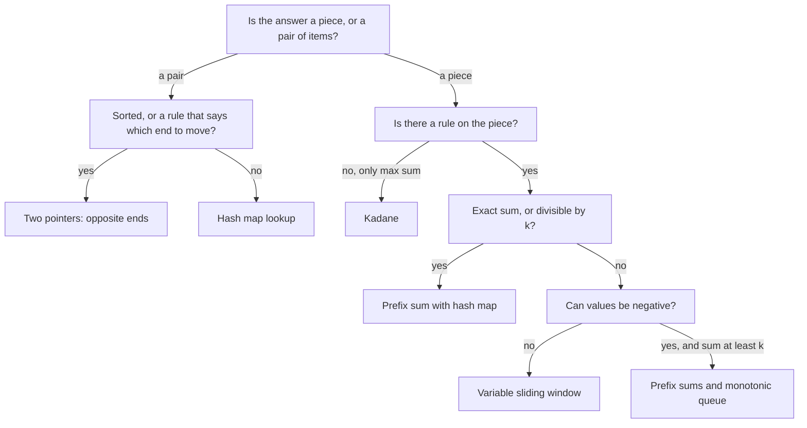
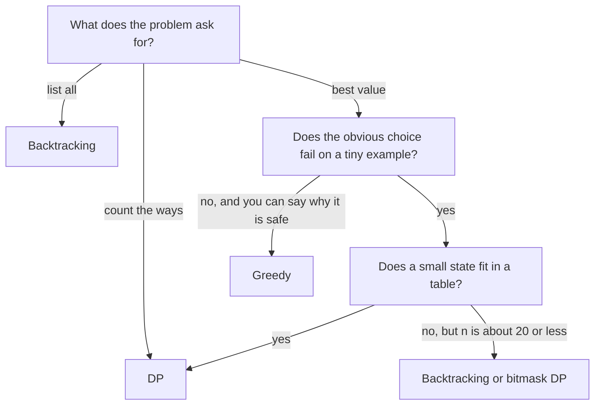
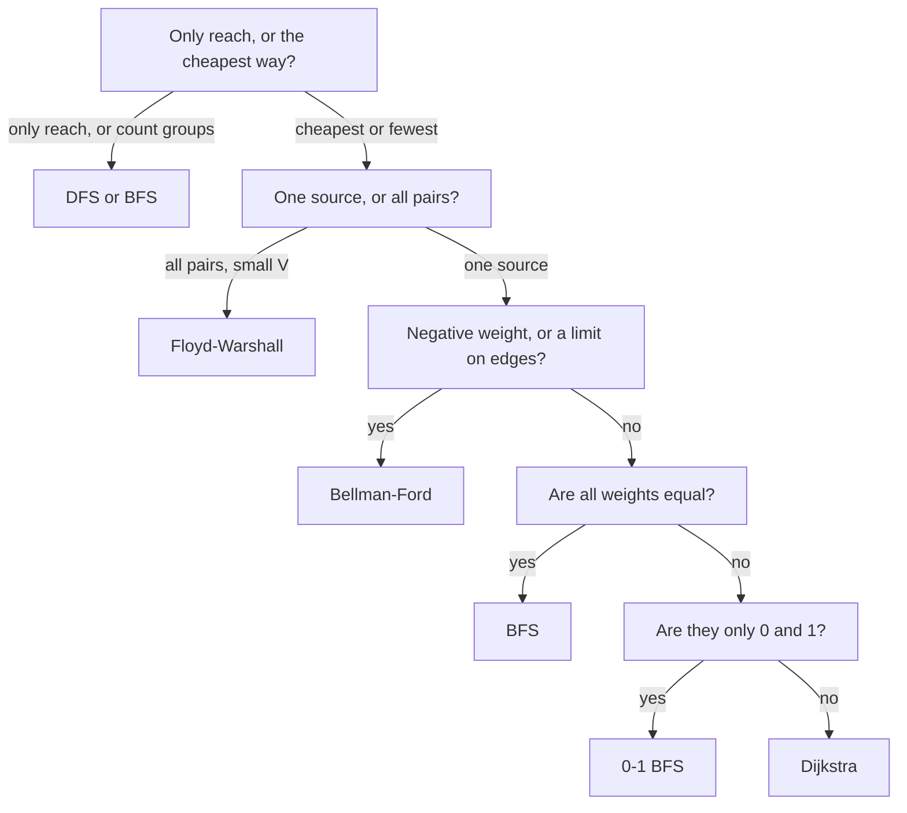
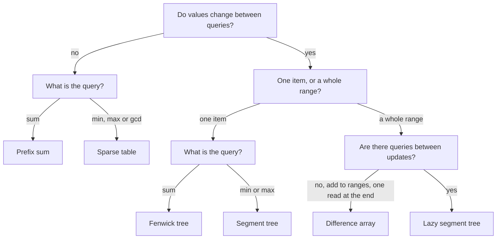

# Lookalike Patterns: How to Tell Them Apart

> **Level:** Intermediate · **Priority:** T1 · **Time:** 180 min · **Read first:** [Pattern Cards](06-pattern-cards.md) · **Next:** [Worked Recognition Walkthroughs](08-worked-recognition-walkthroughs.md)

Many interview problems look the same but need different tools. Often one word decides: "subarray" or "subsequence", "positive" or "integers", "list" or "count". This chapter puts the confusing techniques side by side. It gives you one question to ask, one pair of real problems, and one small example that shows why the wrong tool fails.

## Quick revision

Each line is the question that separates the lookalikes.

- **Subarray, subsequence, subset:** May I skip items? May I reorder them?
- **Window, prefix sum, two pointers, Kadane:** Is the answer a piece or a pair? Is there a rule? Can values be negative?
- **Fixed or variable window:** Is k the length of the window, or a limit on what is inside it?
- **Fast and slow or two pointers:** Is one pointer moving at double speed along a chain, or do the pointers move by a rule on values?
- **DP, greedy, backtracking:** The verb decides. "List all" is backtracking. "Count" or "best" is DP. Use greedy only if you cannot break it with a tiny example and you can say why the choice is safe.
- **Memoization or tabulation:** Can you name the order to fill the table? If yes, tabulate. If no, memoize.
- **Subset, combination, permutation:** Does order matter? Is the size fixed?
- **0/1 or unbounded knapsack:** Can one item be used twice?
- **LIS or LCS:** One sequence or two?
- **Binary search on answer, DP, greedy:** If I guess the answer, is checking the guess easy, and does the result flip only once?
- **DFS, BFS, Dijkstra, Bellman-Ford, Floyd:** Are there weights? Are any negative? Is there a limit on edges? One source or all pairs?
- **0-1 BFS or Dijkstra:** Are all weights only 0 or 1?
- **Topological sort, cycle detection, plain DFS:** Do you need an order, a yes or no, or only a visit?
- **Union-Find or DFS:** Do edges arrive over time? Do you need the path itself?
- **Kruskal or Prim:** Are you given an edge list, or is every pair of nodes connected?
- **Heap, sorting, quickselect, bucket sort:** Is the data a stream? Do you need all items in order, or only the k-th? Are the values small?
- **Monotonic stack, monotonic queue, heap:** Do you want an item's nearest bigger neighbour, or the best of a moving window, or the best of a set you keep removing from?
- **Trie or hash map:** Whole keys, or prefixes?
- **Segment tree, Fenwick tree, prefix sum, sparse table:** Are there updates? Is the query a sum or a min?
- **KMP, Z, rolling hash:** Is a pattern given? Do you need one border, or a match length at every position, or many substring comparisons?

## How to use this chapter

Do three things when two techniques seem to fit.

1. **Find the deciding word.** Read the statement again and look for the one word that would change the method. This chapter names that word for each pair.
2. **Check what the tool needs.** Every technique needs something to be true. A sliding window needs a rule that flips only one way. Dijkstra needs no negative edges. If that thing is false, the tool is wrong, even if the problem looks right.
3. **Try to break it.** Take three or four small numbers and run the tool by hand. A failure on a tiny input saves you 20 minutes of coding the wrong thing.

The comparisons are grouped by what the problem looks like:

| Part | Comparisons |
|---|---|
| [Part 1: Arrays and lists](#part-1-arrays-and-lists) | 1 to 4 |
| [Part 2: Choices and DP](#part-2-choices-and-dp) | 5 to 10 |
| [Part 3: Graphs](#part-3-graphs) | 11 to 15 |
| [Part 4: Data structures and strings](#part-4-data-structures-and-strings) | 16 to 20 |
| [Mixed drills](#mixed-drills) | Test yourself |

## Part 1: Arrays and lists

### 1. Subarray vs subsequence vs subset

**Ask:** May I skip items? May I change their order?

Take `nums = [3, 1, 2]`.

| Word | May skip? | May reorder? | Example that is allowed | Example that is not | How many (not empty) |
|---|---|---|---|---|---|
| Subarray (substring for a string) | No | No | `[3, 1]` | `[3, 2]` skips the 1 | n(n+1)/2, so 6 here |
| Subsequence | Yes | No | `[3, 2]` | `[2, 3]` changes the order | 2^n - 1, so 7 here |
| Subset | Yes | Yes | `{2, 3}` is the same as `{3, 2}` | none: only the items matter | 2^n - 1, so 7 here |

The word tells you the family of tools:

| Word | Where to go |
|---|---|
| Subarray | [Sliding window](../05-core-patterns/05-sliding-window-variable.md), [prefix sums](../05-core-patterns/06-prefix-sums.md) or [Kadane](../05-core-patterns/08-kadane-and-subarray-dp.md) |
| Subsequence | [LIS](../09-dynamic-programming/06-longest-increasing-subsequence.md) or [LCS](../09-dynamic-programming/07-lcs-and-edit-distance.md) |
| Subset | [Knapsack](../09-dynamic-programming/04-zero-one-knapsack.md) or [backtracking](../06-recursion-backtracking-greedy/02-backtracking-subsets.md). Because order does not matter, you may sort first. |

**One-word pair:** [Longest Continuous Increasing Subsequence](https://leetcode.com/problems/longest-continuous-increasing-subsequence/) (LeetCode 674) and [Longest Increasing Subsequence](https://leetcode.com/problems/longest-increasing-subsequence/) (LeetCode 300). The word is "continuous". For `[1, 3, 5, 4, 7]`, the first gives 3 (`[1, 3, 5]`). The second gives 4 (`[1, 3, 5, 7]`). The first is one scan. The second needs DP.

**Why the lookalike fails:** Read the rule, not the title. LeetCode 674 says "subsequence" in its title, but it asks for a subarray. [Longest Consecutive Sequence](https://leetcode.com/problems/longest-consecutive-sequence/) (LeetCode 128) says "sequence", but the positions do not matter at all, so it is about the set of values, and a hash set solves it.

### 2. Sliding window vs prefix sum vs two pointers vs Kadane

**Ask:** Is the answer a contiguous piece (one with no gaps), or a pair of items? Is there a rule on the piece? Can values be negative?

| Tool | What it finds | What it needs | Words that give it away |
|---|---|---|---|
| [Variable sliding window](../05-core-patterns/05-sliding-window-variable.md) | The longest, shortest or count of pieces that obey a rule | A rule that flips only one way as the piece grows. For "at most" or "at least" sums, that means no negative values. For an exact sum, every value must be above 0. | "positive integers", "longest substring", "at most k" |
| [Prefix sum with a hash map](../05-core-patterns/06-prefix-sums.md) | Pieces with an exact sum or remainder | Nothing about signs | "equals k", "divisible by k", negative values allowed |
| [Two pointers: opposite ends](../05-core-patterns/01-two-pointers-opposite-ends.md) | Two items, not the piece between them | A sorted array, or a rule that tells you which end to move | "sorted", "pair", "two numbers" |
| [Kadane](../05-core-patterns/08-kadane-and-subarray-dp.md) | The largest sum of any piece | No extra rule on the piece | "maximum sum subarray" with nothing else |



Leaves: [two pointers](../05-core-patterns/01-two-pointers-opposite-ends.md), [hash map lookup](../02-arrays-strings-hashing/04-hashing-patterns.md), [Kadane](../05-core-patterns/08-kadane-and-subarray-dp.md), [sliding window](../05-core-patterns/05-sliding-window-variable.md), [prefix sums](../05-core-patterns/06-prefix-sums.md), [monotonic queue](../05-core-patterns/13-monotonic-queue.md).

**One-word pairs:**

- [Minimum Size Subarray Sum](https://leetcode.com/problems/minimum-size-subarray-sum/) (LeetCode 209) and [Shortest Subarray with Sum at Least K](https://leetcode.com/problems/shortest-subarray-with-sum-at-least-k/) (LeetCode 862). Both ask for the shortest piece with sum at least a target. The word is "positive". The first has only positive values, so a window works. The second allows negative values, so it needs prefix sums and a monotonic queue.
- [Two Sum II](https://leetcode.com/problems/two-sum-ii-input-array-is-sorted/) (LeetCode 167) and [Two Sum](https://leetcode.com/problems/two-sum/) (LeetCode 1). The word is "sorted". Sorted means two pointers. Not sorted means a hash map, with O(1) lookups on average.
- [Subarray Sum Equals K](https://leetcode.com/problems/subarray-sum-equals-k/) (LeetCode 560) and [Maximum Subarray](https://leetcode.com/problems/maximum-subarray/) (LeetCode 53). "Equals k" is a target, so use a prefix map. "Maximum" has no target, so use Kadane.

**Why the lookalike fails:** A window shrinks when the sum is too big. It assumes that the sum can never come back down. A negative number breaks that. Find a piece with sum 3 in `[5, -3, 1]`.

| right | Add | Sum | Too big? | left after | Found 3? |
|---|---|---|---|---|---|
| 0 | 5 | 5 | yes, remove 5, sum is 0 | 1 | no |
| 1 | -3 | -3 | no | 1 | no |
| 2 | 1 | -2 | no | 1 | no |

The window finds nothing. But the whole array sums to 3. The window threw away the 5 too early.

The prefix map does not guess. A prefix sum is the sum of the first few items. If the sum up to here is `p`, and an earlier prefix was `p - k`, then the items between them sum to exactly k. The signs do not matter.

```cpp
#include <bits/stdc++.h>
#include <cassert>
using namespace std;

class Solution {
public:
    // LeetCode 560. Correct with negative numbers.
    int subarraySum(vector<int>& nums, int k) {
        unordered_map<long long, int> seen;  // prefix sum -> how many times it appeared
        seen[0] = 1;                         // the empty prefix, so a piece can start at index 0
        long long prefix = 0;
        int count = 0;
        for (int value : nums) {
            prefix += value;
            auto it = seen.find(prefix - k);  // each such earlier prefix leaves exactly k
            if (it != seen.end()) count += it->second;
            seen[prefix]++;
        }
        return count;
    }
};

// WRONG when values can be negative. It is here only so that you can see it fail.
int windowCount(const vector<int>& nums, int k) {
    long long sum = 0;
    int left = 0, count = 0;
    for (int right = 0; right < (int)nums.size(); right++) {
        sum += nums[right];
        while (sum > k && left <= right) sum -= nums[left++];
        if (sum == k) count++;
    }
    return count;
}

int main() {
    Solution solution;
    vector<int> positive = {1, 1, 1};
    vector<int> mixed = {5, -3, 1};
    vector<int> zeros = {0, 0};
    vector<int> single = {3};
    assert(solution.subarraySum(positive, 2) == 2);  // two pieces of [1, 1]
    assert(windowCount(positive, 2) == 2);           // positive values: the window agrees
    assert(solution.subarraySum(mixed, 3) == 1);     // the whole array
    assert(windowCount(mixed, 3) == 0);              // the window misses it
    assert(solution.subarraySum(zeros, 0) == 3);     // [0], [0] and [0, 0]
    assert(solution.subarraySum(single, 5) == 0);    // no piece works
    cout << "All tests passed\n";
}
```

**Why not a window for Kadane?** Take `[2, -1, 3, -4]`. The best piece is `[2, -1, 3]` with sum 4. A window needs a rule that tells it when to shrink, and "maximum sum" gives none. Kadane has its own rule: if the running sum is negative, drop it, because it can only hurt whatever comes next.

### 3. Fixed vs variable sliding window

**Ask:** Is k the length of the window, or a limit on what is inside it?

| | Fixed window | Variable window |
|---|---|---|
| What k means | The length: "of length k", "k consecutive days" | A limit: "at most k distinct", "at most k flips" |
| How `left` moves | Once per step, as soon as the window is full | Only when the rule says so, maybe many times in one step |
| Chapter | [Fixed window](../05-core-patterns/04-sliding-window-fixed.md) | [Variable window](../05-core-patterns/05-sliding-window-variable.md) |

**One-word pair:** [Maximum Number of Vowels in a Substring of Given Length](https://leetcode.com/problems/maximum-number-of-vowels-in-a-substring-of-given-length/) (LeetCode 1456) and [Max Consecutive Ones III](https://leetcode.com/problems/max-consecutive-ones-iii/) (LeetCode 1004). Both have a k. In the first, k is the "length". In the second, k is how many zeros you may "flip", and the window length is the answer.

**A hidden length:** [Permutation in String](https://leetcode.com/problems/permutation-in-string/) (LeetCode 567) never says "length k". But a permutation of `t` has exactly `t.size()` letters, so the window is fixed. [Minimum Window Substring](https://leetcode.com/problems/minimum-window-substring/) (LeetCode 76) says every letter of `t` must be "included" in the window, and other letters may sit between them. So its length changes.

Take `s = "abxc"` and `t = "abc"`. The fixed windows are `abx` and `bxc`, and neither is a permutation of `abc`. But the shortest window that contains all three letters is `abxc`.

**Why the lookalike fails:** A problem can hide its window in the part you do not take.

- [Maximum Points You Can Obtain from Cards](https://leetcode.com/problems/maximum-points-you-can-obtain-from-cards/) (LeetCode 1423): you take exactly k cards from the two ends. The cards you leave are one contiguous piece of length n - k. That is a fixed window.
- [Minimum Operations to Reduce X to Zero](https://leetcode.com/problems/minimum-operations-to-reduce-x-to-zero/) (LeetCode 1658): you take items from the two ends until they sum to x. The items you leave sum to total - x, and you want that piece to be as long as possible. Its length is unknown, and the values are positive, so it is a variable window.

### 4. Fast and slow pointers vs two pointers

**Ask:** Does one pointer move at double speed along a chain, no matter what the values are? Or do the pointers move because of a rule on the values?

| Tool | How the pointers move | Typical input | Words that give it away |
|---|---|---|---|
| [Fast and slow pointers](../05-core-patterns/03-fast-and-slow-pointers.md) | Slow moves 1, fast moves 2, every step | A linked list, or any "next" chain | "cycle", "middle", "O(1) space" |
| [Two pointers: opposite ends](../05-core-patterns/01-two-pointers-opposite-ends.md) | From the two ends toward each other, chosen by comparing values | A sorted array | "pair", "sorted" |
| [Two pointers: same direction](../05-core-patterns/02-two-pointers-same-direction.md) | Both go forward. One reads, and one writes when the value is kept | An array to change in place | "in place", "remove" |
| Two pointers with a fixed gap (see [singly linked list](../03-linked-lists-stacks-queues/01-singly-linked-list.md)) | Both move at speed 1, with a gap of n between them | A linked list | "from the end" |

**One-word pair:** [Middle of the Linked List](https://leetcode.com/problems/middle-of-the-linked-list/) (LeetCode 876) and [Remove Nth Node From End of List](https://leetcode.com/problems/remove-nth-node-from-end-of-list/) (LeetCode 19). "Middle" means speeds 1 and 2: when fast reaches the end, slow is halfway. "From end" means equal speeds with a gap of n: when the front pointer reaches the end, the back pointer is n nodes behind it.

**Why the lookalike fails:** There is no sorted order in a chain, so comparing values tells you nothing. You cannot walk backwards from the end of a singly linked list, so the opposite-ends method has no second start.

**The chain can be hidden.** Fast and slow works on anything where each state has one next state.

- [Happy Number](https://leetcode.com/problems/happy-number/) (LeetCode 202): the next state of a number is the sum of the squares of its digits. There is no list, but the numbers form a chain, and the chain reaches 1 or enters a cycle.
- [Find the Duplicate Number](https://leetcode.com/problems/find-the-duplicate-number/) (LeetCode 287): treat `i -> nums[i]` as a next pointer. The duplicate is where the cycle begins. The words "constant extra space" and "without modifying" rule out a hash set and sorting.

**A warning about names:** Some books call the read and write pointers of [Remove Duplicates from Sorted Array](https://leetcode.com/problems/remove-duplicates-from-sorted-array/) (LeetCode 26) "fast and slow". They are not a speed-2 pair. In this guide they are two pointers in the same direction.

## Part 2: Choices and DP

### 5. DP vs greedy vs backtracking

**Ask:** What is the verb? "List", "count", or "best"? If it is "best", does the obvious choice survive a tiny example?

DP (dynamic programming) saves the answer to each smaller problem, so each one is solved once. Greedy makes one choice at each step and never goes back. Backtracking tries a choice, goes on, then undoes it to try the next.

| The problem says | Tool | Typical cost | Example |
|---|---|---|---|
| "return all", "list every" | [Backtracking](../06-recursion-backtracking-greedy/03-backtracking-permutations-combinations.md) | Exponential, because the output itself can be that large | [Combination Sum](https://leetcode.com/problems/combination-sum/) (LeetCode 39) |
| "how many ways" | [DP](../09-dynamic-programming/01-dp-from-zero.md) | States times choices per state | [Coin Change II](https://leetcode.com/problems/coin-change-ii/) (LeetCode 518) |
| "minimum" or "maximum", and a choice now changes what is possible later | [DP](../09-dynamic-programming/05-unbounded-knapsack.md) | States times choices per state | [Coin Change](https://leetcode.com/problems/coin-change/) (LeetCode 322) |
| "minimum" or "maximum", and one choice is always safe | [Greedy](../06-recursion-backtracking-greedy/06-greedy-foundations.md) | Often O(n log n), for the sort | [Non-overlapping Intervals](https://leetcode.com/problems/non-overlapping-intervals/) (LeetCode 435) |

**Limit of this rule:** the verb works when you build a group by choosing items. [Find All Anagrams in a String](https://leetcode.com/problems/find-all-anagrams-in-a-string/) (LeetCode 438) says "all", but each answer is one window, so use a fixed sliding window. "Count the subarrays" is usually prefix sums or a window, not DP.



Leaves: [backtracking](../06-recursion-backtracking-greedy/03-backtracking-permutations-combinations.md), [DP](../09-dynamic-programming/01-dp-from-zero.md), [greedy](../06-recursion-backtracking-greedy/06-greedy-foundations.md), [bitmask DP](../09-dynamic-programming/12-bitmask-dp.md).

**One-word pairs:**

- The verb: LeetCode 39, 518 and 322 all give you a list of numbers and a target. "All" the combinations means backtracking. The "number" of combinations means DP. The "fewest" coins means DP too.
- The weight: LeetCode 435 and [Maximum Profit in Job Scheduling](https://leetcode.com/problems/maximum-profit-in-job-scheduling/) (LeetCode 1235) both choose intervals that do not overlap. The word is "profit". When every interval counts the same, always take the one that ends first. When intervals have different profits, that choice is no longer safe.

**Why the lookalike fails:** Take jobs `[1, 3]` with profit 1, `[2, 5]` with profit 10, and `[4, 6]` with profit 1. Earliest end first takes `[1, 3]`, then `[4, 6]`, for a profit of 2. The best answer is `[2, 5]` alone, for a profit of 10.

Coins show the same thing. With coins `{1, 3, 4}` and amount 6, "take the biggest coin" gives 4 + 1 + 1, which is 3 coins. The best is 3 + 3, which is 2 coins. With coins `{3, 4}`, greedy finds nothing at all.

```cpp
#include <bits/stdc++.h>
#include <cassert>
using namespace std;

class Solution {
public:
    // LeetCode 322. Tries every coin as the last coin of every amount.
    int coinChange(vector<int>& coins, int amount) {
        const int unreachable = amount + 1;  // no real answer uses this many coins
        vector<int> dp(amount + 1, unreachable);
        dp[0] = 0;
        for (int sum = 1; sum <= amount; sum++) {
            for (int coin : coins) {
                if (coin <= sum) dp[sum] = min(dp[sum], dp[sum - coin] + 1);
            }
        }
        return dp[amount] == unreachable ? -1 : dp[amount];
    }
};

// WRONG in general. It always takes as many of the biggest coin as it can.
int greedyCoins(vector<int> coins, int amount) {
    sort(coins.rbegin(), coins.rend());
    int count = 0;
    for (int coin : coins) {
        count += amount / coin;
        amount %= coin;
    }
    return amount == 0 ? count : -1;
}

int main() {
    Solution solution;
    vector<int> tricky = {1, 3, 4};
    vector<int> noOne = {3, 4};
    vector<int> usual = {1, 2, 5};
    vector<int> two = {2};
    assert(solution.coinChange(tricky, 6) == 2);  // 3 + 3
    assert(greedyCoins(tricky, 6) == 3);          // 4 + 1 + 1, not the best
    assert(solution.coinChange(noOne, 6) == 2);   // 3 + 3
    assert(greedyCoins(noOne, 6) == -1);          // takes 4, and then 2 is stuck
    assert(solution.coinChange(usual, 11) == 3);  // 5 + 5 + 1
    assert(greedyCoins(usual, 11) == 3);          // right here, but only because of these coins
    assert(solution.coinChange(two, 3) == -1);    // cannot make an odd amount
    assert(solution.coinChange(usual, 0) == 0);   // nothing to pay
    cout << "All tests passed\n";
}
```

Passing a few examples does not prove a greedy. You still need a reason, such as: "swapping any other choice for this one never makes the result worse." If you have no reason, use DP.

### 6. Memoization vs tabulation

**Ask:** Can you name the order in which to fill the table? If yes, tabulate. If no, or if few states are reachable, memoize.

Both are DP. Both use the same states and the same recurrence (the rule that builds one state from smaller states), and both have the same worst-case big-O time.

| | Memoization (top-down) | Tabulation (bottom-up) |
|---|---|---|
| How it works | Recursion, plus a cache of finished states | Loops that fill a table from the smallest state up |
| Fill order | The recursion finds it for you | You must work it out |
| States computed | Only those reached | Usually all of them |
| Extra space | The table and the recursion stack | The table. Often you can keep only the last row. |
| Main risk | Very deep recursion can overflow the stack | A wrong order reads cells that are not ready, with no error |

**One-word pair:** [Unique Paths](https://leetcode.com/problems/unique-paths/) (LeetCode 62) and [Longest Increasing Path in a Matrix](https://leetcode.com/problems/longest-increasing-path-in-a-matrix/) (LeetCode 329). Both walk on a grid. In the first you move "right or down", so each cell needs only the cells above and to the left. Row by row works. In the second you move in "four directions", so a cell can need a neighbour on any side. No row order works, and memoization is the natural choice. (You could sort the cells by value to get an order, but that is extra work.)

**Why the lookalike fails:** The choice here is about fit, not about being correct.

- [House Robber](https://leetcode.com/problems/house-robber/) (LeetCode 198) needs only the last two values. Tabulation can drop the table and use O(1) space. Memoization cannot, because it must keep its cache and its stack.
- [Frog Jump](https://leetcode.com/problems/frog-jump/) (LeetCode 403) has the state (stone, last jump). Most pairs can never happen. Memoization visits only the ones that can, so you do not have to work out the reachable pairs yourself.

In an interview, either one is accepted. Start with the one you can write correctly, and mention the other as a follow-up. See [DP from zero](../09-dynamic-programming/01-dp-from-zero.md).

### 7. Subset vs combination vs permutation

**Ask:** Does order matter? Is the size or the sum fixed?

| Problem type | Order matters? | When to record | Loop starts at | Count for n items |
|---|---|---|---|---|
| Subset | No | At every step | `start` | 2^n |
| Combination | No | Only when the size or sum is reached | `start` | C(n, k) for size k |
| Permutation | Yes | Only when all items are used | `0`, skipping used items | n! |

Two small changes cover the common variants:

| Variant | Change | Example |
|---|---|---|
| Each item may repeat | Recurse with `i`, not `i + 1` | Combination Sum (LeetCode 39) |
| The input has equal values | Sort, then skip an equal neighbour at the same level | [Subsets II](https://leetcode.com/problems/subsets-ii/) (LeetCode 90), [Permutations II](https://leetcode.com/problems/permutations-ii/) (LeetCode 47), [Combination Sum II](https://leetcode.com/problems/combination-sum-ii/) (LeetCode 40) |

**One-word pair:** [Subsets](https://leetcode.com/problems/subsets/) (LeetCode 78) and [Permutations](https://leetcode.com/problems/permutations/) (LeetCode 46). Both take a list of distinct numbers. The difference is whether `[1, 2]` and `[2, 1]` are the same answer. Another pair is LeetCode 39 and LeetCode 40: "unlimited" times or "once" changes `i` to `i + 1`.

**Why the lookalike fails:** A `start` index only moves forward, so a permutation built with it can never produce `[2, 1]`. A loop from 0 with a `used` array, in a combination problem, produces both `[1, 2]` and `[2, 1]`, which is a repeated answer.

**A title that lies:** [Combination Sum IV](https://leetcode.com/problems/combination-sum-iv/) (LeetCode 377) says "combination", but it counts `1 + 2` and `2 + 1` as different. So order matters. It also asks for a count, not a list, so use DP ([comparison 8](#8-01-vs-unbounded-knapsack) shows the loop).

```cpp
#include <bits/stdc++.h>
#include <cassert>
using namespace std;

class Solution {
public:
    vector<vector<int>> subsets(vector<int>& nums) {  // LeetCode 78
        vector<vector<int>> result;
        vector<int> current;
        buildSubsets(nums, 0, current, result);
        return result;
    }

    vector<vector<int>> combine(int n, int k) {  // LeetCode 77
        vector<vector<int>> result;
        vector<int> current;
        buildCombinations(n, k, 1, current, result);
        return result;
    }

    vector<vector<int>> permute(vector<int>& nums) {  // LeetCode 46
        vector<vector<int>> result;
        vector<int> current;
        vector<bool> used(nums.size(), false);
        buildPermutations(nums, used, current, result);
        return result;
    }

private:
    void buildSubsets(const vector<int>& nums, int start, vector<int>& current,
                      vector<vector<int>>& result) {
        result.push_back(current);  // every partial choice is itself a subset
        for (int i = start; i < (int)nums.size(); i++) {
            current.push_back(nums[i]);
            buildSubsets(nums, i + 1, current, result);  // only later items, so no repeats
            current.pop_back();
        }
    }

    void buildCombinations(int n, int k, int start, vector<int>& current,
                           vector<vector<int>>& result) {
        if ((int)current.size() == k) {  // only groups of the full size count
            result.push_back(current);
            return;
        }
        for (int value = start; value <= n; value++) {
            current.push_back(value);
            buildCombinations(n, k, value + 1, current, result);
            current.pop_back();
        }
    }

    void buildPermutations(const vector<int>& nums, vector<bool>& used, vector<int>& current,
                           vector<vector<int>>& result) {
        if (current.size() == nums.size()) {  // every item is placed
            result.push_back(current);
            return;
        }
        for (int i = 0; i < (int)nums.size(); i++) {  // from 0: an earlier item may come later
            if (used[i]) continue;
            used[i] = true;
            current.push_back(nums[i]);
            buildPermutations(nums, used, current, result);
            current.pop_back();
            used[i] = false;
        }
    }
};

bool contains(const vector<vector<int>>& lists, const vector<int>& wanted) {
    return find(lists.begin(), lists.end(), wanted) != lists.end();
}

int main() {
    Solution solution;
    vector<int> nums = {1, 2, 3};
    vector<int> single = {7};

    assert(solution.subsets(nums).size() == 8);    // 2^3
    assert(solution.permute(nums).size() == 6);    // 3!
    assert(solution.combine(4, 2).size() == 6);    // C(4, 2)
    assert(solution.subsets(single).size() == 2);  // the empty list and [7]
    assert(solution.permute(single).size() == 1);
    assert(solution.combine(3, 3).size() == 1);    // only one way to take all

    // The tricky difference: order.
    assert(contains(solution.permute(nums), {2, 1, 3}));
    assert(contains(solution.permute(nums), {1, 2, 3}));
    assert(contains(solution.combine(4, 2), {1, 2}));
    assert(!contains(solution.combine(4, 2), {2, 1}));
    assert(!contains(solution.subsets(nums), {2, 1}));
    cout << "All tests passed\n";
}
```

See [backtracking: subsets](../06-recursion-backtracking-greedy/02-backtracking-subsets.md) and [permutations and combinations](../06-recursion-backtracking-greedy/03-backtracking-permutations-combinations.md).

### 8. 0/1 vs unbounded knapsack

**Ask:** Can one item be used more than once?

| | [0/1 knapsack](../09-dynamic-programming/04-zero-one-knapsack.md) | [Unbounded knapsack](../09-dynamic-programming/05-unbounded-knapsack.md) |
|---|---|---|
| Words | "each element once", "at most once" | "unlimited supply", "infinite number of each" |
| Inner loop on the sum | Goes down | Goes up |
| Why | `dp[s - x]` is still the old value, from before x was tried, so x is used at most once | `dp[s - x]` may already include x, so x can be used again |

Here is the effect with one item, `x = 5`, and target 10.

| Loop | First step | Second step | `dp[10]` |
|---|---|---|---|
| Down | s = 10: `dp[5]` is false, so `dp[10]` stays false | s = 5: `dp[0]` is true, so `dp[5]` becomes true | false, correct for one 5 |
| Up | s = 5: `dp[0]` is true, so `dp[5]` becomes true | s = 10: `dp[5]` is true, so `dp[10]` becomes true | true, correct for many 5s |

**One-word pair:** [Partition Equal Subset Sum](https://leetcode.com/problems/partition-equal-subset-sum/) (LeetCode 416) and [Coin Change II](https://leetcode.com/problems/coin-change-ii/) (LeetCode 518). In the first, each number goes into one group only, so it is used once, even though the statement only says "partition". Each coin in the second has an "infinite" supply.

**Why the lookalike fails:** The wrong direction gives no error. It gives a wrong answer that looks fine.

**Knapsack in disguise:** Neither of these says "knapsack".

- [Target Sum](https://leetcode.com/problems/target-sum/) (LeetCode 494): put `+` or `-` before each number. Let P be the sum of the plus numbers, and N the sum of the minus numbers. P - N = target and P + N = total, so P = (total + target) / 2. If total + target is odd or negative, the answer is 0. Otherwise, count subsets with sum P. That is 0/1.
- [Perfect Squares](https://leetcode.com/problems/perfect-squares/) (LeetCode 279): the coins are 1, 4, 9 and so on, and each can repeat. That is unbounded.

**A second lookalike inside unbounded:** the order of the two loops. With `{1, 2}` and target 3, Coin Change II counts 2 (`1+1+1`, `1+2`). Combination Sum IV counts 3 (`1+1+1`, `1+2`, `2+1`). With items in the outer loop, each item is finished before the next one starts, so every group appears in one order only. With the sum in the outer loop, any item can come last at every sum, so different orders count separately.

```cpp
#include <bits/stdc++.h>
#include <cassert>
using namespace std;

// Can some items add up to target? Items are not negative, and target is at least 0.
bool canMake(const vector<int>& items, int target, bool reuse) {
    vector<char> dp(target + 1, 0);
    dp[0] = 1;  // the empty group makes 0
    for (int item : items) {
        if (reuse) {
            for (int sum = item; sum <= target; sum++) {  // up: this item may repeat
                if (dp[sum - item]) dp[sum] = 1;
            }
        } else {
            for (int sum = target; sum >= item; sum--) {  // down: this item is used once
                if (dp[sum - item]) dp[sum] = 1;
            }
        }
    }
    return dp[target] != 0;
}

class Solution {
public:
    bool canPartition(vector<int>& nums) {  // LeetCode 416
        long long total = accumulate(nums.begin(), nums.end(), 0LL);
        if (total % 2 != 0) return false;  // an odd total cannot split in half
        return canMake(nums, (int)(total / 2), false);
    }

    int change(int amount, vector<int>& coins) {  // LeetCode 518: groups
        // Unsigned: middle values may pass the limit. Wrapping is safe, and the final answer fits.
        vector<unsigned long long> dp(amount + 1, 0);
        dp[0] = 1;
        for (int coin : coins) {  // items outside: each group is counted in one order
            for (int sum = coin; sum <= amount; sum++) dp[sum] += dp[sum - coin];
        }
        return (int)dp[amount];
    }

    int combinationSum4(vector<int>& nums, int target) {  // LeetCode 377: ordered sequences
        vector<unsigned long long> dp(target + 1, 0);
        dp[0] = 1;
        for (int sum = 1; sum <= target; sum++) {  // sum outside: any item can come last
            for (int value : nums) {
                if (value <= sum) dp[sum] += dp[sum - value];
            }
        }
        return (int)dp[target];
    }
};

int main() {
    Solution solution;
    vector<int> partition = {1, 5, 11, 5};
    vector<int> oddTotal = {1, 2, 3, 5};
    vector<int> oneTwo = {1, 2};
    vector<int> coins = {1, 2, 5};
    vector<int> three = {1, 2, 3};
    vector<int> onlyTwo = {2};

    assert(solution.canPartition(partition));          // 11 and 5 + 5 + 1
    assert(!solution.canPartition(oddTotal));          // the total is 11
    assert(!canMake({5}, 10, false));                  // one 5 only
    assert(canMake({5}, 10, true));                    // 5 + 5
    assert(!canMake({2, 4}, 3, true));                 // even items cannot make 3
    assert(canMake({2, 4}, 0, false));                 // the empty group

    assert(solution.change(5, coins) == 4);            // 5, 2+2+1, 2+1+1+1, 1+1+1+1+1
    assert(solution.combinationSum4(three, 4) == 7);   // 1+1+1+1, 1+1+2, 1+2+1, 2+1+1, 2+2, 1+3, 3+1
    assert(solution.change(3, oneTwo) == 2);           // same input, groups
    assert(solution.combinationSum4(oneTwo, 3) == 3);  // same input, orders
    assert(solution.change(3, onlyTwo) == 0);          // no way to make 3
    assert(solution.change(0, coins) == 1);            // the empty group
    cout << "All tests passed\n";
}
```

### 9. LIS vs LCS

**Ask:** How many sequences are in the input?

| | [LIS](../09-dynamic-programming/06-longest-increasing-subsequence.md) (longest increasing subsequence) | [LCS](../09-dynamic-programming/07-lcs-and-edit-distance.md) (longest common subsequence) |
|---|---|---|
| Input | One sequence | Two sequences |
| Each item is compared with | Earlier items of the same sequence | Items of the other sequence |
| Words | "increasing", "strictly larger", "chain" | "common", "both strings", "delete from either" |
| Cost | O(n^2), or O(n log n) with binary search | O(n * m) time |

**One-word pair:** [Longest Increasing Subsequence](https://leetcode.com/problems/longest-increasing-subsequence/) (LeetCode 300) and [Longest Common Subsequence](https://leetcode.com/problems/longest-common-subsequence/) (LeetCode 1143). The word is "increasing" against "common".

**Why the lookalike fails:** Disguises often hide which one you have.

- [Uncrossed Lines](https://leetcode.com/problems/uncrossed-lines/) (LeetCode 1035): lines join equal numbers in two rows and may not cross. Lines that do not cross keep the same order in both rows. So this is LCS, even though it never says "subsequence".
- [Russian Doll Envelopes](https://leetcode.com/problems/russian-doll-envelopes/) (LeetCode 354): there is only one list. Sort by width going up, with equal widths by height going down. Then find the LIS of the heights. The height order stops two envelopes of equal width from being chained.
- [Minimum Operations to Make a Subsequence](https://leetcode.com/problems/minimum-operations-to-make-a-subsequence/) (LeetCode 1713): this looks like LCS, but both arrays can have 100,000 items, so an O(n * m) table is too slow. The trick is that `target` has distinct values. Replace each item of `arr` by its position in `target`, and drop the ones not found. Now a common subsequence is an increasing list of positions. For `target = [5, 1, 3]` and `arr = [1, 5, 3]`, the positions are `[1, 0, 2]`. The LIS is 2, so you must insert 3 - 2 = 1 number.

### 10. Binary search on answer vs DP vs greedy

**Ask:** If someone gave you a guess for the answer, could you check it quickly? If a guess works, does every easier guess also work?

| Tool | Use it when | Words |
|---|---|---|
| [Binary search on the answer](../04-sorting-searching/07-binary-search-on-answer.md) | The answer is a number in a known range, a guess is easy to check, and the result flips only once | "minimize the maximum", "maximize the minimum", "least weight capacity", "minimum eating speed" |
| [DP](../09-dynamic-programming/01-dp-from-zero.md) | Choices interact, so you must remember a state, and no guess makes the check easy | "split", "ways", often small n |
| [Greedy](../06-recursion-backtracking-greedy/06-greedy-foundations.md) | One pass with a safe choice gives the answer directly, with no guess | "minimum number of jumps" in [Jump Game II](https://leetcode.com/problems/jump-game-ii/) (LeetCode 45) |

Here is the idea on [Capacity To Ship Packages Within D Days](https://leetcode.com/problems/capacity-to-ship-packages-within-d-days/) (LeetCode 1011). Take `weights = [3, 2, 2, 4]` and 2 days. A capacity below 4 is not possible, because the package of 4 would not fit.

| Guess for capacity | Days, filling each day in order | Fits in 2 days? |
|---|---|---|
| 4 | 3: `[3]`, `[2, 2]`, `[4]` | no |
| 5 | 3: `[3, 2]`, `[2]`, `[4]` | no |
| 6 | 2: `[3, 2]`, `[2, 4]` | yes |
| 7 | 2: `[3, 2, 2]`, `[4]` | yes |

The column reads no, no, yes, yes. It flips once, so binary search can find the first yes. The answer is 6.

**One-word pair:** LeetCode 1011 and [Find Minimum Time to Finish All Jobs](https://leetcode.com/problems/find-minimum-time-to-finish-all-jobs/) (LeetCode 1723). Both ask you to divide work so that the largest share is as small as possible. The word is "order". Packages ship "in the order given", so the check is one greedy pass. Jobs have no order and can go to any worker, so the check itself is hard.

**Why the lookalike fails:** Take jobs `[3, 3, 2, 2, 2]` and 2 workers. "Biggest job to the least busy worker" gives shares `3 + 2 + 2 = 7` and `3 + 2 = 5`. The best split is `3 + 3 = 6` and `2 + 2 + 2 = 6`. There is no simple safe choice. But LeetCode 1723 has at most 12 jobs, and that small limit points to [backtracking](../06-recursion-backtracking-greedy/04-backtracking-constraint-search.md) or [bitmask DP](../09-dynamic-programming/12-bitmask-dp.md).

**When both work:** [Split Array Largest Sum](https://leetcode.com/problems/split-array-largest-sum/) (LeetCode 410) can be solved by DP in O(n^2 * k) time, or by binary search in O(n log(sum)) time. The pieces must keep their order, so the greedy check works. Choose the binary search. It is shorter and faster.

## Part 3: Graphs

### 11. DFS vs BFS vs Dijkstra vs Bellman-Ford vs Floyd

**Ask:** Do I only need to reach something, or do I need the cheapest way? Are there weights? Are any negative? Is there a limit on edges? One source, or all pairs?

| Question | Edge weights | Tool | Cost |
|---|---|---|---|
| Can I reach it? How many groups? | Ignored | [DFS or BFS](../08-graphs/02-bfs-and-dfs.md) | O(V + E) |
| Fewest steps | All equal | [BFS](../08-graphs/04-bfs-shortest-path-patterns.md) | O(V + E) |
| Cheapest path from one source | Not negative | [Dijkstra](../08-graphs/08-dijkstra.md) | O(E log V) with a heap |
| Cheapest path from one source | Some negative, or a limit on edges | [Bellman-Ford](../08-graphs/09-bellman-ford-and-spfa.md) | O(V * E) |
| Cheapest path between every pair | Any, with no negative cycle | [Floyd-Warshall](../08-graphs/10-floyd-warshall-and-all-pairs.md) | O(V^3), so V up to about 400 |

(V is the number of nodes and E is the number of edges.)

Two exceptions. On a directed graph with no cycle, DP in topological order handles negative edges in O(V + E). For all pairs on a large sparse graph with no negative edges, run Dijkstra from each node.



Leaves: [DFS or BFS](../08-graphs/02-bfs-and-dfs.md), [Floyd-Warshall](../08-graphs/10-floyd-warshall-and-all-pairs.md), [Bellman-Ford](../08-graphs/09-bellman-ford-and-spfa.md), [BFS and 0-1 BFS](../08-graphs/04-bfs-shortest-path-patterns.md), [Dijkstra](../08-graphs/08-dijkstra.md).

**One-word pairs:**

- [Shortest Path in Binary Matrix](https://leetcode.com/problems/shortest-path-in-binary-matrix/) (LeetCode 1091) and [Network Delay Time](https://leetcode.com/problems/network-delay-time/) (LeetCode 743). The first counts "cells", so every step costs 1 and BFS is enough. The second has a "time" on each edge, so you need Dijkstra.
- LeetCode 743 and [Cheapest Flights Within K Stops](https://leetcode.com/problems/cheapest-flights-within-k-stops/) (LeetCode 787). Both have weights that are not negative. The word is "within". A limit of k stops means at most k + 1 edges, so run k + 1 rounds of Bellman-Ford, using a copy of the last round's distances.

**Why each lookalike fails:**

| Wrong tool | Tiny graph | What goes wrong |
|---|---|---|
| DFS for fewest steps | A-B, B-C, A-C | DFS may go A, B, C (2 steps) and stop. A-C is 1 step. To be sure, DFS would have to try every path. |
| BFS with weights | A-C costs 10, A-B costs 1, B-C costs 1 | BFS reaches C first by the direct edge, with cost 10. The real best is 2. |
| Dijkstra with a negative edge | A->B costs 2, A->C costs 3, C->B costs -2 | Dijkstra finishes B at cost 2 and never looks at it again. The real best is 3 - 2 = 1. (A version that re-adds B may get this right, but it loses the O(E log V) bound.) |
| Plain Dijkstra with a stop limit | A->B 1, B->C 1, C->D 1, A->C 5, limit of 1 stop | It keeps only the cheapest cost for C, which is 2 through B. That path needs 2 stops to reach D. The valid path A, C, D costs 6, and it was thrown away because 5 is worse than 2. |

**"Shortest" can hide in other words.** Two problems change what "cost" means, and Dijkstra still works, because the cost never improves as a path gets longer:

- [Path With Minimum Effort](https://leetcode.com/problems/path-with-minimum-effort/) (LeetCode 1631): the cost of a path is its largest single step, not a sum.
- [Path with Maximum Probability](https://leetcode.com/problems/path-with-maximum-probability/) (LeetCode 1514): the cost is a product of numbers up to 1. Use a max-heap.

### 12. 0-1 BFS vs Dijkstra

**Ask:** Is every edge weight either 0 or 1?

| Weights | Tool | Why | Cost |
|---|---|---|---|
| All the same | [BFS](../08-graphs/04-bfs-shortest-path-patterns.md) with a queue | Nodes come out in order of distance | O(V + E) |
| Only 0 and 1 | [0-1 BFS](../08-graphs/04-bfs-shortest-path-patterns.md) with a [deque](../03-linked-lists-stacks-queues/09-deque.md) (a queue open at both ends) | A 0 edge goes to the front and a 1 edge goes to the back, so the deque stays in order | O(V + E) |
| Any that are not negative | [Dijkstra](../08-graphs/08-dijkstra.md) | A heap keeps the order | O(E log V) |

**One-word pair:** LeetCode 1091 and [Minimum Obstacle Removal to Reach Corner](https://leetcode.com/problems/minimum-obstacle-removal-to-reach-corner/) (LeetCode 2290). Both are grids. The first counts "cells", so all weights are 1. The second counts "obstacles" removed. An empty cell costs 0 and an obstacle costs 1, so use 0-1 BFS. Dijkstra also gives the right answer, but it is slower by a log factor.

**Why the lookalike fails:** Take A->B costing 1, A->C costing 0, and C->B costing 0. A plain queue from A adds B and then C, in the order of the edges. It gives B distance 1 and never changes it. The real distance is 0, through C. 0-1 BFS puts C at the front, so C is handled first and B improves to 0.

**A close neighbour:** [Shortest Path in a Grid with Obstacles Elimination](https://leetcode.com/problems/shortest-path-in-a-grid-with-obstacles-elimination/) (LeetCode 1293) looks the same, but it asks for the fewest steps with "at most k" removals. Now the removals are a budget, not a cost. Use plain BFS on the state (row, column, removals used).

### 13. Topological sort vs cycle detection vs DFS

**Ask:** Do I need an order, a yes or no about a cycle, or only a visit?

| You need | Tool | Note |
|---|---|---|
| An order that obeys dependencies | [Topological sort](../08-graphs/06-topological-sort.md) | Works only on a directed graph with no cycle. |
| Yes or no: is there a cycle, directed graph | [Cycle detection](../08-graphs/05-cycle-detection-and-bipartite.md), or topological sort | If the sort cannot place every node, there is a cycle. |
| Yes or no: is there a cycle, undirected graph | [Union-Find](../08-graphs/07-union-find.md), or DFS that ignores the parent edge | An undirected graph has no topological order. |
| Only to visit nodes | [Plain DFS or BFS](../08-graphs/02-bfs-and-dfs.md) | There are no dependencies to respect. |

**One-word pair:** [Course Schedule](https://leetcode.com/problems/course-schedule/) (LeetCode 207) and [Course Schedule II](https://leetcode.com/problems/course-schedule-ii/) (LeetCode 210). The input is the same. The first asks if you can "finish" all courses. The second asks for the "ordering". One algorithm solves both. Kahn's algorithm removes nodes with no remaining dependency, one by one. If it removes all n nodes, the removal order is the answer. If not, there is a cycle.

**Why the lookalike fails:** A `visited` array alone does not find a directed cycle. Take this diamond:

```text
A -> B -> D
A -> C -> D
```

DFS reaches D through B, then reaches D again through C. D is already visited, but there is no cycle. A directed cycle exists only when you reach a node that is still on the current path. So you need three states: not seen, on the path, and finished.

Other words to watch for:

- [Find Eventual Safe States](https://leetcode.com/problems/find-eventual-safe-states/) (LeetCode 802): "every possible path" ending at a node with no way out means the node cannot reach a cycle.
- [Parallel Courses III](https://leetcode.com/problems/parallel-courses-iii/) (LeetCode 2050): "minimum number of months" with dependencies is the longest path on a graph with no cycle, so use topological order with DP.

### 14. Union-Find vs DFS

**Ask:** Do edges arrive over time? Do I need the actual path?

Union-Find keeps groups of nodes. It can join two groups, and it can say if two nodes are in the same group. Each operation costs almost O(1) amortized (averaged over many operations).

| Situation | Use | Why |
|---|---|---|
| The graph is fixed, and you want one answer | [DFS or BFS](../08-graphs/02-bfs-and-dfs.md), or Union-Find | Both work. DFS needs no extra structure. |
| Edges arrive one by one, and you must answer after each | [Union-Find](../08-graphs/07-union-find.md) | DFS would have to start again after each edge. |
| You need the path, or its length | DFS or BFS | Union-Find knows the group, not the route. |
| Edges are removed | Neither alone. Try processing the events in reverse, as [offline queries](../05-core-patterns/20-offline-query-processing.md). | Union-Find cannot split a group. Reversed, a removal becomes an addition. |
| The graph is directed, and you ask who can reach whom | DFS or BFS | Union-Find treats every edge as two-way. |

**One-word pair:** [Number of Islands](https://leetcode.com/problems/number-of-islands/) (LeetCode 200) and [Number of Islands II](https://leetcode.com/problems/number-of-islands-ii/) (LeetCode 305, Premium). The grid is fixed in the first. In the second, land is "added", and you report the count after every addition. Each DFS costs O(rows * columns), so repeating it for k additions costs O(k * rows * columns). Union-Find does each addition in almost O(1) amortized.

**Why the lookalike fails:** Union-Find can answer "same group?" but not "by what route?". If you must print the path, it cannot help. [Redundant Connection](https://leetcode.com/problems/redundant-connection/) (LeetCode 684) is the opposite case, and Union-Find fits it well: the first edge that joins two nodes already in one group closes the cycle.

### 15. Kruskal vs Prim

**Ask:** Am I given a list of edges, or is every pair of nodes connected?

Both find a minimum spanning tree (MST): the cheapest set of edges that connects all nodes. See the [MST chapter](../08-graphs/11-minimum-spanning-tree.md).

| | Kruskal | Prim |
|---|---|---|
| Idea | Sort all edges. Add each one unless it closes a cycle. | Grow one tree. Always add the cheapest edge that leaves it. |
| Needs | [Union-Find](../08-graphs/07-union-find.md) | A [heap](../07-trees/11-heap-from-zero.md), or a plain array for a dense graph |
| Cost | O(E log E) | O(E log V) with a heap, O(V^2) with an array |
| Fits | A given edge list, a sparse graph | A dense graph, or edges that are not listed |

**One-word pair:** [Connecting Cities With Minimum Cost](https://leetcode.com/problems/connecting-cities-with-minimum-cost/) (LeetCode 1135) and [Min Cost to Connect All Points](https://leetcode.com/problems/min-cost-to-connect-all-points/) (LeetCode 1584). The first gives you "connections", which is a ready edge list, so Kruskal fits. The second gives you "points", and every pair is an edge. With 1,000 points, that is 499,500 edges to build and sort. Prim with an array needs no edge list at all.

**The bigger trap: MST or shortest path?** Take a triangle with A-B costing 2, B-C costing 2, and A-C costing 3. The MST is A-B and B-C, with a total of 4. But the cheapest way from A to C is the direct edge, which costs 3. The MST does not give shortest paths. "Connect everything for the lowest total" is MST. "Cheapest from here to there" is [Dijkstra](../08-graphs/08-dijkstra.md).

## Part 4: Data structures and strings

### 16. Heap vs sorting vs quickselect vs bucket sort

**Ask:** Does the data arrive over time? Do I need all items in order, or only the top k? Are the values in a small range?

| Situation | Tool | Cost |
|---|---|---|
| You need everything in order, or k is close to n | [Sorting](../04-sorting-searching/05-custom-sorting.md) | O(n log n) |
| Data arrives as a stream, or k is small | [Heap of size k](../05-core-patterns/14-top-k-and-heaps.md) | O(n log k) time, O(k) space |
| A fixed array, and you need only the k-th item or the top k in any order | [Quickselect](../04-sorting-searching/03-quick-sort-and-quickselect.md) | O(n) on average, O(n^2) in the worst case |
| The values are small whole numbers, such as frequencies up to n | [Bucket or counting sort](../04-sorting-searching/04-non-comparison-sorts.md) | O(n + range) |

**One-word pair:** [Kth Largest Element in an Array](https://leetcode.com/problems/kth-largest-element-in-an-array/) (LeetCode 215) and [Kth Largest Element in a Stream](https://leetcode.com/problems/kth-largest-element-in-a-stream/) (LeetCode 703). The word is "stream". Quickselect needs all the data at once and rearranges it, so a stream rules it out. A heap of size k updates in O(log k) for each new value.

**Why the lookalike fails:** Two traps.

- The k largest items use a **min-heap**. Keep the k largest so far. The top of the heap is the weakest of them, so each new value only has to beat that one. A max-heap would hide the item you need to throw out.
- [Top K Frequent Elements](https://leetcode.com/problems/top-k-frequent-elements/) (LeetCode 347) looks like a heap problem, and a heap does work. But a frequency is at most n, so you can use the frequency as a bucket index and get O(n) on average (the counting step uses a hash map). The word "frequent" is the clue.

### 17. Monotonic stack vs monotonic queue vs heap

**Ask:** Do I want an item's nearest bigger neighbour? The best of a moving window? Or the best of a set you keep removing from?

A monotonic structure keeps its items sorted by throwing out items that can no longer matter.

| Tool | Question | Items leave by | Cost |
|---|---|---|---|
| [Monotonic stack](../05-core-patterns/12-monotonic-stack.md) | "next greater", "previous smaller", "how far can this bar stretch" | Value only, from one end | O(n) |
| [Monotonic queue](../05-core-patterns/13-monotonic-queue.md) | "maximum of each window", "best of the last k" | Value at the back, age at the front | O(n) |
| [Heap](../05-core-patterns/14-top-k-and-heaps.md) | "k-th largest so far", "take the largest and remove it", best of a group with no window. (For only the largest so far, one variable is enough.) | Only the top leaves. Other items need lazy deletion (leave them and throw them out when they reach the top). | O(n log n) |

**One-word pair:** [Daily Temperatures](https://leetcode.com/problems/daily-temperatures/) (LeetCode 739) and [Sliding Window Maximum](https://leetcode.com/problems/sliding-window-maximum/) (LeetCode 239). Run both on `[3, 1, 2, 4]`.

- "Warmer" day: the waits are `[3, 1, 1, 0]`. Each item looks for its next bigger neighbour, so use a stack.
- "Window" maximum with k = 2: the answers are `[3, 2, 4]`. Items get too old and must leave from the front. A stack cannot remove from the bottom, so use a deque.

**Why the lookalike fails:** A heap also solves LeetCode 239, with lazy deletion, but it costs O(n log n) and not O(n). A monotonic queue only fits when the query is about one end of the order. [Find Median from Data Stream](https://leetcode.com/problems/find-median-from-data-stream/) (LeetCode 295) wants the middle, and nothing can be thrown out, so it needs [two heaps](../05-core-patterns/15-two-heaps.md).

**Hidden queue:** [Jump Game VI](https://leetcode.com/problems/jump-game-vi/) (LeetCode 1696) is DP, where each cell needs the best of the last k cells. "Best of the last k" is the sign of a monotonic queue.

### 18. Trie vs hash map

**Ask:** Do I look up whole keys, or do I need prefixes?

A trie is a tree of letters. Each path from the root spells a prefix, and words with the same start share nodes.

| Need | Tool | Cost for a key of length L |
|---|---|---|
| "Is this exact word present?" | [Hash map or hash set](../02-arrays-strings-hashing/03-hash-tables-from-zero.md) | O(L) on average, because the hash reads the whole key |
| "Does any word start with this?" | [Trie](../07-trees/13-trie.md) | O(L) worst case |
| Walk letter by letter and stop at dead ends | Trie | Each step tells you if the path can still become a word |

**One-word pair:** The two methods of [Implement Trie (Prefix Tree)](https://leetcode.com/problems/implement-trie-prefix-tree/) (LeetCode 208): `search` and `startsWith`. If only `search` existed, a hash set would be enough. The word "prefix" is the reason for the trie.

**Why the lookalike fails:** With a hash set of words, `startsWith` must scan every word. You could store every prefix of every word in the set. But a word of length L has L prefixes with a total of about L^2 / 2 letters, so memory grows fast. A trie shares those letters.

In [Word Search II](https://leetcode.com/problems/word-search-ii/) (LeetCode 212), the trie lets DFS stop as soon as the letters so far start no word. A hash set of words cannot tell you that.

**A third option:** If the words never change, sort them and use [binary search](../04-sorting-searching/06-binary-search-basics.md) for the first word with that prefix. [Search Suggestions System](https://leetcode.com/problems/search-suggestions-system/) (LeetCode 1268) can be solved this way.

**The trie you did not expect:** [Maximum XOR of Two Numbers in an Array](https://leetcode.com/problems/maximum-xor-of-two-numbers-in-an-array/) (LeetCode 421) stores numbers as strings of bits. The prefix here is the high bits.

### 19. Segment tree vs Fenwick tree vs prefix sum vs sparse table

**Ask:** Do values change between queries? Is the query a sum, or a min or max?

| Tool | Updates? | Query | Build | Query cost | Update cost |
|---|---|---|---|---|---|
| [Prefix sum](../05-core-patterns/06-prefix-sums.md) | No | Sum | O(n) | O(1) | Not supported |
| [Sparse table](../12-advanced-data-structures/04-sparse-table-and-rmq.md) | No | Min, max, gcd | O(n log n) | O(1) (plus the gcd call for gcd) | Not supported |
| [Fenwick tree](../12-advanced-data-structures/03-fenwick-tree.md) | One item at a time | Sum | O(n) | O(log n) | O(log n) |
| [Segment tree](../12-advanced-data-structures/01-segment-tree.md) | One item at a time | Anything you can merge: sum, min, max, gcd | O(n) | O(log n) | O(log n) |
| [Lazy segment tree](../12-advanced-data-structures/02-segment-tree-lazy-propagation.md) | A whole range | Same | O(n) | O(log n) | O(log n) |



The leaves match the table above. The extra one is the [difference array](../05-core-patterns/07-difference-array-and-sweep-line.md).

**One-word pair:** [Range Sum Query - Immutable](https://leetcode.com/problems/range-sum-query-immutable/) (LeetCode 303) and [Range Sum Query - Mutable](https://leetcode.com/problems/range-sum-query-mutable/) (LeetCode 307). "Immutable" means no changes, so prefix sums give O(1) queries. "Mutable" means changes. One update could change n prefix sums, so use a Fenwick tree.

**Why each lookalike fails:**

- **Fenwick tree for range min.** A Fenwick tree finds a range by subtraction: `sum(l, r) = prefix(r) - prefix(l - 1)`. Min has no subtraction. For `[5, 1, 7]`, the min of the first 3 items is 1, and the min of the first 2 is 1. From those two numbers you cannot get the 7 at the third position.
- **Sparse table for sum.** It answers with two blocks that may overlap. For a range of 5 items, it uses the first 4 and the last 4. The middle 3 items are counted twice. That is fine for min, because `min(x, x) = x`. It is wrong for sum.
- **Segment tree for everything.** It works, but it is more code. When values do not change, a prefix sum or sparse table is simpler and faster.

### 20. KMP vs Z-algorithm vs rolling hash

**Ask:** Is a pattern given? What do I need to know at each position?

All three can find a pattern in a text in O(n + m) time (on average, for the rolling hash), so the plain "find a pattern" problem does not separate them. These words do.

| Tool | What it computes | Words that give it away |
|---|---|---|
| [KMP](../10-string-algorithms/02-kmp.md) | For each prefix, the longest proper prefix that is also its suffix (this is called a border) | "prefix which is also a suffix", "repeated pattern", text arriving letter by letter |
| [Z-algorithm](../10-string-algorithms/03-z-algorithm.md) | For each position i, how far the string from i matches the start of the whole string | "for every suffix", "common prefix with the whole string" |
| [Rolling hash](../10-string-algorithms/04-rabin-karp-and-rolling-hash.md) | A number for any substring, updated in O(1) as a window moves | No pattern given, "duplicate substring", many substrings compared |

Here is `s = "abab"` in both tables. (Position 0 of the Z table has no useful value, so it is shown as `-`.)

```text
index          0  1  2  3
letter         a  b  a  b
KMP border     0  0  1  2    "abab" has border "ab"
Z value        -  0  2  0    from index 2, "ab" matches the start for 2 letters
```

**One-word pairs:**

- [Find the Index of the First Occurrence in a String](https://leetcode.com/problems/find-the-index-of-the-first-occurrence-in-a-string/) (LeetCode 28) and [Longest Duplicate Substring](https://leetcode.com/problems/longest-duplicate-substring/) (LeetCode 1044). The first gives you a "needle", so any of the three works. The second gives you no pattern. It wants the longest "duplicate". KMP needs a pattern to start from, so use binary search on the length, with a rolling hash to check each length.
- [Longest Happy Prefix](https://leetcode.com/problems/longest-happy-prefix/) (LeetCode 1392) and [Sum of Scores of Built Strings](https://leetcode.com/problems/sum-of-scores-of-built-strings/) (LeetCode 2223). The first wants one "longest" border, which is the last value of the KMP table. The second wants a score for "each" suffix, which is the Z table, plus n for the whole string.

**Why the lookalike fails:** A rolling hash can give a false match, because two different strings can have the same hash. That is called a collision. On a match, compare the real letters, or use two hashes. KMP and Z compare real letters, so they have no such risk. Prefer them when they fit.

## Mixed drills

Cover the answers. For each story, name the tool and the word that decides it. The order is mixed on purpose, and many stories hide the real problem.

**D1.** An exam has only True and False answers. You may change at most k answers. What is the longest run of equal answers you can make?

<details>
<summary>Answer</summary>

[Variable sliding window](../05-core-patterns/05-sliding-window-variable.md). k is a limit, not a length, so the window is not fixed. Run it once for each letter: the window may hold at most k of the other letter. This is [Maximize the Confusion of an Exam](https://leetcode.com/problems/maximize-the-confusion-of-an-exam/) (LeetCode 2024).

</details>

**D2.** A virus spreads each minute from every infected computer to the computers next to it in a grid. How many minutes until all are infected?

<details>
<summary>Answer</summary>

[Multi-source BFS](../08-graphs/04-bfs-shortest-path-patterns.md). Each minute is one BFS layer, and all infected computers start at once. DFS is wrong, because it follows one route deep and does not model time. This is [Rotting Oranges](https://leetcode.com/problems/rotting-oranges/) (LeetCode 994).

</details>

**D3.** Two rows of numbers are drawn on paper. You join equal numbers with straight lines, and no two lines may cross. What is the largest number of lines?

<details>
<summary>Answer</summary>

[LCS](../09-dynamic-programming/07-lcs-and-edit-distance.md). There are two sequences, and lines that do not cross keep the same order in both. It is not greedy: joining the first match you see can block better lines. This is [Uncrossed Lines](https://leetcode.com/problems/uncrossed-lines/) (LeetCode 1035).

</details>

**D4.** You know a share's price for each day. You may buy once and sell once later. What is the largest profit?

<details>
<summary>Answer</summary>

One scan that keeps the lowest price so far. It is the same as [Kadane](../05-core-patterns/08-kadane-and-subarray-dp.md) on the daily changes. Opposite-ends two pointers do not apply, because the array is not sorted and the buy must come before the sell. This is [Best Time to Buy and Sell Stock](https://leetcode.com/problems/best-time-to-buy-and-sell-stock/) (LeetCode 121).

</details>

**D5.** You are given flights with prices. Find the cheapest trip from one city to another with at most 2 changes of plane.

<details>
<summary>Answer</summary>

[Bellman-Ford](../08-graphs/09-bellman-ford-and-spfa.md) with 3 rounds, one more than the changes. "At most" a number of edges is the clue, because plain Dijkstra keeps only the cheapest cost for each city. This is [Cheapest Flights Within K Stops](https://leetcode.com/problems/cheapest-flights-within-k-stops/) (LeetCode 787).

</details>

**D6.** An array has n + 1 numbers, each from 1 to n. One value repeats. You may not change the array, and you may use only O(1) extra space.

<details>
<summary>Answer</summary>

[Fast and slow pointers](../05-core-patterns/03-fast-and-slow-pointers.md). Treat `i -> nums[i]` as a linked list. The repeat is where the cycle starts. A hash set breaks the space limit, and sorting breaks the "no change" rule. This is [Find the Duplicate Number](https://leetcode.com/problems/find-the-duplicate-number/) (LeetCode 287).

</details>

**D7.** Put a plus or a minus before each number so that the total equals a target. How many ways are there?

<details>
<summary>Answer</summary>

[0/1 knapsack](../09-dynamic-programming/04-zero-one-knapsack.md). Each number is used once. The plus numbers must sum to (total + target) / 2, so count subsets with that sum. Backtracking also works for small input, but it tries 2^n sign choices. This is [Target Sum](https://leetcode.com/problems/target-sum/) (LeetCode 494).

</details>

**D8.** As a user types in a search box, show up to 3 product names that begin with what they have typed.

<details>
<summary>Answer</summary>

A [trie](../07-trees/13-trie.md), or sorting plus [binary search](../04-sorting-searching/06-binary-search-basics.md). "Begin with" means a prefix, and a hash map of whole names cannot answer that. This is [Search Suggestions System](https://leetcode.com/problems/search-suggestions-system/) (LeetCode 1268).

</details>

**D9.** Game scores arrive one at a time. After each score, print the third highest so far.

<details>
<summary>Answer</summary>

A [min-heap of size k](../05-core-patterns/14-top-k-and-heaps.md), here with k = 3. "One at a time" means a stream, so quickselect does not fit, and sorting after each score is too slow. This is [Kth Largest Element in a Stream](https://leetcode.com/problems/kth-largest-element-in-a-stream/) (LeetCode 703).

</details>

**D10.** Software packages depend on other packages. Print an order to install them all, or say it is not possible.

<details>
<summary>Answer</summary>

[Topological sort](../08-graphs/06-topological-sort.md). "Order" with dependencies is the clue, and "not possible" means a cycle. This is [Course Schedule II](https://leetcode.com/problems/course-schedule-ii/) (LeetCode 210).

</details>

**D11.** Parcels on a belt must be sent in the given order within d days. What is the smallest truck capacity that can do it?

<details>
<summary>Answer</summary>

[Binary search on the answer](../04-sorting-searching/07-binary-search-on-answer.md). If a capacity works, every larger one works. Because of the fixed order, one greedy pass checks a guess. This is [Capacity To Ship Packages Within D Days](https://leetcode.com/problems/capacity-to-ship-packages-within-d-days/) (LeetCode 1011).

</details>

**D12.** Cards lie in a row. You must take exactly k cards, each from the left end or the right end. Find the largest total.

<details>
<summary>Answer</summary>

[Fixed sliding window](../05-core-patterns/04-sliding-window-fixed.md) on the n - k cards you leave. Minimize that piece. DP works but costs more, and greedy fails because a small card can hide a big one behind it. This is [Maximum Points You Can Obtain from Cards](https://leetcode.com/problems/maximum-points-you-can-obtain-from-cards/) (LeetCode 1423).

</details>

**D13.** You cross a grid and may knock down walls. Walking is free, but each wall you knock down costs 1. Find the lowest cost.

<details>
<summary>Answer</summary>

[0-1 BFS](../08-graphs/04-bfs-shortest-path-patterns.md). The weights are only 0 and 1. Plain BFS would count steps, which is the wrong thing. This is [Minimum Obstacle Removal to Reach Corner](https://leetcode.com/problems/minimum-obstacle-removal-to-reach-corner/) (LeetCode 2290).

</details>

**D14.** People join a network one friendship at a time. After each new friendship, print how many friend groups exist.

<details>
<summary>Answer</summary>

[Union-Find](../08-graphs/07-union-find.md). Edges arrive over time, and you answer after each one. DFS would start again every time. The same idea solves [Number of Islands II](https://leetcode.com/problems/number-of-islands-ii/) (LeetCode 305, Premium).

</details>

**D15.** A shop keeps daily sales in an array. Managers ask for the total between two days, and a sale can be corrected at any time.

<details>
<summary>Answer</summary>

[Fenwick tree](../12-advanced-data-structures/03-fenwick-tree.md) or [segment tree](../12-advanced-data-structures/01-segment-tree.md). A correction is an update, so prefix sums would need O(n) for each change. This is [Range Sum Query - Mutable](https://leetcode.com/problems/range-sum-query-mutable/) (LeetCode 307).

</details>

**D16.** Each box has a width and a height. A box fits inside another only if both sizes are strictly smaller. How many boxes can you nest?

<details>
<summary>Answer</summary>

[LIS](../09-dynamic-programming/06-longest-increasing-subsequence.md) after sorting. Sort by width going up, and by height going down for equal widths. Then find the LIS of the heights. There is one list, so it is not LCS. This is [Russian Doll Envelopes](https://leetcode.com/problems/russian-doll-envelopes/) (LeetCode 354).

</details>

**D17.** Count the subarrays whose sum is divisible by k. Numbers may be negative.

<details>
<summary>Answer</summary>

[Prefix sum with a hash map](../05-core-patterns/06-prefix-sums.md) of remainders. Two prefixes with the same remainder enclose a good piece. In C++, `%` can give a negative result, so use `((p % k) + k) % k`. A window fails, because "divisible" does not flip only one way. This is [Subarray Sums Divisible by K](https://leetcode.com/problems/subarray-sums-divisible-by-k/) (LeetCode 974).

</details>

**D18.** You must give 12 jobs to k workers, and any worker can take any job. Make the busiest worker's total as small as possible.

<details>
<summary>Answer</summary>

[Backtracking](../06-recursion-backtracking-greedy/04-backtracking-constraint-search.md) or [bitmask DP](../09-dynamic-programming/12-bitmask-dp.md). It sounds like binary search on the answer, but "any worker" makes the check hard. The limit of 12 jobs is the clue. This is [Find Minimum Time to Finish All Jobs](https://leetcode.com/problems/find-minimum-time-to-finish-all-jobs/) (LeetCode 1723).

</details>

**D19.** Each person in a line wants to know how many places ahead the next taller person stands.

<details>
<summary>Answer</summary>

[Monotonic stack](../05-core-patterns/12-monotonic-stack.md). "Next taller" is a nearest bigger neighbour. Nobody leaves by age, so a queue is not needed. This has the same shape as [Daily Temperatures](https://leetcode.com/problems/daily-temperatures/) (LeetCode 739).

</details>

**D20.** Offices sit at points on a map. A cable between two offices costs their Manhattan distance. Connect all offices for the lowest total.

<details>
<summary>Answer</summary>

[MST](../08-graphs/11-minimum-spanning-tree.md), with Prim, because every pair is an edge. "All connected, lowest total" is MST, not Dijkstra. This is [Min Cost to Connect All Points](https://leetcode.com/problems/min-cost-to-connect-all-points/) (LeetCode 1584).

</details>

**D21.** Steps can be of size 1, 2 or 3. In how many ways can you reach step n, if `1 then 2` and `2 then 1` are different?

<details>
<summary>Answer</summary>

[Unbounded knapsack](../09-dynamic-programming/05-unbounded-knapsack.md) counting, with the sum in the outer loop, because order matters. Backtracking would list them all, and you need only a count. This is [Combination Sum IV](https://leetcode.com/problems/combination-sum-iv/) (LeetCode 377).

</details>

**D22.** Find every 10-letter piece of a DNA string that appears more than once.

<details>
<summary>Answer</summary>

[Fixed sliding window](../05-core-patterns/04-sliding-window-fixed.md) with a [hash set](../02-arrays-strings-hashing/03-hash-tables-from-zero.md), O(n) on average because the length is fixed at 10. A [rolling hash](../10-string-algorithms/04-rabin-karp-and-rolling-hash.md) is the same idea for longer pieces. KMP does not fit, because no pattern is given. This is [Repeated DNA Sequences](https://leetcode.com/problems/repeated-dna-sequences/) (LeetCode 187).

</details>

**D23.** Clients want to rent your room. Each gives a start day, an end day and a payment. Bookings may not overlap. Find the largest total payment.

<details>
<summary>Answer</summary>

[DP](../09-dynamic-programming/02-one-dimensional-dp.md) over bookings sorted by end day, with [binary search](../04-sorting-searching/06-binary-search-basics.md) for the last booking that fits. "Payment" makes earliest end first unsafe. Without payments, that greedy would be right. This is [Maximum Profit in Job Scheduling](https://leetcode.com/problems/maximum-profit-in-job-scheduling/) (LeetCode 1235).

</details>

**D24.** A sensor gives a reading each second. After each second, print the highest reading of the last k seconds.

<details>
<summary>Answer</summary>

[Monotonic queue](../05-core-patterns/13-monotonic-queue.md). Old readings leave by age, and that is the mark of a queue. A heap also works with lazy deletion, but it costs a log factor more. This is [Sliding Window Maximum](https://leetcode.com/problems/sliding-window-maximum/) (LeetCode 239).

</details>

**D25.** Two friends each have a playlist. Find the longest run of songs that appears in both, one after another, with no gaps.

<details>
<summary>Answer</summary>

A DP table for the longest common **subarray**. If `a[i] == b[j]`, then `dp[i][j] = dp[i - 1][j - 1] + 1`, and otherwise 0. "No gaps" is the word that decides. If gaps were allowed, it would be [LCS](../09-dynamic-programming/07-lcs-and-edit-distance.md). This is [Maximum Length of Repeated Subarray](https://leetcode.com/problems/maximum-length-of-repeated-subarray/) (LeetCode 718).

</details>

**D26.** A printer repeats a word so that copies overlap as much as possible. Find the longest start of the word that is also its end, but not the whole word.

<details>
<summary>Answer</summary>

[KMP](../10-string-algorithms/02-kmp.md). The answer is the last value of the border table. This is [Longest Happy Prefix](https://leetcode.com/problems/longest-happy-prefix/) (LeetCode 1392).

</details>

**D27.** Find the k most used tags in a list, faster than O(n log n).

<details>
<summary>Answer</summary>

[Bucket sort](../04-sorting-searching/04-non-comparison-sorts.md) on frequency. A count is at most n, so it can be an index. That gives O(n) on average, because the counting uses a hash map. A heap gives O(n log k). This is [Top K Frequent Elements](https://leetcode.com/problems/top-k-frequent-elements/) (LeetCode 347).

</details>

**D28.** Replace a number by the sum of the squares of its digits, again and again. Will it reach 1?

<details>
<summary>Answer</summary>

[Fast and slow pointers](../05-core-patterns/03-fast-and-slow-pointers.md), or a hash set of numbers seen. The numbers form a chain with one next value each, so it reaches 1 or enters a cycle. This is [Happy Number](https://leetcode.com/problems/happy-number/) (LeetCode 202).

</details>

## Common pitfalls

1. **Trusting the title.** LeetCode 674 says "subsequence" but means subarray. LeetCode 377 says "combination" but counts orders. Fix: read the rule and the example, not the name.
2. **Seeing k and picking a fixed window.** "At most k flips" has a k, but the length is the answer. Fix: ask what k measures. See [comparison 3](#3-fixed-vs-variable-sliding-window).
3. **Using a window with negative numbers.** The sum can come back down, so shrinking can throw away the answer. Fix: check the limits on the values before you choose a window. See [comparison 2](#2-sliding-window-vs-prefix-sum-vs-two-pointers-vs-kadane).
4. **Hearing "shortest" and writing BFS.** BFS counts edges, not cost. Fix: look for weights first. See [comparison 11](#11-dfs-vs-bfs-vs-dijkstra-vs-bellman-ford-vs-floyd).
5. **Trusting a greedy because it passed the examples.** The examples may be friendly, as with coins `{1, 2, 5}`. Fix: try to break it with 3 or 4 small values, then give a reason why the choice is safe.
6. **Seeing "minimum" and starting a DP table.** "Minimize the largest" is often a binary search on the answer. Fix: ask whether a guess is easy to check. See [comparison 10](#10-binary-search-on-answer-vs-dp-vs-greedy).
7. **Mixing up MST and shortest path.** An MST gives the lowest total for the whole network, not the best route between two nodes. Fix: ask if the goal is everything connected, or one trip.

## Interview questions

<details>
<summary><strong>Q1. Why does a sliding window not work here, if the array has negative numbers?</strong></summary>

A window shrinks because it assumes a sum that is too big can only stay too big. A negative number can bring it back down, so the window may throw away the start of the real answer. For an exact sum I would use prefix sums with a hash map. For "sum at least k", I would use prefix sums with a monotonic queue.

</details>

<details>
<summary><strong>Q2. How do you know your greedy is correct?</strong></summary>

First I try to break it with small inputs. Then I give an exchange argument: take any best solution that does not make my choice, swap my choice in, and show that the result is no worse. If I cannot make that argument, I switch to DP.

</details>

<details>
<summary><strong>Q3. Why Dijkstra and not BFS? Why not Dijkstra with a negative edge?</strong></summary>

BFS treats every edge as the same, so it finds the fewest edges, not the lowest cost. Dijkstra finishes a node once it is the cheapest one left, and that is safe only if no later edge can lower a cost. A negative edge can, so I would use Bellman-Ford. If all weights are 0 or 1, I can use 0-1 BFS and drop the log factor.

</details>

<details>
<summary><strong>Q4. Heap or quickselect for the top k?</strong></summary>

If the data is a stream, I use a heap of size k, at O(n log k). If the array is fixed and I can change it, quickselect is O(n) on average, but its worst case is O(n^2). A heap has a safer worst case and needs only O(k) space. If the values are small, such as frequencies, bucket sort can be better than both.

</details>

<details>
<summary><strong>Q5. Would you use memoization or tabulation?</strong></summary>

They have the same worst-case big-O time. I use tabulation when the fill order is clear, because I can often reduce the space to one row. I use memoization when the order is hard to see, or when few states are reachable. Follow-up: very deep recursion can overflow the stack, so for large depth I prefer tabulation.

</details>

## Where to go next

- See these comparisons used on full problems in [Worked Recognition Walkthroughs](08-worked-recognition-walkthroughs.md).
- Test yourself with [Recognition Drills: Easy](09-recognition-drills-easy.md), [Medium](10-recognition-drills-medium.md) and [Hard](11-recognition-drills-hard.md).
- Stuck on a new problem? Read [When You Do Not Recognize the Problem](12-when-you-do-not-recognize-it.md).

