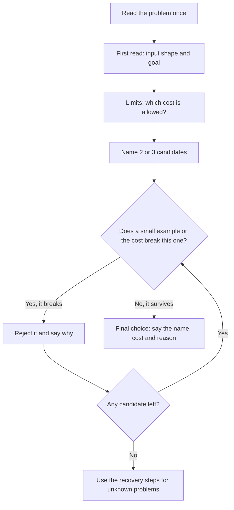

# Worked Recognition Walkthroughs

> **Level:** Intermediate · **Priority:** T1 · **Time:** 180 min · **Read first:** [How to Recognize Any Problem](01-how-to-recognize-any-problem.md), [Constraints Tell You the Algorithm](02-constraints-tell-you-the-algorithm.md), [Lookalike Patterns](07-lookalike-patterns.md) · **Next:** [Recognition Drills: Easy](09-recognition-drills-easy.md)

This chapter reads 40 real problems out loud, the way an experienced engineer thinks about them in the first two minutes. You will see the first thought, what the limits say, which techniques were tried and why most of them were rejected.

## Quick revision

- Use the same five steps for every problem: input shape, goal, limits, candidates, final choice.
- Never stop at the first idea. Name two or three candidates, then try to break each one.
- A small example that breaks a candidate is the strongest reason to reject it.
- **Fix one item and the other value is known:** hash map ([W1](#w1-two-sum-leetcode-1-easy)).
- **Subarray sum target plus negative numbers:** a sliding window fails. Use prefix sums ([W12](#w12-subarray-sum-equals-k-leetcode-560-medium)).
- **Size is known:** fixed window. **Size is the answer:** variable window ([W10](#w10-longest-substring-without-repeating-characters-leetcode-3-medium), [W11](#w11-find-all-anagrams-in-a-string-leetcode-438-medium)).
- **Loop or middle of a linked list, plus O(1) memory:** fast and slow pointers ([W4](#w4-linked-list-cycle-leetcode-141-easy)). **A repeat among values that are valid indexes, read-only array, O(1) memory:** the same idea ([W20](#w20-find-the-duplicate-number-leetcode-287-medium)).
- **"Smallest value that works":** if k works and k + 1 also works, use binary search on the answer ([W19](#w19-koko-eating-bananas-leetcode-875-medium)).
- **Return all combinations, subsets or orderings:** backtracking. **Count them or find the best:** think DP first ([W30](#w30-combination-sum-leetcode-39-medium)).
- **Next greater, next smaller:** monotonic stack. **Max or min of a moving window:** monotonic queue ([W7](#w7-next-greater-element-i-leetcode-496-easy), [W34](#w34-sliding-window-maximum-leetcode-239-hard)).
- **Fewest steps, all steps cost the same:** BFS. **Different non-negative costs:** Dijkstra ([W36](#w36-word-ladder-leetcode-127-hard), [W25](#w25-network-delay-time-leetcode-743-medium)).
- **The same place can be better or worse:** add what you carry to the state ([W37](#w37-shortest-path-in-a-grid-with-obstacles-elimination-leetcode-1293-hard)).
- **Range queries mixed with updates:** Fenwick tree or segment tree, not prefix sums ([W21](#w21-range-sum-query---mutable-leetcode-307-medium)).
- **Greedy looks right:** spend one minute looking for a small counterexample before you trust it ([W27](#w27-coin-change-leetcode-322-medium)).

## How to use this chapter

Do not read these like a story. Read each one like a puzzle:

1. Read only the **Problem** line.
2. Cover the rest with your hand, and decide on a technique. Say your reason out loud.
3. Read the thinking. Compare it with yours. A different answer is fine if your reason is sound.
4. Read the **Lesson** line twice. Lessons are what carry over to problems you have never seen.

The thinking is written as "I", because it is the voice in your own head. The limits come from LeetCode, and they may change a little over time. The reasoning matters more than the exact number.

## 1. The five-step routine

Every walkthrough follows the same five steps. Each step has one job.

| Step | Label below | The question you ask |
|---|---|---|
| 1 | First read | What is the input shape, and what is the goal? Which words stand out? |
| 2 | Limits | How big is n? What cost does that allow? Does the text demand a cost or a memory limit? |
| 3 | Candidates | Which two or three techniques could fit? |
| 4 | Candidates (the test) | Can I break each one with a small example or a cost count? |
| 5 | Final choice | Which one survives? What are its time and space costs? |



If no candidate survives, go to [When You Do Not Recognize the Problem](12-when-you-do-not-recognize-it.md).

Here is the rough table used for the Limits step. It assumes about 10^8 simple steps in one second, which is only a rule of thumb. The full version is in [Constraints Tell You the Algorithm](02-constraints-tell-you-the-algorithm.md).

| Largest n | Cost you can afford | Usually means |
|---|---|---|
| up to about 10 | O(n!) | All orderings |
| up to about 20 | O(2^n) | All subsets, bitmask DP |
| up to about 500 | O(n^3) | Interval DP, Floyd-Warshall |
| up to about 5,000 | O(n^2) | Two-index DP, one fixed item plus two pointers |
| up to about 10^6 | O(n log n) or O(n) | Sorting, heap, window, hash map |
| 10^9 or more | O(sqrt n), O(log n) or O(1) | A loop to the square root, binary search, a formula |

## 2. Easy problems

### W1. Two Sum ([LeetCode 1](https://leetcode.com/problems/two-sum/), Easy)

**Problem:** Return the indexes of the two numbers that add up to a target. Exactly one pair exists. For `nums = [3, 8, 5]` and `target = 13`, the answer is `[1, 2]`, because 8 + 5 = 13.

**First read:** I need a pair. The array is not sorted. The answer is indexes, not values. That last point will matter.

**Limits:** n is up to 10^4. Two loops check about 50 million pairs, which would pass. The interviewer will still ask for something better than O(n^2).

**Candidates:**

- **Two loops. Works, not best.** O(n^2) time. I keep it as my fallback.
- **Sort, then two pointers. Rejected.** Sorting moves the numbers, so I lose their indexes. I could store (value, index) pairs, but that costs O(n log n) and adds code for no gain.
- **Hash map. Accepted.** If I fix one number x, the other number must be exactly `target - x`. That is a lookup: "have I seen this value already?"

**Final choice:** Hash map lookup. O(n) time on average, because each lookup is O(1) on average. O(n) space. Check for the partner before you store x, so that x never pairs with itself.

**Go deeper:** [Hashing Patterns](../02-arrays-strings-hashing/04-hashing-patterns.md)

**Lesson:** When fixing one item tells you the exact value of the other, you have a lookup problem. If the array is already sorted, two pointers need no extra memory.

### W2. Valid Parentheses ([LeetCode 20](https://leetcode.com/problems/valid-parentheses/), Easy)

**Problem:** A string holds only the characters `()[]{}`. Check that every opening bracket is closed by the same type, in the correct order. `"([])"` is valid. `"([)]"` is not.

**First read:** The pairs can nest inside each other. The bracket opened last must be closed first.

**Limits:** n is up to 10^4. A single pass is the natural target.

**Candidates:**

- **Count each type. Rejected.** `"([)]"` has one of each, and it is still wrong. Counts forget the order.
- **Two pointers from both ends. Rejected.** `"()[]"` is valid, but its first and last characters do not match each other.
- **Stack. Accepted.** "Last opened, first closed" is exactly how a stack works.

**Final choice:** Stack simulation. O(n) time, because each character is pushed and popped at most once. O(n) space, for a string of only opening brackets. Remember the empty stack: a closing bracket with nothing to match makes the string invalid.

**Go deeper:** [Stack From Zero](../03-linked-lists-stacks-queues/05-stack-from-zero.md)

**Lesson:** "The most recent unfinished thing must finish first" means a stack.

### W3. Best Time to Buy and Sell Stock ([LeetCode 121](https://leetcode.com/problems/best-time-to-buy-and-sell-stock/), Easy)

**Problem:** Given prices by day, buy once and sell once on a later day. Return the largest profit, or 0 if you cannot make a profit. `[4, 1, 5, 2, 6]` gives `5`: buy at 1, sell at 6.

**First read:** I want `prices[j] - prices[i]` as large as possible, with `i < j`. The order of days matters.

**Limits:** n is up to 10^5. All pairs is about 5 billion, which is too slow. I need O(n) or O(n log n).

**Candidates:**

- **Largest minus smallest. Rejected.** In `[6, 1, 5]` the largest price comes before the smallest. The real answer is 4 (buy at 1, sell at 5), not 5.
- **Sorting. Rejected.** It destroys the order of days, and the order is the whole point.
- **Sliding window. Rejected.** A window needs a rule that tells me when to shrink. Here the only rule would be "a lower price appeared", and that is just the next idea with extra steps.
- **Kadane on daily changes. Works, not best.** A subarray is a part of an array with no gaps, and Kadane's algorithm finds the largest subarray sum. The changes are `[-3, 4, -3, 4]`, and their best subarray sum is 5.
- **Running minimum. Accepted.** Treat each day as the selling day. The best buying day is the cheapest day before it. One variable remembers that.

**Final choice:** Prefix and suffix scan, in its simplest form: a running minimum. O(n) time and O(1) space.

**Go deeper:** [Left and Right Scans](../05-core-patterns/22-left-and-right-scans.md)

**Lesson:** For a best pair with `i < j`, when the score splits into one part for each item, fix the later item. Keep the best earlier item in one variable. The score in W14 does not split, so this fails there.

### W4. Linked List Cycle ([LeetCode 141](https://leetcode.com/problems/linked-list-cycle/), Easy)

**Problem:** Say whether a linked list loops back on itself. For `1 -> 2 -> 3 -> back to 2`, the answer is true.

**First read:** The input is a linked list. The answer is yes or no. I do not need to know where the loop starts.

**Limits:** Up to 10^4 nodes. The text then asks: can you do it with O(1) memory? That line decides the technique.

**Candidates:**

- **Hash set of visited nodes. Works, not best.** O(n) time on average, but O(n) space.
- **Change the nodes to mark them. Rejected.** It damages the input.
- **Fast and slow pointers. Accepted.** Two runners on a circular track: the faster one catches the slower one. Inside a loop, the gap closes by exactly one node each step, so the fast pointer cannot jump over the slow one.

**Final choice:** Fast and slow pointers. O(n) time, because slow enters the loop within n steps, and then the gap closes within one lap. O(1) space.

**Go deeper:** [Fast and Slow Pointers](../05-core-patterns/03-fast-and-slow-pointers.md)

**Lesson:** Linked list, plus a loop or a middle point, plus O(1) memory, means fast and slow pointers.

### W5. Single Number ([LeetCode 136](https://leetcode.com/problems/single-number/), Easy)

**Problem:** Every value appears twice, except one value that appears once. Find that value in O(n) time with O(1) extra space. `[4, 1, 2, 1, 2]` gives `4`.

**First read:** This looks like frequency counting, which is my first idea.

**Limits:** The text demands O(1) extra space. A hash map is out before I start.

**Candidates:**

- **Hash map of counts. Rejected.** O(n) space breaks the rule.
- **Sort, then check neighbours. Rejected.** O(n log n) time breaks the rule.
- **XOR. Accepted.** XOR compares two numbers bit by bit. Two facts help: `x ^ x = 0` and `x ^ 0 = x`. Order does not matter, so every pair cancels and only the single value remains.

**Final choice:** Bit manipulation. XOR all values. O(n) time and O(1) space.

**Go deeper:** [Bit Manipulation](../05-core-patterns/17-bit-manipulation.md)

**Lesson:** "Everything appears twice except one" with O(1) space means XOR.

### W6. Nim Game ([LeetCode 292](https://leetcode.com/problems/nim-game/), Easy)

**Problem:** There are n stones. Two players take turns, and each takes 1, 2 or 3 stones. Whoever takes the last stone wins. You go first and both play perfectly. Can you win? `n = 4` gives false. `n = 5` gives true.

**First read:** Two players who play perfectly means game theory. A position is winning if some move leaves the other player in a losing position.

**Limits:** n goes up to 2^31 - 1. That rejects anything that walks from 1 to n. I need O(1) or O(log n), so there must be a formula.

**Candidates:**

- **Minimax with memoization. Rejected.** The idea is right, but it is O(n) with about 2 billion states.
- **Solve small cases by hand, then find the pattern. Accepted.** Use the win rule on the first few values:

| n | 1 | 2 | 3 | 4 | 5 | 6 | 7 | 8 |
|---|---|---|---|---|---|---|---|---|
| Result for the player to move | win | win | win | lose | win | win | win | lose |

The pattern says you lose exactly when n is a multiple of 4. Now prove both directions. If n is a multiple of 4, then you take t stones and the opponent takes 4 - t, so n stays a multiple of 4 until the opponent takes the last stone. If n is not a multiple of 4, you take `n % 4` stones, and now your opponent faces a multiple of 4.

**Final choice:** Game theory. Return `n % 4 != 0`. O(1) time and space.

**Go deeper:** [Game Theory](../11-math-geometry-games/08-game-theory.md)

**Lesson:** When n is huge and the rules are tiny, work out the first eight answers by hand. Then prove the pattern you see.

### W7. Next Greater Element I ([LeetCode 496](https://leetcode.com/problems/next-greater-element-i/), Easy)

**Problem:** All values in `nums2` are distinct, and every value in `nums1` also appears in `nums2`. For each value in `nums1`, find it in `nums2` and return the first greater value to its right, or -1. For `nums1 = [2, 4]` and `nums2 = [1, 2, 4, 3]`, the answer is `[4, -1]`.

**First read:** "First greater to the right" is a phrase I know.

**Limits:** Both arrays have at most 1000 items, so the slow way passes. The follow-up asks for O(n + m), where n and m are the two lengths.

**Candidates:**

- **Scan right for each value. Works, not best.** O(n * m) fails the follow-up.
- **Sorting or binary search. Rejected.** Both lose "to the right", because that depends on the original order.
- **Monotonic stack on `nums2`. Accepted.** A monotonic stack keeps its values in sorted order. Each number waits on the stack until a greater number arrives. That number is the answer for everything smaller on top of the stack. I save each answer in a hash map.

**Final choice:** Monotonic stack. O(n + m) time on average, because each value is pushed and popped once, and hash operations are O(1) on average. O(m) space.

**Go deeper:** [Monotonic Stack](../05-core-patterns/12-monotonic-stack.md)

**Lesson:** "Next greater", "next smaller" or "first larger to the right" means a monotonic stack.

### W8. Diameter of Binary Tree ([LeetCode 543](https://leetcode.com/problems/diameter-of-binary-tree/), Easy)

**Problem:** Find the longest path between any two nodes of a binary tree, counted in edges. The path does not have to pass through the root.

```text
      1
     / \
    2   3       Longest path: 4 - 2 - 1 - 3, so the answer is 3.
   / \
  4   5
```

**First read:** The input is a tree. The warning is "does not have to pass through the root". A path goes up to one node, bends there, then goes down.

**Limits:** Up to 10^4 nodes. Repeated height work could cost O(n^2) on a chain, so I want O(n).

**Candidates:**

- **BFS by levels. Rejected.** Levels tell me depth. They say nothing about a path that goes up and then down.
- **Left height plus right height at the root. Rejected.** If the root has one child and that child has two long arms, the best path misses the root.
- **Call a height function at every node. Works, not best.** It is correct, but O(n^2) on a chain.
- **One DFS that does two jobs. Accepted.** Each node returns its height in nodes (0 for an empty child) to its parent. It also updates a global best with `leftHeight + rightHeight`, the path that bends here.

**Final choice:** Tree DFS. O(n) time, because each node is visited once. O(h) space for the recursion stack, where h is the tree height.

**Go deeper:** [Tree DFS Problems](../07-trees/03-tree-dfs-problems.md)

**Lesson:** When a path can bend, a tree function returns one thing (the straight arm) and records another (the bent path).

### W9. Climbing Stairs ([LeetCode 70](https://leetcode.com/problems/climbing-stairs/), Easy)

**Problem:** You climb n steps, taking 1 or 2 at a time. How many different ways can you reach the top? `n = 3` gives `3`: 1+1+1, 1+2 and 2+1.

**First read:** "How many ways" is counting. Each move is a small choice.

**Limits:** n is at most 45. For `n = 45` the answer is over 1.8 billion, so listing the ways one by one is too slow.

**Candidates:**

- **Backtracking that walks every way. Rejected.** It takes at least as many steps as the answer itself.
- **Plain recursion. Rejected.** The formula is right, but it solves the same smaller n again and again.
- **DP. Accepted.** Ask: what was the last move? It was 1 step or 2 steps. So `ways(n) = ways(n - 1) + ways(n - 2)`. Only the last two values are needed.

**Final choice:** 1D DP. O(n) time and O(1) space.

**Go deeper:** [1D Dynamic Programming](../09-dynamic-programming/02-one-dimensional-dp.md)

**Lesson:** For "how many ways", ask what the last move could be. If there are few options, write the recurrence.

## 3. Medium problems: arrays, strings and searching

### W10. Longest Substring Without Repeating Characters ([LeetCode 3](https://leetcode.com/problems/longest-substring-without-repeating-characters/), Medium)

**Problem:** Find the length of the longest substring with no repeated character. `"abcabcbb"` gives `3`, from `"abc"`. (A substring is a part of a string with no gaps.)

**First read:** "Longest substring" means one unbroken piece. The piece must obey a rule: no repeats.

**Limits:** n is up to 5 * 10^4. There are about 1.25 billion substrings, so I need about O(n).

**Candidates:**

- **Check every substring. Rejected.** There are O(n^2) of them to check, even with a set.
- **Variable sliding window. Accepted.** First I run the monotonic test. (Monotonic means a rule can flip only one way as the window grows.) If a window has a repeat, every bigger window that contains it also has that repeat. So once the window is broken, I can move `left` forward and never miss an answer.

**Final choice:** Variable sliding window. O(n) time, because `left` and `right` only move forward. O(1) space, because the table of last positions has one entry for each possible character.

**Go deeper:** [Sliding Window: Variable Size](../05-core-patterns/05-sliding-window-variable.md)

**Lesson:** "Longest" plus "contiguous" (no gaps) plus a rule that stays broken as the piece grows means a variable window.

### W11. Find All Anagrams in a String ([LeetCode 438](https://leetcode.com/problems/find-all-anagrams-in-a-string/), Medium)

**Problem:** Return every start index in `s` where a substring is an anagram of `p`. (An anagram uses the same letters in any order.) For `s = "abab"` and `p = "ab"`, the answer is `[0, 1, 2]`.

**First read:** An anagram of `p` has exactly the length of `p`. So the window size is known before I start.

**Limits:** Both strings have up to 3 * 10^4 lowercase letters. Only 26 letters exist, so a count table is cheap.

**Candidates:**

- **Sort each piece and compare. Rejected.** For lengths n and m, O(n * m log m) repeats the same work at every start.
- **Variable sliding window. Rejected.** It finds the right size. Here the size is given, so there is nothing to grow or shrink.
- **KMP string matching. Rejected.** KMP finds one exact order of letters. An anagram can be in any order.
- **Fixed sliding window. Accepted.** Moving one step adds one letter and removes one letter. A count table of 26 entries tells me if the window matches `p`.

**Final choice:** Fixed sliding window. O(26 * n) time, which is O(n). O(1) space.

**Go deeper:** [Sliding Window: Fixed Size](../05-core-patterns/04-sliding-window-fixed.md)

**Lesson:** "Anagram" or "permutation" of a short string inside a long one means the size is known, so use a fixed window.

### W12. Subarray Sum Equals K ([LeetCode 560](https://leetcode.com/problems/subarray-sum-equals-k/), Medium)

**Problem:** Count the subarrays whose sum is exactly k. Numbers can be negative. For `nums = [1, -1, 1]` and `k = 1`, the answer is `3`: `[1]`, `[1]` and `[1, -1, 1]`.

**First read:** "Subarray" and "sum" make me think of a sliding window. Then I see the negative numbers, and I stop.

**Limits:** n is up to 2 * 10^4, and values go down to -1000. All pairs is about 200 million, which is too risky, so I want O(n).

**Candidates:**

- **Variable sliding window. Rejected.** The window needs "growing keeps it broken". A negative number can lower the sum, so a window that is too big can become good again. Shrinking could skip real answers.
- **Kadane's algorithm. Rejected.** It finds the largest sum. I need a count of one exact sum.
- **Prefix sums with two loops. Works, not best.** A prefix sum is the sum of the first few items. This is O(n^2).
- **Prefix sum with a hash map. Accepted.** The sum from `i` to `j` is `prefix[j] - prefix[i - 1]`. So for each `j`, I need the number of earlier prefixes equal to `prefix[j] - k`. That is W1 again, on prefix sums.

Here is the trace. The map starts with `{0: 1}`, for the empty prefix.

| Index | Value | Prefix | Need (prefix - k) | Found in map | Count | Map after |
|---|---|---|---|---|---|---|
| 0 | 1 | 1 | 0 | 1 | 1 | `{0: 1, 1: 1}` |
| 1 | -1 | 0 | -1 | 0 | 1 | `{0: 2, 1: 1}` |
| 2 | 1 | 1 | 0 | 2 | 3 | `{0: 2, 1: 2}` |

**Final choice:** Prefix sum with hash map. O(n) time on average, and O(n) space. Use `long long` for the prefix if the values can be larger.

**Go deeper:** [Prefix Sums](../05-core-patterns/06-prefix-sums.md)

**Lesson:** Before you use a window on a sum, look for negative numbers. An exact sum with negatives means a prefix sum and a hash map.

### W13. 3Sum ([LeetCode 15](https://leetcode.com/problems/3sum/), Medium)

**Problem:** Return all unique triples of values that add up to 0. `[-2, 0, 1, 1, 2]` gives `[-2, 0, 2]` and `[-2, 1, 1]`.

**First read:** This is a triple, not a pair. The answer is values, not indexes. "Unique" means I must handle duplicates.

**Limits:** n is at most 3000. There are about 4.5 billion triples, so O(n^3) is out. O(n^2) is about 9 million steps, which is fine. A limit near 3000 is a strong hint for O(n^2).

**Candidates:**

- **Three loops with a set. Rejected.** It is too slow.
- **Fix one, then hash map (W1). Works, not best.** O(n^2) on average, but removing duplicate triples becomes painful.
- **Fix two, then binary search. Works, not best.** O(n^2 log n) is slower than it needs to be.
- **Sort, then two pointers. Accepted.** Unlike W1, the answer is values, so I am free to sort. Fix the first number. Then run two pointers from both ends of the rest. Sorting also places equal values side by side, so skipping duplicates is easy.

**Final choice:** Two pointers: opposite ends, after sorting. O(n^2) time: O(n log n) to sort, then O(n) pointer moves for each of n fixed numbers. O(1) extra space, apart from sorting and the output.

**Go deeper:** [Two Pointers: Opposite Ends](../05-core-patterns/01-two-pointers-opposite-ends.md)

**Lesson:** Look at what you must return. Values leave you free to sort. Indexes must be carried along, as W1 showed.

### W14. Container With Most Water ([LeetCode 11](https://leetcode.com/problems/container-with-most-water/), Medium)

**Problem:** Each number is the height of a vertical line. Pick two lines to hold the most water. The water is the shorter height times the distance between them. `[1, 3, 2, 4]` gives `6`: heights 3 and 4 at distance 2.

**First read:** I pick a pair. The score depends on both the distance and the shorter line. Lines between the two do not matter.

**Limits:** n is up to 10^5, so all pairs is too slow.

**Candidates:**

- **All pairs. Rejected.** It is O(n^2).
- **Sorting. Rejected.** The distance depends on the original positions.
- **Monotonic stack. Rejected.** It looks like [W35](#w35-largest-rectangle-in-histogram-leetcode-84-hard), but there the bars between matter. Here they do not.
- **Two pointers from both ends. Accepted.** The array is not sorted, so I need another reason. Start with the widest pair. Suppose the left line is the shorter one. Pairing it with any closer line gives less width and a height that is still at most its own. So that left line can never do better, and I can discard it. The same is true for the right line when it is shorter.

**Final choice:** Two pointers: opposite ends. O(n) time, because each step discards one line. O(1) space.

**Go deeper:** [Two Pointers: Opposite Ends](../05-core-patterns/01-two-pointers-opposite-ends.md)

**Lesson:** Opposite pointers do not need a sorted array. They need a proof that one end can be thrown away.

### W15. Merge Intervals ([LeetCode 56](https://leetcode.com/problems/merge-intervals/), Medium)

**Problem:** Merge all overlapping intervals. `[[1, 3], [2, 6], [8, 9]]` gives `[[1, 6], [8, 9]]`.

**First read:** The input is intervals, and the word is "overlap". The items arrive in no fixed order.

**Limits:** n is up to 10^4. Sorting is fine.

**Candidates:**

- **Compare every pair and repeat. Rejected.** One merge can create new overlaps, so this repeats O(n^2) work.
- **Mark a difference array over the values. Rejected.** It answers "how many cover this point?" I want the shapes of the merged groups, and touching intervals such as `[1, 4]` and `[4, 5]` need extra care.
- **Sort by start, then scan. Accepted.** After sorting, the next interval can overlap only the group I am building. If it does not overlap, no later interval can either, because they start no earlier.

**Final choice:** Merge intervals. O(n log n) time for the sort, then O(n) for the scan. O(n) space for the output.

**Go deeper:** [Merge Intervals](../05-core-patterns/09-merge-intervals.md)

**Lesson:** Interval problems almost always start with sorting. To merge, sort by start.

### W16. Non-overlapping Intervals ([LeetCode 435](https://leetcode.com/problems/non-overlapping-intervals/), Medium)

**Problem:** Remove the fewest intervals so that the rest do not overlap. Intervals that only touch, such as `[1, 2]` and `[2, 3]`, do not count as overlapping. `[[1, 3], [2, 4], [3, 5]]` gives `1`: remove `[2, 4]`.

**First read:** "Fewest removed" is the same as "most kept". So I want the largest set of intervals that do not overlap.

**Limits:** n is up to 10^5, so an O(n^2) DP is too slow.

**Candidates:**

- **Try all subsets. Rejected.** O(2^n).
- **Sort by start, then O(n^2) DP. Rejected.** It is correct, but too slow.
- **Sort by start and keep the earliest start. Rejected.** With `[1, 100], [2, 3], [4, 5]`, the long interval blocks the other two.
- **Sort by end and keep the earliest end. Accepted.** The interval that ends first leaves the most room. Here is the proof idea: take any best answer and replace its first interval with the earliest-ending one. That one ends no later, so nothing new overlaps, and the answer is still valid and the same size.

**Final choice:** Greedy, after sorting by end. O(n log n) time. O(1) extra space, apart from the sort.

**Go deeper:** [Merge Intervals](../05-core-patterns/09-merge-intervals.md), [Classic Greedy Algorithms](../06-recursion-backtracking-greedy/07-greedy-classics.md)

**Lesson:** To merge intervals, sort by start. To keep as many as possible, sort by end.

### W17. Kth Largest Element in an Array ([LeetCode 215](https://leetcode.com/problems/kth-largest-element-in-an-array/), Medium)

**Problem:** Return the k-th largest value, counting duplicates as separate items. The text asks if you can do it without sorting. `[3, 1, 5, 2]` with `k = 2` gives `3`.

**First read:** "K-th largest" is an order question, but I need only one position, not the full order.

**Limits:** n is up to 10^5, and values stay between -10^4 and 10^4. That small value range is a clue worth noticing.

**Candidates:**

- **Sort. Rejected.** O(n log n) would pass, but the text asks to avoid it.
- **Min-heap of size k. Accepted.** The heap holds the k largest values so far. Its top is the smallest of them, which is the k-th largest. O(n log k) time, and it also works on a stream.
- **Quickselect. Accepted as the O(n) answer.** It places one random pivot, then continues only on the side that holds the answer. O(n) on average, but O(n^2) in the worst case. With many equal values, use a three-way partition.
- **Counting by value. Works here only.** It costs O(n + range) because the range is small. Mention it, but do not rely on it, because a follow-up can remove the limit.

**Final choice:** Top K with heap as the safe default. O(n log k) time and O(k) space. Offer Quickselect if the interviewer wants O(n) on average.

**Go deeper:** [Top K With Heaps](../05-core-patterns/14-top-k-and-heaps.md), [Quick Sort and Quickselect](../04-sorting-searching/03-quick-sort-and-quickselect.md)

**Lesson:** For the k largest, keep a min-heap of size k. The heap type is the opposite of the word in the problem.

### W18. Search in Rotated Sorted Array ([LeetCode 33](https://leetcode.com/problems/search-in-rotated-sorted-array/), Medium)

**Problem:** A sorted array of distinct values was rotated at an unknown point. Find the index of a target in O(log n) time, or return -1. `[4, 5, 6, 1, 2]` with target 1 gives `3`.

**First read:** The text says O(log n). That almost always means binary search. But this array is not sorted as a whole.

**Limits:** n is only 5000, so a linear scan fits the size. The text forbids it anyway, because it demands O(log n).

**Candidates:**

- **Plain binary search. Rejected.** In `[4, 5, 6, 1, 2]` with target 1, the middle is 6. Normal logic says "go left", but the target is on the right.
- **Find the rotation point, then search one side. Works, not best.** O(log n), but it needs two searches.
- **Binary search that checks which half is sorted. Accepted.** At any middle point, at least one half is sorted. If the target lies inside the range of that sorted half, go there. If not, go to the other half.

**Final choice:** Binary search on index. O(log n) time and O(1) space.

**Go deeper:** [Binary Search Basics](../04-sorting-searching/06-binary-search-basics.md)

**Lesson:** Binary search does not need a sorted array. It needs a way to discard half of the items at each step.

### W19. Koko Eating Bananas ([LeetCode 875](https://leetcode.com/problems/koko-eating-bananas/), Medium)

**Problem:** There are piles of bananas and h hours. Each hour, Koko picks one pile and eats up to k bananas from it. Find the smallest whole number k that lets her finish in time. For `piles = [3, 6, 7, 11]` and `h = 8`, the answer is `4`.

**First read:** The story hides the real question. Strip it away: "find the smallest k such that a check passes."

**Limits:** Up to 10^4 piles, each up to 10^9, and h up to 10^9. The answer can be as large as 10^9, so I cannot try every k. The hours can add up past 2 billion for small k, so I use `long long`.

**Candidates:**

- **Try k = 1, 2, 3 and so on. Rejected.** That is up to 10^9 tries, and each costs O(n).
- **Greedy. Rejected.** There is no choice to make. The order of the piles does not change the total hours.
- **Binary search on the answer. Accepted.** Test it: if speed k works, then speed k + 1 also works. So the answers look like `no no no yes yes yes`, and I need the first yes. Each check costs O(n).

| k | Hours needed for `[3, 6, 7, 11]` | At most 8? |
|---|---|---|
| 3 | 1 + 2 + 3 + 4 = 10 | no |
| 4 | 1 + 2 + 2 + 3 = 8 | yes |

**Final choice:** Binary search on answer, over k from 1 to the largest pile. O(n log m) time, where m is the largest pile. O(1) space.

**Go deeper:** [Binary Search on the Answer](../04-sorting-searching/07-binary-search-on-answer.md)

**Lesson:** "Smallest value that works" or "minimize the largest" means you should test one thing: if k works, does k + 1 work too? [Split Array Largest Sum](https://leetcode.com/problems/split-array-largest-sum/) (LeetCode 410, Hard) has the same shape.

### W20. Find the Duplicate Number ([LeetCode 287](https://leetcode.com/problems/find-the-duplicate-number/), Medium)

**Problem:** An array has n + 1 numbers, each from 1 to n. One value repeats, maybe many times. Find it without changing the array, using O(1) extra space. `[1, 3, 4, 2, 2]` gives `2`.

**First read:** "Duplicate" says hash set. But the two rules at the end look very deliberate.

**Limits:** n is up to 10^5, the array cannot change, and extra space must be O(1). There is also a strange gift: every value is from 1 to n, so every value is a valid index.

**Candidates:**

- **Hash set. Rejected.** O(n) space.
- **Sort, or cyclic sort. Rejected.** Both change the array.
- **XOR or a sum formula. Rejected.** The value may appear three or more times, so some values from 1 to n are missing. The formulas fail.
- **Binary search on the value. Works, not best.** Count how many numbers are at most mid. O(n log n) time and O(1) space. It is a fine second answer.
- **Fast and slow pointers. Accepted.** Treat each index i as a node that points to index `nums[i]`. The array is now a hidden linked list. Nothing points to index 0, because no value is 0, so 0 is outside any loop. The walk from 0 must enter a loop, and the node where it enters has two arrows into it: one from the walk and one from the loop. Only the duplicate value has two indexes pointing to it, so that node is the duplicate.

```text
index:  0  1  2  3  4
value:  1  3  4  2  2

Follow the values from index 0:
0 -> 1 -> 3 -> 2 -> 4 -> 2 -> 4 -> ...
                    the loop starts at 2
```

**Final choice:** Fast and slow pointers. Find the meeting point, then find the start of the loop. O(n) time and O(1) space.

**Go deeper:** [Fast and Slow Pointers](../05-core-patterns/03-fast-and-slow-pointers.md)

**Lesson:** "Values from 1 to n" means values can act as indexes. Following them turns an array into a hidden linked list. If you may change the array, cyclic sort is often simpler.

### W21. Range Sum Query - Mutable ([LeetCode 307](https://leetcode.com/problems/range-sum-query-mutable/), Medium)

**Problem:** Build a class with two operations: change one value, and return the sum of a range. For `[1, 3, 5]`: the sum of the whole range is 9. After changing index 1 to 2, it is 8.

**First read:** "Range sum" makes me think of prefix sums. Then I see the update operation.

**Limits:** n is up to 3 * 10^4, with up to 3 * 10^4 calls. If each call costs O(n), that is about 900 million steps. I want about O(log n) per call.

**Candidates:**

- **Plain array. Rejected.** Update is O(1), but each sum is O(n).
- **Prefix sums. Rejected.** A sum is O(1), but one update changes every later prefix, which is O(n).
- **Square root decomposition. Works, not best.** O(sqrt n) per call would pass, but it is slower than the next two.
- **Fenwick tree. Accepted.** A Fenwick tree stores sums of carefully chosen ranges, so that update and prefix sum each touch O(log n) entries. The code is very short.
- **Segment tree. Accepted as the general choice.** It has the same cost and more code. It also handles range minimum, range maximum and, with lazy propagation, range updates.

**Final choice:** Fenwick tree. O(log n) per operation, O(n) space, and O(n log n) to build by repeated updates.

**Go deeper:** [Fenwick Tree](../12-advanced-data-structures/03-fenwick-tree.md), [Segment Tree](../12-advanced-data-structures/01-segment-tree.md)

**Lesson:** For range sums, ask if the data ever changes. No updates means prefix sums. Updates mixed with range queries means a Fenwick tree or a segment tree.

## 4. Medium problems: graphs

### W22. Number of Islands ([LeetCode 200](https://leetcode.com/problems/number-of-islands/), Medium)

**Problem:** A grid holds land (`1`) and water (`0`). Count the islands, where land cells connect up, down, left and right.

```text
1 1 0
0 0 0       The answer is 2.
0 1 1
```

**First read:** A grid is a graph in disguise: cells are nodes, and neighbours are edges. "Count the islands" means count connected groups.

**Limits:** Up to 300 by 300, which is 90,000 cells. O(cells) is fine.

**Candidates:**

- **DP. Rejected.** An island can bend in any direction, so there is no fixed order of cells to fill in.
- **DFS or BFS flood fill. Accepted.** Each unvisited land cell starts a new island. Then visit its whole island, so that it is never counted again.
- **Union-Find. Works, not best.** Union-Find is a structure that merges groups and says if two items share a group. It is correct, but it needs more code for a grid that never changes. It shines when land is added over time.

**Final choice:** Grid DFS or BFS. O(rows * cols) time, because each cell is visited once. O(rows * cols) space in the worst case, for the queue or the recursion stack. A long snake of land makes recursion deep, so BFS is the safer choice.

**Go deeper:** [Grid Graphs](../08-graphs/03-grid-graphs.md)

**Lesson:** For connected groups in a fixed grid, use DFS or BFS. Groups that grow over time suggest Union-Find.

### W23. Rotting Oranges ([LeetCode 994](https://leetcode.com/problems/rotting-oranges/), Medium)

**Problem:** A grid holds empty cells (`0`), fresh oranges (`1`) and rotten oranges (`2`). Each minute, every fresh orange next to a rotten one becomes rotten. Return the minutes until no fresh orange is left, or -1 if that cannot happen. `[[2, 1, 0], [0, 1, 1]]` gives `3`.

**First read:** The story describes something spreading in steps. All rotten oranges spread at the same time and the same speed. "Minimum minutes" is a shortest-distance question.

**Limits:** The grid is at most 10 by 10, so the size does not force anything. I choose by what fits best.

**Candidates:**

- **Rescan the grid each minute. Works, not best.** It passes at this size, but it would be O(cells^2) on a big grid.
- **DFS. Rejected.** DFS runs far along one path first. The first time it reaches a cell may not be the earliest time.
- **BFS from each rotten orange, one at a time. Rejected.** That repeats work for each rotten orange, and I still must take the minimum for each cell.
- **Multi-source BFS. Accepted.** Put all rotten oranges in the queue at minute 0. Each BFS level is one minute. At the end, if any fresh orange remains, return -1.

**Final choice:** Multi-source BFS. O(rows * cols) time and space.

**Go deeper:** [BFS Shortest Path Patterns](../08-graphs/04-bfs-shortest-path-patterns.md)

**Lesson:** Spreading from several places at once means putting all the starts in the queue together.

### W24. Course Schedule ([LeetCode 207](https://leetcode.com/problems/course-schedule/), Medium)

**Problem:** There are n courses, and some must be taken before others. Can you finish them all? With 2 courses and "1 needs 0", the answer is true. If each also needs the other, the answer is false.

**First read:** "Must come before" is a one-way relation, so this is a directed graph. A course is impossible only if courses wait on each other in a circle. So the real question is: does a directed cycle exist?

**Limits:** Up to 2000 courses and 5000 rules. O(V + E) is easy, where V is the number of nodes and E the number of edges.

**Candidates:**

- **Union-Find. Rejected.** It ignores direction. The edges `0 -> 1`, `0 -> 2` and `1 -> 2` have no directed cycle, but Union-Find sees a cycle.
- **DFS with three colours. Works, not best.** It is correct and common. It marks each node as unvisited, in progress or done.
- **Topological sort. Accepted.** A topological order lists nodes so that each edge points forward. Take all courses with no remaining rules, remove them, and repeat. If every course gets removed, the answer is true. If some course stays, a cycle exists, so the answer is false.

**Final choice:** Topological sort. O(V + E) time and space.

**Go deeper:** [Topological Sort](../08-graphs/06-topological-sort.md)

**Lesson:** "Before", "depends on" and "prerequisite" mean a directed graph. Ordering it, or checking if that is possible, means topological sort.

### W25. Network Delay Time ([LeetCode 743](https://leetcode.com/problems/network-delay-time/), Medium)

**Problem:** A signal leaves node k and travels along one-way edges, each with a travel time. Return the time until all nodes have it, or -1 if some never do. For edges `1 -> 2` (4), `1 -> 3` (1), `3 -> 2` (2), and k = 1, the answer is `3`.

**First read:** Edges have different costs. Each node gets the signal at its shortest travel time from k. The answer is the largest of those times.

**Limits:** At most 100 nodes and 6000 edges. No weight is negative, and that fact decides the technique.

**Candidates:**

- **Plain BFS. Rejected.** BFS counts edges, not time. In the example, the direct edge costs 4, while the two-edge route costs 3.
- **DFS over all paths. Rejected.** The number of paths can grow exponentially.
- **Bellman-Ford. Works, not best.** O(V * E) passes here, but it is built for negative edges, and this graph has none.
- **Floyd-Warshall. Works, not best.** About a million steps pass, but it finds all pairs, and I need one source.
- **Dijkstra with a heap. Accepted.** One source and no negative edges. When a node leaves the heap, its distance is final.

**Final choice:** Dijkstra. O(E log V) time and O(V + E) space.

**Go deeper:** [Dijkstra's Algorithm](../08-graphs/08-dijkstra.md)

**Lesson:** Look at the edge weights first. All equal means BFS. Only 0 and 1 means 0-1 BFS. Different but not negative means Dijkstra. Negative means Bellman-Ford.

### W26. Redundant Connection ([LeetCode 684](https://leetcode.com/problems/redundant-connection/), Medium)

**Problem:** A tree of n nodes got one extra edge. Return an edge you can remove so that it is a tree again. If there are several, return the one that comes last in the input. `[[1, 2], [1, 3], [2, 3]]` gives `[2, 3]`.

**First read:** The edges have no direction, and the graph has exactly one cycle. The phrase "last in the input" tells me that edge order matters. I should process edges one by one.

**Limits:** n is at most 1000, so even O(n^2) passes.

**Candidates:**

- **Remove each edge, then check the graph. Works, not best.** O(n^2) is slow for what it does.
- **DFS to find the cycle, then pick the edge that comes last. Works, not best.** It is correct but needs more code.
- **Topological sort. Rejected.** It works on directed graphs, and this one is undirected.
- **Union-Find. Accepted.** Add edges in order. If both ends of an edge are already connected, this edge closes the cycle. There is only one cycle, so this first such edge is also the cycle edge that comes last in the input.

**Final choice:** Union-Find. Nearly O(n) time, and O(n) space.

**Go deeper:** [Union-Find](../08-graphs/07-union-find.md)

**Lesson:** "Are these two already connected?", asked as edges arrive one by one, means Union-Find.

## 5. Medium problems: DP, backtracking and design

### W27. Coin Change ([LeetCode 322](https://leetcode.com/problems/coin-change/), Medium)

**Problem:** Given coin values and an amount, return the fewest coins that make the amount, or -1. You may use each coin value any number of times. `coins = [1, 3, 4]` and `amount = 6` gives `2`, from 3 + 3.

**First read:** "Fewest coins" tempts me to take the largest coin first, as a shop assistant does.

**Limits:** At most 12 coin types, and the amount is at most 10^4. A small amount means I can use it as an array index.

**Candidates:**

- **Greedy, largest coin first. Rejected.** On the example it picks 4 + 1 + 1, which is 3 coins. The best is 2.
- **Backtracking. Rejected.** It tries every mix of coins, and the same remaining amount comes up again and again.
- **BFS over amounts. Works, not best.** Each level is one more coin, so it is correct. It costs the same as DP and is less standard.
- **Unbounded knapsack DP. Accepted.** The last coin was some value c, so `dp[a] = 1 + min(dp[a - c])` over all coins. "Unbounded" means each item can be used many times.

**Final choice:** Unbounded knapsack. O(amount * coins) time and O(amount) space.

**Go deeper:** [Unbounded Knapsack](../09-dynamic-programming/05-unbounded-knapsack.md)

**Lesson:** Spend one minute trying to break greedy with a small example. If it breaks and the target is small, build a DP indexed by the target.

### W28. Partition Equal Subset Sum ([LeetCode 416](https://leetcode.com/problems/partition-equal-subset-sum/), Medium)

**Problem:** Can you split the array into two groups with equal sums? `[1, 2, 3, 4]` gives true (1 + 4 and 2 + 3). `[1, 2, 5]` gives false.

**First read:** If two groups are equal, each one sums to half of the total. So the question becomes: can some subset sum to `total / 2`? (A subset is any choice of items, with gaps allowed.)

**Limits:** Up to 200 numbers, each at most 100. The total is at most 20,000, so the half is at most 10,000. With n = 200, `2^n` is impossible. But `n * half` is only about 2 million. A small sum is the real clue.

**Candidates:**

- **Backtracking over subsets. Rejected.** O(2^n).
- **Greedy, put each number in the smaller group. Rejected.** `[3, 3, 2, 2, 2]` ends as 7 and 5, but 3 + 3 and 2 + 2 + 2 is a perfect split.
- **Sliding window. Rejected.** A subset can skip items, and a window cannot.
- **Meet in the middle. Rejected.** It splits the items in half and lists all choices on each side, which suits n near 40, not 200.
- **0/1 knapsack DP. Accepted.** Each item is used at most once. Keep a table of which sums are reachable. Loop the sums downwards, so that one item is not counted twice.

**Final choice:** 0/1 knapsack. O(n * half) time and O(half) space. If the total is odd, return false at once.

**Go deeper:** [0/1 Knapsack](../09-dynamic-programming/04-zero-one-knapsack.md)

**Lesson:** Rewrite the question first. "Pick or skip" with a small sum means 0/1 knapsack, even when n looks too big for subsets.

### W29. Longest Common Subsequence ([LeetCode 1143](https://leetcode.com/problems/longest-common-subsequence/), Medium)

**Problem:** Find the length of the longest sequence that appears in both strings in the same order, with gaps allowed. `"abcde"` and `"ace"` give `3`.

**First read:** There are two strings. "Subsequence" means gaps are allowed, so a window is out.

**Limits:** Both strings have at most 1000 characters. O(n * m) is about a million steps, which is what this limit suggests.

**Candidates:**

- **Two pointers, one on each string. Rejected.** When the letters differ, I do not know which pointer to move. Two pointers answer "is s a subsequence of t?", but not this.
- **List all subsequences. Rejected.** O(2^n).
- **Two-index DP. Accepted.** Let `dp[i][j]` be the answer for the first i letters of one string and the first j of the other. If the last letters match, use them and add 1 to `dp[i - 1][j - 1]`. If not, drop one last letter and take the better result.

**Final choice:** LCS DP. O(n * m) time and O(n * m) space, or O(min(n, m)) if you keep only one row.

**Go deeper:** [LCS and Edit Distance](../09-dynamic-programming/07-lcs-and-edit-distance.md)

**Lesson:** Two strings, "keep the order" and a best length to find mean `dp[i][j]` on prefixes. Ask what happens to the last letters.

### W30. Combination Sum ([LeetCode 39](https://leetcode.com/problems/combination-sum/), Medium)

**Problem:** Given distinct positive numbers and a target, return all combinations that sum to the target. A number can be used many times. `[2, 3, 5]` with target 5 gives `[2, 3]` and `[5]`.

**First read:** This looks almost the same as W27, but the goal changes everything: return all of them.

**Limits:** At most 30 numbers, target at most 40, and the text promises fewer than 150 answers. Small limits allow a full search.

**Candidates:**

- **DP. Rejected.** DP is great for one number, such as a count or a minimum. Here the output is every combination, so I must build each one anyway.
- **Loop over all items at each step, as in permutations. Rejected.** It returns both `[2, 3]` and `[3, 2]`, and those are the same combination.
- **Backtracking with a start index. Accepted.** At each step, choose from the current index onwards. Staying on the same index allows reuse. Never going back prevents duplicates. Stop as soon as the sum passes the target.

**Final choice:** Backtracking: combinations. Exponential time in the worst case, limited by the size of the search tree. Recursion depth is at most `target / smallest number`, and the output needs its own space.

**Go deeper:** [Backtracking: Permutations and Combinations](../06-recursion-backtracking-greedy/03-backtracking-permutations-combinations.md)

**Lesson:** "Return all" choices, such as combinations or subsets, means backtracking. "Return all" positions or triples may not (W11, W13). "How many" or "fewest" means think of DP first. Compare this one with W27.

### W31. LRU Cache ([LeetCode 146](https://leetcode.com/problems/lru-cache/), Medium)

**Problem:** Build a cache with `get` and `put`, each O(1) on average. When it is full, it removes the least recently used key. With capacity 2: put key 1, put key 2, get key 1, put key 3. Key 2 is removed, because key 1 was used more recently.

**First read:** The word "design" means I should list the operations and what each one needs.

**Limits:** The text demands O(1) on average, with up to 2 * 10^5 calls. Anything that scans is out.

**Candidates:** I need three things: find a key fast, move a key to "most recent" fast, and remove the oldest fast.

- **Hash map alone. Rejected.** It finds keys, but finding the oldest takes O(n).
- **Hash map plus a heap of timestamps. Rejected.** Every use changes a timestamp, and heap updates cost O(log n).
- **Hash map plus an array or a queue. Rejected.** Moving an item out of the middle costs O(n).
- **Hash map plus a singly linked list. Rejected.** Removing a node needs its previous node, and a singly linked list cannot reach it quickly.
- **Hash map plus a doubly linked list. Accepted.** The map jumps straight to a node. The list then removes that node in O(1) and adds it at the front in O(1).

**Final choice:** Design: hash map plus linked list. O(1) per operation on average. O(capacity) space.

**Go deeper:** [LRU and LFU Cache](../13-design-problems/01-lru-and-lfu-cache.md)

**Lesson:** In a design problem, list each operation with its required cost. If no single structure fits, combine one that finds with one that keeps order.

## 6. Hard problems

### W32. Merge k Sorted Lists ([LeetCode 23](https://leetcode.com/problems/merge-k-sorted-lists/), Hard)

**Problem:** Merge k sorted linked lists into one sorted list. `[[1, 4], [2, 3], [5]]` gives `[1, 2, 3, 4, 5]`.

**First read:** Merging two sorted lists is easy. The hard part is the k. At each step, I need the smallest of k front nodes.

**Limits:** Up to 10^4 lists and 10^4 nodes in total. Call the total N. I want better than O(k * N).

**Candidates:**

- **Collect everything and sort. Works, not best.** O(N log N) time and O(N) space. It ignores the fact that the lists are already sorted.
- **Merge lists one at a time. Rejected.** The merged list keeps growing, so early nodes get copied again and again. That is O(k * N).
- **Scan all k fronts at each step. Rejected.** Also O(k * N).
- **Min-heap of the k fronts. Accepted.** The heap gives the smallest front in O(log k). After I take a node, its next node joins the heap.
- **Merge pairs, like merge sort. Works just as well.** O(N log k) time and no heap, with O(log k) stack space if recursive.

**Final choice:** K-way merge. O(N log k) time and O(k) space.

**Go deeper:** [K-Way Merge](../05-core-patterns/16-k-way-merge.md)

**Lesson:** "Smallest among k fronts, again and again" means a heap with k entries.

### W33. Find Median from Data Stream ([LeetCode 295](https://leetcode.com/problems/find-median-from-data-stream/), Hard)

**Problem:** Numbers arrive one at a time. At any moment, return the median, which is the middle value, or the average of the two middle values. After 1 and 2 the median is 1.5. After 3 it is 2.

**First read:** "Stream" means the data keeps changing. The median needs only the middle, not the full order.

**Limits:** Up to 5 * 10^4 calls.

**Candidates:**

- **Sort at each query. Rejected.** O(n log n) per query.
- **Sorted array with insertion. Works, not best.** The median is O(1), but each insert shifts items, which is O(n).
- **One heap. Rejected.** A heap shows only one end, and the median sits in the middle.
- **Two heaps. Accepted.** A max-heap holds the lower half, and a min-heap holds the upper half. Their tops are exactly the middle values. Keep their sizes within one of each other.

**Final choice:** Two heaps. O(log n) per insert, O(1) per median, and O(n) space.

**Go deeper:** [Two Heaps](../05-core-patterns/15-two-heaps.md)

**Lesson:** You need only the border between the two halves. Two heaps give you that border and ignore the rest.

### W34. Sliding Window Maximum ([LeetCode 239](https://leetcode.com/problems/sliding-window-maximum/), Hard)

**Problem:** For each window of size k, return its largest value. `[1, 3, -1, -3, 5]` with `k = 3` gives `[3, 3, 5]`.

**First read:** The window size is fixed, so this looks like W11. But a maximum is harder than a count. When the largest value leaves, I cannot subtract it.

**Limits:** n is up to 10^5, and k can be as large as n. Rescanning costs about 2.5 billion steps when k is n / 2.

**Candidates:**

- **Rescan each window. Rejected.** O(n * k).
- **Max-heap that removes old items late. Works, not best.** O(n log n) time. Stale items stay in the heap until they reach the top.
- **Ordered multiset. Works, not best.** O(n log k) time.
- **Monotonic queue. Accepted.** Keep a deque (a queue open at both ends) of indexes with values in decreasing order. If a new value is larger than an older value, the older one can never be the maximum again, because the new one stays longer. So remove it. Also drop the front once it leaves the window. The front is then always the answer.

**Final choice:** Monotonic queue. O(n) time, because each index enters and leaves once. O(k) space.

**Go deeper:** [Monotonic Queue](../05-core-patterns/13-monotonic-queue.md)

**Lesson:** A moving window plus max or min means a monotonic queue. If a newer item beats an older one, the older one is useless.

### W35. Largest Rectangle in Histogram ([LeetCode 84](https://leetcode.com/problems/largest-rectangle-in-histogram/), Hard)

**Problem:** Bars of width 1 stand side by side. Find the largest rectangle inside them. `[2, 4, 3]` gives `6`: height 2 across three bars, or height 3 across two bars.

**First read:** A rectangle covers a range of bars, and its height is the shortest bar in that range.

**Limits:** n is up to 10^5, so all ranges is too slow.

**Candidates:**

- **All ranges. Rejected.** O(n^2) at best.
- **Two pointers from both ends, as in W14. Rejected.** In W14, only the two end lines mattered. Here, the shortest bar can sit in the middle, so moving an end gives me no safe discard.
- **Divide at the shortest bar. Works, not best.** It costs O(n^2) on sorted input, unless I add a structure for range minimum.
- **Monotonic stack. Accepted.** Flip the question. Do not ask "which range is best?" Ask "for each bar, if it is the shortest, how far can the rectangle stretch?" It stretches until the next smaller bar on each side. That is the [W7](#w7-next-greater-element-i-leetcode-496-easy) question in a new form.

For `[2, 4, 3]`: bar 2 stretches over all 3 bars (area 6), bar 4 stays alone (area 4), and bar 3 covers 2 bars (area 6). The best is 6.

**Final choice:** Monotonic stack. O(n) time, because each bar is pushed and popped once. O(n) space.

**Go deeper:** [Monotonic Stack](../05-core-patterns/12-monotonic-stack.md), [Contribution Technique](../05-core-patterns/18-contribution-technique.md)

**Lesson:** When ranges are too many, ask what each single element can do at its best. "How far does this element stay the minimum?" means a monotonic stack.

### W36. Word Ladder ([LeetCode 127](https://leetcode.com/problems/word-ladder/), Hard)

**Problem:** Change one word into another, one letter at a time. Every word on the way must be in a given list. Return the number of words in the shortest chain, or 0 if there is none. `hit -> hot -> dot -> dog -> cog` gives `5`.

**First read:** This does not look like a graph problem, but it is one. Each word is a node. Two words have an edge if they differ by one letter. "Shortest chain" is a shortest path, and every step costs the same.

**Limits:** Up to 5000 words of up to 10 letters. Comparing all pairs is over 100 million letter checks, so I want something better.

**Candidates:**

- **DFS or backtracking. Rejected.** It walks long chains first, and it may try a huge number of them.
- **DP. Rejected.** The word graph can have cycles, so there is no order in which to fill a table.
- **Dijkstra. Rejected.** Every step costs 1, so the heap adds cost for no gain.
- **BFS. Accepted.** The first time BFS reaches a word, it has used the fewest steps. To find neighbours, change each position to each of 26 letters and look the result up in a hash set.
- **BFS from both ends. A later speed-up.** It meets in the middle and often visits far fewer words. Mention it after the basic answer.

**Final choice:** BFS shortest path. Using N words of length L, the time is `O(N * 26 * L^2)` on average, because each of the `26 * L` new words costs O(L) to hash. The space is O(N * L).

**Go deeper:** [BFS Shortest Path Patterns](../08-graphs/04-bfs-shortest-path-patterns.md)

**Lesson:** "Fewest steps from one state to another", when all steps cost the same, means BFS, even when the nodes are words and the graph is never drawn.

### W37. Shortest Path in a Grid with Obstacles Elimination ([LeetCode 1293](https://leetcode.com/problems/shortest-path-in-a-grid-with-obstacles-elimination/), Hard)

**Problem:** Walk from the top-left cell to the bottom-right cell, moving up, down, left or right. You may remove at most k obstacles (`1`). Return the fewest steps, or -1. With `k = 1`, this grid gives `8`:

```text
0 1 0 1 0 0
0 0 0 1 1 0
```

**First read:** A grid, fewest steps, every step costs 1. That says BFS. But the removals change things, because a cell is no longer simply "visited" or "not visited".

**Limits:** The grid is at most 40 by 40, and k is at most 1600. The number of (row, column, removals left) states is at most 40 * 40 * 1600, about 2.5 million. That size is fine.

**Candidates:**

- **DP over the grid. Rejected.** You can move in all four directions, so there is no fixed order of cells.
- **Dijkstra with obstacles as cost. Rejected.** That minimizes removals, not steps. It answers a different question.
- **Plain BFS with `visited[row][col]`. Rejected.** In the grid above, a fast path removes the top obstacle at column 1. It reaches the top cell of column 2 in 2 steps, with no removals left, and it gets stuck at column 3. A slower path along the bottom reaches the same cell in 4 steps with one removal left, and only that path can finish. But plain `visited` blocks it, so plain BFS returns -1.
- **BFS on (row, column, removals left). Accepted.** The same cell with more removals left is a different state.

**Final choice:** State-space BFS. O(rows * cols * k) time and space.

**Go deeper:** [BFS Shortest Path Patterns](../08-graphs/04-bfs-shortest-path-patterns.md), [Graph Modeling Tricks](../08-graphs/18-graph-modeling-tricks.md)

**Lesson:** If reaching the same place can be better or worse depending on what you carry, then what you carry belongs in the state.

### W38. Burst Balloons ([LeetCode 312](https://leetcode.com/problems/burst-balloons/), Hard)

**Problem:** Burst all the balloons, one at a time. Each burst earns left neighbour * balloon * right neighbour, using the neighbours at that moment. Outside the array, treat the value as 1. Find the largest total. `[3, 5]` gives `20`: burst 3 first for 15, then 5 for 5.

**First read:** The order matters, and neighbours change after each burst.

**Limits:** n is at most 300. O(n^3) is about 27 million steps. A limit of a few hundred on an array often means interval DP. (Interval DP solves a problem for every range `i..j`.)

**Candidates:**

- **Try every order. Rejected.** O(n!).
- **Greedy, burst the smallest first. Rejected.** `[3, 1, 5, 8]` gives 78 this way, but the best is 167.
- **Interval DP on the first balloon to burst. Rejected.** After it bursts, the left and right parts become neighbours. They affect each other, so they are not separate smaller problems.
- **Interval DP on the last balloon to burst. Accepted.** Flip the order. If k is the last balloon burst between walls i and j, everything else inside is already gone. So k's neighbours are exactly i and j, and the two sides are fully separate. Here `a` is the array with a 1 added at each end, and `dp[i][j]` is the best total for all balloons strictly between i and j. `dp[i][j] = max(dp[i][k] + dp[k][j] + a[i] * a[k] * a[j])`.

**Final choice:** Interval DP. O(n^3) time and O(n^2) space.

**Go deeper:** [Interval DP](../09-dynamic-programming/09-interval-dp.md)

**Lesson:** If the first choice tangles the two sides, try the last choice. Thinking in reverse can make the sides independent.

### W39. Word Search II ([LeetCode 212](https://leetcode.com/problems/word-search-ii/), Hard)

**Problem:** Given a letter grid and a list of words, return the words you can trace through neighbouring cells, using each cell at most once per word. For the grid `[[a, b], [c, d]]` and the words `abd` and `ad`, the answer is `[abd]`, because diagonal moves are not allowed.

**First read:** One word is plain [Word Search](https://leetcode.com/problems/word-search/) (LeetCode 79, Medium), which is backtracking. The new part is the long list of words.

**Limits:** The grid is at most 12 by 12, with up to 3 * 10^4 words of up to 10 letters. Searching for each word on its own repeats far too much work.

**Candidates:**

- **Search for each word separately. Rejected.** Words such as `oath` and `oat` repeat the same walk.
- **Walk the grid and check a hash set of words. Rejected.** A set can say "this is a word". It cannot say "stop now, because no word starts like this."
- **Aho-Corasick. Rejected.** It scans a line of text for many words. Paths on a grid are not one line of text.
- **Trie plus backtracking. Accepted.** A trie is a tree of shared prefixes. Walk the grid and the trie together. If the current letters are not a prefix in the trie, stop this path at once. Words with shared prefixes are searched together.

**Final choice:** Trie, with backtracking on the grid. In the worst case, about `cells * 4 * 3^(L - 1)` steps for words of length L, and the trie cuts most of them. The space is the total letters in the trie, plus O(L) for recursion.

**Go deeper:** [Trie (Prefix Tree)](../07-trees/13-trie.md), [Backtracking: Constraint Search](../06-recursion-backtracking-greedy/04-backtracking-constraint-search.md)

**Lesson:** Many words plus "stop early when no word starts like this" means a trie.

### W40. Shortest Subarray with Sum at Least K ([LeetCode 862](https://leetcode.com/problems/shortest-subarray-with-sum-at-least-k/), Hard)

**Problem:** Find the length of the shortest non-empty subarray with a sum of at least k, or -1. Numbers can be negative. `[2, -1, 2]` with `k = 3` gives `3`.

**First read:** "Shortest subarray, sum at least k" is the textbook sliding window. Then I see the negative numbers, the same trap as W12.

**Limits:** n is up to 10^5, values reach 10^5 in size, and k reaches 10^9. Sums can reach 10^10, so prefix sums need `long long`. O(n^2) is out.

**Candidates:**

- **Variable sliding window. Rejected.** In `[2, -1, 2]`, the sum falls and rises as the window grows. "At least k" can flip back, so the rule is not monotonic.
- **Prefix sums with a hash map. Rejected.** That finds an exact sum, as in W12. Here I need "at least", and a hash map cannot answer a range of values.
- **Prefix sums, a stack and binary search. Works, not best.** O(n log n).
- **Prefix sums with a monotonic queue. Accepted.** Let P be the prefix sums. I want `P[j] - P[i] >= k` with `j - i` as small as possible. Two rules keep the queue of indexes short:
    - **Front rule:** if `P[j] - P[front] >= k`, record the length and drop the front. Any later j would only give a longer length.
    - **Back rule:** if `P[back] >= P[j]`, drop the back. Index j is both newer and lower, so it is a better start.

Here is the trace. The prefix sums are `P = [0, 2, 1, 3]`.

| j | P[j] | Front rule | Back rule | Queue after | Best |
|---|---|---|---|---|---|
| 0 | 0 | queue is empty | nothing to drop | `[0]` | none |
| 1 | 2 | 2 - 0 = 2, too small | P[0] = 0 stays | `[0, 1]` | none |
| 2 | 1 | 1 - 0 = 1, too small | P[1] = 2 is dropped | `[0, 2]` | none |
| 3 | 3 | 3 - 0 = 3, length 3, drop index 0, then 3 - 1 = 2 is too small | P[2] = 1 stays | `[2, 3]` | 3 |

**Final choice:** Monotonic queue on prefix sums. O(n) time, because each index enters and leaves once. O(n) space.

**Go deeper:** [Monotonic Queue](../05-core-patterns/13-monotonic-queue.md), [Prefix Sums](../05-core-patterns/06-prefix-sums.md)

**Lesson:** Hard problems often join two easy ideas. Negatives push you to prefix sums. "Shortest with at least k" then pushes you to a monotonic queue.

## 7. The reasons that reject a candidate

The same few reasons rejected most candidates in this chapter. Learn them, because they work on problems you have never seen.

| Reason | Ask yourself | Seen in |
|---|---|---|
| Sorting destroys something you need | Does the answer depend on the original positions? | W1, W3, W7, W14 |
| The rule is not monotonic | Can a broken window become good again? | W12, W40 |
| A small example breaks greedy | Can a choice now hurt me later? | W16, W27, W28, W38 |
| There is no order for the table | Can moves go in circles? If so, DP has no order. | W22, W36, W37 |
| The structure ignores something | Does it lose order, direction or edge weight? | W2, W24, W25 |
| The memory or cost rule forbids it | Does the text demand O(1) space or O(log n) time? | W4, W5, W18, W20 |
| It answers a different question | Does it find one exact order, a best sum, or a count? | W11, W12, W30, W37 |
| It repeats work | Does a smaller problem appear many times? | W9, W27, W39 |

## 8. The 40 at a glance

Use this table for revision. Cover the last column and name the technique from the clue.

| # | Problem | The clue | Technique |
|---|---|---|---|
| W1 | Two Sum | Other value is known, unsorted, return indexes | Hash map lookup |
| W2 | Valid Parentheses | Last opened closes first | Stack simulation |
| W3 | Best Time to Buy and Sell Stock | Best later minus earlier, `i < j` | Prefix and suffix scan |
| W4 | Linked List Cycle | Loop in a list, O(1) memory | Fast and slow pointers |
| W5 | Single Number | All twice but one, O(1) space | Bit manipulation |
| W6 | Nim Game | Two players, n up to 2^31 - 1 | Game theory |
| W7 | Next Greater Element I | First greater to the right | Monotonic stack |
| W8 | Diameter of Binary Tree | Path bends at some node | Tree DFS |
| W9 | Climbing Stairs | How many ways, few last moves | 1D DP |
| W10 | Longest Substring Without Repeating Characters | Longest piece, rule stays broken | Variable sliding window |
| W11 | Find All Anagrams in a String | Anagram, so size is known | Fixed sliding window |
| W12 | Subarray Sum Equals K | Exact sum with negatives | Prefix sum with hash map |
| W13 | 3Sum | Triples of values, n near 3000 | Two pointers: opposite ends |
| W14 | Container With Most Water | Pair, the shorter end can be discarded | Two pointers: opposite ends |
| W15 | Merge Intervals | Overlapping groups | Merge intervals |
| W16 | Non-overlapping Intervals | Keep the most intervals | Greedy |
| W17 | Kth Largest Element in an Array | One rank, not the full order | Top K with heap |
| W18 | Search in Rotated Sorted Array | O(log n), one half is sorted | Binary search on index |
| W19 | Koko Eating Bananas | Smallest k that works, k + 1 also works | Binary search on answer |
| W20 | Find the Duplicate Number | Values are indexes, O(1) space, no changes | Fast and slow pointers |
| W21 | Range Sum Query - Mutable | Updates mixed with range sums | Fenwick tree |
| W22 | Number of Islands | Connected groups in a fixed grid | Grid DFS or BFS |
| W23 | Rotting Oranges | Spreading from many starts | Multi-source BFS |
| W24 | Course Schedule | Must come before, directed cycle | Topological sort |
| W25 | Network Delay Time | One source, no negative weights | Dijkstra |
| W26 | Redundant Connection | Edges one by one, already connected? | Union-Find |
| W27 | Coin Change | Fewest items, reuse, greedy breaks | Unbounded knapsack |
| W28 | Partition Equal Subset Sum | Pick or skip, small sum | 0/1 knapsack |
| W29 | Longest Common Subsequence | Two strings, gaps allowed | LCS DP |
| W30 | Combination Sum | Return all combinations | Backtracking: combinations |
| W31 | LRU Cache | Find and reorder in O(1) on average | Design: hash map plus linked list |
| W32 | Merge k Sorted Lists | Smallest of k fronts, repeatedly | K-way merge |
| W33 | Find Median from Data Stream | Middle of changing data | Two heaps |
| W34 | Sliding Window Maximum | Max of a moving window | Monotonic queue |
| W35 | Largest Rectangle in Histogram | How far does each bar stay the minimum? | Monotonic stack |
| W36 | Word Ladder | Fewest steps, equal cost, hidden graph | BFS shortest path |
| W37 | Shortest Path in a Grid with Obstacles Elimination | Same cell, different power left | State-space BFS |
| W38 | Burst Balloons | Neighbours change, n near 300, think last | Interval DP |
| W39 | Word Search II | Many words, stop on a dead prefix | Trie |
| W40 | Shortest Subarray with Sum at Least K | "At least k" with negatives | Monotonic queue |

Now test yourself on problems without the thinking written out: [Recognition Drills: Easy](09-recognition-drills-easy.md), [Recognition Drills: Medium](10-recognition-drills-medium.md) and [Recognition Drills: Hard](11-recognition-drills-hard.md).
