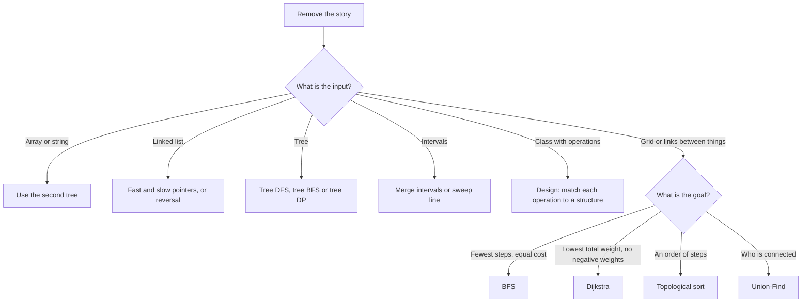
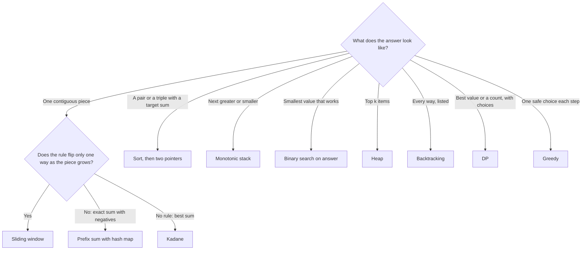

# Recognition Drills: Medium

> **Level:** Intermediate · **Priority:** T1 · **Time:** 240 min · **Read first:** [Recognition Drills: Easy](09-recognition-drills-easy.md), [Lookalike Patterns: How to Tell Them Apart](07-lookalike-patterns.md) · **Next:** [Recognition Drills: Hard](11-recognition-drills-hard.md)

These 120 short problems train one skill: you read a problem you have never seen, and you name the technique before you write any code. Medium problems are harder to read than Easy ones, because the story often hides the real question. You will learn to remove the story, read the limits and reject the lookalike.

## Quick revision

- **Remove the story first.** Ask: what are the items, and what must I return? A story about shops or robots is often a plain array question.
- **Read the limits next.** They tell you the speed you need. See [Constraints Tell You the Algorithm](02-constraints-tell-you-the-algorithm.md).
- **Rough guide to limits:** n up to 20 allows 2^n work. n up to 5,000 allows n squared. n up to 100,000 needs about n log n.
- **Contiguous** means next to each other. "Subarray" and "substring" are contiguous. "Subsequence" may skip items.
- **List all ways** points to backtracking. **Count ways** or **best value** with choices points to DP.
- **"Smallest value that works"** points to binary search on the answer, if every larger value also works.
- **Equal cost and fewest steps** points to BFS. **Weights that are not negative** point to Dijkstra.
- **"Before" and "depends on"** point to topological sort. **"Same group"** points to Union-Find.
- **Exact sum with negative numbers** in a subarray points to prefix sums with a hash map, not to a sliding window. If all values are positive, a window still works (Drill 36).
- **Next greater or next smaller** points to a monotonic stack.
- **Taking from both ends** leaves a contiguous middle. Think about the part that stays. This fails if the order of taking changes the score. Then use interval DP.
- **"Any order"** often means you may sort first. A group you pick can then become a window.
- **Name one lookalike** and say why it fails. If you cannot say why, you have not finished reading.

## How to use these drills

1. Cover the answer. Each answer is hidden until you click on it.
2. Give yourself about one minute for each drill.
3. Say three things out loud: the pattern, the words that gave it away, and one lookalike that fails.
4. Open the answer and compare all three things, not only the pattern name.
5. Mark any drill you missed. Later, retry it from [Drills by chapter](#drills-by-chapter).

The order is mixed on purpose, so a drill's neighbours tell you nothing. Some problems fit more than one technique. If you named a different one, check whether it also meets the limits. If it does, count it as right. The answer shows the one that most people should reach for first.

Each answer links to the real problem, so you can solve it after the drill. Do one set of 20 at a time. A full set takes about 30 minutes.

## How to read a Medium problem

Here is one worked example. Read this story.

> A port ships parcels in a fixed line. Their weights are `[3, 2, 2, 4]`. Each day one ship takes the next parcels from the line, up to its capacity. All parcels must leave within 2 days. Find the smallest capacity that works.

**Step 1: remove the story.** The items are an array of numbers. You cut it into at most 2 contiguous parts. You want the smallest possible limit on a part's sum.

**Step 2: read the limits.** The real problem allows 50,000 parcels. So n squared work is risky, and n log n is safe.

**Step 3: name the candidates.** "Parts of an array" suggests DP. "Smallest" suggests greedy or binary search.

**Step 4: test each candidate.** The test for binary search on the answer is: if a capacity works, does every larger capacity also work? Yes, because a bigger ship can carry the same parcels. Checking one capacity is easy too: fill the ship in order and count the days.

| Capacity | Days used | Works? |
|---|---|---|
| 5 | 3 (`3, 2` then `2` then `4`) | no |
| 6 | 2 (`3, 2` then `2, 4`) | yes |

**Step 5: reject the lookalike.** DP on "position and days left" is correct, but it needs far more work. Once the capacity is fixed, you have no real choice: filling the ship as full as you can is always safe. The answer is 6, found with [binary search on the answer](../04-sorting-searching/07-binary-search-on-answer.md). This problem is [Capacity To Ship Packages Within D Days](https://leetcode.com/problems/capacity-to-ship-packages-within-d-days/) (LeetCode 1011, Medium).

### What the story often hides

| The story says | The real question is often | Go to |
|---|---|---|
| "spreads each minute", "rots", "infects", "rumour" | BFS, one layer each minute | [BFS Shortest Path Patterns](../08-graphs/04-bfs-shortest-path-patterns.md) |
| "before", "depends on", "must finish first" | Topological sort | [Topological Sort](../08-graphs/06-topological-sort.md) |
| "same group", "shared", "connected", "merge records" | Union-Find | [Union-Find (Disjoint Set Union)](../08-graphs/07-union-find.md) |
| "smallest speed", "least capacity", "earliest day" | Binary search on the answer | [Binary Search on the Answer](../04-sorting-searching/07-binary-search-on-answer.md) |
| "make the smallest gap as big as possible" | Binary search on the answer | [Binary Search on the Answer](../04-sorting-searching/07-binary-search-on-answer.md) |
| "take from either end", and the order does not change the score | The part that stays is a window | [Sliding Window: Variable Size](../05-core-patterns/05-sliding-window-variable.md) |
| "two rooms", "two teams", "cannot be together" | Bipartite check | [Cycle Detection and Bipartite Graphs](../08-graphs/05-cycle-detection-and-bipartite.md) |
| "no two neighbours may both..." | Take or skip DP | [1D Dynamic Programming](../09-dynamic-programming/02-one-dimensional-dp.md) |
| "fewest rooms", "most at the same time" | Sweep line | [Difference Arrays and Sweep Line](../05-core-patterns/07-difference-array-and-sweep-line.md) |
| "waits for the next warmer or taller one" | Monotonic stack | [Monotonic Stack](../05-core-patterns/12-monotonic-stack.md) |
| "fewest moves", each move changes a whole state | State-space BFS | [BFS Shortest Path Patterns](../08-graphs/04-bfs-shortest-path-patterns.md) |
| "when free, take the best one that is waiting" | Heap | [Top K With Heaps](../05-core-patterns/14-top-k-and-heaps.md) |
| "each item points to one other item" | Follow the pointers, look for cycles | [Fast and Slow Pointers](../05-core-patterns/03-fast-and-slow-pointers.md) |

### Two small decision trees

Start here, after you remove the story.

Use this second tree for an array or a string.

Each end of these trees leads to a chapter.

| End of the tree | Chapter |
|---|---|
| Fast and slow pointers, or reversal | [Fast and Slow Pointers](../05-core-patterns/03-fast-and-slow-pointers.md), [In-Place Linked List Reversal](../05-core-patterns/11-in-place-linked-list-reversal.md) |
| Tree DFS, tree BFS or tree DP | [Tree DFS Problems](../07-trees/03-tree-dfs-problems.md), [Tree BFS Problems](../07-trees/04-tree-bfs-problems.md), [Tree DP](../09-dynamic-programming/11-tree-dp.md) |
| Merge intervals or sweep line | [Merge Intervals](../05-core-patterns/09-merge-intervals.md), [Difference Arrays and Sweep Line](../05-core-patterns/07-difference-array-and-sweep-line.md) |
| Design | [LRU and LFU Cache](../13-design-problems/01-lru-and-lfu-cache.md), [Hashing and Randomized Design](../13-design-problems/04-hashing-and-randomized-design.md) |
| BFS | [BFS Shortest Path Patterns](../08-graphs/04-bfs-shortest-path-patterns.md) |
| Dijkstra | [Dijkstra's Algorithm](../08-graphs/08-dijkstra.md) |
| Topological sort | [Topological Sort](../08-graphs/06-topological-sort.md) |
| Union-Find | [Union-Find (Disjoint Set Union)](../08-graphs/07-union-find.md) |
| Sliding window | [Sliding Window: Fixed Size](../05-core-patterns/04-sliding-window-fixed.md), [Sliding Window: Variable Size](../05-core-patterns/05-sliding-window-variable.md) |
| Prefix sum with hash map | [Prefix Sums](../05-core-patterns/06-prefix-sums.md) |
| Kadane | [Kadane's Algorithm](../05-core-patterns/08-kadane-and-subarray-dp.md) |
| Sort, then two pointers | [Two Pointers: Opposite Ends](../05-core-patterns/01-two-pointers-opposite-ends.md) |
| Monotonic stack | [Monotonic Stack](../05-core-patterns/12-monotonic-stack.md) |
| Binary search on answer | [Binary Search on the Answer](../04-sorting-searching/07-binary-search-on-answer.md) |
| Heap | [Top K With Heaps](../05-core-patterns/14-top-k-and-heaps.md) |
| Backtracking | [Backtracking: Permutations and Combinations](../06-recursion-backtracking-greedy/03-backtracking-permutations-combinations.md), [Backtracking: Constraint Search](../06-recursion-backtracking-greedy/04-backtracking-constraint-search.md) |
| DP | [Dynamic Programming From Zero](../09-dynamic-programming/01-dp-from-zero.md) |
| Greedy | [Greedy Foundations](../06-recursion-backtracking-greedy/06-greedy-foundations.md) |

## Set 1: drills 1 to 20

### Drill 1

Put `+` or `-` before each number so that the total equals a target. Count the ways. `[1,1,2]` with target 2 gives 2.

Answer

**Pattern:** 0/1 knapsack

**Giveaway:** Let P be the sum of the numbers with `+`. Then P must equal `(total + target) / 2`, so this is "count subsets with sum P". If that value is not a whole number or falls below 0, the answer is 0.

**Not the lookalike:** Backtracking costs 2^n. It passes for about 20 numbers, but the knapsack is faster when the sum is small.

**Chapter:** [0/1 Knapsack](../09-dynamic-programming/04-zero-one-knapsack.md)

**Problem:** [Target Sum](https://leetcode.com/problems/target-sum/) (LeetCode 494, Medium)

### Drill 2

You get a number as a string and a number k. Remove k digits so that the number left is as small as possible. `"1324"` with `k = 1` gives `"124"`.

Answer

**Pattern:** Monotonic stack

**Giveaway:** "Remove k" and "as small as possible", and the digits left keep their order. A digit followed by a smaller digit should go, because earlier digits matter more. Keep a stack of digits that never falls.

**Not the lookalike:** Removing the k largest digits fails. In `"1324"`, removing 4 gives 132, which is worse than 124.

**Chapter:** [Monotonic Stack](../05-core-patterns/12-monotonic-stack.md)

**Problem:** [Remove K Digits](https://leetcode.com/problems/remove-k-digits/) (LeetCode 402, Medium)

### Drill 3

You walk a trail and record heights in an array, and neighbours are never equal. A peak is a point higher than both its neighbours, and the outside counts as lower. Find any peak in O(log n). `[1,3,2,4,1]` gives index 1 or 3.

Answer

**Pattern:** Binary search on index

**Real question:** Find any local maximum by dropping half of the array at each step.

**Giveaway:** "Any" peak plus O(log n). If `h[mid] < h[mid + 1]`, you are going uphill, so a peak must exist on the right. You only need a rule that drops half, not a sorted array.

**Not the lookalike:** "Binary search needs a sorted array" is a false belief. A linear scan works, but it costs O(n).

**Chapter:** [Binary Search Basics](../04-sorting-searching/06-binary-search-basics.md)

**Problem:** [Find Peak Element](https://leetcode.com/problems/find-peak-element/) (LeetCode 162, Medium)

### Drill 4

You play snakes and ladders on an n by n board. Each dice roll moves you 1 to 6 squares. A snake or ladder at your landing square moves you to its end. Find the fewest rolls to reach the last square, or -1.

Answer

**Pattern:** BFS shortest path

**Giveaway:** "Fewest rolls", and each roll costs 1. Squares are nodes, each with up to 6 edges. Snakes and ladders only change where an edge lands.

**Not the lookalike:** DP along the board fails, because snakes go backwards. Always rolling a 6 fails, because a ladder may sit on a lower square.

**Chapter:** [BFS Shortest Path Patterns](../08-graphs/04-bfs-shortest-path-patterns.md)

**Problem:** [Snakes and Ladders](https://leetcode.com/problems/snakes-and-ladders/) (LeetCode 909, Medium)

### Drill 5

Find the largest value of `nums[i] XOR nums[j]`. The array has up to 200,000 values. `[3,10,5]` gives 15.

Answer

**Pattern:** Trie

**Giveaway:** "Largest XOR" with too many values for all pairs. High bits decide the result, so you want the opposite bit at each step, from the top. A binary trie holds the values bit by bit, so you can walk towards the opposite bit.

**Not the lookalike:** Two loops cost O(n^2). The XOR trick of cancelling pairs does not help, because nothing cancels here.

**Chapter:** [Trie (Prefix Tree)](../07-trees/13-trie.md)

**Problem:** [Maximum XOR of Two Numbers in an Array](https://leetcode.com/problems/maximum-xor-of-two-numbers-in-an-array/) (LeetCode 421, Medium)

### Drill 6

Find the length of the longest part of a string in which no character repeats. `"abcab"` gives 3.

Answer

**Pattern:** Variable sliding window

**Giveaway:** "Longest" and a contiguous part. The rule is "no repeats". If a window has a repeat, every bigger window has it too, so the rule is monotonic. Keep the last index of each character.

**Not the lookalike:** A subsequence may skip characters, and a window cannot. Here the word "part" means substring, so the window fits.

**Chapter:** [Sliding Window: Variable Size](../05-core-patterns/05-sliding-window-variable.md)

**Problem:** [Longest Substring Without Repeating Characters](https://leetcode.com/problems/longest-substring-without-repeating-characters/) (LeetCode 3, Medium)

### Drill 7

You get up to 1000 points. Joining two points costs their Manhattan distance, which is `|x1 - x2| + |y1 - y2|`. Find the smallest total cost to connect all points. `[0,0]`, `[1,1]`, `[2,0]` give 4.

Answer

**Pattern:** Minimum spanning tree

**Giveaway:** "Connect all" with "smallest total" is a minimum spanning tree. Every pair can be joined, so the graph is dense. Prim's algorithm in O(n^2) fits well.

**Not the lookalike:** Dijkstra minimizes the distance from one source, not the total cost of the chosen edges.

**Chapter:** [Minimum Spanning Trees](../08-graphs/11-minimum-spanning-tree.md)

**Problem:** [Min Cost to Connect All Points](https://leetcode.com/problems/min-cost-to-connect-all-points/) (LeetCode 1584, Medium)

### Drill 8

Find the kth largest element of an array, counting repeats. Try not to sort the whole array. `[3,5,5,1]` with `k = 2` gives 5.

Answer

**Pattern:** Top K with heap

**Giveaway:** "Kth largest" and no need for full order. A min-heap of size k gives O(n log k). Quickselect gives O(n) on average.

**Not the lookalike:** A full sort costs O(n log n). But if many queries ask for different k on the same array, sort once.

**Chapter:** [Top K With Heaps](../05-core-patterns/14-top-k-and-heaps.md), [Quick Sort and Quickselect](../04-sorting-searching/03-quick-sort-and-quickselect.md)

**Problem:** [Kth Largest Element in an Array](https://leetcode.com/problems/kth-largest-element-in-an-array/) (LeetCode 215, Medium)

### Drill 9

An office chart is a binary tree. A rumour starts at one person at minute 0. Each minute, everyone who knows it tells their boss and their direct reports. Find when everyone knows.

Answer

**Pattern:** Graph BFS

**Real question:** Find the largest distance from one node in a tree.

**Giveaway:** "Spreads each minute to neighbours" means BFS layers. It also goes up the tree, so treat the tree as an undirected graph. The answer is the distance to the furthest node from the start.

**Not the lookalike:** A DFS going down from the start misses everyone above it. Multi-source BFS is not needed, because there is only one source.

**Chapter:** [Tree BFS Problems](../07-trees/04-tree-bfs-problems.md), [BFS and DFS](../08-graphs/02-bfs-and-dfs.md)

**Problem:** [Amount of Time for Binary Tree to Be Infected](https://leetcode.com/problems/amount-of-time-for-binary-tree-to-be-infected/) (LeetCode 2385, Medium)

### Drill 10

You get two sorted arrays. Find the k pairs, one value from each array, with the smallest sums. `[1,7]`, `[2,3]` with `k = 2` give `[1,2]` and `[1,3]`.

Answer

**Pattern:** K-way merge

**Giveaway:** Each value in the first array starts its own sorted list of sums. So this is "take the k smallest from many sorted lists". A heap holds the current head of each list.

**Not the lookalike:** Building all pairs costs O(nm). Two pointers cannot work, because the next smallest sum can come from many places.

**Chapter:** [K-Way Merge](../05-core-patterns/16-k-way-merge.md)

**Problem:** [Find K Pairs with Smallest Sums](https://leetcode.com/problems/find-k-pairs-with-smallest-sums/) (LeetCode 373, Medium)

### Drill 11

A researcher's papers have citation counts. The h-index is the largest h such that at least h papers have at least h citations each. `[4,0,2,5]` gives 2.

Answer

**Pattern:** Counting or bucket sort

**Giveaway:** The answer cannot be more than n, so any count above n can be treated as n. That gives n + 1 buckets. Walk from the top and add up the papers until the total reaches the bucket number. O(n) time.

**Not the lookalike:** Sorting works in O(n log n). Binary search on h also works, but it is not needed.

**Chapter:** [Counting, Radix and Bucket Sort](../04-sorting-searching/04-non-comparison-sorts.md)

**Problem:** [H-Index](https://leetcode.com/problems/h-index/) (LeetCode 274, Medium)

### Drill 12

An array is arranged in a circle, so the last element is followed by the first. Find the largest sum of a non-empty subarray that uses each element at most once. `[4,-5,3]` gives 7.

Answer

**Pattern:** Kadane

**Giveaway:** "Largest subarray sum" plus "circular". A wrapped subarray leaves one normal subarray out, so its best value is the total minus the smallest subarray. Take the larger of that and normal Kadane. If all values are negative, use only normal Kadane, because the wrapped case would be empty.

**Not the lookalike:** Doubling the array also works, but you then need a monotonic queue to limit the length. That is more code.

**Chapter:** [Kadane's Algorithm](../05-core-patterns/08-kadane-and-subarray-dp.md)

**Problem:** [Maximum Sum Circular Subarray](https://leetcode.com/problems/maximum-sum-circular-subarray/) (LeetCode 918, Medium)

### Drill 13

You travel on given days of the year. Passes last 1, 7 or 30 days, each with its own price. Find the smallest cost that covers all travel days. Days `[1,4,6]` with prices `[2,7,15]` give 6.

Answer

**Pattern:** 1D DP

**Giveaway:** At each travel day you choose one of three options, and earlier choices affect later ones. Let `dp[d]` be the cost up to day d, and look back 1, 7 or 30 days.

**Not the lookalike:** Greedy pass choice fails, because an expensive pass pays off only if the next travel days are close.

**Chapter:** [Unbounded Knapsack](../09-dynamic-programming/05-unbounded-knapsack.md), [1D Dynamic Programming](../09-dynamic-programming/02-one-dimensional-dp.md)

**Problem:** [Minimum Cost For Tickets](https://leetcode.com/problems/minimum-cost-for-tickets/) (LeetCode 983, Medium)

### Drill 14

Runners go along a narrow trail to a finish line at distance 10. Each runner has a position and a speed. Nobody can pass. A faster runner who catches a slower one stays behind and they move on together as one group. Count the groups that reach the finish. Positions `[0,6]` with speeds `[4,1]` give 1.

Answer

**Pattern:** Sorting with custom order, Monotonic stack

**Real question:** Scan by position from the finish, and count how many times a new largest arrival time appears.

**Giveaway:** Only the runner ahead can block you. Sort by position, nearest to the finish first, and compute each arrival time. A runner who would arrive no later than the group ahead joins it. A later arrival starts a new group, which is a new largest time. A stack holds those times.

**Not the lookalike:** Simulating time step by step is slow, and runners may meet at fractions of a step.

**Chapter:** [Sorting With a Custom Order](../04-sorting-searching/05-custom-sorting.md), [Monotonic Stack](../05-core-patterns/12-monotonic-stack.md)

**Problem:** [Car Fleet](https://leetcode.com/problems/car-fleet/) (LeetCode 853, Medium)

### Drill 15

You get flights with prices. Find the cheapest way from city `src` to city `dst` with at most k stops, or -1.

Answer

**Pattern:** Bellman-Ford

**Giveaway:** "At most k stops" limits the number of edges. Run k + 1 rounds of Bellman-Ford. Each round must read from a copy of the last round, so one round cannot use two flights.

**Not the lookalike:** Plain Dijkstra keeps only the cheapest way to each city. That way may use too many stops, while a more expensive way with fewer stops is the one you need.

**Chapter:** [Bellman-Ford and SPFA](../08-graphs/09-bellman-ford-and-spfa.md)

**Problem:** [Cheapest Flights Within K Stops](https://leetcode.com/problems/cheapest-flights-within-k-stops/) (LeetCode 787, Medium)

### Drill 16

You get strings `s` and `p`. Find every start index in `s` where some rearrangement of `p` begins. `s = "abab"`, `p = "ab"` gives `[0,1,2]`.

Answer

**Pattern:** Fixed sliding window

**Giveaway:** A rearrangement of `p` has the same length as `p`. So the window size is fixed. Compare letter counts as the window slides, one letter in and one letter out.

**Not the lookalike:** A variable window is for when you choose the length, and here the length is given. Sorting every window costs far more.

**Chapter:** [Sliding Window: Fixed Size](../05-core-patterns/04-sliding-window-fixed.md)

**Problem:** [Find All Anagrams in a String](https://leetcode.com/problems/find-all-anagrams-in-a-string/) (LeetCode 438, Medium)

### Drill 17

Build a store with `set(key, value, timestamp)` and `get(key, timestamp)`. `get` returns the value with the largest timestamp at or before the given one. Timestamps of `set` calls only rise.

Answer

**Pattern:** Binary search on index

**Giveaway:** Rising timestamps mean each key's list is already sorted. "At or before" is `upper_bound` minus one. Use a hash map from key to a sorted vector.

**Not the lookalike:** A `std::map` per key also works, but the appends already arrive in order, so a vector is enough.

**Chapter:** [Hashing and Randomized Design](../13-design-problems/04-hashing-and-randomized-design.md), [Binary Search Basics](../04-sorting-searching/06-binary-search-basics.md)

**Problem:** [Time Based Key-Value Store](https://leetcode.com/problems/time-based-key-value-store/) (LeetCode 981, Medium)

### Drill 18

A linked list may end in a loop. Return the node where the loop begins, or null if there is no loop. Use O(1) extra space.

Answer

**Pattern:** Fast and slow pointers

**Giveaway:** "Loop" plus "O(1) space". Slow moves 1 step and fast moves 2. They meet inside the loop if there is one. Then move one pointer back to the head and step both by 1. They meet at the loop's first node.

**Not the lookalike:** A hash set of visited nodes finds it easily, but it uses O(n) space.

**Chapter:** [Fast and Slow Pointers](../05-core-patterns/03-fast-and-slow-pointers.md)

**Problem:** [Linked List Cycle II](https://leetcode.com/problems/linked-list-cycle-ii/) (LeetCode 142, Medium)

### Drill 19

Split a string into as many pieces as you can, so that each letter appears in only one piece. Return the piece sizes. `"abacd"` gives `[3,1,1]`.

Answer

**Pattern:** Greedy

**Giveaway:** Each letter's first and last position form an interval. Walk the string and extend the current piece to the last position of each letter you see. When you reach that end, close the piece.

**Not the lookalike:** This is merge intervals in another form, and both ways work. DP is not needed.

**Chapter:** [Greedy Foundations](../06-recursion-backtracking-greedy/06-greedy-foundations.md)

**Problem:** [Partition Labels](https://leetcode.com/problems/partition-labels/) (LeetCode 763, Medium)

### Drill 20

A shop's log has one letter for each hour: `Y` if customers came and `N` if nobody came. The shop loses 1 for each hour it is open with no customers, and 1 for each hour it is closed while customers come. It closes for good at some hour and stays open before that. Find the earliest closing hour with the smallest loss. `"YNNY"` gives 1.

Answer

**Pattern:** Prefix and suffix scan

**Real question:** Find the best cut point of a string.

**Giveaway:** Each closing hour cuts the log into a left part and a right part. The loss is the number of `N` on the left plus the number of `Y` on the right. Moving the cut one hour changes the loss by exactly 1, so one scan updates it.

**Not the lookalike:** Recounting for each hour costs O(n^2). DP is not needed, because there is only one decision: where to cut.

**Chapter:** [Left and Right Scans](../05-core-patterns/22-left-and-right-scans.md)

**Problem:** [Minimum Penalty for a Shop](https://leetcode.com/problems/minimum-penalty-for-a-shop/) (LeetCode 2483, Medium)

## Set 2: drills 21 to 40

### Drill 21

An array holds only the values 0, 1 and 2. Sort it in place, in one pass, with O(1) extra space. `[2,0,1]` gives `[0,1,2]`.

Answer

**Pattern:** In-place array manipulation

**Giveaway:** Three values, "in place" and "one pass". Keep three zones with three pointers: 0s at the front, 2s at the back and unread items in the middle.

**Not the lookalike:** Counting sort works, but it needs two passes. `std::sort` costs O(n log n).

**Chapter:** [Quick Sort and Quickselect](../04-sorting-searching/03-quick-sort-and-quickselect.md)

**Problem:** [Sort Colors](https://leetcode.com/problems/sort-colors/) (LeetCode 75, Medium)

### Drill 22

You get two arrays `a` and `b` of the same size, up to 100,000, and k. Choose k indexes. The score is the sum of the chosen `a` values times the smallest chosen `b` value. Find the best score. `a = [1,3,2]`, `b = [2,1,4]` with `k = 2` give 6.

Answer

**Pattern:** Top K with heap

**Giveaway:** "The minimum of the chosen" is hard to control, so fix it. Sort by `b` from largest to smallest. At index i, `b[i]` is the minimum of everything so far. You then need the k largest `a` values so far. A min-heap of size k tracks them.

**Not the lookalike:** DP on index and count is too big for 100,000 elements. "Sort by one value, keep a heap on the other" is a common Medium shape.

**Chapter:** [Top K With Heaps](../05-core-patterns/14-top-k-and-heaps.md)

**Problem:** [Maximum Subsequence Score](https://leetcode.com/problems/maximum-subsequence-score/) (LeetCode 2542, Medium)

### Drill 23

You get an unsorted array of up to 100,000 integers. Find the length of the longest chain of values that follow each other, such as 1, 2, 3. The values can sit anywhere in the array. You must use O(n) time. `[9,1,3,2,7]` gives 3.

Answer

**Pattern:** Hash map lookup

**Giveaway:** "O(n)" rules out sorting. The chain is about values, not positions. Put all values in a hash set. Start counting at x only when x - 1 is missing, so each chain is walked once. That is O(n) on average.

**Not the lookalike:** A sliding window needs the items next to each other in the array, and here they are scattered. Sorting gives the right answer, but it costs O(n log n).

**Chapter:** [Hashing Patterns](../02-arrays-strings-hashing/04-hashing-patterns.md)

**Problem:** [Longest Consecutive Sequence](https://leetcode.com/problems/longest-consecutive-sequence/) (LeetCode 128, Medium)

### Drill 24

Build a stack with `push`, `pop`, `top` and `getMin`, all in O(1).

Answer

**Pattern:** Design: data structure

**Giveaway:** The minimum changes only with stack operations. Keep a second stack that holds the minimum at each depth.

**Not the lookalike:** One number fails, because popping the minimum loses the old one. A heap costs O(log n).

**Chapter:** [Stack From Zero](../03-linked-lists-stacks-queues/05-stack-from-zero.md), [Stack and Queue Design Problems](../13-design-problems/02-stack-and-queue-design.md)

**Problem:** [Min Stack](https://leetcode.com/problems/min-stack/) (LeetCode 155, Medium)

### Drill 25

A treasure board has 2 rows and n columns, with coins in each cell. Two robots walk from the top-left cell to the bottom-right cell, moving only right or down. The first robot walks first and takes the coins on its path. The second robot then walks and takes what remains. The first robot wants the second to get as little as possible, and the second wants as much as possible. Find what the second robot gets.

Answer

**Pattern:** Prefix sum

**Real question:** Try every turning column. For each one, take the larger of two range sums. Return the smallest such value.

**Giveaway:** With 2 rows, a path is one choice: the column where it goes down. After that, the second robot can only take the top row to the right of that column, or the bottom row to the left of it. Both are range sums, so prefix sums give each one in O(1).

**Not the lookalike:** Grid DP looks natural for paths, but a path here has only n possible shapes, so you can try them all. Letting the first robot collect the most coins is wrong, because its goal is to leave little for the second robot.

**Chapter:** [Prefix Sums](../05-core-patterns/06-prefix-sums.md)

**Problem:** [Grid Game](https://leetcode.com/problems/grid-game/) (LeetCode 2017, Medium)

### Drill 26

Stations form a circle. `gas[i]` is the fuel gained at station i, and `cost[i]` is the fuel to reach the next one. The tank starts empty. Find the station that lets you drive the full circle, or -1. `gas = [1,3]`, `cost = [2,2]` gives 1.

Answer

**Pattern:** Greedy

**Giveaway:** If the tank goes negative at station i after starting at s, no station between s and i can work either. So restart at i + 1. A start exists exactly when total gas is at least total cost.

**Not the lookalike:** Trying each start costs O(n^2).

**Chapter:** [Greedy Foundations](../06-recursion-backtracking-greedy/06-greedy-foundations.md)

**Problem:** [Gas Station](https://leetcode.com/problems/gas-station/) (LeetCode 134, Medium)

### Drill 27

You get a nested list such as `[1,[2,[3]],4]`. Build an iterator with `next` and `hasNext` that returns 1, 2, 3, 4.

Answer

**Pattern:** Design: iterator

**Giveaway:** An iterator must pause in the middle of a nested walk. An explicit stack holds the place where you paused.

**Not the lookalike:** Flattening everything at the start also works, but it does all the work and uses all the memory up front.

**Chapter:** [Iterators](../13-design-problems/03-iterators.md)

**Problem:** [Flatten Nested List Iterator](https://leetcode.com/problems/flatten-nested-list-iterator/) (LeetCode 341, Medium)

### Drill 28

You get two words. One operation inserts, deletes or replaces one character. Find the fewest operations that turn the first word into the second. `"cat"` and `"cart"` give 1.

Answer

**Pattern:** LCS DP

**Giveaway:** Two strings plus "fewest edits". Use `dp[i][j]` for the first i letters of one word and the first j letters of the other.

**Not the lookalike:** BFS over strings has far too many states.

**Chapter:** [LCS and Edit Distance](../09-dynamic-programming/07-lcs-and-edit-distance.md)

**Problem:** [Edit Distance](https://leetcode.com/problems/edit-distance/) (LeetCode 72, Medium)

### Drill 29

You get daily temperatures. For each day, find how many days you must wait for a warmer day, or 0 if none comes. `[3,1,2,5]` gives `[3,1,1,0]`.

Answer

**Pattern:** Monotonic stack

**Giveaway:** "The next warmer day" is the next greater element. Keep a stack of days that are still waiting. A new warm day answers every cooler day on top of the stack.

**Not the lookalike:** A heap gives the largest value overall, not the nearest larger one. Two loops cost O(n^2).

**Chapter:** [Monotonic Stack](../05-core-patterns/12-monotonic-stack.md)

**Problem:** [Daily Temperatures](https://leetcode.com/problems/daily-temperatures/) (LeetCode 739, Medium)

### Drill 30

Word b comes before word c if adding one letter anywhere in b gives c. Find the longest chain of such words. `a, ba, bda, bdca` gives 4.

Answer

**Pattern:** LIS DP

**Giveaway:** A chain is like an increasing subsequence, with "can follow" in place of "is smaller". Sort by length. For each word, remove each letter and look up the shorter word in a hash map.

**Not the lookalike:** Plain LIS on the original order fails, because the input is not sorted. Longest path on a graph also works, but it is more code.

**Chapter:** [Longest Increasing Subsequence](../09-dynamic-programming/06-longest-increasing-subsequence.md)

**Problem:** [Longest String Chain](https://leetcode.com/problems/longest-string-chain/) (LeetCode 1048, Medium)

### Drill 31

A school must run exams. Each exam has a start time and an end time, both included. Two exams that overlap cannot use the same room. Find the fewest rooms. `[[1,3],[2,4],[5,6]]` gives 2.

Answer

**Pattern:** Sweep line

**Real question:** Find the largest number of intervals that overlap at one point.

**Giveaway:** The fewest rooms equals the most exams running at one moment. You need at least that many, because they all overlap. That many is also enough: take exams in start order, and give each one any free room. So sort the start and end events, and track the peak. On a tie, count the start first, because end times are included.

**Not the lookalike:** Merging overlapping intervals gives one block and hides how many overlap.

**Chapter:** [Difference Arrays and Sweep Line](../05-core-patterns/07-difference-array-and-sweep-line.md)

**Problem:** [Divide Intervals Into Minimum Number of Groups](https://leetcode.com/problems/divide-intervals-into-minimum-number-of-groups/) (LeetCode 2406, Medium)

### Drill 32

You have up to 14 tasks with given hours. One work session lasts at most `sessionTime` hours. A task cannot be split. Find the fewest sessions for all tasks. `[1,2,3]` with `sessionTime = 3` gives 2.

Answer

**Pattern:** Bitmask DP

**Giveaway:** n up to 14 points to 2^n states. The state is the set of finished tasks. For each set, store the fewest sessions and the smallest time used in the last session.

**Not the lookalike:** Greedy filling can fail, because this is bin packing. Backtracking with pruning also passes at this size.

**Chapter:** [Bitmask DP](../09-dynamic-programming/12-bitmask-dp.md)

**Problem:** [Minimum Number of Work Sessions to Finish the Tasks](https://leetcode.com/problems/minimum-number-of-work-sessions-to-finish-the-tasks/) (LeetCode 1986, Medium)

### Drill 33

A hiker crosses a grid of heights from the top-left to the bottom-right, moving in four directions. A path's effort is its largest height step between neighbouring cells. Find the smallest possible effort.

Answer

**Pattern:** Dijkstra

**Giveaway:** The path's cost is a maximum, not a sum, but it never falls as the path grows. So Dijkstra still works. Binary search on the answer with a BFS also works.

**Not the lookalike:** Grid DP fails, because the best path may go up or left, so there is no fixed order of cells.

**Chapter:** [Dijkstra's Algorithm](../08-graphs/08-dijkstra.md)

**Problem:** [Path With Minimum Effort](https://leetcode.com/problems/path-with-minimum-effort/) (LeetCode 1631, Medium)

### Drill 34

A convex polygon has a value at each corner. Cut it into triangles. Each triangle costs the product of its three corners. Find the smallest total cost. `[1,3,1,4]` gives 7.

Answer

**Pattern:** Interval DP

**Giveaway:** Picking a triangle on the side `(i, j)` splits the rest into two separate polygons. So `dp[i][j]` tries each corner between i and j. With n up to 50, O(n^3) is fine.

**Not the lookalike:** Greedy on the smallest triangle fails, because one cut changes which triangles remain.

**Chapter:** [Interval DP](../09-dynamic-programming/09-interval-dp.md)

**Problem:** [Minimum Score Triangulation of Polygon](https://leetcode.com/problems/minimum-score-triangulation-of-polygon/) (LeetCode 1039, Medium)

### Drill 35

You must place m sensors at some of the given positions on a line. Make the smallest gap between two sensors as large as possible. Positions `[1,2,4,8]` with `m = 3` give 3.

Answer

**Pattern:** Binary search on answer

**Giveaway:** "Make the smallest as large as possible" is the classic phrase. If gap d is possible, every smaller gap is also possible. Sort the positions, then check a gap by placing each sensor as early as you can.

**Not the lookalike:** Spreading sensors evenly cannot be computed directly, because positions are fixed. DP over position and count is too big.

**Chapter:** [Binary Search on the Answer](../04-sorting-searching/07-binary-search-on-answer.md)

**Problem:** [Magnetic Force Between Two Balls](https://leetcode.com/problems/magnetic-force-between-two-balls/) (LeetCode 1552, Medium)

### Drill 36

You get positive integers and a number x. Each move removes the leftmost or the rightmost element and subtracts it from x. Find the fewest moves that make x exactly 0, or -1 if you cannot. `[3,1,1,2]` with `x = 5` gives 2.

Answer

**Pattern:** Variable sliding window

**Real question:** Find the longest subarray with a sum of exactly `total - x`.

**Giveaway:** Removing from both ends leaves a contiguous middle. Fewest removals means the longest middle part. Its sum must be `total - x`. All values are positive, so a window works.

**Not the lookalike:** DP on `(left, right)` has O(n^2) states. If the number of removals were given, the middle would have a fixed size, and you would use a fixed window.

**Chapter:** [Sliding Window: Variable Size](../05-core-patterns/05-sliding-window-variable.md)

**Problem:** [Minimum Operations to Reduce X to Zero](https://leetcode.com/problems/minimum-operations-to-reduce-x-to-zero/) (LeetCode 1658, Medium)

### Drill 37

You stand to the right of a binary tree. List the nodes you can see, from top to bottom.

Answer

**Pattern:** Tree BFS

**Giveaway:** "One node per level" means level order. Take the last node of each level. A DFS that visits the right child first also works.

**Not the lookalike:** Following only right children fails, because a left node can reach lower than the right side.

**Chapter:** [Tree BFS Problems](../07-trees/04-tree-bfs-problems.md)

**Problem:** [Binary Tree Right Side View](https://leetcode.com/problems/binary-tree-right-side-view/) (LeetCode 199, Medium)

### Drill 38

Each record has a name and some email addresses. Two records belong to the same person if they share an email. Merge the records.

Answer

**Pattern:** Union-Find

**Giveaway:** "Share an email" links records, and links chain together. So connect all emails in one record, then group emails by their root.

**Not the lookalike:** The name cannot be the key, because two people may have the same name. No single key exists, so plain group by key fails.

**Chapter:** [Union-Find (Disjoint Set Union)](../08-graphs/07-union-find.md)

**Problem:** [Accounts Merge](https://leetcode.com/problems/accounts-merge/) (LeetCode 721, Medium)

### Drill 39

You get non-negative integers. Arrange them to form the largest number, and return it as a string. `[3,30,34]` gives `"34330"`.

Answer

**Pattern:** Sorting with custom order

**Giveaway:** "Arrange" plus "largest". Put a before b when the string `a + b` is larger than `b + a`. That comparison is all you need for the sort. If the result starts with 0, return `"0"`.

**Not the lookalike:** A plain descending string sort gives `"34303"`, which is smaller.

**Chapter:** [Sorting With a Custom Order](../04-sorting-searching/05-custom-sorting.md)

**Problem:** [Largest Number](https://leetcode.com/problems/largest-number/) (LeetCode 179, Medium)

### Drill 40

Find all different triples in an array that add up to 0. `[-1,0,1,2,-1]` gives `[-1,-1,2]` and `[-1,0,1]`.

Answer

**Pattern:** Two pointers: opposite ends

**Giveaway:** "Triple" plus "sum" plus "no repeated triples". Sort first. Fix one number, then run two pointers on the rest. Sorting also puts equal values together, so skipping repeats is easy. The total is O(n^2).

**Not the lookalike:** A hash set can find the third number, but removing repeated triples becomes messy. Three loops cost O(n^3).

**Chapter:** [Two Pointers: Opposite Ends](../05-core-patterns/01-two-pointers-opposite-ends.md)

**Problem:** [3Sum](https://leetcode.com/problems/3sum/) (LeetCode 15, Medium)

## Set 3: drills 41 to 60

### Drill 41

You get a string and a list of words. Can the string be split into listed words, with reuse allowed? `"catsdog"` with `cats, dog` gives true.

Answer

**Pattern:** 1D DP

**Giveaway:** Whether the first i letters can be split depends on shorter prefixes. So `dp[i]` is true when some `dp[j]` is true and `s[j..i)` is a listed word.

**Not the lookalike:** Taking the longest match fails. In `"abcd"` with `ab, abc, cd`, taking `abc` leaves `d`, but `ab` then `cd` works.

**Chapter:** [1D Dynamic Programming](../09-dynamic-programming/02-one-dimensional-dp.md)

**Problem:** [Word Break](https://leetcode.com/problems/word-break/) (LeetCode 139, Medium)

### Drill 42

Tourist towns lie along a highway, and each town has a fun score. A trip visits two towns i and j with i before j. Its value is `score[i] + score[j] - (j - i)`. Find the best trip. `[8,1,5]` gives 11.

Answer

**Pattern:** Separate the variables

**Real question:** Find the best pair for a formula that can be split into a part for i and a part for j.

**Giveaway:** The formula mixes i and j. Split it: `(score[i] + i) + (score[j] - j)`. For each j, you need only the best `score[i] + i` so far, which is one running number.

**Not the lookalike:** Trying all pairs costs O(n^2). Two pointers from both ends have no safe rule for which one to move.

**Chapter:** [Left and Right Scans](../05-core-patterns/22-left-and-right-scans.md)

**Problem:** [Best Sightseeing Pair](https://leetcode.com/problems/best-sightseeing-pair/) (LeetCode 1014, Medium)

### Drill 43

You get a grid of letters and a word. Can you trace the word through neighbouring cells (up, down, left, right), using each cell at most once in the path?

Answer

**Pattern:** Backtracking: constraint search

**Giveaway:** The path must not reuse a cell, and a failed path must give its cells back. Mark a cell on the way in, and unmark it on the way out.

**Not the lookalike:** Plain BFS or DFS with a permanent visited set fails. A cell used by a failed path may be needed by another path.

**Chapter:** [Backtracking: Constraint Search](../06-recursion-backtracking-greedy/04-backtracking-constraint-search.md)

**Problem:** [Word Search](https://leetcode.com/problems/word-search/) (LeetCode 79, Medium)

### Drill 44

An array has integers that may be negative or zero. Find the largest product of a subarray. `[2,-1,3,-2]` gives 12.

Answer

**Pattern:** Kadane

**Giveaway:** "Subarray" plus "largest" looks like Kadane. But a negative number can turn the smallest product into the largest. So keep both the largest and the smallest product ending here.

**Not the lookalike:** A sliding window fails. A negative number can make a bad window good again, so the rule is not monotonic.

**Chapter:** [Kadane's Algorithm](../05-core-patterns/08-kadane-and-subarray-dp.md)

**Problem:** [Maximum Product Subarray](https://leetcode.com/problems/maximum-product-subarray/) (LeetCode 152, Medium)

### Drill 45

You hold cards with numbers. Can you split all of them into groups of size `groupSize`, where each group has consecutive values? `[1,2,2,3,3,4]` with `groupSize = 3` gives true.

Answer

**Pattern:** Greedy

**Giveaway:** The smallest remaining card must begin a group, because nothing smaller can come before it. So there is no choice to make. Keep counts in an ordered map, and remove one full group at a time.

**Not the lookalike:** Backtracking over groups is exponential and is not needed, because each step has only one option.

**Chapter:** [Greedy Foundations](../06-recursion-backtracking-greedy/06-greedy-foundations.md), [Ordered Set Patterns](../05-core-patterns/19-ordered-set-patterns.md)

**Problem:** [Hand of Straights](https://leetcode.com/problems/hand-of-straights/) (LeetCode 846, Medium)

### Drill 46

You get a list of intervals. Find the fewest to remove so that the rest do not overlap. Two intervals that only touch at an end do not overlap. `[[1,4],[2,3],[3,5]]` gives 1.

Answer

**Pattern:** Merge intervals

**Giveaway:** Fewest removed means most kept. Sort by end time. Keep each interval that starts at or after the end of the last one you kept. The earliest end leaves the most room for the rest.

**Not the lookalike:** Merging answers a different question, because it joins intervals instead of dropping them. Sorting by start also works, if on each overlap you keep the interval that ends first.

**Chapter:** [Merge Intervals](../05-core-patterns/09-merge-intervals.md)

**Problem:** [Non-overlapping Intervals](https://leetcode.com/problems/non-overlapping-intervals/) (LeetCode 435, Medium)

### Drill 47

An ad server has ads with weights. `pick()` must return ad i with chance equal to `w[i]` divided by the total weight. There are up to 10,000 ads, and weights go up to 100,000.

Answer

**Pattern:** Prefix sum

**Real question:** Find which prefix sum range holds a random number.

**Giveaway:** Lay the weights end to end on a number line, so each ad owns a range. Prefix sums build the ranges. A random number falls in one range, and binary search finds it.

**Not the lookalike:** Filling a list with `w[i]` copies of each index uses too much memory.

**Chapter:** [Randomized Algorithms](../11-math-geometry-games/06-randomized-algorithms.md), [Prefix Sums](../05-core-patterns/06-prefix-sums.md)

**Problem:** [Random Pick with Weight](https://leetcode.com/problems/random-pick-with-weight/) (LeetCode 528, Medium)

### Drill 48

A grid holds non-negative numbers. You move only right or down, from the top-left to the bottom-right. Find the smallest path sum. `[[1,3],[1,1]]` gives 3.

Answer

**Pattern:** Grid DP

**Giveaway:** "Only right or down" means no cycles, so each cell depends only on the cell above and the cell to the left.

**Not the lookalike:** Dijkstra works, but it does more than you need. Choosing the smaller next cell each time can fail.

**Chapter:** [Grid DP](../09-dynamic-programming/03-grid-dp.md)

**Problem:** [Minimum Path Sum](https://leetcode.com/problems/minimum-path-sum/) (LeetCode 64, Medium)

### Drill 49

Each cell of a grid is alive or dead. The next state of a cell depends on its 8 neighbours, and all cells change at the same moment. Update the grid in place.

Answer

**Pattern:** Grid simulation

**Giveaway:** "Same moment" plus "in place". Store the old and new state in one cell, for example in two bits, then shift them in a final pass.

**Not the lookalike:** Updating cells directly means later cells read new values. A copy of the grid works, but it uses O(mn) space.

**Chapter:** [Matrix Problems](../02-arrays-strings-hashing/05-matrix-problems.md)

**Problem:** [Game of Life](https://leetcode.com/problems/game-of-life/) (LeetCode 289, Medium)

### Drill 50

You get coin values and an amount, with unlimited coins of each value. Count the combinations that make the amount, where order does not matter. `[1,2]` with amount 3 gives 2.

Answer

**Pattern:** Unbounded knapsack

**Giveaway:** "Unlimited" plus "count" plus "order does not matter". Loop over coins outside and amounts inside, so that each combination is counted once.

**Not the lookalike:** Swapping the two loops counts orderings instead, so `1+2` and `2+1` count twice. Listing combinations by backtracking is too slow.

**Chapter:** [Unbounded Knapsack](../09-dynamic-programming/05-unbounded-knapsack.md)

**Problem:** [Coin Change II](https://leetcode.com/problems/coin-change-ii/) (LeetCode 518, Medium)

### Drill 51

Every value appears exactly three times, except one value that appears once. Find it in O(n) time with O(1) extra space. `[5,7,5,5]` gives 7.

Answer

**Pattern:** Bit manipulation

**Giveaway:** "Three times" plus O(1) space. Count how many numbers have each of the 32 bits set. Each count modulo 3 gives one bit of the single number.

**Not the lookalike:** Plain XOR of all values fails, because three copies leave one copy. A hash map uses O(n) space.

**Chapter:** [Bit Manipulation](../05-core-patterns/17-bit-manipulation.md)

**Problem:** [Single Number II](https://leetcode.com/problems/single-number-ii/) (LeetCode 137, Medium)

### Drill 52

Each integer is an asteroid. Its size is the absolute value. Positive means it moves right, and negative means it moves left. When two meet, the smaller one explodes, and if they are equal both explode. Find what remains. `[4,2,-3]` gives `[4]`.

Answer

**Pattern:** Stack simulation

**Giveaway:** A new asteroid can only hit the nearest survivor on its left, and the newest survivor is met first. That is last in, first out. Keep the survivors on a stack, and let a left-moving asteroid fight the top.

**Not the lookalike:** This is not a monotonic stack, because the stack need not be sorted. Also, `[-1,1]` never collide, because they move apart.

**Chapter:** [Stack From Zero](../03-linked-lists-stacks-queues/05-stack-from-zero.md)

**Problem:** [Asteroid Collision](https://leetcode.com/problems/asteroid-collision/) (LeetCode 735, Medium)

### Drill 53

Friends numbered 0 to n - 1 play a party game. Each friend holds a card with a friend's number, and every number appears on exactly one card. You start at a friend, read the card, go to that friend, and stop when you return to someone you have met. Find the most friends one walk can meet. `[2,0,1,3]` gives 3.

Answer

**Pattern:** Permutation cycles

**Real question:** Find the longest cycle in a permutation.

**Giveaway:** "Every number appears exactly once" means a permutation. Every permutation splits into separate cycles. Walk each cycle once and mark its friends, so the total work is O(n).

**Not the lookalike:** Walking from every friend without marks costs O(n^2). Full graph cycle detection is not needed, because each node has exactly one arrow in and one arrow out.

**Chapter:** [Cyclic Sort and Index as Hash](../05-core-patterns/10-cyclic-sort.md)

**Problem:** [Array Nesting](https://leetcode.com/problems/array-nesting/) (LeetCode 565, Medium)

### Drill 54

You get the preorder and inorder lists of a binary tree with different values. Rebuild the tree.

Answer

**Pattern:** Tree construction

**Giveaway:** The first preorder value is the root. Its place in the inorder list splits left from right. A hash map from value to inorder index avoids scanning, for O(n) on average.

**Not the lookalike:** Inserting values one by one builds a search tree, which is the wrong shape. Preorder alone does not fix one tree.

**Chapter:** [Tree Construction and Serialization](../07-trees/05-tree-construction-and-serialization.md)

**Problem:** [Construct Binary Tree from Preorder and Inorder Traversal](https://leetcode.com/problems/construct-binary-tree-from-preorder-and-inorder-traversal/) (LeetCode 105, Medium)

### Drill 55

`height[i]` is the height of a wall at position i. Pick two walls so that, with the ground, they hold the most water. `[1,3,2,5]` gives 6, from the walls of height 3 and 5.

Answer

**Pattern:** Two pointers: opposite ends

**Giveaway:** You pick two items, not a piece. The area is the distance times the shorter wall. Start with the widest pair. Moving the taller wall can never help, because the width falls and the shorter wall still limits the height. So always move the shorter wall.

**Not the lookalike:** A monotonic stack suits Trapping Rain Water, where the walls in between matter. Here they do not matter.

**Chapter:** [Two Pointers: Opposite Ends](../05-core-patterns/01-two-pointers-opposite-ends.md)

**Problem:** [Container With Most Water](https://leetcode.com/problems/container-with-most-water/) (LeetCode 11, Medium)

### Drill 56

A node in a binary tree is good if no node on the path from the root to it has a larger value. Count the good nodes.

Answer

**Pattern:** Tree DFS

**Giveaway:** The check depends on the path above, so pass the largest value so far down the DFS.

**Not the lookalike:** A level order walk with one shared maximum fails, because it mixes nodes from different branches. Each node needs the maximum of its own path.

**Chapter:** [Tree DFS Problems](../07-trees/03-tree-dfs-problems.md)

**Problem:** [Count Good Nodes in Binary Tree](https://leetcode.com/problems/count-good-nodes-in-binary-tree/) (LeetCode 1448, Medium)

### Drill 57

A lock has 4 wheels, each from 0 to 9. A move turns one wheel by one step, and 9 and 0 are next to each other. You start at `0000`, and some codes are forbidden. Find the fewest moves to reach a target code, or -1.

Answer

**Pattern:** State-space BFS

**Giveaway:** "Fewest moves" at equal cost, where a node is a whole lock code. There are at most 10,000 codes, so BFS is cheap.

**Not the lookalike:** DP fails, because moves can go in circles. DFS does not give the fewest moves.

**Chapter:** [BFS Shortest Path Patterns](../08-graphs/04-bfs-shortest-path-patterns.md)

**Problem:** [Open the Lock](https://leetcode.com/problems/open-the-lock/) (LeetCode 752, Medium)

### Drill 58

A library has shelves numbered 1 to n. There are n + 1 tickets, each naming one shelf, so at least one shelf is named twice. Exactly one shelf number repeats, perhaps many times. You may not change the tickets, and you may use only O(1) extra memory. Find the repeated number. `[1,3,2,2]` gives 2.

Answer

**Pattern:** Fast and slow pointers

**Real question:** `nums` has n + 1 values in the range 1 to n. Find the repeated value without changing the array and with O(1) space.

**Giveaway:** Treat each value as a pointer: index i points to index `nums[i]`. No value is 0, so a walk from index 0 never returns there and must enter a loop. The node where the loop begins has two arrows coming in: one from outside the loop and one from inside. Only the repeated value can have two, so it is that node. This is the "find the start of a loop" problem on an array.

**Not the lookalike:** A hash set uses O(n) space. Sorting and cyclic sort both change the array. Binary search on the value range also works, in O(n log n).

**Chapter:** [Fast and Slow Pointers](../05-core-patterns/03-fast-and-slow-pointers.md)

**Problem:** [Find the Duplicate Number](https://leetcode.com/problems/find-the-duplicate-number/) (LeetCode 287, Medium)

### Drill 59

`nums[i]` is the longest jump you can make from index i. You start at index 0, and you can always reach the end. Find the fewest jumps. `[2,1,3,1,1]` gives 2.

Answer

**Pattern:** Greedy reach extension

**Giveaway:** Fewest steps at equal cost is BFS in layers. Each layer is one range of indexes, so you only need to track the furthest reach.

**Not the lookalike:** 1D DP works, but it can cost O(n^2).

**Chapter:** [Greedy Foundations](../06-recursion-backtracking-greedy/06-greedy-foundations.md)

**Problem:** [Jump Game II](https://leetcode.com/problems/jump-game-ii/) (LeetCode 45, Medium)

### Drill 60

Evaluate a string with non-negative integers and `+`, `-`, `*`, `/`, with no brackets. Division cuts off the fraction. `"1+2*3-4"` gives 3.

Answer

**Pattern:** Expression parsing

**Giveaway:** `*` and `/` come before `+` and `-`. Keep a stack of signed terms. Apply `*` and `/` to the top at once, and add up the stack at the end.

**Not the lookalike:** Reading strictly left to right gives 5 for this example, which is wrong.

**Chapter:** [Stacks for Expressions and Parentheses](../03-linked-lists-stacks-queues/06-stack-expressions-and-parentheses.md)

**Problem:** [Basic Calculator II](https://leetcode.com/problems/basic-calculator-ii/) (LeetCode 227, Medium)

## Set 4: drills 61 to 80

### Drill 61

You get two strings. One move is either to swap any two characters, or to pick two letters that appear in the string and exchange all their copies (every `a` becomes `b` and every `b` becomes `a`). Can you turn the first string into the second? `"aab"` and `"bba"` gives true.

Answer

**Pattern:** Frequency counting

**Giveaway:** Free swaps mean order does not matter, so only counts matter. The moves can never change the set of letters or the sorted list of counts. When both of those match, you can always reach the target. So compare exactly those two things.

**Not the lookalike:** "Can you reach it with moves" suggests BFS, but the number of possible strings is huge. When moves are free, look for what the moves cannot change.

**Chapter:** [Hashing Patterns](../02-arrays-strings-hashing/04-hashing-patterns.md)

**Problem:** [Determine if Two Strings Are Close](https://leetcode.com/problems/determine-if-two-strings-are-close/) (LeetCode 1657, Medium)

### Drill 62

Each node of a linked list has `next` and also `random`, which may point to any node or be null. Make a full copy that shares no nodes with the original.

Answer

**Pattern:** Linked list manipulation

**Giveaway:** "Copy" with pointers to nodes that may not exist yet. When you copy a node, its `random` target may not be copied. So make two passes: first create all the new nodes in a hash map from old to new, then set the links.

**Not the lookalike:** Copying only along `next` leaves `random` pointing into the old list. Clone Graph has the same shape, and it uses the same map.

**Chapter:** [Linked List Problems](../03-linked-lists-stacks-queues/04-linked-list-problems.md)

**Problem:** [Copy List with Random Pointer](https://leetcode.com/problems/copy-list-with-random-pointer/) (LeetCode 138, Medium)

### Drill 63

Sensors sit in a ring, and each has a value. You may switch on sensors, but no two neighbours may both be on. Find the largest total value. `[2,3,2]` gives 3.

Answer

**Pattern:** 1D DP

**Real question:** This is the "rob houses" DP, solved twice on a line.

**Giveaway:** "No two neighbours" plus "largest total" is take or skip DP. The ring makes the first and last neighbours, so solve twice: once without the first and once without the last.

**Not the lookalike:** Taking every second item fails, because the best choice may leave a gap of two.

**Chapter:** [1D Dynamic Programming](../09-dynamic-programming/02-one-dimensional-dp.md)

**Problem:** [House Robber II](https://leetcode.com/problems/house-robber-ii/) (LeetCode 213, Medium)

### Drill 64

People stand in a queue. Each person is `[h, k]`: height h, with exactly k people of height h or more in front of them. The list is shuffled. Rebuild the queue. `[[5,0],[6,0],[5,1]]` gives `[[5,0],[5,1],[6,0]]`.

Answer

**Pattern:** Sorting with custom order

**Giveaway:** Shorter people do not affect the count of a taller person. So sort from tallest to shortest, with smaller k first on equal height. Then insert each person at index k.

**Not the lookalike:** Backtracking over orders is exponential.

**Chapter:** [Sorting With a Custom Order](../04-sorting-searching/05-custom-sorting.md)

**Problem:** [Queue Reconstruction by Height](https://leetcode.com/problems/queue-reconstruction-by-height/) (LeetCode 406, Medium)

### Drill 65

You get different positive numbers and a target. List every combination that adds up to the target. A number may be used many times. `[2,3]` with target 7 gives `[2,2,3]`.

Answer

**Pattern:** Backtracking: combinations

**Giveaway:** "List every" means the output itself can be large, so try choices and undo them. Pass a start index, so that the same combination does not appear in a different order.

**Not the lookalike:** Coin change counts or finds a minimum, but it does not list the combinations.

**Chapter:** [Backtracking: Permutations and Combinations](../06-recursion-backtracking-greedy/03-backtracking-permutations-combinations.md)

**Problem:** [Combination Sum](https://leetcode.com/problems/combination-sum/) (LeetCode 39, Medium)

### Drill 66

You get a string and a list of index pairs. You may swap the characters at any listed pair, as many times as you like. Find the smallest string you can make. `"cba"` with pairs `[0,1]` and `[1,2]` gives `"abc"`.

Answer

**Pattern:** Union-Find

**Giveaway:** If 0 and 1 can swap, and 1 and 2 can swap, then all three can be in any order. So connected indexes form a group, and each group can be sorted.

**Not the lookalike:** Greedy single swaps miss the chains. BFS over strings has far too many states.

**Chapter:** [Union-Find (Disjoint Set Union)](../08-graphs/07-union-find.md)

**Problem:** [Smallest String With Swaps](https://leetcode.com/problems/smallest-string-with-swaps/) (LeetCode 1202, Medium)

### Drill 67

Find the sum of the minimum value of every subarray, modulo 10^9 + 7. The array has up to 30,000 elements. `[3,1,2]` gives 9.

Answer

**Pattern:** Contribution technique

**Giveaway:** "Sum over all subarrays" means you should not list the subarrays. For each element, count the subarrays in which it is the minimum. A monotonic stack finds how far it can reach on each side. Use a strict comparison on one side only, so that equal values are not counted twice.

**Not the lookalike:** Listing all subarrays is O(n^2) subarrays, which is too many for this limit.

**Chapter:** [Contribution Technique](../05-core-patterns/18-contribution-technique.md), [Monotonic Stack](../05-core-patterns/12-monotonic-stack.md)

**Problem:** [Sum of Subarray Minimums](https://leetcode.com/problems/sum-of-subarray-minimums/) (LeetCode 907, Medium)

### Drill 68

There are n courses. A pair `[a, b]` means you must take b before a. Can you finish every course?

Answer

**Pattern:** Topological sort

**Giveaway:** "Before" makes a directed graph. You can finish exactly when the graph has no directed cycle: a cycle blocks its courses, and with no cycle some course always has nothing left to wait for. Kahn's algorithm finds this by repeatedly removing courses that wait for nothing.

**Not the lookalike:** Union-Find ignores direction. Edges `a to b`, `a to c` and `b to c` form no directed cycle, but Union-Find would report one.

**Chapter:** [Topological Sort](../08-graphs/06-topological-sort.md)

**Problem:** [Course Schedule](https://leetcode.com/problems/course-schedule/) (LeetCode 207, Medium)

### Drill 69

A clinic has one doctor. Each patient has `[arrival, duration]`. When free, the doctor takes the waiting patient with the shortest duration, and on a tie the lowest index. If nobody is waiting, the doctor rests until the next arrival. List the order of patients. `[[0,3],[1,2],[1,1]]` gives `[0,2,1]`.

Answer

**Pattern:** Heap simulation

**Real question:** Simulate shortest-job-first scheduling with arrival times.

**Giveaway:** Items arrive over time, and you keep needing the smallest among those waiting. Sort by arrival, and keep the waiting patients in a min-heap by `(duration, index)`.

**Not the lookalike:** Sorting only by duration ignores who has arrived. Use `long long` for the clock.

**Chapter:** [Top K With Heaps](../05-core-patterns/14-top-k-and-heaps.md)

**Problem:** [Single-Threaded CPU](https://leetcode.com/problems/single-threaded-cpu/) (LeetCode 1834, Medium)

### Drill 70

Cut a string into pieces so that every piece reads the same both ways. List every way. `"noon"` gives 3 ways: `n,o,o,n`, `n,oo,n` and `noon`.

Answer

**Pattern:** Backtracking: constraint search

**Giveaway:** "List every way" plus cut points. At each position, try every next piece that is a palindrome, recurse, then undo.

**Not the lookalike:** Palindrome DP finds the fewest cuts, which is a single number. Listing all ways needs backtracking.

**Chapter:** [Backtracking: Constraint Search](../06-recursion-backtracking-greedy/04-backtracking-constraint-search.md)

**Problem:** [Palindrome Partitioning](https://leetcode.com/problems/palindrome-partitioning/) (LeetCode 131, Medium)

### Drill 71

You get an array and a number k. One operation adds 1 to any element. With at most k operations, find the largest number of equal elements you can make. `[1,2,4]` with `k = 3` gives 2.

Answer

**Pattern:** Variable sliding window

**Giveaway:** You can only raise values, so the best group is the values just below some target. After sorting, those values are neighbours, so the group is a window. The cost of a window is `largest * size - sum`. Use `long long` for it.

**Not the lookalike:** "Any element" seems to rule out a window. It is a hint to sort first. Counting frequencies alone ignores that you may change values.

**Chapter:** [Sliding Window: Variable Size](../05-core-patterns/05-sliding-window-variable.md)

**Problem:** [Frequency of the Most Frequent Element](https://leetcode.com/problems/frequency-of-the-most-frequent-element/) (LeetCode 1838, Medium)

### Drill 72

Letters are coded as A = 1 up to Z = 26. Count the ways to decode a string of digits. `"12"` gives 2 (`AB` or `L`), and `"06"` gives 0.

Answer

**Pattern:** 1D DP

**Giveaway:** "Count ways" where each step takes 1 or 2 characters. `dp[i]` adds `dp[i-1]` when the last digit is valid and `dp[i-2]` when the last two digits are valid.

**Not the lookalike:** Plain backtracking repeats the same work and is exponential.

**Chapter:** [1D Dynamic Programming](../09-dynamic-programming/02-one-dimensional-dp.md)

**Problem:** [Decode Ways](https://leetcode.com/problems/decode-ways/) (LeetCode 91, Medium)

### Drill 73

Flowers stand in a row, and `bloom[i]` is the day flower i opens. A bouquet needs k neighbouring open flowers, and each flower is used once. Find the earliest day you can make m bouquets, or -1. `[1,5,2]` with `m = 1`, `k = 2` gives 5.

Answer

**Pattern:** Binary search on answer

**Giveaway:** "Earliest day such that". Later days only open more flowers, so the answer flips once. For a given day, one scan counts the bouquets.

**Not the lookalike:** A fixed window of size k finds one bouquet, but it does not count m bouquets that share no flowers.

**Chapter:** [Binary Search on the Answer](../04-sorting-searching/07-binary-search-on-answer.md)

**Problem:** [Minimum Number of Days to Make m Bouquets](https://leetcode.com/problems/minimum-number-of-days-to-make-m-bouquets/) (LeetCode 1482, Medium)

### Drill 74

You play a card game. Cards lie in a row, each with some points. In each of k turns, you take a card from the left end or the right end. Find the most points you can get. `[1,2,9,1]` with `k = 2` gives 10.

Answer

**Pattern:** Fixed sliding window

**Real question:** Find the subarray of size n - k with the smallest sum.

**Giveaway:** You take k cards from the two ends, so n - k cards stay. Those cards form one contiguous piece of fixed size. The most you can take is the total minus the smallest sum of a window of size n - k.

**Not the lookalike:** Taking the larger end each turn fails. In `[1,100,4,5]` with `k = 2`, that takes 5 and 4 for 9, but taking 1 and 100 gives 101.

**Chapter:** [Sliding Window: Fixed Size](../05-core-patterns/04-sliding-window-fixed.md)

**Problem:** [Maximum Points You Can Obtain from Cards](https://leetcode.com/problems/maximum-points-you-can-obtain-from-cards/) (LeetCode 1423, Medium)

### Drill 75

You get `spells`, `potions` and `success`. A pair works if its product is at least `success`. For each spell, count the potions that work. Both arrays have up to 100,000 values. Spells `[1,3]`, potions `[2,4,5]` with `success = 6` give `[0,3]`.

Answer

**Pattern:** Binary search on index

**Giveaway:** For one spell, "at least" is a threshold on the potion. Sort the potions and binary search for the first one that works. Use `long long` for the product.

**Not the lookalike:** Two loops are about 10^10 steps. Two pointers on sorted spells also work, but you must track the original indexes.

**Chapter:** [Binary Search Basics](../04-sorting-searching/06-binary-search-basics.md)

**Problem:** [Successful Pairs of Spells and Potions](https://leetcode.com/problems/successful-pairs-of-spells-and-potions/) (LeetCode 2300, Medium)

### Drill 76

You get an array that may hold negative numbers, and a number k. Count the subarrays whose sum is exactly k. `[1,-1,1]` with `k = 1` gives 3.

Answer

**Pattern:** Prefix sum with hash map

**Giveaway:** "Exact sum" plus "negative numbers". A subarray ending here has sum k exactly when some earlier prefix sum equals the current prefix sum minus k. A hash map counts the earlier prefix sums.

**Not the lookalike:** A sliding window needs a monotonic rule. A negative number lowers the sum, so a broken window can become good again.

**Chapter:** [Prefix Sums](../05-core-patterns/06-prefix-sums.md)

**Problem:** [Subarray Sum Equals K](https://leetcode.com/problems/subarray-sum-equals-k/) (LeetCode 560, Medium)

### Drill 77

A network has n computers and directed links with travel times. A signal starts at computer k. Find when every computer has it, or -1 if some never do.

Answer

**Pattern:** Dijkstra

**Giveaway:** Weights that are not negative and one source. The answer is the largest shortest distance.

**Not the lookalike:** BFS assumes that every edge costs the same. Bellman-Ford also works, but it is slower.

**Chapter:** [Dijkstra's Algorithm](../08-graphs/08-dijkstra.md)

**Problem:** [Network Delay Time](https://leetcode.com/problems/network-delay-time/) (LeetCode 743, Medium)

### Drill 78

An array of n integers has values from 1 to n, and each value appears once or twice. Find all values that appear twice, in O(n) time and O(1) extra space. `[4,2,2,4]` gives 2 and 4.

Answer

**Pattern:** Cyclic sort

**Giveaway:** "Values from 1 to n" in an array of size n means a value can act as an index. Use the sign of `nums[value - 1]` as a "seen" mark, or put each value at its home index.

**Not the lookalike:** A hash set breaks the O(1) space rule. Sorting costs O(n log n).

**Chapter:** [Cyclic Sort and Index as Hash](../05-core-patterns/10-cyclic-sort.md)

**Problem:** [Find All Duplicates in an Array](https://leetcode.com/problems/find-all-duplicates-in-an-array/) (LeetCode 442, Medium)

### Drill 79

You get up to 200 positive integers, each at most 100. Can you split them into two groups with equal sums? `[1,5,3,3]` gives true.

Answer

**Pattern:** 0/1 knapsack

**Giveaway:** This is the same as "is there a subset with sum total / 2?". Each item is used once, and the sum is small, so a DP over sums works. If the total is odd, the answer is false.

**Not the lookalike:** Greedy filling fails. Two pointers look for a pair, not for a subset of any size.

**Chapter:** [0/1 Knapsack](../09-dynamic-programming/04-zero-one-knapsack.md)

**Problem:** [Partition Equal Subset Sum](https://leetcode.com/problems/partition-equal-subset-sum/) (LeetCode 416, Medium)

### Drill 80

A delivery van drives along a street. Each house has one parcel with a positive value, and equal values mean the same product. The driver picks one stretch of neighbouring houses and collects all their parcels. No trip may hold the same product twice. Find the largest total value. `[5,2,5,1]` gives 8.

Answer

**Pattern:** Variable sliding window

**Real question:** Find the largest sum of a subarray whose values are all different.

**Giveaway:** "Neighbouring" means contiguous. "No product twice" is a monotonic rule, and values are positive, so a longer valid stretch always earns more. Keep a running sum and a set of values, and shrink from the left when a repeat enters.

**Not the lookalike:** Kadane finds the best sum, but it has no way to enforce the "no repeats" rule.

**Chapter:** [Sliding Window: Variable Size](../05-core-patterns/05-sliding-window-variable.md)

**Problem:** [Maximum Erasure Value](https://leetcode.com/problems/maximum-erasure-value/) (LeetCode 1695, Medium)

## Set 5: drills 81 to 100

### Drill 81

Build a cache with a fixed capacity. `get` and `put` must run in O(1) on average. When the cache is full, it removes the entry that was used least recently.

Answer

**Pattern:** Design: hash map plus linked list

**Giveaway:** You need two things: find by key, and reorder by last use. A hash map finds a node, and a doubly linked list moves or removes it in O(1).

**Not the lookalike:** A heap by time costs O(log n), and updating an entry in it is awkward. A vector costs O(n) to remove from the middle.

**Chapter:** [LRU and LFU Cache](../13-design-problems/01-lru-and-lfu-cache.md)

**Problem:** [LRU Cache](https://leetcode.com/problems/lru-cache/) (LeetCode 146, Medium)

### Drill 82

Count the substrings that read the same both ways. `"aba"` gives 4.

Answer

**Pattern:** Palindrome DP

**Giveaway:** There are 2n - 1 centres of a palindrome. Expand around each one, or fill a table of `dp[i][j]`. n is up to 1000, so O(n^2) is fine.

**Not the lookalike:** A sliding window fails, because a window can stop being a palindrome and then become one again. Manacher is faster, but it is not needed here.

**Chapter:** [Palindromes and Manacher's Algorithm](../10-string-algorithms/01-palindromes-and-manacher.md), [Palindrome DP](../09-dynamic-programming/08-palindrome-dp.md)

**Problem:** [Palindromic Substrings](https://leetcode.com/problems/palindromic-substrings/) (LeetCode 647, Medium)

### Drill 83

You get two nodes in a binary tree that is not a search tree. Find the lowest node that has both in its subtree. A node counts as part of its own subtree.

Answer

**Pattern:** Tree DFS

**Giveaway:** The answer needs news from both children, so use a post-order DFS. If both children report a found node, this node is the answer.

**Not the lookalike:** The shortcut for a binary search tree compares values, and it does not work here. Binary lifting is for many queries.

**Chapter:** [Tree DFS Problems](../07-trees/03-tree-dfs-problems.md)

**Problem:** [Lowest Common Ancestor of a Binary Tree](https://leetcode.com/problems/lowest-common-ancestor-of-a-binary-tree/) (LeetCode 236, Medium)

### Drill 84

You get a partly filled 9 by 9 Sudoku board. Say whether the filled cells break a rule: no digit twice in one row, one column or one 3 by 3 box. You do not need to solve the board.

Answer

**Pattern:** Hash map lookup

**Giveaway:** "Does any digit repeat" is a set question. Keep one seen-set for each row, each column and each box. Cell `(r, c)` belongs to box number `r / 3 * 3 + c / 3`.

**Not the lookalike:** The word Sudoku suggests backtracking, but that is for filling the board. Here you only check it, so one pass is enough.

**Chapter:** [Hashing Patterns](../02-arrays-strings-hashing/04-hashing-patterns.md)

**Problem:** [Valid Sudoku](https://leetcode.com/problems/valid-sudoku/) (LeetCode 36, Medium)

### Drill 85

A company chart is a binary tree, and each person has a fun score. Invite people to a party so that nobody comes with their direct boss. Find the largest total fun.

Answer

**Pattern:** Tree DP

**Real question:** Find the best set of nodes with no parent and child together.

**Giveaway:** "No two neighbours" on a tree. For each person, compute two values: the best total if invited and the best total if not. A DFS returns both to the boss.

**Not the lookalike:** Taking every second level fails, because the best choice may skip two levels in a row.

**Chapter:** [Tree DP](../09-dynamic-programming/11-tree-dp.md)

**Problem:** [House Robber III](https://leetcode.com/problems/house-robber-iii/) (LeetCode 337, Medium)

### Drill 86

A binary array holds only 0 and 1. Find the longest subarray with equal numbers of 0s and 1s. `[0,1,1,0,1]` gives 4.

Answer

**Pattern:** Prefix sum with hash map

**Giveaway:** Replace each 0 with -1. "Equal counts" now means "sum is 0". A subarray has sum 0 exactly when the prefix sum at its end equals the prefix sum just before its start. So store the first index of each prefix sum.

**Not the lookalike:** A sliding window fails, because a window can go from balanced to not balanced and back. The rule is not monotonic.

**Chapter:** [Prefix Sums](../05-core-patterns/06-prefix-sums.md)

**Problem:** [Contiguous Array](https://leetcode.com/problems/contiguous-array/) (LeetCode 525, Medium)

### Drill 87

Check whether a binary tree is a valid binary search tree. All values in a left subtree must be smaller than the node, and all values in a right subtree must be larger.

Answer

**Pattern:** BST property

**Giveaway:** Pass an allowed range down the tree, or check that the inorder walk is strictly rising. Use `long long` bounds, because node values can reach the `int` limits.

**Not the lookalike:** Comparing a node only with its children fails. In `[5,1,6,null,null,3,7]`, the 3 is fine under 6, but it is smaller than the root 5.

**Chapter:** [Binary Search Trees From Zero](../07-trees/06-bst-from-zero.md)

**Problem:** [Validate Binary Search Tree](https://leetcode.com/problems/validate-binary-search-tree/) (LeetCode 98, Medium)

### Drill 88

You get a string of uppercase letters and a number k. You may change at most k characters to any letter. Find the longest substring that can become one repeated letter. `"AABCA"` with `k = 1` gives 3.

Answer

**Pattern:** Variable sliding window

**Giveaway:** "At most k changes" plus "longest substring". A window is fine when its size minus the count of its most common letter is at most k. You never need to try which letters to change, because keeping the most common letter is always best.

**Not the lookalike:** Backtracking over which characters to change is far too slow.

**Chapter:** [Sliding Window: Variable Size](../05-core-patterns/05-sliding-window-variable.md)

**Problem:** [Longest Repeating Character Replacement](https://leetcode.com/problems/longest-repeating-character-replacement/) (LeetCode 424, Medium)

### Drill 89

Find the longest substring in which every character appears at least k times. `"aabcc"` with `k = 2` gives 2.

Answer

**Pattern:** Divide and conquer

**Giveaway:** A character whose total count is below k can never be in the answer. So split the string at it, and solve each side.

**Not the lookalike:** A plain sliding window fails. A new character breaks the window, and more copies of it can fix it again, so the rule is not monotonic.

**Chapter:** [Divide and Conquer](../06-recursion-backtracking-greedy/05-divide-and-conquer.md)

**Problem:** [Longest Substring with At Least K Repeating Characters](https://leetcode.com/problems/longest-substring-with-at-least-k-repeating-characters/) (LeetCode 395, Medium)

### Drill 90

Decode a string where `k[x]` means x repeated k times. Brackets can be nested. `3[a2[b]]` gives `abbabbabb`.

Answer

**Pattern:** Stack simulation

**Giveaway:** Nested brackets mean the inner part must finish first. Keep a stack of the count and the text built so far. Recursion also fits.

**Not the lookalike:** Repeated text replacement is slow and hard to get right with nesting.

**Chapter:** [Stack From Zero](../03-linked-lists-stacks-queues/05-stack-from-zero.md)

**Problem:** [Decode String](https://leetcode.com/problems/decode-string/) (LeetCode 394, Medium)

### Drill 91

Two friends each wrote down the cities they visited, in order, as one letter per city. Find the longest list of cities that appears in both, in the same order, with gaps allowed. `"abcde"` and `"ace"` give 3.

Answer

**Pattern:** LCS DP

**Real question:** Find the longest common subsequence.

**Giveaway:** "Same order, gaps allowed" means a subsequence of two sequences. `dp[i][j]` covers the first i items of one and the first j of the other.

**Not the lookalike:** Sliding windows and string matching need no gaps, so they fail here.

**Chapter:** [LCS and Edit Distance](../09-dynamic-programming/07-lcs-and-edit-distance.md)

**Problem:** [Longest Common Subsequence](https://leetcode.com/problems/longest-common-subsequence/) (LeetCode 1143, Medium)

### Drill 92

You get two lists of closed intervals. Each list is sorted, and its own intervals do not overlap. Find all the overlaps between the lists. `[[1,3],[5,9]]` and `[[2,6]]` give `[[2,3],[5,6]]`.

Answer

**Pattern:** Merge intervals

**Giveaway:** Two sorted lists mean one pointer each. The overlap of two intervals is `[larger start, smaller end]`. Move the pointer of the interval that ends first, because it cannot touch anything else.

**Not the lookalike:** Joining both lists and merging gives you the union, not the overlaps.

**Chapter:** [Merge Intervals](../05-core-patterns/09-merge-intervals.md)

**Problem:** [Interval List Intersections](https://leetcode.com/problems/interval-list-intersections/) (LeetCode 986, Medium)

### Drill 93

A machine does one job per minute, and each job has a type from A to Z. After a job, the same type must wait until at least n other minutes have passed. The machine may stay idle. Find the fewest minutes for all jobs. `[A,A,B]` with `n = 2` gives 4.

Answer

**Pattern:** Greedy

**Giveaway:** The most common type forces the gaps. With `maxCount` as its count, you get `(maxCount - 1) * (n + 1)` plus the number of types that have that count. The answer is the larger of that and the number of jobs.

**Not the lookalike:** DP over remaining counts is far too large. A heap simulation also works, but it needs more code.

**Chapter:** [Classic Greedy Algorithms](../06-recursion-backtracking-greedy/07-greedy-classics.md)

**Problem:** [Task Scheduler](https://leetcode.com/problems/task-scheduler/) (LeetCode 621, Medium)

### Drill 94

Build a set with `insert`, `remove` and `getRandom`, where each value has an equal chance. All three must run in O(1) on average.

Answer

**Pattern:** Design: data structure

**Giveaway:** A random pick needs an array with indexes. Fast removal needs a hash map from value to index. To remove, swap the value with the last one, then pop.

**Not the lookalike:** A hash set alone cannot pick a random element in O(1).

**Chapter:** [Hashing and Randomized Design](../13-design-problems/04-hashing-and-randomized-design.md)

**Problem:** [Insert Delete GetRandom O(1)](https://leetcode.com/problems/insert-delete-getrandom-o1/) (LeetCode 380, Medium)

### Drill 95

Find the longest subarray in which the difference between any two elements is at most `limit`. `[1,5,2,3]` with `limit = 3` gives 3.

Answer

**Pattern:** Monotonic queue

**Giveaway:** "Longest subarray" with a limit points to a variable window, and growing only widens the range, so the rule is monotonic. The hard part is the largest and smallest values after you remove from the left. Two monotonic queues give both.

**Not the lookalike:** One number cannot hold the maximum after a removal. An ordered multiset also works, in O(n log n).

**Chapter:** [Monotonic Queue](../05-core-patterns/13-monotonic-queue.md)

**Problem:** [Longest Continuous Subarray With Absolute Diff Less Than or Equal to Limit](https://leetcode.com/problems/longest-continuous-subarray-with-absolute-diff-less-than-or-equal-to-limit/) (LeetCode 1438, Medium)

### Drill 96

A teacher must put n students into two rooms. Some pairs of students fight and cannot share a room. Is it possible? With 3 students and fights `[1,2]`, `[2,3]`, `[1,3]`, the answer is false.

Answer

**Pattern:** Bipartite check

**Real question:** Is this graph bipartite?

**Giveaway:** "Two groups" plus "pairs that cannot be together". Make each fight an edge, then try to colour the graph with 2 colours. It fails exactly when the graph has an odd cycle.

**Not the lookalike:** Union-Find on "friends" fails, because "does not fight" does not chain. With 3 rooms, the problem becomes graph colouring, which has no known fast method.

**Chapter:** [Cycle Detection and Bipartite Graphs](../08-graphs/05-cycle-detection-and-bipartite.md)

**Problem:** [Possible Bipartition](https://leetcode.com/problems/possible-bipartition/) (LeetCode 886, Medium)

### Drill 97

Reorder a linked list so that `1,2,3,4,5` becomes `1,5,2,4,3`: first, last, second, second last and so on. Change the links, not the values.

Answer

**Pattern:** Fast and slow pointers, In-place linked list reversal

**Giveaway:** "From the end" on a singly linked list means walking backwards, which you cannot do. So find the middle with fast and slow pointers, reverse the second half, then join the two halves in turn.

**Not the lookalike:** Copying the nodes to an array works, but it uses O(n) space. Recursion also uses O(n) stack space.

**Chapter:** [Fast and Slow Pointers](../05-core-patterns/03-fast-and-slow-pointers.md), [In-Place Linked List Reversal](../05-core-patterns/11-in-place-linked-list-reversal.md)

**Problem:** [Reorder List](https://leetcode.com/problems/reorder-list/) (LeetCode 143, Medium)

### Drill 98

In a grid, 0 is empty, 1 is a fresh orange and 2 is a rotten orange. Each minute, a rotten orange makes its four neighbours rotten. Find the minutes until no fresh orange is left, or -1 if that cannot happen.

Answer

**Pattern:** Multi-source BFS

**Giveaway:** Rot spreads from many places at once, and minutes are BFS layers. Put all rotten cells in the queue at time 0.

**Not the lookalike:** A separate BFS from each rotten orange does repeated work. DFS does not give the earliest time.

**Chapter:** [BFS Shortest Path Patterns](../08-graphs/04-bfs-shortest-path-patterns.md)

**Problem:** [Rotting Oranges](https://leetcode.com/problems/rotting-oranges/) (LeetCode 994, Medium)

### Drill 99

Build a calendar. `book(start, end)` adds an event on the time `[start, end)` and returns true, but only if it overlaps no existing event. Otherwise it returns false and adds nothing.

Answer

**Pattern:** Ordered set

**Giveaway:** Events arrive one at a time, and for each you need its nearest neighbours by start time. `std::map` with `lower_bound` finds them in O(log n), and it also inserts in O(log n).

**Not the lookalike:** Merge intervals sorts once, after all the data is known. A scan over all events costs O(n) per call.

**Chapter:** [Merge Intervals](../05-core-patterns/09-merge-intervals.md), [Ordered Set Patterns](../05-core-patterns/19-ordered-set-patterns.md)

**Problem:** [My Calendar I](https://leetcode.com/problems/my-calendar-i/) (LeetCode 729, Medium)

### Drill 100

You have video clips, each covering `[start, end]` of an event that lasts `time` seconds. Clips may overlap, and you can cut them. Find the fewest clips that cover the whole event, or -1. `[[0,2],[1,5],[4,6]]` with `time = 6` gives 3.

Answer

**Pattern:** Greedy reach extension

**Giveaway:** "Fewest" to "cover a range". Among the clips that start within the part you already cover, take the one that reaches furthest. It is the same idea as jumping as far as you can in fewest jumps.

**Not the lookalike:** Merging gives the union of all clips, not the fewest. DP also works, but it costs more.

**Chapter:** [Greedy Foundations](../06-recursion-backtracking-greedy/06-greedy-foundations.md)

**Problem:** [Video Stitching](https://leetcode.com/problems/video-stitching/) (LeetCode 1024, Medium)

## Set 6: drills 101 to 120

### Drill 101

A grid gives land heights. The top and left edges touch sea A, and the bottom and right edges touch sea B. Water flows to a neighbour of equal or lower height. Find all cells whose water can reach both seas.

Answer

**Pattern:** Grid DFS or BFS

**Giveaway:** Asking "where does each cell's water go" repeats work. Turn it around: start at each sea and walk uphill. The answer is the cells both walks reached.

**Not the lookalike:** A search from every cell costs O((mn)^2). Plain memoization fails, because water can flow in circles between equal heights.

**Chapter:** [Grid Graphs](../08-graphs/03-grid-graphs.md)

**Problem:** [Pacific Atlantic Water Flow](https://leetcode.com/problems/pacific-atlantic-water-flow/) (LeetCode 417, Medium)

### Drill 102

A printer has several documents with `[3,6,7]` pages. Each hour it prints up to k pages of one document, and any capacity left in that hour is lost. Find the smallest k that finishes everything within 4 hours. The answer is 6.

Answer

**Pattern:** Binary search on answer

**Real question:** Binary search the smallest k where the sum of `ceil(pages / k)` is at most h.

**Giveaway:** "Smallest k such that you can finish". If k works, every larger k also works, so the answer flips only once. Checking one k takes O(n). Use `long long` for the hours, because a small k can give a huge total.

**Not the lookalike:** There is no order to choose, so DP and greedy have nothing to decide. Checking a guess is easy, but computing k directly is hard.

**Chapter:** [Binary Search on the Answer](../04-sorting-searching/07-binary-search-on-answer.md)

**Problem:** [Koko Eating Bananas](https://leetcode.com/problems/koko-eating-bananas/) (LeetCode 875, Medium)

### Drill 103

For each index, find the product of all the other elements. You may not use division, and you must use O(n) time. `[2,3,4]` gives `[12,8,6]`.

Answer

**Pattern:** Prefix and suffix scan

**Giveaway:** "All the other elements" means everything on the left times everything on the right. Scan once from the left and once from the right, then multiply the two results.

**Not the lookalike:** Dividing the total product by each element is not allowed, and it also fails when an element is zero.

**Chapter:** [Arrays From Zero](../02-arrays-strings-hashing/01-arrays-from-zero.md), [Left and Right Scans](../05-core-patterns/22-left-and-right-scans.md)

**Problem:** [Product of Array Except Self](https://leetcode.com/problems/product-of-array-except-self/) (LeetCode 238, Medium)

### Drill 104

Count the subarrays that hold exactly k odd numbers. `[1,1,2,1]` with `k = 2` gives 3.

Answer

**Pattern:** Prefix sum with hash map

**Giveaway:** "Exactly k" of a yes or no property. Treat odd as 1 and even as 0, and the question becomes "count subarrays with sum k". Then use prefix counts, or compute `atMost(k) - atMost(k - 1)`.

**Not the lookalike:** A plain sliding window fails on "exactly". One end point can match several start points, and a single `left` cannot count them all.

**Chapter:** [Prefix Sums](../05-core-patterns/06-prefix-sums.md), [Sliding Window: Variable Size](../05-core-patterns/05-sliding-window-variable.md)

**Problem:** [Count Number of Nice Subarrays](https://leetcode.com/problems/count-number-of-nice-subarrays/) (LeetCode 1248, Medium)

### Drill 105

You get a list of words. Put words together when they use the same letters the same number of times. For `["eat","tea","tan","ate"]`, the groups are `eat, tea, ate` and `tan`.

Answer

**Pattern:** Group by key

**Giveaway:** "Put together when they match in some way" means group by key. Two words match exactly when their sorted letters are equal. So the sorted word is the key of a hash map.

**Not the lookalike:** Comparing every pair of words costs O(n^2) comparisons. Sorting the list as it stands does not help, because `eat` and `tea` are not neighbours in alphabetical order.

**Chapter:** [Hashing Patterns](../02-arrays-strings-hashing/04-hashing-patterns.md)

**Problem:** [Group Anagrams](https://leetcode.com/problems/group-anagrams/) (LeetCode 49, Medium)

### Drill 106

A sorted array of different values was rotated at an unknown point, such as `[4,5,1,2,3]`. Find the index of a target, or -1, in O(log n).

Answer

**Pattern:** Binary search on index

**Giveaway:** "Sorted" plus "O(log n)". At any middle point, at least one side is still sorted. Check whether the target lies in that side, then drop the other half.

**Not the lookalike:** A linear scan breaks the O(log n) rule. Finding the rotation point first also works, but it needs more code.

**Chapter:** [Binary Search Basics](../04-sorting-searching/06-binary-search-basics.md)

**Problem:** [Search in Rotated Sorted Array](https://leetcode.com/problems/search-in-rotated-sorted-array/) (LeetCode 33, Medium)

### Drill 107

You have up to 15 sticks of given lengths. Use every stick, without breaking any, to form one square. Is it possible? `[3,1,1,3,2,2]` gives true.

Answer

**Pattern:** Backtracking: constraint search

**Real question:** Can the items be split into 4 groups with equal sums?

**Giveaway:** "Use all" items in 4 equal groups, with n up to 15. So exponential work is allowed. Put each stick on one of 4 sides, longest first, and stop any branch that goes over the side length.

**Not the lookalike:** 0/1 knapsack finds one group with a given sum, but that does not show the other groups also fit. Bitmask DP also works.

**Chapter:** [Backtracking: Constraint Search](../06-recursion-backtracking-greedy/04-backtracking-constraint-search.md)

**Problem:** [Matchsticks to Square](https://leetcode.com/problems/matchsticks-to-square/) (LeetCode 473, Medium)

### Drill 108

A tree with n nodes was given one extra edge. The edges come as a list. Find an edge to remove so that the rest is a tree again. If there are several, return the one that comes last in the list.

Answer

**Pattern:** Union-Find

**Giveaway:** Add the edges one at a time. The first edge whose two ends are already connected closes the only cycle. It is also the last edge of that cycle in the list.

**Not the lookalike:** Running a DFS after each new edge costs O(n^2).

**Chapter:** [Cycle Detection and Bipartite Graphs](../08-graphs/05-cycle-detection-and-bipartite.md), [Union-Find (Disjoint Set Union)](../08-graphs/07-union-find.md)

**Problem:** [Redundant Connection](https://leetcode.com/problems/redundant-connection/) (LeetCode 684, Medium)

### Drill 109

You get a singly linked list and two positions, `left` and `right`. Reverse only the nodes between them. `1,2,3,4,5` with positions 2 and 4 gives `1,4,3,2,5`.

Answer

**Pattern:** In-place linked list reversal

**Giveaway:** "Reverse a part of a list". Use a dummy node, because the part may begin at the head. Then keep moving the next node to the front of the part.

**Not the lookalike:** Swapping values would need you to walk backwards from `right`, which a singly linked list cannot do.

**Chapter:** [In-Place Linked List Reversal](../05-core-patterns/11-in-place-linked-list-reversal.md)

**Problem:** [Reverse Linked List II](https://leetcode.com/problems/reverse-linked-list-ii/) (LeetCode 92, Medium)

### Drill 110

Friends numbered 1 to n sit in a circle. Starting from friend 1, count k friends, and the kth leaves. Go on from the next friend until one remains. `n = 4`, `k = 2` gives 1.

Answer

**Pattern:** Queue simulation

**Giveaway:** "Circle" plus "remove". A queue models it: move k - 1 people to the back, then pop one. That is O(nk). The formula `J(n) = (J(n-1) + k) % n` gives O(n) with 0-based numbers.

**Not the lookalike:** Erasing from a vector works, but each erase costs O(n).

**Chapter:** [Circular Linked Lists](../03-linked-lists-stacks-queues/03-circular-linked-lists.md), [Queue From Zero](../03-linked-lists-stacks-queues/07-queue-from-zero.md)

**Problem:** [Find the Winner of the Circular Game](https://leetcode.com/problems/find-the-winner-of-the-circular-game/) (LeetCode 1823, Medium)

### Drill 111

Each boat carries at most 2 people, with a total weight of at most `limit`. Find the fewest boats that carry everyone. Weights `[3,2,2,1]` with `limit = 3` give 3.

Answer

**Pattern:** Two pointers: opposite ends

**Giveaway:** "At most 2 in a group" plus "fewest groups". Sort. If the heaviest person cannot share with the lightest, that person cannot share with anyone. So pair those two when they fit, and otherwise send the heaviest alone.

**Not the lookalike:** If a boat could hold any number of people, this would be bin packing, which has no known fast exact method. The limit of 2 is what makes the greedy choice safe.

**Chapter:** [Two Pointers: Opposite Ends](../05-core-patterns/01-two-pointers-opposite-ends.md)

**Problem:** [Boats to Save People](https://leetcode.com/problems/boats-to-save-people/) (LeetCode 881, Medium)

### Drill 112

You get product names and a search word. After each typed letter, list up to 3 names with that prefix, in alphabetical order.

Answer

**Pattern:** Trie

**Giveaway:** "After each letter" plus "prefix". Walk a trie one letter at a time, and take the first 3 names below that node. Sorting the names and using binary search also fits.

**Not the lookalike:** A hash map of whole names cannot answer a prefix question.

**Chapter:** [Trie (Prefix Tree)](../07-trees/13-trie.md)

**Problem:** [Search Suggestions System](https://leetcode.com/problems/search-suggestions-system/) (LeetCode 1268, Medium)

### Drill 113

Each street market covers a range of a long road. A guard standing at position x watches every market whose range contains x. Find the fewest guards so that every market is watched. `[[1,4],[2,5],[7,8]]` gives 2.

Answer

**Pattern:** Merge intervals

**Real question:** Find the fewest points that touch all intervals.

**Giveaway:** Each guard covers a group of ranges that share a point. Sort by end. Put a guard at the end of the first market not yet watched. That is the furthest right spot that still watches it, so it covers the most later markets.

**Not the lookalike:** Merging fails. `[1,2],[2,3],[3,4]` merge into one block, but you need 2 points.

**Chapter:** [Merge Intervals](../05-core-patterns/09-merge-intervals.md)

**Problem:** [Minimum Number of Arrows to Burst Balloons](https://leetcode.com/problems/minimum-number-of-arrows-to-burst-balloons/) (LeetCode 452, Medium)

### Drill 114

You get a binary tree of integers, which may be negative, and a target. Count the downward paths whose values add up to the target. A path may start and end at any node, but it must go from parent to child.

Answer

**Pattern:** Prefix sum with hash map

**Giveaway:** A downward path is a subarray of the list from the root to a node. "Exact sum" plus "negative values" is the subarray-sum idea, done during a DFS. Add the prefix sum to the map on the way in, and remove it on the way out. Use `long long` for the sums.

**Not the lookalike:** Starting a new DFS from every node works, but it costs O(n^2) on a long thin tree.

**Chapter:** [Tree DFS Problems](../07-trees/03-tree-dfs-problems.md), [Prefix Sums](../05-core-patterns/06-prefix-sums.md)

**Problem:** [Path Sum III](https://leetcode.com/problems/path-sum-iii/) (LeetCode 437, Medium)

### Drill 115

You get positive integers and a target. Find the length of the shortest subarray with a sum of at least the target, or 0 if there is none. `[1,4,2,3]` with target 6 gives 2.

Answer

**Pattern:** Variable sliding window

**Giveaway:** "Shortest subarray" plus "at least" plus "positive". All values are positive, so adding an element only raises the sum, and the rule is monotonic. Shrink while the window is good, and record the answer inside that loop.

**Not the lookalike:** If values may be negative, the rule breaks. Then you need prefix sums with a monotonic queue.

**Chapter:** [Sliding Window: Variable Size](../05-core-patterns/05-sliding-window-variable.md)

**Problem:** [Minimum Size Subarray Sum](https://leetcode.com/problems/minimum-size-subarray-sum/) (LeetCode 209, Medium)

### Drill 116

You get equations such as `a / b = 2` and `b / c = 3`. Answer queries such as `a / c`, which is 6, or -1 if it cannot be found.

Answer

**Pattern:** Graph DFS

**Giveaway:** Variables are nodes, and each ratio is a pair of weighted edges. A query is a path, and you multiply the weights along it. Weighted Union-Find also works.

**Not the lookalike:** Gaussian elimination is too heavy, because each equation links only two variables.

**Chapter:** [Union-Find (Disjoint Set Union)](../08-graphs/07-union-find.md), [BFS and DFS](../08-graphs/02-bfs-and-dfs.md)

**Problem:** [Evaluate Division](https://leetcode.com/problems/evaluate-division/) (LeetCode 399, Medium)

### Drill 117

A bus with `capacity` seats drives east and never turns back. Each trip is `[people, from, to]`, and stops are numbered up to 1000. Can the bus serve every trip?

Answer

**Pattern:** Difference array

**Giveaway:** Many ranges each add to a count, and you need the peak. Add at `from`, subtract at `to`, then a running sum gives the load at each stop. People leave at `to`, so their seat is free at that stop.

**Not the lookalike:** Merge intervals hides how many trips overlap. Updating every stop for every trip costs O(trips times stops).

**Chapter:** [Difference Arrays and Sweep Line](../05-core-patterns/07-difference-array-and-sweep-line.md)

**Problem:** [Car Pooling](https://leetcode.com/problems/car-pooling/) (LeetCode 1094, Medium)

### Drill 118

You get integers. Pick a value x and earn x points, then every value equal to x - 1 or x + 1 is deleted. Repeat until nothing is left. Find the most points. `[3,4,2]` gives 6.

Answer

**Pattern:** 1D DP

**Real question:** This is "no two neighbours" on the sorted values.

**Giveaway:** Picking x blocks its value neighbours. So group by value: `points[v]` is v times its count. Now it is take or skip on the value line, where neighbouring values cannot both be taken.

**Not the lookalike:** Taking the largest value first fails, because it may block more points than it earns.

**Chapter:** [1D Dynamic Programming](../09-dynamic-programming/02-one-dimensional-dp.md)

**Problem:** [Delete and Earn](https://leetcode.com/problems/delete-and-earn/) (LeetCode 740, Medium)

### Drill 119

You get a list of words. Return the k most common words, and break ties in alphabetical order. `["b","a","b","a","c"]` with `k = 1` gives `["a"]`.

Answer

**Pattern:** Top K with heap

**Giveaway:** "k most" plus a tie rule. Count with a hash map, then keep a heap of size k with a custom comparison. The heap's tie rule must be the reverse of the output order.

**Not the lookalike:** Bucket sort by count works too, but the tie rule forces you to sort inside each bucket.

**Chapter:** [Top K With Heaps](../05-core-patterns/14-top-k-and-heaps.md)

**Problem:** [Top K Frequent Words](https://leetcode.com/problems/top-k-frequent-words/) (LeetCode 692, Medium)

### Drill 120

You get daily stock prices. You may buy and sell many times, but after selling you must rest for one day. Find the largest profit. `[1,4,0,0,3]` gives 6.

Answer

**Pattern:** State machine DP

**Giveaway:** Each day you are in one of a few states: holding, just sold or resting. The rules say which state can follow which, so keep the best value for each state.

**Not the lookalike:** Adding up every rise fails, because the rest day has a cost.

**Chapter:** [State Machine DP](../09-dynamic-programming/10-state-machine-dp.md)

**Problem:** [Best Time to Buy and Sell Stock with Cooldown](https://leetcode.com/problems/best-time-to-buy-and-sell-stock-with-cooldown/) (LeetCode 309, Medium)

## Score yourself

Count a drill as right only if you named the pattern and the giveaway. Use your score out of 20 for each set.

| Score | What it means | What to do next |
|---|---|---|
| 17 to 20 | Your reading is strong. | Go to the next set, then to [Recognition Drills: Hard](11-recognition-drills-hard.md). |
| 12 to 16 | You know the patterns, but some disguises work on you. | Read [Lookalike Patterns: How to Tell Them Apart](07-lookalike-patterns.md), then repeat your missed drills. |
| 0 to 11 | Some patterns are not yet familiar. | Read [Pattern Cards](06-pattern-cards.md), then the chapters of your missed drills. |

Each miss has one of three causes, and each cause has its own fix.

| Why you missed it | Fix |
|---|---|
| You did not know the pattern. | Read that chapter's "How to recognize it" section. |
| You knew it, but the story hid it. | Rewrite the problem in one plain line, as in the "Real question" lines above. |
| You chose a lookalike. | Write down why the lookalike fails, and read [Worked Recognition Walkthroughs](08-worked-recognition-walkthroughs.md). |

If you are stuck on a new problem with no pattern in sight, use [When You Do Not Recognize the Problem](12-when-you-do-not-recognize-it.md).

## Common pitfalls

1. **Choosing the first pattern that fits the words.** "Longest subarray" makes you think of a window. But a window needs a monotonic rule. Before you commit, ask: can a broken window become good again? If yes, use prefix sums or something else.
2. **Skipping the limits.** `n <= 15` and `n <= 100000` need very different solutions, even with the same story. Read the limits before you read the story closely.
3. **Mixing up list and count.** "List all ways" has an output that can be exponential, so backtracking is fine. "Count the ways" with a large input needs DP, because you cannot afford to visit each way.
4. **Mixing up subarray and subsequence.** A subarray has no gaps, so windows and prefix sums can apply. A subsequence may skip items, so those tools fail and DP is usual.
5. **Believing binary search needs a sorted array.** It needs a rule that can drop half of the options. That can be a slope in an array, or "if x works, every larger x works".
6. **Trusting greedy because it feels right.** A greedy idea is only a guess until you test it. Try a small case with one large item hidden behind a small one. If it survives, try to prove it.
7. **Following the story's objects.** Robots, buses and flowers do not matter. Numbers, order and limits matter. Rewrite the problem with plain arrays and graphs first.

## Drills by chapter

This list gives away the answers, so it is hidden too. Open it when you want to practise one topic again.

Show the list

| Chapter | Drills |
|---|---|
| [Arrays From Zero](../02-arrays-strings-hashing/01-arrays-from-zero.md) | 103 |
| [Hashing Patterns](../02-arrays-strings-hashing/04-hashing-patterns.md) | 23, 61, 84, 105 |
| [Matrix Problems](../02-arrays-strings-hashing/05-matrix-problems.md) | 49 |
| [Circular Linked Lists](../03-linked-lists-stacks-queues/03-circular-linked-lists.md) | 110 |
| [Linked List Problems](../03-linked-lists-stacks-queues/04-linked-list-problems.md) | 62 |
| [Stack From Zero](../03-linked-lists-stacks-queues/05-stack-from-zero.md) | 24, 52, 90 |
| [Stacks for Expressions and Parentheses](../03-linked-lists-stacks-queues/06-stack-expressions-and-parentheses.md) | 60 |
| [Quick Sort and Quickselect](../04-sorting-searching/03-quick-sort-and-quickselect.md) | 21 |
| [Counting, Radix and Bucket Sort](../04-sorting-searching/04-non-comparison-sorts.md) | 11 |
| [Sorting With a Custom Order](../04-sorting-searching/05-custom-sorting.md) | 14, 39, 64 |
| [Binary Search Basics](../04-sorting-searching/06-binary-search-basics.md) | 3, 75, 106 |
| [Binary Search on the Answer](../04-sorting-searching/07-binary-search-on-answer.md) | 35, 73, 102 |
| [Two Pointers: Opposite Ends](../05-core-patterns/01-two-pointers-opposite-ends.md) | 40, 55, 111 |
| [Fast and Slow Pointers](../05-core-patterns/03-fast-and-slow-pointers.md) | 18, 58, 97 |
| [Sliding Window: Fixed Size](../05-core-patterns/04-sliding-window-fixed.md) | 16, 74 |
| [Sliding Window: Variable Size](../05-core-patterns/05-sliding-window-variable.md) | 6, 36, 71, 80, 88, 115 |
| [Prefix Sums](../05-core-patterns/06-prefix-sums.md) | 25, 76, 86, 104 |
| [Difference Arrays and Sweep Line](../05-core-patterns/07-difference-array-and-sweep-line.md) | 31, 117 |
| [Kadane's Algorithm](../05-core-patterns/08-kadane-and-subarray-dp.md) | 12, 44 |
| [Merge Intervals](../05-core-patterns/09-merge-intervals.md) | 46, 92, 99, 113 |
| [Cyclic Sort and Index as Hash](../05-core-patterns/10-cyclic-sort.md) | 53, 78 |
| [In-Place Linked List Reversal](../05-core-patterns/11-in-place-linked-list-reversal.md) | 109 |
| [Monotonic Stack](../05-core-patterns/12-monotonic-stack.md) | 2, 29 |
| [Monotonic Queue](../05-core-patterns/13-monotonic-queue.md) | 95 |
| [Top K With Heaps](../05-core-patterns/14-top-k-and-heaps.md) | 8, 22, 69, 119 |
| [K-Way Merge](../05-core-patterns/16-k-way-merge.md) | 10 |
| [Bit Manipulation](../05-core-patterns/17-bit-manipulation.md) | 51 |
| [Contribution Technique](../05-core-patterns/18-contribution-technique.md) | 67 |
| [Left and Right Scans](../05-core-patterns/22-left-and-right-scans.md) | 20, 42 |
| [Backtracking: Permutations and Combinations](../06-recursion-backtracking-greedy/03-backtracking-permutations-combinations.md) | 65 |
| [Backtracking: Constraint Search](../06-recursion-backtracking-greedy/04-backtracking-constraint-search.md) | 43, 70, 107 |
| [Divide and Conquer](../06-recursion-backtracking-greedy/05-divide-and-conquer.md) | 89 |
| [Greedy Foundations](../06-recursion-backtracking-greedy/06-greedy-foundations.md) | 19, 26, 45, 59, 100 |
| [Classic Greedy Algorithms](../06-recursion-backtracking-greedy/07-greedy-classics.md) | 93 |
| [Tree DFS Problems](../07-trees/03-tree-dfs-problems.md) | 56, 83, 114 |
| [Tree BFS Problems](../07-trees/04-tree-bfs-problems.md) | 9, 37 |
| [Tree Construction and Serialization](../07-trees/05-tree-construction-and-serialization.md) | 54 |
| [Binary Search Trees From Zero](../07-trees/06-bst-from-zero.md) | 87 |
| [Trie (Prefix Tree)](../07-trees/13-trie.md) | 5, 112 |
| [Grid Graphs](../08-graphs/03-grid-graphs.md) | 101 |
| [BFS Shortest Path Patterns](../08-graphs/04-bfs-shortest-path-patterns.md) | 4, 57, 98 |
| [Cycle Detection and Bipartite Graphs](../08-graphs/05-cycle-detection-and-bipartite.md) | 96, 108 |
| [Topological Sort](../08-graphs/06-topological-sort.md) | 68 |
| [Union-Find (Disjoint Set Union)](../08-graphs/07-union-find.md) | 38, 66, 116 |
| [Dijkstra's Algorithm](../08-graphs/08-dijkstra.md) | 33, 77 |
| [Bellman-Ford and SPFA](../08-graphs/09-bellman-ford-and-spfa.md) | 15 |
| [Minimum Spanning Trees](../08-graphs/11-minimum-spanning-tree.md) | 7 |
| [1D Dynamic Programming](../09-dynamic-programming/02-one-dimensional-dp.md) | 41, 63, 72, 118 |
| [Grid DP](../09-dynamic-programming/03-grid-dp.md) | 48 |
| [0/1 Knapsack](../09-dynamic-programming/04-zero-one-knapsack.md) | 1, 79 |
| [Unbounded Knapsack](../09-dynamic-programming/05-unbounded-knapsack.md) | 13, 50 |
| [Longest Increasing Subsequence](../09-dynamic-programming/06-longest-increasing-subsequence.md) | 30 |
| [LCS and Edit Distance](../09-dynamic-programming/07-lcs-and-edit-distance.md) | 28, 91 |
| [Interval DP](../09-dynamic-programming/09-interval-dp.md) | 34 |
| [State Machine DP](../09-dynamic-programming/10-state-machine-dp.md) | 120 |
| [Tree DP](../09-dynamic-programming/11-tree-dp.md) | 85 |
| [Bitmask DP](../09-dynamic-programming/12-bitmask-dp.md) | 32 |
| [Palindromes and Manacher's Algorithm](../10-string-algorithms/01-palindromes-and-manacher.md) | 82 |
| [Randomized Algorithms](../11-math-geometry-games/06-randomized-algorithms.md) | 47 |
| [LRU and LFU Cache](../13-design-problems/01-lru-and-lfu-cache.md) | 81 |
| [Iterators](../13-design-problems/03-iterators.md) | 27 |
| [Hashing and Randomized Design](../13-design-problems/04-hashing-and-randomized-design.md) | 17, 94 |

