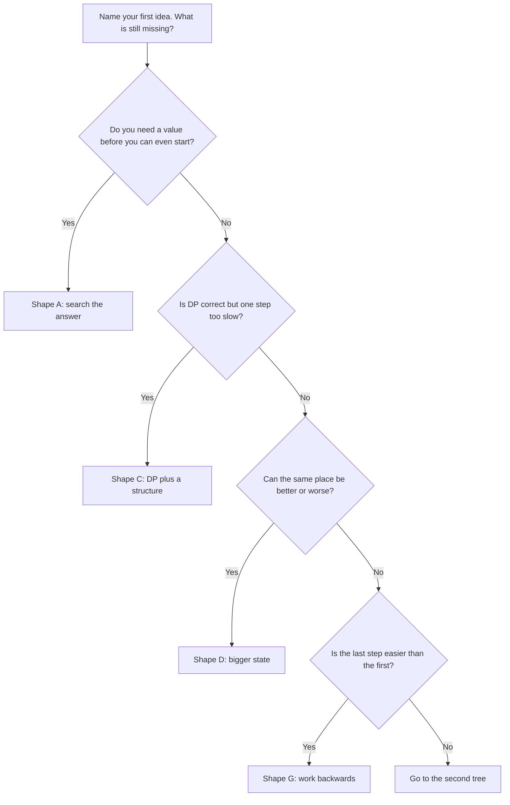
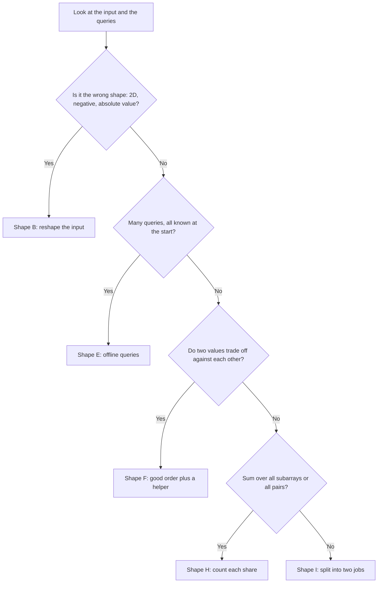

# Recognition Drills: Hard

> **Level:** Advanced · **Priority:** T1 · **Time:** 240 min · **Read first:** [Recognition Drills: Medium](10-recognition-drills-medium.md), [Lookalike Patterns](07-lookalike-patterns.md) · **Next:** [When You Do Not Recognize the Problem](12-when-you-do-not-recognize-it.md)

This chapter has 80 short Hard and Expert-level problems for you to name before you open the answer. Most Hard problems are not new ideas. They are two ideas you already know, joined together. Here you learn to see both parts and how they fit.

## Quick revision

- A Hard problem usually hides **two** patterns. Do not stop after you find the first one.
- After you name a pattern, ask: "What is still too slow, or what is still unknown?" That gap is the second pattern.
- **Smallest maximum, largest minimum:** binary search on the answer, if you can check a guess fast. The check inside is a second pattern (shape A). [D32](#d32) has no fast check.
- **A sum with negative numbers, a matrix, an absolute value, or a strange formula:** try to reshape the input first (shape B).
- **The DP loop must find the best earlier state:** add binary search, a heap, a segment tree, or a monotonic queue if the range only slides forward (shape C).
- **The same place can be better or worse:** add what you carry to the state (shape D).
- **Many queries with a limit, and you know them all at the start:** sort the queries and answer them offline (shape E).
- **Two values matter at once:** sort by one, and keep the other in a heap or a union-find (shape F).
- **Going forward has too many choices:** try to run the process backwards (shape G).
- **"Sum over all subarrays" or "all substrings":** count how much each item adds (shape H).
- **Two separate questions in one story:** solve them one at a time, each with its own tool (shape I).
- Very small limits are a clue: n up to 12 or 20 often means bitmask, and n up to 40 often means meet in the middle. Check the other limits too: [D51](#d51) has n = 20, but its small total length points to DP.
- A limit that is huge, such as k up to 10^15, means you cannot step one by one. Look for matrix power, math or counting.
- If a story feels strange, rewrite it in one line with no story words. The real question is usually a known one.

## How to use these drills

1. Read the problem. Do not open the answer.
2. Take at most 3 minutes. Say out loud: the input shape, the goal, what the limits allow, and your choice.
3. If you think two patterns join, say what each part does. "Binary search plus BFS" is not enough. Say "binary search picks the wait time, and BFS checks it."
4. Open the answer. Check your **reason**, not only the name. A different technique is fine if it is fast enough and you can explain why it works.
5. Write down each miss in one line: which clue did you not see?

Each answer has the same parts:

| Part | What it tells you |
|---|---|
| **Pattern** | The technique, or two techniques joined with `+` |
| **Hidden question** | Only for story problems: the plain question under the story |
| **Giveaway** | The exact words or limits that point to the technique |
| **Lookalike** | The tempting wrong idea, and why it fails |
| **How the parts fit** | Only for joined patterns: the job of each part. The letter is the shape from section 2 |
| **How it works** | Only for single patterns: the key step of the method |
| **Read** | The chapter that teaches it, and the real problem |

The limits in each drill come from LeetCode and may change a little over time. Use them to guide your choice, not as exact facts.

## 1. Why Hard problems feel different

Here is a Medium problem that shows the idea. The problem is [Capacity To Ship Packages Within D Days](https://leetcode.com/problems/capacity-to-ship-packages-within-d-days/) (LeetCode 1011, Medium). Boxes must ship in order. Each day the ship carries a block of neighbouring boxes, up to its capacity. Find the smallest capacity that ships everything in `days` days.

```text
weights = [3, 2, 2, 4], days = 2
```

The first idea is "fill the ship", which is greedy. But greedy needs a capacity, and the capacity is what you are looking for. That gap is the signal for a second pattern.

So you **guess** a capacity, and greedy **checks** the guess. If a capacity works, any larger one also works. That makes binary search safe. The capacity must be at least 4 (the heaviest box) and at most 11 (the total).

| Step | low | high | Guess | Days greedy needs | Works? |
|---|---|---|---|---|---|
| 1 | 4 | 11 | 7 | 2: `[3,2,2]`, `[4]` | yes, so high = 7 |
| 2 | 4 | 7 | 5 | 3: `[3,2]`, `[2]`, `[4]` | no, so low = 6 |
| 3 | 6 | 7 | 6 | 2: `[3,2]`, `[2,4]` | yes, so high = 6 |

Now low equals high, so the answer is 6.

Neither part solves this alone. Greedy cannot pick the capacity. Binary search cannot test a capacity. Each part fills the gap in the other. This is what "two patterns" means, and it is the skill this chapter trains.

## 2. The nine ways two patterns join

Almost every joined problem in this chapter has one of nine shapes. Learn the shapes, because the drills use their letters. Start with the two trees below, then use the table to reach the chapter you need.

The first tree looks at the goal and the state.



The second tree looks at the input and the queries.



| Shape | The join | Part 1 does | Part 2 does | Read |
|---|---|---|---|---|
| A | Search the answer | Guesses a value | Checks the guess with greedy, BFS or two pointers | [Binary search on the answer](../04-sorting-searching/07-binary-search-on-answer.md) |
| B | Reshape the input | Sorts, maps, flattens a matrix or removes an absolute value | Runs a known pattern on the new input | [Transform the input](../05-core-patterns/21-transform-the-input.md) |
| C | DP plus a structure | Defines the DP | Finds the best earlier state fast | [DP optimizations](../09-dynamic-programming/15-dp-optimizations.md) |
| D | Bigger state | Runs BFS or DP | Adds a mask, a count or a second walker to the state | [DP state design tricks](../09-dynamic-programming/16-dp-state-design-tricks.md) |
| E | Offline queries | Puts queries and data in one good order | Keeps a structure that holds only what the current query may use | [Offline query processing](../05-core-patterns/20-offline-query-processing.md) |
| F | Good order plus a helper | Sorting fixes one value | A heap or union-find handles the other value | [Top K with heaps](../05-core-patterns/14-top-k-and-heaps.md), [Union-Find](../08-graphs/07-union-find.md) |
| G | Work backwards | Finds what the last step must have been | Undoes steps, often with a heap or a graph | [Transform the input](../05-core-patterns/21-transform-the-input.md) |
| H | Count each share | Asks how much one item adds | A stack or prefix sums finds that amount fast | [Contribution technique](../05-core-patterns/18-contribution-technique.md) |
| I | Two separate jobs | Solves one sub-question | Solves the other, using the first result | [How to Recognize Any Problem](01-how-to-recognize-any-problem.md) |

## Round 1: drills 1 to 10

### D1

A freelancer sees a list of jobs. Each job has a start time, an end time and a payment. She cannot do two jobs at once, but one job may start at the exact moment another ends. Find the largest total payment. There are up to 50,000 jobs.

<details>
<summary>Answer</summary>

**Pattern:** Sorting + 1D DP + Binary search on index

**Hidden question:** Choose non-overlapping intervals with the largest total weight.

**Giveaway:** "cannot do two at once" with **different** payments, and "largest total".

**Lookalike:** The greedy rule "earliest end first" works only when every job is worth the same. A job from 1 to 10 paying 100 and a job from 1 to 2 paying 1 break it. Greedy takes the small job and loses the big one.

**How the parts fit (shape C):** Sorting by end time gives the DP an order. The DP makes the choice for each job: skip it, or take it and add the best result that ends by its start. Binary search finds that earlier position, so each step costs O(log n).

**Read:** [1D DP](../09-dynamic-programming/02-one-dimensional-dp.md). Real problem: [Maximum Profit in Job Scheduling](https://leetcode.com/problems/maximum-profit-in-job-scheduling/) (LeetCode 1235, Hard).

</details>

### D2

You get an unsorted list of integers. Some are negative, and some repeat. Find the smallest positive integer that is not in the list. You must use O(n) time and O(1) extra memory.

<details>
<summary>Answer</summary>

**Pattern:** Cyclic sort

**Giveaway:** "smallest missing positive" together with "O(n) time and O(1) memory". With n numbers, the answer is between 1 and n + 1. So each useful value v has a natural home: index v - 1.

**Lookalike:** A hash set costs O(n) memory. Sorting costs O(n log n) time. The array itself must act as the hash table, so you swap each value to its home. Then the first index that holds the wrong value gives the answer.

**Read:** [Cyclic sort](../05-core-patterns/10-cyclic-sort.md). Real problem: [First Missing Positive](https://leetcode.com/problems/first-missing-positive/) (LeetCode 41, Hard).

</details>

### D3

You stand in the top-left cell of a grid, and a safe house is in the bottom-right cell. Some cells are walls, and some are on fire. Each minute you may step to a neighbouring cell, then the fire spreads to all cells next to a burning one. You may wait at the start for some minutes before you leave. Find the longest wait that still lets you arrive safely. You may reach the safe house in the same minute as the fire, but no other cell. Return -1 if you can never make it, and 10^9 if you can wait for ever. The grid has up to 20,000 cells.

<details>
<summary>Answer</summary>

**Pattern:** Binary search on answer + Multi-source BFS

**Giveaway:** "the longest wait that still lets you arrive". If waiting w minutes is safe, then waiting less is also safe. "Some are on fire" means many BFS starts.

**Lookalike:** Simulating the fire again for each possible wait repeats the same work. The fire does not depend on you, so compute it only once.

**How the parts fit (shape A):** First run one multi-source BFS from all fires. This stores the minute each cell starts to burn. Then binary search on the wait w. For each w, a normal BFS moves you, and it may enter a cell only before the fire reaches it (the safe house also allows the same minute). The first BFS is the data, the second BFS is the check, and binary search picks the guess.

**Read:** [Binary search on the answer](../04-sorting-searching/07-binary-search-on-answer.md), [BFS shortest path patterns](../08-graphs/04-bfs-shortest-path-patterns.md). Real problem: [Escape the Spreading Fire](https://leetcode.com/problems/escape-the-spreading-fire/) (LeetCode 2258, Hard).

</details>

### D4

People stand in a line, and all heights are different. Person i can see person j on the right if everyone between them is shorter than both of them. For each person, count how many people they can see. There are up to 100,000 people.

<details>
<summary>Answer</summary>

**Pattern:** Monotonic stack

**Giveaway:** "everyone between them is shorter", and one answer for each position. Both clues point to a stack that throws away people who can no longer matter.

**Lookalike:** "Next greater element" is close, but it finds only one person. Here you must count everyone that person i sees before the view is blocked.

**How it works:** Scan from right to left, and keep a stack with the nearest person on top, where heights grow towards the bottom. Person i sees every shorter person on top, so pop them and count them. If the stack is still not empty, person i also sees that first taller person, so add 1. Everyone popped is hidden behind person i for all people further left.

**Read:** [Monotonic stack](../05-core-patterns/12-monotonic-stack.md). Real problem: [Number of Visible People in a Queue](https://leetcode.com/problems/number-of-visible-people-in-a-queue/) (LeetCode 1944, Hard).

</details>

### D5

You must paint n walls. A paid painter takes `time[i]` hours for wall i and charges `cost[i]`. A free painter paints any wall in 1 hour at no cost, but works only while the paid painter is busy. Find the smallest total cost. n is at most 500.

<details>
<summary>Answer</summary>

**Pattern:** 0/1 knapsack

**Hidden question:** If the paid painter takes wall i, you pay `cost[i]` and finish `time[i] + 1` walls: that wall, plus `time[i]` walls for the free painter. Choose walls so that the sum of `time[i] + 1` is at least n, at the smallest cost.

**Giveaway:** Take it or leave it for each wall, n up to 500, and a target to reach. The story sounds like scheduling, but the order of the work never matters.

**Lookalike:** A greedy rule such as "best cost per hour" fails, because walls are whole items. This is why it is 0/1 knapsack. Use `dp[j]` as the smallest cost to finish j walls, and treat any j above n as n.

**Read:** [0/1 knapsack](../09-dynamic-programming/04-zero-one-knapsack.md). Real problem: [Painting the Walls](https://leetcode.com/problems/painting-the-walls/) (LeetCode 2742, Hard).

</details>

### D6

The score of a string is the number of characters that appear exactly once in it. Add up the scores of all substrings of `s`. The length of `s` is up to 100,000.

<details>
<summary>Answer</summary>

**Pattern:** Contribution technique

**Giveaway:** "add up over all substrings". There are about n squared / 2 substrings, so you cannot list them.

**Lookalike:** A sliding window needs a rule to keep or break a window. Here every substring counts, so no window is ever thrown away.

**How it works:** Flip the question. For one occurrence at index i, in how many substrings does it appear exactly once? The substring must start after the previous copy and end before the next copy. So the count is `(i - previous) * (next - i)`. Use -1 if there is no previous copy, and n if there is no next copy. Add this for every index.

**Read:** [Contribution technique](../05-core-patterns/18-contribution-technique.md). Real problem: [Count Unique Characters of All Substrings of a Given String](https://leetcode.com/problems/count-unique-characters-of-all-substrings-of-a-given-string/) (LeetCode 828, Hard).

</details>

### D7

A delivery drone must visit every town on a small map. There are at most 12 towns, the map is connected, and all roads take the same time. The drone may start and stop in any town. It may use a road or a town many times. Find the fewest road trips it needs.

<details>
<summary>Answer</summary>

**Pattern:** State-space BFS + Bitmask DP

**Hidden question:** Find the shortest walk that visits all nodes of an unweighted graph.

**Giveaway:** "at most 12 towns", "fewest", and "same time". The word "many times" is also a clue: a plain `visited[town]` array cannot work.

**Lookalike:** Plain BFS marks a town as done after the first visit. But coming back to a town can be useful if you now have more towns behind you.

**How the parts fit (shape D):** BFS gives the fewest steps, because each step costs the same. The mask records which towns you have seen. A state is (town, mask), so there are at most 12 * 4096 states. Start from every town at once. Stop at the first state whose mask is full.

**Read:** [BFS shortest path patterns](../08-graphs/04-bfs-shortest-path-patterns.md), [Bitmask DP](../09-dynamic-programming/12-bitmask-dp.md). Real problem: [Shortest Path Visiting All Nodes](https://leetcode.com/problems/shortest-path-visiting-all-nodes/) (LeetCode 847, Hard).

</details>

### D8

Given a linked list, reverse each block of k nodes. If fewer than k nodes are left at the end, keep them as they are. Use O(1) extra memory.

<details>
<summary>Answer</summary>

**Pattern:** In-place linked list reversal

**Giveaway:** "reverse" on a linked list, plus "O(1) extra memory".

**Lookalike:** Copying values into an array or a stack costs extra memory. Recursion is short to write, but it costs stack space for each block.

**How it works:** The reversal itself is the easy part. The hard part is the wiring. Count k nodes first, so that you never reverse a short block. Keep the tail of the block before, so that you can link it to the new head.

**Read:** [In-place linked list reversal](../05-core-patterns/11-in-place-linked-list-reversal.md). Real problem: [Reverse Nodes in k-Group](https://leetcode.com/problems/reverse-nodes-in-k-group/) (LeetCode 25, Hard).

</details>

### D9

A server log is a list of user ids, one for each request. Count the unbroken stretches of the log that contain exactly k different users. The log has up to 20,000 entries.

<details>
<summary>Answer</summary>

**Pattern:** Variable sliding window

**Hidden question:** Count the subarrays with exactly k distinct values.

**Giveaway:** "unbroken stretches" means subarrays. "Exactly k different" is the known trap.

**Lookalike:** A single window fails. A window can be good, grow, stop being good, and shorter windows inside it can still be good. Prefix sums also fail, because distinct counts cannot be subtracted.

**How it works:** "At most k" is monotonic, so a window can count it. Then `exactly(k) = atMost(k) - atMost(k - 1)`.

**Read:** [Variable sliding window](../05-core-patterns/05-sliding-window-variable.md). Real problem: [Subarrays with K Different Integers](https://leetcode.com/problems/subarrays-with-k-different-integers/) (LeetCode 992, Hard).

</details>

### D10

You get a grid of letters and up to 30,000 words. A word can be traced through cells that touch by an edge, and one word cannot use the same cell twice. Return all the words that can be traced.

<details>
<summary>Answer</summary>

**Pattern:** Trie + Backtracking: constraint search

**Giveaway:** One grid and **many** words. Searching for one word is plain backtracking. Many words with shared beginnings point to a trie.

**Lookalike:** Searching each word on its own repeats the same paths. A hash set of words cannot say "no word starts like this", so it cannot stop a bad path early.

**How the parts fit (shape I):** Backtracking walks the grid. The trie walks at the same time, one letter per step. If the letters so far are not a prefix of any word, the search stops. The trie is what makes the backtracking fast.

**Read:** [Trie](../07-trees/13-trie.md), [Backtracking: constraint search](../06-recursion-backtracking-greedy/04-backtracking-constraint-search.md). Real problem: [Word Search II](https://leetcode.com/problems/word-search-ii/) (LeetCode 212, Hard).

</details>

## Round 2: drills 11 to 20

### D11

Each envelope has a width and a height. One fits inside another only if both its width and its height are strictly smaller. You cannot rotate them. Find the longest chain of envelopes where each one fits inside the next. There are up to 100,000 envelopes.

<details>
<summary>Answer</summary>

**Pattern:** Sorting with custom order + LIS DP

**Giveaway:** "longest chain" where each item must be larger than the one before. Two values must both grow, so fix one of them by sorting.

**Lookalike:** The simple O(n^2) LIS is too slow for 100,000 items. Sorting both values in ascending order is also wrong. `(3,4)` and `(3,5)` have the same width, but heights 4 then 5 look like a valid chain of 2.

**How the parts fit (shape B):** Sort by width ascending, and by height **descending** when widths tie. Now any strictly increasing subsequence of heights must use different widths. So the problem becomes LIS on heights, which takes O(n log n) with binary search.

**Read:** [Longest increasing subsequence](../09-dynamic-programming/06-longest-increasing-subsequence.md), [Sorting with a custom order](../04-sorting-searching/05-custom-sorting.md). Real problem: [Russian Doll Envelopes](https://leetcode.com/problems/russian-doll-envelopes/) (LeetCode 354, Hard).

</details>

### D12

A row of balloons has numbers on them. Bursting a balloon pays its number times the numbers of its current left and right neighbours. A missing neighbour counts as 1. You must burst all of them. Find the most coins you can earn. There are at most 300 balloons.

<details>
<summary>Answer</summary>

**Pattern:** Interval DP

**Giveaway:** The items are used up one at a time, each step depends on the current neighbours, and n up to 300 allows O(n^3).

**Lookalike:** Trying every order costs n! steps. Greedy fails, because bursting one balloon changes the value of the others.

**How it works:** Do not ask which balloon goes **first**, because then the neighbours keep changing. Ask which balloon in a range goes **last**. When it bursts, the rest of the range is gone, so its neighbours are the two values just outside the range. The left and right parts are now independent.

**Read:** [Interval DP](../09-dynamic-programming/09-interval-dp.md). Real problem: [Burst Balloons](https://leetcode.com/problems/burst-balloons/) (LeetCode 312, Hard).

</details>

### D13

A courier rides an electric bike and can recharge in any city. Roads join the cities, and one pair of cities may have several roads. Each query gives two cities and a range limit. Can she get from one to the other using only roads strictly shorter than the limit? There are up to 100,000 roads and 100,000 queries.

<details>
<summary>Answer</summary>

**Pattern:** Offline query processing + Union-Find

**Hidden question:** Are two nodes connected if you keep only the edges below a limit?

**Giveaway:** All queries are given at the start, and each has a threshold. The word "recharge" means that only single roads matter, not the total length.

**Lookalike:** A BFS for each query costs too much in total. Dijkstra finds total distance, which this problem does not ask for.

**How the parts fit (shape E):** Sort the queries by limit, and sort the roads by length. Go through the queries from the smallest limit. Before each one, add all roads shorter than its limit to the union-find. Edges are only added, never removed, and that is what union-find does well. Each query is then one check: do the two cities have the same root?

**Read:** [Offline query processing](../05-core-patterns/20-offline-query-processing.md), [Union-Find](../08-graphs/07-union-find.md). Real problem: [Checking Existence of Edge Length Limited Paths](https://leetcode.com/problems/checking-existence-of-edge-length-limited-paths/) (LeetCode 1697, Hard).

</details>

### D14

You have n computers and some batteries. Battery i lasts `batteries[i]` minutes and cannot be recharged. A computer uses one battery at a time. You may swap batteries at any moment, and swapping takes no time. Find the largest number of minutes that all n computers can run at the same time. There are up to 100,000 batteries, and each lasts up to 10^9 minutes.

<details>
<summary>Answer</summary>

**Pattern:** Binary search on answer + Greedy

**Giveaway:** "largest number of minutes that all..." If T minutes is possible, then T - 1 is also possible.

**Lookalike:** Simulating swaps with a heap is hard, because a swap can happen at any moment.

**How the parts fit (shape A):** Guess T. One battery can serve only one computer at a time, so it can give at most T useful minutes. T works exactly when the sum of `min(battery, T)` is at least `n * T`. This is needed, because the computers need `n * T` minutes in total. It is also enough: lay the capped batteries end to end across n rows of length T. A capped battery is at most T long, so it never overlaps itself. Use `long long`, because the sum can reach 10^14.

**Read:** [Binary search on the answer](../04-sorting-searching/07-binary-search-on-answer.md). Real problem: [Maximum Running Time of N Computers](https://leetcode.com/problems/maximum-running-time-of-n-computers/) (LeetCode 2141, Hard).

</details>

### D15

Work out the value of a string that holds numbers, `+`, `-`, parentheses and spaces. A minus can come before a parenthesis, as in `-(2+3)`. You may not use a built-in evaluator.

<details>
<summary>Answer</summary>

**Pattern:** Expression parsing

**Giveaway:** Parentheses that nest. A nested thing means you must save your place and come back later.

**Lookalike:** The two-stack method with operator priority also works, but there is no `*` or `/` here, so you do not need it.

**How it works:** Keep a running result and the current sign. At `(`, push both on a stack and start fresh. At `)`, pop them and combine. Recursion does the same job, and the call stack is the stack.

**Read:** [Stacks for expressions and parentheses](../03-linked-lists-stacks-queues/06-stack-expressions-and-parentheses.md). Real problem: [Basic Calculator](https://leetcode.com/problems/basic-calculator/) (LeetCode 224, Hard).

</details>

### D16

You get a tree with up to 30,000 nodes. For each node, find the sum of its distances to all other nodes.

<details>
<summary>Answer</summary>

**Pattern:** Rerooting DP

**Giveaway:** "for each node", and the answer depends on the whole tree.

**Lookalike:** BFS from every node costs O(n^2), which is too slow here.

**How it works:** Use one DFS to get the answer for the root and the size of each subtree. Then move the root from a parent p to its child c. The `size[c]` nodes in c's subtree each get 1 closer, and the other `n - size[c]` nodes each get 1 farther. So `answer[c] = answer[p] - size[c] + (n - size[c])`. A second DFS fills in every node.

**Read:** [Tree DP](../09-dynamic-programming/11-tree-dp.md). Real problem: [Sum of Distances in Tree](https://leetcode.com/problems/sum-of-distances-in-tree/) (LeetCode 834, Hard).

</details>

### D17

Each course has a length in days and a last day by which it must be finished. You take one course at a time, starting on day 1. Find the most courses you can finish. There are up to 10,000 courses.

<details>
<summary>Answer</summary>

**Pattern:** Regret greedy

**Giveaway:** Deadlines, "most items", and a choice you may wish to undo later.

**Lookalike:** "Shortest course first" ignores deadlines. A table of course by day has too many cells.

**How the parts fit (shape F):** Sort by last day, so that you always face the tightest deadline first. Take each course, and put its length in a max-heap. If the total time passes this course's last day, remove the longest course taken. The count stays the same as before, and you get as much free time back as you can. Sorting gives the order, and the heap gives the undo.

**Read:** [Classic greedy algorithms](../06-recursion-backtracking-greedy/07-greedy-classics.md), [Top K with heaps](../05-core-patterns/14-top-k-and-heaps.md). Real problem: [Course Schedule III](https://leetcode.com/problems/course-schedule-iii/) (LeetCode 630, Hard).

</details>

### D18

Find the longest strictly increasing subsequence of an array, where two neighbours in the subsequence differ by at most k. The array has up to 100,000 values, each up to 100,000.

<details>
<summary>Answer</summary>

**Pattern:** LIS DP + Segment tree

**Giveaway:** "longest increasing subsequence" with one extra rule on the gap.

**Lookalike:** The usual binary search LIS keeps only the smallest tails, and it cannot enforce a gap. A monotonic queue also fails, because the values arrive in random order, so the range `[x - k, x - 1]` does not move forward.

**How the parts fit (shape C):** Let `dp[v]` be the longest valid subsequence that ends in value v. For a new value x, `dp[x] = 1 + max(dp[v])` for v in `[x - k, x - 1]`. That is a range maximum with a point update, which is what a segment tree over values does. The DP defines the answer, and the tree makes each step O(log M), where M is the largest value.

**Read:** [DP optimizations](../09-dynamic-programming/15-dp-optimizations.md), [Segment tree](../12-advanced-data-structures/01-segment-tree.md). Real problem: [Longest Increasing Subsequence II](https://leetcode.com/problems/longest-increasing-subsequence-ii/) (LeetCode 2407, Hard).

</details>

### D19

A log file is one long text of up to 30,000 characters. Find the longest piece of text that appears at least twice. The two copies may overlap.

<details>
<summary>Answer</summary>

**Pattern:** Binary search on answer + Rolling hash

**Hidden question:** Find the longest duplicate substring.

**Giveaway:** "longest ... at least twice". If a piece of length L repeats, then a piece of length L - 1 also repeats. That makes length safe to binary search.

**Lookalike:** A DP table on the string against itself needs O(n^2) time and is too slow here. A sliding window has no rule for when to shrink.

**How the parts fit (shape A):** Binary search picks a length L. A rolling hash then checks all pieces of length L in O(n) on average, with a hash set of seen values. Compare the real text when two hashes match, because different pieces can share a hash. A suffix array is a stronger second option.

**Read:** [Rabin-Karp and rolling hash](../10-string-algorithms/04-rabin-karp-and-rolling-hash.md), [Suffix arrays and LCP](../10-string-algorithms/06-suffix-arrays-and-lcp.md). Real problem: [Longest Duplicate Substring](https://leetcode.com/problems/longest-duplicate-substring/) (LeetCode 1044, Hard).

</details>

### D20

Children stand in a line, and each has a rating. Each child gets at least one candy. A child with a higher rating than a direct neighbour must get more candy than that neighbour. Find the smallest total.

<details>
<summary>Answer</summary>

**Pattern:** Prefix and suffix scan

**Giveaway:** Each position has one rule for its left side and one for its right side.

**Lookalike:** A DP has no clear order, because both sides matter. Processing children by rating with a sort also works, but it costs O(n log n) and needs more code.

**How it works:** Scan left to right to satisfy only the left neighbour. Scan right to left to satisfy only the right neighbour. Each child takes the larger of the two values. This meets both rules, and no child gets more than needed.

**Read:** [Left and right scans](../05-core-patterns/22-left-and-right-scans.md), [Greedy foundations](../06-recursion-backtracking-greedy/06-greedy-foundations.md). Real problem: [Candy](https://leetcode.com/problems/candy/) (LeetCode 135, Hard).

</details>

## Round 3: drills 21 to 30

### D21

A 2 by 3 board holds tiles 1 to 5 and one empty space. A move slides a tile that touches the empty space into it. Find the fewest moves to reach `[[1,2,3],[4,5,0]]`, or -1 if you cannot.

<details>
<summary>Answer</summary>

**Pattern:** State-space BFS

**Giveaway:** "fewest moves" on a very small board. There are only 6! = 720 ways to arrange it.

**Lookalike:** DFS can reach the goal, but its first path is not the shortest one. A grid BFS on tile positions is also wrong, because the whole board changes with each move.

**How it works:** Treat each full board as one node, stored as a string such as `"123450"`. Each move is an edge. Then run plain BFS with a visited set.

**Read:** [BFS shortest path patterns](../08-graphs/04-bfs-shortest-path-patterns.md). Real problem: [Sliding Puzzle](https://leetcode.com/problems/sliding-puzzle/) (LeetCode 773, Hard).

</details>

### D22

You get an integer matrix of up to 100 by 100 cells, and values may be negative. Count the submatrices whose values add up to a target.

<details>
<summary>Answer</summary>

**Pattern:** Prefix sum with hash map

**Giveaway:** Same problem as "count subarrays with sum k", but in 2D. "Negative" rules out a window. The size of 100 allows O(n^3).

**Lookalike:** A 2D prefix table gives each sum in O(1), but there are about n^4 submatrices to check.

**How the parts fit (shape B):** Fix a top row and a bottom row. Add up the columns between them to get a single 1D array. Update that array as the bottom row moves down, so that each pair costs only O(columns) to build. Now it is the 1D problem: count subarrays with a target sum, using prefix sums and a hash map. There are O(rows^2) row pairs, and each costs O(columns) on average. The two rows flatten the matrix, and the hash map does the counting.

**Read:** [Prefix sums](../05-core-patterns/06-prefix-sums.md), [Matrix problems](../02-arrays-strings-hashing/05-matrix-problems.md). Real problem: [Number of Submatrices That Sum to Target](https://leetcode.com/problems/number-of-submatrices-that-sum-to-target/) (LeetCode 1074, Hard).

</details>

### D23

Write the numbers 1 to n as text and sort them like dictionary words: 1, 10, 100, 11, and so on. Find the k-th one. n can be up to 10^9.

<details>
<summary>Answer</summary>

**Pattern:** K-th by counting

**Giveaway:** "k-th", with n too large to build the list.

**Lookalike:** Sorting or a heap must touch all n numbers. A real trie has the same problem.

**How it works:** Picture a trie that you never build: under 1 sit 10 to 19, under 10 sit 100 to 109, and so on. For a prefix p, you can compute how many numbers up to n start with p. If that count does not reach k, skip the whole group and move to p + 1. Otherwise step down into p * 10. Each step uses counting, not listing. Use `long long`, because p * 10 can pass the `int` range.

**Read:** [Binary search on the answer](../04-sorting-searching/07-binary-search-on-answer.md), [Trie](../07-trees/13-trie.md). Real problem: [K-th Smallest in Lexicographical Order](https://leetcode.com/problems/k-th-smallest-in-lexicographical-order/) (LeetCode 440, Hard).

</details>

### D24

Each cell of a grid has an arrow that points to one neighbour. You start at the top-left and follow arrows. You may change the arrow of a cell for a cost of 1. Find the smallest total cost that creates a path to the bottom-right cell.

<details>
<summary>Answer</summary>

**Pattern:** 0-1 BFS

**Giveaway:** Each move costs either 0 (follow the arrow) or 1 (change it). Only two costs exist.

**Lookalike:** Plain BFS counts steps, but steps here have different costs. Dijkstra is correct, but a deque is simpler and removes the log factor.

**How it works:** Use a deque. A move of cost 0 goes to the front, and a move of cost 1 goes to the back. The deque then stays in order of distance.

**Read:** [BFS shortest path patterns](../08-graphs/04-bfs-shortest-path-patterns.md), [Deque](../03-linked-lists-stacks-queues/09-deque.md). Real problem: [Minimum Cost to Make at Least One Valid Path in a Grid](https://leetcode.com/problems/minimum-cost-to-make-at-least-one-valid-path-in-a-grid/) (LeetCode 1368, Hard).

</details>

### D25

Given an array and a number k, find the median of every block of k neighbouring values. The array has up to 100,000 values.

<details>
<summary>Answer</summary>

**Pattern:** Two heaps + Lazy deletion

**Giveaway:** A block that moves one step at a time, and "median". The median means you need the middle, not the edge.

**Lookalike:** A monotonic queue tracks only a maximum or a minimum. Sorting each block costs too much.

**How the parts fit (shape I):** A fixed window decides what enters and leaves. Two heaps hold the lower half and the upper half, so the median sits on top. A heap cannot remove a value from the middle. So you note the leaving value in a hash map, and you drop it only when it reaches the top. Two multisets are an easier second option.

**Read:** [Two heaps](../05-core-patterns/15-two-heaps.md), [Fixed sliding window](../05-core-patterns/04-sliding-window-fixed.md). Real problem: [Sliding Window Median](https://leetcode.com/problems/sliding-window-median/) (LeetCode 480, Hard).

</details>

### D26

A camera on a node of a binary tree watches that node, its parent and its children. Find the smallest number of cameras that watch every node.

<details>
<summary>Answer</summary>

**Pattern:** Tree DP

**Giveaway:** A smallest count on a tree, where each node's choice affects its parent and its children.

**Lookalike:** "Use every second level" fails on uneven trees. BFS from the top fails, because a node cannot decide until it knows about its children.

**How it works:** Go bottom-up in post-order. Each node reports one of three states: has a camera, is watched, or needs watching. If a child needs watching, this node must take a camera. If the root still needs watching at the end, give it a camera too. Unless the tree has only one node, never put a camera on a leaf, because its parent covers more nodes.

**Read:** [Tree DP](../09-dynamic-programming/11-tree-dp.md). Real problem: [Binary Tree Cameras](https://leetcode.com/problems/binary-tree-cameras/) (LeetCode 968, Hard).

</details>

### D27

Each puzzle has 7 different letters. A word is valid for a puzzle if it contains the puzzle's first letter and all of its letters appear in the puzzle. For each puzzle, count the valid words. There are up to 100,000 words and 10,000 puzzles.

<details>
<summary>Answer</summary>

**Pattern:** Bit manipulation + Hash map lookup

**Giveaway:** Only **which** letters appear matters, not how many. Also, 7 letters is a tiny number.

**Lookalike:** Comparing every word with every puzzle is 10^9 checks. A trie of each word's sorted letters works, but it is harder to write than masks.

**How the parts fit (shape B):** Turn each word into a 26-bit mask, and count the masks in a hash map. For a puzzle, list all subsets of its other 6 letters (64 of them), add the first letter to each, and look them up. Masks reshape the words, and the small side (64 subsets) is what you list. Each lookup is O(1) on average.

**Read:** [Bit manipulation](../05-core-patterns/17-bit-manipulation.md), [Bitmask DP](../09-dynamic-programming/12-bitmask-dp.md). Real problem: [Number of Valid Words for Each Puzzle](https://leetcode.com/problems/number-of-valid-words-for-each-puzzle/) (LeetCode 1178, Hard).

</details>

### D28

Start with an array of n ones. In one step, you replace any element with the sum of the whole array. Can you reach a given target array?

<details>
<summary>Answer</summary>

**Pattern:** Reverse the process + Heap simulation

**Giveaway:** "Can you reach" from a simple start, where going forward has a choice at every step.

**Lookalike:** BFS forward has too many states. Values can be up to 10^9.

**How the parts fit (shape G):** Going backwards has **no** choice. The last value written is a sum of everything, so it is the largest. Undo it: largest minus the sum of the rest. A max-heap gives the largest each time. If one value is huge and the others are small, the same element is undone many times. So use modulo to do those steps at once. Use `long long` for the sum.

**Read:** [Transform the input](../05-core-patterns/21-transform-the-input.md), [Top K with heaps](../05-core-patterns/14-top-k-and-heaps.md). Real problem: [Construct Target Array With Multiple Sums](https://leetcode.com/problems/construct-target-array-with-multiple-sums/) (LeetCode 1354, Hard).

</details>

### D29

Each node of a tree has a value. A good path has the same value at both ends, and no node on it has a larger value. A single node counts as a good path. Count the good paths. There are up to 30,000 nodes.

<details>
<summary>Answer</summary>

**Pattern:** Sorting + Union-Find

**Giveaway:** "no node on it has a larger value". Any rule of the form "all values on the path are at most X" suggests adding nodes in order of value.

**Lookalike:** A DFS from each node costs O(n^2). Centroid decomposition works but is far harder.

**How the parts fit (shape F):** Process values from small to large. When you add a node, join it to neighbours that are already added. Every component now holds only values up to the current one, so the "at most" rule is true by itself. If a component has c nodes of the current value, it holds `c * (c + 1) / 2` good paths, counting the single nodes. Sorting removes the rule, and union-find tracks who can reach whom.

**Read:** [Union-Find](../08-graphs/07-union-find.md). Real problem: [Number of Good Paths](https://leetcode.com/problems/number-of-good-paths/) (LeetCode 2421, Hard).

</details>

### D30

A pattern can hold `.`, which matches any one character, and `*`, which means zero or more of the character before it. Does the pattern match the whole string?

<details>
<summary>Answer</summary>

**Pattern:** LCS DP

**Giveaway:** Two strings compared from the front, and a symbol that makes you choose how much to use.

**Lookalike:** Greedy fails. With `s = "aaa"` and `p = "a*a"`, a greedy `a*` eats all three letters, and the last `a` in the pattern has nothing left to match. KMP cannot handle wildcards.

**How it works:** Let `dp[i][j]` mean that the first i characters of s match the first j of p. For `*`, try two cases: use it zero times, or use it for one more character.

**Read:** [LCS and edit distance](../09-dynamic-programming/07-lcs-and-edit-distance.md). Real problem: [Regular Expression Matching](https://leetcode.com/problems/regular-expression-matching/) (LeetCode 10, Hard).

</details>

## Round 4: drills 31 to 40

### D31

An integer array may contain negative numbers. Find the length of the shortest non-empty subarray with a sum of at least k, or -1. The array has up to 100,000 values.

<details>
<summary>Answer</summary>

**Pattern:** Prefix sum + Monotonic queue

**Giveaway:** "shortest subarray" looks like a sliding window. "Negative numbers" removes that option.

**Lookalike:** A window breaks, because a new negative number can lower the sum. Binary search over prefix sums also breaks, because they are not sorted when values can be negative.

**How the parts fit (shape B):** A subarray sum is `P[j] - P[i]`, where P is the prefix sum array. For each j, you want the latest i with `P[i] <= P[j] - k`. Keep a deque of indexes with rising prefix values. If `P[j]` is smaller than or equal to the back of the deque, drop the back, because j is later and smaller, so it is a better start. While the front gives a sum of at least k, record the length and drop the front, because a later j cannot make it shorter. Use `long long` for prefix sums.

**Read:** [Monotonic queue](../05-core-patterns/13-monotonic-queue.md), [Prefix sums](../05-core-patterns/06-prefix-sums.md). Real problem: [Shortest Subarray with Sum at Least K](https://leetcode.com/problems/shortest-subarray-with-sum-at-least-k/) (LeetCode 862, Hard).

</details>

### D32

You get a list of job times and k workers, with at most 12 jobs. Each job goes to one worker. Find the assignment that makes the busiest worker's total as small as possible.

<details>
<summary>Answer</summary>

**Pattern:** Branch and bound

**Giveaway:** "12 jobs", and any job can go to any worker. The small limit allows a search over assignments.

**Lookalike:** "Give the longest job to the least busy worker" fails. With jobs `[3,3,2,2,2]` and 2 workers, the best split is 6 and 6, but that greedy gives 7 and 5. It also looks like "split the array" problems, but those keep items in order. Here the order is free, so a simple greedy check does not work.

**How it works:** Backtrack over each job. Cut a branch when a worker's total already reaches the best answer so far. Skip workers with the same current total, because they lead to the same result. Bitmask DP over subsets of jobs also works.

**Read:** [Backtracking: constraint search](../06-recursion-backtracking-greedy/04-backtracking-constraint-search.md), [Bitmask DP](../09-dynamic-programming/12-bitmask-dp.md). Real problem: [Find Minimum Time to Finish All Jobs](https://leetcode.com/problems/find-minimum-time-to-finish-all-jobs/) (LeetCode 1723, Hard).

</details>

### D33

You have k eggs and a building with n floors. There is an unknown floor f. An egg dropped above f breaks, and an egg dropped at f or below does not. Find the fewest drops that always tell you f, even in the worst case. k is at most 100, and n is at most 10,000.

<details>
<summary>Answer</summary>

**Pattern:** DP optimization

**Giveaway:** "fewest ... in the worst case" with a limited resource (eggs).

**Lookalike:** Plain binary search on floors fails, because you can run out of eggs. The direct DP on (eggs, floors) tries every floor at each state, so it costs O(k n^2).

**How it works:** Binary search inside the DP step is one fix. A neater fix is to flip the question. Ask: with m drops and k eggs, how many floors can you handle? One drop tests one floor. If the egg breaks, you have m - 1 drops and k - 1 eggs for the floors below. If not, you have m - 1 drops and k eggs for the floors above. So `f(m, k) = f(m-1, k-1) + f(m-1, k) + 1`. Find the smallest m with `f(m, k) >= n`.

**Read:** [DP optimizations](../09-dynamic-programming/15-dp-optimizations.md), [DP state design tricks](../09-dynamic-programming/16-dp-state-design-tricks.md). Real problem: [Super Egg Drop](https://leetcode.com/problems/super-egg-drop/) (LeetCode 887, Hard).

</details>

### D34

A company has n employees. Each has one favourite person, who is not themselves. Each person will come to a round table only if they can sit next to their favourite. Find the largest number who can be invited.

<details>
<summary>Answer</summary>

**Pattern:** Functional graph + Topological sort

**Giveaway:** "each has one favourite" means each node has **exactly one** outgoing edge. That graph is a functional graph: each part is one cycle with chains flowing into it.

**Lookalike:** It sounds like finding a long cycle in a general graph, which is very hard. The "exactly one outgoing edge" rule makes it easy.

**How the parts fit (shape I):** There are two ways to fill a table. One: a single cycle of 3 or more people, and nobody else fits. Two: pairs who like each other. Each pair can bring a chain of followers on each side, and many such groups can sit together. So the answer is the larger of the longest cycle and the sum over all pairs of `2 + longest chain into one + longest chain into the other`. Peeling nodes with no incoming edges (topological sort) gives the chain lengths and leaves only the cycles.

**Read:** [Strongly connected components](../08-graphs/12-strongly-connected-components.md), [Topological sort](../08-graphs/06-topological-sort.md). Real problem: [Maximum Employees to Be Invited to a Meeting](https://leetcode.com/problems/maximum-employees-to-be-invited-to-a-meeting/) (LeetCode 2127, Hard).

</details>

### D35

A graph has three kinds of edges: Alice-only, Bob-only, and edges both can use. Remove as many edges as you can, so that Alice and Bob can each still reach every node alone. Return -1 if that is not possible.

<details>
<summary>Answer</summary>

**Pattern:** Union-Find + Greedy

**Giveaway:** "remove as many edges" and "still reach every node". An edge is needed only if it joins two separate parts.

**Lookalike:** It looks like a minimum spanning tree, but edges have no weights. The real choice is **which type to use first**.

**How the parts fit (shape F):** Keep one union-find for Alice and one for Bob. Add the shared edges first, because one shared edge does the work of two. Then add each person's own edges. Count an edge as kept only if it joins two separate parts. The answer is total edges minus kept edges, or -1 if either person is left with more than one part. Greedy sets the order, and union-find tells you if an edge is useful.

**Read:** [Union-Find](../08-graphs/07-union-find.md). Real problem: [Remove Max Number of Edges to Keep Graph Fully Traversable](https://leetcode.com/problems/remove-max-number-of-edges-to-keep-graph-fully-traversable/) (LeetCode 1579, Hard).

</details>

### D36

Add the fewest characters to the **front** of a string to make it a palindrome. The string has up to 50,000 characters.

<details>
<summary>Answer</summary>

**Pattern:** KMP

**Hidden question:** Find the longest prefix that is already a palindrome. The rest, reversed, goes in front.

**Giveaway:** "palindrome" and "front". Together they ask about a prefix that equals a reversed suffix, and KMP's table is about prefixes that equal suffixes.

**Lookalike:** Testing each prefix directly, longest first, costs O(n^2) on a longer string shaped like `"aaabaaaa"`. Palindrome DP also needs O(n^2).

**How the parts fit (shape B):** Build `s + "#" + reverse(s)`. The `#` stops a match from running past the middle. The last value of the KMP prefix table is the length of the longest prefix of s that matches the end of reverse(s). That is the longest palindromic prefix. Manacher's algorithm and rolling hashes can also solve it.

**Read:** [KMP](../10-string-algorithms/02-kmp.md), [Palindromes and Manacher's algorithm](../10-string-algorithms/01-palindromes-and-manacher.md). Real problem: [Shortest Palindrome](https://leetcode.com/problems/shortest-palindrome/) (LeetCode 214, Hard).

</details>

### D37

A project needs up to 16 skills. Up to 60 people apply, and each has some of the skills. Find a smallest team that covers every skill.

<details>
<summary>Answer</summary>

**Pattern:** Bitmask DP

**Giveaway:** Two limits side by side: 16 is small and 60 is not. Build the mask over the **small** one.

**Lookalike:** Trying all groups of people costs 2^60. Greedy ("take the person with the most new skills") can give a team that is too large. This is the set cover problem, which has no known fast exact method in general.

**How it works:** Let `dp[mask]` be the smallest team that covers the skills in the mask. For each person, combine them with every mask. That is 2^16 states times 60 people.

**Read:** [Bitmask DP](../09-dynamic-programming/12-bitmask-dp.md). Real problem: [Smallest Sufficient Team](https://leetcode.com/problems/smallest-sufficient-team/) (LeetCode 1125, Hard).

</details>

### D38

Each worker has a quality and a minimum wage. You must hire exactly k workers. Pay within the group must be in proportion to quality, and each person must get at least their minimum wage. Find the smallest total pay. There are up to 10,000 workers.

<details>
<summary>Answer</summary>

**Pattern:** Sorting + Top K with heap

**Giveaway:** Two values pull in different directions: the pay rate and the total quality. "Exactly k" points to a heap that holds the best k.

**Lookalike:** Sorting by wage alone ignores quality. A DP over workers has no small state, because the rate is a real number.

**How the parts fit (shape F):** Every worker has a rate, `wage / quality`. The group must pay the **largest** rate in the group, so the cost is `largest rate * sum of quality`. Sort by rate. As you scan, the current worker sets the rate, and everyone before has a smaller rate. You now need the k smallest qualities seen so far, and a max-heap of size k keeps them. Sorting fixes one value, and the heap handles the other.

**Read:** [Top K with heaps](../05-core-patterns/14-top-k-and-heaps.md). Real problem: [Minimum Cost to Hire K Workers](https://leetcode.com/problems/minimum-cost-to-hire-k-workers/) (LeetCode 857, Hard).

</details>

### D39

Each node of a directed graph has a colour, written as a lowercase letter. The value of a path is how many times its most common colour appears. Find the largest value of any path, or -1 if the graph has a cycle. There are up to 100,000 nodes.

<details>
<summary>Answer</summary>

**Pattern:** Topological sort + DP on a DAG

**Giveaway:** "directed", "-1 if the graph has a cycle", and "best over all paths".

**Lookalike:** Listing all paths is exponential. A plain longest path ignores colour.

**How the parts fit (shape I):** Kahn's topological sort does two jobs. It finds a cycle: some nodes never get processed. It also gives a safe order for the DP. Let `dp[node][colour]` be the largest count of that colour on a path that ends at this node. There are 26 colours, so each edge costs 26 steps.

**Read:** [Topological sort](../08-graphs/06-topological-sort.md). Real problem: [Largest Color Value in a Directed Graph](https://leetcode.com/problems/largest-color-value-in-a-directed-graph/) (LeetCode 1857, Hard).

</details>

### D40

For a number n up to 10^9, count the integers from 0 to n whose binary form has no two 1 bits next to each other.

<details>
<summary>Answer</summary>

**Pattern:** Digit DP

**Giveaway:** "count the integers up to n" with a rule about digits, and n is too large for a loop.

**Lookalike:** Checking each number means up to 10^9 checks.

**How it works:** Walk the bits from high to low. The state is the bit position, the last bit, and "tight", which says if the prefix still equals n's prefix. Without the tight limit, the counts follow the Fibonacci numbers, so you can also use a short table.

**Read:** [Digit DP](../09-dynamic-programming/13-digit-dp.md). Real problem: [Non-negative Integers without Consecutive Ones](https://leetcode.com/problems/non-negative-integers-without-consecutive-ones/) (LeetCode 600, Hard).

</details>

## Round 5: drills 41 to 50

### D41

You get a binary matrix of up to 200 by 200 cells. Find the area of the largest rectangle that holds only 1s.

<details>
<summary>Answer</summary>

**Pattern:** Monotonic stack

**Giveaway:** "largest rectangle" in a grid of 0s and 1s.

**Lookalike:** The DP for the largest **square** does not carry over. A square has one size, but a rectangle has both a width and a height.

**How the parts fit (shape B):** Treat each row as the floor of a histogram. For each column, the bar height is the number of unbroken 1s going up from this row. That is a small DP from the row above. Then each row is the "largest rectangle in a histogram" problem, which a monotonic stack solves in O(columns). The DP reshapes the matrix, and the stack finds the best rectangle.

**Read:** [Monotonic stack](../05-core-patterns/12-monotonic-stack.md). Real problem: [Maximal Rectangle](https://leetcode.com/problems/maximal-rectangle/) (LeetCode 85, Hard).

</details>

### D42

Points are sorted by x, and all x values are different. Find the largest value of `y_i + y_j + |x_i - x_j|` over pairs with `i < j` and `|x_i - x_j| <= k`. There are up to 100,000 points, and at least one such pair exists.

<details>
<summary>Answer</summary>

**Pattern:** Removing absolute values + Monotonic queue

**Giveaway:** An absolute value in a formula, sorted points, and a distance limit.

**Lookalike:** All pairs cost O(n^2). A heap also works, but it costs O(n log n).

**How the parts fit (shape B):** The points are sorted and `i < j`, so `|x_i - x_j| = x_j - x_i`. Group by point: the value is `(y_j + x_j) + (y_i - x_i)`. The first bracket depends only on j. So for each j, you want the largest `y_i - x_i` among earlier points within distance k. That is a sliding window maximum, which a deque solves.

**Read:** [Transform the input](../05-core-patterns/21-transform-the-input.md), [Monotonic queue](../05-core-patterns/13-monotonic-queue.md). Real problem: [Max Value of Equation](https://leetcode.com/problems/max-value-of-equation/) (LeetCode 1499, Hard).

</details>

### D43

A building has n rooms, numbered from 0. Meetings have different start times. A meeting takes the free room with the smallest number. If no room is free, it waits for the first room to free up and keeps its length. If several rooms free up at once, the one with the smallest number goes first. Waiting meetings go in order of start time. Which room holds the most meetings? On a tie, return the smallest number. n is at most 100, and there are up to 100,000 meetings.

<details>
<summary>Answer</summary>

**Pattern:** Heap simulation

**Giveaway:** Two "smallest" rules: the smallest room number among free rooms, and the earliest end time among busy rooms.

**Lookalike:** A sweep line tells you **how many** rooms are busy. This problem needs to know **which** room. It is also not the median "two heaps" pattern: both heaps here are min-heaps, and they run a simulation.

**How it works:** Sort meetings by start. Keep a min-heap of free room numbers, and a min-heap of busy rooms by (end time, room). Before each meeting, move rooms that have finished to the free heap. If none is free, pop the first busy room and shift the meeting later. End times can grow, so use `long long`.

**Read:** [Merge intervals](../05-core-patterns/09-merge-intervals.md), [Top K with heaps](../05-core-patterns/14-top-k-and-heaps.md). Real problem: [Meeting Rooms III](https://leetcode.com/problems/meeting-rooms-iii/) (LeetCode 2402, Hard).

</details>

### D44

You get a connected weighted graph with at most 100 nodes and 200 edges. Find the edges that are in **every** minimum spanning tree, and the edges that are in **some** but not all of them.

<details>
<summary>Answer</summary>

**Pattern:** Minimum spanning tree + Enumeration

**Giveaway:** "every" and "some" over all best trees, with very small limits. 200 edges means you can run Kruskal once for each edge.

**Lookalike:** One minimum spanning tree does not tell you the answer. Equal weights can create many best trees.

**How the parts fit (shape I):** Run Kruskal once to get the best weight W. For each edge, ban it and run again. If the weight rises, or the graph falls apart, the edge is in every best tree. If not, force it in first and run again. If the weight is still W, the edge is in some best trees. Enumeration asks the question, and Kruskal answers it.

**Read:** [Minimum spanning trees](../08-graphs/11-minimum-spanning-tree.md). Real problem: [Find Critical and Pseudo-Critical Edges in Minimum Spanning Tree](https://leetcode.com/problems/find-critical-and-pseudo-critical-edges-in-minimum-spanning-tree/) (LeetCode 1489, Hard).

</details>

### D45

A row of marbles has weights. You split the row into k non-empty bags, and each bag is one unbroken block. A bag costs its first weight plus its last weight. Find the difference between the largest and smallest possible total. There are up to 100,000 marbles.

<details>
<summary>Answer</summary>

**Pattern:** Greedy + Sorting

**Hidden question:** Each cut between marbles i and i + 1 adds `w[i] + w[i+1]` to the total. Pick k - 1 cuts.

**Giveaway:** "split into k blocks" with a cost that uses only the block ends. Costs on the ends often turn into costs on the cuts.

**Lookalike:** Partition DP is the first idea, but it costs at least O(nk), which is too slow here.

**How the parts fit (shape B):** The first and last marbles always count, in both totals, so they cancel out. Only the cuts matter, and cuts do not affect each other. So build the list of neighbour sums and sort it. The largest total takes the k - 1 biggest, and the smallest takes the k - 1 smallest. Use `long long`.

**Read:** [Transform the input](../05-core-patterns/21-transform-the-input.md), [Greedy foundations](../06-recursion-backtracking-greedy/06-greedy-foundations.md). Real problem: [Put Marbles in Bags](https://leetcode.com/problems/put-marbles-in-bags/) (LeetCode 2551, Hard).

</details>

### D46

You get an array of up to 100,000 positive integers, each up to 200,000. Each non-empty subsequence has a GCD (the greatest common divisor of all its values). How many different GCD values exist?

<details>
<summary>Answer</summary>

**Pattern:** Harmonic enumeration

**Giveaway:** "subsequences" means 2^n of them, so you cannot list them. But the answers are limited: each GCD is at most 200,000. Small values mean that you can loop over the **answers**.

**Lookalike:** A DP on subsets is far too large.

**How it works:** For each candidate g, take all array values that are multiples of g, and compute their GCD. If it equals g, then g is a possible answer. This is exact. If some subsequence has GCD g, all its values are multiples of g, and adding more multiples keeps the GCD a multiple of g, while it can only fall. So the GCD of all multiples is also g. In the other direction, the multiples themselves form a subsequence with GCD g. The loop costs M/1 + M/2 + M/3 and so on, which is O(M log M) values, where M is the largest value.

**Read:** [GCD counting and Mobius inversion](../11-math-geometry-games/11-gcd-counting-and-mobius.md). Real problem: [Number of Different Subsequences GCDs](https://leetcode.com/problems/number-of-different-subsequences-gcds/) (LeetCode 1819, Hard).

</details>

### D47

A square map has a ground height in each cell. Rain lifts the water level by 1 each minute, so at minute t the water is at level t everywhere. You can swim between two neighbouring cells at minute t if both are at height t or lower, and swimming takes no time. Find the earliest minute you can get from the top-left corner to the bottom-right corner. The map is at most 50 by 50.

<details>
<summary>Answer</summary>

**Pattern:** Dijkstra

**Hidden question:** Find a path whose highest cell is as low as possible.

**Giveaway:** The cost of a path is its **worst** cell, not its total. Time is the water level, and steps are free.

**Lookalike:** Plain BFS counts steps, but steps cost nothing here. Grid DP fails, because the best path may go up or left.

**How it works:** Run Dijkstra, but the distance is the maximum along the path, not the sum. Two other ways also work: binary search on t with a BFS as the check, or adding cells in order of height to a union-find.

**Read:** [Dijkstra's algorithm](../08-graphs/08-dijkstra.md). Real problem: [Swim in Rising Water](https://leetcode.com/problems/swim-in-rising-water/) (LeetCode 778, Hard).

</details>

### D48

Ants will build n rooms, one at a time. Room 0 already exists. For each other room you get its parent room, and the parent must be built first. The rooms form a tree. Count the possible build orders, modulo 10^9 + 7. There are up to 100,000 rooms.

<details>
<summary>Answer</summary>

**Pattern:** Combinatorics + Modular arithmetic

**Hidden question:** Count the topological orders of a rooted tree.

**Giveaway:** "count the orders", "parent first", and a modulo.

**Lookalike:** A topological sort gives one order, not a count. A DP on subsets of rooms has 2^n states.

**How the parts fit (shape I):** There is a known formula: `n! / (product of size[v])` for all nodes v, where `size[v]` is the size of v's subtree. Why? Take a random order of all n rooms. In a valid order, each node comes first in its own subtree, and the chance of that for v is `1 / size[v]`. These events are independent, so the chances multiply. A tree walk gives the sizes. Modular arithmetic does the division, using a modular inverse, because you cannot divide directly under a modulo.

**Read:** [Combinatorics](../11-math-geometry-games/04-combinatorics.md), [Modular arithmetic](../11-math-geometry-games/03-modular-arithmetic.md). Real problem: [Count Ways to Build Rooms in an Ant Colony](https://leetcode.com/problems/count-ways-to-build-rooms-in-an-ant-colony/) (LeetCode 1916, Hard).

</details>

### D49

A playlist has up to 100,000 songs, and each song has a genre letter. A request lists the genres it needs, with counts, such as two rock and one jazz. Find the shortest unbroken stretch of the playlist that meets the request.

<details>
<summary>Answer</summary>

**Pattern:** Variable sliding window

**Hidden question:** Find the shortest substring that contains all characters of a second string, with their counts.

**Giveaway:** "shortest unbroken stretch" and "meets the request", which means it holds at least the listed counts. A good stretch stays good as it grows, so the rule is monotonic.

**Lookalike:** A fixed window fails, because the length is what you are looking for. Prefix sums work for exact sums, but they have no easy way to find the shortest stretch for many counts at once.

**How it works:** Grow `right`, and count how many needs are still missing. While nothing is missing, record the window, then move `left` to shrink it. Record inside the shrink loop, because this is a "shortest" problem.

**Read:** [Variable sliding window](../05-core-patterns/05-sliding-window-variable.md). Real problem: [Minimum Window Substring](https://leetcode.com/problems/minimum-window-substring/) (LeetCode 76, Hard).

</details>

### D50

You get a list of intervals and a list of query points. For each query, find the size of the smallest interval that contains it, or -1. The size is `right - left + 1`. There are up to 100,000 of each.

<details>
<summary>Answer</summary>

**Pattern:** Offline query processing + Lazy deletion

**Giveaway:** Many queries against a list of ranges, and all queries are known at the start.

**Lookalike:** Merging intervals loses their sizes. Checking every interval for each query costs O(n * q).

**How the parts fit (shape E):** Sort intervals by left end, and sort queries by value (keep the original positions). As the query value rises, push each interval that has started into a min-heap by size. Then pop the top while it has already ended. Such an interval can never help a later query, because queries only rise. The top of the heap is the answer. Sorting gives one direction, and that is why the lazy pops are safe.

**Read:** [Offline query processing](../05-core-patterns/20-offline-query-processing.md), [Merge intervals](../05-core-patterns/09-merge-intervals.md), [Top K with heaps](../05-core-patterns/14-top-k-and-heaps.md). Real problem: [Minimum Interval to Include Each Query](https://leetcode.com/problems/minimum-interval-to-include-each-query/) (LeetCode 1851, Hard).

</details>

## Round 6: drills 51 to 60

### D51

You want to build a billboard on two supports of equal height. You have up to 20 rods, and their total length is at most 5,000. Rods can be welded together, and you need not use all of them. Find the tallest possible height, or 0.

<details>
<summary>Answer</summary>

**Pattern:** 0/1 knapsack

**Giveaway:** Each rod has a choice, and the **total length is small**. A small total means that a value can be a DP state.

**Lookalike:** Each rod has three choices (left, right, unused), so a full search is 3^20 steps. Plain subset sum is not enough, because rods can stay unused.

**How it works:** Only the **difference** between the two sides matters. Let `dp[d]` be the largest height of the taller side when the sides differ by d. Each rod updates every d: add it to the taller side, add it to the shorter side, or skip it. The answer is `dp[0]`. Meet in the middle also works.

**Read:** [0/1 knapsack](../09-dynamic-programming/04-zero-one-knapsack.md), [DP state design tricks](../09-dynamic-programming/16-dp-state-design-tricks.md). Real problem: [Tallest Billboard](https://leetcode.com/problems/tallest-billboard/) (LeetCode 956, Hard).

</details>

### D52

You get a binary array and a number k. One flip picks k neighbouring bits and flips all of them. Find the fewest flips that make every bit 1, or -1. The array has up to 100,000 bits.

<details>
<summary>Answer</summary>

**Pattern:** Greedy + Difference array

**Giveaway:** A range operation of fixed size, and "fewest". The order of flips does not matter, and flipping one place twice does nothing.

**Lookalike:** BFS over all arrays has 2^n states.

**How the parts fit (shape I):** Look at the leftmost 0. Everything to its left is already 1, so only a flip that **starts here** can fix it. There is no choice, so greedy is forced and correct. But doing each flip costs k steps, which is O(nk) in total. A difference array (or a queue of flip ends) tracks how many flips cover the current position. So the current value of a bit is known in O(1). Greedy decides, and the difference array makes it fast.

**Read:** [Difference arrays and sweep line](../05-core-patterns/07-difference-array-and-sweep-line.md), [Greedy foundations](../06-recursion-backtracking-greedy/06-greedy-foundations.md). Real problem: [Minimum Number of K Consecutive Bit Flips](https://leetcode.com/problems/minimum-number-of-k-consecutive-bit-flips/) (LeetCode 995, Hard).

</details>

### D53

You get a start word, an end word and a dictionary. A step changes one letter, and each new word must be in the dictionary. Return **all** the shortest chains. The dictionary has up to 500 words, and words have at most 5 letters.

<details>
<summary>Answer</summary>

**Pattern:** BFS shortest path + Backtracking: constraint search

**Giveaway:** "shortest" points to BFS. "All" points to backtracking. You need both words at once.

**Lookalike:** DFS alone explores huge numbers of long chains. BFS alone finds one chain, or the length.

**How the parts fit (shape I):** BFS goes level by level. For each word, it records **all** words on the level before that reach it. Mark a word as used only after its level ends, so that two parents can share it. Then backtrack from the end word through these parent lists. Every path you walk is a shortest chain, so the search never wastes a step.

**Read:** [BFS shortest path patterns](../08-graphs/04-bfs-shortest-path-patterns.md), [Backtracking: constraint search](../06-recursion-backtracking-greedy/04-backtracking-constraint-search.md). Real problem: [Word Ladder II](https://leetcode.com/problems/word-ladder-ii/) (LeetCode 126, Hard).

</details>

### D54

A print shop must copy a row of books, in shelf order, with m clerks. Each clerk takes one unbroken block of books. A clerk's time is the total pages in that block. All clerks work at the same time. Find the smallest possible finish time. There are at most 1,000 books and 50 clerks, and every clerk gets at least one book.

<details>
<summary>Answer</summary>

**Pattern:** Binary search on answer + Greedy

**Hidden question:** Split an array into m unbroken parts, so that the largest part sum is as small as possible.

**Giveaway:** "unbroken block" and "smallest possible finish time". The finish time is the **largest** total, so this is "minimize the maximum".

**Lookalike:** Compare this with [D32](#d32). There the items can go in any order. Here the blocks are unbroken, and that makes the greedy check correct. A partition DP also works here, but it is slower.

**How the parts fit (shape A):** Guess a limit L. Greedy check: give each clerk books until the next one would pass L, then start the next clerk. If that uses at most m clerks, L works. If L works, a larger L also works, so binary search is safe. Search from the largest book to the sum of all pages.

**Read:** [Binary search on the answer](../04-sorting-searching/07-binary-search-on-answer.md). Real problem: [Split Array Largest Sum](https://leetcode.com/problems/split-array-largest-sum/) (LeetCode 410, Hard).

</details>

### D55

An integer array may hold negative numbers. Count the subarrays whose sum lies between `lower` and `upper`, both included. The array has up to 100,000 values.

<details>
<summary>Answer</summary>

**Pattern:** Prefix sum + Merge sort counting

**Giveaway:** "count subarrays" with a **range** of sums, and negative numbers.

**Lookalike:** A hash map on prefix sums finds an exact value, not a range. A sliding window fails because of the negative numbers.

**How the parts fit (shape B):** A subarray sum is `P[j] - P[i]`. So you count pairs `i < j` with `lower <= P[j] - P[i] <= upper`. Now it is a pair counting problem on the prefix array. Merge sort gives both sorted halves, with every left index before every right index. For each left value, two moving pointers find the range in the right half. A Fenwick tree with compressed values also works. Use `long long` for prefix sums.

**Read:** [Prefix sums](../05-core-patterns/06-prefix-sums.md), [Merge sort](../04-sorting-searching/02-merge-sort.md). Real problem: [Count of Range Sum](https://leetcode.com/problems/count-of-range-sum/) (LeetCode 327, Hard).

</details>

### D56

You get an array, then queries (left, right, threshold). Each query asks for a value that appears at least `threshold` times between those two positions, or -1. Each query has `2 * threshold` greater than the length of its range. The array has up to 20,000 values, and there are up to 10,000 queries.

<details>
<summary>Answer</summary>

**Pattern:** Segment tree + Boyer-Moore voting

**Giveaway:** The rule on `2 * threshold` hides the word **majority**. At most one value can pass, so there is only one candidate.

**Lookalike:** A count table for each value and position is too large. Boyer-Moore on each query costs O(n) each, or O(n * q) in total.

**How the parts fit (shape I):** Boyer-Moore votes can be merged. So each segment tree node stores (candidate, votes), and a range query gives one candidate in O(log n). But a candidate is only a proposal. It may be false if no majority exists. So keep a sorted list of positions for each value, and use binary search to count the candidate inside the range. One part proposes, and the other part confirms.

**Read:** [Segment tree](../12-advanced-data-structures/01-segment-tree.md), [Binary search basics](../04-sorting-searching/06-binary-search-basics.md). Real problem: [Online Majority Element In Subarray](https://leetcode.com/problems/online-majority-element-in-subarray/) (LeetCode 1157, Hard).

</details>

### D57

Up to 100,000 people live in a tall tower. Person i lives on floor `nums[i]`, and moving one floor costs that person `cost[i]`. Everyone will meet on one floor. Find the smallest total cost.

<details>
<summary>Answer</summary>

**Pattern:** Median minimizes distance

**Hidden question:** Make all array values equal, where changing `nums[i]` by 1 costs `cost[i]`.

**Giveaway:** A sum of `weight * |x - value|`. Picking one point to reduce a sum of absolute differences is the median idea.

**Lookalike:** The average minimizes a sum of **squares**, not a sum of absolute differences.

**How it works:** Move the meeting floor up by one. The total changes by (weight of people below or on it) minus (weight of people above it). The best floor is where those two balance. So sort by floor, and walk until the weight so far reaches half the total. That floor is the weighted median. The cost curve has a single low point, so binary search on its slope also works. Use `long long`.

**Read:** [Quick sort and quickselect](../04-sorting-searching/03-quick-sort-and-quickselect.md). Real problem: [Minimum Cost to Make Array Equal](https://leetcode.com/problems/minimum-cost-to-make-array-equal/) (LeetCode 2448, Hard).

</details>

### D58

A strange printer prints one solid rectangle of one colour at a time, over whatever is already there. Each colour can be used only once. Given a final grid of up to 60 by 60 cells, with at most 60 colours, can the printer make it?

<details>
<summary>Answer</summary>

**Pattern:** Reverse the process + Topological sort

**Giveaway:** "over whatever is already there" means that a later print hides an earlier one. "Each colour once" means a question about order.

**Lookalike:** Trying all print orders costs up to 60! steps.

**How the parts fit (shape G):** Think from the final picture backwards. The rectangle of colour c must cover at least the bounding box of all its cells. If another colour sits inside that box, it must have been printed **after** c. Each such fact is a directed edge. The grid is possible exactly when this graph has no cycle. If there is a cycle, no order can obey all the edges. If there is no cycle, print the bounding boxes in topological order, and the later prints fix the cells that belong to them.

**Read:** [Transform the input](../05-core-patterns/21-transform-the-input.md), [Topological sort](../08-graphs/06-topological-sort.md). Real problem: [Strange Printer II](https://leetcode.com/problems/strange-printer-ii/) (LeetCode 1591, Hard).

</details>

### D59

You have a pile of airline tickets, each from one airport to another. You must use every ticket exactly once, starting from `JFK`. A valid trip exists. If there are several, return the one that is first in dictionary order.

<details>
<summary>Answer</summary>

**Pattern:** Euler path

**Giveaway:** "use every **ticket** exactly once". A ticket is an edge. Using every edge once is an Euler path. Using every node once is a very different problem (Hamiltonian).

**Lookalike:** "Always take the smallest next airport" can run into a dead end, and a tour can get stuck with tickets left over. Plain backtracking can take a very long time.

**How it works:** Use Hierholzer's algorithm. Take neighbours in sorted order, and do a DFS that uses up each edge. Add an airport to the route only when it has no tickets left. Then reverse the route. This puts dead ends at the end of the route, so all tickets get used.

**Read:** [Euler and Hamiltonian paths](../08-graphs/14-euler-and-hamiltonian-paths.md). Real problem: [Reconstruct Itinerary](https://leetcode.com/problems/reconstruct-itinerary/) (LeetCode 332, Hard).

</details>

### D60

You get up to 40 integers, which can be negative and can be as large as 10^7 in size. Choose any subset so that its sum is as close as possible to a goal. Return the smallest possible distance from the goal.

<details>
<summary>Answer</summary>

**Pattern:** Meet in the middle

**Giveaway:** n up to 40. 2^40 is too large, but 2^20 is fine.

**Lookalike:** Subset sum DP needs a table as large as the range of sums, and that range is huge here.

**How the parts fit (shape I):** Split the array into two halves. List all 2^20 subset sums of each half. Sort one list. For each sum a from the other list, use binary search to find the value closest to `goal - a`. The split makes the work small, and sorted search joins the two lists.

**Read:** [Meet in the middle](../06-recursion-backtracking-greedy/08-meet-in-the-middle.md). Real problem: [Closest Subsequence Sum](https://leetcode.com/problems/closest-subsequence-sum/) (LeetCode 1755, Hard).

</details>

## Round 7: drills 61 to 70

### D61

Wizards stand in a line, and each has a strength. For a group of wizards standing next to each other, the total strength is the weakest wizard's strength times the sum of the group. Add this over all groups, modulo 10^9 + 7. There are up to 100,000 wizards.

<details>
<summary>Answer</summary>

**Pattern:** Contribution technique + Monotonic stack + Prefix sum

**Giveaway:** "over all groups" means contribution. "Weakest" means that each item is the minimum of some range.

**Lookalike:** A sliding window does not fit, because every group counts and there is no rule to break. A plain prefix sum handles the sum but not the minimum.

**How the parts fit (shape H):** Three parts each answer one question. Contribution asks: for wizard i, which groups have i as the weakest? A monotonic stack finds those left and right borders. Use a strict rule on one side only, so that ties are not counted twice. Now you need the sum of the sums of all groups inside the borders that contain i. A prefix sum of prefix sums gives that in O(1).

**Read:** [Contribution technique](../05-core-patterns/18-contribution-technique.md), [Monotonic stack](../05-core-patterns/12-monotonic-stack.md). Real problem: [Sum of Total Strength of Wizards](https://leetcode.com/problems/sum-of-total-strength-of-wizards/) (LeetCode 2281, Hard).

</details>

### D62

A record of length n uses the letters A, L and P. A valid record has fewer than 2 A in total, and never 3 or more L in a row. Count the valid records of length n, modulo 10^9 + 7. n is up to 100,000.

<details>
<summary>Answer</summary>

**Pattern:** State machine DP

**Giveaway:** "never 3 in a row" and "fewer than 2" are rules that need only a tiny memory.

**Lookalike:** Backtracking lists 3^n strings. A closed formula is hard, because the two rules mix.

**How it works:** The state is (number of A so far, current L run). That is 2 * 3 = 6 states. Each new letter moves you between states, and you add up the ways. Each step costs O(1), so the total is O(n). For a far larger n, you could use matrix power on the same 6 states.

**Read:** [State machine DP](../09-dynamic-programming/10-state-machine-dp.md). Real problem: [Student Attendance Record II](https://leetcode.com/problems/student-attendance-record-ii/) (LeetCode 552, Hard).

</details>

### D63

You get a string and a number k. One move takes any one of the first k letters and puts it at the end. You may make any number of moves. Find the smallest string you can reach, in dictionary order.

<details>
<summary>Answer</summary>

**Pattern:** Invariants and parity

**Giveaway:** A small move that you may repeat as often as you like. Always ask: "What can this move reach?"

**Lookalike:** BFS over strings can have n! states.

**How it works:** If k = 1, you can only rotate the string, so try all n rotations. If k >= 2, you can hold one letter back while the others go past it. That lets you swap two neighbours, and swaps of neighbours reach every order. So the answer is the sorted string. The hard part is the proof, and the code is about five lines.

**Read:** [Simulation, enumeration and brainteasers](../02-arrays-strings-hashing/06-simulation-and-enumeration.md). Real problem: [Orderly Queue](https://leetcode.com/problems/orderly-queue/) (LeetCode 899, Hard).

</details>

### D64

A string holds parentheses and letters. Remove the fewest parentheses to make it valid. Return **all** the different results. The string has at most 25 characters.

<details>
<summary>Answer</summary>

**Pattern:** Backtracking: constraint search

**Giveaway:** "all" and a very small limit.

**Lookalike:** The usual stack gives one valid answer, not all of them. Trying all 2^25 ways to remove characters wastes work.

**How it works:** First count with one pass how many `(` and `)` must go. Then backtrack, and remove exactly those numbers. Skip a parenthesis that repeats the one before it, to avoid equal results. BFS also works: remove one character per level, and stop at the first level that has a valid string.

**Read:** [Backtracking: constraint search](../06-recursion-backtracking-greedy/04-backtracking-constraint-search.md). Real problem: [Remove Invalid Parentheses](https://leetcode.com/problems/remove-invalid-parentheses/) (LeetCode 301, Hard).

</details>

### D65

`target` holds different values, and `arr` may hold repeats. In one move, you insert any number at any place in `arr`. Find the fewest moves so that `target` is a subsequence of `arr`. Both arrays have up to 100,000 values.

<details>
<summary>Answer</summary>

**Pattern:** LIS DP

**Hidden question:** The answer is the length of `target` minus the longest common subsequence of the two arrays.

**Giveaway:** "subsequence" of two arrays looks like LCS. But 100,000 by 100,000 is too large for a table. The word "different" is the key clue.

**Lookalike:** The LCS table costs O(n * m).

**How the parts fit (shape B):** The values of `target` are all different, so each one has a single position. Replace each value in `arr` by its position in `target`, and drop values that are not in `target`. A common subsequence is now a list of positions that rise. So LCS turned into LIS, which takes O(n log n).

**Read:** [Longest increasing subsequence](../09-dynamic-programming/06-longest-increasing-subsequence.md), [LCS and edit distance](../09-dynamic-programming/07-lcs-and-edit-distance.md). Real problem: [Minimum Operations to Make a Subsequence](https://leetcode.com/problems/minimum-operations-to-make-a-subsequence/) (LeetCode 1713, Hard).

</details>

### D66

From an array of integers, choose a non-empty subsequence with the largest sum. Two neighbouring chosen items may be at most k positions apart. Values may be negative. The array has up to 100,000 values.

<details>
<summary>Answer</summary>

**Pattern:** 1D DP + Monotonic queue

**Giveaway:** "subsequence" with a limit on the gap. The DP step looks back over exactly the last k positions.

**Lookalike:** Kadane's algorithm allows no gaps. Plain DP costs O(nk).

**How the parts fit (shape C):** Let `dp[i]` be the best sum that ends at i. Then `dp[i] = nums[i] + max(0, best of the last k dp values)`. "Best of the last k" is a sliding window maximum. So a deque over the dp values, which are filled in as you go, makes the whole scan O(n).

**Read:** [Monotonic queue](../05-core-patterns/13-monotonic-queue.md), [DP optimizations](../09-dynamic-programming/15-dp-optimizations.md). Real problem: [Constrained Subsequence Sum](https://leetcode.com/problems/constrained-subsequence-sum/) (LeetCode 1425, Hard).

</details>

### D67

Up to 200 rectangular carpets lie on a floor, with sides parallel to the walls. They may overlap. Corner positions can be as large as 10^9. Find the total floor area covered, counting overlaps once, modulo 10^9 + 7.

<details>
<summary>Answer</summary>

**Pattern:** Sweep line + Coordinate compression

**Hidden question:** Find the area of a union of rectangles.

**Giveaway:** "overlap" and "counting once", with coordinates too large for a grid.

**Lookalike:** A real grid has 10^18 cells. Adding and subtracting overlaps (inclusion-exclusion) has 2^200 terms.

**How the parts fit (shape B):** Coordinate compression keeps only the y values that exist. A vertical line sweeps from left to right, stopping at each carpet edge. Between two stops, the area is `width * covered y length`. With 200 carpets, a simple count on each y slice is enough. With far more carpets, a segment tree keeps the covered length. Use `long long` for areas.

**Read:** [Difference arrays and sweep line](../05-core-patterns/07-difference-array-and-sweep-line.md), [Segment tree with lazy propagation](../12-advanced-data-structures/02-segment-tree-lazy-propagation.md). Real problem: [Rectangle Area II](https://leetcode.com/problems/rectangle-area-ii/) (LeetCode 850, Hard).

</details>

### D68

Trees stand at points in a garden, and there are at most 3,000 of them. A fence must enclose all trees, using the least rope. Return every tree that lies exactly on the fence, including those in the middle of a straight side.

<details>
<summary>Answer</summary>

**Pattern:** Geometry

**Hidden question:** Find the convex hull of a set of points.

**Giveaway:** "enclose all trees" with the "least rope".

**Lookalike:** A bounding rectangle is not the shortest fence.

**How it works:** Use the monotone chain method: sort the points, then build the lower and upper parts. The cross product tells you which way a corner turns. The trap is the last line of the problem. Pop a point only on a real wrong turn, so that points on a straight side stay. Then remove duplicates.

**Read:** [Computational geometry](../11-math-geometry-games/07-computational-geometry.md). Real problem: [Erect the Fence](https://leetcode.com/problems/erect-the-fence/) (LeetCode 587, Hard).

</details>

### D69

Each cell of a square grid is empty, holds a cherry, or holds a thorn. Go from the top-left to the bottom-right moving only right or down, then come back moving only left or up. You cannot enter thorns, and each cherry can be picked once. Find the most cherries, or 0 if no path exists. The grid is at most 50 by 50.

<details>
<summary>Answer</summary>

**Pattern:** Grid DP

**Giveaway:** Two trips that affect each other, and a limit of 50 that allows O(n^3).

**Lookalike:** Running the best path, removing its cherries, and running the best path again is a greedy idea, and it fails. The first trip can take cherries in a way that blocks a better total.

**How it works:** The way back, read in reverse, is a second trip forward. So picture two people walking forward at the same time. After t steps, each person's row gives their column. So the state is (t, row 1, row 2), and a cherry on a shared cell counts once.

**Read:** [Grid DP](../09-dynamic-programming/03-grid-dp.md), [DP state design tricks](../09-dynamic-programming/16-dp-state-design-tricks.md). Real problem: [Cherry Pickup](https://leetcode.com/problems/cherry-pickup/) (LeetCode 741, Hard).

</details>

### D70

Each edge of a tree has a weight from 1 to 26. For each query (a, b), find the fewest edges to change so that all edges on the path from a to b have the same weight. Queries do not affect each other. There are up to 10,000 nodes and 20,000 queries.

<details>
<summary>Answer</summary>

**Pattern:** Lowest common ancestor + Binary lifting

**Giveaway:** "path from a to b" in a tree, many queries, and only 26 possible weights.

**Lookalike:** Walking each path costs O(n) per query, which adds up to too much.

**How the parts fit (shape I):** The answer for one path is `path length - count of its most common weight`. To get the counts, store `count[v][w]`: how many edges of weight w lie between the root and v. It is a prefix sum on a tree. Then the count on a path is `count[a][w] + count[b][w] - 2 * count[lca][w]`. Binary lifting finds the lowest common ancestor in O(log n). So each query costs O(26 + log n).

**Read:** [LCA and binary lifting](../12-advanced-data-structures/09-lca-and-binary-lifting.md), [Prefix sums](../05-core-patterns/06-prefix-sums.md). Real problem: [Minimum Edge Weight Equilibrium Queries in a Tree](https://leetcode.com/problems/minimum-edge-weight-equilibrium-queries-in-a-tree/) (LeetCode 2846, Hard).

</details>

## Round 8: drills 71 to 80

### D71

You have two arrays. `nums1` holds 0s and 1s, and `nums2` holds integers. Query type 1 flips all bits of `nums1` in a range. Type 2 does `nums2[i] += nums1[i] * p` for **every** i. Type 3 asks for the sum of `nums2`. The arrays have up to 100,000 values, and there are up to 100,000 queries.

<details>
<summary>Answer</summary>

**Pattern:** Lazy segment tree

**Hidden question:** You never need `nums2` itself, only its sum. Type 2 adds `p * (number of 1s in nums1)` to that sum. So the real problem is: flip a range, and count all the 1s.

**Giveaway:** Range updates mixed with queries, on the same array.

**Lookalike:** Updating `nums2` directly costs O(n) per query. A Fenwick tree does not handle a flip well.

**How it works:** Each node stores how many 1s it holds. A flip changes that count to `length - ones`, and a lazy flag sends the flip down only when needed. Keep the total of `nums2` in one `long long`.

**Read:** [Segment tree with lazy propagation](../12-advanced-data-structures/02-segment-tree-lazy-propagation.md). Real problem: [Handling Sum Queries After Update](https://leetcode.com/problems/handling-sum-queries-after-update/) (LeetCode 2569, Hard).

</details>

### D72

You get a rooted tree where each node's number is also its value. Each query gives a node and a value `val`. Among the nodes on the path from that node up to the root, find the largest XOR with `val`. There are up to 100,000 nodes and 30,000 queries.

<details>
<summary>Answer</summary>

**Pattern:** Offline query processing + Trie

**Giveaway:** "largest XOR" points to a binary trie. "Path up to the root" matches exactly what a DFS holds at any moment.

**Lookalike:** Walking up the path costs O(n) per query. A trie of all nodes would use nodes that are not on the path.

**How the parts fit (shape E):** Group the queries by node. During a DFS, add a node to the trie when you enter it and remove it when you leave (each trie node keeps a count, so removing is easy). So the trie always holds exactly the path from the root to the current node. Answer that node's queries at that moment. Each trie step picks the opposite bit if it can, from the high bit down.

**Read:** [Offline query processing](../05-core-patterns/20-offline-query-processing.md), [Trie](../07-trees/13-trie.md). Real problem: [Maximum Genetic Difference Query](https://leetcode.com/problems/maximum-genetic-difference-query/) (LeetCode 1938, Hard).

</details>

### D73

A secret word is hidden in a list of up to 100 different 6-letter words. You can call `guess(word)`, which returns how many positions match the secret exactly. You have a limited number of calls. Find the secret.

<details>
<summary>Answer</summary>

**Pattern:** Interactive problem + Candidate elimination

**Giveaway:** You cannot see the data. You can only ask a judge, and the number of questions is limited.

**Lookalike:** Binary search needs an order, and words have no useful order here.

**How it works:** After a guess returns x, the secret must match that guess in exactly x positions. Remove every word that does not. Each answer shrinks the list. Pick guesses that split the list well, for example by choosing the word that leaves the smallest group in the worst case.

**Read:** [Interactive problems](../05-core-patterns/23-interactive-problems.md). Real problem: [Guess the Word](https://leetcode.com/problems/guess-the-word/) (LeetCode 843, Hard).

</details>

### D74

A mouse and a cat play on a graph with at most 50 nodes. The mouse starts at node 1, the cat at node 2, and a hole is at node 0. They take turns moving along an edge, and the mouse goes first. The cat may not enter the hole. The mouse wins at the hole, and the cat wins by catching the mouse. If a position repeats, it is a draw. Who wins if both play well?

<details>
<summary>Answer</summary>

**Pattern:** Retrograde game analysis

**Giveaway:** A game on a graph with **cycles**, and "repeats means a draw".

**Lookalike:** Memoized DFS works for games with no cycles. Here a state can depend on itself, so the recursion has no correct order.

**How it works:** A state is (mouse, cat, whose turn). That is about 50 * 50 * 2 states. Start from the states whose result you know: mouse in the hole, or cat on the mouse. Work **backwards** with a queue, much like Kahn's algorithm. A state is a win if any move leads to a win for the player moving. It is a loss if all moves lead to losses. Any state still unknown at the end is a draw.

**Read:** [Game theory](../11-math-geometry-games/08-game-theory.md). Real problem: [Cat and Mouse](https://leetcode.com/problems/cat-and-mouse/) (LeetCode 913, Hard).

</details>

### D75

Find the median of two sorted arrays in O(log(m + n)) time.

<details>
<summary>Answer</summary>

**Pattern:** Binary search on index

**Giveaway:** "sorted" with a log cost.

**Lookalike:** Merging the arrays gives the median, but it costs O(m + n).

**How it works:** Do not search for a value. Search for a **cut**. The left side of the merged array has a fixed size, so a cut in the shorter array fixes the cut in the other one. Check that the left values of each array are not larger than the right values of the other. Binary search moves the cut until that holds.

**Read:** [Binary search basics](../04-sorting-searching/06-binary-search-basics.md). Real problem: [Median of Two Sorted Arrays](https://leetcode.com/problems/median-of-two-sorted-arrays/) (LeetCode 4, Hard).

</details>

### D76

Each item belongs to one group or to none. Each item also has a list of items that must come before it. Order all items so that items of the same group sit next to each other, and all "before" rules hold. Return any such order, or an empty list. There are up to 30,000 items.

<details>
<summary>Answer</summary>

**Pattern:** Topological sort

**Giveaway:** "must come before" means topological sort. "Sit next to each other" adds a second level.

**Lookalike:** One topological sort on the items obeys the rules, but it can scatter a group across the list.

**How the parts fit (shape I):** Run topological sort at two levels. Give each item with no group its own new group. A rule between items of two groups becomes an edge between the groups. A rule inside a group stays an edge between items. Topologically sort the items, and topologically sort the groups. Then write out the groups in order, each with its items in order. A cycle at either level means the answer is empty.

**Read:** [Topological sort](../08-graphs/06-topological-sort.md). Real problem: [Sort Items by Groups Respecting Dependencies](https://leetcode.com/problems/sort-items-by-groups-respecting-dependencies/) (LeetCode 1203, Hard).

</details>

### D77

Design a cache with a fixed size. `get` and `put` must run in O(1) on average. When the cache is full, it removes the key used the fewest times. On a tie, it removes the one that was used longest ago.

<details>
<summary>Answer</summary>

**Pattern:** Design: hash map plus linked list

**Giveaway:** "O(1)", with "fewest times" and then "longest ago". Two orders must both be kept.

**Lookalike:** A heap costs O(log n), and it is awkward to change a key's count inside it. One linked list handles recency only.

**How the parts fit (shape I):** One hash map goes from key to node, so that you find it fast. A second hash map goes from use count to a doubly linked list, and that list keeps recency order. Also track the smallest use count. On each use, move the node to the list of the next count. Hash maps give the O(1) lookups, and linked lists give the O(1) moves.

**Read:** [LRU and LFU cache](../13-design-problems/01-lru-and-lfu-cache.md). Real problem: [LFU Cache](https://leetcode.com/problems/lfu-cache/) (LeetCode 460, Hard).

</details>

### D78

For an array and a target, find a subarray whose bitwise AND is as close as possible to the target. Return the smallest difference. The array has up to 100,000 values, each up to 10^6.

<details>
<summary>Answer</summary>

**Pattern:** Subarray bitwise states

**Giveaway:** "subarray" with a bitwise AND. As a subarray grows, AND can only lose bits, so it can only fall or stay the same.

**Lookalike:** Checking all subarrays costs O(n^2). Prefix AND does not work, because AND cannot be undone the way a sum can.

**How it works:** Think about all subarrays that end at i. Their AND values can only lose bits, and values up to 10^6 have about 20 bits. So there are only about 20 different values. Keep that small set. For the next element, AND each one with it, and add the element itself. A sliding window with a counter for each bit also works, because AND is monotonic as the window grows. A sparse table gives the AND of any range in O(1), so binary search on the subarray's end works too.

**Read:** [Bit manipulation](../05-core-patterns/17-bit-manipulation.md), [Sparse table](../12-advanced-data-structures/04-sparse-table-and-rmq.md). Real problem: [Find a Value of a Mysterious Function Closest to Target](https://leetcode.com/problems/find-a-value-of-a-mysterious-function-closest-to-target/) (LeetCode 1521, Hard).

</details>

### D79

You get two strings `s` and `t` of the same length n, and a number k. One move cuts a non-empty proper suffix of `s` and puts it at the front. Count the ways to turn `s` into `t` in exactly k moves, modulo 10^9 + 7. n is up to 500,000, and k is up to 10^15.

<details>
<summary>Answer</summary>

**Pattern:** KMP + Matrix exponentiation

**Hidden question:** Each move is a rotation by a non-zero amount. Count the k-step walks that end on a rotation equal to `t`.

**Giveaway:** k up to 10^15 means you cannot step one by one. "Moving a suffix to the front" means rotation, and searching rotations means string matching in `s + s`.

**Lookalike:** A DP with one state for each rotation has n states, which is too many for matrix power.

**How the parts fit (shape I):** Only one thing matters about the current rotation: is it offset 0, or some non-zero offset? So two numbers are enough. Let `f(k)` be the ways to be at offset 0, and `g(k)` the ways to be at one given non-zero offset. Then `f(k) = (n-1) * g(k-1)` and `g(k) = f(k-1) + (n-2) * g(k-1)`. Matrix power on this 2 by 2 system gets you to step k in O(log k). KMP counts how many offsets turn `s` into `t`. The answer adds `f(k)` for offset 0, if it matches, and `g(k)` for each non-zero match.

**Read:** [KMP](../10-string-algorithms/02-kmp.md), [Matrix exponentiation](../11-math-geometry-games/05-matrix-exponentiation.md). Real problem: [String Transformation](https://leetcode.com/problems/string-transformation/) (LeetCode 2851, Hard).

</details>

### D80

Houses stand along a street at given positions, in no special order. Place k mailboxes so that the total distance from each house to its nearest mailbox is as small as possible. There are at most 100 houses.

<details>
<summary>Answer</summary>

**Pattern:** 1D DP + Median minimizes distance

**Giveaway:** "k mailboxes" and "total distance". Each house uses its nearest mailbox, so the houses split into k groups. A sum of absolute differences to one point means the median.

**Lookalike:** Greedy placement fails. A good place for one mailbox can be a bad place when you add a second.

**How the parts fit (shape B):** Sort the houses first. Each mailbox then serves one unbroken block of houses. For one block, the best place is the median house, so `cost[i][j]` is easy to fill. Let `dp[i][m]` be the best total for the first i houses with m mailboxes. Try every position for the last block. The median solves one block, and the DP chooses the blocks.

**Read:** [1D DP](../09-dynamic-programming/02-one-dimensional-dp.md), [Quick sort and quickselect](../04-sorting-searching/03-quick-sort-and-quickselect.md). Real problem: [Allocate Mailboxes](https://leetcode.com/problems/allocate-mailboxes/) (LeetCode 1478, Hard).

</details>

## Practice by shape

If one shape keeps beating you, redo its drills together.

<details>
<summary>Open only after your first full pass</summary>

| Shape | Joined drills | Same idea, one pattern |
|---|---|---|
| A | [D3](#d3), [D14](#d14), [D19](#d19), [D54](#d54) | none |
| B | [D11](#d11), [D22](#d22), [D27](#d27), [D31](#d31), [D36](#d36), [D41](#d41), [D42](#d42), [D45](#d45), [D55](#d55), [D65](#d65), [D67](#d67), [D80](#d80) | none |
| C | [D1](#d1), [D18](#d18), [D66](#d66) | [D33](#d33) |
| D | [D7](#d7) | [D51](#d51), [D62](#d62), [D69](#d69) |
| E | [D13](#d13), [D50](#d50), [D72](#d72) | none |
| F | [D17](#d17), [D29](#d29), [D35](#d35), [D38](#d38) | none |
| G | [D28](#d28), [D58](#d58) | [D12](#d12), [D74](#d74) |
| H | [D61](#d61) | [D6](#d6) |
| I | [D10](#d10), [D25](#d25), [D34](#d34), [D39](#d39), [D44](#d44), [D48](#d48), [D52](#d52), [D53](#d53), [D56](#d56), [D60](#d60), [D70](#d70), [D76](#d76), [D77](#d77), [D79](#d79) | none |

</details>

## Score yourself

Count a drill as right only if you named the technique **and** gave a sound reason.

| Score | What it means | What to do next |
|---|---|---|
| 60 to 80 | You read Hard problems well | Practise writing the code. Try [Mock Interview Sets](../14-interview-practice/04-mock-interview-sets.md) |
| 35 to 59 | You find one part, but miss the second | Study the nine shapes again, and redo the misses after a week |
| Below 35 | The base patterns are not yet firm | Go back to [Pattern Cards](06-pattern-cards.md), then redo [Recognition Drills: Medium](10-recognition-drills-medium.md) |

## Common pitfalls

1. **Stopping at the first pattern.** You see "subarray", say "window", and stop. Ask what is still too slow or still unknown. In [D31](#d31), the word "negative" should have stopped you.
2. **Believing the story.** "Painter" and "schedule" sound like a time problem, but [D5](#d5) is a knapsack. Rewrite the story in one plain line before you choose.
3. **Ignoring a small limit.** Limits of 12, 20, 40 or 300 are chosen for a reason. See [Constraints Tell You the Algorithm](02-constraints-tell-you-the-algorithm.md).
4. **Binary search with no monotonic check.** Before you binary search on an answer, say the sentence "if x works, then x + 1 works" out loud, with the real values in it. When you want the largest x, say "then x - 1 works".
5. **Trusting greedy without a test.** Spend one minute trying to break it. [D32](#d32) falls to five small numbers.
6. **Using plain BFS when a place can be better or worse.** If you can come back to a cell with more than you had, the visited array must include what you carry. See [D7](#d7).
7. **Naming two patterns with no job for each.** If you cannot say what each part does, you have two words, not a plan.

## What to read next

If a problem still gives you nothing after 5 minutes, read [When You Do Not Recognize the Problem](12-when-you-do-not-recognize-it.md). If you keep reaching for a segment tree or a suffix array, read [When to Use Advanced Structures](13-when-to-use-advanced-structures.md) to learn when you truly need one.
