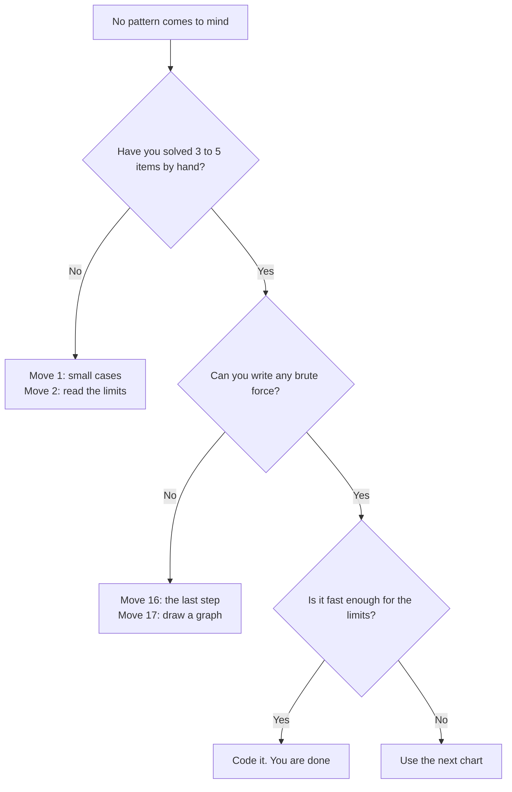
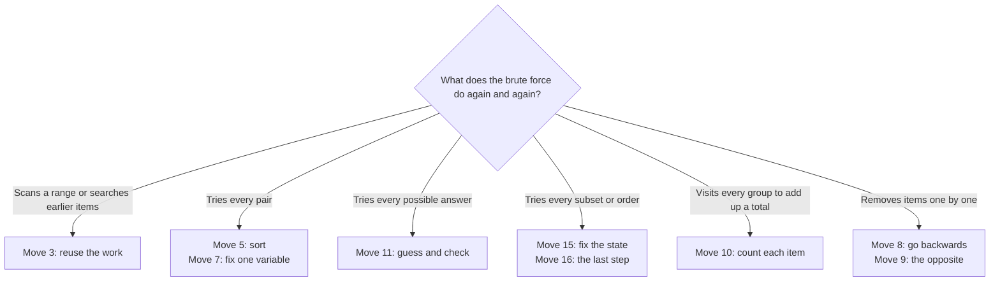
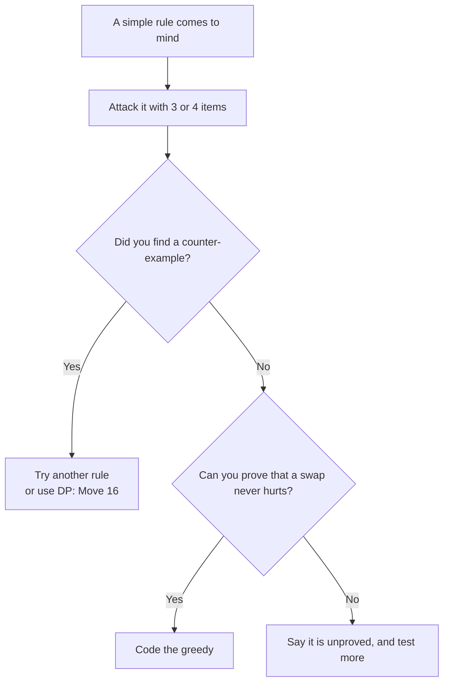

# When You Do Not Recognize the Problem

> **Level:** Intermediate · **Priority:** T1 · **Time:** 150 min · **Read first:** [How to Recognize Any Problem](01-how-to-recognize-any-problem.md), [Constraints Tell You the Algorithm](02-constraints-tell-you-the-algorithm.md) · **Next:** [When to Use Advanced Structures](13-when-to-use-advanced-structures.md)

Sometimes you read a problem and no pattern comes to mind. This happens to everyone, even to strong engineers. This chapter gives you 20 moves to try when it happens, so that you always have a next step. Each move comes with a real problem, the clue that points to it, and the lookalike that does not fit.

## Quick revision

- **Do not wait for an idea. Pick a move.** Each move is a small action that you can start right now.
- **Do not understand it yet?** Solve 3 to 5 items by hand (Move 1). Read the limits (Move 2).
- **Understand it, but have no plan?** Write the brute force, which is the slow way that tries everything. Then find its repeated work (Move 3). Ask what fact would make it easy (Move 4).
- **Change the input:** sort it (Move 5), map the values to something simpler (Move 6), fix one variable (Move 7).
- **Change the question:** run it backwards (Move 8), solve the opposite (Move 9), count what each item adds (Move 10), guess the answer and check it (Move 11).
- **Make it smaller:** solve an easier version (Move 12), find the known problem inside it (Move 13), split it in half (Move 14).
- **Build a model:** add what your state forgets (Move 15), look at the last step (Move 16), draw a graph (Move 17), list the operations you need (Move 18).
- **Test your idea:** look for a counter-example to greedy (Move 19). Look for what never changes (Move 20).
- **"Smallest value that still works"** means Move 11, if every bigger value works too.
- **"Fewest moves" between states** means Move 17, if the states are few enough to visit.
- **A window fails because the rule is not monotonic?** Try Move 6 or Move 14.
- **If you find one counter-example, that greedy rule is dead.** Try another rule, or DP. If you find none, the rule is not yet proved.
- **Speak while you try.** An interviewer can help you only if they can hear where you are stuck.
- **A working brute force beats an unfinished clever idea.** Write it if time is running out.

## How to use the moves

Think of a locked door when you have no key. You do not stand and wait. You try the handle, then the window, then the back door. Each try takes a short time, and each try teaches you something.

A move works the same way. Give each move about one minute. Say out loud what you are trying. If the move shows nothing, take the next one.

Here is what that can sound like in an interview:

| Moment | What you say |
|---|---|
| The problem is new | "I do not see the pattern yet. Let me try a small example by hand." |
| You see the slow way | "The brute force is O(n^2). Let me first see where it repeats work." |
| You have a guess | "Sorting might help here. Let me test that on this example." |
| Your guess fails | "This input breaks the idea, so I will try something else." |
| Time is short | "I will code the brute force now, then improve it if time is left." |

You do not need all 20 moves for one problem. Most problems open after 2 or 3.

## Where to start

Start with this chart. It asks how far you got.



If your brute force is too slow, ask what it spends its time on.



Each move links to the chapters that teach its tools.

## Group A: Understand the problem

### Move 1. Solve small cases by hand

**Try it when:** the statement is confusing, or the problem looks like a puzzle with no structure.

**Real example:** [Bulb Switcher](https://leetcode.com/problems/bulb-switcher/) (LeetCode 319, Medium). You have n bulbs, all off. In round 1 you flip every bulb. In round 2 you flip every 2nd bulb. In round k you flip every k-th bulb. After n rounds, how many bulbs are on?

**The thinking:** Do not start with code. Write the rounds for `n = 6`. `1` means on.

| After round | Bulbs 1 to 6 |
|---|---|
| 1 | `111111` |
| 2 | `101010` |
| 3 | `100011` |
| 4 | `100111` |
| 5 | `100101` |
| 6 | `100100` |

Bulbs 1 and 4 stay on, so the answer for 6 is 2. Do the same for other values of n:

| n | 1 | 2 | 3 | 4 | 5 | 6 | 7 | 8 | 9 | 10 |
|---|---|---|---|---|---|---|---|---|---|---|
| Bulbs on | 1 | 1 | 1 | 2 | 2 | 2 | 2 | 2 | 3 | 3 |

The answer rises at 1, 4 and 9. Those are perfect squares, and that is your clue. Here is why. Bulb i is flipped once for each number that divides i, so it ends on exactly when i has an odd number of divisors. Divisors come in pairs, such as 2 and 3 for 6. A divisor has no partner exactly when it pairs with itself, and that happens exactly when i is a perfect square. So the answer is the number of perfect squares up to n, which is the whole part of the square root of n.

**Why the lookalike fails:** The words "round" and "flip" suggest [simulation](../02-arrays-strings-hashing/06-simulation-and-enumeration.md). But n can be 1 billion, so you cannot flip every bulb.

**What to look for in small cases:** a jump in the answer, a repeat every few steps, or a shape such as squares, powers of 2 or a remainder.

**Read more:** [How to Solve Any Problem](../00-start-here/05-how-to-solve-any-problem.md), [Logic Building Warm-Ups](../00-start-here/06-logic-building-warm-ups.md), [Number Basics](../11-math-geometry-games/01-number-basics.md)

### Move 2. Read the limits before you think

**Try it when:** you have no idea what speed is needed, or one number in the input is strangely small.

**Real example:** [Smallest Sufficient Team](https://leetcode.com/problems/smallest-sufficient-team/) (LeetCode 1125, Hard). Each person has some skills. Pick the smallest team that covers all required skills. There are at most 16 skills and at most 60 people.

**The thinking:** Look at the two limits. Trying every team costs up to 2^60, which is far too many. But 2^16 is only 65,536. So you can afford one entry for every set of skills. A set of skills fits in a **bitmask**, which is an integer where each bit says yes or no for one item. Now the plan is clear: for each set of skills, remember the smallest team that gives it. That is about 60 x 65,536, or about 4 million steps.

**Why the lookalike fails:** "Smallest set that covers everything" sounds like greedy: take the person with the most new skills. That choice can be wrong. In general, no fast exact method is known for covering everything with the fewest sets. The small 16 tells you to use a table instead.

**Rule:** a limit of 20 or less often means something like 2^n. A limit of 100,000 usually means O(n log n) or O(n). When two limits appear, ask which one the solution may be exponential in.

**Read more:** [Constraints Tell You the Algorithm](02-constraints-tell-you-the-algorithm.md), [Bitmask DP](../09-dynamic-programming/12-bitmask-dp.md)

### Move 3. Write the brute force and find the repeated work

**Try it when:** you can see the slow way, but nothing better. This is the most useful move in the chapter.

**Real example:** [Best Time to Buy and Sell Stock](https://leetcode.com/problems/best-time-to-buy-and-sell-stock/) (LeetCode 121, Easy). Given daily prices, buy on one day and sell on a later day. Find the largest profit, or 0 if no profit is possible.

**The thinking:** The brute force takes every buy day, then scans every later sell day. That is O(n^2). Now look at what it repeats. For each sell day, you really ask one thing: "What is the cheapest price before today?" The scan finds that again and again, but one variable can remember it.

With `prices = [7, 1, 5, 3, 6, 4]`:

| Day price | 7 | 1 | 5 | 3 | 6 | 4 |
|---|---|---|---|---|---|---|
| Cheapest so far | 7 | 1 | 1 | 1 | 1 | 1 |
| Sell today, profit | 0 | 0 | 4 | 2 | 5 | 3 |
| Best profit | 0 | 0 | 4 | 4 | 5 | 5 |

The answer is 5, in O(n) time. This table shows which tool removes which kind of repeated work.

| The brute force keeps doing this | Remove it with |
|---|---|
| Finding the smallest or largest so far | One variable, or a [left and right scan](../05-core-patterns/22-left-and-right-scans.md) |
| Adding up the same range | [Prefix sums](../05-core-patterns/06-prefix-sums.md) |
| Searching earlier items for a value | [A hash map](../02-arrays-strings-hashing/04-hashing-patterns.md) |
| Finding the largest in a moving window | [A monotonic queue](../05-core-patterns/13-monotonic-queue.md) |
| Finding the next bigger item for each item | [A monotonic stack](../05-core-patterns/12-monotonic-stack.md) |
| Solving the same smaller problem many times | [Dynamic programming](../09-dynamic-programming/01-dp-from-zero.md) |

**Why the lookalike fails:** A window also works here: jump `left` to each new low. But that is the same remembered value, so you do not need a window.

### Move 4. Ask what would make it easy

**Try it when:** you can solve the problem if only you knew one more fact.

**Real example:** [Trapping Rain Water](https://leetcode.com/problems/trapping-rain-water/) (LeetCode 42, Hard). Bars of given heights stand in a row. Rain falls. How much water stays between them?

**The thinking:** The whole shape looks hard, so look at one column. Finish this sentence: "This would be easy if I knew ..." For one column, you would like to know the tallest bar on its left and the tallest bar on its right. Water rises to the lower of the two. So you want these two facts for every column, and you can compute them first.

With `height = [3, 0, 2, 0, 4]`:

| Index | Height | Tallest left | Tallest right | Water level | Water here |
|---|---|---|---|---|---|
| 0 | 3 | 3 | 4 | 3 | 0 |
| 1 | 0 | 3 | 4 | 3 | 3 |
| 2 | 2 | 3 | 4 | 3 | 1 |
| 3 | 0 | 3 | 4 | 3 | 3 |
| 4 | 4 | 4 | 4 | 4 | 0 |

The total is 7. (Tallest left and right include the column itself.)

**Good wishes to try:** "if the array were sorted", "if there were no negative numbers", "if I knew the best answer to the left", "if I could divide". Each wish points to a step you can often pay for first.

**Why the lookalike fails:** "Water between two bars" looks like [Container With Most Water](https://leetcode.com/problems/container-with-most-water/), which uses two walls only. Here every column holds its own water, so you must sum over all columns.

**Read more:** [Left and Right Scans](../05-core-patterns/22-left-and-right-scans.md)

## Group B: Change the input

### Move 5. Sort the input

**Try it when:** the order of the input does not matter to the answer, and you compare items with each other.

**Real example:** [Minimum Absolute Difference](https://leetcode.com/problems/minimum-absolute-difference/) (LeetCode 1200, Easy). Find all pairs with the smallest difference.

**The thinking:** The brute force tries every pair, which is O(n^2). Now sort `[4, 2, 1, 3]` into `[1, 2, 3, 4]`. If `a <= b <= c`, then `c - a` is at least `b - a`. So a far item is never closer than a neighbour. You only need to compare neighbours. The cost is O(n log n) for the sort plus O(n) for the scan.

**Ask this test question:** "If I shuffle the input, is the answer the same?" If yes, you may sort, at a cost of O(n log n).

**Why the lookalike fails:** Do not sort when the answer needs contiguous items, as in subarray and substring problems. Contiguous means next to each other, with no gaps, and sorting destroys that. [Two Sum](https://leetcode.com/problems/two-sum/) asks for original indexes, so sorting alone loses them. Use a hash map, or keep each value with its index.

**Read more:** [Sorting With a Custom Order](../04-sorting-searching/05-custom-sorting.md), [Merge Intervals](../05-core-patterns/09-merge-intervals.md)

### Move 6. Map the values to something simpler

**Try it when:** the rule talks about balance, remainders, or a shape, and the raw values get in the way.

**Real example:** [Contiguous Array](https://leetcode.com/problems/contiguous-array/) (LeetCode 525, Medium). In an array of 0s and 1s, find the longest subarray with equal counts of 0 and 1. (A subarray is a part of an array with no gaps.)

**The thinking:** Replace each `0` with `-1`. The sum of a piece is then (ones) minus (zeros). So the sum is 0 exactly when the counts are equal. The strange rule has become "sum equals 0".

Take `[0, 1, 1, 0, 0]`. It becomes `[-1, 1, 1, -1, -1]`. A **prefix sum** is the sum of the first few items. The prefix sums, from the empty prefix on, are `0, -1, 0, 1, 0, -1`. Two equal prefix sums mean that the items between them sum to 0. The value 0 first appears at position 0 and last at position 4, so the first 4 items balance. The answer is 4. A hash map from each prefix sum to its first position finds this in O(n) on average.

**Why the lookalike fails:** "Longest subarray" suggests a [variable sliding window](../05-core-patterns/05-sliding-window-variable.md). But a balanced window can become unbalanced, then balanced again. A window rule is **monotonic** if growing the window can only break it, or can only fix it, never both. This rule is not monotonic, so you cannot know when to shrink.

**Other useful maps:** a number to its remainder, a word to its sorted letters, an item to `value - index`.

**Read more:** [Transform the Input](../05-core-patterns/21-transform-the-input.md), [Prefix Sums](../05-core-patterns/06-prefix-sums.md)

### Move 7. Fix one variable

**Try it when:** the answer uses two or three choices at once, and they feel tangled.

**Real example 1:** [3Sum](https://leetcode.com/problems/3sum/) (LeetCode 15, Medium). Find all different triples that sum to 0.

**The thinking:** Three free choices are hard. So fix one, and ask what remains. Sort the array, then fix the smallest number of the triple. Say you fix `-1` in `[-4, -1, -1, 0, 1, 2]`. Now you need a pair that sums to 1 in the sorted part after it. That is exactly [Two Sum II](https://leetcode.com/problems/two-sum-ii-input-array-is-sorted/), which two pointers solve in O(n). The total drops from O(n^3) to O(n^2).

**Real example 2:** [Best Sightseeing Pair](https://leetcode.com/problems/best-sightseeing-pair/) (LeetCode 1014, Medium). For `i < j`, the score is `values[i] + values[j] + i - j`. Find the best score.

**The thinking:** Fix `j`. Then rewrite the score so that each part uses one index: `(values[i] + i) + (values[j] - j)`. For a fixed `j`, the second part is a constant. So you only need the largest `values[i] + i` so far, and one variable holds it. For `[8, 1, 5, 2, 6]`, the best pair is `i = 0, j = 2`, with score `8 + 5 + 0 - 2 = 11`.

**A third common form:** in [Subarray Sum Equals K](https://leetcode.com/problems/subarray-sum-equals-k/), fix the right end. Then ask how many earlier prefix sums equal `currentPrefix - k`. A hash map answers that in O(1) on average.

**Why the lookalike fails:** A nested loop over "all pairs" also fixes one variable, but it never asks what the inner loop really needs. The answer is usually one remembered value or one lookup.

**Read more:** [Two Pointers: Opposite Ends](../05-core-patterns/01-two-pointers-opposite-ends.md), [Prefix Sums](../05-core-patterns/06-prefix-sums.md)

## Group C: Change the question

### Move 8. Run the problem backwards

**Try it when:** the forward direction has many choices, or the problem says "after all operations" or "remove one by one".

**Real example:** [Broken Calculator](https://leetcode.com/problems/broken-calculator/) (LeetCode 991, Medium). A display shows `startValue`. You can double it or subtract 1. Find the fewest steps to reach `target`.

**The thinking:** Going forward, each step has two choices, and it is not clear which is right. For start 3 and target 10, doubling as long as you can gives `3, 6, 12, 11, 10`, which is 4 steps. That is not the best.

Now go backwards from the target. The steps turn around: halve, or add 1. If the number is odd, you cannot halve it, so you must add 1. There is no choice at all. If the number is even, halving is best. (Adding 1 twice and then halving reaches the same number as halving and then adding 1, but it costs one more step.)

| Number | Odd or even | Step | Steps so far |
|---|---|---|---|
| 10 | even | halve to 5 | 1 |
| 5 | odd | add 1 to get 6 | 2 |
| 6 | even | halve to 3 | 3 |

You stop at 3, so the answer is 3. The real path is `3, 6, 5, 10`. Always stop as soon as the number is at or below the start. Then add the gap to your count, because only "add 1" can close it.

**Other forms of this move:** in [Merge Sorted Array](https://leetcode.com/problems/merge-sorted-array/), fill from the back, so that you never overwrite a value you still need. In [Burst Balloons](https://leetcode.com/problems/burst-balloons/), ask which balloon bursts last, not first. Tracking connected groups while edges are removed is hard, but adding the edges back in reverse order works with [Union-Find](../08-graphs/07-union-find.md), a structure that merges groups.

**Why the lookalike fails:** "Fewest steps" suggests [BFS](../08-graphs/04-bfs-shortest-path-patterns.md) (breadth-first search). But numbers here can reach 1 billion, so visiting every number costs too much. Going backwards removes the choices, so a simple loop is enough.

**Read more:** [Transform the Input](../05-core-patterns/21-transform-the-input.md), [Greedy Foundations](../06-recursion-backtracking-greedy/06-greedy-foundations.md)

### Move 9. Solve the opposite question

**Try it when:** what you must remove or count looks scattered, but what remains is simple. Look for the words "at least one", "remove from both ends", or "not".

**Real example:** [Minimum Operations to Reduce X to Zero](https://leetcode.com/problems/minimum-operations-to-reduce-x-to-zero/) (LeetCode 1658, Medium). All values are positive. In each operation, remove the first or the last item and subtract it from `x`. Find the fewest operations that bring `x` to exactly 0, or -1 if you cannot.

**The thinking:** The removed items sit at two ends, which is messy. But what stays is one contiguous middle piece, and that is simple. So flip the question. Removing items with sum `x` is the same as keeping a piece with sum `total - x`. Fewest removed is the same as longest kept.

Take `nums = [1, 1, 4, 2, 3]` and `x = 5`. The total is 11, so you must keep a sum of 6. The longest piece with sum 6 is `[1, 1, 4]`, with length 3. So you remove `5 - 3 = 2` items, which are `2` and `3`. Because all values are positive, a [variable sliding window](../05-core-patterns/05-sliding-window-variable.md) finds this piece.

**Why the lookalike fails:** "Both ends" suggests [two pointers from both ends](../05-core-patterns/01-two-pointers-opposite-ends.md) with a greedy rule. If you always take the smaller end, you take `1`, `1`, then `3`. That is 3 operations, but the best is 2.

**The counting form:** count all the cases, then subtract the bad ones. "Pairs that differ" is easier as "all pairs minus pairs that are equal".

**Read more:** [Transform the Input](../05-core-patterns/21-transform-the-input.md)

### Move 10. Count what each item adds

**Try it when:** you must add up something over all pairs or all subarrays, and there are too many of them to visit.

**Real example:** [Total Hamming Distance](https://leetcode.com/problems/total-hamming-distance/) (LeetCode 477, Medium). The Hamming distance of two numbers is the count of bits where they differ. Find the sum of this distance over all pairs.

**The thinking:** The brute force visits every pair, then every bit. Swap the two loops. Ask for one bit: how many pairs differ at this bit? If `ones` numbers have a 1 there and `zeros` numbers have a 0, then exactly `ones * zeros` pairs differ.

Take `[4, 14, 2]`, which is `0100`, `1110` and `0010` in binary.

| Bit | Numbers with a 1 | ones | zeros | Pairs that differ |
|---|---|---|---|---|
| 0 | none | 0 | 3 | 0 |
| 1 | 14, 2 | 2 | 1 | 2 |
| 2 | 4, 14 | 2 | 1 | 2 |
| 3 | 14 | 1 | 2 | 2 |

The total is 6. The values here fit in 30 bits, so the cost falls from O(n^2 x 30) to O(n x 30). The total can be large, so use `long long` for it.

**Why the lookalike fails:** "All pairs" suggests a double loop, or sorting. But a pair here does not depend on order or size. The sum only comes apart when you look at one bit, or one item, at a time.

**Read more:** [Contribution Technique](../05-core-patterns/18-contribution-technique.md), [Bit Manipulation](../05-core-patterns/17-bit-manipulation.md)

### Move 11. Guess the answer and check it

**Try it when:** finding the best value is hard, but checking one value is easy. Look for "smallest ... so that", "minimum speed", or "minimize the largest".

**Real example:** [Koko Eating Bananas](https://leetcode.com/problems/koko-eating-bananas/) (LeetCode 875, Medium). There are piles of bananas. Each hour, Koko eats up to `k` bananas from one pile. Find the smallest `k` that finishes all piles within `h` hours.

**The thinking:** Do not try to compute `k`. Guess one, and ask: "Can she finish at this speed?" That check takes one pass, because each pile needs `ceil(pile / k)` hours. Add the hours in a `long long`, because at a slow speed the total can pass 2 billion.

With `piles = [3, 6, 7, 11]` and `h = 8`:

| Speed k | 1 | 2 | 3 | 4 | 5 | 6 |
|---|---|---|---|---|---|---|
| Hours needed | 27 | 15 | 10 | 8 | 8 | 6 |
| Within 8? | no | no | no | yes | yes | yes |

The answers form a line of `no` values, then a line of `yes` values, because a faster speed never needs more hours. Whenever that holds, you can binary search for the first `yes`. Here it is 4.

**Check these two things first:**

1. Can you test one guess quickly, usually in O(n)?
2. Once a guess works, do all bigger guesses (or all smaller ones) work too?

**Why the lookalike fails:** "Minimum" alone is not enough. [Coin Change](https://leetcode.com/problems/coin-change/) also asks for a minimum. But checking one guess ("can I make the amount with at most 5 coins?") is as hard as the problem itself. Question 1 above fails, so you need [dynamic programming (DP)](../09-dynamic-programming/05-unbounded-knapsack.md), which Move 16 explains.

**Read more:** [Binary Search on the Answer](../04-sorting-searching/07-binary-search-on-answer.md)

## Group D: Make it smaller

### Move 12. Solve an easier version first

**Try it when:** one rule in the problem makes everything hard. Remove that rule, solve the rest, and then add it back.

**Real example:** [House Robber II](https://leetcode.com/problems/house-robber-ii/) (LeetCode 213, Medium). Houses stand in a circle, each with some money. You cannot rob two neighbours. Find the most money.

**The thinking:** The circle is the hard part, so drop it. Houses in a line are the known problem [House Robber](https://leetcode.com/problems/house-robber/). Now add the circle back. It adds one rule: the first and last house are neighbours, so you cannot rob both. That means at least one of them is skipped, and this gives two line problems.

Take `[1, 2, 3, 1]`. Skip the first house: the line `[2, 3, 1]` gives 3. Skip the last house: the line `[1, 2, 3]` gives 4. The answer is 4. (With one house, there is no second house to conflict, so take it.)

**What you can drop:**

| The hard version | Try first |
|---|---|
| A circle | A line |
| A 2D grid | A 1D array |
| k items, k transactions, k groups | k = 1, then k = 2 |
| Many queries | One query |
| Negative values or duplicates | Only positive, all different |
| A stream of input | The whole input at once |

**Why the lookalike fails:** A circle sometimes tempts you to copy the array twice. That works when you want a piece that wraps around the end. Here it does not help, because a copy could use the same house twice.

**Read more:** [1D Dynamic Programming](../09-dynamic-programming/02-one-dimensional-dp.md)

### Move 13. Find the known problem inside it

**Try it when:** you have rewritten the goal in simple words, and it starts to sound like something you know.

**Real example 1:** [Partition Equal Subset Sum](https://leetcode.com/problems/partition-equal-subset-sum/) (LeetCode 416, Medium). Can you split the array into two groups with equal sums?

**The thinking:** Two groups sound new. But if the two sums are equal, each is half of the total. So you only need one group with sum `total / 2`, and the other group is whatever is left. That is the **0/1 knapsack** idea: pick or skip each item to reach a sum. For `[1, 5, 11, 5]`, the total is 22, so you look for 11, and `{11}` works. An odd total means no.

**Real example 2:** [Maximal Rectangle](https://leetcode.com/problems/maximal-rectangle/) (LeetCode 85, Hard). Find the largest rectangle of 1s in a binary grid. Treat each row as the ground, and count how tall the 1s stand on it. Now each row is [Largest Rectangle in Histogram](https://leetcode.com/problems/largest-rectangle-in-histogram/).

**The thinking in one sentence:** say the problem with no story words, then ask, "Where have I seen this?"

| The problem says | It often is |
|---|---|
| Split into two groups with equal sums | [0/1 knapsack](../09-dynamic-programming/04-zero-one-knapsack.md) |
| Tasks that must come before other tasks | [Topological sort](../08-graphs/06-topological-sort.md) |
| Groups that merge when two items link | [Union-Find](../08-graphs/07-union-find.md) |
| Fewest changes to turn one string into another | [Edit distance](../09-dynamic-programming/07-lcs-and-edit-distance.md) |
| A rectangle in a grid | A 1D problem, solved [for each row](../05-core-patterns/12-monotonic-stack.md) |
| Longest chain where each item beats the last | [Longest increasing subsequence](../09-dynamic-programming/06-longest-increasing-subsequence.md) |

**Why the lookalike fails:** "Two groups" also suggests [sorting and greedy](../06-recursion-backtracking-greedy/06-greedy-foundations.md): give the next big item to the smaller group. For `[3, 3, 2, 2, 2]`, that gives `3 + 2 + 2 = 7` and `3 + 2 = 5`. But `3 + 3 = 6` and `2 + 2 + 2 = 6` is a perfect split.

**Read more:** [Lookalike Patterns](07-lookalike-patterns.md), [Graph Modeling Tricks](../08-graphs/18-graph-modeling-tricks.md)

### Move 14. Split the problem in half

**Try it when:** a window fails, but one item clearly divides the input into separate parts. Also try it when a count over pairs is easy once each half is sorted.

**Real example:** [Longest Substring with At Least K Repeating Characters](https://leetcode.com/problems/longest-substring-with-at-least-k-repeating-characters/) (LeetCode 395, Medium). Find the longest substring in which every letter appears at least `k` times.

**The thinking:** Take `s = "aaabb"` and `k = 3`. The letter `b` appears only 2 times in the whole string. So no answer can contain a `b`. Each `b` is a wall, and the answer must lie between walls. Split around the walls and solve each part alone. The parts are `"aaa"` and empty strings, so the answer is 3.

**Ask this question:** "If I had the answers for the left part and the right part, what is still missing?" Sometimes nothing is missing, as here. Sometimes only the answers that cross the middle are missing, and those are often easier to find.

**Why the lookalike fails:** "Longest substring" suggests a [variable sliding window](../05-core-patterns/05-sliding-window-variable.md). But a new letter can break the rule, and more copies of it can fix the rule again. The rule is not monotonic, so a plain window can skip answers.

**Read more:** [Divide and Conquer](../06-recursion-backtracking-greedy/05-divide-and-conquer.md), [Merge Sort](../04-sorting-searching/02-merge-sort.md)

## Group E: Build a model

### Move 15. Add what your state forgets

The **state** is what you remember at one point of the solution, such as the current cell or the current day.

**Try it when:** your BFS or DP looks right, but it gives wrong answers. The cause is often that two different situations look the same to your code.

**Real example:** [Shortest Path in a Grid with Obstacles Elimination](https://leetcode.com/problems/shortest-path-in-a-grid-with-obstacles-elimination/) (LeetCode 1293, Hard). Walk from the top-left cell to the bottom-right cell, one step at a time. You may break at most `k` walls. Find the fewest steps, or -1 if you cannot arrive.

**The thinking:** A normal BFS marks each cell as visited once. Here is a case with `k = 1`, where `#` is a wall:

```text
S . #
# . #
. # T
```

You can reach the center in 2 steps in two ways. Going right then down breaks no wall. Going down through the wall then right breaks your one wall. Suppose the second path arrives first and marks the center as visited. The first path is now thrown away. But every way forward from the center needs a wall to be broken, and the second path has no breaks left. So the BFS says "no path", while the true answer is 4.

The two arrivals have the same cell but a different future. So the cell alone is not enough. Add the missing fact to the state: `(row, col, wallsLeft)`. Now both arrivals are kept. The cost grows to `rows x cols x (k + 1)` states, and that is fine for this problem's limits.

**Ask this test question:** "Can two arrivals at the same state have different futures?" If yes, add what makes them different.

**The same idea in DP:** in [Best Time to Buy and Sell Stock with Cooldown](https://leetcode.com/problems/best-time-to-buy-and-sell-stock-with-cooldown/), the day alone is not enough. You must also know if you hold a stock or are waiting.

**Why the lookalike fails:** "Shortest path with a cost" suggests [Dijkstra](../08-graphs/08-dijkstra.md). You do not need it here, because every step costs 1. The problem is not the cost of a step. It is what the state remembers.

**Read more:** [DP State Design Tricks](../09-dynamic-programming/16-dp-state-design-tricks.md), [BFS Shortest Path Patterns](../08-graphs/04-bfs-shortest-path-patterns.md), [State Machine DP](../09-dynamic-programming/10-state-machine-dp.md)

### Move 16. Look at the last step

**Try it when:** the problem asks for "how many ways", "the minimum cost" or "is it possible", and you make a series of choices.

**Real example:** [Decode Ways](https://leetcode.com/problems/decode-ways/) (LeetCode 91, Medium). Letters are coded as `A = 1` up to `Z = 26`. Given a string of digits, count the ways to decode it.

**The thinking:** Do not think about the whole string. Look at the end and ask, "What could the last letter be?" It used either the last digit alone, or the last two digits together. Once you choose, a shorter string remains, and that string is the same problem again.

So `ways(prefix) = ways(without last digit) + ways(without last two digits)`, and each part counts only if those digits form a valid letter. (`0` alone and `06` are not valid.) Take `s = "226"`:

| Prefix | Last digit alone | Last two digits | Ways |
|---|---|---|---|
| empty | | | 1 |
| `2` | `2` is valid, add 1 | none | 1 |
| `22` | `2` is valid, add 1 | `22` is valid, add 1 | 2 |
| `226` | `6` is valid, add 2 | `26` is valid, add 1 | 3 |

The three ways are `2 2 6`, `22 6` and `2 26`.

**Why the lookalike fails:** [Backtracking](../06-recursion-backtracking-greedy/02-backtracking-subsets.md) also makes choices, but you need it only to **list** every result. Here you only count, and the same prefixes come up many times. That repeat is what makes [dynamic programming](../09-dynamic-programming/01-dp-from-zero.md) possible. DP means saving the answer to each smaller problem, so that you solve it once.

**Read more:** [1D Dynamic Programming](../09-dynamic-programming/02-one-dimensional-dp.md)

### Move 17. Draw it as a graph

**Try it when:** you move from one situation to another, or things link to each other, even if the problem never says "graph". A graph is a set of nodes joined by edges.

**Real example:** [Open the Lock](https://leetcode.com/problems/open-the-lock/) (LeetCode 752, Medium). A lock has 4 wheels, each from 0 to 9, and each wheel wraps around. It starts at `0000`. One move turns one wheel by one step. Some codes are forbidden. Find the fewest moves to reach `target`, or -1.

**The thinking:** Ask two questions. What is one situation? One code, so that is a **node**. What is one move? A turn that changes one code into another, so that is an **edge**. There are 10,000 nodes, and each has 8 neighbours. "Fewest moves" where each move costs the same means [BFS](../08-graphs/02-bfs-and-dfs.md). With forbidden code `8888` and target `0009`, the answer is 1, because the last wheel can wrap from 0 back to 9.

**Real example 2:** [Evaluate Division](https://leetcode.com/problems/evaluate-division/) (LeetCode 399, Medium). You know `a / b = 2` and `b / c = 3`. Find `a / c`. Each variable is a node, and each known ratio is an edge with a weight. Walk from `a` to `c` and multiply the weights: `2 x 3 = 6`.

| The problem says | Nodes | Edges | Tool |
|---|---|---|---|
| "change one letter or digit at a time" | Each form | One change | [BFS](../08-graphs/04-bfs-shortest-path-patterns.md) |
| "a must come before b" | Tasks | a to b | [Topological sort](../08-graphs/06-topological-sort.md) |
| "a and b are in the same group" | Items | a with b | [Union-Find](../08-graphs/07-union-find.md) |
| "each route has a cost" | Places | Routes | [Dijkstra](../08-graphs/08-dijkstra.md), if no cost is negative |

**Why the lookalike fails:** "Fewest moves" also suggests [DP](../09-dynamic-programming/01-dp-from-zero.md). But the wheels can go round in a circle, so no state comes clearly "before" another. DP needs that order. BFS does not.

**Read more:** [Graph Modeling Tricks](../08-graphs/18-graph-modeling-tricks.md), [Grid Graphs](../08-graphs/03-grid-graphs.md)

### Move 18. List the operations you need

**Try it when:** the problem describes a class to build, or items that arrive over time, or queries mixed with updates.

**Real example:** [Insert Delete GetRandom O(1)](https://leetcode.com/problems/insert-delete-getrandom-o1/) (LeetCode 380, Medium). Build a set that can insert a value, remove a value, and return a random value, each in O(1) on average.

**The thinking:** Write the operations in a list, then test each structure.

| Structure | Insert | Remove a value | Random item |
|---|---|---|---|
| Array | Fast | Slow, must find it | Fast |
| Hash set | Fast | Fast | Slow, no index to pick |
| Array plus hash map (value to index) | Fast | Fast | Fast |

No single structure wins, so use both. To remove from the middle of the array, move the last item into the gap. Nothing else shifts.

```text
insert(10)   arr = [10]           pos = {10:0}
insert(20)   arr = [10, 20]       pos = {10:0, 20:1}
insert(30)   arr = [10, 20, 30]   pos = {10:0, 20:1, 30:2}
remove(10)   arr = [30, 20]       pos = {20:1, 30:0}
```

Hash map operations are O(1) on average and O(n) in the worst case.

| You need this fast | Use |
|---|---|
| The largest or smallest, again and again | [Heap](../05-core-patterns/14-top-k-and-heaps.md) |
| The median of a growing list | [Two heaps](../05-core-patterns/15-two-heaps.md) |
| The nearest value, with inserts and removals | [Ordered set](../05-core-patterns/19-ordered-set-patterns.md) |
| The sum of a range, with updates | [Fenwick tree](../12-advanced-data-structures/03-fenwick-tree.md) |
| Words by prefix | [Trie](../07-trees/13-trie.md) |
| Find by key and drop the oldest | [Hash map plus linked list](../13-design-problems/01-lru-and-lfu-cache.md) |

**Why the lookalike fails:** "Set" suggests `unordered_set`, and it gives two of the three operations. Always check every operation in the list. One slow operation decides the whole design.

**Read more:** [When to Use Advanced Structures](13-when-to-use-advanced-structures.md), [Hashing and Randomized Design](../13-design-problems/04-hashing-and-randomized-design.md)

## Group F: Test your idea

### Move 19. Try greedy, then attack it

**Greedy** means taking the choice that looks best now, and never coming back to it. A **counter-example** is one input where an idea gives a wrong answer.

**Try it when:** a simple rule comes to mind, such as "always take the biggest". This is a good thing to try, but do not trust it yet.

**Real example 1:** [Coin Change](https://leetcode.com/problems/coin-change/) (LeetCode 322, Medium). Use the fewest coins to make an amount. The rule "take the biggest coin first" works for many coin sets. Attack it with coins `[1, 3, 4]` and amount 6. Greedy takes `4 + 1 + 1`, which is 3 coins. But `3 + 3` is 2 coins. One input is enough: this rule is dead. No known greedy rule works for every coin set, so use [DP](../09-dynamic-programming/05-unbounded-knapsack.md) and Move 16.

**Real example 2:** [Non-overlapping Intervals](https://leetcode.com/problems/non-overlapping-intervals/) (LeetCode 435, Medium). Remove the fewest intervals so that the others do not overlap. In other words, keep as many as you can. Intervals that only touch at an end do not overlap. Test some rules:

| Rule for the next interval | Test input | What the rule keeps | Best | Verdict |
|---|---|---|---|---|
| Earliest start | `[1,10] [2,3] [4,5]` | `[1,10]`, so 1 | 2 | Wrong |
| Shortest | `[1,4] [3,5] [4,7]` | `[3,5]`, so 1 | 2 | Wrong |
| Earliest end | no counter-example found | | | Now prove it |

Here is the proof for "earliest end". Take any best answer, and look at its first interval. The earliest-ending interval ends no later than that one. So you can swap it in, and the rest still fit. So a best answer exists that uses the greedy choice. Repeat for the intervals that remain.

**How to attack a greedy rule:** use 3 or 4 items. Make one big item that blocks two good ones. Make a choice that looks a little worse now but opens a much better one later. Try ties.



**Why the lookalike fails:** Greedy and DP problems both ask for "the best". Finding no counter-example only means that you may go on to the swap argument.

**Read more:** [Greedy Foundations](../06-recursion-backtracking-greedy/06-greedy-foundations.md), [Classic Greedy Algorithms](../06-recursion-backtracking-greedy/07-greedy-classics.md)

### Move 20. Look for what never changes

An **invariant** is something that stays the same after every step.

**Try it when:** the problem has moves or swaps that you may repeat as often as you like. The answer may then depend only on a simple fact about the input.

**Real example:** [Minimum Cost to Move Chips to The Same Position](https://leetcode.com/problems/minimum-cost-to-move-chips-to-the-same-position/) (LeetCode 1217, Easy). Each chip sits at a position. Moving a chip by 2 is free. Moving it by 1 costs 1. Find the smallest cost to bring all chips to one position.

**The thinking:** A free move of 2 never changes whether a position is odd or even. That is the invariant. So all chips at odd positions can gather at one odd position for free. All chips at even positions can gather at one even position for free. Now you have two piles next to each other. Move the smaller pile, at a cost of 1 for each chip. You cannot do better, because all chips must end with the same parity, and each chip that changes parity pays at least 1. So the answer is `min(oddCount, evenCount)`.

For positions `[1, 2, 3]`, there are 2 odd chips and 1 even chip, so the answer is 1.

**What to check:** parity (odd or even), the total sum, the count of items, or a difference between two counts. Do a few steps by hand, and see which of these stays the same.

**Why the lookalike fails:** "Minimum cost" suggests [DP](../09-dynamic-programming/01-dp-from-zero.md) or trying every target position. But once you see the invariant, the exact positions stop mattering, and only two counts remain.

**Read more:** [Number Basics](../11-math-geometry-games/01-number-basics.md), [Greedy Foundations](../06-recursion-backtracking-greedy/06-greedy-foundations.md)

## One full walkthrough

Here is how several moves work together on one problem. The problem is [Number of Subsequences That Satisfy the Given Sum Condition](https://leetcode.com/problems/number-of-subsequences-that-satisfy-the-given-sum-condition/) (LeetCode 1498, Medium). Count the non-empty subsequences whose smallest plus largest value is at most `target`. A **subsequence** keeps the order of items but may skip some. The array can have 100,000 items, and the count is given modulo 1,000,000,007.

Say that you do not recognize it. Take `nums = [3, 5, 6, 7]` and `target = 9`.

**Move 1, small cases.** List some by hand: `[3]` has 3 + 3 = 6, so it counts. `[5]` has 5 + 5 = 10, so it does not. `[3, 5]`, `[3, 6]` and `[3, 5, 6]` count. `[3, 7]` has 10, so it does not. A group without 3 has a smallest value of at least 5, so it fails. A group with 7 fails too. So the only groups left are the 4 you found.

**Move 2, limits.** With 100,000 items, you cannot try 2^n subsets. You need about O(n log n).

**Move 5, sort.** Look at your small case again. Only the smallest and largest values matter. So the order does not matter, and you may sort. (The word "subsequence" suggests DP. But the rule uses only two values, so sorting is the better first try.)

**Move 7, fix one variable.** Fix the smallest value at index `left`. Now find the largest index `right` with `nums[left] + nums[right] <= target`. Every item between them may be in or out, and the group stays valid. So this `left` gives `2^(right - left)` subsequences.

| left | Smallest | right after moving | Check | Added |
|---|---|---|---|---|
| 0 | 3 | 2 | 3 + 6 = 9, fits | 2^2 = 4 |
| 1 | 5 | 0 | `right` passes `left`, stop | 0 |

The total is 4, the same as your hand count. As `left` moves up, `right` can only move down. So this is [two pointers from both ends](../05-core-patterns/01-two-pointers-opposite-ends.md), in O(n) after the sort. Store the powers of 2 modulo 1,000,000,007 in an array first, because 2^100000 fits in no integer type.

No pattern was recognized at the start. Four small moves found it anyway.

## Drills

Each drill is a problem you may not have met. Some hide the real question in a story. Before you open the answer, name the move and the tool, and say what rules out the lookalike. Take about one minute for each.

**D1.** A factory belt holds boxes in a fixed order, each with a weight. Each day a truck takes the next boxes from the belt, up to a weight limit. All boxes must leave within D days. Find the smallest limit that works.

<details>
<summary>Answer to D1</summary>

**Move 11: guess and check.** You can test one limit in one pass, and a bigger limit never hurts. So use [binary search on the answer](../04-sorting-searching/07-binary-search-on-answer.md). With weights `[1, 2, 3, 1, 1]` and D = 4, the answer is 3. No limit below the heaviest box can work, and limit 3 finishes in 3 days. The lookalike is DP over ways to split, which is much slower. This is [Capacity To Ship Packages Within D Days](https://leetcode.com/problems/capacity-to-ship-packages-within-d-days/).

</details>

**D2.** A team of k movers must share at most 16 boxes, so that every mover carries the same total weight. Every box must go to someone. Is it possible?

<details>
<summary>Answer to D2</summary>

**Move 2: read the limits.** A limit of 16 allows about 2^16 states, so use [bitmask DP](../09-dynamic-programming/12-bitmask-dp.md) or [backtracking](../06-recursion-backtracking-greedy/04-backtracking-constraint-search.md). The lookalike is [0/1 knapsack](../09-dynamic-programming/04-zero-one-knapsack.md). It fits two groups, but with k groups you must also remember which items are used. This is [Partition to K Equal Sum Subsets](https://leetcode.com/problems/partition-to-k-equal-sum-subsets/).

</details>

**D3.** A row of cards lies on a table, each with points. You must take exactly k cards, and each card must come from the left end or the right end. Find the most points.

<details>
<summary>Answer to D3</summary>

**Move 9: the opposite.** The cards you leave form one contiguous piece of size `n - k`. Find the smallest sum of such a piece with a [fixed sliding window](../05-core-patterns/04-sliding-window-fixed.md), then subtract it from the total. For `[1, 2, 3, 4, 5, 6, 1]` and k = 3, you leave `[1, 2, 3, 4]`, so the answer is 12. Greedy on the bigger end fails, because it cannot see a large card behind a small one. This is [Maximum Points You Can Obtain from Cards](https://leetcode.com/problems/maximum-points-you-can-obtain-from-cards/).

</details>

**D4.** Coins lie on a large board. You may remove a coin if another coin is still in its row or its column. How many coins can you remove at most?

<details>
<summary>Answer to D4</summary>

**Move 17: draw a graph.** Each coin is a node. Join two coins if they share a row or column. Inside one connected group, you can always remove coins until one is left: walk the group with DFS and remove coins in reverse visit order, so each coin still has the neighbour that led to it. The last coin of a group can never go, because no coin shares its row or column. So the answer is `coins - groups`, and [Union-Find](../08-graphs/07-union-find.md) counts the groups. The lookalike is greedy on the coin with the fewest neighbours, which you would have to prove. This is [Most Stones Removed with Same Row or Column](https://leetcode.com/problems/most-stones-removed-with-same-row-or-column/).

</details>

**D5.** In a list of numbers, a pair `i < j` is "bad" if `j - i` is not equal to `nums[j] - nums[i]`. Count the bad pairs.

<details>
<summary>Answer to D5</summary>

**Move 9, then Moves 6 and 7.** Count the good pairs and subtract them. A pair is good exactly when `nums[i] - i` equals `nums[j] - j`. So map each item to `nums[i] - i`, and count equal values with a [hash map](../02-arrays-strings-hashing/04-hashing-patterns.md), in O(n) on average. For `[4, 1, 3, 3]`, the mapped values are `4, 0, 1, 0`. There is 1 good pair out of 6, so the answer is 5. Use `long long`, because the count of pairs can be large. This is [Count Number of Bad Pairs](https://leetcode.com/problems/count-number-of-bad-pairs/).

</details>

**D6.** A magician shows the top card, moves the next top card to the bottom, and repeats until the deck is empty. In what order must the deck start, so that the cards appear in rising order?

<details>
<summary>Answer to D6</summary>

**Move 8: go backwards.** Run the steps in reverse from the last card, or run them forward on positions with a [queue](../03-linked-lists-stacks-queues/07-queue-from-zero.md) to learn which position shows which card. The lookalike is plain sorting, which gives the values but not the order. This is [Reveal Cards In Increasing Order](https://leetcode.com/problems/reveal-cards-in-increasing-order/).

</details>

**D7.** A number can be written as a sum of "binary-looking" numbers, which use only the digits 0 and 1. Given a very long number as a string, find the fewest such numbers that add up to it.

<details>
<summary>Answer to D7</summary>

**Move 1: small cases.** For `"32"`, you can write `11 + 11 + 10`, which is 3 numbers. Each binary-looking number adds at most 1 to any digit. So you need at least as many numbers as the largest digit, and that many is always enough. The answer is the largest digit. The lookalike is DP or knapsack, but the number is far too long for those. This is [Partitioning Into Minimum Number Of Deci-Binary Numbers](https://leetcode.com/problems/partitioning-into-minimum-number-of-deci-binary-numbers/).

</details>

**D8.** Pick any items from a list, so that their sum is as large as you can make it and is divisible by 3.

<details>
<summary>Answer to D8</summary>

**Move 15: add to the state.** The best sum so far is not enough, because the remainder decides the future. Keep the best sum for each remainder 0, 1 and 2, as a small [DP](../09-dynamic-programming/16-dp-state-design-tricks.md). For `[3, 6, 5, 1, 8]`, the answer is 18 from `3 + 6 + 1 + 8`. A knapsack over all sums is the lookalike, but the sums are too large for that table, and only the remainder matters. This is [Greatest Sum Divisible by Three](https://leetcode.com/problems/greatest-sum-divisible-by-three/).

</details>

**D9.** For each index, find the product of all other items. You may not use division, and you need O(n).

<details>
<summary>Answer to D9</summary>

**Move 4: what would make it easy?** It would be easy if you knew the product of everything on the left and everything on the right. Compute both with a [left and right scan](../05-core-patterns/22-left-and-right-scans.md). For `[1, 2, 3, 4]`, the answer is `[24, 12, 8, 6]`. The lookalike is one total product, then divide, which is banned and also breaks on zeros. This is [Product of Array Except Self](https://leetcode.com/problems/product-of-array-except-self/).

</details>

**D10.** Build an array that supports `set(index, value)`, `snap()` which saves the current version, and `get(index, snapId)` which reads an old version.

<details>
<summary>Answer to D10</summary>

**Move 18: list the operations.** Copying the array at each `snap()` is too slow when the array is large. Most values do not change between snaps. So for each index, keep a list of (snapId, value) pairs, and [binary search](../04-sorting-searching/06-binary-search-basics.md) it in `get`. This is [Snapshot Array](https://leetcode.com/problems/snapshot-array/).

</details>

**D11.** You get a math expression with no parentheses, such as `2-1-1`. List the result of every way to add parentheses.

<details>
<summary>Answer to D11</summary>

**Move 14: split it.** Each operator can be the last one to run. It splits the expression into a left part and a right part, and you solve each part alone. Saving the results of repeated parts helps. For `2-1-1`, the results are 0 and 2. The lookalike is a [stack parser](../03-linked-lists-stacks-queues/06-stack-expressions-and-parentheses.md), which follows one fixed order, but here you need all orders. See [Divide and Conquer](../06-recursion-backtracking-greedy/05-divide-and-conquer.md). This is [Different Ways to Add Parentheses](https://leetcode.com/problems/different-ways-to-add-parentheses/).

</details>

**D12.** You have a string and a list of index pairs. You may swap the letters of any listed pair, as many times as you like. Find the smallest string you can reach in alphabetical order.

<details>
<summary>Answer to D12</summary>

**Move 17, then Move 5.** Each index is a node and each pair is an edge. Inside one connected group, repeated swaps can arrange the letters in any order. So find the groups with [Union-Find](../08-graphs/07-union-find.md), then sort the letters inside each group. For `"dcab"` with pairs `(0, 3)` and `(1, 2)`, the answer is `"bacd"`. Greedy single swaps are the lookalike, and they can stop too early. This is [Smallest String With Swaps](https://leetcode.com/problems/smallest-string-with-swaps/).

</details>

**D13.** A delivery van drives around a circular route. Each stop gives it some fuel, and each road to the next stop costs some fuel. The tank starts empty. Find a stop from which the van can finish a full circle, or -1.

<details>
<summary>Answer to D13</summary>

**Move 20: what never changes.** The total of fuel minus cost does not depend on the start. If it is negative, no start works. If it is zero or more, a start exists, and one scan finds it. If the tank falls below zero on the way from stop s to stop i, no stop from s to i can be the start, so try i + 1 next. The lookalike is trying each start, which is O(n^2). See [Classic Greedy Algorithms](../06-recursion-backtracking-greedy/07-greedy-classics.md). This is [Gas Station](https://leetcode.com/problems/gas-station/).

</details>

**D14.** Each boat holds at most two people and has a weight limit. Find the fewest boats for everyone.

<details>
<summary>Answer to D14</summary>

**Move 5, then Move 19.** Sort, then put the heaviest person with the lightest person if they fit. Otherwise, the heaviest goes alone. That is [two pointers from both ends](../05-core-patterns/01-two-pointers-opposite-ends.md). For weights `[3, 2, 2, 1]` and limit 3, you need 3 boats. The general form of packing items into bins is hard, but the limit of two people makes this greedy rule correct. This is [Boats to Save People](https://leetcode.com/problems/boats-to-save-people/).

</details>

**D15.** A playlist has songs with lengths in seconds. Count the pairs whose total length is a whole number of minutes.

<details>
<summary>Answer to D15</summary>

**Move 6: map the values.** Replace each length with its remainder after dividing by 60. For remainder r, you need an earlier song with remainder `(60 - r) % 60`, so count with an array of 60 entries. For `[30, 20, 150, 100, 40]`, the answer is 3. The lookalike is checking all pairs, which is O(n^2). This is [Pairs of Songs With Total Durations Divisible by 60](https://leetcode.com/problems/pairs-of-songs-with-total-durations-divisible-by-60/).

</details>

**D16.** Each job has a start, an end and a profit. Jobs you take may not overlap. Find the largest total profit.

<details>
<summary>Answer to D16</summary>

**Move 19, then Move 16.** Attack "take the biggest profit first": jobs `[1,3]` with profit 4, `[4,6]` with profit 4, and `[2,5]` with profit 5. Greedy takes the 5 and blocks both others, but 4 + 4 = 8 is better. So this rule is dead. Now use the last step: sort by end time, and for the last job, either skip it or take it and [binary search](../04-sorting-searching/06-binary-search-basics.md) for the last job that ends in time. See [1D Dynamic Programming](../09-dynamic-programming/02-one-dimensional-dp.md). This is [Maximum Profit in Job Scheduling](https://leetcode.com/problems/maximum-profit-in-job-scheduling/).

</details>

**D17.** Find the sum of all subarrays of odd length.

<details>
<summary>Answer to D17</summary>

**Move 10: count each item.** Do not visit each subarray. Ask how many odd-length subarrays contain index i. There are `(i + 1) * (n - i)` subarrays that contain it, and the odd ones are that number divided by 2, rounded up. For `[1, 4, 2, 5, 3]`, the counts are 3, 4, 5, 4, 3, so the sum is `3 + 16 + 10 + 20 + 9 = 58`. See [Contribution Technique](../05-core-patterns/18-contribution-technique.md). This is [Sum of All Odd Length Subarrays](https://leetcode.com/problems/sum-of-all-odd-length-subarrays/).

</details>

**D18.** Put a plus or a minus sign in front of each number. Count the ways to reach a given total.

<details>
<summary>Answer to D18</summary>

**Move 13: the known problem inside.** Let P be the sum of the plus group, N the sum of the minus group, and S the sum of all numbers. Then `P - N = target` and `P + N = S`, so `P = (S + target) / 2`. If `S + target` is odd or negative, the answer is 0. Otherwise you only count subsets with sum P, which is [0/1 knapsack](../09-dynamic-programming/04-zero-one-knapsack.md) counting. For `[1, 1, 1, 1, 1]` and target 3, P = 4, and there are 5 ways. Backtracking also works, because n is at most 20, but it costs O(2^n). This is [Target Sum](https://leetcode.com/problems/target-sum/).

</details>

## Common pitfalls

1. **Waiting for the idea.** Sitting in silence feels like thinking, but it gives nothing. Pick a move and write something within a minute.
2. **Skipping the brute force.** Without it, you have no base for Move 3, and nothing to fall back on. Say it first, even if you do not code it.
3. **Sorting when order matters.** Sorting breaks subarray and substring problems, and it loses original indexes. Use the shuffle test from Move 5.
4. **Trusting greedy after one good example.** Examples in the statement rarely break a wrong rule. Build your own small attack (Move 19).
5. **Binary searching without order.** Move 11 needs all `no` values before all `yes` values. If "works" can flip back and forth, the search skips answers.
6. **Fixing the code when the state is wrong.** If BFS or DP gives wrong answers and the code looks correct, stop. Ask what two different situations your state treats as one (Move 15).
7. **Using a sliding window with a broken rule.** A window needs a monotonic rule. "Sum equals x" with all positive values is fine (Move 9). With negative numbers, or "equal counts" rules, try Move 6 or [prefix sums](../05-core-patterns/06-prefix-sums.md).

## Interview questions

<details>
<summary><strong>Q1. What do you do when you have not seen a problem before?</strong></summary>

I start with a small example by hand, so that I am sure I understand it. Then I read the limits to learn the speed I need. Next I describe the brute force and look for repeated work. I say each step out loud, so that you can correct me early.

</details>

<details>
<summary><strong>Q2. Why would you describe a slow solution first?</strong></summary>

It proves that I understand the problem, and it gives me something correct to improve. It also shows where the time goes, and that often points to the right tool. If time runs out, I still have a working answer.

</details>

<details>
<summary><strong>Q3. How do you know if a greedy idea is correct?</strong></summary>

First I try to break it with 3 or 4 items, using a big item that blocks others and some ties. One counter-example ends the idea. If I find none, I try a swap argument: take any best answer, and show that I can swap in the greedy choice without making it worse. Finding no counter-example alone is not a proof.

</details>

<details>
<summary><strong>Q4. Your BFS gives a wrong answer, but the code looks correct. What do you check?</strong></summary>

I check the state. If two arrivals at the same cell can have different futures, marking the cell as visited throws one of them away. Then I add the missing fact to the state, such as keys held or walls left. The state count grows, so I check it against the limits.

</details>

<details>
<summary><strong>Q5. How long do you stay stuck before you change direction?</strong></summary>

I give one idea a minute or two. If an example breaks it, I say so and take the next move. If I am still stuck, I tell the interviewer what I have tried and where it fails. That often earns a useful hint, and it shows how I work.

</details>
