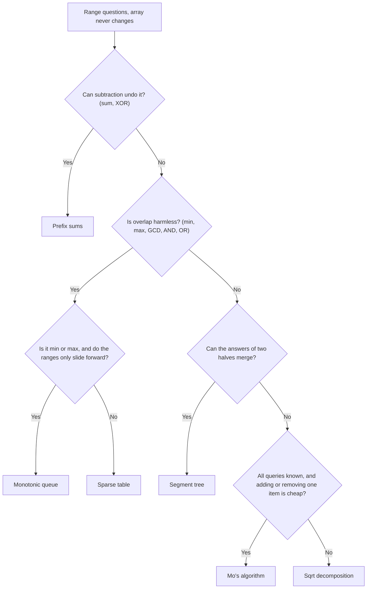
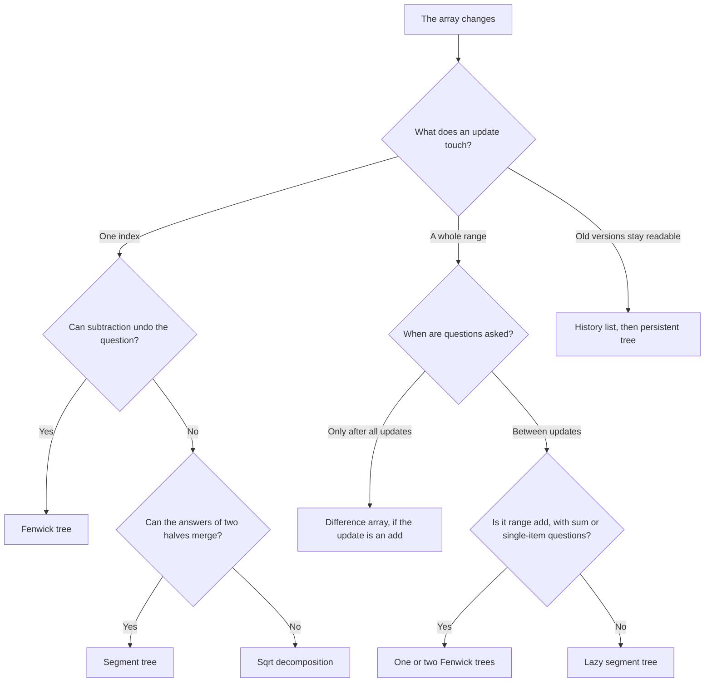
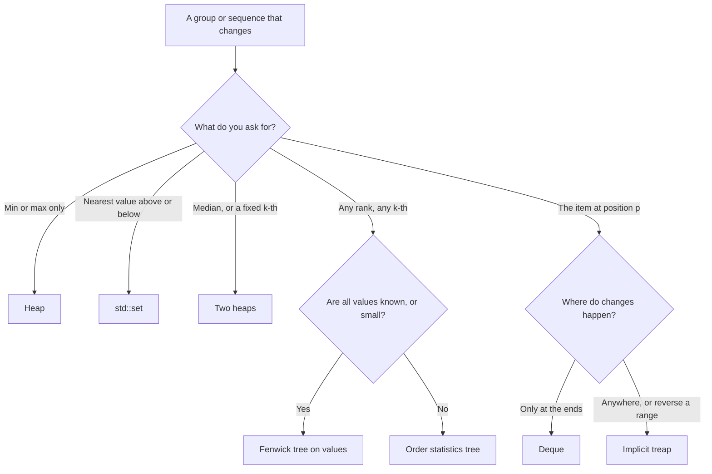
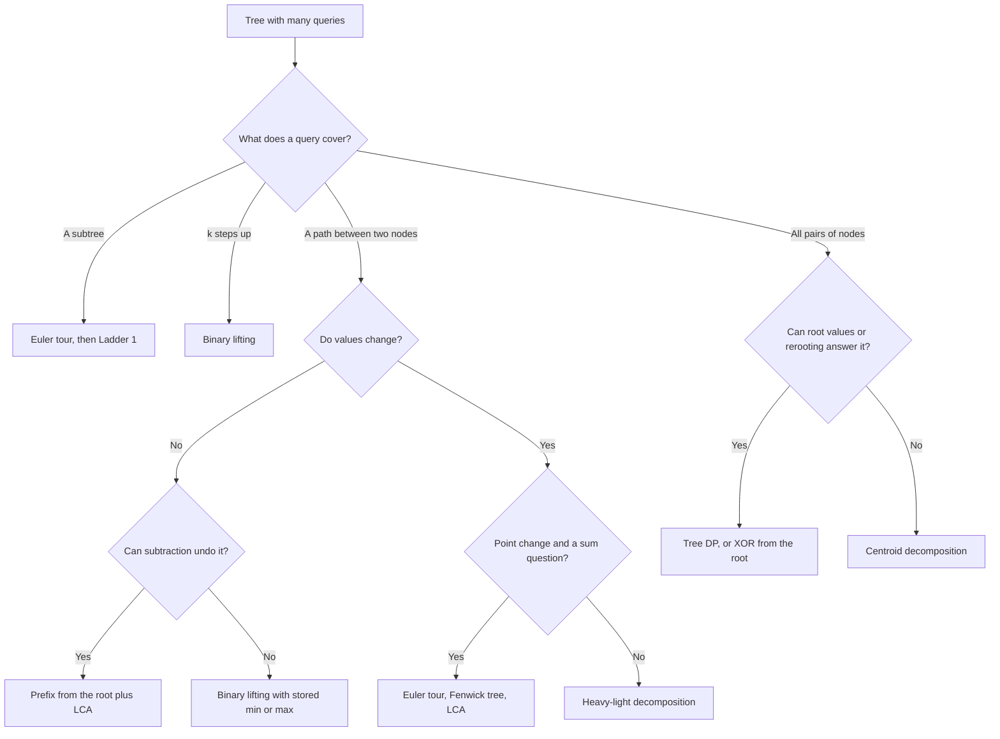
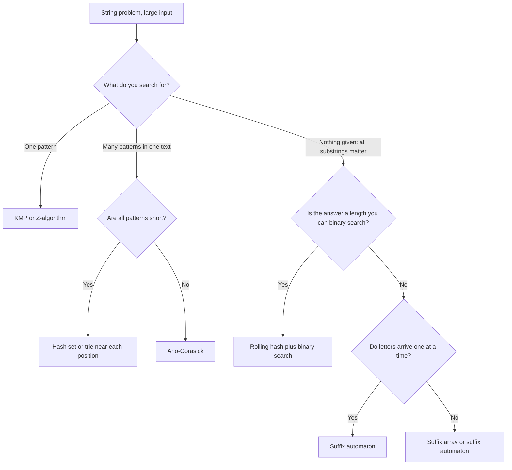
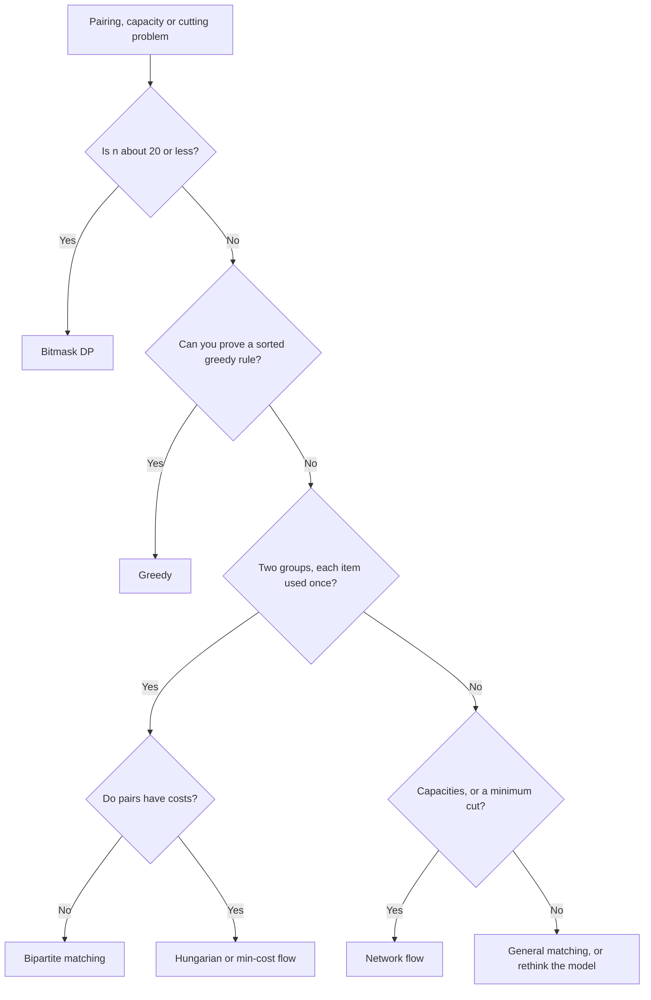

# When to Use Advanced Structures

> **Level:** Advanced · **Priority:** T2 · **Time:** 120 min · **Read first:** [Constraints Tell You the Algorithm](02-constraints-tell-you-the-algorithm.md), [When You Do Not Recognize the Problem](12-when-you-do-not-recognize-it.md) · **Next:** [Segment Tree](../12-advanced-data-structures/01-segment-tree.md)

Most interview problems never need a segment tree or a suffix automaton. This guide shows the exact moment when a simple tool stops working. For each of 18 advanced structures, you get the plain problem that first needs it, the words that give it away, what fails with simpler tools, and the chapter to study.

## Quick revision

- **Start on the lowest rung.** Use an advanced structure only when you can name what the simpler tool cannot do.
- **Ask four questions:** What changes? What is asked? When do the queries arrive? How big is the input?
- **The undo test:** if subtraction can remove a part from the answer, prefix ideas work. Sum and XOR pass. Min, max and GCD fail.
- **Array never changes:** sum or XOR uses prefix sums. Min, max or GCD uses a sparse table.
- **One item changes:** sum uses a Fenwick tree. Min, max or a custom answer uses a segment tree.
- **A range changes:** range add with only the final array needed uses a difference array. Questions between updates use a lazy segment tree.
- **All queries known, no updates, counting inside a range:** sort the queries, or use Mo's algorithm.
- **Old versions are read:** try a history list for each index. Then try a persistent segment tree.
- **Any rank or any k-th, with a changing set:** order statistics tree, or a Fenwick tree on values.
- **Insert at a position or reverse a range:** implicit treap.
- **Trees:** subtree uses an Euler tour. k-th ancestor and LCA use binary lifting. A changing path with max uses heavy-light. All pairs by distance use centroid decomposition.
- **Strings:** one pattern uses KMP. Many long patterns use Aho-Corasick. All substrings of one string use a suffix array or suffix automaton.
- **Two groups, each item used once:** bipartite matching. **Capacities or a cheapest cut:** network flow.
- **The count of pairs for every possible sum:** FFT.
- **Small limits cancel everything.** With n up to 1000, a plain O(n^2) loop usually passes.

## How to recognize it

First, four words you need.

- A **query** asks a question and changes nothing. An **update** changes the data.
- A **point update** changes one item. A **range update** changes every item from `l` to `r`.
- **Online** means you must answer each query before you see the next one.
- **Offline** means you get all queries first, so you may answer them in any order.

Now ask these four questions, in this order.

**1. What changes?** Nothing, one item, a whole range, or the positions of the items. Sometimes the data changes and old versions must stay readable. This one answer removes most options. A sparse table must be rebuilt after any update. A segment tree cannot shift items sideways.

**2. What is asked, and does it pass the undo test?** The undo test asks: can you remove a part from an answer by subtraction? Here is a tiny example.

```text
nums        = [1, 9, 3, 7]
prefix sums = [1, 10, 13, 20]    sum of indexes 2..3 = 20 - 10 = 10   correct
prefix mins = [1, 1, 1, 1]       min of indexes 2..3 = ???            real answer is 3
```

The sum of the first part can be taken away. The min of the first part cannot, because the 1 hides everything after it. So sum passes the undo test, and min fails it. XOR also passes, because XOR-ing a value a second time removes it. Max and GCD fail, like min. You will meet this test again on arrays and on trees.

**3. When do the queries arrive?** If they are offline, sorting them may remove the need for any advanced structure. See [Offline Query Processing](../05-core-patterns/20-offline-query-processing.md). A statement that says each query depends on the previous answer forces online work.

**4. How big is the input?** An advanced structure is needed only when the data is large and there are many operations. If n and q are both near 100,000, then n times q is 10^10, which is too slow. You need about O(log n) or O(sqrt n) for each operation. If q is 1000, a loop may pass. See [Constraints Tell You the Algorithm](02-constraints-tell-you-the-algorithm.md).

### The whole ladder on one page

| Structure | Signal in the statement | Try this first | Chapter |
|---|---|---|---|
| Fenwick tree | Point update and range sum, or counting smaller values so far | Prefix sums, if nothing changes | [Fenwick](../12-advanced-data-structures/03-fenwick-tree.md) |
| Segment tree | Point update and range min or max, or "first position where..." | Fenwick tree, if the answer is a sum | [Segment tree](../12-advanced-data-structures/01-segment-tree.md) |
| Lazy segment tree | "Add to, set or flip all items in l..r", with queries between | Difference array, if it is range add and queries come last | [Lazy](../12-advanced-data-structures/02-segment-tree-lazy-propagation.md) |
| Sparse table | Fixed array, range min, max or GCD, very many queries | Monotonic queue, if it is min or max and ranges only slide | [Sparse table](../12-advanced-data-structures/04-sparse-table-and-rmq.md) |
| Sqrt decomposition | Query has a step k, or the answers of two halves cannot merge | Segment tree | [Sqrt](../12-advanced-data-structures/05-sqrt-decomposition-and-mos-algorithm.md) |
| Mo's algorithm | Offline ranges, no updates, add or remove one item is cheap | Prefix counts, or sorting the queries | [Mo](../12-advanced-data-structures/05-sqrt-decomposition-and-mos-algorithm.md) |
| Persistent segment tree | "At version v", or k-th smallest in a range, online | A history list for each index | [Persistent](../12-advanced-data-structures/06-persistent-data-structures.md) |
| Order statistics tree | "Rank of x" or "k-th smallest", with inserts and deletes | Two heaps, or Fenwick on values | [Order statistics](../12-advanced-data-structures/07-order-statistics-and-pbds.md) |
| Treap | "Insert at position p", "reverse l..r", "cut and paste" | Deque, if changes happen only at the ends | [Treap](../07-trees/09-splay-tree-and-treap.md) |
| Binary lifting | "k-th ancestor", "after k steps" with huge k, many LCA queries | Walk up, if the depth is small | [Binary lifting](../12-advanced-data-structures/09-lca-and-binary-lifting.md) |
| Heavy-light | Path between two nodes, values change, max or range update | Euler tour, if the query is a subtree | [Heavy-light](../12-advanced-data-structures/10-heavy-light-and-centroid-decomposition.md) |
| Centroid decomposition | "Count pairs at distance at most k", "nearest marked node" | Tree DP, XOR from the root | [Centroid](../12-advanced-data-structures/10-heavy-light-and-centroid-decomposition.md) |
| Suffix array | "Distinct substrings", "longest repeated", sorted substrings | Rolling hash plus binary search | [Suffix array](../10-string-algorithms/06-suffix-arrays-and-lcp.md) |
| Suffix automaton | Questions about all substrings, letters added one at a time | Suffix array | [Suffix automaton](../10-string-algorithms/07-suffix-automaton-and-suffix-tree.md) |
| Aho-Corasick | A dictionary of many words searched in one text or stream | Hash set, if all words are short | [Aho-Corasick](../10-string-algorithms/05-aho-corasick.md) |
| Network flow | Capacities, "minimum to cut so that A cannot reach B" | Shortest path or greedy | [Flow](../08-graphs/15-network-flow.md) |
| Bipartite matching | Two groups, allowed pairs, each item used once | Bitmask DP for tiny n, greedy for sorted rules | [Matching](../08-graphs/16-bipartite-matching.md) |
| FFT | "For every sum, count the pairs", huge number multiplication | Plain loops, if the values are small | [FFT](../11-math-geometry-games/10-fft-and-ntt.md) |

## Ladder 1: Range questions on an array

Every problem here has an array and many questions about ranges. Start with the bottom rung.

**Rung 0: prefix sums and difference arrays.** [Range Sum Query - Immutable](https://leetcode.com/problems/range-sum-query-immutable/) (LeetCode 303, Easy) has a fixed array and asks range sums. [Prefix sums](../05-core-patterns/06-prefix-sums.md) solve it. [Car Pooling](https://leetcode.com/problems/car-pooling/) (LeetCode 1094, Medium) has many range additions and looks at the result only at the end. A [difference array](../05-core-patterns/07-difference-array-and-sweep-line.md) solves it. If your problem fits one of these, stop climbing.





### Rung 1: Fenwick tree

**Plain problem:** [Range Sum Query - Mutable](https://leetcode.com/problems/range-sum-query-mutable/) (LeetCode 307, Medium). Two operations arrive in any order: change one value, and ask the sum of a range.

**Signal:** "update" and "sum of range" in one problem. Also "for each item, count the smaller items before or after it", as in [Count of Smaller Numbers After Self](https://leetcode.com/problems/count-of-smaller-numbers-after-self/) (LeetCode 315, Hard). There, the set of seen values grows, and each new question is a prefix count on values.

**What fails with simpler tools:** prefix sums. One update can rewrite almost the whole table.

```text
nums   = [2, 1, 5, 3]      prefix = [0, 2, 3, 8, 11]
set nums[1] = 4            prefix = [0, 2, 6, 11, 14]    3 of 5 entries changed
```

A plain array has the opposite problem: O(1) to update and O(n) to sum. Either way one operation costs O(n). With 100,000 of each, that is about 10^10 steps. A Fenwick tree stores sums of blocks, so that both operations are O(log n).

**Do not climb if:** the array never changes, because then prefix sums are enough. **Skip this rung if** the answer fails the undo test. A Fenwick tree computes `sum(l..r) = prefix(r) - prefix(l - 1)`, and that subtraction is exactly what min cannot do. One exception: a max over a prefix `0..r`, when values only grow, needs no subtraction, so a Fenwick tree works.

**Study:** [Fenwick Tree](../12-advanced-data-structures/03-fenwick-tree.md).

### Rung 2: Segment tree

**Plain problem:** range minimum with point updates (Classic). A real example, with max in place of min, is [Fruits Into Baskets III](https://leetcode.com/problems/fruits-into-baskets-iii/) (LeetCode 3479, Medium). Each fruit takes the leftmost free basket that is big enough.

**Signal:** "minimum in range" or "maximum in range" plus updates. "The first position whose value is at least x", with values that change. A [DP](../09-dynamic-programming/01-dp-from-zero.md) step that needs the best value over a range of earlier states, as in [Longest Increasing Subsequence II](https://leetcode.com/problems/longest-increasing-subsequence-ii/) (LeetCode 2407, Hard).

**What fails with simpler tools:** a Fenwick tree cannot subtract a min. A segment tree does not need to subtract. It stores the answer for each block of positions and merges two blocks.

```text
nums = [5, 2, 7, 1]

            [0..3] min 1
           /            \
    [0..1] min 2    [2..3] min 1
     /      \         /      \
    5        2       7        1
```

To change `nums[3]` to 9, you rewrite only one path: the leaf, then `[2..3]` becomes 7, then `[0..3]` becomes 2. To ask a range, you merge a few blocks. Both are O(log n).

The test is this: **if you know the answer for the left half and the right half, can you build the answer for the whole?** Min passes. Maximum subarray sum also passes, if each block stores four numbers (best, best prefix, best suffix, total). The median fails.

**Do not climb if:** the answer is a sum and updates are single items, because a Fenwick tree is shorter. Do not climb if the array is fixed and the operation is min, max, GCD, AND or OR, because a sparse table is simpler. Maximum subarray sum on a fixed array still needs this tree.

**Study:** [Segment Tree](../12-advanced-data-structures/01-segment-tree.md).

### Rung 3: Lazy segment tree

**Plain problem:** range add and range sum (Classic). A real example is [Handling Sum Queries After Update](https://leetcode.com/problems/handling-sum-queries-after-update/) (LeetCode 2569, Hard). One operation flips all bits from `l` to `r`, and another needs the count of ones.

**Signal:** "add x to every item in l..r", "set every item in l..r to x", or "flip every item in l..r", **with questions between the updates**.

**What fails with simpler tools:** a normal segment tree must visit every leaf in the range, so one range update costs O(n). A difference array is fast, but it cannot answer a question until you rebuild the array.

A lazy tag fixes this. Stop at a block that lies fully inside the range, write a note on it, and go no deeper.

```text
add 3 to indexes 0..3, in an array of 8 items

            [0..7]
           /      \
     [0..3]*      [4..7]        * tag: "add 3 to everything under me"
```

One tag replaced four writes. The note moves down only when a later operation needs to look inside that block.

**Do not climb if:**

- The updates are range adds, and questions come only after all of them. Use a [difference array](../05-core-patterns/07-difference-array-and-sweep-line.md). It cannot do "set to x", because it works by adding at `l` and cancelling after `r`.
- It is range add with single-item questions, or range add with range sums. One or two [Fenwick trees](../12-advanced-data-structures/03-fenwick-tree.md) do this.
- The items are intervals that you add and remove. [Range Module](https://leetcode.com/problems/range-module/) (LeetCode 715, Hard) also works with intervals kept in a map, as in [Ordered Set Patterns](../05-core-patterns/19-ordered-set-patterns.md).
- The limits are small. [My Calendar III](https://leetcode.com/problems/my-calendar-iii/) (LeetCode 732, Hard) allows only 400 calls, so a sorted map of changes is enough.

**Study:** [Segment Tree With Lazy Propagation](../12-advanced-data-structures/02-segment-tree-lazy-propagation.md).

### Rung 4: Sparse table

**Plain problem:** range minimum on a fixed array (Classic). A real example is [Find a Value of a Mysterious Function Closest to Target](https://leetcode.com/problems/find-a-value-of-a-mysterious-function-closest-to-target/) (LeetCode 1521, Hard). The function is the bitwise AND of a subarray. AND can only fall as a subarray grows, so you can binary search the end of the subarray. Each step of that search needs a range AND.

**Signal:** the array never changes, the operation is min, max, GCD, AND or OR, and there are very many queries, or the query sits inside a binary search.

**What fails with simpler tools:** prefix sums fail the undo test. A segment tree works, but each query costs O(log n). A sparse table answers in O(1), after O(n log n) time and space to build. (GCD adds the cost of one gcd call.)

The trick is overlap. The table stores the answer for every block whose length is a power of 2. Any range is covered by two such blocks.

```text
nums = [4, 2, 6, 1, 5], query 0..4 (length 5, biggest power of 2 is 4)

block 0..3  min = 1
block 1..4  min = 1
answer = min(1, 1) = 1
```

Indexes 1, 2 and 3 are counted twice. That does no harm for min, because `min(x, x) = x`. An operation with this property is called **idempotent**. For a sum, the same two blocks would count 2, 6 and 1 twice, so this trick gives a wrong sum.

**Do not climb if:** the ranges only slide to the right and you want min or max. [Sliding Window Maximum](https://leetcode.com/problems/sliding-window-maximum/) (LeetCode 239, Hard) uses a [monotonic queue](../05-core-patterns/13-monotonic-queue.md), which costs O(n) in total. Also, one update ruins a sparse table, so use a segment tree when values change. In LeetCode 1521, a simpler way exists: the ANDs of all subarrays ending at one index take at most about 20 values, so keep that small set at each index.

**Study:** [Sparse Table and Range Minimum Queries](../12-advanced-data-structures/04-sparse-table-and-rmq.md).

### Rung 5: Sqrt decomposition

**Plain problem:** [XOR After Range Multiplication Queries II](https://leetcode.com/problems/xor-after-range-multiplication-queries-ii/) (LeetCode 3655, Hard). Each query multiplies `nums[l]`, `nums[l + k]`, `nums[l + 2k]` and so on by a value. [Sum Of Special Evenly-Spaced Elements In Array](https://leetcode.com/problems/sum-of-special-evenly-spaced-elements-in-array/) (LeetCode 1714, Hard, Premium) has the same shape.

**Signal:** a query with a **step size k**. Or a range question where you can summarize one block, but you cannot merge two summaries in O(log n).

**What fails with simpler tools:** the indexes `l, l + k, l + 2k` are not one contiguous range (a range with no gaps), so a tree over positions gives no help. Walking them costs O(n) when k is 1.

The idea is to split the cases at about sqrt(n).

```text
n = 16, split at 4

big steps (k is 4 or more):  each query touches at most 4 items. Walk them.
small steps (k is 1, 2, 3):  there are only 3 such steps. Prepare one table for each.
```

For n = 100,000 the split is about 316. A big step costs at most about 316 moves for each query. The small-step tables cost about 316 * n in total. The other classic form cuts the array into blocks of size sqrt(n), and keeps a summary for each block. A query then reads a few whole blocks and a few loose items.

**Do not climb if:** a segment tree can do it. O(log n) is far better than O(sqrt n), so sqrt is a tool for when merging is the problem.

**Study:** [Sqrt Decomposition and Mo's Algorithm](../12-advanced-data-structures/05-sqrt-decomposition-and-mos-algorithm.md).

### Rung 6: Mo's algorithm

**Plain problem:** count the distinct values in each query range (Classic).

**Signal:** all queries are known, the array has no updates, and the answer depends on the **counts** of values in the range: distinct values, the most common value, the number of equal pairs.

**What fails with simpler tools:** the undo test fails, since the distinct count of `0..r` minus that of `0..l-1` means nothing. A segment tree fails too, because merging two blocks of distinct values needs whole sets, not one number.

Mo's algorithm keeps one range and a count table. It moves the two ends one step at a time. Here, each move is cheap.

| Move | Count change | Distinct | Range now |
|---|---|---|---|
| start | 1 appears twice, 2 once | 2 | `0..2` |
| remove index 0 (value 1) | 1 appears once | 2 | `1..2` |
| add index 3 (value 3) | 3 appears once | 3 | `1..3` |
| remove index 1 (value 2) | 2 appears zero times | 2 | `2..3` |
| add index 4 (value 2) | 2 appears once | 3 | `2..4` |

That table uses `nums = [1, 2, 1, 3, 2]` with queries `0..2`, `1..3` and `2..4`. To keep the moves few, sort the queries: first by the block of `l`, using blocks of size sqrt(n), then by `r`. The total is about O((n + q) * sqrt(n)) moves.

**Do not climb if:**

- The values are small. [Minimum Absolute Difference Queries](https://leetcode.com/problems/minimum-absolute-difference-queries/) (LeetCode 1906, Medium) has values up to 100, so keep one prefix count for each value.
- One value is asked about. [Range Frequency Queries](https://leetcode.com/problems/range-frequency-queries/) (LeetCode 2080, Medium) keeps a sorted list of positions for each value in a hash map. Each query does a binary search there, in O(log n) on average because of the hash lookup.
- Distinct values can also be counted with [offline queries and a Fenwick tree](../05-core-patterns/20-offline-query-processing.md).

**Study:** [Sqrt Decomposition and Mo's Algorithm](../12-advanced-data-structures/05-sqrt-decomposition-and-mos-algorithm.md).

### Rung 7: Persistent segment tree

**Plain problem:** [Snapshot Array](https://leetcode.com/problems/snapshot-array/) (LeetCode 1146, Medium) is the first problem about versions, though it does not need a tree. The first that does is the k-th smallest value in `l..r` with online queries (Classic).

**Signal:** "at version v", "as of snapshot id", "query an old state". Also "k-th smallest in a range", when each query depends on the last answer.

**What fails with simpler tools:** copying the array at each version costs O(n) time and memory each time. Instead, a persistent tree copies only one path.

```text
version 0:   root0 -> left, right
update a leaf under right
version 1:   root1 -> left (shared), right1 -> new leaf
```

An update creates O(log n) new nodes, and every old root still works. For k-th smallest in `l..r`, build one version for each prefix of the array. Each version is a tree over values, and it counts the values in that prefix. Then compare version `r` with version `l - 1`, node by node. That subtraction is the undo test again, this time on counts.

**Do not climb if:**

- Only single items are read from old versions. In Snapshot Array, store for each index a list of `(snapId, value)`, and binary search it. For example, the list `(0, 5), (2, 6)` means that index holds 5 at snapshot 1. [Time Based Key-Value Store](https://leetcode.com/problems/time-based-key-value-store/) (LeetCode 981, Medium) is the same idea.
- Queries are offline. Sort them by version, and answer each one while you sweep. [Maximum XOR With an Element From Array](https://leetcode.com/problems/maximum-xor-with-an-element-from-array/) (LeetCode 1707, Hard) sorts queries by their limit and adds numbers to a [trie](../07-trees/13-trie.md) as the limit grows.

**Study:** [Persistent Data Structures](../12-advanced-data-structures/06-persistent-data-structures.md).

## Ladder 2: A changing group of values or a changing sequence

Here the data is not a fixed row of positions. Values come and go, or items move.



### Rung 8: Order statistics tree

**Plain problem:** keep a set with inserts and deletes, and answer "how many values are less than x?" and "what is the k-th smallest?" (Classic). [Finding MK Average](https://leetcode.com/problems/finding-mk-average/) (LeetCode 1825, Hard) is a real problem of this kind, though three multisets also solve it, because its two ranks never change.

**Signal:** "rank of x", "k-th smallest", "how many values below x", in a set that keeps changing, with k different on each query.

**What fails with simpler tools:**

- A sorted vector finds a rank fast, but one insert costs O(n).
- A heap sees only its top.
- `std::set` is sorted, but it has no rank. `distance(s.begin(), it)` walks one step at a time, so it costs O(n).

An order statistics tree is a balanced tree where each node also stores the size of its subtree. Both rank and k-th then cost O(log n).

```text
set = {3, 8, 15, 20}
order_of_key(15)   -> 2     two values are smaller than 15
find_by_order(3)   -> 20    counting from 0, the fourth smallest
```

**Do not climb if:**

- k does not move freely. [Find Median from Data Stream](https://leetcode.com/problems/find-median-from-data-stream/) (LeetCode 295, Hard) always needs the middle, so [two heaps](../05-core-patterns/15-two-heaps.md) work. [Sequentially Ordinal Rank Tracker](https://leetcode.com/problems/sequentially-ordinal-rank-tracker/) (LeetCode 2102, Hard) moves k by one at a time, so two heaps work there too.
- All values are known first, or are small. A [Fenwick tree](../12-advanced-data-structures/03-fenwick-tree.md) over the values gives both rank and k-th, and it is plain C++ that every interviewer accepts. The tree used above is a GNU extension, so ask before you use it.

**Study:** [Order Statistics and Policy-Based Trees](../12-advanced-data-structures/07-order-statistics-and-pbds.md).

### Rung 9: Treap

**Plain problem:** a sequence where you insert at a position, delete at a position, and reverse a range (Classic).

**Signal:** "insert at position p", "move the piece l..r to the front", "reverse l..r", and n near 100,000. The **positions** of items change, not just their values.

**What fails with simpler tools:**

- A vector shifts items, at O(n) for each insert.
- A linked list inserts in O(1), but it takes O(n) to reach position p.
- A segment tree has fixed positions, so it cannot make room for a new item.

A treap is a search tree that random priorities keep balanced on average. Use an **implicit treap** here: the key of an item is its position, and each node knows its subtree size. It has two main moves, split and merge, and each costs O(log n) on average.

```text
[a, b, c, d, e], reverse indexes 1..3

split:  [a]  [b, c, d]  [e]
tag the middle piece with "reversed"
merge:  [a, d, c, b, e]
```

**Do not climb if:**

- Changes happen only at the ends or the middle. [Design Front Middle Back Queue](https://leetcode.com/problems/design-front-middle-back-queue/) (LeetCode 1670, Medium) uses two [deques](../03-linked-lists-stacks-queues/09-deque.md).
- Items only move to the end. [Design Most Recently Used Queue](https://leetcode.com/problems/design-most-recently-used-queue/) (LeetCode 1756, Medium, Premium) can use a Fenwick tree with extra free slots at the end. Each fetch finds the k-th present item, removes it, and adds it to the next free slot.
- The limits are small. [Queue Reconstruction by Height](https://leetcode.com/problems/queue-reconstruction-by-height/) (LeetCode 406, Medium) inserts at positions, but n is at most 2000, so a vector is enough.

**Study:** [Splay Trees and Treaps](../07-trees/09-splay-tree-and-treap.md).

## Ladder 3: Many queries on a tree

One query on a tree is a simple [tree DFS](../07-trees/03-tree-dfs-problems.md). The advanced tools appear when there are many queries. A **path** is the route between two nodes. The **LCA** (lowest common ancestor) of two nodes is their deepest shared ancestor. An **Euler tour** writes nodes in DFS order, so that each subtree becomes one contiguous range of an array. That turns a subtree question into an array question from Ladder 1.



### Rung 10: Binary lifting

**Plain problem:** [Kth Ancestor of a Tree Node](https://leetcode.com/problems/kth-ancestor-of-a-tree-node/) (LeetCode 1483, Hard). Many queries ask for the node k steps above a given node.

**Signal:** "k-th ancestor", many "LCA" queries, or "after k steps" with a huge k. [Maximize Value of Function in a Ball Passing Game](https://leetcode.com/problems/maximize-value-of-function-in-a-ball-passing-game/) (LeetCode 2836, Hard) has k up to 10^10. Each node points to one next node there, so jumping works on a graph too.

**What fails with simpler tools:** walking up costs O(depth) for each query. On a tree shaped like a chain, that is O(n) per query, so O(n * q) in total.

Binary lifting stores, for each node, the node 1, 2, 4, 8 and so on steps above it. Any k is a sum of powers of 2.

```text
k = 13 = 8 + 4 + 1
jump 8 steps, then 4 steps, then 1 step: 3 jumps, not 13 steps
```

Each query costs O(log n), after O(n log n) time and space to build. With a huge k, write log k in place of log n. The jumped pieces are only merged, never subtracted. So the table can also store a min or max for each jump, even though those fail the undo test.

**Do not climb if:**

- There is one query. [Lowest Common Ancestor of a Binary Tree](https://leetcode.com/problems/lowest-common-ancestor-of-a-binary-tree/) (LeetCode 236, Medium) is one DFS.
- The tree is a search tree. [Lowest Common Ancestor of a Binary Search Tree](https://leetcode.com/problems/lowest-common-ancestor-of-a-binary-search-tree/) (LeetCode 235, Medium) walks down by comparing values.
- The tree is shallow. [Cycle Length Queries in a Tree](https://leetcode.com/problems/cycle-length-queries-in-a-tree/) (LeetCode 2509, Hard) has depth at most 30, so walk up.

**Study:** [LCA and Binary Lifting](../12-advanced-data-structures/09-lca-and-binary-lifting.md).

### Rung 11: Heavy-light decomposition

**Plain problem:** path maximum with value updates (Classic). A query asks the maximum on the path from u to v, and another operation changes one node's value.

**Signal:** "path between u and v", values change, and the question fails the undo test. Or a range update applied along a path.

**What fails with simpler tools:**

- A prefix from the root needs subtraction, so it fails for max.
- Binary lifting tables would need a rebuild after each change.
- An Euler tour makes a subtree contiguous, but a path is not contiguous in that order.

Heavy-light decomposition cuts the tree into chains. From each node, the edge to its child with the largest subtree is **heavy**. All others are **light**. Each light edge at least doubles the subtree size as you walk up, so the walk from any node to the root crosses at most log2(n) light edges. A path from u to v is at most two such walks, so it becomes O(log n) contiguous pieces of a flat array. A segment tree handles each piece, so a query costs O(log^2 n).

**Do not climb if:**

- The query is a subtree. An Euler tour is enough.
- The query starts at the root. [Shortest Path in a Weighted Tree](https://leetcode.com/problems/shortest-path-in-a-weighted-tree/) (LeetCode 3515, Hard) changes one edge, which changes the distance of a whole subtree. That is a range add and a single read on an Euler tour.
- The question is a sum and updates are single items. The same trick works between any two nodes: `d(u) + d(v) - 2 * d(lca)`, plus the value of the LCA when values sit on nodes. Sum passes the undo test.
- Values never change. [Minimum Edge Weight Equilibrium Queries in a Tree](https://leetcode.com/problems/minimum-edge-weight-equilibrium-queries-in-a-tree/) (LeetCode 2846, Hard) uses prefix counts from the root plus LCA.

**Study:** [Heavy-Light and Centroid Decomposition](../12-advanced-data-structures/10-heavy-light-and-centroid-decomposition.md).

### Rung 12: Centroid decomposition

**Plain problem:** count the pairs of nodes whose distance is at most k (Classic). Another classic is finding the nearest marked node, while nodes keep getting marked.

**Signal:** the question is about **all paths** in the tree, by length, and it has no fixed root.

**What fails with simpler tools:** a BFS from each node costs O(n^2). Rooting the tree does not help directly, because a path can bend at any node.

The centroid is a node whose removal leaves parts of at most n/2 nodes each. Every path either passes through the centroid or lies fully inside one part.

```text
chain 1 - 2 - 3 - 4 - 5, centroid 3, parts {1, 2} and {4, 5}

path 1 to 5 passes through 3: length 2 + 2 = 4
path 1 to 2 stays in one part: solve it when you recurse into {1, 2}
```

Part sizes halve at each level, so there are at most about log2(n) levels. Each level does O(n) work (more if you sort), which gives about O(n log n) to O(n log^2 n) in total.

**Do not climb if:**

- A value from the root solves it. [Count Paths That Can Form a Palindrome in a Tree](https://leetcode.com/problems/count-paths-that-can-form-a-palindrome-in-a-tree/) (LeetCode 2791, Hard) uses XOR, which passes the undo test, so shared parts of two root paths cancel.
- The answer is one number for each node. [Sum of Distances in Tree](https://leetcode.com/problems/sum-of-distances-in-tree/) (LeetCode 834, Hard) uses [rerooting in tree DP](../09-dynamic-programming/11-tree-dp.md).
- You can process values in sorted order. [Number of Good Paths](https://leetcode.com/problems/number-of-good-paths/) (LeetCode 2421, Hard) adds nodes from small to large with [Union-Find](../08-graphs/07-union-find.md).
- Each subtree can pass up a set of values. Then small-to-large merging (always pour the smaller set into the larger) may be simpler. The chapter linked below teaches it.

**Study:** [Heavy-Light and Centroid Decomposition](../12-advanced-data-structures/10-heavy-light-and-centroid-decomposition.md).

## Ladder 4: Strings

The first rungs are [KMP](../10-string-algorithms/02-kmp.md) and the [Z-algorithm](../10-string-algorithms/03-z-algorithm.md) for one pattern, and a [rolling hash](../10-string-algorithms/04-rabin-karp-and-rolling-hash.md) with binary search for "the longest piece that...". Climb only when these fail.



### Rung 13: Suffix array

**Plain problem:** count the distinct substrings of a long string (Classic). [Number of Distinct Substrings in a String](https://leetcode.com/problems/number-of-distinct-substrings-in-a-string/) (LeetCode 1698, Medium, Premium) is the LeetCode form.

**Signal:** "distinct substrings", "longest repeated substring", "k-th smallest substring", with n near 100,000. The question is about **all substrings** of one string, and no pattern is given.

**What fails with simpler tools:** a string of length n has about n^2 / 2 substrings. Listing them is too slow, and a trie of all suffixes can need O(n^2) nodes.

A **suffix** is a piece that runs to the end of the string. A suffix array is the list of all suffixes in sorted order. The LCP array stores the length of the longest common prefix of each sorted neighbour pair.

```text
s = "banana"

start   suffix    LCP with the one above
5       a         -
3       ana       1
1       anana     3
0       banana    0
4       na        0
2       nana      2
```

Every substring is a prefix of some suffix, so sorted suffixes show repeats side by side. The biggest LCP is 3, so the longest repeated substring is `ana`. The number of distinct substrings is all substrings minus the repeats: 21 - (1 + 3 + 0 + 0 + 2) = 15. Doubling builds it in O(n log n) with counting sort, or O(n log^2 n) with `std::sort`.

**Do not climb if:**

- The limits are small. LeetCode 1698 has length at most 500, so a trie is fine.
- The answer is a length that you can binary search. [Longest Duplicate Substring](https://leetcode.com/problems/longest-duplicate-substring/) (LeetCode 1044, Hard) works with a rolling hash: if a piece of length L repeats, a piece of length L - 1 repeats too.

**Study:** [Suffix Arrays and LCP](../10-string-algorithms/06-suffix-arrays-and-lcp.md).

### Rung 14: Suffix automaton

**Plain problem:** the longest common substring of two long strings (Classic). Build the automaton on one string, then walk the other through it.

**Signal:** the same questions as the suffix array, plus "letters are added one at a time, and after each letter give the number of distinct substrings". Also "how many times does each substring appear?"

**What fails with simpler tools:** a suffix array is built for a fixed string, so a new letter at the end means a new build. The automaton adds one letter at a time, at O(1) amortized cost for a fixed alphabet. (Amortized means the average over all steps, as [this chapter](../00-start-here/07-amortized-analysis.md) explains.)

A suffix automaton is a small machine whose paths from the start spell every substring of a string. It has at most about 2n states, even though there are about n^2 / 2 substrings. Each state groups the substrings that end at the same set of positions.

**How to choose:** use whichever you know better when the string is fixed. Use the automaton when letters arrive one at a time.

**Do not climb if:** a rolling hash with binary search solves it. [Longest Common Subpath](https://leetcode.com/problems/longest-common-subpath/) (LeetCode 1923, Hard) works that way, though it also has suffix array and automaton solutions.

**Study:** [Suffix Automaton and Suffix Tree](../10-string-algorithms/07-suffix-automaton-and-suffix-tree.md).

### Rung 15: Aho-Corasick

**Plain problem:** find all occurrences of every word of a dictionary in one text (Classic). Real examples are [Stream of Characters](https://leetcode.com/problems/stream-of-characters/) (LeetCode 1032, Hard) and [Construct String with Minimum Cost](https://leetcode.com/problems/construct-string-with-minimum-cost/) (LeetCode 3213, Hard).

**Signal:** "a list of words" and one long text or stream. "Banned words". "Which words end at this position?"

**What fails with simpler tools:**

- KMP for each word costs O(number of words * text length), plus the word lengths.
- A trie walk from each text position costs O(text length * longest word).

Aho-Corasick puts all words in a trie, then adds failure links, which are the KMP idea on a trie. After a mismatch you do not restart. You jump to the longest suffix of what you have read that is still in the trie. The cost is O(total word length + text length + matches), for a fixed alphabet.

**Do not climb if:**

- There is one pattern. Use [KMP](../10-string-algorithms/02-kmp.md).
- All words are short. [Length of the Longest Valid Substring](https://leetcode.com/problems/length-of-the-longest-valid-substring/) (LeetCode 2781, Hard) has forbidden words of length at most 10, so a hash set checks the last 10 endings at each step.
- The input is small. [Extra Characters in a String](https://leetcode.com/problems/extra-characters-in-a-string/) (LeetCode 2707, Medium) has length at most 50, so DP with a set or [trie](../07-trees/13-trie.md) is enough.

**Study:** [Aho-Corasick](../10-string-algorithms/05-aho-corasick.md).

## Ladder 5: Pairing, capacity and cutting

These problems sound like [greedy](../06-recursion-backtracking-greedy/07-greedy-classics.md) or shortest path. Check the size first. Then check whether a simple greedy rule can be proved.



### Rung 16: Network flow

**Plain problem:** water flows from a source to a sink through pipes, and each pipe has a capacity. Find the most water per second that can arrive (Classic).

**Signal:** "capacity", "at most c items through this link". "The cheapest set of links to cut, so that A cannot reach B", which is a **minimum cut**. The max-flow min-cut theorem says that the max flow equals the cost of the cheapest cut. "Each project gives profit but needs some paid tools", which is project selection.

**What fails with simpler tools:** shortest path finds one route. Greedy can block itself. Here, each pipe has capacity 1.

```text
source -> a, source -> b, a -> b, a -> sink, b -> sink

greedy first route: source -> a -> b -> sink      flow 1, now stuck
best answer:        source -> a -> sink
                    source -> b -> sink           flow 2
```

Flow algorithms add reverse edges, so that a later route can undo an earlier choice. That is what greedy lacks.

**Do not climb if:**

- One cut edge is enough. [Critical Connections in a Network](https://leetcode.com/problems/critical-connections-in-a-network/) (LeetCode 1192, Hard) needs [bridges](../08-graphs/13-bridges-and-articulation-points.md).
- The answer is small by reasoning. [Minimum Number of Days to Disconnect Island](https://leetcode.com/problems/minimum-number-of-days-to-disconnect-island/) (LeetCode 1568, Hard) never needs more than 2 days, so test 0, then 1, then answer 2.

**Study:** [Network Flow](../08-graphs/15-network-flow.md).

### Rung 17: Bipartite matching

**Plain problem:** workers and jobs, with a table of who can do what. Each worker takes one job, and each job takes one worker. Find the most pairs. [Maximum Number of Accepted Invitations](https://leetcode.com/problems/maximum-number-of-accepted-invitations/) (LeetCode 1820, Medium, Premium) is this problem with a different story.

**Signal:** **two groups**, a list of allowed pairs, each item used at most once, and n too big for bitmask DP, such as 200. A hidden form: conflicts on a grid. A grid can be colored like a chessboard, so neighbours fall in two groups. Then the fewest cells to remove equals the max matching. That is [Minimum Operations to Remove Adjacent Ones in Matrix](https://leetcode.com/problems/minimum-operations-to-remove-adjacent-ones-in-matrix/) (LeetCode 2123, Hard, Premium).

**What fails with simpler tools:** greedy takes a pair that blocks a better plan.

```text
A can do job 1 or job 2.  B can do only job 1.

greedy: A takes job 1, so B has nothing     1 pair
best:   A takes job 2, B takes job 1        2 pairs
```

Kuhn's algorithm fixes this. When B wants job 1, it asks A to move to another job. That chain of moves is an **augmenting path**. Kuhn's algorithm costs O(V * E), where V counts nodes and E counts allowed pairs.

**Do not climb if:**

- n is tiny. [Maximum Compatibility Score Sum](https://leetcode.com/problems/maximum-compatibility-score-sum/) (LeetCode 1947, Medium) has n at most 8. [Maximum AND Sum of Array](https://leetcode.com/problems/maximum-and-sum-of-array/) (LeetCode 2172, Hard) has at most 9 slots. Use [bitmask DP](../09-dynamic-programming/12-bitmask-dp.md). [Maximum Students Taking Exam](https://leetcode.com/problems/maximum-students-taking-exam/) (LeetCode 1349, Hard) also has a matching solution, but its 8 by 8 limit lets bitmask DP pass.
- A sorted rule works. [Assign Cookies](https://leetcode.com/problems/assign-cookies/) (LeetCode 455, Easy) has one number for each item, so the allowed pairs have a simple shape. Sort and use [greedy](../06-recursion-backtracking-greedy/07-greedy-classics.md).

**Study:** [Bipartite Matching](../08-graphs/16-bipartite-matching.md).

## Ladder 6: All sums at once

### Rung 18: FFT

**Plain problem:** multiply two polynomials with 100,000 terms each (Classic). The same work counts, for every sum s, the pairs `(a, b)` with `a + b = s`.

**Signal:** "for **every** value of s, compute...", with `result[s]` built from `a[i] * b[s - i]` for all i. This shape is called a **convolution**. "Multiply two numbers of 100,000 digits". When this shape appears, an answer modulo 998244353 points to NTT, which is FFT with whole numbers modulo a prime. That modulus alone proves nothing, because many other problems use it.

**What fails with simpler tools:** the double loop is O(n^2). A hash map answers one target sum, not all of them at once.

```text
A = {1, 2}, B = {2, 3}

as polynomials: (x + x^2) * (x^2 + x^3) = x^3 + 2x^4 + x^5

sum 3: 1 way (1 + 2)
sum 4: 2 ways (1 + 3, 2 + 2)
sum 5: 1 way (2 + 3)
```

Each value becomes a power of x, and each count becomes a coefficient. Multiplying polynomials adds the exponents, so it counts the sums. FFT does this multiplication in O(n log n), where n is the highest power of x. So when you count sums, n is the largest value, not the length of the list.

**Do not climb if:**

- There is one target. [Two Sum](https://leetcode.com/problems/two-sum/) (LeetCode 1, Easy) uses a hash map.
- The values are small. [3Sum With Multiplicity](https://leetcode.com/problems/3sum-with-multiplicity/) (LeetCode 923, Medium) has values up to 100, so loop over values.
- The numbers are short. [Multiply Strings](https://leetcode.com/problems/multiply-strings/) (LeetCode 43, Medium) has at most 200 digits, so school multiplication passes.

**Study:** [FFT and NTT](../11-math-geometry-games/10-fft-and-ntt.md).

## Drills

Cover each answer. Name the tool, say why, and name the lookalike that fails. Some stories hide the real question, and a few have a simple answer. Unless a drill says otherwise, n and q are near 100,000.

**D1.** A chat app has a list of 5,000 banned words, some of them 500 letters long. Each message is a long text. Mark every banned word in it.

<details>
<summary>Answer</summary>

**[Aho-Corasick](../10-string-algorithms/05-aho-corasick.md).** Many patterns, one text. KMP for each word repeats the text 5,000 times. A hash set of short lengths fails, because the words are long.

</details>

**D2.** A hotel has n rooms in a line. Guests check in and out of single rooms. The manager often asks how many guests are in rooms a to b.

<details>
<summary>Answer</summary>

**[Fenwick tree](../12-advanced-data-structures/03-fenwick-tree.md).** This is point update and range sum in a story. Prefix sums break on each check-in. A segment tree also works, but it is longer to write.

</details>

**D3.** Up to 1000 boxes fall on a line, one at a time. Each lands on the highest box under it. After each drop, report the tallest stack. See [Falling Squares](https://leetcode.com/problems/falling-squares/) (LeetCode 699, Hard).

<details>
<summary>Answer</summary>

**Two nested loops.** For each new box, compare it with all earlier boxes. O(n^2) is about 10^6 steps. The statement looks like a lazy segment tree, and that works, but the limit makes it unnecessary.

</details>

**D4.** Each employee has one boss. Many questions ask: who is k levels above this employee?

<details>
<summary>Answer</summary>

**[Binary lifting](../12-advanced-data-structures/09-lca-and-binary-lifting.md)**, as in [Kth Ancestor of a Tree Node](https://leetcode.com/problems/kth-ancestor-of-a-tree-node/) (LeetCode 1483, Hard). Walking up is O(n) per query on a long chain of bosses.

</details>

**D5.** Two lists hold 100,000 scores each, from 0 to 100,000. For each possible total, print how many pairs (one score from each list) give that total, modulo 998244353.

<details>
<summary>Answer</summary>

**[FFT or NTT](../11-math-geometry-games/10-fft-and-ntt.md).** "For each possible total" plus large values is a convolution. A hash map handles one total. The double loop is 10^10 steps. The modulus points to NTT.

</details>

**D6.** A settings file has 50,000 keys. You can change a key, save a version, and read one key from any saved version.

<details>
<summary>Answer</summary>

**A history list for each key, with binary search**, as in [Snapshot Array](https://leetcode.com/problems/snapshot-array/) (LeetCode 1146, Medium). A [persistent tree](../12-advanced-data-structures/06-persistent-data-structures.md) also works, but it is not needed, since reads touch one key.

</details>

**D7.** A wall has n planks. A painter sets all planks from l to r to one color number. Between jobs, the owner asks for the smallest color number on planks a to b.

<details>
<summary>Answer</summary>

**[Lazy segment tree](../12-advanced-data-structures/02-segment-tree-lazy-propagation.md)** with range assign and range min. It is a range update, with questions between updates. A difference array cannot answer between updates. Fenwick trees fail the undo test on min.

</details>

**D8.** Cities form a tree of roads. The toll of one road can change. Many drivers ask for the single most expensive road on their route from u to v.

<details>
<summary>Answer</summary>

**[Heavy-light decomposition](../12-advanced-data-structures/10-heavy-light-and-centroid-decomposition.md)** with a segment tree. It has a path, changing values, and max, which fails the undo test. An Euler tour handles subtrees, not paths. Binary lifting tables go stale after each change.

</details>

**D9.** A company has 200 interns and 200 projects, and a table of who can do what. Each project takes one intern, and each intern takes one project. Fill as many projects as you can.

<details>
<summary>Answer</summary>

**[Bipartite matching](../08-graphs/16-bipartite-matching.md).** Two groups, allowed pairs, each used once. 200 is too big for bitmask DP. Greedy can block a better plan.

</details>

**D10.** A power company has 100,000 records. Each says a customer used x units from hour s to hour e, in one year. After reading all of them, find the busiest hour.

<details>
<summary>Answer</summary>

**[Difference array](../05-core-patterns/07-difference-array-and-sweep-line.md).** This is range add, with one question at the very end, like [Car Pooling](https://leetcode.com/problems/car-pooling/) (LeetCode 1094, Medium). No tree is needed, because no question arrives between updates. Use `long long` for the totals.

</details>

**D11.** A DNA string has 100,000 letters. How many different pieces (contiguous parts) does it contain?

<details>
<summary>Answer</summary>

**[Suffix array with LCP](../10-string-algorithms/06-suffix-arrays-and-lcp.md)**, or a [suffix automaton](../10-string-algorithms/07-suffix-automaton-and-suffix-tree.md). The answer is `n(n + 1)/2 - sum(LCP)`. Use `long long`, because the count can reach about 5 * 10^9. A trie of all suffixes can be too big. Hash plus binary search does not fit, because this is a count over all lengths.

</details>

**D12.** A cinema has 50,000 rows, and seats in each row fill from the left. A group of k friends wants the first row with k free seats together. See [Booking Concert Tickets in Groups](https://leetcode.com/problems/booking-concert-tickets-in-groups/) (LeetCode 2286, Hard).

<details>
<summary>Answer</summary>

**[Segment tree](../12-advanced-data-structures/01-segment-tree.md)** that stores the max free seats in each block. "The first position with a value of at least k" means: go left if the left block's max is enough, else go right. Binary search alone fails, because free seats are not sorted.

</details>

**D13.** A museum logged the home city of each of n visitors. Offline, for each of q questions, count the different cities among visitors l to r.

<details>
<summary>Answer</summary>

**[Mo's algorithm](../12-advanced-data-structures/05-sqrt-decomposition-and-mos-algorithm.md)**, or [sort the queries by r and use a Fenwick tree](../05-core-patterns/20-offline-query-processing.md). It is offline, with no updates, and it depends on counts. Prefix counts fail, because there can be too many cities for one table per city.

</details>

**D14.** A playlist has 100,000 songs. Users insert a song at position p, reverse the songs from l to r, and ask which song is at position p.

<details>
<summary>Answer</summary>

**[Implicit treap](../07-trees/09-splay-tree-and-treap.md).** Positions shift and ranges reverse. A vector shifts O(n) items. A segment tree has fixed positions. A deque helps only at the ends.

</details>

**D15.** Data centers are joined by cables, and each cable has a price to cut. Find the cheapest set of cables to cut, so that center A cannot reach center B.

<details>
<summary>Answer</summary>

**[Network flow](../08-graphs/15-network-flow.md).** This is a minimum cut, which equals the max flow when prices are capacities. [Bridges](../08-graphs/13-bridges-and-articulation-points.md) help only when one cable is enough. Shortest path answers a different question.

</details>

**D16.** Find the longest strictly increasing subsequence in which two neighbours differ by at most k. See [Longest Increasing Subsequence II](https://leetcode.com/problems/longest-increasing-subsequence-ii/) (LeetCode 2407, Hard).

<details>
<summary>Answer</summary>

**[Segment tree](../12-advanced-data-structures/01-segment-tree.md) on values, inside a DP.** For value v, the best length is `1 + max(best[v - k .. v - 1])`. That is a range max with point updates. The normal [LIS](../09-dynamic-programming/06-longest-increasing-subsequence.md) trick with binary search fails, because of the limit k.

</details>

**D17.** A building has n rooms, and each room has one one-way door to another room. Many questions ask: start in room s, go through 10^12 doors. Where do you end?

<details>
<summary>Answer</summary>

**[Binary lifting](../12-advanced-data-structures/09-lca-and-binary-lifting.md)** on a graph where each node has one out-edge. Use 40 levels, for jumps of 2^0 up to 2^39, because 10^12 is below 2^40. Finding the cycle works for one start, but handling a cycle for each query takes more code.

</details>

**D18.** 8 students and 8 mentors each answered a survey. Pair them one to one, to get the highest total score. See [Maximum Compatibility Score Sum](https://leetcode.com/problems/maximum-compatibility-score-sum/) (LeetCode 1947, Medium).

<details>
<summary>Answer</summary>

**[Bitmask DP](../09-dynamic-programming/12-bitmask-dp.md).** It looks like weighted matching, but n is 8. Even trying all 8! orders passes, which is about 40,000 orders.

</details>

**D19.** A stadium has n seats in a row. Each promotion adds v points to seats l, l + k, l + 2k and so on, up to seat r. After q promotions, print all the seats.

<details>
<summary>Answer</summary>

**[Sqrt decomposition](../12-advanced-data-structures/05-sqrt-decomposition-and-mos-algorithm.md) on the step k.** For k above sqrt(n), walk the seats. For small k, keep one difference array for each k, where each cell passes its value to the cell k places ahead. This has the shape of [XOR After Range Multiplication Queries II](https://leetcode.com/problems/xor-after-range-multiplication-queries-ii/) (LeetCode 3655, Hard). A lazy tree fails, because the seats are not contiguous.

</details>

**D20.** A company tree has n employees. Salaries change one at a time. Many questions ask for the total salary of one manager and everyone under them.

<details>
<summary>Answer</summary>

**[Euler tour](../12-advanced-data-structures/09-lca-and-binary-lifting.md) plus a [Fenwick tree](../12-advanced-data-structures/03-fenwick-tree.md).** A manager's group is a subtree, so it is one contiguous range. Heavy-light would work, but it is far too much.

</details>

**D21.** A game has a live leaderboard with scores up to 10^9. Scores change, online. Questions ask for one player's rank, and for the player at rank k.

<details>
<summary>Answer</summary>

**[Order statistics tree](../12-advanced-data-structures/07-order-statistics-and-pbds.md)** with `(score, playerId)` pairs, so that equal scores stay separate. A `std::set` has no fast rank. Two heaps work only for a fixed position. If you could read all scores first, a Fenwick tree on compressed values would also work.

</details>

**D22.** Towns form a tree, and each road has length 1. Count the pairs of towns at most k roads apart.

<details>
<summary>Answer</summary>

**[Centroid decomposition](../12-advanced-data-structures/10-heavy-light-and-centroid-decomposition.md).** It asks about all paths by length, with no root. BFS from each town is O(n^2). Root values do not help, because the condition is a comparison of lengths along paths that bend anywhere.

</details>

**D23.** A shop's sales log is final. One million questions ask for the lowest sale between two dates.

<details>
<summary>Answer</summary>

**[Sparse table](../12-advanced-data-structures/04-sparse-table-and-rmq.md).** No updates, min, many queries. Prefix sums fail the undo test. A segment tree works, but each query is O(log n) rather than O(1).

</details>

**D24.** An array never changes. Each query asks for the k-th smallest value in `l..r`. The real `l`, `r` and `k` are found by using the previous answer.

<details>
<summary>Answer</summary>

**[Persistent segment tree](../12-advanced-data-structures/06-persistent-data-structures.md)**, with one version for each prefix. The dependence on the previous answer forces online work, so Mo's algorithm and sorting the queries both fail.

</details>

**D25.** Towns form a tree, and each road has a letter. Count the pairs of towns whose route letters can be rearranged into a palindrome.

<details>
<summary>Answer</summary>

**XOR mask from the root, with a hash map**, as in [Count Paths That Can Form a Palindrome in a Tree](https://leetcode.com/problems/count-paths-that-can-form-a-palindrome-in-a-tree/) (LeetCode 2791, Hard). A palindrome allows at most one letter with an odd count. XOR passes the undo test, so the part above the LCA cancels. It costs about 27 lookups per node, and each is O(1) on average. It looks like centroid decomposition, but this does not need it.

</details>

**D26.** A sensor sends a stream of readings. After each reading, print the median of the last k readings.

<details>
<summary>Answer</summary>

**[Two heaps](../05-core-patterns/15-two-heaps.md) with delayed removal, or two multisets**, as in [Sliding Window Median](https://leetcode.com/problems/sliding-window-median/) (LeetCode 480, Hard). The position is always the middle, so you do not need any-rank power. An order statistics tree also works, if the interviewer allows it.

</details>

**D27.** Find the longest piece of text that appears in both of two documents of 100,000 letters each.

<details>
<summary>Answer</summary>

**[Rolling hash](../10-string-algorithms/04-rabin-karp-and-rolling-hash.md) plus binary search on the length.** If a shared piece of length L exists, a shared piece of length L - 1 exists too. A [suffix automaton](../10-string-algorithms/07-suffix-automaton-and-suffix-tree.md) gives an O(n) solution with no collision risk. The O(n * m) [LCS-style DP](../09-dynamic-programming/07-lcs-and-edit-distance.md) is 10^10 steps, so it fails here.

</details>

## Common pitfalls

1. **Climbing before you read the limits.** You see "range" and start a segment tree, but n is 1000. Do the size check first.
2. **Using Mo's algorithm on online queries.** Mo needs to sort the queries. If each query depends on the last answer, you cannot sort them. Use a persistent tree, or a structure that does not need the order.
3. **Using heavy-light for a subtree.** A subtree is already one contiguous range in an Euler tour. Heavy-light is for paths.
4. **Trusting greedy for pairing.** Greedy needs a proof. Without one, test it on the small example in Rung 17, and use matching.
5. **Forgetting that hashes can collide.** A rolling hash can report a false match. Compare the real strings when it matters, or use two hashes.

## Practice list

- [ ] [Range Frequency Queries](https://leetcode.com/problems/range-frequency-queries/) (LeetCode 2080, Medium): positions per value and binary search, not Mo.
- [ ] [Snapshot Array](https://leetcode.com/problems/snapshot-array/) (LeetCode 1146, Medium): a history list per index.
- [ ] [Range Sum Query - Mutable](https://leetcode.com/problems/range-sum-query-mutable/) (LeetCode 307, Medium): the first Fenwick tree.
- [ ] [Fruits Into Baskets III](https://leetcode.com/problems/fruits-into-baskets-iii/) (LeetCode 3479, Medium): segment tree, leftmost value at least x.
- [ ] [Count of Smaller Numbers After Self](https://leetcode.com/problems/count-of-smaller-numbers-after-self/) (LeetCode 315, Hard): Fenwick tree on values.
- [ ] [Kth Ancestor of a Tree Node](https://leetcode.com/problems/kth-ancestor-of-a-tree-node/) (LeetCode 1483, Hard): jump by powers of 2.
- [ ] [Find a Value of a Mysterious Function Closest to Target](https://leetcode.com/problems/find-a-value-of-a-mysterious-function-closest-to-target/) (LeetCode 1521, Hard): sparse table for AND, inside a binary search.
- [ ] [Handling Sum Queries After Update](https://leetcode.com/problems/handling-sum-queries-after-update/) (LeetCode 2569, Hard): lazy flip with a count of ones.
- [ ] [Stream of Characters](https://leetcode.com/problems/stream-of-characters/) (LeetCode 1032, Hard): reversed trie, then Aho-Corasick.
- [ ] [Longest Duplicate Substring](https://leetcode.com/problems/longest-duplicate-substring/) (LeetCode 1044, Hard): hash with binary search, then a suffix array.
- [ ] [Shortest Path in a Weighted Tree](https://leetcode.com/problems/shortest-path-in-a-weighted-tree/) (LeetCode 3515, Hard): Euler tour, range add, single read.
- [ ] [Maximum Students Taking Exam](https://leetcode.com/problems/maximum-students-taking-exam/) (LeetCode 1349, Hard): bitmask DP, then try the matching view.

## Interview questions

<details>
<summary><strong>Q1. Both a Fenwick tree and a segment tree can solve this. Which do you pick?</strong></summary>

If the answer is a sum and updates are single items, I pick a Fenwick tree, because the code is short and it has less overhead. If I need min, max, a custom merge, or a search for the first valid position, I pick a segment tree.

</details>

<details>
<summary><strong>Q2. Why does a sparse table give O(1) for min but not for sum?</strong></summary>

It covers a range with two power-of-2 blocks that may overlap. For min, an item counted twice changes nothing, since `min(x, x) = x`. For a sum, an item counted twice changes the result. To use the table for a sum you must split the range into O(log n) separate blocks, and prefix sums are simpler anyway.

</details>

<details>
<summary><strong>Q3. How do offline queries change your choice?</strong></summary>

If I can reorder the queries, I can sort them and sweep once, so an online structure may become unnecessary. For example, a query on an old version can be answered at that moment in the sweep, which removes the need for a persistent tree. Mo's algorithm also depends on this freedom.

</details>

<details>
<summary><strong>Q4. When do you need heavy-light decomposition and not an Euler tour?</strong></summary>

An Euler tour turns a subtree into a range, and with LCA it handles path sums, because subtraction works. Heavy-light is needed for a path question that cannot be undone by subtraction, such as a path max with updates, or for a range update along a path.

</details>

<details>
<summary><strong>Q5. Can you use a GNU policy-based tree in an interview?</strong></summary>

I would ask first. It is a GCC extension, not standard C++. A safe answer is to explain a tree that stores subtree sizes, or to use a Fenwick tree on values when the values are known or small.

</details>
