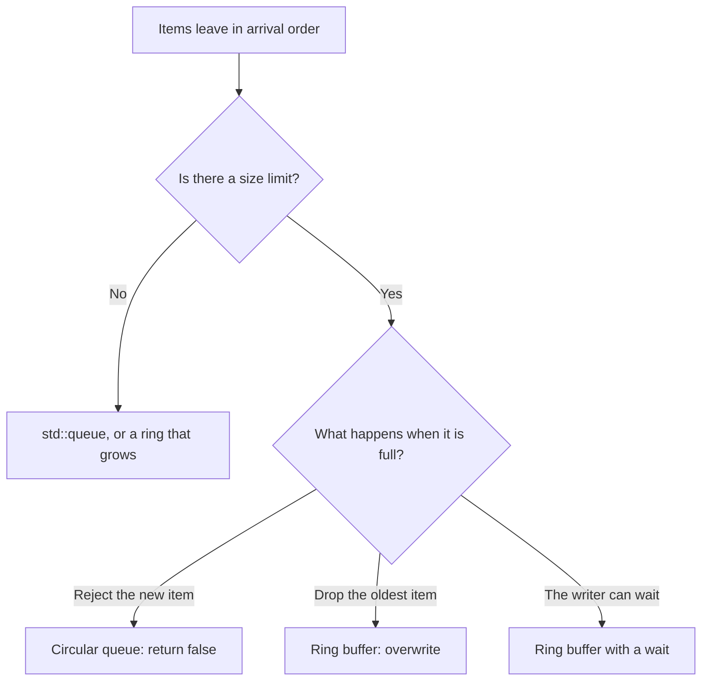

# Circular Queue and Ring Buffer

> **Level:** Beginner · **Priority:** T1 · **Time:** 150 min · **Read first:** [Queue from zero](07-queue-from-zero.md) · **Next:** [Deque](09-deque.md)

A circular queue keeps a queue in a fixed array and lets its indexes wrap from the last slot back to the first. You get O(1) operations with no wasted space and no memory allocation after the start. That makes it a common design question and a common part of real systems.

## Quick revision

- A **circular queue** treats a fixed array as a ring: after the last slot comes slot 0. It is also called a **ring buffer** or a **circular buffer**.
- It solves the **wasted space problem** of a plain array queue, because slots freed at the front get used again.
- `head` is the index of the oldest element. `tail` is the index of the next free slot.
- Move forward with `i = (i + 1) % capacity`.
- Move backward with `i = (i - 1 + capacity) % capacity`. In C++, `-1 % 4` is `-1`, so you must add `capacity` first.
- The i-th oldest element is at `(head + i) % capacity`. The newest is at `(head + count - 1) % capacity`.
- Every operation is O(1). Nothing shifts, and nothing is allocated after the start.
- `head == tail` can mean **empty** or **full**. Fix this with a `count` field, or by leaving one slot empty.
- One empty slot: allocate `capacity + 1` slots. Empty is `head == tail`. Full is `(tail + 1) % slots == head`.
- When a ring is full, you need a **policy**, a rule for what happens next: **reject** the new item (a queue), **overwrite** the oldest (a log) or **wait** (a buffer between two threads).
- To grow a ring, copy the elements into a bigger array in queue order. The wrap point changes, so a plain copy breaks the queue.
- **k queues in one array:** a `nextSlot` array links the slots of each queue, and a free list tracks the unused slots.
- **Circular array walk:** `(start + step) % n`. Distance on a ring: `min(d, n - d)`.
- **Doubled array:** every rotation of `a` is a piece of `a + a`. To save memory, loop `i` up to `2n - 1` and read `a[i % n]`.
- **Turning a ring into a line:** double it, cut it and run twice, or use the complement. See [the three ways](#three-ways-to-turn-a-ring-into-a-line).

## How to recognize it

This chapter has two recognition jobs. The first is to see when a problem wants a ring buffer. The second is to see when the input itself is a ring.

**Does the problem want a ring buffer?** Ask these four questions. If all four answers are yes, use one.

1. Do items leave in the same order they arrived (first in, first out)?
2. Is there a fixed limit on how many items you keep?
3. Do you add at one end and remove at the other, and never remove from the middle?
4. Do you want O(1) operations with no memory allocation for each new item?

**Is the input a ring?** Ask these two questions. If both answers are yes, use the tricks in [section 10](#10-circular-array-tricks).

1. Does the statement say that the last element is next to the first?
2. Can the answer cross from the last element back to the first?

Some words in the tables below may be new:

- A **window** is a block of neighboring items, such as the last 5 values.
- **Contiguous** means next to each other, with no gaps.
- A **rotation** moves some items from the front to the back and keeps their order.
- A **producer** adds items, and a **consumer** removes them.
- A **thread** is a separate line of execution inside a program.

| Words in the problem | What they tell you |
|---|---|
| "circular queue", "ring buffer", "circular buffer" | Build it: a fixed array, two indexes and a count |
| "fixed size", "bounded", "capacity k", "at most n items" | Allocate once. The size never changes |
| "keep the last n", "most recent k", "recent history" | Overwrite the oldest when the ring is full |
| "moving average", "rolling sum of the last k values" | A ring plus a running total |
| "data stream" with a window size | Values arrive one at a time and nothing else stores them, so a ring must hold the window |
| "drop the oldest", "discard old entries" | The overwrite policy |
| "return false if the queue is full" | The reject policy |
| "producer and consumer", "buffer between two threads" | A ring with a wait policy |
| "k queues", "share one array", "use the space fully" | A free list inside the array |
| "circular array", "arranged in a circle" | Walk with `(i + 1) % n` |
| "the next element of the last is the first", "wrap around" | Modulo walk, and check both directions |
| "rotation of", "rotated", "left shift" | The doubled array or string, unless the array is also sorted (see the next table) |
| "contiguous" items "in a circle" | A fixed window with a wrap, or the doubled array |

A story often hides the ring. Remove the story and look at what is left.

| The story | What it really is |
|---|---|
| "Show the average CPU load over the last 5 minutes" | A ring of 300 samples (one per second) plus a running sum |
| "Keep the last 100 messages in each chat room" | A ring that overwrites its oldest entry |
| "The player keeps playing while the video downloads" | A ring between a producer and a consumer |
| "Give each server a turn, one after another" | A walk with `(i + 1) % n` |
| "n people sit around a table, and each one talks to both neighbors" | `(i + 1) % n` and `(i - 1 + n) % n` |

**Not this pattern if:**

| You see | Use instead | Why |
|---|---|---|
| No size limit on the queue | [Queue from zero](07-queue-from-zero.md) | `std::queue` grows by itself. A fixed ring would reject items. |
| Add or remove at both ends | [Deque](09-deque.md) | A circular queue adds at one end and removes at the other. A deque is the same ring with both ends free to move. |
| Max or min of the last k values | [Monotonic queue](../05-core-patterns/13-monotonic-queue.md) | A ring stores the window, but finding its maximum still costs O(k). |
| Sum of a window over an array you already have | [Fixed sliding window](../05-core-patterns/04-sliding-window-fixed.md) | The array already stores every value, so you need no second buffer. |
| Items leave by priority, not by arrival | [Heaps](../07-trees/11-heap-from-zero.md) | A ring only knows arrival order. |
| Items removed from the middle of a circle | [Circular linked lists](03-circular-linked-lists.md) | Removing from the middle of an array costs O(n). |
| Remove the oldest, but items can be used again | [LRU cache](../13-design-problems/01-lru-and-lfu-cache.md) | A used item must jump from the middle to the newest end. A ring cannot do that in O(1). |
| Last in, first out | [Stack](05-stack-from-zero.md) | Undo and nesting need the newest item first. |
| A limit in time, such as "calls in the last 3000 ms" | [Queue from zero](07-queue-from-zero.md) | The window holds a changing number of items, so no fixed ring is sure to fit. Use a plain queue. A ring works only if you group items into time buckets. |
| Search in a rotated sorted array | [Binary search](../04-sorting-searching/06-binary-search-basics.md) | The goal is O(log n), and one side of the middle is always sorted. The doubled array costs O(n). |
| Best sum of a subarray of any length on a ring | [Kadane's algorithm](../05-core-patterns/08-kadane-and-subarray-dp.md) | A window of any length on a doubled array can pass `n` and use an element twice. Use the total minus the smallest subarray. |
| Each index jumps to another index, and you look for a loop | [Fast and slow pointers](../05-core-patterns/03-fast-and-slow-pointers.md) | The modulo only computes the next index. The real problem is a cycle in a chain of jumps. |

Once you know you need a queue, this tree picks the type:



## 1. The idea in plain English

Think of a round table with 3 plates. A cook walks around the table and puts food on the next empty plate. A customer walks behind the cook and eats from the next full plate. Both walk in the same direction, and both keep going round.

The plates never move. Only the two people move. A plate that was eaten from is ready for the cook on the next **lap**, which is one full trip around the table.

Two rules keep this working:

- The cook cannot put food on a plate that still has food. When the cook catches the customer from behind, the table is **full**.
- The customer cannot eat from an empty plate. When the customer catches the cook, the table is **empty**.

A ring buffer is this table. The plates are array slots. (A **slot** is one position in the array.) The cook is `tail`, and the customer is `head`.

The columns "Cook at" and "Customer at" show the next plate each person will use.

| Step | Action | Plate 0 | Plate 1 | Plate 2 | Cook at | Customer at |
|---|---|---|---|---|---|---|
| 1 | serve A | A | | | 1 | 0 |
| 2 | serve B | A | B | | 2 | 0 |
| 3 | eat A | | B | | 2 | 1 |
| 4 | serve C | | B | C | 0 | 1 |
| 5 | serve D | D | B | C | 1 | 1 |
| 6 | eat B | D | | C | 1 | 2 |

Look at step 4. The cook walks past plate 2 and comes back to plate 0. In an array, this is the **wrap-around**. Step 5 uses plate 0 again, the plate that A left free in step 3. No plate was wasted.

Step 5 also shows the full table: the cook and the customer stand at the same plate, and all 3 plates have food.

## 2. The wasted space problem

A plain array queue keeps two indexes: `front` and `rear`. Both only move right. `enqueue` adds an item at the back, and `dequeue` removes the item at the front. Here is one with a **capacity** of 4, meaning that it can hold at most 4 items.

```text
start            [ _,  _,  _,  _]   front = 0, rear = 0
enqueue(10)      [10,  _,  _,  _]   front = 0, rear = 1
enqueue(20)      [10, 20,  _,  _]   front = 0, rear = 2
enqueue(30)      [10, 20, 30,  _]   front = 0, rear = 3
enqueue(40)      [10, 20, 30, 40]   front = 0, rear = 4
dequeue() -> 10  [ _, 20, 30, 40]   front = 1, rear = 4
dequeue() -> 20  [ _,  _, 30, 40]   front = 2, rear = 4
enqueue(50)      rear is 4, which is past the last slot: "queue is full"
```

The queue holds 2 items, and slots 0 and 1 are free. It still refuses item 50, because `rear` has gone past the last slot. This is the **wasted space problem**: a slot behind `front` can never be used again.

[Queue from zero](07-queue-from-zero.md) showed this problem and moved on to a linked list. Here are all your options:

| Option | enqueue | dequeue | The problem |
|---|---|---|---|
| Plain array, indexes only move right | O(1) | O(1) | Free slots are lost forever |
| Shift all items left after each dequeue | O(1) | O(n) | Every dequeue moves every element |
| Linked list | O(1) | O(1) | One memory allocation and one pointer for each item |
| Ring: the indexes wrap around | O(1) | O(1) | The size is fixed, unless you add growing ([section 6](#6-a-ring-that-grows)) |

The ring keeps the O(1) speed and the array. It needs one change: when an index reaches the end, send it back to slot 0. One line of math does this.

## 3. Modulo: the math of wrapping around

`a % n`, read "a modulo n", is the remainder after you divide `a` by `n`. For example, `7 % 4` is 3. The number 7 is one 4 plus 3 left over.

You already use this when you read a clock. Say it is 9 o'clock. What time is it 5 hours later? `(9 + 5) % 12 = 2`, so it is 2 o'clock. The hand passed the end of the clock and kept going.

An array with 4 slots is a clock with 4 hours: 0, 1, 2 and 3.

```text
  i     i + 1     (i + 1) % 4
  0       1            1
  1       2            2
  2       3            3
  3       4            0        <- past the end, so it wraps to slot 0
```

```text
      +---> 0 ---> 1 ---+
      |                 |
      +---- 3 <--- 2 <--+
```

**The rule:** on a ring of `n` slots, `(i + k) % n` is where you land after `k` steps forward from `i`.

Now watch `head` and `tail` move around a ring of 4 slots. `head` is the index of the oldest item, like the customer. `tail` is the index of the next free slot, like the cook. They do the job of `front` and `rear` from section 2. `H` marks `head`, and `T` marks `tail`. Each step uses the same one-line math. Follow the two wraps: `tail` wraps at `enqueue(40)`, and `head` wraps at `dequeue() -> 40`.

```text
start             [  _ |  _ |  _ |  _ ]  count = 0
                    HT

enqueue(10)       [ 10 |  _ |  _ |  _ ]  tail = (0 + 1) % 4 = 1
                     H    T

enqueue(20)       [ 10 | 20 |  _ |  _ ]  tail = (1 + 1) % 4 = 2
                     H         T

enqueue(30)       [ 10 | 20 | 30 |  _ ]  tail = (2 + 1) % 4 = 3
                     H              T

dequeue() -> 10   [  _ | 20 | 30 |  _ ]  head = (0 + 1) % 4 = 1
                          H         T

enqueue(40)       [  _ | 20 | 30 | 40 ]  tail = (3 + 1) % 4 = 0, wraps
                     T    H

enqueue(50)       [ 50 | 20 | 30 | 40 ]  tail = (0 + 1) % 4 = 1
                         HT

dequeue() -> 20   [ 50 |  _ | 30 | 40 ]  head = (1 + 1) % 4 = 2
                          T    H

dequeue() -> 30   [ 50 |  _ |  _ | 40 ]  head = (2 + 1) % 4 = 3
                          T         H

dequeue() -> 40   [ 50 |  _ |  _ |  _ ]  head = (3 + 1) % 4 = 0, wraps
                     H    T

dequeue() -> 50   [  _ |  _ |  _ |  _ ]  head = (0 + 1) % 4 = 1
                         HT
```

The queue processed 5 items in only 4 slots, and it can keep going forever. A plain array queue would have stopped at item 5.

### Going backward

Sometimes you need the slot before `i`. For example, the newest item sits one slot before `tail`. At `i = 0`, the answer should be the last slot. But `i - 1` is -1, which is not a slot.

The natural idea is `(i - 1) % n`, and this is a trap. In C++, the result of `%` takes the sign of the left number.

```text
-1 % 4 = -1     you wanted 3
-5 % 4 = -1     you wanted 3
```

The fix is to add `n`. Taking `n` steps on a ring of `n` slots brings you back to the same place, so adding `n` never changes where you land. It only makes the number positive.

```text
(i - 1 + n) % n              one step back
((i + steps) % n + n) % n    any number of steps, forward or backward
```

Use the second form when `steps` can be larger than `n`. The inner `%` brings the value above `-n`, and then one added `n` is enough. The last `%` matters when the value was already positive. Here are both cases.

```text
i = 1, steps = -6, n = 4

(1 - 6) % 4  =  -5 % 4  =  -1    the inner % brings it above -4
-1 + 4                  =   3    one added n makes it positive
3 % 4                   =   3    the last % changes nothing here

i = 1, steps = 6, n = 4

(1 + 6) % 4  =   7 % 4  =   3    already a valid slot
3 + 4                   =   7    the added n went too far
7 % 4                   =   3    the last % brings it back
```

```cpp
#include <bits/stdc++.h>
#include <cassert>
using namespace std;

int main() {
    int n = 4;

    // Forward: slot 3 is followed by slot 0.
    assert((0 + 1) % n == 1);
    assert((3 + 1) % n == 0);
    assert((3 + 6) % n == 1);       // 6 steps from slot 3: 0, 1, 2, 3, 0, 1

    // Backward: C++ keeps the sign of the left number.
    assert((0 - 1) % n == -1);      // -1 is not a slot
    assert((0 - 1 + n) % n == 3);   // adding n fixes it

    // Any number of steps, in either direction.
    int i = 1, steps = -6;          // 6 steps back from slot 1: 0, 3, 2, 1, 0, 3
    assert((i + steps + n) % n == -1);        // one added n is not enough here
    assert(((i + steps) % n + n) % n == 3);   // % first, then add n

    cout << "All tests passed\n";
}
```

## 4. Full or empty: the one hard question

Look again at the picture in section 3. After `enqueue(50)` the ring is full. After `dequeue() -> 50` it is empty. In both states, `H` and `T` are on slot 1.

```text
Full:    [ 50 | 20 | 30 | 40 ]    head = 1, tail = 1
Empty:   [  _ |  _ |  _ |  _ ]    head = 1, tail = 1
```

So `head == tail` has two meanings, and the two indexes alone cannot tell them apart.

This is not a coding mistake that better code could avoid. A ring of 4 slots can hold 0, 1, 2, 3 or 4 items, which is 5 different sizes. But the distance `(tail - head + 4) % 4` has only 4 possible values: 0, 1, 2 and 3. Two sizes must share a value, and sizes 0 and 4 share the value 0. You need one more piece of information.

There are two common fixes.

**Fix 1: keep a count.** Store a third number. Empty is `count == 0`, and full is `count == capacity`. Every slot can hold an item. [Section 5](#5-full-implementation) builds this version.

**Fix 2: leave one slot empty.** Never use the last free slot. To hold 3 items, allocate 4 slots. Now `head == tail` only means empty. Full means `tail` is one step behind `head`, so `(tail + 1) % slots == head`.

```text
Holds 3 items in 4 slots. Each ring below is full.

[ 10 | 20 | 30 |  _ ]    head = 0, tail = 3    (3 + 1) % 4 = 0, which is head
[  _ | 20 | 30 | 40 ]    head = 1, tail = 0    (0 + 1) % 4 = 1, which is head
```

The empty slot moves around, but there is always exactly one when the ring is full. So the cook never quite catches the customer, and `head == tail` can never mean full. [P8](#p8-circular-queue-with-one-empty-slot-classic-medium) builds this version in full.

| | Count field | One empty slot |
|---|---|---|
| Stored numbers | `head`, `tail`, `count` | `head`, `tail` |
| Slots needed for `n` items | `n` | `n + 1` |
| Empty test | `count == 0` | `head == tail` |
| Full test | `count == n` | `(tail + 1) % (n + 1) == head` |
| Size | `count` | `(tail - head + n + 1) % (n + 1)` |
| Who changes what | `enqueue` and `dequeue` both change `count` | `enqueue` changes only `tail`, `dequeue` changes only `head` |
| Best for | Interviews and single-threaded code | Two threads with no lock ([section 8](#8-faster-rings-advanced)) |

The "who changes what" row is the real difference. With one empty slot, each index has one writer. That matters when two threads share the ring.

**In an interview, use the count field** unless you are told otherwise. It is shorter, and it is harder to get wrong.

A note on names: some books call the indexes `front` and `rear`, and some let `rear` point at the last element instead of one past it. Both work. This chapter always uses `tail` for the next free slot.

Many textbooks also start with `front = rear = -1`, and `front == -1` means empty. This is one more fix for the same problem: the value -1 is the extra piece of information.

## 5. Full implementation

Here is the complete class with the count field. `print` shows the state. So the output below the code is the picture from section 3, now produced by real code. It also shows two calls that the queue refuses.

```cpp
#include <bits/stdc++.h>
#include <cassert>
using namespace std;

class CircularQueue {
    vector<int> slots;  // the ring: its size never changes
    int head = 0;       // index of the oldest element
    int tail = 0;       // index of the next free slot
    int count = 0;      // how many elements are stored

public:
    explicit CircularQueue(int maxItems) : slots(maxItems) {}

    int capacity() const { return (int)slots.size(); }
    int size() const { return count; }
    bool isEmpty() const { return count == 0; }
    bool isFull() const { return count == capacity(); }

    // Returns false if the queue is full.
    bool enqueue(int value) {
        if (isFull()) return false;
        slots[tail] = value;
        tail = (tail + 1) % capacity();
        count++;
        return true;
    }

    // Returns false if the queue is empty.
    bool dequeue() {
        if (isEmpty()) return false;
        head = (head + 1) % capacity();  // the old value stays, but its slot now counts as free
        count--;
        return true;
    }

    // front() and rear() return -1 on an empty queue, like LeetCode 622.
    int front() const { return isEmpty() ? -1 : slots[head]; }
    int rear() const { return isEmpty() ? -1 : slots[(tail - 1 + capacity()) % capacity()]; }

    // The i-th oldest element. at(0) is the front. The caller keeps i below size().
    int at(int i) const { return slots[(head + i) % capacity()]; }

    void clear() { head = tail = count = 0; }

    // Prints the slots in memory order, with _ for a free slot.
    void print(const string& label) const {
        vector<string> cells(capacity(), "_");
        for (int i = 0; i < count; i++) cells[(head + i) % capacity()] = to_string(at(i));
        cout << left << setw(17) << label << "[";
        for (int i = 0; i < capacity(); i++) cout << (i ? " | " : " ") << right << setw(2) << cells[i];
        cout << " ]  head=" << head << " tail=" << tail << " count=" << count << "\n";
    }
};

int main() {
    CircularQueue q(4);
    auto push = [&](int value) {
        bool ok = q.enqueue(value);
        q.print("enqueue(" + to_string(value) + ")" + (ok ? "" : " full"));
        return ok;
    };
    auto pop = [&]() {
        int oldest = q.front();
        bool ok = q.dequeue();
        q.print(ok ? "dequeue() -> " + to_string(oldest) : "dequeue() empty");
        return ok;
    };

    q.print("start");
    assert(q.isEmpty() && q.front() == -1 && q.rear() == -1);
    assert(push(10));
    assert(push(20));
    assert(push(30));
    assert(q.front() == 10 && q.rear() == 30);
    assert(pop());                             // 10 leaves, so slot 0 is free again
    assert(push(40));                          // fills slot 3, and tail wraps to 0
    assert(q.rear() == 40);                    // tail is 0 here, so rear() must step back over the wrap
    assert(push(50));                          // reuses slot 0
    assert(q.isFull() && q.size() == 4);
    assert(!push(60));                         // refused, and nothing changes
    assert(q.at(0) == 20 && q.at(3) == 50);    // queue order, not memory order
    assert(pop());
    assert(pop());
    assert(pop());
    assert(pop());
    assert(q.isEmpty());
    assert(!pop());                            // refused, and nothing changes

    CircularQueue one(1);                      // one slot: head and tail always stay at 0
    assert(one.enqueue(5) && one.isFull() && one.front() == 5 && one.rear() == 5);
    assert(!one.enqueue(6));
    assert(one.dequeue() && one.isEmpty() && one.front() == -1);

    CircularQueue none(0);                     // no slots: the checks stop us before % 0
    assert(none.isEmpty() && none.isFull());
    assert(!none.enqueue(1) && !none.dequeue());

    q.enqueue(7);
    q.clear();
    assert(q.isEmpty() && q.front() == -1);

    cout << "All tests passed\n";
}
```

```text output
start            [  _ |  _ |  _ |  _ ]  head=0 tail=0 count=0
enqueue(10)      [ 10 |  _ |  _ |  _ ]  head=0 tail=1 count=1
enqueue(20)      [ 10 | 20 |  _ |  _ ]  head=0 tail=2 count=2
enqueue(30)      [ 10 | 20 | 30 |  _ ]  head=0 tail=3 count=3
dequeue() -> 10  [  _ | 20 | 30 |  _ ]  head=1 tail=3 count=2
enqueue(40)      [  _ | 20 | 30 | 40 ]  head=1 tail=0 count=3
enqueue(50)      [ 50 | 20 | 30 | 40 ]  head=1 tail=1 count=4
enqueue(60) full [ 50 | 20 | 30 | 40 ]  head=1 tail=1 count=4
dequeue() -> 20  [ 50 |  _ | 30 | 40 ]  head=2 tail=1 count=3
dequeue() -> 30  [ 50 |  _ |  _ | 40 ]  head=3 tail=1 count=2
dequeue() -> 40  [ 50 |  _ |  _ |  _ ]  head=0 tail=1 count=1
dequeue() -> 50  [  _ |  _ |  _ |  _ ]  head=1 tail=1 count=0
dequeue() empty  [  _ |  _ |  _ |  _ ]  head=1 tail=1 count=0
All tests passed
```

### Reading the queue in order

The array holds items in **memory order**: slot 0, then slot 1, and so on. You usually want **queue order**: oldest first. A **logical index** is a position in the queue: 0 is the oldest, 1 is the next, and so on. A **physical index** is a real slot in the array. One formula connects them.

```text
physical = (head + logical) % capacity
```

Take the state after `dequeue() -> 30` in the output above: `[ 50 | _ | _ | 40 ]`, with `head = 3` and `count = 2`.

```text
logical 0:  (3 + 0) % 4 = 3  ->  40    the oldest
logical 1:  (3 + 1) % 4 = 0  ->  50    the newest
```

`at(i)` is this formula. `print`, growing and the log buffer in [P2](#p2-bounded-log-buffer-that-keeps-the-last-n-entries-classic-easy) all use it too. If you remember one formula from this chapter, make it this one.

### What each operation costs

| Operation | Time | Why |
|---|---|---|
| `enqueue` | O(1) | One write and one modulo |
| `dequeue` | O(1) | One modulo. Nothing shifts |
| `front`, `rear`, `at` | O(1) | One direct read |
| `isEmpty`, `isFull`, `size` | O(1) | They read a stored number |
| `clear` | O(1) | It resets three numbers. Old values stay, but they count as free |
| Space | O(capacity) | The array is allocated once, at the start |

Two more facts are worth knowing.

- **`dequeue` erases nothing.** The value stays in memory until a later `enqueue` overwrites it. The slot counts as free only because `head` and `count` say so. If the slots hold large objects such as strings, you can reset the slot so that its memory is freed early.
- **The C++ standard library has no ring buffer.** `std::queue` uses `std::deque` by default, and it has no size limit. In an interview, you write your own.

## 6. A ring that grows

A fixed ring refuses items when it is full. You may want no limit and still want the speed of an array. Then let the ring grow. Java's `ArrayDeque` works this way.

The steps are the same as for a growing array: allocate an array twice as big, then copy. There is one trap. You cannot copy the slots as they are.

```text
Before: 4 slots, full, head = 2. The queue order is 10, 20, 30, 40.

    [ 30 | 40 | 10 | 20 ]
                 H

Wrong: copy each slot to the same index, and keep head = 2.

    [ 30 | 40 | 10 | 20 |  _ |  _ |  _ |  _ ]
                 H

    Reading 4 items from head gives 10, 20, _, _.
    Items 30 and 40 are lost, because free slots now sit between them and head.

Right: copy in queue order, and set head = 0.

    [ 10 | 20 | 30 | 40 |  _ |  _ |  _ |  _ ]
       H
```

The items 30 and 40 came after 20 only because the old ring wrapped at slot 3. In the bigger ring, slot 4 comes after slot 3, and it is empty. So the wrap point has moved, and the old layout no longer means the same thing.

```cpp
#include <bits/stdc++.h>
#include <cassert>
using namespace std;

class GrowingQueue {
    vector<int> slots;
    int head = 0;    // index of the oldest element
    int count = 0;   // how many elements are stored

    void grow() {
        vector<int> bigger(slots.size() * 2);
        // Copy in queue order, so that the oldest element lands in slot 0.
        for (int i = 0; i < count; i++) bigger[i] = slots[(head + i) % (int)slots.size()];
        slots = std::move(bigger);
        head = 0;
    }

public:
    // At least one slot, because doubling 0 slots still gives 0.
    explicit GrowingQueue(int startSize = 4) : slots(max(startSize, 1)) {}

    int capacity() const { return (int)slots.size(); }
    int size() const { return count; }
    bool isEmpty() const { return count == 0; }

    void enqueue(int value) {
        if (count == capacity()) grow();
        slots[(head + count) % capacity()] = value;
        count++;
    }

    bool dequeue() {
        if (isEmpty()) return false;
        head = (head + 1) % capacity();
        count--;
        return true;
    }

    int front() const { return isEmpty() ? -1 : slots[head]; }
    int rear() const { return isEmpty() ? -1 : slots[(head + count - 1) % capacity()]; }
};

int main() {
    // Build the state from the picture: 4 slots, full, with head = 2.
    GrowingQueue q(4);
    for (int value : {1, 2, 10, 20}) q.enqueue(value);
    q.dequeue();
    q.dequeue();
    q.enqueue(30);
    q.enqueue(40);
    assert(q.capacity() == 4 && q.size() == 4);

    q.enqueue(50);  // full, so the ring grows first
    assert(q.capacity() == 8 && q.size() == 5);
    assert(q.rear() == 50);
    for (int expected : {10, 20, 30, 40, 50}) {
        assert(q.front() == expected);
        q.dequeue();
    }
    assert(q.isEmpty() && !q.dequeue() && q.front() == -1 && q.rear() == -1);

    GrowingQueue tiny(0);  // a start size of 0 must still work
    tiny.enqueue(9);
    assert(tiny.front() == 9 && tiny.capacity() == 1);

    // Random operations against std::queue, with a fixed seed.
    GrowingQueue ring(1);
    queue<int> model;
    mt19937 rng(12345);
    for (int step = 0; step < 20000; step++) {
        if (rng() % 3 != 0) {
            int value = (int)(rng() % 1000);
            ring.enqueue(value);
            model.push(value);
        } else {
            assert(ring.dequeue() == !model.empty());
            if (!model.empty()) model.pop();
        }
        assert(ring.size() == (int)model.size());
        if (!model.empty()) assert(ring.front() == model.front() && ring.rear() == model.back());
    }
    cout << "All tests passed\n";
}
```

One `enqueue` can cost O(n), because of the copy. The average is still O(1). Start with 1 slot and add 9 items. The ring copies 1, then 2, then 4, then 8 items. That is 15 copies for 9 items, which is less than 2 copies per item. This is **amortized O(1)**, meaning that the total cost divided by the number of operations is constant. [Big-O from zero](../00-start-here/03-big-o-from-zero.md) explains the idea with the doubling array.

## 7. Ring buffers in real systems

A ring buffer sits between two parts of a system. The **producer** writes data, and the **consumer** reads it. The two often work at different speeds. The ring holds the waiting items in a fixed amount of memory, so the fast side does not have to stop at every item. Each system also needs a **policy**: a rule for what to do when the ring is full.

| System | Producer | Consumer | When the ring is full |
|---|---|---|---|
| Linux kernel log (`dmesg`) | The kernel | You, or a log service | Overwrite the oldest message |
| Crash log in an app | The app | A crash report | Overwrite the oldest line |
| Audio playback | The decoder | The sound card | The decoder waits |
| Network card | The card | The driver | Drop the new packet |
| Keyboard input | The keyboard | The program | Drop the new key press |
| A chart of the last 60 seconds | A timer | The dashboard | Overwrite the oldest point |

(A **decoder** turns a compressed music file into **samples**, the small numbers that the sound card plays.)

The policy depends on which data is worth more, and on who can wait.

- **Overwrite the oldest** when new data is worth more than old data. A crash report needs the last 1,000 log lines, not the first 1,000. See [P2](#p2-bounded-log-buffer-that-keeps-the-last-n-entries-classic-easy).
- **Drop the new item** when the producer cannot wait. A network card cannot pause the internet, so it drops what does not fit. A protocol such as TCP then sends that data again.
- **Wait** when the producer can slow down. An audio decoder can wait until the sound card has played some samples.

You may hear two more words. An **overrun** is when the producer finds the ring full. An **underrun** is when the consumer finds it empty. In audio playback, an underrun is the small click or gap you sometimes hear.

Why not use a linked list in these systems? There are three reasons.

- **No allocation.** A call to `new` can take a long and unknown time. In audio code, a late sample is a click in your headphones.
- **Fixed memory.** A slow consumer cannot make the buffer use up all the memory.
- **Fast access.** The **CPU cache** is a small, very fast memory inside the processor. When the CPU reads one slot, it also loads the slots around it. So reading the next slot is fast. List nodes can be anywhere in memory, so they do not get this help.

## 8. Faster rings (advanced)

You can skip this section on a first read. It answers the follow-ups that a systems-focused interviewer may ask.

### A power-of-two capacity

`%` is a division, which is one of the slowest basic CPU instructions. If the capacity is a power of two, one AND does the same job. (`&` is the bitwise AND operator: a bit of the result is 1 only if that bit is 1 in both numbers.)

```text
capacity = 8      binary 1000
mask     = 7      binary 0111

i = 13            binary 1101
13 & 7            binary 0101  =  5
13 % 8                         =  5
```

Dividing by 8 removes the last 3 bits, and those 3 bits are the remainder. A **mask** is a number that you AND with a value to keep some bits and clear the rest. The mask 7 keeps exactly those 3 bits. So for a power of two and for `i >= 0`, `i % capacity` equals `i & (capacity - 1)`.

This is why many ring buffers round their size up to a power of two. [Bit manipulation](../05-core-patterns/17-bit-manipulation.md) covers AND in depth.

### Counters that never wrap

Here is one more way to solve the full-or-empty problem. Keep two counters that only go up: `written` is how many items were ever written, and `read` is how many were ever read. Apply the modulo only when you need a slot.

```text
capacity = 4, written = 6, read = 3

size               6 - 3 = 3
next slot to write 6 % 4 = 2
oldest slot        3 % 4 = 3
empty              written == read
full               written - read == capacity
```

This needs no `count` and wastes no slot, and each counter has one writer. A counter **overflows** when it goes past its largest value. A 64-bit counter will not overflow in practice: at a billion items per second, it lasts more than 500 years. The Linux kernel's `kfifo` ring uses this design.

### One producer, one consumer, no lock

A **thread** is a separate line of execution inside a program, and two threads can run at the same time. Say one thread writes a variable while another uses it, with no protection. That is a **data race**, and the program is broken.

The usual protection is a **lock** (`std::mutex`): one thread waits while the other works. But a waiting thread can lose the CPU for a long time, and that is too slow for audio or network code.

A ring with exactly one producer and one consumer needs no lock, because each counter has one writer. Only the producer changes `written`, and only the consumer changes `read`. Each thread only reads the other thread's counter. `std::atomic` makes those reads and writes safe: two threads can use an **atomic** variable at the same time with no data race.

Order matters. The producer must fill the slot first and update `written` second. Otherwise, the consumer could read a slot that has no data yet.

On an atomic, a **store** is a write and a **load** is a read. The `release` store and the `acquire` load give this promise: a thread that sees the new counter also sees everything written before it. So the store **publishes** the slot, which means that it makes the slot visible to the other thread.

A `relaxed` load gives no such promise. It is enough when a thread reads its own counter, because no other thread changes that counter.

```cpp
#include <bits/stdc++.h>
#include <cassert>
using namespace std;

// SPSC means single producer, single consumer.
// This class is safe for exactly one producer thread and one consumer thread.
template <typename T, size_t Capacity>
class SpscRing {
    static_assert(Capacity > 0 && (Capacity & (Capacity - 1)) == 0, "Capacity must be a power of two");

    array<T, Capacity> slots{};
    alignas(64) atomic<size_t> written{0};  // only the producer changes this
    alignas(64) atomic<size_t> read{0};     // only the consumer changes this

public:
    bool push(const T& value) {
        size_t writeCount = written.load(memory_order_relaxed);  // our own counter
        size_t readCount = read.load(memory_order_acquire);
        if (writeCount - readCount == Capacity) return false;    // full
        slots[writeCount & (Capacity - 1)] = value;
        written.store(writeCount + 1, memory_order_release);     // publish after the slot is filled
        return true;
    }

    bool pop(T& out) {
        size_t readCount = read.load(memory_order_relaxed);      // our own counter
        size_t writeCount = written.load(memory_order_acquire);
        if (writeCount == readCount) return false;               // empty
        out = slots[readCount & (Capacity - 1)];
        read.store(readCount + 1, memory_order_release);         // free the slot after it is read
        return true;
    }
};

int main() {
    SpscRing<int, 8> ring;
    int unused;
    assert(!ring.pop(unused));  // empty at the start

    for (int i = 0; i < 8; i++) assert(ring.push(i));
    assert(!ring.push(99));     // full: all 8 slots are in use, and none is wasted
    for (int i = 0; i < 8; i++) {
        int value;
        assert(ring.pop(value) && value == i);
    }

    // Two real threads. The consumer must see 1, 2, 3, ... in order, with nothing lost.
    const int total = 20000;
    thread producer([&] {
        for (int i = 1; i <= total; i++) {
            while (!ring.push(i)) this_thread::yield();  // full: let the consumer run
        }
    });

    long long sum = 0;
    bool inOrder = true;
    thread consumer([&] {
        for (int expected = 1; expected <= total; expected++) {
            int value;
            while (!ring.pop(value)) this_thread::yield();  // empty: let the producer run
            if (value != expected) inOrder = false;
            sum += value;
        }
    });

    producer.join();
    consumer.join();
    assert(inOrder);
    assert(sum == 200010000LL);  // 20000 * 20001 / 2
    cout << "All tests passed\n";
}
```

Three notes on this code.

- `alignas(64)` puts each counter in its own **cache line**, the block of memory (usually 64 bytes) that a CPU loads at one time. Without it, the two CPU cores keep taking the same block from each other, even though they use different variables. Both of them slow down. This problem is called **false sharing**.
- It works for **one** producer and **one** consumer. Two producers could pick the same slot. For many producers, use a lock or a design made for that case.
- **Lock-free** code shares data with atomics and no lock, so a stopped thread can never block the others. It is hard to get right. If nobody asks for it, a `std::mutex` around the [section 5](#5-full-implementation) class is the right answer.

## 9. k queues in one array

This section solves the wasted space problem again, with a different structure.

You have one array of 6 slots, and 3 queues must share it. The first idea is to give each queue 2 slots.

```text
[ q0 | q0 | q1 | q1 | q2 | q2 ]
```

Now queue 0 receives 3 items, and the other queues receive none. The third item is refused while 4 slots are free. This is the wasted space problem again.

The fix has two parts.

1. **Any queue can use any free slot.** The items of one queue can now be anywhere. So each slot records where the next item of its queue is, and `nextSlot[i]` holds that slot number. This is a [linked list](01-singly-linked-list.md), with array indexes used as pointers.
2. **Free slots form a second linked list**, called the **free list**. It uses the same `nextSlot` array, and `freeHead` is its first slot. To get a slot, take the first one. To give one back, put it first. Both steps are O(1).

Here are 5 slots shared by 2 queues.

```text
slot           0     1     2     3     4
values        40    20    30     _     _
nextSlot      -1     0    -1     4    -1

queue 0:    frontOf[0] = 2  ->  slot 2 (30)  ->  end
queue 1:    frontOf[1] = 1  ->  slot 1 (20)  ->  slot 0 (40)  ->  end
free list:  freeHead = 3    ->  slot 3       ->  slot 4       ->  end
```

Read queue 1. It starts at slot 1. `nextSlot[1]` is 0, so its next item is in slot 0. `nextSlot[0]` is -1, so the queue ends there. The items do not need to sit in order, and no slot is lost. A single queue can fill the whole array.

This structure is not a ring. It belongs here because it is the classic answer when an interviewer asks how several queues can share space. [P11](#p11-k-queues-in-one-array-classic-hard) builds it in full. [Stack from zero](05-stack-from-zero.md) uses the same idea for k stacks.

## 10. Circular array tricks

A **circular array** is a normal array, plus a statement that the last element is next to the first. Nothing changes in memory. Only your index math changes.

### Trick 1: walk with modulo

To visit all `n` elements once from slot `start`, count steps and turn each step into a slot.

```text
n = 5, start = 3

step                0   1   2   3   4
(3 + step) % 5      3   4   0   1   2
```

A **load balancer** shares incoming requests between several servers. A **round-robin** balancer gives each server a turn. It runs `current = (current + 1) % servers`.

### Trick 2: the two neighbors

The neighbors of `i` are `(i + 1) % n` and `(i - 1 + n) % n`. [P3](#p3-check-if-array-is-sorted-and-rotated-leetcode-1752-easy) uses this.

### Trick 3: distance on a ring

There are two ways between two slots. If one way takes `d` steps, the other takes `n - d`.

```text
ring of 8 slots, from slot 1 to slot 6

one way:        1, 2, 3, 4, 5, 6      5 steps
other way:      1, 0, 7, 6            3 steps = 8 - 5
```

So the distance is `min(d, n - d)`, where `d = abs(a - b)`. [P5](#p5-shortest-distance-to-target-string-in-a-circular-array-leetcode-2515-easy) uses this.

### Trick 4: the doubled array

Copy the array after itself. Now every rotation is a plain window. So is every window that used to wrap.

```text
nums            = [3, 1, 2]
nums + nums     = [3, 1, 2, 3, 1, 2]

rotation at 0:     3  1  2
rotation at 1:        1  2  3
rotation at 2:           2  3  1
```

You do not need to build the copy. Let `i` run up to `2n - 1` and read `nums[i % n]`. You see the same values and use no extra memory. `longestRingRun` in the program below does this. On `[1, 1, 0, 1]` it finds a run of three 1s that crosses the end. For strings, `s + s` is often the shortest code. [P4](#p4-rotate-string-leetcode-796-easy) does this.

**The limit:** a window longer than `n` would use an element twice, and this is rarely allowed. On `[1, 1, 1]`, the walk counts a run of 6, so `longestRingRun` caps its answer at `n`. Also take care with the loop end. If each window must count once, stop at `n + k - 2`. [P10](#p10-alternating-groups-ii-leetcode-3208-medium) shows why.

```cpp
#include <bits/stdc++.h>
#include <cassert>
using namespace std;

int nextIndex(int i, int n) { return (i + 1) % n; }
int prevIndex(int i, int n) { return (i - 1 + n) % n; }

// steps can be negative, and can be larger than n.
int moveBy(int i, int steps, int n) { return ((i + steps) % n + n) % n; }

// The fewest steps between slots a and b, going either way around.
int ringDistance(int a, int b, int n) {
    int direct = abs(a - b);
    return min(direct, n - direct);
}

// Lists the ring once around, from slot start.
vector<int> walkFrom(const vector<int>& ring, int start) {
    int n = (int)ring.size();
    vector<int> result;
    for (int step = 0; step < n; step++) result.push_back(ring[(start + step) % n]);
    return result;
}

// The best sum of k neighbors on a ring, for 1 <= k <= n.
long long bestRingWindow(const vector<int>& ring, int k) {
    int n = (int)ring.size();
    long long sum = 0;
    for (int i = 0; i < k; i++) sum += ring[i];
    long long best = sum;
    for (int start = 1; start < n; start++) {
        sum -= ring[start - 1];            // the element that leaves
        sum += ring[(start + k - 1) % n];  // the element that enters, which may wrap
        best = max(best, sum);
    }
    return best;
}

// The longest run of equal neighbors on a ring. It walks twice, because a run can cross the end.
int longestRingRun(const vector<int>& ring) {
    int n = (int)ring.size();
    int run = 1, best = 1;
    for (int i = 1; i < 2 * n; i++) {
        if (ring[i % n] == ring[(i - 1) % n]) run++;
        else run = 1;
        best = max(best, run);
    }
    return min(best, n);  // on an all-equal ring, the walk counts each element twice
}

int main() {
    assert(nextIndex(3, 4) == 0);
    assert(prevIndex(0, 4) == 3);
    assert(moveBy(1, 10, 4) == 3);        // 11 % 4 = 3
    assert(moveBy(1, -6, 4) == 3);        // 6 steps back: 0, 3, 2, 1, 0, 3
    assert(ringDistance(1, 6, 8) == 3);   // 5 steps one way, 3 the other way
    assert(ringDistance(2, 2, 8) == 0);   // already there
    assert(walkFrom({7, 8, 9}, 1) == vector<int>({8, 9, 7}));
    assert(bestRingWindow({5, 1, 2, 4}, 2) == 9);   // 4 and 5 are neighbors on the ring
    assert(bestRingWindow({5, 1, 2, 4}, 4) == 12);  // the window is the whole ring
    assert(bestRingWindow({3}, 1) == 3);            // one element
    assert(bestRingWindow({2000000000, 2000000000}, 2) == 4000000000LL);  // too big for an int
    assert(longestRingRun({1, 1, 0, 1}) == 3);      // slots 3, 0 and 1 cross the end
    assert(longestRingRun({1, 1, 1}) == 3);         // capped at n, not 6
    assert(longestRingRun({1, 0}) == 1);            // no equal neighbors
    assert(longestRingRun({5}) == 1);               // one element
    cout << "All tests passed\n";
}
```

### Three ways to turn a ring into a line

Most problems on a ring are easy on a line. So the real skill is to turn one into the other.

| Way | How it works | Use it when |
|---|---|---|
| Double it | Copy the ring after itself, or loop to `2n` | The answer is a window or a next element, and it may cross the end |
| Cut it and run twice | Find two choices that cannot both happen, and solve one line for each | The first and the last element affect each other |
| Use the complement | A window that wraps is the whole ring minus a window that does not wrap | You want a best sum on a ring |

Trick 4 showed the first way. Here is a tiny example of each of the other two.

```text
Cut it: pick numbers on a ring for the biggest sum, with no two neighbors picked.
nums = [2, 3, 2]

Slots 0 and 2 are neighbors, so you can never pick both.
Line without the last slot:     [2, 3]    best 3
Line without the first slot:    [3, 2]    best 3
Answer: max(3, 3) = 3

Use the complement: find the best sum of neighbors on a ring.
nums = [5, -3, 5]

The best window wraps:          slots 2 and 0, so 5 + 5 = 10
The rest of the ring:           slot 1, which is -3, the smallest window
Total minus the rest:           7 - (-3) = 10
```

One trap in the complement: if every value is negative, the smallest window is the whole ring, and nothing is left. The best sum is then the largest single value.

### Problems that use these tricks

These problems are solved in other chapters. Try each one with the trick shown.

| Problem | Trick | Solved in |
|---|---|---|
| [Next Greater Element II](https://leetcode.com/problems/next-greater-element-ii/) (LeetCode 503) | Loop to `2n` with `i % n` | [Monotonic stack](../05-core-patterns/12-monotonic-stack.md) |
| [Defuse the Bomb](https://leetcode.com/problems/defuse-the-bomb/) (LeetCode 1652) | A fixed window that wraps | [Fixed sliding window](../05-core-patterns/04-sliding-window-fixed.md) |
| [Maximum Points You Can Obtain from Cards](https://leetcode.com/problems/maximum-points-you-can-obtain-from-cards/) (LeetCode 1423) | Cards from both ends form one window across the wrap | [Fixed sliding window](../05-core-patterns/04-sliding-window-fixed.md) |
| [Maximum Sum Circular Subarray](https://leetcode.com/problems/maximum-sum-circular-subarray/) (LeetCode 918) | The complement: total minus the smallest subarray | [Kadane's algorithm](../05-core-patterns/08-kadane-and-subarray-dp.md) |
| [House Robber II](https://leetcode.com/problems/house-robber-ii/) (LeetCode 213) | Cut it and run twice | [1D DP](../09-dynamic-programming/02-one-dimensional-dp.md) |
| [Gas Station](https://leetcode.com/problems/gas-station/) (LeetCode 134) | One pass finds the right place to cut | [Greedy foundations](../06-recursion-backtracking-greedy/06-greedy-foundations.md) |
| [Circular Array Loop](https://leetcode.com/problems/circular-array-loop/) (LeetCode 457) | Jumps with negative steps, using the modulo fix | [Fast and slow pointers](../05-core-patterns/03-fast-and-slow-pointers.md) |
| [Find the Winner of the Circular Game](https://leetcode.com/problems/find-the-winner-of-the-circular-game/) (LeetCode 1823) | Counting around a circle that shrinks | [Circular linked lists](03-circular-linked-lists.md) |
| [Rotate Array](https://leetcode.com/problems/rotate-array/) (LeetCode 189) | Each element moves to `(i + k) % n` | [Arrays from zero](../02-arrays-strings-hashing/01-arrays-from-zero.md) |
| [Design Circular Deque](https://leetcode.com/problems/design-circular-deque/) (LeetCode 641) | A ring with two moving ends | [Deque](09-deque.md) |
| [Design Hit Counter](https://leetcode.com/problems/design-hit-counter/) (LeetCode 362, Premium) | A ring of 300 one-second buckets | [Hashing and randomized design](../13-design-problems/04-hashing-and-randomized-design.md) |

## 11. Solved problems

### P1. Moving Average With a Ring Buffer (Classic, Easy)

**Problem:** Numbers arrive one at a time. After each number, return the average of the last `size` numbers. If fewer than `size` numbers have arrived, average all of them. `size` is at least 1.

**Example:** `size = 3` and the stream `1, 10, 3, 5` gives `1.0`, `5.5`, `4.67`, `6.0`. The last average is `(10 + 3 + 5) / 3`, because 1 has left the window.

**Pattern:** Circular buffer

**How to recognize it:** "The last k values" of a stream means a window of fixed size. You must store it yourself, because nothing else keeps the stream. The size never changes, so a ring fits exactly.

**Brute force:** Keep every number, and add up the last `size` numbers on each call. That is O(size) per call, and the memory grows forever.

**Key idea:** Keep a running sum. When the ring is full, the slot you are about to write holds the oldest value. So subtract that value, then overwrite it. One slot gives you the removal and the insertion, and you do not need a `head` index.

[Queue from zero](07-queue-from-zero.md) solves this problem as LeetCode 346, with a `std::queue`. This version teaches a different technique: one fixed array, with no allocation after the start.

**Dry run:** on `size = 3`, with the stream `1, 10, 3, 5`.

| add | Slot written | Oldest value removed | Slots after | next after | count | sum | Average |
|---|---|---|---|---|---|---|---|
| 1 | 0 | none | `[1, _, _]` | 1 | 1 | 1 | 1.0 |
| 10 | 1 | none | `[1, 10, _]` | 2 | 2 | 11 | 5.5 |
| 3 | 2 | none | `[1, 10, 3]` | 0 | 3 | 14 | 4.67 |
| 5 | 0 | 1 | `[5, 10, 3]` | 1 | 3 | 18 | 6.0 |

```cpp
#include <bits/stdc++.h>
#include <cassert>
using namespace std;

class MovingAverage {
    vector<int> slots;
    int next = 0;       // the slot that the next value goes into
    int count = 0;      // how many slots hold a value
    long long sum = 0;  // the total of the values in the ring

public:
    explicit MovingAverage(int size) : slots(size) {}

    double add(int value) {
        int size = (int)slots.size();
        if (count == size) sum -= slots[next];  // full: this slot holds the oldest value
        else count++;
        slots[next] = value;
        sum += value;
        next = (next + 1) % size;
        return (double)sum / count;  // count, not size: the window may not be full yet
    }
};

bool almostEqual(double a, double b) { return abs(a - b) < 1e-9; }

int main() {
    MovingAverage average(3);
    assert(almostEqual(average.add(1), 1.0));
    assert(almostEqual(average.add(10), 5.5));
    assert(almostEqual(average.add(3), 14.0 / 3));
    assert(almostEqual(average.add(5), 6.0));         // 1 has left the window

    MovingAverage single(1);                          // the average is always the last value
    assert(almostEqual(single.add(7), 7.0));
    assert(almostEqual(single.add(-2), -2.0));

    MovingAverage big(2);                             // the sum does not fit in an int
    assert(almostEqual(big.add(2000000000), 2e9));
    assert(almostEqual(big.add(2000000000), 2e9));
    assert(almostEqual(big.add(-2000000000), 0.0));
    cout << "All tests passed\n";
}
```

**Complexity:** O(1) time per call, because each call does one subtraction, one write and one addition. O(size) space for the ring.

**Edge cases:** `size = 1`, where each new value replaces the last one. A window that is not full yet, which is why you divide by `count`. Large values, which is why `sum` is a `long long`.

**Follow-up:** "What if you want the maximum of the window?" A sum can be undone by subtracting, but a maximum cannot. Use a [monotonic queue](../05-core-patterns/13-monotonic-queue.md).

### P2. Bounded Log Buffer That Keeps the Last N Entries (Classic, Easy)

**Problem:** Build a log that keeps only the newest `n` entries, in a fixed amount of memory. `append(entry)` adds an entry, and drops the oldest one if the log is full. `entries()` returns all stored entries, oldest first. `latest(m)` returns the newest `m` entries, newest first.

**Example:** With `n = 3`, appending `A, B, C, D` makes `entries()` return `[B, C, D]`. `A` was dropped.

**Pattern:** Circular buffer

**How to recognize it:** "Keep the last n" and "drop the oldest" with a fixed memory budget. This is a ring with the overwrite policy: a new entry is never refused.

**Brute force:** Use a `vector` and call `erase(begin())` when it is full. Each `append` then shifts all `n` entries, so it costs O(n).

**Key idea:** Keep `head` and `count`. The write position is `(head + count) % n`. When the log is full, that position is `head` itself. So the write lands on the oldest entry. Then move `head` one step forward, because the next entry is now the oldest.

**Dry run:** on `n = 3`, appending `A` to `E`.

| Operation | Write at | Slots after | head | count | Oldest to newest |
|---|---|---|---|---|---|
| `append(A)` | 0 | `[A, _, _]` | 0 | 1 | A |
| `append(B)` | 1 | `[A, B, _]` | 0 | 2 | A, B |
| `append(C)` | 2 | `[A, B, C]` | 0 | 3 | A, B, C |
| `append(D)` | 0 | `[D, B, C]` | 1 | 3 | B, C, D |
| `append(E)` | 1 | `[D, E, C]` | 2 | 3 | C, D, E |

Look at the last row. The slots read `D, E, C`, but the queue order is `C, D, E`. Reading in order needs the formula from section 5: the i-th oldest entry is at `(head + i) % n`.

```cpp
#include <bits/stdc++.h>
#include <cassert>
using namespace std;

class LogBuffer {
    vector<string> slots;
    int head = 0;    // index of the oldest entry
    int count = 0;   // how many entries are stored

public:
    explicit LogBuffer(int maxEntries) : slots(maxEntries) {}

    void append(const string& entry) {
        int capacity = (int)slots.size();
        if (capacity == 0) return;          // this log keeps nothing, and % 0 would crash
        slots[(head + count) % capacity] = entry;
        if (count < capacity) count++;
        else head = (head + 1) % capacity;  // the write replaced the oldest entry
    }

    // All stored entries, oldest first.
    vector<string> entries() const {
        vector<string> result;
        for (int i = 0; i < count; i++) result.push_back(slots[(head + i) % (int)slots.size()]);
        return result;
    }

    // The newest m entries, newest first, like reading the end of a log file.
    vector<string> latest(int m) const {
        vector<string> result;
        for (int i = count - 1; i >= 0 && i >= count - m; i--) {
            result.push_back(slots[(head + i) % (int)slots.size()]);
        }
        return result;
    }
};

using Lines = vector<string>;

int main() {
    LogBuffer log(3);
    assert(log.entries().empty() && log.latest(2).empty());  // nothing stored yet
    log.append("A");
    log.append("B");
    assert(log.entries() == Lines({"A", "B"}));              // not full, so nothing is dropped
    log.append("C");
    log.append("D");
    assert(log.entries() == Lines({"B", "C", "D"}));         // A was dropped
    assert(log.latest(2) == Lines({"D", "C"}));              // newest first
    assert(log.latest(9) == Lines({"D", "C", "B"}));         // m is larger than the log
    log.append("E");
    assert(log.entries() == Lines({"C", "D", "E"}));

    LogBuffer single(1);                                     // each entry replaces the last one
    single.append("x");
    single.append("y");
    assert(single.entries() == Lines({"y"}));

    LogBuffer none(0);                                       // keeps nothing, and must not crash
    none.append("x");
    assert(none.entries().empty());

    LogBuffer laps(2);                                       // many laps around the ring
    for (int i = 0; i <= 100; i++) laps.append(to_string(i));
    assert(laps.entries() == Lines({"99", "100"}));
    cout << "All tests passed\n";
}
```

**Complexity:** `append` is O(1) slot operations, plus the cost of copying the string. `entries` is O(n), and `latest` is O(min(m, n)), because it stops when the log runs out. Space is O(n) slots, and it never grows.

**Edge cases:** a capacity of 0, which would divide by zero without the early return. A capacity of 1, where `head` stays at 0. A value of `m` larger than the log, which the `i >= 0` check handles.

**Follow-up:** "What if two threads write to the log?" Lock a `std::mutex` in `append`, and also in `entries` and `latest`, because a read during a write is a data race too. Or give each thread its own ring. "What if the log must survive a crash?" Use a set of fixed-size files on disk, and reuse the oldest file when the set is full. This is the same ring, with files as the slots.

### P3. Check if Array Is Sorted and Rotated ([LeetCode 1752](https://leetcode.com/problems/check-if-array-is-sorted-and-rotated/), Easy)

**Problem:** A **rotation** moves some elements from the front of an array to the back and keeps their order. Return true if `nums` is a sorted array that was rotated by some amount. Sorted means non-decreasing, so duplicates are allowed. The amount may be zero.

**Example:** `nums = [3, 4, 5, 1, 2]` gives `true`, because it is `[1, 2, 3, 4, 5]` rotated. `nums = [2, 1, 3, 4]` gives `false`.

**Pattern:** Array simulation

**How to recognize it:** "Rotated" tells you to see the array as a ring. On a ring, a rotation changes nothing except where you start reading. So the question becomes: is this ring sorted, if you start at the right place?

**Brute force:** Try every rotation and check whether it is sorted. O(n^2) time.

**Key idea:** Walk once around the ring and count the **drops**, the places where a value is larger than the next value. A sorted ring has at most one drop, where the largest value meets the smallest. The reverse is also true: if there is at most one drop, start reading just after it, and the values never fall. You must include the wrap pair: last with first.

**Dry run:** on `nums = [3, 4, 5, 1, 2]`.

| i | nums[i] | (i + 1) % 5 | Next value | Drop? | Drops |
|---|---|---|---|---|---|
| 0 | 3 | 1 | 4 | no | 0 |
| 1 | 4 | 2 | 5 | no | 0 |
| 2 | 5 | 3 | 1 | yes | 1 |
| 3 | 1 | 4 | 2 | no | 1 |
| 4 | 2 | 0 | 3 | no | 1 |

One drop, so the answer is true. Now try `nums = [2, 1, 3, 4]`.

| i | nums[i] | (i + 1) % 4 | Next value | Drop? | Drops |
|---|---|---|---|---|---|
| 0 | 2 | 1 | 1 | yes | 1 |
| 1 | 1 | 2 | 3 | no | 1 |
| 2 | 3 | 3 | 4 | no | 1 |
| 3 | 4 | 0 | 2 | yes | 2 |

Two drops, so the answer is false. The second drop is the wrap pair. A straight scan would miss it.

```cpp
#include <bits/stdc++.h>
#include <cassert>
using namespace std;

class Solution {
public:
    bool check(vector<int>& nums) {
        int n = (int)nums.size();
        int drops = 0;
        for (int i = 0; i < n; i++) {
            if (nums[i] > nums[(i + 1) % n]) drops++;  // the modulo includes the pair (last, first)
        }
        return drops <= 1;
    }
};

int main() {
    Solution solution;
    vector<int> a = {3, 4, 5, 1, 2};
    assert(solution.check(a) == true);
    vector<int> b = {2, 1, 3, 4};
    assert(solution.check(b) == false);  // only the wrap pair shows the second drop
    vector<int> c = {1, 2, 3};
    assert(solution.check(c) == true);   // a rotation by zero
    vector<int> d = {7};
    assert(solution.check(d) == true);   // one element: it compares with itself
    vector<int> e = {2, 2, 2};
    assert(solution.check(e) == true);   // equal values are not drops
    vector<int> f = {2, 1};
    assert(solution.check(f) == true);   // [1, 2] rotated by one
    vector<int> g = {1, 3, 2};
    assert(solution.check(g) == false);
    cout << "All tests passed\n";
}
```

**Complexity:** O(n) time, with one walk around the ring. O(1) space.

**Edge cases:** one element and all values equal. Both give zero drops. Use `>` and not `>=`, because equal neighbors are allowed.

### P4. Rotate String ([LeetCode 796](https://leetcode.com/problems/rotate-string/), Easy)

**Problem:** A shift moves the first character of `s` to the end. Return true if `s` can become `goal` after some number of shifts.

**Example:** `s = "abcde"`, `goal = "cdeab"` gives `true`, after 2 shifts.

**Pattern:** String manipulation

**How to recognize it:** A shift that sends the first character to the end is a rotation. A string under rotation is a ring of characters. Whenever you see "rotation of", think of the doubled string.

**Brute force:** Build each of the `n` rotations and compare it with `goal`. O(n^2) time.

**Key idea:** Every rotation of `s` is a substring of `s + s`. The reverse is also true: any piece of `s + s` with the same length as `s` is a rotation. So the answer is true exactly when the two lengths are equal and `goal` appears inside `s + s`.

**Dry run:** on `s = "abcde"`.

```text
s + s    =  a b c d e a b c d e
                c d e a b          goal starts at index 2, which is 2 shifts
```

| Shifts | Rotation | Starts at index of `s + s` |
|---|---|---|
| 0 | `abcde` | 0 |
| 1 | `bcdea` | 1 |
| 2 | `cdeab` | 2 |
| 3 | `deabc` | 3 |
| 4 | `eabcd` | 4 |

```cpp
#include <bits/stdc++.h>
#include <cassert>
using namespace std;

class Solution {
public:
    bool rotateString(string s, string goal) {
        if (s.size() != goal.size()) return false;  // a rotation keeps the length
        return (s + s).find(goal) != string::npos;
    }
};

int main() {
    Solution solution;
    assert(solution.rotateString("abcde", "cdeab") == true);
    assert(solution.rotateString("abcde", "abced") == false);
    assert(solution.rotateString("abcde", "abcde") == true);  // zero shifts
    assert(solution.rotateString("a", "aa") == false);        // "aa" is inside "a" + "a", but the length differs
    assert(solution.rotateString("aa", "aa") == true);        // repeated characters
    cout << "All tests passed\n";
}
```

**Complexity:** O(n^2) time in the worst case, because `find` can restart at each position. That is fine for this problem's limit of 100 characters, and [KMP](../10-string-algorithms/02-kmp.md) makes it O(n). O(n) space for `s + s`.

**Edge cases:** different lengths. Without the length check, `s = "a"` and `goal = "aa"` would wrongly give true.

**Follow-up:** "How many shifts does it take?" The index that `find` returns is the smallest number of shifts.

### P5. Shortest Distance to Target String in a Circular Array ([LeetCode 2515](https://leetcode.com/problems/shortest-distance-to-target-string-in-a-circular-array/), Easy)

**Problem:** `words` is a ring. From `startIndex`, one step moves you to the next word or to the previous word. Return the fewest steps to reach a word equal to `target`, or -1 if there is none.

**Example:** `words = ["hello", "i", "am", "leetcode", "hello"]`, `target = "hello"`, `startIndex = 1` gives `1`. One step back reaches index 0.

**Pattern:** Array simulation

**How to recognize it:** "Circular array" plus moves in both directions. Each position has two routes, so this is Trick 3 from [section 10](#10-circular-array-tricks): the shorter of `d` and `n - d`.

**Brute force:** Walk away from `startIndex` in both directions, one step at a time, and stop at the first `target`. This also takes O(n) steps, but the formula below needs less code.

**Key idea:** Take each index `i` that holds the target. One route takes `d = abs(i - startIndex)` steps, and the other takes `n - d`. The answer is the smallest of these over all matches.

**Dry run:** on the example, where `n = 5`.

| i | words[i] | Match? | d | n - d | Shorter | Best |
|---|---|---|---|---|---|---|
| 0 | hello | yes | 1 | 4 | 1 | 1 |
| 1 | i | no | | | | 1 |
| 2 | am | no | | | | 1 |
| 3 | leetcode | no | | | | 1 |
| 4 | hello | yes | 3 | 2 | 2 | 1 |

```cpp
#include <bits/stdc++.h>
#include <cassert>
using namespace std;

class Solution {
public:
    int closestTarget(vector<string>& words, string target, int startIndex) {
        int n = (int)words.size();
        int best = INT_MAX;
        for (int i = 0; i < n; i++) {
            if (words[i] != target) continue;
            int direct = abs(i - startIndex);
            best = min(best, min(direct, n - direct));  // either way around the ring
        }
        return best == INT_MAX ? -1 : best;
    }
};

int main() {
    Solution solution;
    vector<string> a = {"hello", "i", "am", "leetcode", "hello"};
    assert(solution.closestTarget(a, "hello", 1) == 1);
    vector<string> b = {"a", "b", "leetcode"};
    assert(solution.closestTarget(b, "leetcode", 0) == 1);  // the short way wraps backward
    assert(solution.closestTarget(b, "a", 0) == 0);         // already there
    vector<string> c = {"i", "eat", "leetcode"};
    assert(solution.closestTarget(c, "ate", 0) == -1);      // not in the list
    vector<string> d = {"x"};
    assert(solution.closestTarget(d, "x", 0) == 0);         // one word
    cout << "All tests passed\n";
}
```

**Complexity:** O(n * L) time, where L is the word length. Each comparison can read a whole word. O(1) extra space.

**Edge cases:** the target is missing, so `best` stays `INT_MAX` and you return -1. The start word is already the target, so the answer is 0.

### P6. Transformed Array ([LeetCode 3379](https://leetcode.com/problems/transformed-array/), Easy)

**Problem:** `nums` is a ring. For each index `i`, start at `i` and move `nums[i]` steps: to the right if it is positive, to the left if it is negative. `result[i]` is the value where you land. A value of 0 stays in place.

**Example:** `nums = [3, -2, 1, 1]` gives `[1, 1, 1, 3]`. From index 1, two steps left pass index 0 and land on index 3. That index holds 1.

**Pattern:** Array simulation

**How to recognize it:** "Circular array" with steps that can be negative, and that can be larger than `n`. This problem tests the modulo fix from [section 3](#3-modulo-the-math-of-wrapping-around).

**Brute force:** Walk one step at a time for each index. That is O(n * m) time, where m is the largest step.

**Key idea:** The landing index is `((i + nums[i]) % n + n) % n`. Each part has a job. The first `%` brings the value between `-n` and `n`. Adding `n` makes it positive. The last `%` brings it back into the array.

**Dry run:** on `nums = [3, -2, 1, 1]`, where `n = 4`.

| i | nums[i] | i + nums[i] | then `% 4` | then `+ 4` | then `% 4` | result[i] |
|---|---|---|---|---|---|---|
| 0 | 3 | 3 | 3 | 7 | 3 | 1 |
| 1 | -2 | -1 | -1 | 3 | 3 | 1 |
| 2 | 1 | 3 | 3 | 7 | 3 | 1 |
| 3 | 1 | 4 | 0 | 4 | 0 | 3 |

```cpp
#include <bits/stdc++.h>
#include <cassert>
using namespace std;

class Solution {
public:
    vector<int> constructTransformedArray(vector<int>& nums) {
        int n = (int)nums.size();
        vector<int> result(n);
        for (int i = 0; i < n; i++) {
            int landing = ((i + nums[i]) % n + n) % n;  // safe for negative and for large steps
            result[i] = nums[landing];
        }
        return result;
    }
};

int main() {
    Solution solution;
    vector<int> a = {3, -2, 1, 1};
    assert(solution.constructTransformedArray(a) == vector<int>({1, 1, 1, 3}));
    vector<int> b = {-1, 4, -1};
    assert(solution.constructTransformedArray(b) == vector<int>({-1, -1, 4}));
    vector<int> c = {0};
    assert(solution.constructTransformedArray(c) == vector<int>({0}));  // one element
    vector<int> d = {-7, 0};
    assert(solution.constructTransformedArray(d) == vector<int>({0, 0}));  // the step is larger than n
    vector<int> e = {-4, 1, 2, 3};
    assert(solution.constructTransformedArray(e) == vector<int>({-4, 2, -4, 2}));  // -4 is a full lap
    cout << "All tests passed\n";
}
```

**Complexity:** O(n) time, with one modulo step for each index. O(n) space for `result`.

**Edge cases:** `nums[i] = 0` lands on itself. The value there is 0, so it needs no special code. A step of exactly `-n` is a trap. With `-4` and `n = 4`, the first two parts give `0` and then `4`. The last `%` brings it back to `0`.

### P7. Design Circular Queue ([LeetCode 622](https://leetcode.com/problems/design-circular-queue/), Medium)

**Problem:** Build a fixed-size queue on a ring, with no built-in queue. `enQueue` and `deQueue` return whether they worked. `Front` and `Rear` return the first and the last value, or -1 if the queue is empty. `isEmpty` and `isFull` report the state.

**Example:** With a capacity of 3, the first three calls to `enQueue` work, and `enQueue(4)` returns false. After one `deQueue()`, `enQueue(4)` works and `Rear()` returns 4.

**Pattern:** Circular buffer

**How to recognize it:** The size `k` is fixed at the start. Items leave in first-in, first-out order. The last position connects back to the first, and `enQueue` returns false when the queue is full, which is the reject policy. A problem with a different title can show the same clues: "fixed capacity", "first in, first out" and "reuse the freed space".

**Brute force:** Use a `vector` and `erase(begin())`. Each `deQueue` then shifts every element, so it costs O(k).

**Key idea:** You only need two numbers, `head` and `count`. A separate `tail` is not needed, because you can compute it. The next free slot is `(head + count) % k`, and the last element is at `(head + count - 1) % k`. Both formulas are the logical index formula from [section 5](#5-full-implementation).

**Dry run:** on the example, with `k = 3`.

| Operation | Returns | Slots after | head | count | Slot math |
|---|---|---|---|---|---|
| `MyCircularQueue(3)` | | `[_, _, _]` | 0 | 0 | |
| `enQueue(1)` | true | `[1, _, _]` | 0 | 1 | write at (0 + 0) % 3 = 0 |
| `enQueue(2)` | true | `[1, 2, _]` | 0 | 2 | write at (0 + 1) % 3 = 1 |
| `enQueue(3)` | true | `[1, 2, 3]` | 0 | 3 | write at (0 + 2) % 3 = 2 |
| `enQueue(4)` | false | `[1, 2, 3]` | 0 | 3 | refused, because count is 3 |
| `Rear()` | 3 | `[1, 2, 3]` | 0 | 3 | read at (0 + 3 - 1) % 3 = 2 |
| `isFull()` | true | `[1, 2, 3]` | 0 | 3 | |
| `deQueue()` | true | `[_, 2, 3]` | 1 | 2 | head = (0 + 1) % 3 = 1 |
| `enQueue(4)` | true | `[4, 2, 3]` | 1 | 3 | write at (1 + 2) % 3 = 0 |
| `Rear()` | 4 | `[4, 2, 3]` | 1 | 3 | read at (1 + 3 - 1) % 3 = 0 |

```cpp
#include <bits/stdc++.h>
#include <cassert>
using namespace std;

class MyCircularQueue {
    vector<int> slots;
    int head = 0;    // index of the oldest element
    int count = 0;   // how many elements are stored

public:
    MyCircularQueue(int k) : slots(k) {}

    bool enQueue(int value) {
        if (isFull()) return false;
        slots[(head + count) % (int)slots.size()] = value;
        count++;
        return true;
    }

    bool deQueue() {
        if (isEmpty()) return false;
        head = (head + 1) % (int)slots.size();
        count--;
        return true;
    }

    int Front() { return isEmpty() ? -1 : slots[head]; }

    int Rear() { return isEmpty() ? -1 : slots[(head + count - 1) % (int)slots.size()]; }

    bool isEmpty() { return count == 0; }

    bool isFull() { return count == (int)slots.size(); }
};

int main() {
    MyCircularQueue q(3);
    assert(q.isEmpty() == true);
    assert(q.Front() == -1 && q.Rear() == -1);    // empty
    assert(q.deQueue() == false);                 // nothing to remove
    assert(q.enQueue(1) == true);
    assert(q.enQueue(2) == true);
    assert(q.enQueue(3) == true);
    assert(q.enQueue(4) == false);                // full
    assert(q.Rear() == 3);
    assert(q.isFull() == true);
    assert(q.deQueue() == true);
    assert(q.enQueue(4) == true);                 // reuses slot 0
    assert(q.Rear() == 4);
    assert(q.Front() == 2);                       // 2 is now the oldest

    MyCircularQueue one(1);                       // one slot
    assert(one.enQueue(5) && one.isFull() && one.Front() == 5 && one.Rear() == 5);
    assert(one.deQueue() && one.isEmpty() && one.Rear() == -1);

    MyCircularQueue laps(2);                      // head goes around the ring many times
    for (int i = 0; i < 1000; i++) {
        assert(laps.enQueue(i));
        assert(laps.Front() == i && laps.Rear() == i);
        assert(laps.deQueue());
    }
    assert(laps.isEmpty());
    cout << "All tests passed\n";
}
```

**Complexity:** O(1) time for every method, because each does a fixed number of steps with no shifting. O(k) space for the ring.

**Edge cases:** `k = 1`, where `head` stays at 0. `Rear()` just after the write position wraps. This version never computes `tail - 1`, so it has no negative index to fix. That is one reason it is popular.

**Follow-up:** "How would you make it safe for many threads?" Lock a `std::mutex` at the start of each method. With exactly one producer and one consumer, see [section 8](#8-faster-rings-advanced). "Can you build it with a linked list?" Yes. Keep a pointer to the last node of a [circular linked list](03-circular-linked-lists.md), plus a count. It costs one allocation for each item, and the array version costs none.

### P8. Circular Queue With One Empty Slot (Classic, Medium)

**Problem:** Build the same queue with no `count` field. You may keep only `head` and `tail`. It must still hold `capacity` items.

**Example:** With a capacity of 3, the array has 4 slots. After three calls to `enqueue`, the queue is full, with `head = 0` and `tail = 3`. Slot 3 stays empty.

**Pattern:** Circular buffer

**How to recognize it:** The interviewer says "without a count variable" or "use only two indexes". Another clue is a buffer shared by two threads. With a count, both threads must write to one variable, and that needs a lock or an atomic add. With two indexes, each thread writes only its own index.

**Key idea:** Allocate one extra slot and never fill it. Then `head == tail` can only mean empty, and `(tail + 1) % slots == head` means full. The size comes from the distance between the indexes: `(tail - head + slots) % slots`.

**Dry run:** with a capacity of 3, so `slots = 4`.

| Operation | Returns | Slots after | head | tail | What the check says |
|---|---|---|---|---|---|
| start | | `[_, _, _, _]` | 0 | 0 | `head == tail`: empty |
| `enqueue(1)` | true | `[1, _, _, _]` | 0 | 1 | size is 1 |
| `enqueue(2)` | true | `[1, 2, _, _]` | 0 | 2 | size is 2 |
| `enqueue(3)` | true | `[1, 2, 3, _]` | 0 | 3 | (3 + 1) % 4 = 0, which is `head`: full |
| `enqueue(4)` | false | `[1, 2, 3, _]` | 0 | 3 | refused, and slot 3 stays empty |
| `dequeue()` | true | `[_, 2, 3, _]` | 1 | 3 | size is 2 |
| `enqueue(4)` | true | `[_, 2, 3, 4]` | 1 | 0 | `tail` wraps. (0 + 1) % 4 = 1, which is `head`: full |
| `dequeue()` | true | `[_, _, 3, 4]` | 2 | 0 | size is (0 - 2 + 4) % 4 = 2 |
| `dequeue()` | true | `[_, _, _, 4]` | 3 | 0 | size is (0 - 3 + 4) % 4 = 1 |
| `dequeue()` | true | `[_, _, _, _]` | 0 | 0 | `head` wraps. `head == tail`: empty |

```cpp
#include <bits/stdc++.h>
#include <cassert>
using namespace std;

class OneSlotQueue {
    vector<int> slots;  // one more slot than the queue can hold
    int head = 0;       // index of the oldest element
    int tail = 0;       // index of the next free slot

    int slotCount() const { return (int)slots.size(); }

public:
    explicit OneSlotQueue(int capacity) : slots(capacity + 1) {}

    bool isEmpty() const { return head == tail; }
    bool isFull() const { return (tail + 1) % slotCount() == head; }  // stop one step before head
    int size() const { return (tail - head + slotCount()) % slotCount(); }

    bool enqueue(int value) {
        if (isFull()) return false;
        slots[tail] = value;
        tail = (tail + 1) % slotCount();
        return true;
    }

    bool dequeue() {
        if (isEmpty()) return false;
        head = (head + 1) % slotCount();
        return true;
    }

    int front() const { return isEmpty() ? -1 : slots[head]; }
    int rear() const { return isEmpty() ? -1 : slots[(tail - 1 + slotCount()) % slotCount()]; }
};

int main() {
    OneSlotQueue q(3);
    assert(q.isEmpty() && q.size() == 0 && q.front() == -1 && q.rear() == -1);
    assert(!q.dequeue());                          // nothing to remove
    assert(q.enqueue(1) && q.enqueue(2) && q.enqueue(3));
    assert(q.isFull() && q.size() == 3);           // it holds the full 3 items
    assert(!q.enqueue(4));
    assert(q.dequeue());
    assert(q.enqueue(4));                          // tail wraps to 0
    assert(q.isFull() && q.size() == 3);           // tail - head is negative here
    assert(q.front() == 2 && q.rear() == 4);       // rear() must step back over the wrap
    assert(q.dequeue() && q.dequeue() && q.dequeue());
    assert(q.isEmpty() && q.size() == 0);

    OneSlotQueue one(1);                           // holds 1 item in 2 slots
    assert(one.enqueue(9) && one.isFull() && !one.enqueue(8));
    assert(one.front() == 9 && one.rear() == 9);

    OneSlotQueue none(0);                          // 1 slot, which must stay empty
    assert(none.isEmpty() && none.isFull() && !none.enqueue(1));

    // Random operations against std::deque, with a fixed seed.
    OneSlotQueue ring(5);
    deque<int> model;
    mt19937 rng(777);
    for (int step = 0; step < 20000; step++) {
        if (rng() % 2 == 0) {
            int value = (int)(rng() % 1000);
            bool ok = ring.enqueue(value);
            assert(ok == (model.size() < 5));
            if (ok) model.push_back(value);
        } else {
            bool ok = ring.dequeue();
            assert(ok == !model.empty());
            if (ok) model.pop_front();
        }
        assert(ring.size() == (int)model.size());
        assert(ring.front() == (model.empty() ? -1 : model.front()));
        assert(ring.rear() == (model.empty() ? -1 : model.back()));
    }
    cout << "All tests passed\n";
}
```

**Complexity:** O(1) time for every operation. O(capacity) space, with one extra slot.

**Edge cases:** a capacity of 0 gives one slot. `isEmpty` and `isFull` are then both true, so every call is refused. The size formula needs `+ slotCount()`, because `tail - head` is negative after `tail` wraps.

**Follow-up:** "Is the wasted slot a problem?" Usually not. If each slot holds a huge item, store pointers in the ring. Or use the two counters from [section 8](#8-faster-rings-advanced), which waste no slot.

### P9. Minimum Swaps to Group All 1's Together II ([LeetCode 2134](https://leetcode.com/problems/minimum-swaps-to-group-all-1s-together-ii/), Medium)

**Problem:** You have a circular array of 0s and 1s. One swap exchanges the values at any two positions. Return the fewest swaps that bring all the 1s together, anywhere on the ring.

**Example:** `nums = [0, 1, 0, 1, 1, 0, 0]` gives `1`. Swapping indexes 1 and 2 gives `[0, 0, 1, 1, 1, 0, 0]`.

**Pattern:** Fixed sliding window

**How to recognize it:** "Group all 1s together" means the final answer is one block, and you know its length: the number of 1s. A block of known length is a fixed window. "Circular" means the window can wrap.

**Brute force:** For each of the `n` block positions, count its zeros from scratch. O(n * k) time, where k is the number of 1s.

**Key idea:** Let `k` be the number of 1s. The final block is a window of size `k`. Each 0 inside the window must be swapped with a 1 outside it. The window has `k` places, and there are `k` ones in total. So the zeros inside always equal the ones outside. One swap fixes one zero, and no swap can fix two. So the answer is the smallest number of zeros in any circular window of size `k`.

**Dry run:** on `nums = [0, 1, 0, 1, 1, 0, 0]`, where `k = 3`. Moving from one window to the next removes one element and adds one element.

| Start | Leaves | Enters | Window indexes | Zeros | Best |
|---|---|---|---|---|---|
| 0 | | | 0, 1, 2 | 2 | 2 |
| 1 | `nums[0]` = 0 | `nums[3]` = 1 | 1, 2, 3 | 1 | 1 |
| 2 | `nums[1]` = 1 | `nums[4]` = 1 | 2, 3, 4 | 1 | 1 |
| 3 | `nums[2]` = 0 | `nums[5]` = 0 | 3, 4, 5 | 1 | 1 |
| 4 | `nums[3]` = 1 | `nums[6]` = 0 | 4, 5, 6 | 2 | 1 |
| 5 | `nums[4]` = 1 | `nums[0]` = 0 | 5, 6, 0 | 3 | 1 |
| 6 | `nums[5]` = 0 | `nums[1]` = 1 | 6, 0, 1 | 2 | 1 |

The last two rows are the windows that wrap. A straight scan would never see them.

```cpp
#include <bits/stdc++.h>
#include <cassert>
using namespace std;

class Solution {
public:
    int minSwaps(vector<int>& nums) {
        int n = (int)nums.size();
        int ones = accumulate(nums.begin(), nums.end(), 0);
        if (ones == 0) return 0;  // nothing to group

        int zeros = 0;  // zeros in the window that starts at index 0
        for (int i = 0; i < ones; i++) {
            if (nums[i] == 0) zeros++;
        }

        int best = zeros;
        for (int start = 1; start < n; start++) {
            if (nums[start - 1] == 0) zeros--;               // the element that leaves
            if (nums[(start + ones - 1) % n] == 0) zeros++;  // the element that enters, which may wrap
            best = min(best, zeros);
        }
        return best;
    }
};

int main() {
    Solution solution;
    vector<int> a = {0, 1, 0, 1, 1, 0, 0};
    assert(solution.minSwaps(a) == 1);
    vector<int> b = {0, 1, 1, 1, 0, 0, 1, 1, 0};
    assert(solution.minSwaps(b) == 2);
    vector<int> c = {1, 1, 0, 0, 1};
    assert(solution.minSwaps(c) == 0);  // already grouped, but only across the wrap
    vector<int> d = {0, 0, 0};
    assert(solution.minSwaps(d) == 0);  // no ones
    vector<int> e = {1, 1, 1};
    assert(solution.minSwaps(e) == 0);  // all ones: the window is the whole ring
    vector<int> f = {1};
    assert(solution.minSwaps(f) == 0);  // one element
    cout << "All tests passed\n";
}
```

**Complexity:** O(n) time, because each of the `n` windows takes O(1) after the first. O(1) space.

**Edge cases:** no 1s at all, which the early return handles. The 1s already grouped across the wrap, as in `[1, 1, 0, 0, 1]`.

**Follow-up:** "What if the array is not circular?" Stop the window at the end of the array, with no modulo. That is [Minimum Swaps to Group All 1's Together](https://leetcode.com/problems/minimum-swaps-to-group-all-1s-together/) (LeetCode 1151, Medium).

### P10. Alternating Groups II ([LeetCode 3208](https://leetcode.com/problems/alternating-groups-ii/), Medium)

**Problem:** `colors` is a ring of `n` tiles, each 0 or 1. An alternating group is `k` contiguous tiles on the ring whose colors alternate. Count the groups. LeetCode promises `3 <= k <= n`.

**Example:** `colors = [0, 1, 0, 1, 0]`, `k = 3` gives `3`. The groups start at indexes 0, 1 and 2. The windows that start at 3 and 4 both contain the equal neighbors at indexes 4 and 0.

**Pattern:** Fixed sliding window

**How to recognize it:** "k contiguous tiles" is a fixed window. A "circle" means the window wraps. "Count" means you must look at each of the `n` windows exactly once.

**Brute force:** For each of the `n` starts, check `k - 1` neighboring pairs. O(n * k) time.

**Key idea:** Do not check each window again. Keep `run`, the length of the alternating stretch that ends at the current tile. A window of size `k` that ends here is good exactly when `run >= k`.

To see each window once, walk `i` from 0 to `n + k - 2` and read `colors[i % n]`. The first window ends at index `k - 1`. The last of the `n` windows ends `n - 1` places later, at index `n + k - 2`.

**Dry run:** on `colors = [0, 1, 0, 1, 0]`, `k = 3`, so `i` runs from 0 to 6.

| i | i % 5 | Color | Previous color | run | run >= 3? | Groups |
|---|---|---|---|---|---|---|
| 0 | 0 | 0 | | 1 | no | 0 |
| 1 | 1 | 1 | 0 | 2 | no | 0 |
| 2 | 2 | 0 | 1 | 3 | yes | 1 |
| 3 | 3 | 1 | 0 | 4 | yes | 2 |
| 4 | 4 | 0 | 1 | 5 | yes | 3 |
| 5 | 0 | 0 | 0 | 1 | no | 3 |
| 6 | 1 | 1 | 0 | 2 | no | 3 |

At `i = 5`, the walk crosses the wrap and meets two equal colors. So `run` starts again.

```cpp
#include <bits/stdc++.h>
#include <cassert>
using namespace std;

class Solution {
public:
    int numberOfAlternatingGroups(vector<int>& colors, int k) {
        int n = (int)colors.size();
        int run = 1;     // length of the alternating stretch that ends at i
        int groups = 0;
        for (int i = 1; i <= n + k - 2; i++) {  // stop here, or a window is counted twice
            if (colors[i % n] != colors[(i - 1) % n]) run++;
            else run = 1;
            if (run >= k) groups++;             // the window of size k that ends at i is good
        }
        return groups;
    }
};

int main() {
    Solution solution;
    vector<int> a = {0, 1, 0, 1, 0};
    assert(solution.numberOfAlternatingGroups(a, 3) == 3);
    vector<int> b = {0, 1, 0, 0, 1, 0, 1};
    assert(solution.numberOfAlternatingGroups(b, 6) == 2);
    vector<int> c = {1, 1, 0, 1};
    assert(solution.numberOfAlternatingGroups(c, 4) == 0);
    vector<int> d = {0, 1, 0, 1};
    assert(solution.numberOfAlternatingGroups(d, 4) == 4);  // k = n: every start works
    vector<int> e = {1, 1, 1};
    assert(solution.numberOfAlternatingGroups(e, 3) == 0);  // one color only
    vector<int> f = {0, 1, 0};
    assert(solution.numberOfAlternatingGroups(f, 3) == 1);  // an odd ring cannot fully alternate
    cout << "All tests passed\n";
}
```

**Complexity:** O(n + k) time, which is O(n) because `k <= n`. O(1) space, because the modulo replaces the doubled array.

**Edge cases:** `k = n` on a fully alternating ring, where each of the `n` starts counts. If you looped up to `2n - 1` instead, you would count windows twice. The limit `k >= 3` matters too. With `k = 1`, the window that ends at index 0 would be missed, because the loop starts at 1.

**Follow-up:** "What if tiles can change color?" Then each change affects many windows. See [Alternating Groups III](https://leetcode.com/problems/alternating-groups-iii/) (LeetCode 3245, Hard), which needs an ordered set and a [Fenwick tree](../12-advanced-data-structures/03-fenwick-tree.md).

### P11. K Queues in One Array (Classic, Hard)

**Problem:** Build `k` first-in, first-out queues that share one array of `n` slots. Any queue may use any free slot, so `enqueue` fails only when the whole array is full. `enqueue` and `dequeue` must be O(1).

**Example:** With 5 slots and 2 queues: `enqueue(0, 10)`, `enqueue(1, 20)`, `enqueue(0, 30)`, then `dequeue(0)` returns 10. The next `enqueue(1, 40)` reuses the slot that 10 just left, even though that slot was used by the other queue.

**Pattern:** Data structure implementation

**How to recognize it:** "k queues", "one array" and "use the space fully". Any problem where several growing structures share fixed memory points to a free list.

**Brute force:** Split the array into `k` equal parts. This is simple, but a queue can be refused while other parts are free. [Section 9](#9-k-queues-in-one-array) shows this.

**Key idea:** `nextSlot[i]` links each slot to the next slot of its queue. Free slots are linked the same way, starting from `freeHead`. An enqueue takes the first free slot and links it to the end of the queue. A dequeue unlinks the front slot and puts it back at the start of the free list.

**Dry run:** with 5 slots and 2 queues. `frontOf` and `rearOf` each have one entry per queue, and -1 means empty.

| Operation | values | nextSlot | frontOf | rearOf | freeHead |
|---|---|---|---|---|---|
| start | `[_, _, _, _, _]` | `[1, 2, 3, 4, -1]` | `[-1, -1]` | `[-1, -1]` | 0 |
| `enqueue(0, 10)` | `[10, _, _, _, _]` | `[-1, 2, 3, 4, -1]` | `[0, -1]` | `[0, -1]` | 1 |
| `enqueue(1, 20)` | `[10, 20, _, _, _]` | `[-1, -1, 3, 4, -1]` | `[0, 1]` | `[0, 1]` | 2 |
| `enqueue(0, 30)` | `[10, 20, 30, _, _]` | `[2, -1, -1, 4, -1]` | `[0, 1]` | `[2, 1]` | 3 |
| `dequeue(0)` gives 10 | `[_, 20, 30, _, _]` | `[3, -1, -1, 4, -1]` | `[2, 1]` | `[2, 1]` | 0 |
| `enqueue(1, 40)` | `[40, 20, 30, _, _]` | `[-1, 0, -1, 4, -1]` | `[2, 1]` | `[2, 0]` | 3 |
| `dequeue(1)` gives 20 | `[40, _, 30, _, _]` | `[-1, 3, -1, 4, -1]` | `[2, 0]` | `[2, 0]` | 1 |
| `dequeue(1)` gives 40 | `[_, _, 30, _, _]` | `[1, 3, -1, 4, -1]` | `[2, -1]` | `[2, -1]` | 0 |
| `dequeue(0)` gives 30 | `[_, _, _, _, _]` | `[1, 3, 0, 4, -1]` | `[-1, -1]` | `[-1, -1]` | 2 |

Follow the row for `enqueue(0, 30)`. Slot 2 comes from the free list, so `freeHead` moves to 3. Slot 0 was the last slot of queue 0, so `nextSlot[0]` becomes 2. `rearOf[0]` also becomes 2.

Then follow `enqueue(1, 40)`. Slot 0 belonged to queue 0 a moment ago, and now it belongs to queue 1. No slot is tied to a queue.

```cpp
#include <bits/stdc++.h>
#include <cassert>
using namespace std;

class KQueues {
    vector<int> values;    // values[i] is the element stored in slot i
    vector<int> nextSlot;  // used slot: the next slot of its queue. Free slot: the next free slot
    vector<int> frontOf;   // frontOf[q] is the first slot of queue q, or -1 if q is empty
    vector<int> rearOf;    // rearOf[q] is the last slot of queue q, or -1 if q is empty
    int freeHead;          // the first free slot, or -1 if the array is full

public:
    KQueues(int capacity, int k)
        : values(capacity), nextSlot(capacity), frontOf(k, -1), rearOf(k, -1) {
        for (int i = 0; i < capacity; i++) nextSlot[i] = i + 1;  // all slots start out free
        if (capacity > 0) nextSlot[capacity - 1] = -1;
        freeHead = capacity > 0 ? 0 : -1;
    }

    bool isFull() const { return freeHead == -1; }
    bool isEmpty(int q) const { return frontOf[q] == -1; }
    int front(int q) const { return isEmpty(q) ? -1 : values[frontOf[q]]; }
    int rear(int q) const { return isEmpty(q) ? -1 : values[rearOf[q]]; }

    bool enqueue(int q, int value) {
        if (isFull()) return false;
        int slot = freeHead;
        freeHead = nextSlot[slot];         // take the first free slot
        values[slot] = value;
        nextSlot[slot] = -1;               // the new element is the last of its queue
        if (isEmpty(q)) frontOf[q] = slot;
        else nextSlot[rearOf[q]] = slot;   // link it behind the old last element
        rearOf[q] = slot;
        return true;
    }

    // Removes the oldest element of queue q and writes it to out.
    bool dequeue(int q, int& out) {
        if (isEmpty(q)) return false;
        int slot = frontOf[q];
        out = values[slot];
        frontOf[q] = nextSlot[slot];       // read this link before the next line overwrites it
        if (frontOf[q] == -1) rearOf[q] = -1;
        nextSlot[slot] = freeHead;         // give the slot back
        freeHead = slot;
        return true;
    }

    // Each slot must be in exactly one list: a queue or the free list.
    bool everySlotOnce() const {
        vector<int> seen(values.size(), 0);
        for (int q = 0; q < (int)frontOf.size(); q++) {
            for (int slot = frontOf[q]; slot != -1; slot = nextSlot[slot]) seen[slot]++;
        }
        for (int slot = freeHead; slot != -1; slot = nextSlot[slot]) seen[slot]++;
        return all_of(seen.begin(), seen.end(), [](int times) { return times == 1; });
    }
};

int main() {
    KQueues store(5, 2);
    int value = 0;
    assert(!store.dequeue(0, value) && store.front(1) == -1 && store.rear(1) == -1);  // both queues start empty

    assert(store.enqueue(0, 10) && store.enqueue(1, 20) && store.enqueue(0, 30));
    assert(store.dequeue(0, value) && value == 10);
    assert(store.enqueue(1, 40));                              // reuses the slot of 10
    assert(store.front(0) == 30 && store.front(1) == 20 && store.rear(1) == 40);
    assert(store.dequeue(1, value) && value == 20);
    assert(store.dequeue(1, value) && value == 40);
    assert(store.isEmpty(1));
    assert(store.enqueue(1, 50) && store.front(1) == 50);      // a queue can become empty and start again
    assert(store.everySlotOnce());

    KQueues solo(3, 3);                                        // one queue may fill the whole array
    assert(solo.enqueue(0, 1) && solo.enqueue(0, 2) && solo.enqueue(0, 3));
    assert(solo.isFull() && !solo.enqueue(1, 4));              // refused only when no slot is free

    KQueues none(0, 2);                                        // no slots at all
    assert(none.isFull() && !none.enqueue(0, 1) && !none.dequeue(0, value));

    // Random operations against k std::queue objects, with a fixed seed.
    const int capacity = 8, queues = 3;
    KQueues shared(capacity, queues);
    vector<queue<int>> model(queues);
    int used = 0;
    mt19937 rng(2024);
    for (int step = 0; step < 20000; step++) {
        int q = (int)(rng() % queues);
        if (rng() % 2 == 0) {
            int item = (int)(rng() % 1000);
            bool ok = shared.enqueue(q, item);
            assert(ok == (used < capacity));
            if (ok) {
                model[q].push(item);
                used++;
            }
        } else {
            int out = -1;
            bool ok = shared.dequeue(q, out);
            assert(ok == !model[q].empty());
            if (ok) {
                assert(out == model[q].front());
                model[q].pop();
                used--;
            }
        }
        assert(shared.front(q) == (model[q].empty() ? -1 : model[q].front()));
        assert(shared.rear(q) == (model[q].empty() ? -1 : model[q].back()));
        assert(shared.everySlotOnce());
    }
    cout << "All tests passed\n";
}
```

**Complexity:** O(1) time for `enqueue` and `dequeue`, because each changes a fixed number of links. O(n + k) space: two arrays of size `n`, and two of size `k`. The price of using every slot is one extra `int` per slot.

**Edge cases:** a queue that becomes empty and then starts again. An array that is full while one queue is empty, where `enqueue` must still fail.

**Follow-up:** "How would you build k stacks in one array?" It is the same idea and simpler. A stack needs only a top index for each stack. See [Stack from zero](05-stack-from-zero.md). "How do you stop one queue from taking every slot?" Add a limit for each queue, and check it in `enqueue`.

## Common pitfalls

1. **Using `head == tail` as the only test.** It is true for both a full ring and an empty ring, so one of your checks will be wrong. Add a `count` field, or leave one slot empty.
2. **Writing `(i - 1) % n`.** At `i = 0` this gives `-1` in C++, which is not a slot. Write `(i - 1 + n) % n`.
3. **Reading the last element with `slots[tail - 1]`.** Just after `tail` wraps to 0, this reads index -1. Use `(tail - 1 + capacity) % capacity`, or `(head + count - 1) % capacity`.
4. **Allocating `capacity` slots in the one-empty-slot version.** The queue then holds only `capacity - 1` items. Allocate `capacity + 1`. Use the slot count, not the capacity, in every `%`.
5. **Mixing `int` with `size()`.** In `(tail - head) % slots.size()`, the negative number becomes a huge unsigned number. With `head = 3`, `tail = 1` and 5 slots, this gives 4 and not 3. With 4 slots it gives the right answer by luck, because 4 is a power of two. So your tests may hide the bug. Write `int n = (int)slots.size();`, then `(tail - head + n) % n`.
6. **Copying the slots as they are when the ring grows.** The wrap point moves, so wrapped items are cut off from the rest of the queue. Copy with `(head + i) % oldCapacity`, then set `head = 0`.
7. **Forgetting to move `head` when you overwrite.** After the write replaces the oldest entry, `head` must move one step. If it stays, it points at the newest entry and the reading order breaks. See [P2](#p2-bounded-log-buffer-that-keeps-the-last-n-entries-classic-easy).
8. **Dividing by a capacity of 0.** The full check protects a normal queue, because `isFull` is true before any `%` runs. An overwrite ring has no full check, so it needs its own guard.
9. **Dividing integers in an average.** `sum / count` drops the fraction. Write `(double)sum / count`.
10. **Destroying a link too early in k queues.** If `dequeue` runs `nextSlot[slot] = freeHead` before it reads `nextSlot[slot]`, the rest of the queue is lost. Read the link first, then give the slot back.
11. **Skipping the wrap pair.** A loop over `i + 1 < n` never compares the last element with the first, and that pair decides [P3](#p3-check-if-array-is-sorted-and-rotated-leetcode-1752-easy). Loop over all `n` indexes and use `(i + 1) % n`.
12. **Going too far on a doubled array.** A window longer than `n` uses an element twice. In a counting problem, looping to `2n - 1` counts some windows twice. Work out the exact last index, as in [P10](#p10-alternating-groups-ii-leetcode-3208-medium).

## Practice list

- [ ] [Maximum Difference Between Adjacent Elements in a Circular Array](https://leetcode.com/problems/maximum-difference-between-adjacent-elements-in-a-circular-array/) (LeetCode 3423, Easy): compare each element with `(i + 1) % n`.
- [ ] [Circular Sentence](https://leetcode.com/problems/circular-sentence/) (LeetCode 2490, Easy): the last letter of each word must match the first letter of the next word, with a wrap.
- [ ] [Alternating Groups I](https://leetcode.com/problems/alternating-groups-i/) (LeetCode 3206, Easy): check each tile against both of its neighbors.
- [ ] [Distance Between Bus Stops](https://leetcode.com/problems/distance-between-bus-stops/) (LeetCode 1184, Easy): add up one way. The other way is the total minus that.
- [ ] [Find the Losers of the Circular Game](https://leetcode.com/problems/find-the-losers-of-the-circular-game/) (LeetCode 2682, Easy): pass the ball with `(position + round * k) % n` until someone gets it twice.
- [ ] [Most Visited Sector in a Circular Track](https://leetcode.com/problems/most-visited-sector-in-a-circular-track/) (LeetCode 1560, Easy): only the first and the last sector of the walk matter.
- [ ] [Defuse the Bomb](https://leetcode.com/problems/defuse-the-bomb/) (LeetCode 1652, Easy): a window of size `abs(k)` that wraps, on either side of each index.
- [ ] [Design Circular Deque](https://leetcode.com/problems/design-circular-deque/) (LeetCode 641, Medium): the same as P7, but `head` can also step backward.
- [ ] [Rotate Function](https://leetcode.com/problems/rotate-function/) (LeetCode 396, Medium): get the value of each rotation from the previous rotation in O(1).
- [ ] [Next Greater Element II](https://leetcode.com/problems/next-greater-element-ii/) (LeetCode 503, Medium): a monotonic stack over `2n` steps, reading `nums[i % n]`.
- [ ] [Minimum Number of Flips to Make the Binary String Alternating](https://leetcode.com/problems/minimum-number-of-flips-to-make-the-binary-string-alternating/) (LeetCode 1888, Medium): rotations are free, so slide a window of size `n` over `s + s`.
- [ ] [Minimum Seconds to Equalize a Circular Array](https://leetcode.com/problems/minimum-seconds-to-equalize-a-circular-array/) (LeetCode 2808, Medium): for each value, find the largest gap on the ring between two copies. Half of that gap is the time.
- [ ] [Make K-Subarray Sums Equal](https://leetcode.com/problems/make-k-subarray-sums-equal/) (LeetCode 2607, Medium): all window sums are equal when `arr[i] == arr[(i + k) % n]`, so walk each cycle and move its values to their median.
- [ ] [Implement Router](https://leetcode.com/problems/implement-router/) (LeetCode 3508, Medium): a bounded queue that drops the oldest packet, plus a set of stored packets to catch duplicates.
- [ ] [Finding MK Average](https://leetcode.com/problems/finding-mk-average/) (LeetCode 1825, Hard): a ring of the last `m` values, plus three multisets for the small, middle and large parts.
- [ ] [Pizza With 3n Slices](https://leetcode.com/problems/pizza-with-3n-slices/) (LeetCode 1388, Hard): the first and the last slice conflict, so cut the ring and run a DP twice.
- [ ] [Smallest Rotation with Highest Score](https://leetcode.com/problems/smallest-rotation-with-highest-score/) (LeetCode 798, Hard): each value scores on a circular range of rotations, so use a difference array.

## Interview questions

<details>
<summary><strong>Q1. Why use a circular queue and not a linked list queue?</strong></summary>

Both give O(1) enqueue and dequeue. The ring allocates its memory once, so it needs no allocation and no pointer for each item. Its slots sit next to each other, so the CPU cache works well. The cost is a fixed size. I would pick the ring when there is a natural limit or when speed matters, and a linked list when the size is unknown.

</details>

<details>
<summary><strong>Q2. head equals tail. Is the queue full or empty?</strong></summary>

With only two indexes, you cannot tell. A ring of n slots can hold n + 1 different sizes, but the distance between the indexes has only n values. So two sizes must share one. I would add a `count` field, which is the simplest fix. The other options are to leave one slot empty, or to use two counters that never wrap.

</details>

<details>
<summary><strong>Q3. When would you choose one empty slot over a count field?</strong></summary>

When two threads share the ring with no lock. With a count field, both threads write to the same variable. With one empty slot, the producer writes only `tail` and the consumer writes only `head`. So each index has one writer. In single-threaded code I would use the count field, because it uses every slot and it is easier to read.

</details>

<details>
<summary><strong>Q4. What should a ring do when it is full?</strong></summary>

It depends on the data. A queue refuses the new item. A log overwrites the oldest entry, because recent data is worth more. A buffer can make the producer wait, if the producer is able to slow down. I would ask which data matters more, and whether the producer can wait.

</details>

<details>
<summary><strong>Q5. Why can you not copy the slots as they are when a ring grows?</strong></summary>

Because the wrap point moves. In the old ring, slot 0 comes after the last slot. In the new ring, free slots come after it. So the wrapped items are cut off from the rest of the queue. I copy in queue order with `(head + i) % oldCapacity` and set `head` to 0. With doubling, this is amortized O(1) per enqueue.

</details>

<details>
<summary><strong>Q6. Why does (i - 1) % n fail in C++?</strong></summary>

In C++, the result of `%` takes the sign of the left number. So `-1 % 4` is `-1`, which is not a valid index. Python gives 3 here, so this bug often appears when people switch languages. I write `(i - 1 + n) % n`. If the step can be larger than n, I write `((i + steps) % n + n) % n`.

</details>

<details>
<summary><strong>Q7. How would you make a circular queue safe for threads?</strong></summary>

For many threads, I would lock a `std::mutex` in each method. If a thread must wait for space or for data, I would add two condition variables. A condition variable lets a thread sleep until another thread wakes it. One signals "not full", and the other signals "not empty". With exactly one producer and one consumer, I can avoid the lock. I use two atomic counters, each with one writer. The producer fills the slot before it publishes the new counter.

</details>

<details>
<summary><strong>Q8. Why do many ring buffers use a power-of-two capacity?</strong></summary>

Because `i % capacity` becomes `i & (capacity - 1)`, and an AND is much faster than a division. It also makes counters that never wrap safe: when an unsigned counter overflows, the masked index still continues correctly. The cost is that you must round the size up to a power of two, which can waste some memory.

</details>

<details>
<summary><strong>Q9. How does the doubled array help, and what is its limit?</strong></summary>

A ring is hard because a window can cross the end. In `a + a`, every rotation and every wrapped window is a plain window. So normal tools work. I usually loop `i` up to `2n - 1` and read `a[i % n]`, so that I do not build the copy. The limit is that a window longer than n would use an element twice. In counting problems, I also stop at the exact last index. Then no window counts twice.

</details>

<details>
<summary><strong>Q10. How do k queues share one array with no wasted space?</strong></summary>

Each slot stores its value and the index of the next slot of its queue, so each queue is a linked list inside the array. Free slots form another list in the same `nextSlot` array. Enqueue takes a slot from the free list, and dequeue gives it back. Both are O(1). The cost is one extra integer per slot, plus two integers per queue. `enqueue` fails only when the whole array is full.

</details>

<details>
<summary><strong>Q11. Does dequeue delete the value? Should it?</strong></summary>

In the integer version it does not. The slot counts as free because `head` and `count` say so, and a later enqueue overwrites it. If the slots hold strings or other objects that own memory, I would reset the slot. Otherwise the ring keeps that memory alive until the slot is overwritten.

</details>

<details>
<summary><strong>Q12. What would you ask before you build a ring buffer?</strong></summary>

I would ask five things. Is the capacity fixed, or can it grow? What should happen when it is full: refuse, overwrite or wait? What should a read return when it is empty? Can more than one thread use it at the same time? Are the items large, so that the ring should store pointers?

</details>

<!-- lint: no-size-limit -->
