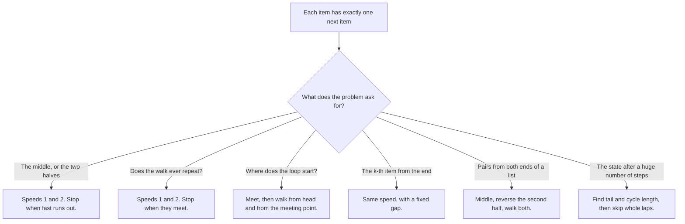

# Fast and Slow Pointers

> **Level:** Beginner · **Priority:** T1 · **Time:** 180 min · **Read first:** [Singly linked list](../03-linked-lists-stacks-queues/01-singly-linked-list.md), [Two pointers: same direction](02-two-pointers-same-direction.md) · **Next:** [Sliding window: fixed size](04-sliding-window-fixed.md)

Two pointers walk the same path at different speeds. This one idea finds the middle of a linked list, detects a cycle, finds where the cycle starts and finds a duplicate in an array. Each of these takes O(n) time and O(1) extra memory. It is one of the most common linked list ideas in interviews.

## Quick revision

- **The setup:** `slow` moves one step and `fast` moves two steps, from the same start.
- **No cycle:** `fast` reaches the end first. At that moment `slow` is at the middle.
- **Cycle:** `fast` comes around behind `slow`. The gap between them shrinks by exactly 1 on each step, so they must land on the same node.
- **Cycle test:** move first, then compare. Both pointers start on the same node, so a check before moving is always true.
- **Compare pointers, not values.** Two different nodes can hold the same value.
- **Cycle start:** after they meet, put one pointer on `head` and leave the other on the meeting point. Move both one step at a time. They meet on the cycle start.
- **Why that works:** `a + b = k * L`, so `a = k * L - b`. Here `a` is the distance from the head to the cycle start, `b` is the distance from the cycle start to the meeting point, and `L` is the cycle length.
- **Cycle length:** from any node in the cycle, walk until you are back, and count.
- **Which middle:** `while (fast && fast->next)` stops `slow` at index `n / 2`, the second middle. `while (fast->next && fast->next->next)` stops it at index `(n - 1) / 2`, the first middle.
- **Hidden linked list:** any rule "from x go to f(x)" is a linked list. Examples are `i -> nums[i]`, the happy number rule, and a state that changes day by day.
- **Rho shape:** a rule on a finite set always gives a tail, then a loop.
- **Skip ahead:** with tail length `t` and cycle length `L`, step `n` is the same as step `t + (n - t) % L`, when `n >= t`.
- **Palindrome, reorder, twin sum:** find the middle, reverse the second half, then walk both halves together.
- **k-th from the end:** same speed, but one pointer starts k - 1 nodes ahead.
- **Cost:** O(n) time and O(1) space. A hash set also works, but it needs O(n) space.

## How to recognize it

Ask these four questions. If all four answers are yes, use fast and slow pointers.

1. Does each item have exactly one next item? This can be a `next` pointer, or a rule such as `x -> f(x)` or `i -> nums[i]`.
2. Can you only walk forward, one item at a time, with no way to jump to a position in the walk? An array can still be a yes. In `i -> nums[i]` you can read any index, but you cannot jump to "step 50 of the walk".
3. Is the question about a position in the walk (the middle, a place near the end) or about a repeat (a cycle, where it starts)?
4. Would a hash set or an array copy solve it, but you want O(1) extra memory?

| Words in the problem | What they tell you |
|---|---|
| "middle of the linked list" | Speeds 1 and 2. `slow` stops at the middle. |
| "cycle", "loop", "does the list ever end" | Floyd's cycle detection |
| "where the cycle begins", "first node of the loop" | Meet, then walk from `head` and from the meeting point |
| "palindrome" on a linked list | Middle, reverse the second half, compare |
| "twin", "first with last, second with second-last" | Middle, reverse the second half, walk both |
| "reorder", "L0, Ln, L1, Ln-1" | Middle, reverse the second half, then join the halves, one node from each |
| "O(1) extra space" on a linked list | No copy into an array. Pointers only. |
| "n + 1 integers in the range 1 to n", "do not modify the array" | The array is a linked list: `i -> nums[i]` |
| "repeat the process until", "loops endlessly" | A hidden cycle. Numbers are nodes, and the rule is `next`. |
| "circular array", "jump nums[i] steps" | Each index has exactly one next index |
| "after n days" or "repeated n times", with a huge n and a small state | A **state** is everything you need to know about one moment, such as the 8 cells on one day. A small state has only a few possible values, so states must repeat. Find the cycle and skip whole laps. |
| "k-th node from the end" | Same speed, with a fixed gap |
| "first shared node" of two lists that "may have cycles" | Find each cycle start first, then line up the two walks |
| "each node has exactly one outgoing edge" | An edge is an arrow from one node to another. One arrow out of each node means one next item, so every walk is a tail and then a loop. |

Once you know that this is the pattern, the goal picks the variant:



**Not this pattern if:**

| You see | Use instead | Why |
|---|---|---|
| A sorted array and a pair with a given sum | [Two pointers: opposite ends](01-two-pointers-opposite-ends.md) | The pointers move toward each other, and the array lets you jump to any index. |
| "remove in place", "move zeroes", "keep at most two copies" | [Two pointers: same direction](02-two-pointers-same-direction.md) | One pointer reads and one writes. The data decides when the write pointer moves, not a fixed speed. |
| The longest or shortest contiguous piece (one with no gaps) that obeys a rule | [Sliding window](05-sliding-window-variable.md) | The two pointers mark a window, and the rule decides when each one moves. |
| A cycle in a graph where a node can have many outgoing edges | [Cycle detection](../08-graphs/05-cycle-detection-and-bipartite.md) | Fast and slow pointers need exactly one next item. With many, use DFS colors or union-find. |
| An answer for every node of a graph where each node has one next node | [P14](#p14-count-visited-nodes-in-a-directed-graph-leetcode-2876-hard) | Floyd remembers nothing, so n starts cost O(n^2). Store each node's answer and reuse it. |
| Many questions of the form "where are you after k steps from x?" | [Binary lifting](../12-advanced-data-structures/09-lca-and-binary-lifting.md) | Floyd answers for one start at a time. A table of jumps of 1, 2, 4, 8 and so on steps answers each question in O(log k). |
| Values from 1 to n, and you may change the array | [Cyclic sort](10-cyclic-sort.md) | Putting each value at its own index is simpler when writes are allowed. |
| A repeated value, where some values are not valid indexes | [Hash set](../02-arrays-strings-hashing/04-hashing-patterns.md) | `i -> nums[i]` needs every value to be a valid index. Without that, there is no hidden list to walk. |
| Reverse a list or a part of a list | [In-place reversal](11-in-place-linked-list-reversal.md) | There is no position to find, so no speed difference is needed. |
| The middle of an array | Compute `left + (right - left) / 2`, as in [binary search](../04-sorting-searching/06-binary-search-basics.md) | An array lets you jump straight to any index. |

## 1. The idea in plain English

Two friends run on the same path. One runs twice as fast as the other.

If the path is a straight road, the fast friend reaches the end when the slow friend is exactly halfway. If the path is a circular track, nobody reaches an end. The fast friend gains one full **lap**, which is one trip around the track, and catches the slow friend from behind.

So one race answers two questions: **where is the middle?** and **does the path have a loop?**

In code, the path is usually a **linked list**. This is a chain of nodes, where each node holds a value and a pointer to the next node. You cannot jump to a position. You can only follow `next`, starting from the first node, which is called the **head**. The last node's `next` is `nullptr`.

Here is a tiny problem: **find the middle of this list without counting the nodes.**

```text
1 -> 2 -> 3 -> 4 -> 5 -> null
```

The slow way walks the list once to count 5 nodes, then walks again to reach the third node. One walk over the list is called a **pass**, so that is two passes. Two pointers need one pass:

| Step | slow | fast | What happens |
|---|---|---|---|
| start | 1 | 1 | `fast` can still move two nodes |
| 1 | 2 | 3 | `fast` can still move two nodes |
| 2 | 3 | 5 | `fast` is on the last node, so stop |

`fast` walked the whole list and `slow` walked half of it. So `slow` is on the middle, 3.

Now take a list with a **cycle**. A cycle is a loop: following `next` brings you back to a node you already visited. This list has no end, so a normal walk never stops.

```text
1 -> 2 -> 3 -> 4
     ^         |
     |         |
     +---------+
```

| Step | slow | fast | Same node? |
|---|---|---|---|
| start | 1 | 1 | not checked |
| 1 | 2 | 3 | no |
| 2 | 3 | 2 | no |
| 3 | 4 | 4 | yes, so there is a cycle |

In step 2, `fast` moves from 3 to 4, then follows the link back to 2. In step 3, it moves from 2 to 3 to 4. So `fast` came around from behind and landed on `slow`.

The obvious way to detect a cycle is a **hash set**, a table that tells you in O(1) average time whether you have seen an item before. Store each visited node, and stop at a repeat. It works, but it stores up to n pointers. Two pointers store two.

This method is called **Floyd's cycle detection**, or the **tortoise and the hare**, after the old story of the slow tortoise and the fast hare.

## 2. Why the two pointers must meet

If there is no cycle, `fast` reaches the end and the loop stops. There is nothing more to prove.

If there is a cycle, the real worry is this: could `fast` jump over `slow` again and again, and never land on it? It cannot, and the reason is short.

Wait until both pointers are inside the cycle. Let `gap` be the number of steps `fast` must walk forward to reach `slow`. Now look at one step of the loop:

- `slow` moves 1 node away from `fast`, so the gap grows by 1.
- `fast` moves 2 nodes toward `slow`, so the gap shrinks by 2.
- Together, the gap shrinks by exactly 1.

A number that drops by exactly 1 on each step cannot jump over 0. So the gap reaches 0, and that means both pointers are on the same node.

Here is the list `1 -> 2 -> 3 -> 4 -> 5`, with 5 linking back to 2. The cycle is `2 3 4 5`, so it has 4 nodes. `slow` enters the cycle at step 1.

| Step | slow | fast | gap |
|---|---|---|---|
| 1 | 2 | 3 | 3 |
| 2 | 3 | 5 | 2 |
| 3 | 4 | 3 | 1 |
| 4 | 5 | 5 | 0 |

At step 1, `fast` is on 3. It must walk 3 to 4, 4 to 5 and 5 to 2 to reach `slow`, so the gap is 3.

**How many steps does this take?** When `slow` enters the cycle, the gap is smaller than the size of the cycle. So `slow` is caught within its first lap. With n nodes in total, `slow` walks at most n steps, and `fast` makes at most 2n moves. That is O(n) time. The space is O(1), because you store only two pointers.

## 3. Finding where the cycle starts

Knowing that a cycle exists is often not enough. You may need its first node. The method has two phases, and the second phase looks strange until you see the math. First watch it work on this list, where 6 links back to 3:

```text
head
 |
 v
 1 -> 2 -> 3 -> 4
           ^    |
           |    v
           6 <- 5
```

**Phase 1: find the meeting point.** This is the same loop as before.

| Step | slow | fast | Same node? |
|---|---|---|---|
| start | 1 | 1 | not checked |
| 1 | 2 | 3 | no |
| 2 | 3 | 5 | no |
| 3 | 4 | 3 | no |
| 4 | 5 | 5 | yes |

**Phase 2: find the start.** Put a new pointer `finder` on the head. Leave `slow` on the meeting point. Move both one step at a time.

| Step | finder | slow | Same node? |
|---|---|---|---|
| start | 1 | 5 | no |
| 1 | 2 | 6 | no |
| 2 | 3 | 3 | yes, this is the cycle start |

It worked. Here is why. Give three distances a name:

```text
a = steps from the head to the cycle start              here a = 2
b = steps from the cycle start to the meeting point     here b = 2
L = number of nodes in the cycle                        here L = 4
```

When the pointers meet:

- `slow` has walked `a + b` steps.
- `fast` has walked twice as far, so `2 * (a + b)` steps.
- `fast` walked the same path as `slow`, plus some whole laps. There is no other way for both to stand on the same node.

So the extra distance, which is `a + b`, is a whole number of laps:

```text
a + b = k * L      (k is a whole number, at least 1)
    a = k * L - b
```

In the example, `2 + 2 = 1 * 4`, so `k = 1`.

If the cycle starts at the head, then `a = 0`. `slow` walks one whole lap, and they meet on the head. So here `b` is that whole lap: `b = L` and `k = 1`. The math still holds.

Now read the last line as a walk. The meeting point is `b` steps past the cycle start. If you walk `a` more steps from there, you are `b + a = k * L` steps past the cycle start. That is whole laps, so you are standing exactly on the cycle start.

A pointer that walks `a` steps from the head is also on the cycle start. So the two pointers arrive together. Before that, `finder` is still outside the cycle, so they cannot meet any earlier.

If `a` is large and the cycle is short, `k` is bigger than 1. The pointer in the cycle can run more than one lap while `finder` walks to the cycle start. Take a list of 8 nodes where 8 links back to 6, so `a = 5` and `L = 3`. The pointers meet on node 7, so `b = 1`, and `5 + 1 = 2 * 3`. The math does not change.

The same meeting point also gives you the cycle's length. It is inside the cycle, so walk until you are back on it, and count.

```cpp
#include <bits/stdc++.h>
#include <cassert>
using namespace std;

struct ListNode {
    int val;
    ListNode* next;
    ListNode(int x) : val(x), next(nullptr) {}
};

// Phase 1: returns the node where the pointers meet, or nullptr if the list ends.
ListNode* meetingPoint(ListNode* head) {
    ListNode* slow = head;
    ListNode* fast = head;
    while (fast && fast->next) {
        slow = slow->next;
        fast = fast->next->next;
        if (slow == fast) return slow;  // check after moving, because both start on head
    }
    return nullptr;
}

// Phase 2: returns the first node of the cycle, or nullptr if there is no cycle.
ListNode* cycleStart(ListNode* head) {
    ListNode* meet = meetingPoint(head);
    if (!meet) return nullptr;
    ListNode* finder = head;
    while (finder != meet) {  // a = k * L - b, so both arrive at the same moment
        finder = finder->next;
        meet = meet->next;
    }
    return finder;
}

// The meeting point is inside the cycle, so one walk around it gives the length.
int cycleLength(ListNode* head) {
    ListNode* meet = meetingPoint(head);
    if (!meet) return 0;
    int length = 1;
    for (ListNode* node = meet->next; node != meet; node = node->next) length++;
    return length;
}

// Test helper: pos is the index that the last node links back to, or -1 for no cycle.
// The nodes live in a deque, so they are freed automatically and pointers stay valid.
ListNode* build(deque<ListNode>& pool, const vector<int>& values, int pos = -1) {
    for (int value : values) {
        pool.emplace_back(value);
        if (pool.size() > 1) pool[pool.size() - 2].next = &pool.back();
    }
    if (pos >= 0) pool.back().next = &pool[pos];
    return pool.empty() ? nullptr : &pool[0];
}

int main() {
    deque<ListNode> a, b, c, d, e, f;

    ListNode* example = build(a, {1, 2, 3, 4, 5, 6}, 2);  // the list from the text
    assert(meetingPoint(example)->val == 5);
    assert(cycleStart(example)->val == 3);
    assert(cycleLength(example) == 4);

    ListNode* longTail = build(b, {1, 2, 3, 4, 5, 6, 7, 8}, 5);  // a = 5, L = 3, so k = 2
    assert(meetingPoint(longTail)->val == 7);
    assert(cycleStart(longTail)->val == 6);
    assert(cycleLength(longTail) == 3);

    ListNode* ring = build(c, {1, 2, 3}, 0);  // a = 0, the head is the cycle start
    assert(cycleStart(ring)->val == 1);
    assert(cycleLength(ring) == 3);

    ListNode* selfLoop = build(d, {9}, 0);  // a single node that points to itself
    assert(cycleStart(selfLoop)->val == 9);
    assert(cycleLength(selfLoop) == 1);

    ListNode* straight = build(e, {1, 2, 3});  // no cycle
    assert(cycleStart(straight) == nullptr);
    assert(cycleLength(straight) == 0);

    assert(cycleStart(build(f, {})) == nullptr);  // empty list
    cout << "All tests passed\n";
}
```

## 4. Which middle? The loop condition decides

A list with an odd length has one middle. A list with an even length has two:

```text
n = 5:   1 -> 2 -> 3 -> 4 -> 5     one middle: 3
n = 4:   1 -> 2 -> 3 -> 4          two middles: 2 is the first, 3 is the second
```

When both pointers start on the head, the node where `slow` stops depends only on the loop condition. Here are the two common conditions on `1 -> 2 -> 3 -> 4`. In C++, a pointer used as a condition means "is not null", so `while (fast && fast->next)` means "while `fast` is not null and `fast->next` is not null".

**Condition A: `while (fast && fast->next)`**

| Step | slow | fast | Check |
|---|---|---|---|
| start | 1 | 1 | `fast` and `fast->next` both exist, so go on |
| 1 | 2 | 3 | `fast` and `fast->next` both exist, so go on |
| 2 | 3 | null | `fast` is null, so stop |

`slow` stops on 3, the second middle.

**Condition B: `while (fast->next && fast->next->next)`**

| Step | slow | fast | Check |
|---|---|---|---|
| start | 1 | 1 | `fast->next` and `fast->next->next` both exist, so go on |
| 1 | 2 | 3 | `fast->next` is 4, but `fast->next->next` is null, so stop |

`slow` stops on 2, the first middle.

The difference is one question: **may `fast` step past the last node?** Condition A allows it, so `fast` can land on null and `slow` gets one more step. Condition B keeps `fast` on a real node. So when n is even, `slow` stops one step sooner. When n is odd, `fast` lands exactly on the last node under both conditions, so they give the same answer.

A third setup starts `fast` two nodes ahead of `slow`. This is called a **head start**. `fast` now runs out of list one step sooner, so `slow` makes one step fewer and stops one node before the second middle. You need this to delete the middle, because only the node before it can skip it.

| Setup | `slow` stops at index | n = 4 | n = 5 | Use it when |
|---|---|---|---|---|
| `fast = head`, `while (fast && fast->next)` | `n / 2` | 2 | 2 | You want the second middle, or the first node of the second half |
| `fast = head`, `while (fast->next && fast->next->next)` | `(n - 1) / 2` | 1 | 2 | You want the last node of the first half, so that you can cut after it |
| `fast = head->next->next`, `while (fast && fast->next)` | `n / 2 - 1` | 1 | 1 | You want to delete the middle at index `n / 2` |

Picking the wrong one causes real bugs. If you cut after the second middle of a 2-node list, the first half keeps both nodes and the second half is empty. A merge sort on that list would never finish, because the left half never gets smaller. That is why a merge sort on a list, as in [Sort List](../03-linked-lists-stacks-queues/04-linked-list-problems.md), must cut after the first middle.

Condition B reads `fast->next` before anything else, so it crashes on an empty list. Check for `nullptr` first.

```cpp
#include <bits/stdc++.h>
#include <cassert>
using namespace std;

struct ListNode {
    int val;
    ListNode* next;
    ListNode(int x) : val(x), next(nullptr) {}
};

// slow stops at index n / 2: the second middle when n is even.
ListNode* secondMiddle(ListNode* head) {
    ListNode* slow = head;
    ListNode* fast = head;
    while (fast && fast->next) {
        slow = slow->next;
        fast = fast->next->next;
    }
    return slow;
}

// slow stops at index (n - 1) / 2: the first middle when n is even. head must not be null.
ListNode* firstMiddle(ListNode* head) {
    ListNode* slow = head;
    ListNode* fast = head;
    while (fast->next && fast->next->next) {
        slow = slow->next;
        fast = fast->next->next;
    }
    return slow;
}

// slow stops at index n / 2 - 1, just before the second middle. The list needs 2 nodes or more.
ListNode* beforeMiddle(ListNode* head) {
    ListNode* slow = head;
    ListNode* fast = head->next->next;  // the head start costs slow exactly one step
    while (fast && fast->next) {
        slow = slow->next;
        fast = fast->next->next;
    }
    return slow;
}

ListNode* build(deque<ListNode>& pool, const vector<int>& values) {
    for (int value : values) {
        pool.emplace_back(value);
        if (pool.size() > 1) pool[pool.size() - 2].next = &pool.back();
    }
    return pool.empty() ? nullptr : &pool[0];
}

int main() {
    deque<ListNode> a, b, c, d;
    ListNode* even = build(a, {1, 2, 3, 4});
    assert(secondMiddle(even)->val == 3);
    assert(firstMiddle(even)->val == 2);
    assert(beforeMiddle(even)->val == 2);

    ListNode* odd = build(b, {1, 2, 3, 4, 5});
    assert(secondMiddle(odd)->val == 3);
    assert(firstMiddle(odd)->val == 3);
    assert(beforeMiddle(odd)->val == 2);

    ListNode* two = build(c, {1, 2});  // the case that breaks a careless merge sort
    assert(secondMiddle(two)->val == 2);
    assert(firstMiddle(two)->val == 1);
    assert(beforeMiddle(two)->val == 1);

    ListNode* one = build(d, {7});
    assert(secondMiddle(one)->val == 7);
    assert(firstMiddle(one)->val == 7);

    assert(secondMiddle(nullptr) == nullptr);  // condition A is safe on an empty list
    cout << "All tests passed\n";
}
```

## 5. Hidden linked lists

A linked list is only this: **from each item, you know the one item that comes next.** Nothing says that the items must be nodes in memory. Any rule of the form "from x go to f(x)" is a hidden linked list.

| Problem | The items | The `next` rule |
|---|---|---|
| [Happy Number](#p3-happy-number-leetcode-202-easy) | Numbers | The sum of the squares of the digits |
| [Find the Duplicate Number](#p11-find-the-duplicate-number-leetcode-287-medium) | Array indexes | `i -> nums[i]` |
| [Circular Array Loop](#p12-circular-array-loop-leetcode-457-medium) | Array indexes | `i -> i + nums[i]`, wrapped around the ends of the array |
| [Prison Cells After N Days](../02-arrays-strings-hashing/06-simulation-and-enumeration.md) | All 8 cells, as one state | One day passes |

**Why a cycle must appear.** Two facts are enough.

1. The set of items is finite: the number of items has a limit. With more steps than items, the walk must visit some item twice. This is the **pigeonhole principle**: put 5 letters into 4 boxes, and at least one box gets two or more letters.
2. `next` depends only on the current item. So after the first repeat, the walk follows the same path forever.

So every walk has the same shape: a **tail**, then a **loop**. In this chapter, "tail" means the part before the loop, not the last node of a list. The shape looks like the Greek letter rho, ρ, so it is called a **rho shape**. The tail may be empty. The loop may have just one item.

Here is the happy number rule, starting from 2. The tail is `2`, and the loop has 8 numbers:

```text
2 -> 4 -> 16 -> 37 -> 58 -> 89
     ^                       |
     |                       v
     20 <------ 42 <------- 145
```

Floyd's algorithm works on any rho shape. Replace `node->next` with `next(x)`. It finds the tail length and the cycle length with O(1) extra memory.

Those two numbers let you **skip ahead**. After the tail, the walk repeats every `L` steps, and whole laps change nothing. Call the tail length `t`. It is the same number as `a` in [section 3](#3-finding-where-the-cycle-starts). Walking `n` steps lands on the same item as walking this many:

```text
t + (n - t) % L        when n >= t
```

For the walk above, `t = 1` and `L = 8`. Where is the walk after `n = 1000000000000` steps? `(n - 1) % 8 = 7`, so it is the same as step `1 + 7 = 8`. Step 8 is the number 20. A walk of a trillion steps became a walk of 8.

**A real use of skipping: [Prison Cells After N Days](https://leetcode.com/problems/prison-cells-after-n-days/) (LeetCode 957).** There are 8 cells, each 0 or 1. Each day, a cell becomes 1 if its two neighbors were equal, and 0 if they were different. The two end cells become 0. You must return the cells after n days, where n can be 1,000,000,000.

[Simulation, Enumeration and Brainteasers](../02-arrays-strings-hashing/06-simulation-and-enumeration.md) solves this in full with a table of seen states. Floyd uses the same idea with no table. Here is only what differs:

1. The 8 cells become one number, so that they count as one item of the walk.
2. `nextDay` in the code below is the rule. `state << 1` moves each cell's left neighbor into its place, and `state >> 1` moves its right neighbor into its place. XOR (`^`) gives 1 where the two neighbors differ, so NOT (`~`) gives 1 where they are equal. `0x7E` clears the two end cells. See [Bit manipulation](17-bit-manipulation.md) for these operators.
3. `tailAndCycle` and `afterSteps` in the code below do the rest.

For `[1, 0, 0, 1, 0, 0, 1, 0]`, with cell 0 as the lowest bit, the start is the number `1 + 8 + 64 = 73`. Day 15 turns out to be the same as day 1, so `t = 1` and `L = 14`. Then day 1,000,000,000 is the same as day `1 + (1000000000 - 1) % 14 = 6`. You simulate 6 days, not a billion.

Here is all of this in code. The same two functions run the happy number rule, an array and the prison cells.

```cpp
#include <bits/stdc++.h>
#include <cassert>
using namespace std;

// Floyd on any rule. next must depend only on its input.
// The template lets next be a plain function or a lambda.
// Returns {tail, cycle}: how many items come before the cycle, and how many are in it.
template <typename Rule>
pair<int, int> tailAndCycle(int start, Rule next) {
    // Phase 1: the pointers meet somewhere inside the cycle.
    int slow = next(start);
    int fast = next(next(start));
    while (slow != fast) {
        slow = next(slow);
        fast = next(next(fast));
    }

    // Phase 2: from the start and from the meeting point, they reach the cycle start together.
    int tail = 0;
    slow = start;
    while (slow != fast) {
        slow = next(slow);
        fast = next(fast);
        tail++;
    }

    // Phase 3: slow is on the cycle start, so one lap measures the cycle.
    int cycle = 1;
    for (fast = next(slow); fast != slow; fast = next(fast)) cycle++;
    return {tail, cycle};
}

// The item after n steps, without walking all n of them.
template <typename Rule>
int afterSteps(int start, long long n, Rule next) {
    auto [tail, cycle] = tailAndCycle(start, next);
    long long steps = n <= tail ? n : tail + (n - tail) % cycle;  // whole laps change nothing
    int item = start;
    for (long long i = 0; i < steps; i++) item = next(item);
    return item;
}

int digitSquareSum(int x) {
    int sum = 0;
    for (; x > 0; x /= 10) sum += (x % 10) * (x % 10);
    return sum;
}

// One day of Prison Cells After N Days. Bit i is cell i.
int nextDay(int state) {
    return ~((state << 1) ^ (state >> 1)) & 0x7E;  // 0x7E clears the first and last cells
}

int main() {
    // 2, then the loop 4, 16, 37, 58, 89, 145, 42, 20.
    assert(tailAndCycle(2, digitSquareSum) == make_pair(1, 8));
    // 19, 82, 68, 100, then the loop 1, 1, 1 and so on.
    assert(tailAndCycle(19, digitSquareSum) == make_pair(4, 1));

    // The array as next pointers: 0, 1, 3, then the loop 2, 4.
    vector<int> nums = {1, 3, 4, 2, 2};
    auto arrayRule = [&](int i) { return nums[i]; };
    assert(tailAndCycle(0, arrayRule) == make_pair(3, 2));

    // An empty tail: every number is on the loop 1, 2, 0.
    auto addOneMod3 = [](int x) { return (x + 1) % 3; };
    assert(tailAndCycle(1, addOneMod3) == make_pair(0, 3));

    assert(afterSteps(2, 0, digitSquareSum) == 2);                  // zero steps
    assert(afterSteps(2, 1, digitSquareSum) == 4);                  // n equals the tail length
    assert(afterSteps(2, 8, digitSquareSum) == 20);                 // no skipping needed
    assert(afterSteps(2, 1000000000000LL, digitSquareSum) == 20);   // the example from the text

    // Prison cells: 10010010 is 73 with cell 0 as the lowest bit, and 00111110 is 124.
    assert(tailAndCycle(73, nextDay) == make_pair(1, 14));
    assert(afterSteps(73, 1000000000, nextDay) == 124);
    assert(tailAndCycle(36, nextDay) == make_pair(0, 1));           // 00100100 maps to itself
    cout << "All tests passed\n";
}
```

**Floyd or a `seen` array?** Floyd's only gain is memory. If the items are small numbers, a `seen` array that marks visited items is simpler and just as fast. Use Floyd when the problem demands O(1) memory. Also use it when the items are too many or too large to store. An example is the 64-bit numbers in Pollard's rho factorization, which [Advanced number theory](../11-math-geometry-games/12-advanced-number-theory.md) covers.

## 6. Middle plus reversal

A linked list can only walk forward. But some problems want to compare the first node with the last, the second with the second-last, and so on. The trick is to **make the second half walk backward by reversing it**.

The recipe has three steps:

1. Find the middle with fast and slow pointers.
2. Reverse the second half **in place**, which means by changing its links, with no extra list.
3. Walk the first half and the reversed second half together.

Here is what that looks like on `1 -> 2 -> 3 -> 4`:

```text
Start:                1 -> 2 -> 3 -> 4
After steps 1 and 2:  1 -> 2      and      4 -> 3
Step 3 pairs them:    (1, 4), then (2, 3)
```

To reverse a list, you turn each `next` pointer around, one node at a time. You need `previous` (the node behind you), `current` (the node you are on) and `nextNode` (the node ahead). You must save `nextNode` first, because turning the pointer overwrites it. Here is `3 -> 4 -> 5`:

| Step | current | nextNode saved | Link changed | previous after | current after |
|---|---|---|---|---|---|
| 1 | 3 | 4 | 3 -> null | 3 | 4 |
| 2 | 4 | 5 | 4 -> 3 | 4 | 5 |
| 3 | 5 | null | 5 -> 4 | 5 | null |

`previous` ends on 5, the new head of `5 -> 4 -> 3`.

```cpp snippet
ListNode* previous = nullptr;
while (current) {
    ListNode* nextNode = current->next;  // save it, because the next line overwrites it
    current->next = previous;            // turn this link around
    previous = current;
    current = nextNode;
}
// previous is now the head of the reversed list
```

The whole recipe takes O(n) time and O(1) extra memory. A stack or a copy into an array gives the same answer with O(n) memory. [In-place reversal](11-in-place-linked-list-reversal.md) covers reversal in full.

This recipe changes the input. If the list must stay the same, reverse the second half again at the end. [P4](#p4-palindrome-linked-list-leetcode-234-easy) does this.

## 7. Fixed gap: same speed, different start

Fast and slow pointers use a difference in **speed**. A related idea uses a difference in **position**. Both pointers move at speed 1, but one starts ahead. The gap between them never changes.

Use it for "the k-th node from the end", when you do not know the length.

**Tiny example:** find the 2nd node from the end of `1 -> 2 -> 3 -> 4 -> 5`. Put `ahead` on the 2nd node and `behind` on the head. Move both until `ahead` is on the last node.

| Step | behind | ahead |
|---|---|---|
| start | 1 | 2 |
| 1 | 2 | 3 |
| 2 | 3 | 4 |
| 3 | 4 | 5 |

`ahead` is on the last node, so `behind` is the answer, 4.

Why does this work? `ahead` starts on the k-th node, so `behind` is k - 1 nodes behind it, and that never changes. When `ahead` is on the last node, `behind` is k - 1 nodes before the last node. That is exactly the k-th node from the end.

[Singly linked list](../03-linked-lists-stacks-queues/01-singly-linked-list.md) uses this idea for Remove Nth Node From End of List. [P10](#p10-swapping-nodes-in-a-linked-list-leetcode-1721-medium) uses it here.

## 8. Brent's algorithm: a short note

Floyd calls `next` three times on each step: once for `slow` and twice for `fast`. If `next` is slow to compute, those calls add up. **Brent's algorithm** moves only one pointer.

It keeps a `checkpoint` that stays still and a `runner` that moves. The runner gets a budget of 1 step, then 2, then 4, then 8, and so on. When a budget runs out, the checkpoint jumps to the runner and the budget doubles. If the runner lands on the checkpoint, it has walked one full lap. So the number of steps since the last jump is the cycle length.

Here is the list `1 -> 2 -> 3 -> 4 -> 5 -> 6`, with 6 linking back to 3. `length` counts the runner's steps since the last jump. The first row shows the state after the runner's first step.

| checkpoint | runner | length | budget | What happens |
|---|---|---|---|---|
| 1 | 2 | 1 | 1 | Budget used, so the checkpoint jumps to 2 and the budget becomes 2 |
| 2 | 3 | 1 | 2 | |
| 2 | 4 | 2 | 2 | Budget used, so the checkpoint jumps to 4 and the budget becomes 4 |
| 4 | 5 | 1 | 4 | |
| 4 | 6 | 2 | 4 | |
| 4 | 3 | 3 | 4 | |
| 4 | 4 | 4 | 4 | The runner is on the checkpoint, so the cycle length is 4 |

This always ends. Once the checkpoint is inside the cycle and the budget is at least the cycle length, the runner gets back to it within that budget. Budgets double, so the total is O(n) steps.

With the length `L` known, the start is easy. Use the fixed gap from [section 7](#7-fixed-gap-same-speed-different-start): put one pointer `L` nodes ahead of the head, and move both at speed 1. They stay exactly one lap apart. So when the back pointer reaches the cycle start, the front pointer is there too.

```cpp
#include <bits/stdc++.h>
#include <cassert>
using namespace std;

struct ListNode {
    int val;
    ListNode* next;
    ListNode(int x) : val(x), next(nullptr) {}
};

// Returns the number of nodes in the cycle, or 0 if the list ends.
int cycleLengthBrent(ListNode* head) {
    if (!head) return 0;
    ListNode* checkpoint = head;
    ListNode* runner = head->next;
    int budget = 1, length = 1;
    while (runner && runner != checkpoint) {
        if (length == budget) {  // the budget ran out, so restart the count from here
            checkpoint = runner;
            budget *= 2;
            length = 0;
        }
        runner = runner->next;
        length++;
    }
    return runner ? length : 0;  // a null runner means that the list has an end
}

ListNode* cycleStartBrent(ListNode* head) {
    int length = cycleLengthBrent(head);
    if (length == 0) return nullptr;
    ListNode* ahead = head;
    for (int i = 0; i < length; i++) ahead = ahead->next;
    ListNode* behind = head;
    while (behind != ahead) {  // they stay one lap apart, so they meet on the cycle start
        behind = behind->next;
        ahead = ahead->next;
    }
    return behind;
}

ListNode* build(deque<ListNode>& pool, const vector<int>& values, int pos = -1) {
    for (int value : values) {
        pool.emplace_back(value);
        if (pool.size() > 1) pool[pool.size() - 2].next = &pool.back();
    }
    if (pos >= 0) pool.back().next = &pool[pos];
    return pool.empty() ? nullptr : &pool[0];
}

int main() {
    deque<ListNode> a, b;
    ListNode* example = build(a, {1, 2, 3, 4, 5, 6}, 2);  // the list from the text
    assert(cycleLengthBrent(example) == 4);
    assert(cycleStartBrent(example)->val == 3);

    assert(cycleLengthBrent(build(b, {})) == 0);  // empty list

    // Every list shape with up to 8 nodes. Values are 1 to n, and pos is where the last node links.
    for (int n = 1; n <= 8; n++) {
        vector<int> values(n);
        iota(values.begin(), values.end(), 1);
        for (int pos = -1; pos < n; pos++) {
            deque<ListNode> pool;
            ListNode* head = build(pool, values, pos);
            assert(cycleLengthBrent(head) == (pos == -1 ? 0 : n - pos));
            ListNode* start = cycleStartBrent(head);
            if (pos == -1) assert(start == nullptr);
            else assert(start->val == pos + 1);
        }
    }
    cout << "All tests passed\n";
}
```

It is still O(n) time and O(1) space. A test on all tails and cycles of up to 200 nodes found that it detects a cycle with fewer calls to `next` than Floyd on every list. If you also need the cycle start, the totals are close, and either one can win. In an interview, write Floyd. It is shorter to prove, and it is what the interviewer expects. Mention Brent if you are asked how to reduce the calls to `next`.

## 9. Solved problems

The problems go from easiest to hardest. Each one belongs to a family, and the family tells you which tool to use:

| Family | Problems |
|---|---|
| Find a position in a list | [P1](#p1-middle-of-the-linked-list-leetcode-876-easy), [P5](#p5-delete-the-middle-node-of-a-linked-list-leetcode-2095-medium), [P10](#p10-swapping-nodes-in-a-linked-list-leetcode-1721-medium) |
| Detect a cycle | [P2](#p2-linked-list-cycle-leetcode-141-easy), [P3](#p3-happy-number-leetcode-202-easy) |
| Find the cycle start | [P6](#p6-linked-list-cycle-ii-leetcode-142-medium), [P7](#p7-detect-and-remove-a-cycle-classic-medium), [P11](#p11-find-the-duplicate-number-leetcode-287-medium), [P13](#p13-intersection-of-two-lists-that-may-have-cycles-classic-hard) |
| Middle plus reversal | [P4](#p4-palindrome-linked-list-leetcode-234-easy), [P8](#p8-maximum-twin-sum-of-a-linked-list-leetcode-2130-medium), [P9](#p9-reorder-list-leetcode-143-medium) |
| Hidden list with extra rules | [P12](#p12-circular-array-loop-leetcode-457-medium) |
| Many starts on one graph | [P14](#p14-count-visited-nodes-in-a-directed-graph-leetcode-2876-hard) |
| Skip ahead by whole laps | [P15](#p15-count-the-repetitions-leetcode-466-hard) |

### P1. Middle of the Linked List ([LeetCode 876](https://leetcode.com/problems/middle-of-the-linked-list/), Easy)

**Problem:** Return the middle node of a linked list. If there are two middle nodes, return the second one.

**Example:** `1 -> 2 -> 3 -> 4 -> 5 -> 6` gives the node with value `4`. The two middles are 3 and 4, and the problem wants the second.

**Pattern:** Fast and slow pointers

**How to recognize it:** "Middle" of a linked list. You cannot jump to index `n / 2`, and you do not know n. The word "second" tells you which loop condition to use.

**Brute force:** Count the nodes, then walk again to index `n / 2`. That is O(n) time, but it needs two passes. Copying the nodes into an array needs O(n) space.

**Key idea:** `fast` moves twice as far as `slow`. When `fast` runs out of list, `slow` has walked half of it. Condition A from [section 4](#4-which-middle-the-loop-condition-decides) gives the second middle.

**Dry run:** on `1 -> 2 -> 3 -> 4 -> 5 -> 6`.

| Step | slow | fast | What happens |
|---|---|---|---|
| start | 1 | 1 | Both moves are possible |
| 1 | 2 | 3 | Both moves are possible |
| 2 | 3 | 5 | `fast->next` is 6, so `fast` can still move |
| 3 | 4 | null | `fast` stepped past the last node, so stop |

```cpp
#include <bits/stdc++.h>
#include <cassert>
using namespace std;

struct ListNode {
    int val;
    ListNode* next;
    ListNode(int x) : val(x), next(nullptr) {}
};

class Solution {
public:
    ListNode* middleNode(ListNode* head) {
        ListNode* slow = head;
        ListNode* fast = head;
        // fast may step past the last node, which gives slow one more move on even lengths.
        while (fast && fast->next) {
            slow = slow->next;
            fast = fast->next->next;
        }
        return slow;
    }
};

ListNode* build(deque<ListNode>& pool, const vector<int>& values) {
    for (int value : values) {
        pool.emplace_back(value);
        if (pool.size() > 1) pool[pool.size() - 2].next = &pool.back();
    }
    return pool.empty() ? nullptr : &pool[0];
}

int main() {
    Solution solution;
    deque<ListNode> a, b, c, d;
    assert(solution.middleNode(build(a, {1, 2, 3, 4, 5, 6}))->val == 4);  // two middles, take the second
    assert(solution.middleNode(build(b, {1, 2, 3, 4, 5}))->val == 3);     // one middle
    assert(solution.middleNode(build(c, {1}))->val == 1);                 // one node
    assert(solution.middleNode(build(d, {1, 2}))->val == 2);              // the second of two
    cout << "All tests passed\n";
}
```

**Complexity:** O(n) time, because `fast` walks the list once. O(1) space, because there are only two pointers.

**Edge cases:** one node, where the head is the answer. Two nodes, where the answer is the second node.

### P2. Linked List Cycle ([LeetCode 141](https://leetcode.com/problems/linked-list-cycle/), Easy)

**Problem:** Given the head of a linked list, return true if the list has a cycle.

**Example:** `3 -> 2 -> 0 -> -4`, with -4 linking back to 2, gives `true`.

**Pattern:** Fast and slow pointers

**How to recognize it:** The word "cycle" on a linked list. The problem's follow-up asks for O(1) memory, so you cannot use a hash set of visited nodes.

**Brute force:** Store each visited node in a hash set. If a node is already there, the list has a cycle. This is O(n) time and O(n) space.

**Key idea:** If there is no cycle, `fast` finds the end. If there is one, the gap between the pointers shrinks by 1 on each step, so they must land on the same node.

**Dry run:** on the example.

| Step | slow | fast | Same node? |
|---|---|---|---|
| start | 3 | 3 | not checked |
| 1 | 2 | 0 | no |
| 2 | 0 | 2 | no |
| 3 | -4 | -4 | yes, so return true |

In step 2, `fast` moves from 0 to -4, then follows the link back to 2.

```cpp
#include <bits/stdc++.h>
#include <cassert>
using namespace std;

struct ListNode {
    int val;
    ListNode* next;
    ListNode(int x) : val(x), next(nullptr) {}
};

class Solution {
public:
    bool hasCycle(ListNode *head) {
        ListNode* slow = head;
        ListNode* fast = head;
        while (fast && fast->next) {
            slow = slow->next;
            fast = fast->next->next;
            // Compare after moving: both start on head, so a check before moving is always true.
            if (slow == fast) return true;
        }
        return false;  // fast found the end, and a list with an end has no cycle
    }
};

ListNode* build(deque<ListNode>& pool, const vector<int>& values, int pos = -1) {
    for (int value : values) {
        pool.emplace_back(value);
        if (pool.size() > 1) pool[pool.size() - 2].next = &pool.back();
    }
    if (pos >= 0) pool.back().next = &pool[pos];
    return pool.empty() ? nullptr : &pool[0];
}

int main() {
    Solution solution;
    deque<ListNode> a, b, c, d, e, f;
    assert(solution.hasCycle(build(a, {3, 2, 0, -4}, 1)) == true);   // the example
    assert(solution.hasCycle(build(b, {1, 2}, 0)) == true);          // the last node links to the head
    assert(solution.hasCycle(build(c, {1}, 0)) == true);             // a node that points to itself
    assert(solution.hasCycle(build(d, {1})) == false);               // one node, no cycle
    assert(solution.hasCycle(build(e, {})) == false);                // empty list
    assert(solution.hasCycle(build(f, {5, 5, 5, 5})) == false);      // equal values are not a cycle
    cout << "All tests passed\n";
}
```

**Complexity:** O(n) time, because `slow` is caught within its first lap, so it walks at most n steps. O(1) space, because you store only two pointers.

**Edge cases:** an empty list, one node with no cycle, and one node that points to itself. A list of equal values is a trap if you compare `val` instead of the pointers.

### P3. Happy Number ([LeetCode 202](https://leetcode.com/problems/happy-number/), Easy)

**Problem:** Replace a positive number by the sum of the squares of its digits, and repeat. The number is happy if this process reaches 1. Return whether n is happy.

**Example:** `n = 19` gives `true`, because `19 -> 82 -> 68 -> 100 -> 1`.

**Pattern:** Fast and slow pointers

**How to recognize it:** "Repeat the process" and "loops endlessly". There is no list in sight, but each number has exactly one next number. That is a [hidden linked list](#5-hidden-linked-lists).

**Brute force:** Keep a hash set of the numbers you have seen, and stop at a repeat. This works and the walk is short, but the set uses extra memory.

**Key idea:** First, the walk cannot grow forever. An `int` has at most 10 digits, and each digit adds at most 81, so the first step gives at most `10 * 81 = 810`. A number below 1000 gives at most `3 * 81 = 243`. So after the first step, every number stays below 1000. A finite set means that the walk must end in a loop.

Now look at the number 1. It maps to itself, so `1 -> 1` is a loop of length 1. So **every walk ends in a loop, and the only question is which one**. Let Floyd find the loop, then check where the pointers met. If they met on 1, the number is happy.

**Dry run:** first on `n = 19`.

| Step | slow | fast |
|---|---|---|
| start | 19 | 19 |
| 1 | 82 | 68 |
| 2 | 68 | 1 |
| 3 | 100 | 1 |
| 4 | 1 | 1 |

They meet on 1, so 19 is happy. Now on `n = 2`, which follows the walk drawn in [section 5](#5-hidden-linked-lists):

| Step | slow | fast |
|---|---|---|
| start | 2 | 2 |
| 1 | 4 | 16 |
| 2 | 16 | 58 |
| 3 | 37 | 145 |
| 4 | 58 | 20 |
| 5 | 89 | 16 |
| 6 | 145 | 58 |
| 7 | 42 | 145 |
| 8 | 20 | 20 |

They meet on 20, not on 1, so 2 is not happy.

```cpp
#include <bits/stdc++.h>
#include <cassert>
using namespace std;

class Solution {
    int nextNumber(int n) {
        int sum = 0;
        while (n > 0) {
            int digit = n % 10;
            sum += digit * digit;
            n /= 10;
        }
        return sum;
    }

public:
    bool isHappy(int n) {
        int slow = n, fast = n;
        do {  // do-while, because the pointers start equal and must move before the first check
            slow = nextNumber(slow);
            fast = nextNumber(nextNumber(fast));
        } while (slow != fast);
        return slow == 1;  // every walk ends in a loop, and only the loop at 1 is happy
    }
};

int main() {
    Solution solution;
    assert(solution.isHappy(19) == true);           // 19, 82, 68, 100, 1
    assert(solution.isHappy(2) == false);           // falls into the loop of 8 numbers
    assert(solution.isHappy(1) == true);            // already at 1
    assert(solution.isHappy(7) == true);            // 7, 49, 97, 130, 10, 1
    assert(solution.isHappy(4) == false);           // starts inside the loop
    assert(solution.isHappy(2147483647) == false);  // 260, 40, 16, then the loop
    cout << "All tests passed\n";
}
```

**Complexity:** O(log n) time. The first step reads all the digits of n, which is O(log n). After that, the numbers stay below 1000, so the rest of the walk is short and has a fixed limit. O(1) space, because you store only two numbers.

**Edge cases:** `n = 1`, where the pointers meet on 1 after one step. A number that starts inside the loop, such as 4.

**Follow-up:** "Why not stop as soon as you reach 1?" You can, and it saves a few steps. The `do-while` version is shorter, because it treats both endings the same way. "Which loops exist?" Only two: the loop at 1, and the loop of 8 numbers from [section 5](#5-hidden-linked-lists). Every walk drops below 1000, so checking the numbers below 1000 proves this.

### P4. Palindrome Linked List ([LeetCode 234](https://leetcode.com/problems/palindrome-linked-list/), Easy)

**Problem:** Return true if the values of a linked list read the same forward and backward.

**Example:** `1 -> 2 -> 3 -> 2 -> 1` gives `true`.

**Pattern:** Fast and slow pointers + In-place linked list reversal

**How to recognize it:** A palindrome check compares the two ends and moves inward. A list cannot walk backward, so reverse the second half. The follow-up asks for O(1) extra memory, so you cannot copy into an array.

**Brute force:** Copy the values into an array and compare from both ends. This is O(n) time and O(n) space.

**Key idea:** Use the recipe from [section 6](#6-middle-plus-reversal). Find the last node of the first half, which is the first middle. Reverse everything after it. Compare the two halves. At the end, reverse the second half again, so that the caller gets the list back unchanged.

**Dry run:** on `1 -> 2 -> 3 -> 2 -> 1`.

| Step | slow | fast | What happens |
|---|---|---|---|
| start | 1 | 1 | Go on |
| 1 | 2 | 3 | Go on |
| 2 | 3 | 1 | `fast` is on the last node, so stop |

`slow` is on 3. Reverse what comes after it: `2 -> 1` becomes `1 -> 2`. Now compare:

| Compare | left | right | Equal? |
|---|---|---|---|
| 1 | 1 | 1 | yes |
| 2 | 2 | 2 | yes |

`right` has run out, so it is a palindrome. The middle node 3 has no partner, and it does not need one.

```cpp
#include <bits/stdc++.h>
#include <cassert>
using namespace std;

struct ListNode {
    int val;
    ListNode* next;
    ListNode(int x) : val(x), next(nullptr) {}
};

class Solution {
    ListNode* reverseList(ListNode* current) {
        ListNode* previous = nullptr;
        while (current) {
            ListNode* nextNode = current->next;  // save it, because the next line overwrites it
            current->next = previous;
            previous = current;
            current = nextNode;
        }
        return previous;
    }

public:
    bool isPalindrome(ListNode* head) {
        if (!head) return true;

        // Condition B: slow stops on the last node of the first half.
        ListNode* slow = head;
        ListNode* fast = head;
        while (fast->next && fast->next->next) {
            slow = slow->next;
            fast = fast->next->next;
        }

        ListNode* secondHalf = reverseList(slow->next);

        // The second half is never longer, so right runs out first.
        bool palindrome = true;
        ListNode* left = head;
        ListNode* right = secondHalf;
        while (right) {
            if (left->val != right->val) {
                palindrome = false;
                break;
            }
            left = left->next;
            right = right->next;
        }

        slow->next = reverseList(secondHalf);  // put the list back as it was
        return palindrome;
    }
};

ListNode* build(deque<ListNode>& pool, const vector<int>& values) {
    for (int value : values) {
        pool.emplace_back(value);
        if (pool.size() > 1) pool[pool.size() - 2].next = &pool.back();
    }
    return pool.empty() ? nullptr : &pool[0];
}

vector<int> toVector(ListNode* node) {
    vector<int> values;
    for (; node; node = node->next) values.push_back(node->val);
    return values;
}

int main() {
    Solution solution;
    deque<ListNode> a, b, c, d, e;
    ListNode* odd = build(a, {1, 2, 3, 2, 1});
    assert(solution.isPalindrome(odd) == true);              // the example
    assert(toVector(odd) == vector<int>({1, 2, 3, 2, 1}));   // the list is back as it was

    assert(solution.isPalindrome(build(b, {1, 2, 2, 1})) == true);  // even length
    assert(solution.isPalindrome(build(c, {7})) == true);           // one node
    assert(solution.isPalindrome(build(d, {1, 2})) == false);       // two different nodes

    ListNode* almost = build(e, {1, 2, 3, 1});               // the ends match, the inside does not
    assert(solution.isPalindrome(almost) == false);
    assert(toVector(almost) == vector<int>({1, 2, 3, 1}));   // restored after a mismatch too
    cout << "All tests passed\n";
}
```

**Complexity:** O(n) time, with a few passes over the list. O(1) space, because the reversal only moves pointers.

**Edge cases:** one node. Even length, where both middles are compared. A mismatch, which must still restore the list.

**Follow-up:** "Is this safe if another thread reads the list?" No. The list is broken while the second half is reversed. In that case, copy the values into an array.

### P5. Delete the Middle Node of a Linked List ([LeetCode 2095](https://leetcode.com/problems/delete-the-middle-node-of-a-linked-list/), Medium)

**Problem:** Delete the middle node of a linked list and return the head. The middle is the node at index `n / 2`, rounded down, with indexes starting at 0.

**Example:** `1 -> 3 -> 4 -> 7 -> 1 -> 2 -> 6` has 7 nodes, so the middle is index 3, value 7. The result is `1 -> 3 -> 4 -> 1 -> 2 -> 6`.

**Pattern:** Fast and slow pointers

**How to recognize it:** "Middle" of a list again. But to delete a node, you must stand on the node **before** it, because only that node's `next` can skip it.

**Brute force:** Count the nodes, then walk to index `n / 2 - 1`. This takes two passes.

**Key idea:** Give `fast` a head start of two nodes. That costs `slow` exactly one step, so `slow` stops one node before the middle. Then `slow->next = slow->next->next` removes the middle.

**Dry run:** on the example.

| Step | slow | fast | What happens |
|---|---|---|---|
| start | 1 | 4 | `fast` starts on the third node |
| 1 | 3 | 1 | Go on |
| 2 | 4 | 6 | `fast` is on the last node, so stop |

`slow` is on 4, and `slow->next` is 7, the middle. Linking 4 straight to the node after 7 removes it.

```cpp
#include <bits/stdc++.h>
#include <cassert>
using namespace std;

struct ListNode {
    int val;
    ListNode* next;
    ListNode(int x) : val(x), next(nullptr) {}
};

class Solution {
public:
    ListNode* deleteMiddle(ListNode* head) {
        if (!head->next) return nullptr;  // a single node is its own middle
        ListNode* slow = head;
        ListNode* fast = head->next->next;  // the head start stops slow just before the middle
        while (fast && fast->next) {
            slow = slow->next;
            fast = fast->next->next;
        }
        slow->next = slow->next->next;
        return head;
    }
};

ListNode* build(deque<ListNode>& pool, const vector<int>& values) {
    for (int value : values) {
        pool.emplace_back(value);
        if (pool.size() > 1) pool[pool.size() - 2].next = &pool.back();
    }
    return pool.empty() ? nullptr : &pool[0];
}

vector<int> toVector(ListNode* node) {
    vector<int> values;
    for (; node; node = node->next) values.push_back(node->val);
    return values;
}

int main() {
    Solution solution;
    deque<ListNode> a, b, c, d;
    assert(toVector(solution.deleteMiddle(build(a, {1, 3, 4, 7, 1, 2, 6}))) == vector<int>({1, 3, 4, 1, 2, 6}));
    assert(toVector(solution.deleteMiddle(build(b, {1, 2, 3, 4}))) == vector<int>({1, 2, 4}));  // index 2 goes
    assert(toVector(solution.deleteMiddle(build(c, {2, 1}))) == vector<int>({2}));              // two nodes
    assert(solution.deleteMiddle(build(d, {1})) == nullptr);                                    // one node
    cout << "All tests passed\n";
}
```

**Complexity:** O(n) time, because `fast` walks the list once. O(1) space, because you store only two pointers.

**Edge cases:** one node, where the result is an empty list. This case must return early, because `head->next->next` would crash. With two nodes, `fast` starts as null. So `slow` stays on the head, and the second node goes.

**Follow-up:** "Who frees the removed node?" In real C++ code, you would `delete` it if the list owns its nodes. LeetCode does not need that, and the test here keeps its nodes in a deque, so this code has no `delete`.

### P6. Linked List Cycle II ([LeetCode 142](https://leetcode.com/problems/linked-list-cycle-ii/), Medium)

**Problem:** Return the node where the cycle begins, or null if there is no cycle. Do not change the list.

**Example:** `3 -> 2 -> 0 -> -4`, with -4 linking back to 2, returns the node with value `2`.

**Pattern:** Fast and slow pointers

**How to recognize it:** "Where the cycle begins". Detection alone is not enough, so you need Phase 2 of [section 3](#3-finding-where-the-cycle-starts).

**Brute force:** Walk the list with a hash set. The first node you see twice is the start. This is O(n) time and O(n) space.

**Key idea:** After the meeting, `a = k * L - b`. So a walk of `a` steps from the head and a walk of `a` steps from the meeting point both end on the cycle start. Walk from both at speed 1, and they meet exactly there.

**Dry run:** Phase 1 is the table in [P2](#p2-linked-list-cycle-leetcode-141-easy). The pointers meet on -4, after 3 steps. Here `a = 1`, `L = 3` and `b = 2`, so `a + b = 1 * 3`.

| Step | finder | slow | Same node? |
|---|---|---|---|
| start | 3 | -4 | no |
| 1 | 2 | 2 | yes, this is the cycle start |

```cpp
#include <bits/stdc++.h>
#include <cassert>
using namespace std;

struct ListNode {
    int val;
    ListNode* next;
    ListNode(int x) : val(x), next(nullptr) {}
};

class Solution {
public:
    ListNode *detectCycle(ListNode *head) {
        ListNode* slow = head;
        ListNode* fast = head;
        while (fast && fast->next) {
            slow = slow->next;
            fast = fast->next->next;
            if (slow == fast) {
                // Walking a steps from the head or from here ends on the cycle start.
                ListNode* finder = head;
                while (finder != slow) {
                    finder = finder->next;
                    slow = slow->next;
                }
                return finder;
            }
        }
        return nullptr;
    }
};

ListNode* build(deque<ListNode>& pool, const vector<int>& values, int pos = -1) {
    for (int value : values) {
        pool.emplace_back(value);
        if (pool.size() > 1) pool[pool.size() - 2].next = &pool.back();
    }
    if (pos >= 0) pool.back().next = &pool[pos];
    return pool.empty() ? nullptr : &pool[0];
}

int main() {
    Solution solution;
    deque<ListNode> a, b, c, d, e;
    assert(solution.detectCycle(build(a, {3, 2, 0, -4}, 1)) == &a[1]);  // the example
    assert(solution.detectCycle(build(b, {1, 2}, 0)) == &b[0]);         // no tail, so the head is the start
    assert(solution.detectCycle(build(c, {1})) == nullptr);             // no cycle
    assert(solution.detectCycle(build(d, {1, 2, 3}, 2)) == &d[2]);      // the last node points to itself
    assert(solution.detectCycle(build(e, {4, 4, 4, 4}, 2)) == &e[2]);   // only pointers tell these nodes apart
    cout << "All tests passed\n";
}
```

**Complexity:** O(n) time. Phase 1 takes at most n steps, and Phase 2 takes `a` steps, which is less than n. O(1) space, because you store only three pointers.

**Edge cases:** no cycle. A cycle that starts at the head, where `a = 0`, so the pointers meet on the head and the inner loop does not run. A last node that points to itself.

**Follow-up:** "How do you find the length of the cycle?" From the meeting point, walk until you are back on it, and count. [P7](#p7-detect-and-remove-a-cycle-classic-medium) does this from the cycle start.

### P7. Detect and Remove a Cycle (Classic, Medium)

**Problem:** A linked list may have a cycle. Remove it, so that the list ends with null and keeps all of its nodes in order. Return how many nodes were in the cycle, or 0 if there was none.

**Example:** `1 -> 2 -> 3 -> 4 -> 5`, with 5 linking back to 3, returns `3`. The list becomes `1 -> 2 -> 3 -> 4 -> 5 -> null`.

**Pattern:** Fast and slow pointers

**How to recognize it:** To remove a cycle, you must find the last node of the cycle, which is the node just before the cycle start. So you need the cycle start first. That means Floyd's two phases.

**Brute force:** Walk with a hash set of visited nodes, and stop at the first node whose `next` is already in the set. This is O(n) time and O(n) space.

**Key idea:** Find the cycle start. Then walk around the cycle from there until `next` is the start again. That node is the last one, so set its `next` to null. Count the nodes on the way.

Do not cut at the meeting point. In the example the pointers meet on 4, so cutting after 4 would lose node 5.

**Dry run:** on the example. First, Phase 1:

| Step | slow | fast |
|---|---|---|
| start | 1 | 1 |
| 1 | 2 | 3 |
| 2 | 3 | 5 |
| 3 | 4 | 4 |

Then Phase 2 from the head and from the meeting point:

| Step | start | slow |
|---|---|---|
| begin | 1 | 4 |
| 1 | 2 | 5 |
| 2 | 3 | 3 |

The cycle starts on 3. The walk around the cycle visits 3, 4 and 5, so the length is 3. `5->next` is 3, so 5 is the last node. Set `5->next` to null.

```cpp
#include <bits/stdc++.h>
#include <cassert>
using namespace std;

struct ListNode {
    int val;
    ListNode* next;
    ListNode(int x) : val(x), next(nullptr) {}
};

int removeCycle(ListNode* head) {
    ListNode* slow = head;
    ListNode* fast = head;
    while (fast && fast->next) {
        slow = slow->next;
        fast = fast->next->next;
        if (slow == fast) break;
    }
    if (!fast || !fast->next) return 0;  // the loop ended because the list ended

    ListNode* start = head;
    while (start != slow) {
        start = start->next;
        slow = slow->next;
    }

    // Walk one lap. The last node is the one whose next is the cycle start.
    int length = 1;
    ListNode* last = start;
    while (last->next != start) {
        last = last->next;
        length++;
    }
    last->next = nullptr;
    return length;
}

ListNode* build(deque<ListNode>& pool, const vector<int>& values, int pos = -1) {
    for (int value : values) {
        pool.emplace_back(value);
        if (pool.size() > 1) pool[pool.size() - 2].next = &pool.back();
    }
    if (pos >= 0) pool.back().next = &pool[pos];
    return pool.empty() ? nullptr : &pool[0];
}

vector<int> toVector(ListNode* node) {
    vector<int> values;
    for (; node; node = node->next) values.push_back(node->val);
    return values;
}

int main() {
    deque<ListNode> a, b, c, d, e;

    ListNode* example = build(a, {1, 2, 3, 4, 5}, 2);
    assert(removeCycle(example) == 3);
    assert(toVector(example) == vector<int>({1, 2, 3, 4, 5}));

    ListNode* ring = build(b, {1, 2, 3}, 0);  // the whole list is the cycle
    assert(removeCycle(ring) == 3);
    assert(toVector(ring) == vector<int>({1, 2, 3}));

    ListNode* selfLoop = build(c, {7}, 0);  // one node that points to itself
    assert(removeCycle(selfLoop) == 1);
    assert(toVector(selfLoop) == vector<int>({7}));

    ListNode* longTail = build(d, {1, 2, 3, 4, 5, 6, 7, 8}, 5);  // the cycle pointer runs more than one lap
    assert(removeCycle(longTail) == 3);
    assert(toVector(longTail) == vector<int>({1, 2, 3, 4, 5, 6, 7, 8}));

    ListNode* straight = build(e, {1, 2});  // no cycle, so nothing changes
    assert(removeCycle(straight) == 0);
    assert(toVector(straight) == vector<int>({1, 2}));

    assert(removeCycle(nullptr) == 0);  // empty list
    cout << "All tests passed\n";
}
```

**Complexity:** O(n) time, with three short walks: Phase 1, Phase 2 and one lap of the cycle. O(1) space, because you store only a few pointers.

**Edge cases:** no cycle. The whole list is a cycle, where the last node is the one before the head. One node that points to itself.

### P8. Maximum Twin Sum of a Linked List ([LeetCode 2130](https://leetcode.com/problems/maximum-twin-sum-of-a-linked-list/), Medium)

**Problem:** A linked list has an even number of nodes. Node `i` and node `n - 1 - i` are twins: the first with the last, the second with the second-last, and so on. Return the largest sum of a twin pair.

**Example:** `4 -> 2 -> 2 -> 3` gives `7`. The twin sums are `4 + 3 = 7` and `2 + 2 = 4`.

**Pattern:** Fast and slow pointers + In-place linked list reversal

**How to recognize it:** Pairs "from both ends" on a linked list. That is the [section 6](#6-middle-plus-reversal) recipe. Each node of the first half needs a partner from the end, and a list cannot walk backward.

**Brute force:** Copy the values into an array, then walk from both ends. This is O(n) time and O(n) space.

**Key idea:** Find the first node of the second half, which is the second middle. Reverse from there. Now the second half comes in twin order, so walk both halves together and add.

**Dry run:** on `4 -> 2 -> 2 -> 3`.

| Step | slow | fast | What happens |
|---|---|---|---|
| start | 4 | 4 | Go on |
| 1 | 2 | 2 | Go on. `slow` is on index 1 and `fast` is on index 2 |
| 2 | 2 | null | `fast` stepped past the end, so stop. `slow` is on index 2 |

Reverse from index 2: `2 -> 3` becomes `3 -> 2`. Now walk both halves:

| left | right | Sum | Best |
|---|---|---|---|
| 4 | 3 | 7 | 7 |
| 2 | 2 | 4 | 7 |

```cpp
#include <bits/stdc++.h>
#include <cassert>
using namespace std;

struct ListNode {
    int val;
    ListNode* next;
    ListNode(int x) : val(x), next(nullptr) {}
};

class Solution {
public:
    int pairSum(ListNode* head) {
        // Condition A: slow stops on the first node of the second half.
        ListNode* slow = head;
        ListNode* fast = head;
        while (fast && fast->next) {
            slow = slow->next;
            fast = fast->next->next;
        }

        // After the reversal, the second half comes in twin order.
        ListNode* previous = nullptr;
        while (slow) {
            ListNode* nextNode = slow->next;
            slow->next = previous;
            previous = slow;
            slow = nextNode;
        }

        int best = 0;
        ListNode* left = head;
        ListNode* right = previous;
        while (right) {
            best = max(best, left->val + right->val);
            left = left->next;
            right = right->next;
        }
        return best;
    }
};

ListNode* build(deque<ListNode>& pool, const vector<int>& values) {
    for (int value : values) {
        pool.emplace_back(value);
        if (pool.size() > 1) pool[pool.size() - 2].next = &pool.back();
    }
    return pool.empty() ? nullptr : &pool[0];
}

int main() {
    Solution solution;
    deque<ListNode> a, b, c, d, e;
    assert(solution.pairSum(build(a, {4, 2, 2, 3})) == 7);        // the example
    assert(solution.pairSum(build(b, {5, 4, 2, 1})) == 6);        // both pairs give the same sum
    assert(solution.pairSum(build(c, {1, 100000})) == 100001);    // the smallest list: one pair
    assert(solution.pairSum(build(d, {1, 9, 9, 1})) == 18);       // the best pair is in the center
    assert(solution.pairSum(build(e, {9, 1, 1, 9, 2, 3})) == 12); // the pairs give 12, 3 and 10
    cout << "All tests passed\n";
}
```

**Complexity:** O(n) time, with one pass for each of the three steps. O(1) space, because the reversal changes links and stores no nodes.

**Edge cases:** two nodes, which give exactly one pair. The problem promises an even length, so every node has a twin.

### P9. Reorder List ([LeetCode 143](https://leetcode.com/problems/reorder-list/), Medium)

**Problem:** Change the order of a list from `L0, L1, L2, ..., Ln` to `L0, Ln, L1, Ln-1, L2, ...`. Change the links, not the values.

**Example:** `1 -> 2 -> 3 -> 4 -> 5` becomes `1 -> 5 -> 2 -> 4 -> 3`.

**Pattern:** Fast and slow pointers + In-place linked list reversal

**How to recognize it:** The new order takes one node from the front, then one from the back. You cannot walk from the back of a list, so reverse the second half first. This is the [section 6](#6-middle-plus-reversal) recipe with a weave at the end.

**Brute force:** Put the nodes into a vector, then relink them with two indexes from both ends. This is O(n) time and O(n) space.

**Key idea:** Three steps. Cut the list after the first middle. Reverse the second half. Weave the two halves together, one node from each.

**Dry run:** on `1 -> 2 -> 3 -> 4 -> 5`.

| Step | slow | fast | What happens |
|---|---|---|---|
| start | 1 | 1 | Go on |
| 1 | 2 | 3 | Go on |
| 2 | 3 | 5 | `fast` is on the last node, so stop |

Cut after 3. The first half is `1 -> 2 -> 3`. The second half is `4 -> 5`, and it becomes `5 -> 4`. Now weave:

| Round | first | second | List after this round |
|---|---|---|---|
| 1 | 1 | 5 | `1 -> 5 -> 2 -> 3` |
| 2 | 2 | 4 | `1 -> 5 -> 2 -> 4 -> 3` |

`second` has run out, so the list is done. Node 3 was already at the end of the first half, so it stays last.

```cpp
#include <bits/stdc++.h>
#include <cassert>
using namespace std;

struct ListNode {
    int val;
    ListNode* next;
    ListNode(int x) : val(x), next(nullptr) {}
};

class Solution {
public:
    void reorderList(ListNode* head) {
        if (!head) return;

        // Condition B: slow stops on the last node of the first half.
        ListNode* slow = head;
        ListNode* fast = head;
        while (fast->next && fast->next->next) {
            slow = slow->next;
            fast = fast->next->next;
        }

        ListNode* current = slow->next;
        slow->next = nullptr;  // without this cut, the result contains a cycle

        ListNode* previous = nullptr;
        while (current) {
            ListNode* nextNode = current->next;
            current->next = previous;
            previous = current;
            current = nextNode;
        }

        // The second half is never longer, so it runs out first.
        ListNode* first = head;
        ListNode* second = previous;
        while (second) {
            ListNode* firstNext = first->next;
            ListNode* secondNext = second->next;
            first->next = second;
            second->next = firstNext;
            first = firstNext;
            second = secondNext;
        }
    }
};

ListNode* build(deque<ListNode>& pool, const vector<int>& values) {
    for (int value : values) {
        pool.emplace_back(value);
        if (pool.size() > 1) pool[pool.size() - 2].next = &pool.back();
    }
    return pool.empty() ? nullptr : &pool[0];
}

vector<int> toVector(ListNode* node) {
    vector<int> values;
    for (; node; node = node->next) values.push_back(node->val);
    return values;
}

int main() {
    Solution solution;
    deque<ListNode> a, b, c, d, e;

    ListNode* odd = build(a, {1, 2, 3, 4, 5});  // the example
    solution.reorderList(odd);
    assert(toVector(odd) == vector<int>({1, 5, 2, 4, 3}));

    ListNode* even = build(b, {1, 2, 3, 4});
    solution.reorderList(even);
    assert(toVector(even) == vector<int>({1, 4, 2, 3}));

    ListNode* one = build(c, {1});  // nothing to do
    solution.reorderList(one);
    assert(toVector(one) == vector<int>({1}));

    ListNode* two = build(d, {1, 2});  // the order is already right
    solution.reorderList(two);
    assert(toVector(two) == vector<int>({1, 2}));

    ListNode* three = build(e, {1, 2, 3});  // the shortest list that changes
    solution.reorderList(three);
    assert(toVector(three) == vector<int>({1, 3, 2}));
    cout << "All tests passed\n";
}
```

**Complexity:** O(n) time, with one pass for each of the three steps. O(1) space, because all three steps change links and store no nodes.

**Edge cases:** one or two nodes, where nothing changes. An odd length, where the first half has one more node, and that node ends up last.

### P10. Swapping Nodes in a Linked List ([LeetCode 1721](https://leetcode.com/problems/swapping-nodes-in-a-linked-list/), Medium)

**Problem:** Swap the values of the k-th node from the start and the k-th node from the end. k starts at 1.

**Example:** `1 -> 2 -> 3 -> 4 -> 5`, `k = 2` gives `1 -> 4 -> 3 -> 2 -> 5`. The 2nd node from the start is 2, and the 2nd from the end is 4.

**Pattern:** Fast and slow pointers

**How to recognize it:** "k-th from the end" on a list, with no length given. That is the [fixed gap](#7-fixed-gap-same-speed-different-start) version: same speed, different start.

**Brute force:** Count the nodes to get n, then walk to node `n - k + 1`. This takes two passes.

**Key idea:** Walk `ahead` to the k-th node and remember it as `front`. Then start `behind` on the head, and move both until `ahead` is on the last node. They stay k - 1 nodes apart, so `behind` stops on the k-th node from the end.

**Dry run:** on the example. `ahead` starts on the 2nd node, so `front` is the node with value 2.

| Step | behind | ahead |
|---|---|---|
| start | 1 | 2 |
| 1 | 2 | 3 |
| 2 | 3 | 4 |
| 3 | 4 | 5 |

`ahead` is on the last node, so `behind` is the node with value 4. Swap the values of `front` and `behind`.

```cpp
#include <bits/stdc++.h>
#include <cassert>
using namespace std;

struct ListNode {
    int val;
    ListNode* next;
    ListNode(int x) : val(x), next(nullptr) {}
};

class Solution {
public:
    ListNode* swapNodes(ListNode* head, int k) {
        ListNode* ahead = head;
        for (int i = 1; i < k; i++) ahead = ahead->next;
        ListNode* front = ahead;  // ahead is about to move, so remember the k-th node

        // behind stays k - 1 nodes behind ahead, so it ends on the k-th node from the end.
        ListNode* behind = head;
        while (ahead->next) {
            ahead = ahead->next;
            behind = behind->next;
        }
        swap(front->val, behind->val);
        return head;
    }
};

ListNode* build(deque<ListNode>& pool, const vector<int>& values) {
    for (int value : values) {
        pool.emplace_back(value);
        if (pool.size() > 1) pool[pool.size() - 2].next = &pool.back();
    }
    return pool.empty() ? nullptr : &pool[0];
}

vector<int> toVector(ListNode* node) {
    vector<int> values;
    for (; node; node = node->next) values.push_back(node->val);
    return values;
}

int main() {
    Solution solution;
    deque<ListNode> a, b, c, d, e, f;
    assert(toVector(solution.swapNodes(build(a, {1, 2, 3, 4, 5}), 2)) == vector<int>({1, 4, 3, 2, 5}));  // the example
    assert(toVector(solution.swapNodes(build(b, {1}), 1)) == vector<int>({1}));                          // one node
    assert(toVector(solution.swapNodes(build(c, {1, 2}), 2)) == vector<int>({2, 1}));                    // k = n
    assert(toVector(solution.swapNodes(build(d, {1, 2, 3}), 2)) == vector<int>({1, 2, 3}));              // the same node
    assert(toVector(solution.swapNodes(build(e, {1, 2, 3, 4}), 1)) == vector<int>({4, 2, 3, 1}));        // first and last
    assert(toVector(solution.swapNodes(build(f, {1, 2, 3, 4}), 3)) == vector<int>({1, 3, 2, 4}));        // the pointers cross
    cout << "All tests passed\n";
}
```

**Complexity:** O(n) time, because `ahead` walks the list once. O(1) space, because you store only three pointers.

**Edge cases:** `k = 1`, which swaps the first and last nodes. The k-th node from both ends can be the same node, and the swap then does nothing. When k is past the middle, `front` is to the right of `behind`, and the swap still works.

**Follow-up:** "What if you must swap the nodes, not the values?" Then you also need the node before each one. The case where the two nodes are next to each other needs extra care. An extra dummy node before the head makes this easier.

### P11. Find the Duplicate Number ([LeetCode 287](https://leetcode.com/problems/find-the-duplicate-number/), Medium)

**Problem:** An array has n + 1 integers, each from 1 to n. Exactly one value repeats, and it may repeat many times. Find it without changing the array, and with O(1) extra memory.

**Example:** `nums = [1, 3, 4, 2, 2]` gives `2`.

**Pattern:** Fast and slow pointers

**How to recognize it:** "n + 1 numbers in the range 1 to n". Every value is a valid index, so `i -> nums[i]` is a next pointer. "Do not change the array" means no marking and no [cyclic sort](10-cyclic-sort.md). "O(1) extra memory" means no hash set. Binary search on the value obeys both rules, but it costs O(n log n) time. The follow-up asks for O(n) time, and that leaves a [hidden linked list](#5-hidden-linked-lists).

**Brute force:** A hash set takes O(n) space. Sorting a copy also takes O(n) space. Comparing all pairs takes O(n^2) time.

**Key idea:** Draw an arrow from each index `i` to index `nums[i]`:

```text
nums  = [1, 3, 4, 2, 2]
index    0  1  2  3  4

0 -> 1 -> 3 -> 2 -> 4
               ^    |
               +----+
```

Index 2 has two arrows coming in, one from index 3 and one from index 4. Two arrows into one node means that two indexes hold that value. So **the node where the tail joins the cycle is the duplicate**. Finding the cycle start finds the duplicate.

Start at index 0. No value is 0, so no arrow points to index 0. That means index 0 is outside every cycle, and the walk from it has a real tail. The last tail node and the last cycle node are then two different indexes that point to the cycle start, and they hold the same value.

**Dry run:** on the example. Phase 1, with `slow = nums[slow]` and `fast = nums[nums[fast]]`:

| Step | slow | fast |
|---|---|---|
| start | 0 | 0 |
| 1 | 1 | 3 |
| 2 | 3 | 4 |
| 3 | 2 | 4 |
| 4 | 4 | 4 |

Phase 2, from index 0 and from the meeting point:

| Step | finder | slow |
|---|---|---|
| start | 0 | 4 |
| 1 | 1 | 2 |
| 2 | 3 | 4 |
| 3 | 2 | 2 |

They meet on 2, which is the duplicate. Here `a = 3`, `L = 2` and `b = 1`, so `a + b = 2 * 2`. The tail is longer than the cycle, so `slow` ran more than a full lap in Phase 2.

```cpp
#include <bits/stdc++.h>
#include <cassert>
using namespace std;

class Solution {
public:
    int findDuplicate(vector<int>& nums) {
        // Index 0 is a safe start: no value is 0, so it is never inside a cycle.
        int slow = 0, fast = 0;
        do {
            slow = nums[slow];
            fast = nums[nums[fast]];
        } while (slow != fast);

        // The cycle start has two arrows coming in, so it is the repeated value.
        int finder = 0;
        while (finder != slow) {
            finder = nums[finder];
            slow = nums[slow];
        }
        return finder;
    }
};

int main() {
    Solution solution;
    vector<int> a = {1, 3, 4, 2, 2};
    assert(solution.findDuplicate(a) == 2);  // the example
    vector<int> b = {3, 1, 3, 4, 2};
    assert(solution.findDuplicate(b) == 3);
    vector<int> c = {1, 1};
    assert(solution.findDuplicate(c) == 1);  // the smallest input
    vector<int> d = {2, 2, 2, 2, 2};
    assert(solution.findDuplicate(d) == 2);  // the value repeats many times
    vector<int> e = {2, 5, 9, 6, 9, 3, 8, 9, 7, 1};
    assert(solution.findDuplicate(e) == 9);  // some values are missing, which is allowed
    cout << "All tests passed\n";
}
```

**Complexity:** O(n) time, because the walk has n + 1 nodes and each phase takes at most n + 1 steps. O(1) space, because you store only three indexes.

**Edge cases:** the value repeats many times, so some numbers from 1 to n are missing. The method still works, because the proof only needs values in the range 1 to n.

**Follow-up:** "What if you may change the array?" Use [cyclic sort](10-cyclic-sort.md) or mark visited values. "What if O(n log n) time is fine?" Use binary search on the value: count how many numbers are at most `mid`. If the count is above `mid`, the duplicate is at most `mid`.

### P12. Circular Array Loop ([LeetCode 457](https://leetcode.com/problems/circular-array-loop/), Medium)

**Problem:** Each value in a circular array says how far to jump: forward if it is positive, backward if it is negative. Jumps wrap around the ends. Return true if there is a cycle with more than one index, where every jump goes in the same direction.

**Example:** `nums = [2, -1, 1, 2, 2]` gives `true`. The cycle is `0 -> 2 -> 3 -> 0`, and all three jumps go forward.

**Pattern:** Fast and slow pointers

**How to recognize it:** "Circular array" and "jump `nums[i]` steps". Each index has exactly one next index, so this is a [hidden linked list](#5-hidden-linked-lists). The follow-up asks for O(1) extra memory, which points to Floyd. The extra rules, same direction and length above 1, are the new part.

**Brute force:** From each index, walk n steps and check the rules on the cycle you reach. This is O(n^2) time.

**Key idea:** A valid cycle can be anywhere, and one walk may never reach it. So run Floyd from each index, but stop the walk at a dead end. A jump is a dead end if it changes direction, or if it lands on the same index. That second case is a **self-loop**, a cycle of length 1, which the problem does not allow.

If the pointers meet, the cycle is valid, because every jump on the walk passed the checks.

If a walk stops, every index on it leads to that dead end. So none of them can be on a valid cycle. Mark them all with 0, and call each one a **dead index**. The input has no zeros, so 0 is free to use as a mark. Later walks treat a dead index as a dead end, so no walk repeats this work.

**Dry run:** on the example, starting at index 0.

| Step | slow | fast |
|---|---|---|
| start | 0 | 0 |
| 1 | 2 | 3 |
| 2 | 3 | 2 |
| 3 | 0 | 0 |

They meet, so the answer is true.

Now a case with no valid cycle: `nums = [2, 2, -1, 3]`. Here every walk stops at a dead end.

| start | Walk | Why it stops | Array after marking |
|---|---|---|---|
| 0 | `0 -> 2` | `nums[2]` is negative, so the direction changes | `[0, 2, -1, 3]` |
| 1 | `1 -> 3 -> 2` | `nums[2]` is negative, so the direction changes | `[0, 0, -1, 0]` |
| 2 | `2 -> 1` | `nums[1]` is 0, a dead index | `[0, 0, 0, 0]` |
| 3 | | Skipped, because `nums[3]` is 0 | `[0, 0, 0, 0]` |

No pointers met, so the answer is false.

```cpp
#include <bits/stdc++.h>
#include <cassert>
using namespace std;

class Solution {
    // The index after i, or -1 if the walk must stop here.
    int step(const vector<int>& nums, int i, bool forward) {
        int n = (int)nums.size();
        int next = ((i + nums[i]) % n + n) % n;  // the extra + n fixes negative remainders in C++
        if (next == i) return -1;                // a cycle of length 1 does not count
        if (nums[next] == 0 || (nums[next] > 0) != forward) return -1;  // a dead index, or a turn
        return next;
    }

public:
    bool circularArrayLoop(vector<int>& nums) {
        for (int start = 0; start < (int)nums.size(); start++) {
            if (nums[start] == 0) continue;  // already known to lead to a dead end
            bool forward = nums[start] > 0;

            int slow = start, fast = start;
            while (true) {
                slow = step(nums, slow, forward);
                fast = step(nums, fast, forward);
                if (fast != -1) fast = step(nums, fast, forward);
                if (slow == -1 || fast == -1) break;
                if (slow == fast) return true;
            }

            // Every index on this walk leads to the same dead end, so none can be on a good cycle.
            int node = start;
            while (node != -1) {
                int following = step(nums, node, forward);  // read the jump before erasing it
                nums[node] = 0;
                node = following;
            }
        }
        return false;
    }
};

int main() {
    Solution solution;
    vector<int> a = {2, -1, 1, 2, 2};
    assert(solution.circularArrayLoop(a) == true);   // the example: 0 -> 2 -> 3 -> 0
    vector<int> b = {2, 2, -1, 3};
    assert(solution.circularArrayLoop(b) == false);  // the second dry run
    vector<int> c = {-1, -2, -3, -4, -5, 6};
    assert(solution.circularArrayLoop(c) == false);  // every negative jump lands on index 5, a self-loop
    vector<int> d = {1, -1, 5, 1, 4};
    assert(solution.circularArrayLoop(d) == true);   // 3 -> 4 -> 3, and the walks before it stop early
    vector<int> e = {-1, -1, -1};
    assert(solution.circularArrayLoop(e) == true);   // a backward cycle: 0 -> 2 -> 1 -> 0
    vector<int> f = {5};
    assert(solution.circularArrayLoop(f) == false);  // one element is a self-loop
    vector<int> g = {2, 2};
    assert(solution.circularArrayLoop(g) == false);  // both jumps land on their own index
    vector<int> h = {1, -1};
    assert(solution.circularArrayLoop(h) == false);  // a cycle, but the direction changes
    cout << "All tests passed\n";
}
```

**Complexity:** O(n) time. A walk costs about as many steps as the indexes it visits. Then it marks them all, so no later walk visits them again. O(1) extra space, because the marks go into the input array.

**Edge cases:** one element. A jump that is a multiple of n, which lands on its own index. A cycle with mixed directions. A jump larger than n, which the double `%` handles.

**Follow-up:** "What if you may not change the array?" Keep a separate `dead` array of n flags. That costs O(n) space, and the logic stays the same.

### P13. Intersection of Two Lists That May Have Cycles (Classic, Hard)

**Problem:** Two linked lists may each have a cycle, and they may share nodes. Return the first node they share, or null if they share none. If they enter one shared cycle at two different nodes, either node is a correct answer.

**Example:** List A is `1 -> 2 -> 3 -> 4 -> 5`, with 5 linking back to 4. List B is `6 -> 3`, so it joins list A at node 3. The answer is the node with value `3`.

```text
1 -> 2 -> 3 -> 4 -> 5
          ^    ^    |
          |    +----+
          6
```

**Pattern:** Fast and slow pointers

**How to recognize it:** Two lists, and the words "may have cycles". The plain version in [Singly linked list](../03-linked-lists-stacks-queues/01-singly-linked-list.md) walks both lists to the end. A list with a cycle has no end, so that walk never stops. You need each list's cycle start first, and that is Floyd.

**Brute force:** Put the nodes of list A into a hash set, stopping at a repeat. Then walk list B, also stopping at a repeat, and return the first node that is in the set. This is O(n + m) time and O(n + m) space, where n and m are the sizes of the two lists.

**Key idea:** One fact splits this problem into three cases: **two lists that share a node share everything after it.** Each node has only one `next`, so once two paths join, they cannot split.

Run Floyd on each list to get its cycle start, `startA` and `startB`. Null means no cycle.

| Case | What it means | What to do |
|---|---|---|
| Exactly one list has a cycle | A shared node would give both lists that cycle, so they share nothing | Return null |
| `startA == startB`, which includes both being null | Both lists end in the same place, so any join comes on the way there | Treat that place as the end of both lists, and find the first shared node |
| Two different cycle starts | One cycle entered at two nodes, or two separate cycles | Walk around one cycle. If you meet the other start, the cycle is shared. If not, return null |

The middle case uses a [fixed gap](#7-fixed-gap-same-speed-different-start). Count the steps from each head to the end. Move the pointer on the longer path ahead by the difference. Now both are the same distance from the end, so at speed 1 they reach the first shared node at the same moment. If they share nothing before the end, they reach the end together, and the end is the answer.

**Dry run:** on the example. Floyd gives `startA = 4` and `startB = 4`, so this is the middle case, and node 4 is the end. Node 1 is 3 steps from node 4, and node 6 is 2 steps from it. So move A's pointer 1 node ahead, onto node 2.

| Step | a | b | Same node? |
|---|---|---|---|
| start | 2 | 6 | no |
| 1 | 3 | 3 | yes, this is the answer |

Now a case with two starts. List A is `1 -> 2 -> 3 -> 4`, with 4 linking back to 2. List B is `6 -> 5 -> 3`. Floyd gives `startA = 2` and `startB = 3`. Walk around the cycle from node 2. The next node is 3, which is `startB`. So the lists share this cycle, and the code returns node 2. Node 3 would also be correct.

```cpp
#include <bits/stdc++.h>
#include <cassert>
using namespace std;

struct ListNode {
    int val;
    ListNode* next;
    ListNode(int x) : val(x), next(nullptr) {}
};

// The first node of the cycle, or nullptr if the list ends.
ListNode* cycleStart(ListNode* head) {
    ListNode* slow = head;
    ListNode* fast = head;
    while (fast && fast->next) {
        slow = slow->next;
        fast = fast->next->next;
        if (slow == fast) {
            ListNode* finder = head;
            while (finder != slow) {
                finder = finder->next;
                slow = slow->next;
            }
            return finder;
        }
    }
    return nullptr;
}

// Steps from node to end. For a list with no cycle, end is nullptr.
int distanceTo(ListNode* node, ListNode* end) {
    int steps = 0;
    for (; node != end; node = node->next) steps++;
    return steps;
}

// Two paths that stop at the same end. They meet at their first shared node, or at end itself.
ListNode* firstShared(ListNode* a, ListNode* b, ListNode* end) {
    int lengthA = distanceTo(a, end);
    int lengthB = distanceTo(b, end);
    // Line them up, so that both pointers are the same distance from end.
    for (; lengthA > lengthB; lengthA--) a = a->next;
    for (; lengthB > lengthA; lengthB--) b = b->next;
    while (a != b) {
        a = a->next;
        b = b->next;
    }
    return a;
}

ListNode* firstCommonNode(ListNode* headA, ListNode* headB) {
    ListNode* startA = cycleStart(headA);
    ListNode* startB = cycleStart(headB);

    // A shared node would give both lists the same cycle.
    if ((startA == nullptr) != (startB == nullptr)) return nullptr;

    // Both lists end in the same place: null, or the same cycle start.
    if (startA == startB) return firstShared(headA, headB, startA);

    // Two different starts: one cycle entered at two nodes, or two separate cycles.
    for (ListNode* node = startA->next; node != startA; node = node->next) {
        if (node == startB) return startA;
    }
    return nullptr;
}

// Test helper: node i links to node links[i]. Node 0 stands for null, so it is never used.
void makeNodes(deque<ListNode>& nodes, const vector<int>& links) {
    for (int i = 0; i < (int)links.size(); i++) nodes.emplace_back(i);
    for (int i = 1; i < (int)links.size(); i++) {
        if (links[i] != 0) nodes[i].next = &nodes[links[i]];
    }
}

int main() {
    deque<ListNode> a, b, c, d, e, f, g;

    makeNodes(a, {0, 2, 3, 4, 5, 4, 3});  // the example: they join at 3, before the cycle
    assert(firstCommonNode(&a[1], &a[6]) == &a[3]);

    makeNodes(b, {0, 2, 3, 4, 2, 3, 5});  // the second dry run: one cycle, entered at 2 and at 3
    ListNode* either = firstCommonNode(&b[1], &b[6]);
    assert(either == &b[2] || either == &b[3]);

    makeNodes(c, {0, 2, 3, 4, 0, 3});  // no cycles, and they join at 3
    assert(firstCommonNode(&c[1], &c[5]) == &c[3]);

    makeNodes(d, {0, 2, 0, 4, 0});  // no cycles, and nothing is shared
    assert(firstCommonNode(&d[1], &d[3]) == nullptr);

    makeNodes(e, {0, 2, 1, 4, 0});  // only one list has a cycle
    assert(firstCommonNode(&e[1], &e[3]) == nullptr);

    makeNodes(f, {0, 2, 1, 4, 3});  // two separate cycles
    assert(firstCommonNode(&f[1], &f[3]) == nullptr);

    makeNodes(g, {0, 2, 3, 2, 2});  // they join exactly at the cycle start
    assert(firstCommonNode(&g[1], &g[4]) == &g[2]);
    assert(firstCommonNode(&g[1], &g[1]) == &g[1]);      // a list and itself share the head
    assert(firstCommonNode(nullptr, &g[1]) == nullptr);  // an empty list shares nothing
    cout << "All tests passed\n";
}
```

**Complexity:** O(n + m) time, because Floyd is linear on each list and the other walks visit each node at most once. O(1) space, because you store only a few pointers and two counts.

**Edge cases:** one empty list. Lists that join exactly at the cycle start, where the fixed-gap walk ends on the end node. A cycle of one node, where the walk around it finds nothing.

**Follow-up:** "Why can either cycle start be the answer?" Seen from list A, the first shared node is `startA`. Seen from list B, it is `startB`. Each one is first on its own walk, so neither is more correct than the other.

### P14. Count Visited Nodes in a Directed Graph ([LeetCode 2876](https://leetcode.com/problems/count-visited-nodes-in-a-directed-graph/), Hard)

**Problem:** There are n nodes, and each node `i` has exactly one outgoing edge, to `edges[i]`. For each node, start there and follow edges until you reach a node you already visited on this walk. Return how many different nodes each walk visits.

**Example:** `edges = [1, 2, 0, 0]` gives `[3, 3, 3, 4]`. Nodes 0, 1 and 2 form a cycle. Node 3 walks into that cycle and adds itself.

**Pattern:** Functional graph, Cycle detection

**How to recognize it:** "Exactly one outgoing edge" means that each node has exactly one next node. So every walk is a rho shape, and several tails can lead into the same loop. Such a graph is called a **functional graph**, and [Strongly connected components](../08-graphs/12-strongly-connected-components.md) covers more of them. The words "for each node" are the warning sign: this time there are n starts, not one.

**Brute force:** Walk from each node with a visited set, or run Floyd from each node. On a long chain, each walk is O(n), so the total is O(n^2).

**Key idea:** This is the problem where Floyd is the wrong tool. Floyd remembers nothing, so n starts repeat the same work. Instead, notice that the answer has a simple form:

- A node on a cycle of length L has the answer L.
- A node on a tail has the answer `1 + answer[next node]`.

So share the work. Walk from a start and record the path. Stop when you reach a solved node, or a node that is already on this path. In the second case, you have just found a new cycle. Fill in the cycle first, then fill in the tail from back to front.

**Dry run:** on `edges = [1, 2, 0, 0]`.

| start | Walk | Stopped at | What happens | answer after |
|---|---|---|---|---|
| 0 | 0, 1, 2 | 0, on this walk | A new cycle of length 3 | `[3, 3, 3, 0]` |
| 1 | | | Already solved | `[3, 3, 3, 0]` |
| 2 | | | Already solved | `[3, 3, 3, 0]` |
| 3 | 3 | 0, already solved | Tail node: `1 + answer[0]` | `[3, 3, 3, 4]` |

One walk can also hold a tail and a new cycle together. Here is `edges = [1, 2, 3, 1]`, where node 0 leads into the cycle 1, 2, 3:

| start | Walk | Stopped at | What happens | answer after |
|---|---|---|---|---|
| 0 | 0, 1, 2, 3 | 1, on this walk at position 1 | Positions 1 to 3 are a new cycle of length 3. Position 0 is a tail node: `1 + answer[1]` | `[4, 3, 3, 3]` |

Every later start is already solved.

```cpp
#include <bits/stdc++.h>
#include <cassert>
using namespace std;

class Solution {
public:
    vector<int> countVisitedNodes(vector<int>& edges) {
        int n = (int)edges.size();
        vector<int> answer(n, 0);        // 0 means not solved yet
        vector<int> indexOnWalk(n, -1);  // where a node sits on its walk

        for (int start = 0; start < n; start++) {
            if (answer[start] != 0) continue;

            // Walk until a solved node, or a node that is already on this walk.
            vector<int> walk;
            int node = start;
            while (answer[node] == 0 && indexOnWalk[node] == -1) {
                indexOnWalk[node] = (int)walk.size();
                walk.push_back(node);
                node = edges[node];
            }

            // If node is unsolved, it is on this walk, so the walk just closed a new cycle.
            int tailSize = (int)walk.size();
            if (answer[node] == 0) {
                tailSize = indexOnWalk[node];
                int cycleLength = (int)walk.size() - tailSize;
                for (int i = tailSize; i < (int)walk.size(); i++) answer[walk[i]] = cycleLength;
            }

            // Back to front, so that each tail node's next node is already solved.
            for (int i = tailSize - 1; i >= 0; i--) answer[walk[i]] = answer[edges[walk[i]]] + 1;
        }
        return answer;
    }
};

int main() {
    Solution solution;
    vector<int> a = {1, 2, 0, 0};
    assert(solution.countVisitedNodes(a) == vector<int>({3, 3, 3, 4}));      // the example
    vector<int> b = {1, 2, 3, 4, 0};
    assert(solution.countVisitedNodes(b) == vector<int>({5, 5, 5, 5, 5}));   // one big cycle
    vector<int> c = {1, 0};
    assert(solution.countVisitedNodes(c) == vector<int>({2, 2}));            // the smallest graph
    vector<int> d = {1, 0, 1, 2};
    assert(solution.countVisitedNodes(d) == vector<int>({2, 2, 3, 4}));      // a tail of two nodes
    vector<int> e = {1, 0, 3, 2, 2};
    assert(solution.countVisitedNodes(e) == vector<int>({2, 2, 2, 2, 3}));   // two separate cycles
    vector<int> f = {1, 2, 3, 1};
    assert(solution.countVisitedNodes(f) == vector<int>({4, 3, 3, 3}));      // a tail and a cycle on one walk

    // A long chain into a 2-cycle. A recursive walk could overflow the stack here.
    int n = 100000;
    vector<int> chain(n);
    for (int i = 0; i + 1 < n; i++) chain[i] = i + 1;
    chain[n - 1] = n - 2;
    vector<int> answer = solution.countVisitedNodes(chain);
    assert(answer[0] == n);      // the walk from node 0 visits every node
    assert(answer[n - 3] == 3);  // one tail node plus the 2-cycle
    assert(answer[n - 1] == 2);  // on the cycle
    cout << "All tests passed\n";
}
```

**Complexity:** O(n) time, because each node joins a walk once and gets its answer once. O(n) space for the arrays.

**Edge cases:** several separate rho shapes. A very long tail, which this code handles with loops instead of recursion.

**Follow-up:** "When would you still use Floyd here?" When you need the answer for one start only and memory is tight. It finds the tail and cycle lengths of that walk, and their sum is the answer.

### P15. Count The Repetitions ([LeetCode 466](https://leetcode.com/problems/count-the-repetitions/), Hard)

**Problem:** Write `[s, n]` for the string s repeated n times. Let `str1 = [s1, n1]` and `str2 = [s2, n2]`. Find the largest m so that `[str2, m]` is a **subsequence** of `str1`. A subsequence is what remains after you delete some characters and keep the order of the rest.

**Example:** `s1 = "acb"`, `n1 = 4`, `s2 = "ab"`, `n2 = 2` gives `2`. The string `acbacbacbacb` contains `ab` 4 times in order, and `str2 = "abab"` uses 2 of those.

**Pattern:** Fast and slow pointers, Simulation

**How to recognize it:** A huge repeated input and a small state. `n1` can be 1,000,000, but while you read `s1` you only need to remember your position in `s2`, which is the index of the next character you need. The position after one more copy of `s1` depends only on the position before it. So each position has exactly one next position. This is the [skip ahead](#5-hidden-linked-lists) idea again, plus a count that you collect along the walk.

**Brute force:** Read all `n1` copies and match **greedily**, which means that you take each needed character of `s2` as soon as you see it. That is `n1 * |s1|` steps, where `|s1|` is the length of `s1`. It is up to 100,000,000 at the limits, and it grows with `n1`.

**Key idea:** Greedy matching is safe, because using a character earlier never hurts. Now build two tables. For each position `p` in `s2`, read one copy of `s1` and record:

- `nextPos[p]`: your position in `s2` after that copy.
- `finished[p]`: how many full copies of `s2` you completed during that copy.

`nextPos` is a walk on at most `|s2|` positions, so it is a rho shape. Use Floyd to get the tail length, the cycle length and the cycle start. Then add up three parts: the count on the tail, the count for each whole lap, and the count on the leftover steps. Finally, divide by `n2`, because `str2` holds `n2` copies of `s2`.

**Dry run:** on `s1 = "ab"`, `n1 = 7`, `s2 = "baa"`, `n2 = 1`. This example has a real tail and a real cycle.

| Position p | `s2[p]` needed | Reading `ab` from p | `nextPos[p]` | `finished[p]` |
|---|---|---|---|---|
| 0 | b | `a` is skipped, `b` matches | 1 | 0 |
| 1 | a | `a` matches, `b` is skipped | 2 | 0 |
| 2 | a | `a` matches and finishes `baa`, then `b` matches | 1 | 1 |

The walk is `0 -> 1 -> 2 -> 1 -> 2 -> ...`. So `tail = 1`, the cycle start is position 1, and `cycle = 2`. One lap finishes `0 + 1 = 1` copy of `s2`.

Now count the 7 copies of `s1`. The tail uses 1 copy and finishes 0. The other 6 copies are 3 whole laps with 0 left over, so they finish 3. The total is 3, and `3 / 1 = 3`.

```cpp
#include <bits/stdc++.h>
#include <cassert>
using namespace std;

class Solution {
public:
    int getMaxRepetitions(string s1, int n1, string s2, int n2) {
        int size2 = (int)s2.size();

        // What one copy of s1 does, for each position in s2.
        vector<int> nextPos(size2), finished(size2);
        for (int start = 0; start < size2; start++) {
            int pos = start, count = 0;
            for (char c : s1) {
                if (c != s2[pos]) continue;
                pos++;
                if (pos == size2) {
                    pos = 0;
                    count++;
                }
            }
            nextPos[start] = pos;
            finished[start] = count;
        }

        // Floyd on positions. The walk starts at position 0.
        int slow = nextPos[0];
        int fast = nextPos[nextPos[0]];
        while (slow != fast) {
            slow = nextPos[slow];
            fast = nextPos[nextPos[fast]];
        }
        int tail = 0;
        slow = 0;
        while (slow != fast) {
            slow = nextPos[slow];
            fast = nextPos[fast];
            tail++;
        }
        int entry = slow;  // the first position on the cycle
        int cycle = 1;
        for (fast = nextPos[entry]; fast != entry; fast = nextPos[fast]) cycle++;

        // How many copies of s2 finish while reading this many copies of s1, starting at pos.
        auto copiesFinished = [&](int pos, int copiesOfS1) {
            long long total = 0;
            for (int i = 0; i < copiesOfS1; i++) {
                total += finished[pos];
                pos = nextPos[pos];
            }
            return total;
        };

        long long total;
        if (n1 <= tail) {
            total = copiesFinished(0, n1);  // the walk ends before the cycle
        } else {
            long long laps = (n1 - tail) / cycle;
            int leftover = (n1 - tail) % cycle;
            total = copiesFinished(0, tail) + laps * copiesFinished(entry, cycle) + copiesFinished(entry, leftover);
        }
        return (int)(total / n2);
    }
};

int main() {
    Solution solution;
    assert(solution.getMaxRepetitions("acb", 4, "ab", 2) == 2);          // the example
    assert(solution.getMaxRepetitions("acb", 1, "acb", 1) == 1);         // s1 and s2 are the same
    assert(solution.getMaxRepetitions("ab", 7, "baa", 1) == 3);          // the dry run: tail 1, cycle 2
    assert(solution.getMaxRepetitions("abc", 3, "d", 1) == 0);           // s2 can never match
    assert(solution.getMaxRepetitions("aaa", 3, "aa", 1) == 4);          // 9 letters give 4 pairs
    assert(solution.getMaxRepetitions("bacaba", 1, "abacab", 1) == 0);   // n1 is inside the tail
    assert(solution.getMaxRepetitions("bacaba", 2, "abacab", 1) == 1);   // n1 equals the tail
    assert(solution.getMaxRepetitions("bacaba", 3, "abacab", 1) == 2);   // the first step on the cycle
    assert(solution.getMaxRepetitions("ab", 1000000, "ba", 1) == 999999);  // huge n1, the first a is unused
    cout << "All tests passed\n";
}
```

**Complexity:** O(|s1| * |s2|) time to build the tables. The walks after that take a few times `|s2|` steps, so `n1` does not change the cost. O(|s2|) space for the tables.

**Edge cases:** a character of `s2` that is missing from `s1`, where every count is 0. `n1` inside the tail, where no lap is complete. `s1` shorter than `s2`, where one copy of `s2` needs several copies of `s1`.

## Common pitfalls

1. **Checking in the wrong order.** `while (fast->next && fast)` crashes when `fast` is null, because `&&` reads from left to right. Write `while (fast && fast->next)`.
2. **Comparing before moving.** With both pointers on the head, `while (slow != fast)` stops at once and reports a meeting that never happened. Move first, then compare. An `if` after the moves or a `do-while` does this.
3. **Comparing values instead of pointers.** `slow->val == fast->val` is wrong, because two different nodes can hold the same value. On `5 -> 5 -> 5` it reports a cycle that does not exist. Compare `slow == fast`.
4. **Starting `fast` one node ahead and then using Phase 2.** Some code starts with `fast = head->next`, so that `while (slow != fast)` can run. Detection still works. But the math becomes `a = k * L - b - 1`. So in Phase 2 the two pointers stay one node apart, and the loop never ends if the cycle has more than one node. Start both pointers on the same node.
5. **Using the wrong middle.** If you take the second middle and treat `slow->next` as the second half, you skip a node. On `1 -> 2 -> 3 -> 1`, only the last 1 gets compared, so a palindrome check says true. When you cut after `slow`, use the first middle.
6. **Forgetting to cut.** In [Reorder List](#p9-reorder-list-leetcode-143-medium), if you skip `slow->next = nullptr`, the first half still points into the reversed part. On `1 -> 2 -> 3 -> 4`, node 3 ends up pointing to itself, so the result has a cycle. Cut before you reverse.
7. **Cutting at the meeting point.** To remove a cycle, the cut must be at the last node of the cycle. The meeting point can be anywhere in the cycle, so cutting there loses nodes. See [P7](#p7-detect-and-remove-a-cycle-classic-medium).
8. **Leaving the list changed.** The palindrome recipe reverses half of the list. If the caller uses the list later, it is broken. Reverse it back before you return.
9. **Restarting Phase 2 from the wrong item.** Phase 2 must start where both pointers stood before their first move. In [P11](#p11-find-the-duplicate-number-leetcode-287-medium), that is index 0, not `nums[0]`.
10. **Negative remainders.** In C++, `-1 % 5` is `-1`, not `4`. So `(i + nums[i]) % n` can be negative, and the next array access is out of bounds. Use `((i + nums[i]) % n + n) % n`.
11. **Not reading what counts as a cycle.** In [Linked List Cycle](#p2-linked-list-cycle-leetcode-141-easy), a node that points to itself is a cycle. In [Circular Array Loop](#p12-circular-array-loop-leetcode-457-medium), it is not. Check the rules before you code.
12. **Using Floyd for every start.** Running Floyd from each of n nodes costs O(n^2) on a long chain. When you need an answer for every node, store the answers, as in [P14](#p14-count-visited-nodes-in-a-directed-graph-leetcode-2876-hard).
13. **Walking to the end of a list that may have a cycle.** A loop such as `while (node)` never stops on a list with a cycle. Find the cycle start first and stop there, as in [P13](#p13-intersection-of-two-lists-that-may-have-cycles-classic-hard).

## Practice list

- [ ] [Intersection of Two Linked Lists](https://leetcode.com/problems/intersection-of-two-linked-lists/) (LeetCode 160, Easy): link the end of one list to its own head, then the intersection is the cycle start seen from the other list. Undo the link before you return, because the lists must keep their shape.
- [ ] [Find the Losers of the Circular Game](https://leetcode.com/problems/find-the-losers-of-the-circular-game/) (LeetCode 2682, Easy): walk until a friend gets the ball twice. A `visited` array is enough.
- [ ] [Remove Nth Node From End of List](https://leetcode.com/problems/remove-nth-node-from-end-of-list/) (LeetCode 19, Medium): a fixed gap, plus a dummy node before the head.
- [ ] [Rotate List](https://leetcode.com/problems/rotate-list/) (LeetCode 61, Medium): find the new tail with a fixed gap after reducing k by the length.
- [ ] [Sort List](https://leetcode.com/problems/sort-list/) (LeetCode 148, Medium): cut after the first middle, then merge sort.
- [ ] [Convert Sorted List to Binary Search Tree](https://leetcode.com/problems/convert-sorted-list-to-binary-search-tree/) (LeetCode 109, Medium): the middle is the root, and each half is a subtree.
- [ ] [Array Nesting](https://leetcode.com/problems/array-nesting/) (LeetCode 565, Medium): each value appears once, so every walk is a pure cycle with no tail. Find the longest one.
- [ ] [Prison Cells After N Days](https://leetcode.com/problems/prison-cells-after-n-days/) (LeetCode 957, Medium): states must repeat, so skip whole laps as in [section 5](#5-hidden-linked-lists).
- [ ] [Minimum Number of Operations to Reinitialize a Permutation](https://leetcode.com/problems/minimum-number-of-operations-to-reinitialize-a-permutation/) (LeetCode 1806, Medium): follow where index 1 goes until it comes back.
- [ ] [Find Closest Node to Given Two Nodes](https://leetcode.com/problems/find-closest-node-to-given-two-nodes/) (LeetCode 2359, Medium): each node has at most one outgoing edge, so walk from both nodes and stop at a repeat.
- [ ] [Fraction to Recurring Decimal](https://leetcode.com/problems/fraction-to-recurring-decimal/) (LeetCode 166, Medium): in long division, a repeated remainder means that the digits repeat.
- [ ] [Smallest Integer Divisible by K](https://leetcode.com/problems/smallest-integer-divisible-by-k/) (LeetCode 1015, Medium): remainders follow the rule `r -> (r * 10 + 1) % k`. A repeat before 0 means that there is no answer.
- [ ] [Longest Cycle in a Graph](https://leetcode.com/problems/longest-cycle-in-a-graph/) (LeetCode 2360, Hard): use the walk from [P14](#p14-count-visited-nodes-in-a-directed-graph-leetcode-2876-hard), and record the length of each new cycle.
- [ ] [Maximum Employees to Be Invited to a Meeting](https://leetcode.com/problems/maximum-employees-to-be-invited-to-a-meeting/) (LeetCode 2127, Hard): every walk is a rho shape, and cycles of length 2 need special care.
- [ ] [Maximize Value of Function in a Ball Passing Game](https://leetcode.com/problems/maximize-value-of-function-in-a-ball-passing-game/) (LeetCode 2836, Hard): each index has one next index and k is huge, so use [binary lifting](../12-advanced-data-structures/09-lca-and-binary-lifting.md).

## Interview questions

<details>
<summary><strong>Q1. Why must the two pointers meet if there is a cycle?</strong></summary>

Once both pointers are inside the cycle, let the gap be the number of steps `fast` needs to reach `slow`. On each step, `slow` adds 1 to the gap and `fast` removes 2, so the gap shrinks by exactly 1. A number that drops by 1 each time cannot skip 0, so the gap reaches 0 and they are on the same node. The gap starts smaller than the cycle, so this happens within `slow`'s first lap.

</details>

<details>
<summary><strong>Q2. Why does the fast pointer move two steps? Would three work?</strong></summary>

Two steps make the gap shrink by exactly 1, so `fast` cannot pass over `slow`. With three steps, the gap shrinks by 2, so `fast` can jump past `slow`. If both start on the same node, they still meet. After any number of steps that is a multiple of the cycle length and past the tail, they are whole laps apart. If they start on different nodes, they may never meet. In a 2-node cycle with one pointer on each node, both pointers change node on every step, so they stay apart forever. Speed 3 also breaks the simple `a = k * L - b` math, so speed 2 is the natural choice.

</details>

<details>
<summary><strong>Q3. Why does restarting from the head find the cycle start?</strong></summary>

Let `a` be the distance from the head to the cycle start, `b` the distance from the cycle start to the meeting point, and `L` the cycle length. `slow` walked `a + b` and `fast` walked twice that, so the extra `a + b` must be whole laps: `a + b = k * L`. That gives `a = k * L - b`. Walking `a` steps from the meeting point puts you `b + a = k * L` steps past the cycle start, which is the cycle start itself. A pointer that walks `a` steps from the head is there too, so they meet on it.

</details>

<details>
<summary><strong>Q4. How do you find the length of the cycle?</strong></summary>

After the pointers meet, the meeting point is inside the cycle. I keep one pointer there and walk the other until it comes back, counting the steps. That count is the cycle length. It costs at most L extra steps and no extra memory.

</details>

<details>
<summary><strong>Q5. Would you use a hash set or two pointers to detect a cycle?</strong></summary>

Both are O(n) time. A hash set uses O(n) space, but it is easy to write, and the first repeated node is the cycle start with no extra math. Two pointers use O(1) space, so I choose them when the problem asks for it or when memory matters. If the input is small and clarity matters more, the hash set is a fair choice. If I need answers from many start points, I store the results in an array instead.

</details>

<details>
<summary><strong>Q6. How many steps does Floyd's algorithm take exactly?</strong></summary>

The meeting step is the first positive multiple of `L` that is at least `a`. That is never more than `a + L`, which is n, so `slow` takes at most n steps and `fast` makes at most 2n moves. Phase 2 then takes `a` more steps. The total is O(n), and nothing is stored except pointers.

</details>

<details>
<summary><strong>Q7. How do you choose between the first and the second middle?</strong></summary>

I ask what I will do with `slow`. If I want the first node of the second half, I use `while (fast && fast->next)`, which gives the second middle. If I want to cut after `slow`, I use `while (fast->next && fast->next->next)`, which gives the first middle. If I want to delete the middle, I give `fast` a head start of two nodes, so that `slow` stops one node before it. Then I test a 2-node list, because that is where the wrong choice shows up.

</details>

<details>
<summary><strong>Q8. In Find the Duplicate Number, why is the cycle start the duplicate? Why start at index 0?</strong></summary>

Each index has an arrow to `nums[i]`, so two indexes with the same value give two arrows into one node. Only the duplicate can have two arrows coming in. The node where a tail joins a cycle has two, one from the tail and one from the cycle, so the cycle start is the duplicate. Index 0 is the right start because no value is 0. No arrow points to it, so it is outside every cycle, and the walk from it has a real tail. If you started inside a cycle, there would be no tail, and the method would return the start index instead of the duplicate.

</details>

<details>
<summary><strong>Q9. How do you check a linked list for a palindrome with O(1) extra memory? What is the downside?</strong></summary>

I find the first middle, reverse the second half, and compare the two halves. Then I reverse the second half again to restore the list. It is O(n) time and O(1) space. The downside is that the list is broken during the check, so another thread must not read it at the same time. If that is a risk, I copy the values into an array and accept O(n) space.

</details>

<details>
<summary><strong>Q10. What is Brent's algorithm, and when would you use it?</strong></summary>

Brent's algorithm keeps a checkpoint that stays still and a runner that moves. Each time the runner uses up its budget, the checkpoint jumps to it and the budget doubles. When the runner lands on the checkpoint, the steps since the last jump are the cycle length. It is also O(n) time and O(1) space, but it calls `next` once per step instead of three times. So it detects a cycle with fewer calls, which helps when `next` is expensive. In an interview I would write Floyd unless I was asked to reduce those calls.

</details>

<details>
<summary><strong>Q11. Fast and slow pointers, two pointers and sliding window all use two pointers. How do you choose?</strong></summary>

I look at the input and the goal. If each item has one next item and I want a position or a repeat, I use fast and slow pointers, which move at fixed speeds. If the array is sorted and I want a pair, I use two pointers from both ends, because each step removes one candidate. If I want a contiguous piece that obeys a rule, I use a sliding window, because the rule decides when each pointer moves.

</details>

<!-- lint: no-size-limit -->
