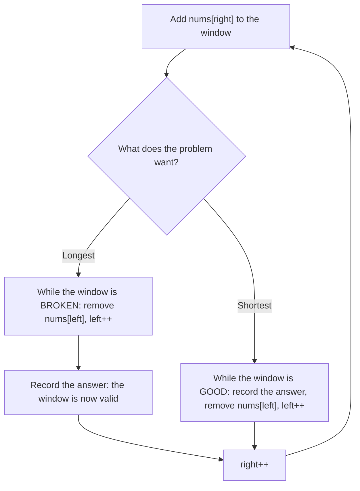
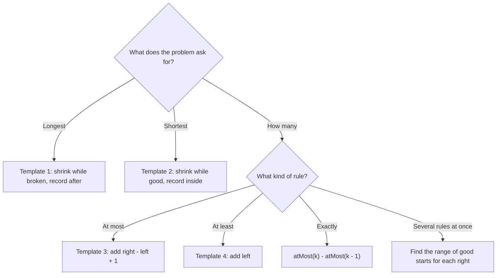

# Sliding Window: Variable Size

> **Level:** Intermediate · **Priority:** T1 · **Time:** 240 min · **Read first:** [Sliding window: fixed size](04-sliding-window-fixed.md), [Hash tables from zero](../02-arrays-strings-hashing/03-hash-tables-from-zero.md) · **Next:** [Prefix sums](06-prefix-sums.md)

The variable sliding window finds the best contiguous piece of an array or string in O(n) time. (Contiguous means next to each other, with no gaps.) It is one of the most common patterns in interviews, and most "longest substring" and "shortest subarray" problems use it.

## Quick revision

- A **window** is a contiguous part of an array or string, marked by two indexes: `left` and `right`.
- Use it when the problem asks for the **longest**, **shortest** or **number of** contiguous pieces that obey a rule.
- The loop never changes: add `nums[right]`, shrink from `left` if needed, update the answer.
- **Longest window:** shrink while the window is **broken**, then record the answer.
- **Shortest window:** shrink while the window is **good**, and record the answer inside the shrink loop.
- **Count windows with "at most k":** after shrinking, add `right - left + 1` to the count.
- **Count windows with "at least k":** shrink while the window is good, then add `left` to the count.
- **Count windows with "exactly k":** `exactly(k) = atMost(k) - atMost(k - 1)`.
- Window size is `right - left + 1`.
- The nested `while` is still O(n), because `left` only moves forward, so it moves at most n times in total.
- It works only when the rule is **monotonic**: if growing a window breaks the rule, growing it more keeps it broken.
- **Negative numbers break this pattern** for sum problems. Use [prefix sums](06-prefix-sums.md) instead.
- The window state is what you remember about the current window. It is usually one number (a sum, a count of zeros) or a frequency table, which counts how many times each value appears.
- **If you cannot undo a step,** as with bitwise OR, keep a counter for each bit so that you can still remove an element.
- **If you may pick items in any order,** sort first. The chosen group then becomes a window.

## How to recognize it

Ask these four questions. If all four answers are yes, use a variable sliding window.

1. Is the input a line of items, such as an array or a string?
2. Must the answer be **contiguous**, meaning no gaps?
3. Does the problem ask for the **longest**, **shortest** or **how many**?
4. If a window breaks the rule, does adding more elements keep it broken? (Or, for "at least" rules, if a window is good, does adding more keep it good?)

One case needs an extra step. If you may pick items in any order, question 2 looks like a no. Sort first, and the group you pick becomes a window. Then ask the questions again. [P16](#p16-frequency-of-the-most-frequent-element-leetcode-1838-medium) and [P20](#p20-minimum-number-of-operations-to-make-array-continuous-leetcode-2009-hard) work this way.

| Words in the problem | What they tell you |
|---|---|
| "contiguous", "consecutive", "subarray", "substring" | The answer is one unbroken piece, so a window can hold it |
| "longest substring", "longest subarray", "maximum length" | Longest window template |
| "shortest subarray", "minimum length", "smallest window" | Shortest window template |
| "at most k", "no more than k distinct" | The rule is a limit: shrink when you pass k |
| "at least k", "sum is at least target" | Shrink while the rule still holds |
| "exactly k" | Use `atMost(k) - atMost(k - 1)` |
| "without repeating characters", "all unique" | Keep a frequency table, or a last-seen table (the last index of each value) |
| "contains all characters of t" | Keep a count of what is still missing |
| "you may replace or flip at most k items" | The window may hold at most k bad items |
| "number of subarrays" with a sum or product "less than k", positive values | Shrink while broken, then count with `right - left + 1` (Template 3) |
| "number of substrings that contain at least one of each" | Shrink while good, then count with `left` (Template 4) |
| "you must delete one element" | The window may hold one bad item, and the answer is one shorter than the window |
| "exactly k odd numbers", "sum equals goal" in a binary array | Treat the items as 0 and 1, then use `atMost(k) - atMost(k - 1)` |
| "at most k operations", "add 1 to any element" | Sort first, then the window must cost at most k |
| "replace one substring so that the whole string..." | The window is the part you replace. Check what is outside it |
| "bitwise OR of the subarray is at least k" | OR never falls as the window grows. Keep a counter for each bit |
| "score is the sum times the length" | A rule with two parts is still monotonic if both parts only rise |
| "minimum operations" where each operation fixes one element | Find the largest group you can keep. The answer is n minus that group |
| "the minimum is x and the maximum is y" | Track the last position of x, of y, and of any value outside the range |

**Not this pattern if:**

| You see | Use instead | Why |
|---|---|---|
| Negative numbers with a sum target | [Prefix sums and a hash map](06-prefix-sums.md) for an exact sum, or [prefix sums and a monotonic queue](13-monotonic-queue.md) for "at least k" | Adding a negative number lowers the sum, so "growing keeps it broken" is false. |
| The window size is given as k | [Fixed sliding window](04-sliding-window-fixed.md) | There is nothing to shrink. Every window has the same size. |
| "subsequence" (items may be skipped) | [Longest increasing subsequence](../09-dynamic-programming/06-longest-increasing-subsequence.md), [longest common subsequence](../09-dynamic-programming/07-lcs-and-edit-distance.md) or greedy | A window cannot skip items. |
| Maximum sum with no rule | [Kadane's algorithm](08-kadane-and-subarray-dp.md) | There is no rule that tells you when to shrink. |
| Max or min of each window | [Monotonic queue](13-monotonic-queue.md) | You need the extreme value after removals, which one number cannot give you. |
| Sorted array and a pair of values | [Two pointers from both ends](01-two-pointers-opposite-ends.md) | You need two items, not a piece between them. |
| Remove or keep items in place | [Two pointers: same direction](02-two-pointers-same-direction.md) | Both pointers move forward, but one reads and one writes. There is no rule about the items between them. |
| "every character appears at least k times" | [Divide and conquer](../06-recursion-backtracking-greedy/05-divide-and-conquer.md) | A new character can break the window, and more copies of it can fix it again. The rule is not monotonic. |
| "sum is divisible by k" | [Prefix sums](06-prefix-sums.md) | A new element can move the remainder up or down, so no direction is safe. |
| A product with zeros or negative numbers | [Kadane's algorithm](08-kadane-and-subarray-dp.md) | A zero or a negative number can lower the product, so a broken window can become good. |

## 1. The idea in plain English

Think of a caterpillar crawling along a branch. Its head moves forward. When its body stretches too far, its tail catches up. The caterpillar never moves backwards, and it covers the whole branch once.

`right` is the head. `left` is the tail. The window is the caterpillar's body.

Here is a tiny problem: **find the longest subarray with a sum of at most 5.**

```text
nums = [2, 1, 3, 1, 1]
```

(A **subarray** is a part of an array with no gaps. `[1, 3]` is a subarray. `[2, 3]` is not, because it skips the `1`. A **substring** is the same idea for a string.)

The slow way tries every start and every end. That is about n squared / 2 windows. For 100,000 elements, that is about 5 billion windows.

The window does better. All these numbers are positive, so if a window's sum is too big, every longer window with the same start is also too big. There is no reason to try them. You move `left` instead.

| Step | right | Add | Sum | Too big? | left after shrinking | Window | Length | Best |
|---|---|---|---|---|---|---|---|---|
| 1 | 0 | 2 | 2 | no | 0 | `[2]` | 1 | 1 |
| 2 | 1 | 1 | 3 | no | 0 | `[2, 1]` | 2 | 2 |
| 3 | 2 | 3 | 6 | yes, remove 2, sum is 4 | 1 | `[1, 3]` | 2 | 2 |
| 4 | 3 | 1 | 5 | no | 1 | `[1, 3, 1]` | 3 | 3 |
| 5 | 4 | 1 | 6 | yes, remove 1, sum is 5 | 2 | `[3, 1, 1]` | 3 | 3 |

The answer is 3. `right` moved 5 times and `left` moved 2 times, so there were 7 pointer moves in total. The slow way checks 15 windows.

## 2. Why it works

Two facts make this pattern correct and fast.

**Fact 1: you can safely skip windows.** Say the window `[left, right]` is broken, and the rule is monotonic. Then every window that starts at `left` and ends after `right` is also broken. None of them can be the answer. So `left` is finished, and you can move it forward. The shortest window works the same way. Say `[left, right]` is good. Every window that starts at `left` and ends after `right` is longer, so it cannot beat this one. So `left` is finished there too.

**Fact 2: it is O(n), even with a loop inside a loop.** The inner `while` looks like it makes this O(n squared). It does not. `left` starts at 0, only moves forward, and never passes the end. Over the whole run, `left` moves at most n times. So the total work of the inner loop, across all outer steps, is at most n. The whole algorithm does at most 2n moves.

### How to test if a rule is monotonic

Monotonic means a rule can flip only one way as a window grows. A limit rule, such as "sum at most 5", can go from valid to broken, but never back. A goal rule, such as "sum at least 5", can go from not good to good, but never back.

To test a rule, ask one question: **could adding one more element undo the last flip?** If yes, the window can skip answers, and the pattern fails.

| Rule | Monotonic? | Why |
|---|---|---|
| Sum at most k, no negative values | Yes | Each new element raises the sum or keeps it the same. |
| Sum at most k, with negative values | No | A negative element lowers the sum, so a broken window can become valid. |
| At most k distinct values | Yes | A new element can only keep or raise the distinct count. |
| Exactly k distinct values | No | A window can grow into a good one, then grow out of it. Use `atMost(k) - atMost(k - 1)`. |
| Contains every letter of t | Yes | A bigger window holds everything the smaller one held. |
| Bitwise OR at least k | Yes | The OR has a 1 in every bit where any number has a 1. A new element can only turn bits on. |
| Largest minus smallest at most a limit | Yes | A new element can only widen the range. The state needs a [monotonic queue](13-monotonic-queue.md), which is a queue that keeps its values sorted. The idea of the window still works. |
| Every letter appears at least k times | No | A new letter breaks the window, and more copies of it fix it. |
| Sum divisible by k | No | A new element can move the remainder anywhere. |

## 3. The templates

Templates 1 and 2 find one best window. The difference between them is **where you record the answer**. Templates 3 and 4, further down, count windows.



- **Longest:** you want the window as big as possible. Shrink only when you must. Once the window is valid again, record it.
- **Shortest:** you want the window as small as possible. As soon as it is good, record it, then try to make it smaller.

```cpp
#include <bits/stdc++.h>
#include <cassert>
using namespace std;

// Template 1, longest: the longest subarray with sum <= limit.
// All values are positive, and limit is at least 0.
int longestWithSumAtMost(const vector<int>& nums, int limit) {
    int left = 0, best = 0;
    long long sum = 0;                   // the sum of two ints can already pass 2 billion
    for (int right = 0; right < (int)nums.size(); right++) {
        sum += nums[right];              // 1. add the new element
        while (sum > limit) {            // 2. shrink while broken
            sum -= nums[left];
            left++;
        }
        best = max(best, right - left + 1);  // 3. the window is valid here, so record it
    }
    return best;
}

// Template 2, shortest: the shortest subarray with sum >= target.
// All values and the target are positive.
int shortestWithSumAtLeast(const vector<int>& nums, int target) {
    int left = 0, best = INT_MAX;
    long long sum = 0;                   // the sum of two ints can already pass 2 billion
    for (int right = 0; right < (int)nums.size(); right++) {
        sum += nums[right];              // 1. add the new element
        while (sum >= target) {          // 2. shrink while good
            best = min(best, right - left + 1);  // record before the window stops being good
            sum -= nums[left];
            left++;
        }
    }
    return best == INT_MAX ? 0 : best;   // 0 means no window was good
}

int main() {
    assert(longestWithSumAtMost({2, 1, 3, 1, 1}, 5) == 3);
    assert(longestWithSumAtMost({9, 9}, 5) == 0);          // no element fits
    assert(shortestWithSumAtLeast({2, 3, 1, 2, 4, 3}, 7) == 2);
    assert(shortestWithSumAtLeast({1, 1}, 5) == 0);        // the whole array is not enough
    // These sums pass the int limit, so an int sum would overflow and give a wrong answer.
    assert(longestWithSumAtMost({2000000000, 2000000000}, 2147483647) == 1);
    assert(shortestWithSumAtLeast({2000000000, 2000000000}, 2147483647) == 2);
    cout << "All tests passed\n";
}
```

Both templates need one thing: the empty window must fail the shrink test. That is why `limit` must be at least 0 and `target` must be above 0. Otherwise the shrink loop keeps going, and `left` runs off the end. See pitfall 10 in [Common pitfalls](#common-pitfalls).

### Template 3: counting windows

To count subarrays that obey an "at most" rule, use this fact. If `[left, right]` is valid, then every window that ends at `right` and starts at or after `left` is also valid. Each of those windows is a part of `[left, right]`, and removing elements from a valid window cannot break it. There are `right - left + 1` such windows.

```text
nums = [a, b, c]    left = 0, right = 2
Valid windows ending at index 2:  [a, b, c], [b, c], [c]
That is right - left + 1 = 3 windows.
```

So after shrinking, add `right - left + 1` to the count. Each window is counted once, at its last element. [P8](#p8-subarray-product-less-than-k-leetcode-713-medium) shows the full code.

For "exactly k", one plain window is not enough. A window with exactly k distinct values may stay good if you grow it, and it may stay good if you shrink it. So the loop cannot tell which way to move. But "at most k" is easy, and:

```text
exactly(k) = atMost(k) - atMost(k - 1)
```

Windows with at most k include those with exactly k and those with fewer. Subtract the ones with fewer, and exactly k remains. [P9](#p9-subarrays-with-k-different-integers-leetcode-992-hard) uses this.

### Template 4: counting windows with an "at least" rule

Template 3 works when a window stays valid as it **shrinks**. Some rules go the other way. "Has at least one of each letter" and "sum is at least target" stay true as a window **grows**. For these rules, the long windows are the good ones.

Take `nums = [1, 2, 1, 1]` and the rule "sum is at least 3". Look at the windows that end at index 3:

```text
Start 0:  [1, 2, 1, 1]  sum is 5, good
Start 1:     [2, 1, 1]  sum is 4, good
Start 2:        [1, 1]  sum is 2, not good
Start 3:           [1]  sum is 1, not good
```

The good starts sit together at the front. This is always true: if start 1 is good, start 0 is good too, because its window is the same window with one more element.

So shrink while the window is good. When the loop stops, `left` is the first start that is not good. The starts 0 to `left - 1` are all good, and there are exactly `left` of them. So add `left` to the count.

| right | Add | Sum | Shrink | left after | Add to count | Count |
|---|---|---|---|---|---|---|
| 0 | 1 | 1 | no | 0 | 0 | 0 |
| 1 | 2 | 3 | remove 1, sum is 2 | 1 | 1 | 1 |
| 2 | 1 | 3 | remove 2, sum is 1 | 2 | 2 | 3 |
| 3 | 1 | 2 | no | 2 | 2 | 5 |

The five good windows are `[1, 2]`, `[1, 2, 1]`, `[2, 1]`, `[1, 2, 1, 1]` and `[2, 1, 1]`.

```cpp
#include <bits/stdc++.h>
#include <cassert>
using namespace std;

// Template 4, count "at least": how many subarrays have sum >= target.
// All values and the target are positive.
long long countWithSumAtLeast(const vector<int>& nums, int target) {
    int left = 0;
    long long sum = 0, count = 0;
    for (int right = 0; right < (int)nums.size(); right++) {
        sum += nums[right];              // 1. add the new element
        while (sum >= target) {          // 2. shrink while good
            sum -= nums[left];
            left++;
        }
        count += left;                   // 3. starts 0 to left - 1 are the good ones
    }
    return count;
}

int main() {
    assert(countWithSumAtLeast({1, 2, 1, 1}, 3) == 5);
    assert(countWithSumAtLeast({1, 1}, 5) == 0);     // the whole array is not enough
    assert(countWithSumAtLeast({5, 5}, 5) == 3);     // every subarray is good
    assert(countWithSumAtLeast({}, 1) == 0);         // empty input
    cout << "All tests passed\n";
}
```

### One idea behind all the counting

For each `right`, ask: **which starts give a good window?** The good starts always form one unbroken range. Find the two ends of that range, and add its size.

```text
index:             0  1  2  3  4  5  6  7
"at most" rule:    .  .  .  G  G  G  G  G     left = 3, right = 7, good starts 3 to 7, add 5
"at least" rule:   G  G  G  .  .  .  .  .     left = 3, right = 7, good starts 0 to 2, add 3
```

| Rule | Good starts for this `right` | Add to the count | Solved in |
|---|---|---|---|
| At most | `left` to `right` | `right - left + 1` | P8, P19 |
| At least | `0` to `left - 1` | `left` | P13 |
| Exactly | The gap between the `left` of "at most k" and the `left` of "at most k - 1" | The size of the gap | P9, P14, P15 |
| Several rules at once | `lastBad + 1` to `min(lastMin, lastMax)` | The size of that range, or 0 | P21 |

### What to keep in the window

The window state is what you remember about the current window. It must do two things in O(1): take in a new element, and drop an old one. Pick the state from what the rule talks about.

| The rule talks about | Keep this | To remove `x` | Solved in |
|---|---|---|---|
| A sum | `sum` | `sum -= x` | P1, P2 |
| A product | `product` | `product /= x` | P8 |
| How many items of one kind | A counter such as `zeros` | Subtract 1 if `x` is that kind | P4, P10 |
| The most common item | A count table and `maxCount` | Subtract 1 from the count of `x`, and leave `maxCount` alone | P6 |
| Repeats | The last index of each value | Nothing, because `left` jumps | P3 |
| Distinct values | A count table and `distinct` | Subtract 1, and lower `distinct` at zero | P5, P9, P11, P12 |
| Everything in a list | `need` and `missing`, or a count table | Add `x` back to what is needed | P7, P13 |
| What is outside the window | Counts of the letters outside | `outside[x]++` | P17 |
| The cost to make items equal | `sum` and the length | `sum -= x` | P16 |
| The sum times the length | `sum` and the length | `sum -= x` | P19 |
| A bitwise OR | One counter for each bit | Subtract 1 for each bit of `x` | P18 |
| Which starts are good | Last positions | Nothing, because you never remove | P21 |

### Which template do I use?



## 4. Solved problems

P1 to P9 teach the core templates. P10 to P21 are variations, ordered from easiest to hardest. Each one adds a single new twist, so read them in order.

| Twist | Problems |
|---|---|
| Restate the problem as "at most k bad items" | P4, P10 |
| Distinct values | P5, P9, P11, P12 |
| Count with an "at most" rule | P8, P19 |
| Count with an "at least" rule | P13 |
| Count with "exactly" | P9, P14, P15 |
| Sort first | P16, P20 |
| The rule is about what is outside the window | P17 |
| The state cannot be undone | P18 |
| Turn "fewest changes" into "most you can keep" | P20 |
| Track last positions instead of shrinking | P3, P21 |

### P1. Longest Subarray With Sum At Most K (Classic, Easy)

**Problem:** Given an array of positive numbers and a limit k that is at least 0, find the length of the longest subarray whose sum is at most k.

**Example:** `nums = [2, 1, 3, 1, 1]`, `k = 5` gives `3`, from the subarray `[1, 3, 1]`.

**Pattern:** Variable sliding window

**How to recognize it:** "Longest" plus "subarray" means contiguous. All values are positive, so a sum that is too big stays too big as the window grows. All four checklist answers are yes.

**Brute force:** Try every start, and keep a running sum as you extend the end. O(n^2) time.

**Key idea:** This is Template 1. Grow the window on the right. When the sum passes k, remove from the left until it fits.

**Dry run:** See the table in [section 1](#1-the-idea-in-plain-english).

```cpp
#include <bits/stdc++.h>
#include <cassert>
using namespace std;

int longestSubarrayAtMostK(const vector<int>& nums, long long k) {
    int left = 0, best = 0;
    long long sum = 0;  // the sum can pass 2 billion on large inputs
    for (int right = 0; right < (int)nums.size(); right++) {
        sum += nums[right];
        while (sum > k) {
            sum -= nums[left];
            left++;
        }
        best = max(best, right - left + 1);
    }
    return best;
}

int main() {
    assert(longestSubarrayAtMostK({2, 1, 3, 1, 1}, 5) == 3);
    assert(longestSubarrayAtMostK({}, 5) == 0);          // empty input
    assert(longestSubarrayAtMostK({10}, 5) == 0);        // one element, too big
    assert(longestSubarrayAtMostK({1, 1, 1}, 3) == 3);   // the whole array fits
    cout << "All tests passed\n";
}
```

**Complexity:** O(n) time, because `left` and `right` each move at most n times. O(1) space, because the state is one number.

**Edge cases:** an empty array, and a single element larger than k. In that second case `left` moves past `right` and the window is empty. Its length is 0, and the code still works.

### P2. Minimum Size Subarray Sum ([LeetCode 209](https://leetcode.com/problems/minimum-size-subarray-sum/), Medium)

**Problem:** Given an array of positive numbers and a target, find the length of the shortest subarray whose sum is at least the target. Return 0 if there is none.

**Example:** `target = 7`, `nums = [2, 3, 1, 2, 4, 3]` gives `2`, from the subarray `[4, 3]`.

**Pattern:** Variable sliding window

**How to recognize it:** "Minimum length" plus "subarray" asks for the shortest contiguous piece. All values are positive, so once a window reaches the target, a longer one also reaches it. That is the monotonic rule.

**Brute force:** Try every start and extend until the sum reaches the target. O(n^2) time.

**Key idea:** This is Template 2. When the window is good, record its length, then remove from the left to see if a smaller window is also good.

**Dry run:**

| right | Add | Sum | Good? | What happens | left after | Best |
|---|---|---|---|---|---|---|
| 0 | 2 | 2 | no | | 0 | none |
| 1 | 3 | 5 | no | | 0 | none |
| 2 | 1 | 6 | no | | 0 | none |
| 3 | 2 | 8 | yes | record 4, remove 2, sum is 6 | 1 | 4 |
| 4 | 4 | 10 | yes | record 4, remove 3, sum is 7, record 3, remove 1, sum is 6 | 3 | 3 |
| 5 | 3 | 9 | yes | record 3, remove 2, sum is 7, record 2, remove 4, sum is 3 | 5 | 2 |

```cpp
#include <bits/stdc++.h>
#include <cassert>
using namespace std;

class Solution {
public:
    int minSubArrayLen(int target, vector<int>& nums) {
        int left = 0, best = INT_MAX;
        long long sum = 0;
        for (int right = 0; right < (int)nums.size(); right++) {
            sum += nums[right];
            while (sum >= target) {
                best = min(best, right - left + 1);  // record first, because the removal may break it
                sum -= nums[left];
                left++;
            }
        }
        return best == INT_MAX ? 0 : best;
    }
};

int main() {
    Solution solution;
    vector<int> a = {2, 3, 1, 2, 4, 3};
    assert(solution.minSubArrayLen(7, a) == 2);
    vector<int> b = {1, 4, 4};
    assert(solution.minSubArrayLen(4, b) == 1);   // one element is enough
    vector<int> c = {1, 1, 1, 1};
    assert(solution.minSubArrayLen(11, c) == 0);  // impossible
    cout << "All tests passed\n";
}
```

**Complexity:** O(n) time, because each pointer moves at most n times. O(1) space, because the state is one sum.

**Edge cases:** no window reaches the target, so `best` stays `INT_MAX` and you return 0. A single element can be enough.

**Follow-up:** "What if the array has negative numbers?" The window no longer works, because adding an element can lower the sum. Use prefix sums with a [monotonic queue](13-monotonic-queue.md), as in LeetCode 862.

### P3. Longest Substring Without Repeating Characters ([LeetCode 3](https://leetcode.com/problems/longest-substring-without-repeating-characters/), Medium)

**Problem:** Find the length of the longest substring in which every character is different.

**Example:** `s = "abcabcbb"` gives `3`, from `"abc"`.

**Pattern:** Variable sliding window

**How to recognize it:** "Longest substring" is contiguous. The rule is "no repeats". If a window has a repeat, any bigger window also has it, so the rule is monotonic.

**Brute force:** Check every substring for repeats. O(n^3) time, or O(n^2) if you use a set while extending.

**Key idea:** Remember the last index of each character. When you meet a character that is inside the window, jump `left` to just after its last position. This skips the one-by-one shrinking.

**Dry run:** on `s = "abcabcbb"`.

| right | Char | Last seen at | left after | Window | Best |
|---|---|---|---|---|---|
| 0 | a | never | 0 | `a` | 1 |
| 1 | b | never | 0 | `ab` | 2 |
| 2 | c | never | 0 | `abc` | 3 |
| 3 | a | 0 | 1 | `bca` | 3 |
| 4 | b | 1 | 2 | `cab` | 3 |
| 5 | c | 2 | 3 | `abc` | 3 |
| 6 | b | 4 | 5 | `cb` | 3 |
| 7 | b | 6 | 7 | `b` | 3 |

```cpp
#include <bits/stdc++.h>
#include <cassert>
using namespace std;

class Solution {
public:
    int lengthOfLongestSubstring(string s) {
        vector<int> lastSeen(256, -1);  // last index of each character, -1 means never seen
        int left = 0, best = 0;
        for (int right = 0; right < (int)s.size(); right++) {
            unsigned char c = s[right];  // unsigned, so that the index is never negative
            // max() matters: the old position may be left of the window, as in "abba".
            left = max(left, lastSeen[c] + 1);
            lastSeen[c] = right;
            best = max(best, right - left + 1);
        }
        return best;
    }
};

int main() {
    Solution solution;
    assert(solution.lengthOfLongestSubstring("abcabcbb") == 3);
    assert(solution.lengthOfLongestSubstring("bbbbb") == 1);
    assert(solution.lengthOfLongestSubstring("") == 0);
    assert(solution.lengthOfLongestSubstring("abba") == 2);  // left must not move backwards
    assert(solution.lengthOfLongestSubstring("a b c") == 3); // spaces count as characters
    cout << "All tests passed\n";
}
```

**Complexity:** O(n) time, with one pass over the string. O(1) space, because the table always has 256 entries.

**Edge cases:** an empty string; every character the same; and `"abba"`. At the last `a`, its old position is 0, but `left` is already 2. Without `max`, `left` would jump backwards and bring the repeated `b` back into the window.

### P4. Max Consecutive Ones III ([LeetCode 1004](https://leetcode.com/problems/max-consecutive-ones-iii/), Medium)

**Problem:** Given an array of 0s and 1s, you may flip at most k zeros to ones. Find the longest run of ones you can make.

**Example:** `nums = [1, 1, 0, 0, 1, 1]`, `k = 1` gives `3`. Flipping the first zero gives `[1, 1, 1]`.

**Pattern:** Variable sliding window

**How to recognize it:** "At most k" flips and a longest run. The trick is to restate the problem: **find the longest window with at most k zeros.** You do not need to flip anything. You only count zeros. More zeros can only break the rule further, so it is monotonic.

**Brute force:** For every start, extend until the window has more than k zeros. O(n^2) time.

**Key idea:** Keep a count of zeros in the window. This is Template 1, where "broken" means `zeros > k`.

**Dry run:** on `nums = [1, 1, 0, 0, 1, 1]`, `k = 1`.

| right | Value | Zeros | Broken? | left after | Window | Best |
|---|---|---|---|---|---|---|
| 0 | 1 | 0 | no | 0 | `1` | 1 |
| 1 | 1 | 0 | no | 0 | `1 1` | 2 |
| 2 | 0 | 1 | no | 0 | `1 1 0` | 3 |
| 3 | 0 | 2 | yes, remove 1, 1, 0 | 3 | `0` | 3 |
| 4 | 1 | 1 | no | 3 | `0 1` | 3 |
| 5 | 1 | 1 | no | 3 | `0 1 1` | 3 |

```cpp
#include <bits/stdc++.h>
#include <cassert>
using namespace std;

class Solution {
public:
    int longestOnes(vector<int>& nums, int k) {
        int left = 0, zeros = 0, best = 0;
        for (int right = 0; right < (int)nums.size(); right++) {
            if (nums[right] == 0) zeros++;
            while (zeros > k) {
                if (nums[left] == 0) zeros--;
                left++;
            }
            best = max(best, right - left + 1);
        }
        return best;
    }
};

int main() {
    Solution solution;
    vector<int> a = {1, 1, 0, 0, 1, 1};
    assert(solution.longestOnes(a, 1) == 3);
    vector<int> b = {1, 1, 1, 0, 0, 0, 1, 1, 1, 1, 0};
    assert(solution.longestOnes(b, 2) == 6);
    vector<int> c = {0, 0, 0};
    assert(solution.longestOnes(c, 0) == 0);  // no flips allowed
    assert(solution.longestOnes(c, 5) == 3);  // k is larger than the array
    cout << "All tests passed\n";
}
```

**Complexity:** O(n) time, because `left` and `right` each move at most n times. O(1) space, because the state is one counter.

**Edge cases:** `k = 0` means the longest run of existing ones. `k` larger than the number of zeros means the answer is the whole array.

### P5. Fruit Into Baskets ([LeetCode 904](https://leetcode.com/problems/fruit-into-baskets/), Medium)

**Problem:** A row of trees is given, and `fruits[i]` is the type of fruit on tree i. You have two baskets, and each holds one type. You may start at any tree. You walk right, pick one fruit from each tree, and stop when you meet a third type. Find the most fruit you can pick.

**Example:** `fruits = [1, 2, 3, 2, 2]` gives `4`, from the trees `[2, 3, 2, 2]`.

**Pattern:** Variable sliding window

**How to recognize it:** The story hides the real question. Remove the story and you get: **find the longest subarray with at most 2 distinct values.** Many window problems hide behind a story like this. This chapter calls such a story a costume. "One fruit from each tree" means contiguous, and "two baskets" means at most 2 distinct.

**Brute force:** For every start, walk until a third type appears. O(n^2) time.

**Key idea:** Keep a frequency map: for each fruit type in the window, how many there are. When the map has more than 2 keys, remove from the left until a key's count reaches zero.

**Dry run:** on `fruits = [1, 2, 3, 2, 2]`.

| right | Fruit | Counts in window | Distinct | left after | Window | Best |
|---|---|---|---|---|---|---|
| 0 | 1 | 1:1 | 1 | 0 | `1` | 1 |
| 1 | 2 | 1:1, 2:1 | 2 | 0 | `1 2` | 2 |
| 2 | 3 | 1:1, 2:1, 3:1 | 3, shrink | 1 | `2 3` | 2 |
| 3 | 2 | 2:2, 3:1 | 2 | 1 | `2 3 2` | 3 |
| 4 | 2 | 2:3, 3:1 | 2 | 1 | `2 3 2 2` | 4 |

```cpp
#include <bits/stdc++.h>
#include <cassert>
using namespace std;

class Solution {
public:
    int totalFruit(vector<int>& fruits) {
        unordered_map<int, int> count;  // fruit type -> how many are in the window
        int left = 0, best = 0;
        for (int right = 0; right < (int)fruits.size(); right++) {
            count[fruits[right]]++;
            while ((int)count.size() > 2) {
                count[fruits[left]]--;
                // Erase at zero, or size() would still count this type.
                if (count[fruits[left]] == 0) count.erase(fruits[left]);
                left++;
            }
            best = max(best, right - left + 1);
        }
        return best;
    }
};

int main() {
    Solution solution;
    vector<int> a = {1, 2, 1};
    assert(solution.totalFruit(a) == 3);
    vector<int> b = {0, 1, 2, 2};
    assert(solution.totalFruit(b) == 3);
    vector<int> c = {1, 2, 3, 2, 2};
    assert(solution.totalFruit(c) == 4);
    vector<int> d = {7};
    assert(solution.totalFruit(d) == 1);
    cout << "All tests passed\n";
}
```

**Complexity:** O(n) time on average, because each element is added once and removed once. O(1) space, because the map never holds more than 3 keys.

**Edge cases:** only one type of fruit, and only one tree.

### P6. Longest Repeating Character Replacement ([LeetCode 424](https://leetcode.com/problems/longest-repeating-character-replacement/), Medium)

**Problem:** A string has uppercase letters. You may change at most k characters to any other letter. Find the longest substring you can make with all the same letter.

**Example:** `s = "AABABBA"`, `k = 1` gives `4`. Change the `B` in `"AABA"` to get `"AAAA"`.

**Pattern:** Variable sliding window

**How to recognize it:** "Longest substring" and "at most k" changes. Now ask what a good window looks like. To make a window all one letter, keep the most common letter and change the rest. So:

```text
changes needed = window length - count of the most common letter
```

A window is valid when `changes needed <= k`.

**Brute force:** For every substring, count its letters and test the rule. O(n^2 * 26) time.

**Key idea:** Keep letter counts and `maxCount`, the highest count any letter has reached in any window so far. When `length - maxCount > k`, remove one letter from the left. You never need to lower `maxCount`, even after that letter leaves the window. An old `maxCount` can be too high. Such a value is called stale. A stale `maxCount` can make a broken window look valid, as in this trace:

```text
s = "AAABCD", k = 1

Window "AAAB":  maxCount is 3, length is 4, 4 - 3 = 1. Valid, so best is 4.
Add C:          length is 5, 5 - 3 = 2. Too many, so remove one A.
Window "AABC":  the real highest count is 2, so this window needs 2 changes.
                But maxCount is still 3, and 4 - 3 = 1, so it looks valid.
Add D:          length is 5, 5 - 3 = 2. Too many, so remove one A.
Window "ABCD":  length is 4 again.
```

This does no harm, because the window only slid. Each new letter adds one and each removal takes one, so the length stays at 4. A real window already reached that length. The window can grow past it only when a letter's count really beats `maxCount`. So `best` is never wrong.

**Dry run:** on `s = "AABABBA"`, `k = 1`.

| right | Char | maxCount | Length | Changes needed | Broken? | left after | Best |
|---|---|---|---|---|---|---|---|
| 0 | A | 1 | 1 | 0 | no | 0 | 1 |
| 1 | A | 2 | 2 | 0 | no | 0 | 2 |
| 2 | B | 2 | 3 | 1 | no | 0 | 3 |
| 3 | A | 3 | 4 | 1 | no | 0 | 4 |
| 4 | B | 3 | 5 | 2 | yes, remove A | 1 | 4 |
| 5 | B | 3 | 5 | 2 | yes, remove A | 2 | 4 |
| 6 | A | 3 | 5 | 2 | yes, remove B | 3 | 4 |

```cpp
#include <bits/stdc++.h>
#include <cassert>
using namespace std;

class Solution {
public:
    int characterReplacement(string s, int k) {
        int count[26] = {0};
        int left = 0, maxCount = 0, best = 0;
        for (int right = 0; right < (int)s.size(); right++) {
            count[s[right] - 'A']++;
            maxCount = max(maxCount, count[s[right] - 'A']);
            // One removal is enough: the window grew by one, so it only needs to shrink by one.
            if (right - left + 1 - maxCount > k) {
                count[s[left] - 'A']--;
                left++;
            }
            best = max(best, right - left + 1);
        }
        return best;
    }
};

int main() {
    Solution solution;
    assert(solution.characterReplacement("ABAB", 2) == 4);
    assert(solution.characterReplacement("AABABBA", 1) == 4);
    assert(solution.characterReplacement("A", 0) == 1);
    assert(solution.characterReplacement("ABCDE", 1) == 2);
    assert(solution.characterReplacement("AAABCD", 1) == 4);  // maxCount goes stale here
    cout << "All tests passed\n";
}
```

**Complexity:** O(n) time, because `right` visits each index once and each step removes at most one letter. O(1) space, because the table has 26 entries.

**Edge cases:** `k = 0` means the longest run of equal letters. `k` at least as long as the string means the whole string is the answer.

### P7. Minimum Window Substring ([LeetCode 76](https://leetcode.com/problems/minimum-window-substring/), Hard)

**Problem:** Given strings `s` and `t`, find the shortest substring of `s` that contains every character of `t`, including duplicates. Return an empty string if there is none.

**Example:** `s = "ADOBECODEBANC"`, `t = "ABC"` gives `"BANC"`. It is the shortest piece that holds an A, a B and a C.

**Pattern:** Variable sliding window

**How to recognize it:** "Shortest substring" that "contains all" of something. Once a window contains everything, a bigger one also does. That is Template 2, the shortest window.

**Brute force:** Check all O(n^2) substrings against `t`. With a 52-letter count check, that is O(n^2 * 52) time.

**Key idea:** Keep a table `need`: how many more of each character the window still needs. A value can go below zero, which means the window has extras. Also keep `missing`, the total number of characters still needed. `missing == 0` means the window is good, and checking it costs O(1).

**Dry run:** on `s = "AXBYCAB"`, `t = "ABC"`. The answer is `"CAB"`.

| right | Char | missing after | Good? | What happens while good | left after | Best |
|---|---|---|---|---|---|---|
| 0 | A | 2 | no | | 0 | none |
| 1 | X | 2 | no | | 0 | none |
| 2 | B | 1 | no | | 0 | none |
| 3 | Y | 1 | no | | 0 | none |
| 4 | C | 0 | yes | record `AXBYC`, remove A, missing is 1 | 1 | `AXBYC` |
| 5 | A | 0 | yes | remove X, record `BYCA`, remove B, missing is 1 | 3 | `BYCA` |
| 6 | B | 0 | yes | remove Y, record `CAB`, remove C, missing is 1 | 5 | `CAB` |

```cpp
#include <bits/stdc++.h>
#include <cassert>
using namespace std;

class Solution {
public:
    string minWindow(string s, string t) {
        vector<int> need(128, 0);
        for (char c : t) need[c]++;
        int missing = (int)t.size();  // how many characters of t the window still lacks
        int left = 0, bestStart = 0, bestLength = INT_MAX;

        for (int right = 0; right < (int)s.size(); right++) {
            // A positive value means the window needed this character.
            if (need[s[right]] > 0) missing--;
            need[s[right]]--;

            while (missing == 0) {
                if (right - left + 1 < bestLength) {
                    bestLength = right - left + 1;
                    bestStart = left;
                }
                need[s[left]]++;
                // Back above zero means this removal took a character the window needed.
                if (need[s[left]] > 0) missing++;
                left++;
            }
        }
        return bestLength == INT_MAX ? "" : s.substr(bestStart, bestLength);
    }
};

int main() {
    Solution solution;
    assert(solution.minWindow("ADOBECODEBANC", "ABC") == "BANC");
    assert(solution.minWindow("AXBYCAB", "ABC") == "CAB");
    assert(solution.minWindow("a", "a") == "a");
    assert(solution.minWindow("a", "aa") == "");    // duplicates in t must be matched
    assert(solution.minWindow("aa", "aa") == "aa");
    cout << "All tests passed\n";
}
```

**Complexity:** O(m + n) time, where m and n are the lengths of `s` and `t`. Each index enters and leaves the window once. O(1) space, because the table has 128 entries, one for each ASCII character.

**Edge cases:** `t` is longer than `s`; `t` has repeated letters; the answer is the whole of `s`.

**Follow-up:** "What if `s` is very long and `t` is short?" Filter `s` to the positions of characters in `t` first. The window then only visits those positions, which saves time when most characters are irrelevant.

### P8. Subarray Product Less Than K ([LeetCode 713](https://leetcode.com/problems/subarray-product-less-than-k/), Medium)

**Problem:** Given an array of positive integers and a number k, count the contiguous subarrays whose product is strictly less than k.

**Example:** `nums = [10, 5, 2, 6]`, `k = 100` gives `8`. They are `[10]`, `[5]`, `[2]`, `[6]`, `[10, 5]`, `[5, 2]`, `[2, 6]` and `[5, 2, 6]`.

**Pattern:** Variable sliding window

**How to recognize it:** "Count" of "contiguous subarrays" with an upper limit, and all values are positive, so a growing product never shrinks. That is Template 3, counting.

**Brute force:** Try every start and multiply as you extend, stopping when the product reaches k. O(n^2) time.

**Key idea:** After shrinking, every window ending at `right` and starting at or after `left` is valid. Add `right - left + 1` to the count.

**Dry run:** on `nums = [10, 5, 2, 6]`, `k = 100`.

| right | Value | Product | Shrink? | left after | New windows | Count |
|---|---|---|---|---|---|---|
| 0 | 10 | 10 | no | 0 | 1 | 1 |
| 1 | 5 | 50 | no | 0 | 2 | 3 |
| 2 | 2 | 100 | yes, divide by 10, product is 10 | 1 | 2 | 5 |
| 3 | 6 | 60 | no | 1 | 3 | 8 |

```cpp
#include <bits/stdc++.h>
#include <cassert>
using namespace std;

class Solution {
public:
    int numSubarrayProductLessThanK(vector<int>& nums, int k) {
        if (k <= 1) return 0;  // every product is at least 1, so nothing can be less than k
        int left = 0, count = 0;
        long long product = 1;
        for (int right = 0; right < (int)nums.size(); right++) {
            product *= nums[right];
            while (product >= k) {
                product /= nums[left];
                left++;
            }
            count += right - left + 1;  // all windows that end at right
        }
        return count;
    }
};

int main() {
    Solution solution;
    vector<int> a = {10, 5, 2, 6};
    assert(solution.numSubarrayProductLessThanK(a, 100) == 8);
    vector<int> b = {1, 2, 3};
    assert(solution.numSubarrayProductLessThanK(b, 0) == 0);  // k too small
    assert(solution.numSubarrayProductLessThanK(b, 1) == 0);
    vector<int> c = {1, 1, 1};
    assert(solution.numSubarrayProductLessThanK(c, 2) == 6);  // every subarray works
    cout << "All tests passed\n";
}
```

**Complexity:** O(n) time, because `left` and `right` each move at most n times. O(1) space, because the state is one product.

**Edge cases:** `k <= 1`. Without the early return, the shrink loop would run past `right`. Even an empty window has product 1, and 1 is not below k.

### P9. Subarrays with K Different Integers ([LeetCode 992](https://leetcode.com/problems/subarrays-with-k-different-integers/), Hard)

**Problem:** Count the subarrays that have exactly k distinct integers.

**Example:** `nums = [1, 2, 1, 2, 3]`, `k = 2` gives `7`. They are `[1, 2]`, `[2, 1]`, `[1, 2]`, `[2, 3]`, `[1, 2, 1]`, `[2, 1, 2]` and `[1, 2, 1, 2]`.

**Pattern:** Variable sliding window

**How to recognize it:** "Exactly k" with a count of subarrays. A plain window cannot do "exactly", because when the window has exactly k distinct values, you cannot tell whether to grow or to shrink. Whenever you see "exactly k" with a count, think of `atMost(k) - atMost(k - 1)`.

**Brute force:** For every start, extend and track the distinct count. O(n^2) time.

**Key idea:** Count windows with at most k distinct values using Template 3. Do it again for k - 1. Subtract.

**Dry run:** on `nums = [1, 2, 1, 2, 3]`.

For `atMost(2)`, each row adds the number of valid windows that end at `right`:

| right | Value | Distinct after shrinking | left | Add | Total |
|---|---|---|---|---|---|
| 0 | 1 | 1 | 0 | 1 | 1 |
| 1 | 2 | 2 | 0 | 2 | 3 |
| 2 | 1 | 2 | 0 | 3 | 6 |
| 3 | 2 | 2 | 0 | 4 | 10 |
| 4 | 3 | 2 | 3 | 2 | 12 |

`atMost(1)` works the same way and gives 5. So the answer is `12 - 5 = 7`.

```cpp
#include <bits/stdc++.h>
#include <cassert>
using namespace std;

class Solution {
    // Counts subarrays with at most k distinct values.
    int atMost(const vector<int>& nums, int k) {
        unordered_map<int, int> count;
        int left = 0, total = 0;
        for (int right = 0; right < (int)nums.size(); right++) {
            count[nums[right]]++;
            while ((int)count.size() > k) {
                if (--count[nums[left]] == 0) count.erase(nums[left]);
                left++;
            }
            total += right - left + 1;
        }
        return total;
    }

public:
    int subarraysWithKDistinct(vector<int>& nums, int k) {
        return atMost(nums, k) - atMost(nums, k - 1);
    }
};

int main() {
    Solution solution;
    vector<int> a = {1, 2, 1, 2, 3};
    assert(solution.subarraysWithKDistinct(a, 2) == 7);
    vector<int> b = {1, 2, 1, 3, 4};
    assert(solution.subarraysWithKDistinct(b, 3) == 3);
    vector<int> c = {5};
    assert(solution.subarraysWithKDistinct(c, 1) == 1);
    assert(solution.subarraysWithKDistinct(c, 2) == 0);  // k is too large
    cout << "All tests passed\n";
}
```

**Complexity:** O(n) average time, with two passes. O(k) space, because the map never holds more than k + 1 keys. Since k can be as large as n, that can reach O(n).

**Edge cases:** k larger than the number of distinct values gives 0. When `k - 1` is 0, `atMost` still works: the map always shrinks to empty, and each `right - left + 1` is 0.

### P10. Longest Subarray of 1's After Deleting One Element ([LeetCode 1493](https://leetcode.com/problems/longest-subarray-of-1s-after-deleting-one-element/), Medium)

**Problem:** Given an array of 0s and 1s, you must delete exactly one element. Find the longest run of 1s in what remains. Return 0 if no 1 remains.

**Example:** `nums = [1, 1, 0, 1, 1, 0, 1]` gives `4`. Delete the first zero, and the four 1s around it join into one run.

**Pattern:** Variable sliding window

**How to recognize it:** "Longest" run, and one item must go. Restate the problem, as you did in [P4](#p4-max-consecutive-ones-iii-leetcode-1004-medium): **find the longest window with at most one zero.** Deleting that zero joins the 1s on both sides of it. More zeros can only break the rule further, so it is monotonic.

**Brute force:** Delete each element in turn, then scan for the longest run of 1s. O(n^2) time.

**Key idea:** This is P4 with k = 1, plus one twist: the delete is forced. A valid window always loses one element. If it has a zero, it loses the zero. If it has no zero, it must still lose a 1. Either way, the run you get is one shorter than the window, which is `right - left`.

**Dry run:** on `nums = [1, 1, 0, 1, 1, 0, 1]`.

| right | Value | Zeros | Broken? | left after | Window | Run after deleting | Best |
|---|---|---|---|---|---|---|---|
| 0 | 1 | 0 | no | 0 | `1` | 0 | 0 |
| 1 | 1 | 0 | no | 0 | `1 1` | 1 | 1 |
| 2 | 0 | 1 | no | 0 | `1 1 0` | 2 | 2 |
| 3 | 1 | 1 | no | 0 | `1 1 0 1` | 3 | 3 |
| 4 | 1 | 1 | no | 0 | `1 1 0 1 1` | 4 | 4 |
| 5 | 0 | 2 | yes, remove 1, 1, 0 | 3 | `1 1 0` | 2 | 4 |
| 6 | 1 | 1 | no | 3 | `1 1 0 1` | 3 | 4 |

```cpp
#include <bits/stdc++.h>
#include <cassert>
using namespace std;

class Solution {
public:
    int longestSubarray(vector<int>& nums) {
        int left = 0, zeros = 0, best = 0;
        for (int right = 0; right < (int)nums.size(); right++) {
            if (nums[right] == 0) zeros++;
            while (zeros > 1) {
                if (nums[left] == 0) zeros--;
                left++;
            }
            // The window has right - left + 1 elements, and one of them must go.
            best = max(best, right - left);
        }
        return best;
    }
};

int main() {
    Solution solution;
    vector<int> a = {1, 1, 0, 1, 1, 0, 1};
    assert(solution.longestSubarray(a) == 4);
    vector<int> b = {0, 1, 1, 1, 0, 1, 1, 0, 1};
    assert(solution.longestSubarray(b) == 5);
    vector<int> c = {1, 1, 1};
    assert(solution.longestSubarray(c) == 2);  // no zero, but a 1 must still go
    vector<int> d = {0, 0, 0};
    assert(solution.longestSubarray(d) == 0);  // no 1 at all
    vector<int> e = {1};
    assert(solution.longestSubarray(e) == 0);  // deleting the only element leaves nothing
    cout << "All tests passed\n";
}
```

**Complexity:** O(n) time, because each index enters and leaves the window once. O(1) space, because the state is one counter.

**Edge cases:** all 1s, such as `[1, 1, 1]`. The delete is forced, so the answer is 2, not 3. All 0s give 0. A single element gives 0.

**Follow-up:** "What if you may delete up to k zeros, and you do not have to delete anything?" Shrink while `zeros > k`. The run is then the number of 1s in the window, which is `right - left + 1 - zeros`.

### P11. Longest Substring with At Most Two Distinct Characters ([LeetCode 159](https://leetcode.com/problems/longest-substring-with-at-most-two-distinct-characters/), Medium, Premium)

**Problem:** Find the length of the longest substring that has at most two different characters.

**Example:** `s = "eceba"` gives `3`, from `"ece"`.

**Pattern:** Variable sliding window

**How to recognize it:** "Longest substring" and "at most two distinct". This is [P5](#p5-fruit-into-baskets-leetcode-904-medium) without the story. Characters take the place of fruit types.

**Brute force:** For every start, extend until a third character appears. O(n^2) time.

**Key idea:** P5 used a hash map, and `size()` gave the distinct count. For characters, a plain table is faster, because there are only 256 possible values. Keep a number `distinct` beside the table. A count that rises from 0 to 1 means a new character entered. A count that falls from 1 to 0 means its last copy left. You never erase anything.

**Dry run:** on `s = "eceba"`.

| right | Char | Counts in window | Distinct | left after | Window | Best |
|---|---|---|---|---|---|---|
| 0 | e | e:1 | 1 | 0 | `e` | 1 |
| 1 | c | e:1, c:1 | 2 | 0 | `ec` | 2 |
| 2 | e | e:2, c:1 | 2 | 0 | `ece` | 3 |
| 3 | b | e:2, c:1, b:1 | 3, shrink | 2 | `eb` | 3 |
| 4 | a | e:1, b:1, a:1 | 3, shrink | 3 | `ba` | 3 |

At `right = 3`, removing the first `e` does not help, because another `e` is still in the window. Only removing the `c` lowers the distinct count. This is why the shrink step is a loop.

```cpp
#include <bits/stdc++.h>
#include <cassert>
using namespace std;

class Solution {
public:
    int lengthOfLongestSubstringTwoDistinct(string s) {
        vector<int> count(256, 0);  // how many of each character are in the window
        int left = 0, distinct = 0, best = 0;
        for (int right = 0; right < (int)s.size(); right++) {
            unsigned char in = s[right];
            if (count[in] == 0) distinct++;  // this character was not in the window before
            count[in]++;
            while (distinct > 2) {
                unsigned char out = s[left];
                count[out]--;
                if (count[out] == 0) distinct--;  // its last copy just left
                left++;
            }
            best = max(best, right - left + 1);
        }
        return best;
    }
};

int main() {
    Solution solution;
    assert(solution.lengthOfLongestSubstringTwoDistinct("eceba") == 3);
    assert(solution.lengthOfLongestSubstringTwoDistinct("ccaabbb") == 5);  // "aabbb"
    assert(solution.lengthOfLongestSubstringTwoDistinct("") == 0);
    assert(solution.lengthOfLongestSubstringTwoDistinct("abab") == 4);     // the whole string fits
    assert(solution.lengthOfLongestSubstringTwoDistinct("abc") == 2);
    cout << "All tests passed\n";
}
```

**Complexity:** O(n) time, because each index enters and leaves the window once. O(1) space, because the table always has 256 entries.

**Edge cases:** an empty string, and a string with at most two distinct characters, where the whole string is the answer.

### P12. Longest Substring with At Most K Distinct Characters ([LeetCode 340](https://leetcode.com/problems/longest-substring-with-at-most-k-distinct-characters/), Medium, Premium)

**Problem:** Find the length of the longest substring that has at most k different characters.

**Example:** `s = "abaccc"`, `k = 2` gives `4`, from `"accc"`.

**Pattern:** Variable sliding window

**How to recognize it:** The same words as [P11](#p11-longest-substring-with-at-most-two-distinct-characters-leetcode-159-medium-premium), with k in place of two. When you solve a problem with a fixed number, ask what changes if the number becomes k. Here only the limit changes, because "at most k distinct" is monotonic for every k.

**Brute force:** For every start, extend and track the distinct count. O(n^2) time.

**Key idea:** Replace `2` with `k`. The rest stays the same. Now test the smallest case, `k = 0`. Each character enters and then leaves at once, so the window stays empty and the answer is 0. You need no special case.

**Dry run:** on `s = "abaccc"`, `k = 2`.

| right | Char | Counts in window | Distinct | left after | Window | Best |
|---|---|---|---|---|---|---|
| 0 | a | a:1 | 1 | 0 | `a` | 1 |
| 1 | b | a:1, b:1 | 2 | 0 | `ab` | 2 |
| 2 | a | a:2, b:1 | 2 | 0 | `aba` | 3 |
| 3 | c | a:2, b:1, c:1 | 3, shrink | 2 | `ac` | 3 |
| 4 | c | a:1, c:2 | 2 | 2 | `acc` | 3 |
| 5 | c | a:1, c:3 | 2 | 2 | `accc` | 4 |

```cpp
#include <bits/stdc++.h>
#include <cassert>
using namespace std;

class Solution {
public:
    int lengthOfLongestSubstringKDistinct(string s, int k) {
        vector<int> count(256, 0);
        int left = 0, distinct = 0, best = 0;
        for (int right = 0; right < (int)s.size(); right++) {
            unsigned char in = s[right];
            if (count[in] == 0) distinct++;
            count[in]++;
            while (distinct > k) {
                unsigned char out = s[left];
                count[out]--;
                if (count[out] == 0) distinct--;
                left++;
            }
            best = max(best, right - left + 1);
        }
        return best;
    }
};

int main() {
    Solution solution;
    assert(solution.lengthOfLongestSubstringKDistinct("abaccc", 2) == 4);
    assert(solution.lengthOfLongestSubstringKDistinct("eceba", 2) == 3);
    assert(solution.lengthOfLongestSubstringKDistinct("aa", 1) == 2);
    assert(solution.lengthOfLongestSubstringKDistinct("abc", 0) == 0);   // nothing may stay in the window
    assert(solution.lengthOfLongestSubstringKDistinct("abc", 10) == 3);  // k is larger than needed
    assert(solution.lengthOfLongestSubstringKDistinct("", 3) == 0);
    assert(solution.lengthOfLongestSubstringKDistinct("aabbcc", 1) == 2);
    assert(solution.lengthOfLongestSubstringKDistinct("aabbcc", 2) == 4);
    cout << "All tests passed\n";
}
```

**Complexity:** O(n) time, because each index enters and leaves the window once. O(1) space, because the table has 256 entries for any k.

**Edge cases:** `k = 0` gives 0. If k is at least the number of distinct characters, the whole string is the answer.

**Follow-up:** "What if `s` is a stream, so long that you cannot read `s[left]` again?" Then you cannot shrink one step at a time. Store only the last index of each character in the window, which is at most k + 1 entries. When the entries pass k, drop the character with the smallest last index, and set `left` to that index plus 1. An ordered map does this in O(log k) for each step. A hash map with a linked list, as in an [LRU cache](../13-design-problems/01-lru-and-lfu-cache.md), does it in O(1).

### P13. Number of Substrings Containing All Three Characters ([LeetCode 1358](https://leetcode.com/problems/number-of-substrings-containing-all-three-characters/), Medium)

**Problem:** A string has only the letters a, b and c. Count the substrings that contain at least one of each letter.

**Example:** `s = "abcabc"` gives `10`. Every substring of length 3 or more has all three letters, and there are 4 + 3 + 2 + 1 = 10 of them.

**Pattern:** Variable sliding window

**How to recognize it:** "Number of substrings" and "at least one of each". Once a window has all three letters, every longer window has them too. That is an "at least" rule, so the good windows are the long ones. Use [Template 4](#template-4-counting-windows-with-an-at-least-rule).

**Brute force:** For every start, extend until all three letters appear. Every later end also counts. O(n^2) time.

**Key idea:** Shrink while the window has all three letters. When the loop stops, the window that starts at `left` is missing a letter, and the starts 0 to `left - 1` all work. So add `left`.

**Dry run:** on `s = "abcabc"`.

| right | Char | Counts of a, b, c | Good? | What happens | left after | Add | Total |
|---|---|---|---|---|---|---|---|
| 0 | a | 1, 0, 0 | no | | 0 | 0 | 0 |
| 1 | b | 1, 1, 0 | no | | 0 | 0 | 0 |
| 2 | c | 1, 1, 1 | yes | remove a | 1 | 1 | 1 |
| 3 | a | 1, 1, 1 | yes | remove b | 2 | 2 | 3 |
| 4 | b | 1, 1, 1 | yes | remove c | 3 | 3 | 6 |
| 5 | c | 1, 1, 1 | yes | remove a | 4 | 4 | 10 |

At `right = 3`, the good starts are 0 and 1, which give `"abca"` and `"bca"`. So the table adds 2.

```cpp
#include <bits/stdc++.h>
#include <cassert>
using namespace std;

class Solution {
public:
    int numberOfSubstrings(string s) {
        int count[3] = {0, 0, 0};  // how many a, b and c are in the window
        int left = 0, total = 0;
        for (int right = 0; right < (int)s.size(); right++) {
            count[s[right] - 'a']++;
            while (count[0] > 0 && count[1] > 0 && count[2] > 0) {
                count[s[left] - 'a']--;
                left++;
            }
            total += left;  // starts 0 to left - 1 give a good substring ending at right
        }
        return total;
    }
};

int main() {
    Solution solution;
    assert(solution.numberOfSubstrings("abcabc") == 10);
    assert(solution.numberOfSubstrings("aaacb") == 3);   // "aaacb", "aacb", "acb"
    assert(solution.numberOfSubstrings("abc") == 1);
    assert(solution.numberOfSubstrings("aaabbb") == 0);  // no c, so never good
    assert(solution.numberOfSubstrings("aabbcc") == 4);  // 2 good starts times 2 good ends
    cout << "All tests passed\n";
}
```

**Complexity:** O(n) time, because `left` and `right` each move at most n times. O(1) space, because there are three counters.

**Edge cases:** if a letter never appears, the window is never good. `left` stays 0, and the answer is 0. The count fits in `int`. LeetCode limits the string to 50,000 characters, which gives about 1.25 billion substrings.

**Follow-up:** "Can you remove the inner loop?" Yes. Keep the last index of each letter, with -1 for a letter not seen yet. For a given `right`, a start is good only if it is at or before all three last positions. So add `min(lastA, lastB, lastC) + 1`. [P21](#p21-count-subarrays-with-fixed-bounds-leetcode-2444-hard) uses the same idea on a harder problem.

### P14. Binary Subarrays With Sum ([LeetCode 930](https://leetcode.com/problems/binary-subarrays-with-sum/), Medium)

**Problem:** Given an array of 0s and 1s and a number `goal`, count the subarrays whose sum is exactly `goal`.

**Example:** `nums = [1, 0, 1, 0, 1]`, `goal = 2` gives `4`. They are `[1, 0, 1]` (twice), `[1, 0, 1, 0]` and `[0, 1, 0, 1]`.

**Pattern:** Variable sliding window

**How to recognize it:** "Count", "subarrays" and "exactly". There are no negative numbers, so a sum never falls as a window grows. "Exactly" with a count means `atMost(k) - atMost(k - 1)`, as in [P9](#p9-subarrays-with-k-different-integers-leetcode-992-hard).

Why not run one window and count each time `sum == goal`? Because of zeros. Take `[0, 0, 1]` with `goal = 1`. Three windows end at index 2: `[1]`, `[0, 1]` and `[0, 0, 1]`. One `left` pointer marks only one of them.

**Brute force:** For every start, extend and add. O(n^2) time.

**Key idea:** `atMost(goal)` counts the windows with a sum up to `goal`. `atMost(goal - 1)` counts those with a sum below `goal`. The difference is the windows with a sum of exactly `goal`.

There is one trap. When `goal` is 0, the second call has a limit of -1. Even an empty window has sum 0, which is above -1. So the shrink loop would run off the end of the array. No window can have a sum of -1 or less, so return 0 for a negative limit.

**Dry run:** on `nums = [1, 0, 1, 0, 1]`, `goal = 2`.

For `atMost(2)`:

| right | Value | Sum after shrinking | left | Add | Total |
|---|---|---|---|---|---|
| 0 | 1 | 1 | 0 | 1 | 1 |
| 1 | 0 | 1 | 0 | 2 | 3 |
| 2 | 1 | 2 | 0 | 3 | 6 |
| 3 | 0 | 2 | 0 | 4 | 10 |
| 4 | 1 | 2 | 1 | 4 | 14 |

For `atMost(1)`:

| right | Value | Sum after shrinking | left | Add | Total |
|---|---|---|---|---|---|
| 0 | 1 | 1 | 0 | 1 | 1 |
| 1 | 0 | 1 | 0 | 2 | 3 |
| 2 | 1 | 1 | 1 | 2 | 5 |
| 3 | 0 | 1 | 1 | 3 | 8 |
| 4 | 1 | 1 | 3 | 2 | 10 |

So the answer is `14 - 10 = 4`.

```cpp
#include <bits/stdc++.h>
#include <cassert>
using namespace std;

class Solution {
    // Counts subarrays with a sum of at most limit.
    int atMost(const vector<int>& nums, int limit) {
        if (limit < 0) return 0;  // every sum is at least 0, so nothing fits
        int left = 0, sum = 0, total = 0;
        for (int right = 0; right < (int)nums.size(); right++) {
            sum += nums[right];
            while (sum > limit) {
                sum -= nums[left];
                left++;
            }
            total += right - left + 1;
        }
        return total;
    }

public:
    int numSubarraysWithSum(vector<int>& nums, int goal) {
        return atMost(nums, goal) - atMost(nums, goal - 1);
    }
};

int main() {
    Solution solution;
    vector<int> a = {1, 0, 1, 0, 1};
    assert(solution.numSubarraysWithSum(a, 2) == 4);
    vector<int> b = {0, 0, 0, 0, 0};
    assert(solution.numSubarraysWithSum(b, 0) == 15);  // every subarray, and goal - 1 is -1
    vector<int> c = {1, 1, 1};
    assert(solution.numSubarraysWithSum(c, 5) == 0);   // goal is too large
    vector<int> d = {1, 0, 1};
    assert(solution.numSubarraysWithSum(d, 0) == 1);   // only the middle zero
    vector<int> e = {0, 0, 1};
    assert(solution.numSubarraysWithSum(e, 1) == 3);   // the zeros give extra windows
    vector<int> f = {};
    assert(solution.numSubarraysWithSum(f, 0) == 0);   // empty input
    cout << "All tests passed\n";
}
```

**Complexity:** O(n) time, with two passes. O(1) space, because the state is one sum.

**Edge cases:** `goal = 0` with all zeros, where every subarray counts. A `goal` above the number of 1s gives 0, because both calls count every subarray.

**Follow-up:** "What if the values can be negative?" The at-most window needs a sum that never falls, so it stops working. Use [prefix sums with a hash map](06-prefix-sums.md). That method also solves this problem, but it takes O(n) space.

### P15. Count Number of Nice Subarrays ([LeetCode 1248](https://leetcode.com/problems/count-number-of-nice-subarrays/), Medium)

**Problem:** A subarray is "nice" if it has exactly k odd numbers. Count the nice subarrays.

**Example:** `nums = [1, 1, 2, 1, 1]`, `k = 3` gives `2`, from `[1, 1, 2, 1]` and `[1, 2, 1, 1]`.

**Pattern:** Variable sliding window

**How to recognize it:** "Exactly k" with a count. Now look at what matters here. The real values do not matter, only whether each one is odd. Write 1 for odd and 0 for even, and the example becomes `[1, 1, 0, 1, 1]`. "Exactly k odd numbers" becomes "sum is exactly k". This is [P14](#p14-binary-subarrays-with-sum-leetcode-930-medium) wearing a costume.

**Brute force:** For every start, extend and count the odd numbers. O(n^2) time.

**Key idea:** Reuse the at-most trick. The window state is `odds`, the count of odd numbers. Here k is at least 1, so `atMost(k - 1)` has a limit of at least 0 and needs no guard.

**Dry run:** on `nums = [1, 1, 2, 1, 1]`, `k = 3`.

For `atMost(3)`:

| right | Value | Odds after shrinking | left | Add | Total |
|---|---|---|---|---|---|
| 0 | 1 | 1 | 0 | 1 | 1 |
| 1 | 1 | 2 | 0 | 2 | 3 |
| 2 | 2 | 2 | 0 | 3 | 6 |
| 3 | 1 | 3 | 0 | 4 | 10 |
| 4 | 1 | 3 | 1 | 4 | 14 |

For `atMost(2)`:

| right | Value | Odds after shrinking | left | Add | Total |
|---|---|---|---|---|---|
| 0 | 1 | 1 | 0 | 1 | 1 |
| 1 | 1 | 2 | 0 | 2 | 3 |
| 2 | 2 | 2 | 0 | 3 | 6 |
| 3 | 1 | 2 | 1 | 3 | 9 |
| 4 | 1 | 2 | 2 | 3 | 12 |

So the answer is `14 - 12 = 2`.

```cpp
#include <bits/stdc++.h>
#include <cassert>
using namespace std;

class Solution {
    // Counts subarrays with at most limit odd numbers.
    int atMost(const vector<int>& nums, int limit) {
        int left = 0, odds = 0, total = 0;
        for (int right = 0; right < (int)nums.size(); right++) {
            if (nums[right] % 2 == 1) odds++;
            while (odds > limit) {
                if (nums[left] % 2 == 1) odds--;
                left++;
            }
            total += right - left + 1;
        }
        return total;
    }

public:
    int numberOfSubarrays(vector<int>& nums, int k) {
        return atMost(nums, k) - atMost(nums, k - 1);
    }
};

int main() {
    Solution solution;
    vector<int> a = {1, 1, 2, 1, 1};
    assert(solution.numberOfSubarrays(a, 3) == 2);
    vector<int> b = {2, 4, 6};
    assert(solution.numberOfSubarrays(b, 1) == 0);   // no odd number at all
    vector<int> c = {2, 2, 2, 1, 2, 2, 1, 2, 2, 2};
    assert(solution.numberOfSubarrays(c, 2) == 16);  // 4 good starts times 4 good ends
    vector<int> d = {1};
    assert(solution.numberOfSubarrays(d, 1) == 1);
    assert(solution.numberOfSubarrays(d, 2) == 0);   // k is larger than the odd count
    cout << "All tests passed\n";
}
```

**Complexity:** O(n) time, with two passes. O(1) space, because the state is one counter.

**Edge cases:** no odd numbers gives 0. A `k` above the number of odd numbers gives 0.

**Follow-up:** "Can you do it in one pass, without calling a function twice?" Yes. One `left` pointer alone cannot do "exactly k", but one extra number can. Keep `starts`: how many good starts the current k odd numbers have.

- When `right` meets an odd number, all the old starts now hold k + 1 odd numbers. So reset `starts` to 0.
- While the window holds exactly k odd numbers, `left` is a good start. Count it and move `left` forward. This stops just after the first odd number leaves.
- When `right` meets an even number, every good window can stretch over it. So `starts` stays the same, and you add it again.

Here is the dry run on `nums = [2, 1, 2, 1, 2]`, `k = 2`. The good starts are 0 and 1, and the good ends are 3 and 4, so the answer is `2 * 2 = 4`.

| right | Value | Odds on arrival | What happens | starts | left after | Total |
|---|---|---|---|---|---|---|
| 0 | 2 | 0 | | 0 | 0 | 0 |
| 1 | 1 | 1 | odd, reset `starts` | 0 | 0 | 0 |
| 2 | 2 | 1 | | 0 | 0 | 0 |
| 3 | 1 | 2 | odd, reset `starts`, then count starts 0 and 1 | 2 | 2 | 2 |
| 4 | 2 | 1 | | 2 | 2 | 4 |

```cpp
#include <bits/stdc++.h>
#include <cassert>
using namespace std;

class Solution {
public:
    int numberOfSubarrays(vector<int>& nums, int k) {
        int left = 0, odds = 0, starts = 0, total = 0;
        for (int right = 0; right < (int)nums.size(); right++) {
            if (nums[right] % 2 == 1) {
                odds++;
                starts = 0;  // the new odd number pushes every old start past k
            }
            while (odds == k) {
                starts++;  // left is a good start, so count it before it leaves
                if (nums[left] % 2 == 1) odds--;
                left++;
            }
            total += starts;  // each good start gives one window that ends at right
        }
        return total;
    }
};

int main() {
    Solution solution;
    vector<int> a = {1, 1, 2, 1, 1};
    assert(solution.numberOfSubarrays(a, 3) == 2);
    vector<int> b = {2, 1, 2, 1, 2};
    assert(solution.numberOfSubarrays(b, 2) == 4);
    vector<int> c = {2, 2, 2, 1, 2, 2, 1, 2, 2, 2};
    assert(solution.numberOfSubarrays(c, 2) == 16);
    vector<int> d = {2, 4, 6};
    assert(solution.numberOfSubarrays(d, 1) == 0);  // no odd number at all
    cout << "All tests passed\n";
}
```

This version is also O(n) time and O(1) space, because `left` and `right` each move at most n times.

### P16. Frequency of the Most Frequent Element ([LeetCode 1838](https://leetcode.com/problems/frequency-of-the-most-frequent-element/), Medium)

**Problem:** The frequency of a value is how many times it appears. In one operation you may add 1 to any element. Using at most k operations, find the highest frequency you can reach.

**Example:** `nums = [1, 2, 4]`, `k = 5` gives `3`. Add 3 to the `1` and 2 to the `2`. That is 5 operations, and all three become 4.

**Pattern:** Variable sliding window, Sorting

**How to recognize it:** "At most k operations" is a budget, and "highest frequency" asks for the biggest group. You may pick any elements, so their order does not matter. When order does not matter, sort first. After sorting, the best group is a window, as the key idea shows.

**Brute force:** After sorting, try each element as the target and walk left while the budget lasts. O(n^2) time.

**Key idea:** Two facts turn this into a window.

1. **The target is the largest element of the group.** You can only add, so no element can come down to meet a smaller target. A target above the largest element only wastes operations.
2. **The best group sits right below the target.** The elements closest to the target are the cheapest to raise. In a sorted array they are next to each other, so the group is a window that ends at the target.

Now find the cost of a window. After the operations, every element equals the target. So the new sum is `target * length`. Each operation adds 1 to the sum, so the cost is the growth of the sum.

```text
cost = target * length - sum of the window

Window [1, 2, 4]:  cost = 4 * 3 - 7 = 5
Window [2, 4]:     cost = 4 * 2 - 6 = 2
```

The window is broken when `cost > k`. The rule is monotonic. The next element is at least as big as the old target, so the target for the whole window rises or stays the same. The cost never falls. Removing the leftmost element lowers the cost the most, because that element is the furthest from the target.

**Dry run:** on `nums = [1, 4, 8, 13]`, `k = 5`, which is already sorted.

| right | Target | Sum | Length | Cost | Broken? | left after | Window | Best |
|---|---|---|---|---|---|---|---|---|
| 0 | 1 | 1 | 1 | 0 | no | 0 | `1` | 1 |
| 1 | 4 | 5 | 2 | 3 | no | 0 | `1 4` | 2 |
| 2 | 8 | 13 | 3 | 11 | yes, remove 1, sum is 12, cost is 4 | 1 | `4 8` | 2 |
| 3 | 13 | 25 | 3 | 14 | yes, remove 4, sum is 21, cost is 5 | 2 | `8 13` | 2 |

```cpp
#include <bits/stdc++.h>
#include <cassert>
using namespace std;

class Solution {
public:
    int maxFrequency(vector<int>& nums, int k) {
        sort(nums.begin(), nums.end());  // the cheapest elements then sit just below the target
        int left = 0, best = 0;
        long long sum = 0;
        for (int right = 0; right < (int)nums.size(); right++) {
            sum += nums[right];
            // Cast first: target * length can pass 2 billion.
            while ((long long)nums[right] * (right - left + 1) - sum > k) {
                sum -= nums[left];
                left++;
            }
            best = max(best, right - left + 1);
        }
        return best;
    }
};

int main() {
    Solution solution;
    vector<int> a = {1, 2, 4};
    assert(solution.maxFrequency(a, 5) == 3);
    vector<int> b = {1, 4, 8, 13};
    assert(solution.maxFrequency(b, 5) == 2);
    vector<int> c = {3, 9, 6};
    assert(solution.maxFrequency(c, 2) == 1);       // the budget is too small to join any two
    vector<int> d = {5};
    assert(solution.maxFrequency(d, 0) == 1);       // one element
    vector<int> e = {2, 2, 2};
    assert(solution.maxFrequency(e, 0) == 3);       // k = 0 keeps what is already there
    vector<int> f = {4, 1, 2};
    assert(solution.maxFrequency(f, 3) == 2);       // the input is not sorted
    vector<int> big(100000, 100000);
    big[0] = 1;
    assert(solution.maxFrequency(big, 0) == 99999); // target * length is 10 billion here
    cout << "All tests passed\n";
}
```

**Complexity:** O(n log n) time, because of the sort. The window itself is O(n). O(1) extra space besides the sort, because the state is two numbers.

**Edge cases:** `k = 0`, where the answer is the highest frequency already in the array. Large inputs, where `target * length` reaches 10 billion, so cast to `long long` before you multiply.

**Follow-up:** "What if you may also subtract 1?" Then the best target is the median of the window (its middle value), and not its largest element. The cost then needs prefix sums. [Apply Operations to Maximize Frequency Score](https://leetcode.com/problems/apply-operations-to-maximize-frequency-score/) is that problem.

### P17. Replace the Substring for Balanced String ([LeetCode 1234](https://leetcode.com/problems/replace-the-substring-for-balanced-string/), Medium)

**Problem:** A string has only the letters Q, W, E and R, and its length n is a multiple of 4. It is balanced if each letter appears exactly n / 4 times. You may replace one substring with any letters of the same length. Find the shortest substring to replace. Return 0 if the string is already balanced.

**Example:** `s = "WQWRQQQW"` gives `3`. Replace the last three letters, `"QQW"`, with `"EER"`. Each letter then appears twice.

**Pattern:** Variable sliding window

**How to recognize it:** "Shortest substring" points to Template 2. The twist is where the rule lives. You can write anything inside the window, so the inside does not matter. What you cannot change is the **outside**. So the rule is: **no letter outside the window may appear more than n / 4 times.** A bigger window leaves fewer letters outside, so a good window stays good.

**Brute force:** Try every substring and count the letters outside it. O(n^2) time.

**Key idea:** Keep counts of the letters outside the window. They start as the counts of the whole string. When `right` moves, a letter leaves the outside. When `left` moves, a letter comes back. The window is good when all four counts are at most n / 4.

Why is that enough? Each outside count is at most n / 4, so each letter is short by some amount. Those amounts add up to exactly the window length. So you can always fill the window with the letters that are missing.

This is also [P7](#p7-minimum-window-substring-leetcode-76-hard) in a costume. In the example, Q has 2 extra copies and W has 1 extra copy. The window must hold those extras, so you want the shortest window that contains two Q and one W.

**Dry run:** on `s = "WQWRQQQW"`. n is 8, so the limit is 2. The counts for Q, W, E, R start at 4, 3, 0, 1.

| right | Char | Outside: Q, W, E, R | Good? | What happens while good | left after | Best |
|---|---|---|---|---|---|---|
| 0 | W | 4, 2, 0, 1 | no | | 0 | none |
| 1 | Q | 3, 2, 0, 1 | no | | 0 | none |
| 2 | W | 3, 1, 0, 1 | no | | 0 | none |
| 3 | R | 3, 1, 0, 0 | no | | 0 | none |
| 4 | Q | 2, 1, 0, 0 | yes | record 5, put back W, record 4, put back Q | 2 | 4 |
| 5 | Q | 2, 2, 0, 0 | yes | record 4, put back W | 3 | 4 |
| 6 | Q | 1, 3, 0, 0 | no | | 3 | 4 |
| 7 | W | 1, 2, 0, 0 | yes | record 5, put back R, record 4, put back Q, record 3, put back Q | 6 | 3 |

```cpp
#include <bits/stdc++.h>
#include <cassert>
using namespace std;

class Solution {
public:
    int balancedString(string s) {
        int n = (int)s.size();
        int limit = n / 4;
        vector<int> outside(128, 0);  // how many of each letter are outside the window
        for (char c : s) outside[c]++;

        auto isGood = [&]() {
            return outside['Q'] <= limit && outside['W'] <= limit &&
                   outside['E'] <= limit && outside['R'] <= limit;
        };
        // The empty window is good here, so the loop below would run past the end.
        if (isGood()) return 0;

        int left = 0, best = n;
        for (int right = 0; right < n; right++) {
            outside[s[right]]--;  // s[right] moves into the window
            while (isGood()) {
                best = min(best, right - left + 1);
                outside[s[left]]++;  // s[left] moves back outside
                left++;
            }
        }
        return best;
    }
};

int main() {
    Solution solution;
    assert(solution.balancedString("WQWRQQQW") == 3);
    assert(solution.balancedString("QWER") == 0);  // already balanced
    assert(solution.balancedString("QQWE") == 1);
    assert(solution.balancedString("QQQW") == 2);
    assert(solution.balancedString("QQQQ") == 3);  // keep one Q, replace the rest
    assert(solution.balancedString("WWEQERQWQWWRWWERQWEQ") == 4);  // W has 3 extra copies
    cout << "All tests passed\n";
}
```

**Complexity:** O(n) time, because each pointer moves at most n times and each check reads 4 counts. O(1) space, because the table has 128 entries.

**Edge cases:** a balanced string. The empty window is already good, so return 0 before the loop. Without that line, `left` passes `right`, and later it runs off the end of the string.

**Follow-up:** "What if the string has 26 letters?" Each check reads 26 counts, which is still O(1). To make it faster, keep a number `over`: how many letters are above the limit. The check is then `over == 0`.

### P18. Shortest Subarray With OR at Least K II ([LeetCode 3097](https://leetcode.com/problems/shortest-subarray-with-or-at-least-k-ii/), Medium)

**Problem:** Given an array of non-negative numbers and a number k, find the length of the shortest non-empty subarray whose bitwise OR is at least k. Return -1 if there is none.

The **bitwise OR** of two numbers has a 1 in every bit where either number has a 1. For example, `5 | 2` is `101 | 010`, which is `111`, or 7. See [Bit manipulation](17-bit-manipulation.md) for more.

**Example:** `nums = [1, 5, 2]`, `k = 7` gives `2`, from `[5, 2]`.

**Pattern:** Variable sliding window, Bit manipulation

**How to recognize it:** "Shortest subarray" and "at least k". A new element can only turn bits on, never off, so the OR never falls as a window grows. A good window stays good. That is Template 2.

**Brute force:** For every start, OR the elements as you extend. O(n^2) time.

**Key idea:** The new problem is removal. With a sum, you undo a step with `sum -= x`. An OR has no undo. Look at these two windows:

```text
Window [1, 5]:  the OR is 5. Remove the 5, and the OR must become 1.
Window [4, 5]:  the OR is 5. Remove the 5, and the OR must become 4.
```

Both windows have an OR of 5, and both remove a 5, but the results differ. So the OR alone is not enough state. Keep more: for each bit, count how many numbers in the window have that bit on. A bit is on in the OR exactly when its count is above 0. This is a frequency table again, but for bits instead of values.

**Dry run:** on `nums = [1, 5, 2]`, `k = 7`. In binary these are `001`, `101` and `010`.

| right | Add | Counters for bits 2, 1, 0 | OR | Good? | What happens while good | left after | Best |
|---|---|---|---|---|---|---|---|
| 0 | 1 | 0, 0, 1 | 1 | no | | 0 | none |
| 1 | 5 | 1, 0, 2 | 5 | no | | 0 | none |
| 2 | 2 | 1, 1, 2 | 7 | yes | record 3, remove 1, counters are 1, 1, 1, OR is 7, record 2, remove 5, counters are 0, 1, 0, OR is 2 | 2 | 2 |

Removing the `1` leaves the OR at 7, because the `5` also has bit 0. The counter for bit 0 falls from 2 to 1, not to 0. That is how the code knows.

```cpp
#include <bits/stdc++.h>
#include <cassert>
using namespace std;

class Solution {
public:
    int minimumSubarrayLength(vector<int>& nums, int k) {
        vector<int> bitCount(31, 0);  // how many numbers in the window have each bit on
        int left = 0, windowOr = 0, best = INT_MAX;

        for (int right = 0; right < (int)nums.size(); right++) {
            for (int bit = 0; bit < 31; bit++) {
                if ((nums[right] >> bit) & 1) {
                    if (bitCount[bit] == 0) windowOr |= 1 << bit;  // the first number with this bit
                    bitCount[bit]++;
                }
            }
            // left <= right: when k is 0 an empty window also passes, but it is not an answer.
            while (left <= right && windowOr >= k) {
                best = min(best, right - left + 1);
                for (int bit = 0; bit < 31; bit++) {
                    if ((nums[left] >> bit) & 1) {
                        bitCount[bit]--;
                        if (bitCount[bit] == 0) windowOr &= ~(1 << bit);  // the last one just left
                    }
                }
                left++;
            }
        }
        return best == INT_MAX ? -1 : best;
    }
};

int main() {
    Solution solution;
    vector<int> a = {1, 5, 2};
    assert(solution.minimumSubarrayLength(a, 7) == 2);
    vector<int> b = {1, 2, 3};
    assert(solution.minimumSubarrayLength(b, 2) == 1);
    vector<int> c = {2, 1, 8};
    assert(solution.minimumSubarrayLength(c, 10) == 3);
    vector<int> d = {1, 2};
    assert(solution.minimumSubarrayLength(d, 0) == 1);   // k = 0: one element is enough
    assert(solution.minimumSubarrayLength(d, 8) == -1);  // the OR can never reach 8
    vector<int> e = {0};
    assert(solution.minimumSubarrayLength(e, 0) == 1);   // an OR of 0 is at least 0
    vector<int> f = {1000000000};
    assert(solution.minimumSubarrayLength(f, 1000000000) == 1);  // the largest input value
    cout << "All tests passed\n";
}
```

**Complexity:** O(31 * n) time, which is O(n). Each number is added once and removed once, and each of those steps checks 31 bits. O(1) space, because there are 31 counters.

**Edge cases:** `k = 0`. Every window passes, even the empty one. So the `left <= right` guard is needed, and the answer is 1. If no window reaches k, the answer is -1.

**Follow-up:** "What about bitwise AND?" Use the same counters. A bit is on in the AND when its count equals the window length. "What about the maximum, or the GCD (greatest common divisor)?" These cannot be undone either, and bit counters do not help. Use a [monotonic queue](13-monotonic-queue.md) for the maximum and a [sparse table](../12-advanced-data-structures/04-sparse-table-and-rmq.md) for the GCD.

### P19. Count Subarrays With Score Less Than K ([LeetCode 2302](https://leetcode.com/problems/count-subarrays-with-score-less-than-k/), Hard)

**Problem:** The score of an array is its sum times its length. Given an array of positive numbers and a number k, count the non-empty subarrays with a score strictly less than k.

**Example:** `nums = [2, 1, 4, 3, 5]`, `k = 10` gives `6`. The good subarrays are the five single elements and `[2, 1]`, whose score is `3 * 2 = 6`.

**Pattern:** Variable sliding window

**How to recognize it:** "Count subarrays" with an upper limit, and all values are positive. The score has two moving parts, which looks hard. But you only need to ask what happens when the window grows. The sum rises and the length rises, so the score rises. The rule is monotonic, so this is Template 3.

**Brute force:** For every start, extend and compute the score. O(n^2) time.

**Key idea:** You need nothing new. Keep `sum`. The score of the window is `sum * (right - left + 1)`, which takes O(1) to compute. Shrink while the score is at least k. Then add `right - left + 1`, as in [P8](#p8-subarray-product-less-than-k-leetcode-713-medium). The problem is rated Hard because it is hard to trust that such a formula is still monotonic, and not because the code is long.

**Dry run:** on `nums = [2, 1, 4, 3, 5]`, `k = 10`.

| right | Value | Sum | Length | Score | Shrink? | left after | Add | Total |
|---|---|---|---|---|---|---|---|---|
| 0 | 2 | 2 | 1 | 2 | no | 0 | 1 | 1 |
| 1 | 1 | 3 | 2 | 6 | no | 0 | 2 | 3 |
| 2 | 4 | 7 | 3 | 21 | yes, remove 2, score is 5 * 2 = 10, remove 1, score is 4 * 1 = 4 | 2 | 1 | 4 |
| 3 | 3 | 7 | 2 | 14 | yes, remove 4, score is 3 * 1 = 3 | 3 | 1 | 5 |
| 4 | 5 | 8 | 2 | 16 | yes, remove 3, score is 5 * 1 = 5 | 4 | 1 | 6 |

```cpp
#include <bits/stdc++.h>
#include <cassert>
using namespace std;

class Solution {
public:
    long long countSubarrays(vector<int>& nums, long long k) {
        int left = 0;
        long long sum = 0, count = 0;
        for (int right = 0; right < (int)nums.size(); right++) {
            sum += nums[right];
            // k is at least 1, so the empty window (score 0) always stops this loop.
            while (sum * (right - left + 1) >= k) {
                sum -= nums[left];
                left++;
            }
            count += right - left + 1;  // all windows that end at right
        }
        return count;
    }
};

int main() {
    Solution solution;
    vector<int> a = {2, 1, 4, 3, 5};
    assert(solution.countSubarrays(a, 10) == 6);
    vector<int> b = {1, 1, 1};
    assert(solution.countSubarrays(b, 5) == 5);   // all but the whole array, whose score is 9
    vector<int> c = {5};
    assert(solution.countSubarrays(c, 1) == 0);   // one element, already too big
    vector<int> d = {1};
    assert(solution.countSubarrays(d, 2) == 1);
    vector<int> big(100000, 100000);
    // Only the whole array reaches a score of 10^15. Both numbers need long long.
    assert(solution.countSubarrays(big, 1000000000000000LL) == 5000049999LL);
    cout << "All tests passed\n";
}
```

**Complexity:** O(n) time, because `left` and `right` each move at most n times. O(1) space, because the state is one sum.

**Edge cases:** one element with a score at or above k. The window becomes empty, with a score of 0. The loop stops there, because k is at least 1. Large inputs: the score can reach 10^15 and the count can pass 5 billion, so both need `long long`.

**Follow-up:** "What if the score used the maximum of the window, and not the sum?" The rule is still monotonic, because the maximum never falls as a window grows. But one number cannot undo a maximum. Use a [monotonic queue](13-monotonic-queue.md) for the state. LeetCode 2398, in that chapter, mixes the maximum and the sum in this way.

### P20. Minimum Number of Operations to Make Array Continuous ([LeetCode 2009](https://leetcode.com/problems/minimum-number-of-operations-to-make-array-continuous/), Hard)

**Problem:** An array of length n is continuous if all its values are different and its largest value minus its smallest value is exactly n - 1. In one operation you may replace any element with any integer. Find the fewest operations that make the array continuous.

**Example:** `nums = [8, 5, 6, 5, 9, 1]` gives `2`. Keep `5, 6, 8, 9`. Change the `1` to 7 and the second `5` to 10. The values are now 5 to 10.

**Pattern:** Variable sliding window, Sorting

**How to recognize it:** "Fewest operations" where each operation fixes exactly one element. Turn the question around: **what is the largest group of elements you can keep?** The answer is n minus the size of that group. The kept values must all be different, and they must fit in a range of n consecutive integers. A group that must fit in a range, in any order, is a window over sorted values.

**Brute force:** For each value x in the array, count the distinct values in the range x to x + n - 1. O(n^2) time.

**Key idea:** Sort and remove duplicates, because a repeated value can be kept only once. Slide a window over the unique values. The window is valid while `last - first <= n - 1`. A window that is too wide stays too wide as it grows, so the rule is monotonic. The longest valid window is the group to keep.

Keep the original n. The final array still has n elements, even though the unique list may be shorter.

**Dry run:** on `nums = [8, 5, 6, 5, 9, 1]`. n is 6, so the largest allowed difference is 5. The sorted unique values are `[1, 5, 6, 8, 9]`.

| right | Value | Value minus nums[left] | Too wide? | left after | Window | Best |
|---|---|---|---|---|---|---|
| 0 | 1 | 0 | no | 0 | `1` | 1 |
| 1 | 5 | 4 | no | 0 | `1 5` | 2 |
| 2 | 6 | 5 | no | 0 | `1 5 6` | 3 |
| 3 | 8 | 7 | yes, remove 1 | 1 | `5 6 8` | 3 |
| 4 | 9 | 4 | no | 1 | `5 6 8 9` | 4 |

The largest group has 4 values, so the answer is `6 - 4 = 2`.

```cpp
#include <bits/stdc++.h>
#include <cassert>
using namespace std;

class Solution {
public:
    int minOperations(vector<int>& nums) {
        int n = (int)nums.size();  // save it now, because removing duplicates shortens the array
        sort(nums.begin(), nums.end());
        nums.erase(unique(nums.begin(), nums.end()), nums.end());

        int left = 0, best = 0;
        for (int right = 0; right < (int)nums.size(); right++) {
            while (nums[right] - nums[left] > n - 1) left++;
            best = max(best, right - left + 1);
        }
        return n - best;  // every element outside the best window must change
    }
};

int main() {
    Solution solution;
    vector<int> a = {8, 5, 6, 5, 9, 1};
    assert(solution.minOperations(a) == 2);
    vector<int> b = {4, 2, 5, 3};
    assert(solution.minOperations(b) == 0);  // already continuous
    vector<int> c = {1, 2, 3, 5, 6};
    assert(solution.minOperations(c) == 1);
    vector<int> d = {1, 10, 100, 1000};
    assert(solution.minOperations(d) == 3);  // keep any one value
    vector<int> e = {7};
    assert(solution.minOperations(e) == 0);  // one element is always continuous
    vector<int> f = {5, 5, 5, 5};
    assert(solution.minOperations(f) == 3);  // the duplicates must all change
    vector<int> g = {1, 4, 4, 4};
    assert(solution.minOperations(g) == 2);  // the range comes from n, not from the unique count
    cout << "All tests passed\n";
}
```

**Complexity:** O(n log n) time, because of the sort. The window itself is O(n). O(1) extra space besides the sort, because duplicates are removed in place.

**Edge cases:** all values the same. `[5, 5, 5, 5]` keeps one `5` and changes the rest, so the answer is 3. Also, save n before you remove duplicates. On `[1, 4, 4, 4]`, n is 4, so the allowed difference is 3. You keep the `1` and one `4`, and you change the other two `4`s to 2 and 3. The answer is 2. If you read the length after removing duplicates, you get 2. The allowed difference becomes 1, and the code returns 1.

### P21. Count Subarrays With Fixed Bounds ([LeetCode 2444](https://leetcode.com/problems/count-subarrays-with-fixed-bounds/), Hard)

**Problem:** Given an array and two numbers `minK` and `maxK`, count the subarrays whose smallest value is exactly `minK` and whose largest value is exactly `maxK`.

**Example:** `nums = [1, 3, 5, 2, 7, 5]`, `minK = 1`, `maxK = 5` gives `2`, from `[1, 3, 5]` and `[1, 3, 5, 2]`.

**Pattern:** Variable sliding window

**How to recognize it:** "Count subarrays" with a rule on the values. Split the rule into its parts:

1. No value may be outside the range `minK` to `maxK`. This is a limit rule, because a bad value breaks every window that holds it.
2. The window must contain `minK`. This is an "at least" rule, because it stays true as the window grows.
3. The window must contain `maxK`. This is also an "at least" rule.

Part 1 wants short windows, and parts 2 and 3 want long windows. One `left` pointer cannot serve both. So use the [idea behind all counting](#one-idea-behind-all-the-counting): for each `right`, find the range of good starts.

**Brute force:** For every start, extend and track the smallest and largest values. O(n^2) time.

**Key idea:** Fix `right` and ask which starts work.

- The start must be after the last bad value. Otherwise the window holds a bad value.
- The start must be at or before the last `minK`. Otherwise the window has no `minK`.
- The start must be at or before the last `maxK`. Otherwise the window has no `maxK`.

So keep three numbers: `lastBad`, `lastMin` and `lastMax`. The good starts run from `lastBad + 1` to `min(lastMin, lastMax)`. Here is one step on a small array:

```text
index:   0  1  2  3  4  5  6
value:   9  2  1  3  5  2  3        minK = 1, maxK = 5, right = 6

lastBad = 0 (the 9), lastMin = 2 (the 1), lastMax = 4 (the 5)

Start 1:  [2, 1, 3, 5, 2, 3]  has a 1 and a 5, and no bad value: good
Start 2:     [1, 3, 5, 2, 3]  has a 1 and a 5, and no bad value: good
Start 3:        [3, 5, 2, 3]  has no 1: not good

Good starts are 1 to 2, so add min(2, 4) - 0 = 2.
```

The count is `min(lastMin, lastMax) - lastBad`. If that is negative, no start works, so add 0.

**Dry run:** on `nums = [1, 3, 5, 2, 7, 5]`, `minK = 1`, `maxK = 5`.

| right | Value | lastBad | lastMin | lastMax | Good starts | Add | Total |
|---|---|---|---|---|---|---|---|
| 0 | 1 | -1 | 0 | -1 | none | 0 | 0 |
| 1 | 3 | -1 | 0 | -1 | none | 0 | 0 |
| 2 | 5 | -1 | 0 | 2 | 0 | 1 | 1 |
| 3 | 2 | -1 | 0 | 2 | 0 | 1 | 2 |
| 4 | 7 | 4 | 0 | 2 | none | 0 | 2 |
| 5 | 5 | 4 | 0 | 5 | none | 0 | 2 |

At `right = 5`, a `5` is in reach, but the only `1` is behind the bad value `7`. So `min(0, 5) - 4` is negative, and the code adds 0.

```cpp
#include <bits/stdc++.h>
#include <cassert>
using namespace std;

class Solution {
public:
    long long countSubarrays(vector<int>& nums, int minK, int maxK) {
        int lastBad = -1, lastMin = -1, lastMax = -1;  // -1 means not seen yet
        long long count = 0;
        for (int right = 0; right < (int)nums.size(); right++) {
            if (nums[right] < minK || nums[right] > maxK) lastBad = right;
            if (nums[right] == minK) lastMin = right;
            if (nums[right] == maxK) lastMax = right;
            // The good starts are lastBad + 1 to min(lastMin, lastMax).
            count += max(0, min(lastMin, lastMax) - lastBad);
        }
        return count;
    }
};

int main() {
    Solution solution;
    vector<int> a = {1, 3, 5, 2, 7, 5};
    assert(solution.countSubarrays(a, 1, 5) == 2);
    vector<int> b = {1, 1, 1, 1};
    assert(solution.countSubarrays(b, 1, 1) == 10);  // minK == maxK, every subarray is good
    vector<int> c = {2, 1};
    assert(solution.countSubarrays(c, 2, 1) == 0);   // minK > maxK, so nothing can match
    vector<int> d = {7, 8, 9};
    assert(solution.countSubarrays(d, 1, 5) == 0);   // every value is bad
    vector<int> e = {1, 5, 1, 5};
    assert(solution.countSubarrays(e, 1, 5) == 6);   // all but the four single elements
    vector<int> f = {9, 2, 1, 3, 5, 2, 3};
    assert(solution.countSubarrays(f, 1, 5) == 6);   // 2 good starts times 3 good ends
    vector<int> big(100000, 1);
    assert(solution.countSubarrays(big, 1, 1) == 5000050000LL);  // the count needs long long
    cout << "All tests passed\n";
}
```

**Complexity:** O(n) time, with one pass. O(1) space, because the state is three numbers.

**Edge cases:** `minK == maxK`, where one element updates both `lastMin` and `lastMax`. `minK > maxK`, where every value is below `minK` or above `maxK`, so every value is bad and the answer is 0. And the `max(0, ...)`, which is needed whenever a bad value comes after `lastMin` or `lastMax`.

**Follow-up:** "Can the at-most idea solve this?" Yes. Let `f(a, b)` count the subarrays whose values are all between a and b. Start with `f(minK, maxK)`. Subtract the ones with no `minK`, which is `f(minK + 1, maxK)`. Subtract the ones with no `maxK`, which is `f(minK, maxK - 1)`. The ones with neither were subtracted twice, so add back `f(minK + 1, maxK - 1)`. This is also O(n), but it makes four passes.

## Common pitfalls

1. **Using a window with negative numbers.** With `[2, -1, 2]` and a target sum, a growing window can lose value, so shrinking at the wrong time skips the answer. Use [prefix sums](06-prefix-sums.md).
2. **Recording the answer in the wrong place.** For "longest", record after the shrink loop, because only then is the window valid. For "shortest", record inside the shrink loop, because the removal may make it invalid.
3. **Moving `left` backwards.** In the last-seen version of [P3](#p3-longest-substring-without-repeating-characters-leetcode-3-medium), `left = lastSeen[c] + 1` is wrong. On `"abba"` it moves `left` back to 1, which brings the repeated `b` back. Use `max(left, lastSeen[c] + 1)`.
4. **Forgetting to erase zero counts.** `count.size()` counts keys, and a key with value 0 is still a key. Erase it, or `size()` will be too large.
5. **Off-by-one in the window length.** The length of `[left, right]` is `right - left + 1`, not `right - left`.
6. **Integer overflow.** A sum of many large numbers can pass 2 billion. Use `long long` for sums and products.
7. **Rebuilding the state on each step.** Calling `accumulate` or copying a map inside the loop makes the code O(n squared). Update the state in O(1) by adding one element and removing one element.
8. **Trying to do "exactly k" with one plain window.** When the window holds exactly k, you cannot tell whether to grow or to shrink, so you miss windows. Use `atMost(k) - atMost(k - 1)` instead.
9. **Using `right - left + 1` for an "at least" rule.** That formula counts the short windows. With an "at least" rule the long windows are the good ones, so shrink while good and add `left`. See [Template 4](#template-4-counting-windows-with-an-at-least-rule).
10. **Forgetting that the empty window can pass the test.** A shrink loop stops only when its test fails. In [P14](#p14-binary-subarrays-with-sum-leetcode-930-medium), `sum > -1` is true for an empty window. In [P17](#p17-replace-the-substring-for-balanced-string-leetcode-1234-medium), an already balanced string is good with an empty window. In [P18](#p18-shortest-subarray-with-or-at-least-k-ii-leetcode-3097-medium), an OR of 0 passes `k = 0`. In each case `left` runs past `right` and reads outside the array. Add a guard such as `left <= right`, or return early.
11. **Returning the window length when a delete is forced.** In [P10](#p10-longest-subarray-of-1s-after-deleting-one-element-leetcode-1493-medium), `[1, 1, 1]` gives 2, not 3. Return `right - left`.
12. **Forgetting to sort first.** In [P16](#p16-frequency-of-the-most-frequent-element-leetcode-1838-medium), the cost formula needs `nums[right]` to be the largest value in the window. Without the sort, `[4, 1, 2]` with `k = 3` returns 3, because the cost comes out negative. The right answer is 2.
13. **Multiplying before you cast.** `(long long)(nums[right] * length)` overflows, because the product is computed in `int` first. Write `(long long)nums[right] * length`, so that the product is computed in `long long`.
14. **Undoing an OR with XOR.** On `[1, 5]` the OR is 5. `windowOr ^= 1` gives 4, but the OR of `[5]` is 5. Use a counter for each bit, as in [P18](#p18-shortest-subarray-with-or-at-least-k-ii-leetcode-3097-medium).
15. **Using the new length after removing duplicates.** In [P20](#p20-minimum-number-of-operations-to-make-array-continuous-leetcode-2009-hard), the range comes from the original n, because the final array still has n elements. On `[1, 4, 4, 4]` the new length gives 1, and the right answer is 2. Save n before you call `unique`.
16. **Forgetting `max(0, ...)` when you count from last positions.** In [P21](#p21-count-subarrays-with-fixed-bounds-leetcode-2444-hard), `min(lastMin, lastMax) - lastBad` is negative when a bad value sits after `lastMin` or `lastMax`. Without the `max`, the count goes down.
17. **Solving the story and not the problem.** Many window problems hide behind a story. Before you code, restate the problem in one line, such as "the longest window with at most one zero". [P5](#p5-fruit-into-baskets-leetcode-904-medium), [P10](#p10-longest-subarray-of-1s-after-deleting-one-element-leetcode-1493-medium), [P15](#p15-count-number-of-nice-subarrays-leetcode-1248-medium) and [P17](#p17-replace-the-substring-for-balanced-string-leetcode-1234-medium) all become easy after this step.

## Practice list

P10, P14, P15, P16 and P17 are on this list on purpose. They are solved above, so come back to them after a few days and solve them without looking.

- [ ] [Max Consecutive Ones](https://leetcode.com/problems/max-consecutive-ones/) (LeetCode 485, Easy): track the current run of ones.
- [ ] [Maximum Length Substring With Two Occurrences](https://leetcode.com/problems/maximum-length-substring-with-two-occurrences/) (LeetCode 3090, Easy): shrink while the new character appears three times.
- [ ] [Count Substrings That Satisfy K-Constraint I](https://leetcode.com/problems/count-substrings-that-satisfy-k-constraint-i/) (LeetCode 3258, Easy): shrink while both counts are above k, then add `right - left + 1`.
- [ ] [Longest Subarray of 1's After Deleting One Element](https://leetcode.com/problems/longest-subarray-of-1s-after-deleting-one-element/) (LeetCode 1493, Medium): the longest window with at most one zero, minus one.
- [ ] [Maximum Sum of Distinct Subarrays With Length K](https://leetcode.com/problems/maximum-sum-of-distinct-subarrays-with-length-k/) (LeetCode 2461, Medium): a fixed window with a frequency map.
- [ ] [Get Equal Substrings Within Budget](https://leetcode.com/problems/get-equal-substrings-within-budget/) (LeetCode 1208, Medium): each position has a cost, so this is the sum template.
- [ ] [Frequency of the Most Frequent Element](https://leetcode.com/problems/frequency-of-the-most-frequent-element/) (LeetCode 1838, Medium): sort first, then the cost to raise the window to its last value must be at most k.
- [ ] [Count Number of Nice Subarrays](https://leetcode.com/problems/count-number-of-nice-subarrays/) (LeetCode 1248, Medium): exactly k odd numbers, so use the at-most trick.
- [ ] [Binary Subarrays With Sum](https://leetcode.com/problems/binary-subarrays-with-sum/) (LeetCode 930, Medium): exactly a sum in a binary array, so use the at-most trick.
- [ ] [Replace the Substring for Balanced String](https://leetcode.com/problems/replace-the-substring-for-balanced-string/) (LeetCode 1234, Medium): shrink the window while the characters outside it are balanced.
- [ ] [Minimum Operations to Reduce X to Zero](https://leetcode.com/problems/minimum-operations-to-reduce-x-to-zero/) (LeetCode 1658, Medium): the longest middle window with sum `total - x`.
- [ ] [Count Complete Subarrays in an Array](https://leetcode.com/problems/count-complete-subarrays-in-an-array/) (LeetCode 2799, Medium): a good window stays good when extended to the right.
- [ ] [Maximum Erasure Value](https://leetcode.com/problems/maximum-erasure-value/) (LeetCode 1695, Medium): the no-repeat window of P3 with a running sum.
- [ ] [Maximize the Confusion of an Exam](https://leetcode.com/problems/maximize-the-confusion-of-an-exam/) (LeetCode 2024, Medium): run the window of P4 once for `T` and once for `F`.
- [ ] [Length of Longest Subarray With at Most K Frequency](https://leetcode.com/problems/length-of-longest-subarray-with-at-most-k-frequency/) (LeetCode 2958, Medium): shrink while the new value appears more than k times.
- [ ] [Find the Longest Semi-Repetitive Substring](https://leetcode.com/problems/find-the-longest-semi-repetitive-substring/) (LeetCode 2730, Medium): the window may hold at most one adjacent equal pair.
- [ ] [Minimum Consecutive Cards to Pick Up](https://leetcode.com/problems/minimum-consecutive-cards-to-pick-up/) (LeetCode 2260, Medium): the shortest window with a repeat, using a last-seen table.
- [ ] [Take K of Each Character From Left and Right](https://leetcode.com/problems/take-k-of-each-character-from-left-and-right/) (LeetCode 2516, Medium): the longest middle window whose outside still has k of each letter.
- [ ] [Count Subarrays Where Max Element Appears at Least K Times](https://leetcode.com/problems/count-subarrays-where-max-element-appears-at-least-k-times/) (LeetCode 2962, Medium): Template 4, where the state is the count of the largest value.
- [ ] [Count the Number of Good Subarrays](https://leetcode.com/problems/count-the-number-of-good-subarrays/) (LeetCode 2537, Medium): Template 4, where adding `x` adds `count[x]` pairs.
- [ ] [Count Substrings That Can Be Rearranged to Contain a String I](https://leetcode.com/problems/count-substrings-that-can-be-rearranged-to-contain-a-string-i/) (LeetCode 3297, Medium): Template 4 with the `need` table of P7.
- [ ] [Count of Substrings Containing Every Vowel and K Consonants II](https://leetcode.com/problems/count-of-substrings-containing-every-vowel-and-k-consonants-ii/) (LeetCode 3306, Medium): exactly k from `atLeast(k) - atLeast(k + 1)`.
- [ ] [Maximum Beauty of an Array After Applying Operation](https://leetcode.com/problems/maximum-beauty-of-an-array-after-applying-operation/) (LeetCode 2779, Medium): sort, then the window needs `last - first <= 2 * k`.
- [ ] [Find the Longest Equal Subarray](https://leetcode.com/problems/find-the-longest-equal-subarray/) (LeetCode 2831, Medium): run one window for each value, over the positions of that value.
- [ ] [Number of Subarrays with Bounded Maximum](https://leetcode.com/problems/number-of-subarrays-with-bounded-maximum/) (LeetCode 795, Medium): track the last value above the range and the last value inside it, as in P21.
- [ ] [Smallest Subarrays With Maximum Bitwise OR](https://leetcode.com/problems/smallest-subarrays-with-maximum-bitwise-or/) (LeetCode 2411, Medium): walk from right to left and keep the nearest index of each bit.
- [ ] [Find Two Non-overlapping Sub-arrays Each With Target Sum](https://leetcode.com/problems/find-two-non-overlapping-sub-arrays-each-with-target-sum/) (LeetCode 1477, Medium): run the window and keep the best length that ends before each index.
- [ ] [Substring with Concatenation of All Words](https://leetcode.com/problems/substring-with-concatenation-of-all-words/) (LeetCode 30, Hard): run a window for each offset, in steps of the word length.
- [ ] [Apply Operations to Maximize Frequency Score](https://leetcode.com/problems/apply-operations-to-maximize-frequency-score/) (LeetCode 2968, Hard): P16 with the median as the target, and prefix sums for the cost.
- [ ] [Maximum Fruits Harvested After at Most K Steps](https://leetcode.com/problems/maximum-fruits-harvested-after-at-most-k-steps/) (LeetCode 2106, Hard): a window over positions, where the cost is the walk to both ends.
- [ ] [Length of the Longest Valid Substring](https://leetcode.com/problems/length-of-the-longest-valid-substring/) (LeetCode 2781, Hard): when `right` moves, check only the short substrings that end at `right`.
- [ ] [Count Complete Substrings](https://leetcode.com/problems/count-complete-substrings/) (LeetCode 2953, Hard): fix the number of distinct letters, which also fixes the window size.
- [ ] [Maximum Number of Visible Points](https://leetcode.com/problems/maximum-number-of-visible-points/) (LeetCode 1610, Hard): sort the angles, then add each one again plus 360 to handle the wrap.

## Interview questions

<details>
<summary><strong>Q1. Your code has a while loop inside a for loop. Why is it O(n) and not O(n squared)?</strong></summary>

Because `left` only moves forward and it never resets. Across the whole run it moves at most n times, so all the runs of the inner loop together do at most n steps. The total is at most 2n pointer moves, which is O(n). This way of counting total work instead of worst-case work per step is called amortized analysis.

</details>

<details>
<summary><strong>Q2. When does the sliding window fail?</strong></summary>

It fails when the rule is not monotonic, meaning that a broken window can become good again by adding more elements. The classic case is a sum target with negative numbers. Adding a negative number lowers the sum, so a window that was too big can become valid, and you cannot safely discard the start. In that case I would use prefix sums, with a hash map for an exact sum or a monotonic queue for "at least k".

</details>

<details>
<summary><strong>Q3. What is the difference between the longest template and the shortest template?</strong></summary>

The longest template shrinks while the window is broken and records after shrinking, because only then is the window valid. The shortest template shrinks while the window is good and records inside the loop, because it wants the smallest good window and the next removal may break it.

</details>

<details>
<summary><strong>Q4. How do you count subarrays with exactly k distinct values?</strong></summary>

I count subarrays with at most k distinct values and subtract the count for at most k - 1. Counting "at most" is easy: after shrinking, every window ending at `right` and starting at or after `left` is valid, so I add `right - left + 1`. "Exactly" does not work with one plain window, because with exactly k distinct values you do not know whether to grow or to shrink.

</details>

<details>
<summary><strong>Q5. In Longest Repeating Character Replacement, why is it safe not to lower maxCount?</strong></summary>

`maxCount` can be too high after a removal, which makes a broken window look valid. But then the window length is already `maxCount + k`, so each new element forces one removal and the window only slides. Its length stays the same, and a real window already reached that length. The window grows again only when a letter's real count passes `maxCount`, and then `maxCount` is correct again. So a stale value never gives a wrong answer.

</details>

<details>
<summary><strong>Q6. Sliding window, two pointers and prefix sums can look alike. How do you choose?</strong></summary>

If the problem wants a contiguous piece and the rule is monotonic, I use a sliding window. If the values can be negative, or it wants a sum equal to an exact target, I use prefix sums with a hash map. If it wants two separate items, usually in a sorted array, I use two pointers from both ends. Only the two end values matter there, not the elements between them.

</details>

<details>
<summary><strong>Q7. How do you count subarrays with an "at least" rule?</strong></summary>

An "at least" window stays good as it grows, so for each `right` the good starts sit together at the front of the array. I shrink while the window is good. When the loop stops, `left` is the first start that fails. The starts 0 to `left - 1` all work, so I add `left`. A likely follow-up is "exactly k": it equals `atLeast(k) - atLeast(k + 1)`.

</details>

<details>
<summary><strong>Q8. Can you count "exactly k" in one pass, without calling a function twice?</strong></summary>

Often, yes. In Count Number of Nice Subarrays I keep a number `starts`, the good starts for the current k odd numbers. A new odd number resets it to 0. While the window holds exactly k odd numbers, I count `left` as a good start and move it forward. An even number leaves `starts` the same, and I add it again. It is still O(n), but with one pass.

</details>

<details>
<summary><strong>Q9. Your window needs a bitwise OR. How do you remove an element?</strong></summary>

You cannot undo an OR directly, because the OR does not remember which numbers set each bit. So I keep a counter for each bit: how many numbers in the window have that bit on. Removing a number subtracts 1 from the counters of its bits. A bit stays in the OR while its counter is above 0. Each step costs 31 operations, so the total is still O(n).

</details>

<details>
<summary><strong>Q10. Why must you sort first in Frequency of the Most Frequent Element?</strong></summary>

The group I raise should be the elements closest below the target, because they are the cheapest. After sorting, those elements sit next to each other, so the group is a window that ends at the target. Sorting also makes `nums[right]` the largest value in the window, which the cost formula `target * length - sum` needs. Without the sort, the cost can even come out negative.

</details>

<details>
<summary><strong>Q11. In Replace the Substring for Balanced String, why do you look outside the window?</strong></summary>

I can write anything inside the window, so the inside puts no limit on the answer. The only letters I cannot change are the ones outside. So the string can be balanced only if no outside letter appears more than n / 4 times. A bigger window leaves fewer letters outside, so that rule is monotonic, and the shortest window template applies.

</details>

<details>
<summary><strong>Q12. How do you know that a rule with a formula, such as sum times length, is still monotonic?</strong></summary>

I do not look at the whole formula. I ask what each part does when the window grows by one element. With positive values, the sum rises and the length rises, so their product rises. A rule that moves only one way is monotonic, however complex it looks. If any part can move both ways, such as a sum with negative values, I drop the window and think of prefix sums.

</details>

<details>
<summary><strong>Q13. In the longest template, can the `while` be an `if`?</strong></summary>

Yes, for "longest" only. With `if`, each step either grows the window by one or slides it by one, so its length never falls. The window may be broken for a while, but its length then only equals the best valid length so far, because it grows only when it is valid. So the final length is the answer. This is why P6 uses `if`. It does not work for "shortest" or for counting, because those need the exact valid window at each step.

</details>

<details>
<summary><strong>Q14. Count Subarrays With Fixed Bounds has no shrink loop. Why is it still a window?</strong></summary>

It is a window whose left side I work out directly. For each `right`, the good starts form one range, from `lastBad + 1` to `min(lastMin, lastMax)`. A normal window finds the end of that range by moving `left` one step at a time. Here three last positions give both ends at once, so each step is O(1), and the whole pass is O(n).

</details>

<!-- lint: no-size-limit -->
