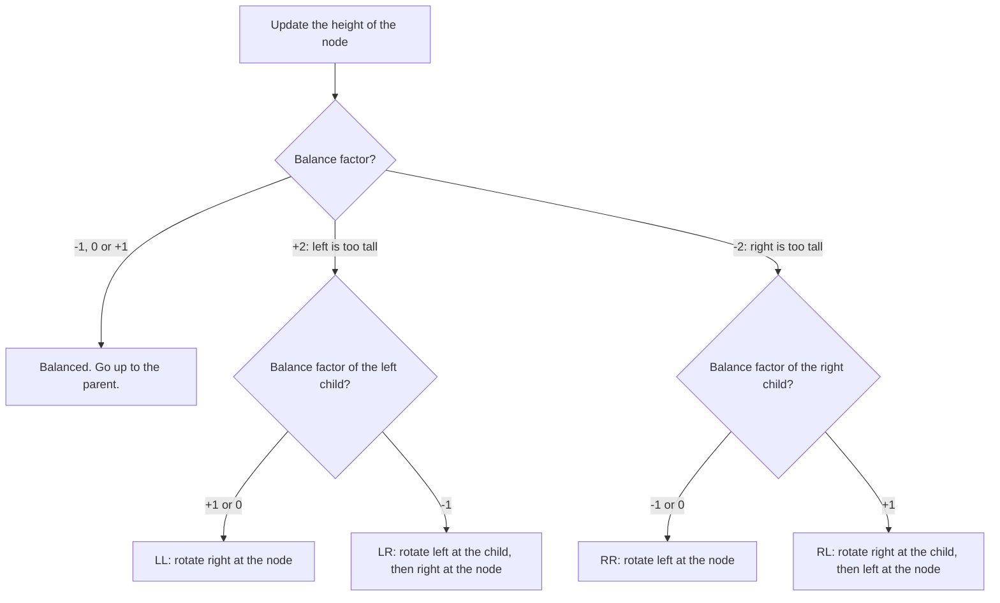

# AVL Trees

> **Level:** Intermediate · **Priority:** T1 · **Time:** 180 min · **Read first:** [Binary search trees from zero](06-bst-from-zero.md) · **Next:** [Red-black trees](08-red-black-tree.md)

An AVL tree is a binary search tree that repairs itself after every change, so every operation stays O(log n) even on sorted input. It also teaches rotations, the move behind most self-balancing binary trees.

## Quick revision

- A plain **binary search tree** (BST) can turn into a chain of height n. An **AVL tree** is a BST with one extra rule: at **every** node, the heights of the two subtrees differ by at most 1.
- **Height** of a node: the number of nodes on the longest path from it down to a leaf. An empty subtree has height 0. A leaf has height 1.
- **Balance factor** of a node: `height(left) - height(right)`. Legal values are -1, 0 and +1.
- A **rotation** lifts a child above its parent. It changes three links, costs O(1) and keeps the sorted order.
- After every change, walk back up to the root. Fix each node whose balance factor is +2 or -2, lowest first. To pick the fix, read the sign of its taller child.
- **LL** (node +2, child +1 or 0): rotate right at the node.
- **RR** (node -2, child -1 or 0): rotate left at the node.
- **LR** (node +2, child -1): rotate left at the child, then rotate right at the node.
- **RL** (node -2, child +1): rotate right at the child, then rotate left at the node.
- Memory aid: same signs need one rotation. Opposite signs need two.
- **Insert** needs at most one fix (one LL, RR, LR or RL), because a fix brings the subtree back to its old height.
- **Delete** can need one fix at many levels, because a fix can leave the subtree shorter. That is O(log n) fixes in the worst case.
- The height is at most about **1.44 log2 n**. The proof uses the fewest nodes a tree of height h can have: `N(h) = 1 + N(h-1) + N(h-2)`, which grows like Fibonacci.
- Search, insert and delete are O(log n). AVL trees are shorter than red-black trees, so reads are a little faster. They also rotate more, so writes cost a little more.
- In an interview, use `std::set` and `std::map` for ordered data. Write your own tree only when asked, or when you need the **rank** of a key (how many keys are smaller).

## How to recognize it

A data structure fits a problem when it makes the needed operations fast. So first list the operations the problem needs.

Ask these four questions. If all four answers are yes, you need a balanced BST. In an interview, that usually means `std::set` or `std::map`, which are balanced BSTs you do not have to write.

1. Does the data change while you answer questions about it?
2. Do the questions depend on sorted order, such as "next larger", "closest value", "smallest" or "all keys in a range"?
3. Is a heap or hash table not enough? (A heap only shows its top. A hash table has no order.)
4. Must every operation stay O(log n), even on sorted input?

| Words in the problem | What they tell you |
|---|---|
| "AVL", "balance factor", "rotation" | Use the rules of this chapter directly |
| "draw the tree after inserting these keys" | Trace the four cases by hand, as in [P4](#p4-avl-insertion-with-all-four-rotations-classic-medium) |
| "balance this BST", "subtree depths differ by at most 1" | Read the keys in sorted order and rebuild, as in [P6](#p6-balance-a-binary-search-tree-leetcode-1382-medium) |
| "merge two balanced BSTs" | Read both trees in sorted order, merge and rebuild, as in [P7](#p7-merge-two-avl-trees-classic-medium) |
| "closest value", "next greater value", "floor", "ceiling" | A walk down the tree, or `lower_bound` on a `std::set`. The floor of x is the largest key at most x. The ceiling is the smallest key at least x. |
| "index distance at most k and value distance at most t" | A sliding window kept in an ordered set, as in [P8](#p8-contains-duplicate-iii-leetcode-220-hard) |
| "how many are smaller", "rank", "k-th smallest" while inserting | A tree with subtree sizes, as in [P9](#p9-count-of-smaller-elements-with-an-augmented-avl-tree-classic-hard) |
| "keep the data sorted as it arrives" | A balanced BST, because a sorted array costs O(n) per insert |
| "guaranteed O(log n) in the worst case" | A balanced BST, not a plain BST or a hash table |
| "many reads, few writes" | AVL fits better than red-black |

Here is why a balanced BST wins when the data changes and order matters:

| Operation | Sorted array | Plain BST | Heap | Hash table | AVL tree |
|---|---|---|---|---|---|
| Search for a key | O(log n) | O(n) | O(n) | O(1) average | O(log n) |
| Insert | O(n) | O(n) | O(log n) | O(1) average | O(log n) |
| Delete a key | O(n) | O(n) | O(n), or O(log n) for the top | O(1) average | O(log n) |
| Smallest or largest | O(1) | O(n) | O(1) for one of them | O(n) | O(log n) |
| Next larger key | O(log n) | O(n) | O(n) | O(n) | O(log n) |
| All keys in sorted order | O(n) | O(n) | O(n log n) | O(n log n) | O(n) |

No other column stays fast in every row.

**Not this pattern if:**

| You see | Use instead | Why |
|---|---|---|
| Ordered data that changes, and nobody asks for the tree itself | [Ordered set patterns](../05-core-patterns/19-ordered-set-patterns.md) | `std::set` and `std::map` are already balanced BSTs. Write your own only when asked, or when you need rank. |
| Only the smallest or the largest matters | [Heap](11-heap-from-zero.md) | A heap reads its top in O(1) and has less code. It stores everything in one array. |
| The largest or smallest value of each sliding window | [Monotonic queue](../05-core-patterns/13-monotonic-queue.md) | It is O(n) in total. A set also works, but it adds a log factor. |
| The median of a stream of numbers | [Two heaps](../05-core-patterns/15-two-heaps.md) | Each insert is O(log n) and reading the median is O(1), with far less code than a tree. |
| Only exact lookups, with no order | [Hash table](../02-arrays-strings-hashing/03-hash-tables-from-zero.md) | It is O(1) on average, and you never need "next larger". |
| The data never changes | [Sort, then binary search](../04-sorting-searching/06-binary-search-basics.md) | An array is simpler and faster. Nothing needs rebalancing. |
| Sums or minimums over index ranges, with updates | [Segment tree](../12-advanced-data-structures/01-segment-tree.md) or [Fenwick tree](../12-advanced-data-structures/03-fenwick-tree.md) | They are built for ranges of positions, not for sorted keys. |
| Rank queries, and all values are known in advance | [Fenwick tree](../12-advanced-data-structures/03-fenwick-tree.md) or [policy-based trees](../12-advanced-data-structures/07-order-statistics-and-pbds.md) | Far less code than adding subtree sizes to an AVL tree. |
| String keys and prefix questions | [Trie](13-trie.md) | Comparing whole strings at each node is wasted work. |
| Data on disk, where each read is slow | [B-tree](10-b-tree-and-b-plus-tree.md) | Wide nodes make the tree so short that few disk reads are needed. |
| Many writes, or you are using a library | [Red-black tree](08-red-black-tree.md) | It does fewer rotations per write, and `std::map` already gives you one. |
| The tree is given, and you only check its balance | [Tree DFS problems](03-tree-dfs-problems.md) | You compute heights once. There are no rotations. |

## 1. The idea in plain English

Think of a hanging mobile, the toy above a baby's bed. It hangs from one string. If one side gets too long, the toy tips over. You do not rebuild the toy to fix it. You move the string to a nearby point, and the toy levels out.

A binary search tree is that toy. Its root is the point where the string is tied. An AVL tree watches both sides of every node. When one side gets too long, it moves the "string" from a node to its child. This move is called a **rotation**. Only a few links change, and the tree levels out.

First, a quick reminder of three terms:

- A **binary search tree** (BST) is a binary tree with a sorting rule. For every node, all keys in its left subtree are smaller. All keys in its right subtree are larger.
- A **key** is the value stored in a node.
- A **subtree** is a node together with everything below it.

Here is the problem AVL trees solve. Insert 10, 20, 30 into a plain BST, in that order:

```text
10
  \
   20
     \
      30
```

Each new key is larger than everything so far, so it always goes right. The tree now behaves like a linked list. Searching for 30 visits all 3 nodes.

Sorted input is not a rare accident. Order IDs and timestamps only ever grow.

Now lift 20 above 10:

```text
    20
   /  \
 10    30
```

The keys are the same, and the BST rule still holds: 10 < 20 < 30. Searching for 30 now visits 2 nodes instead of 3.

That gap grows fast. BST operations cost O(height), and the **height of a tree** is the number of nodes on its longest path from the root down.

| Keys | Plain BST, worst height | AVL tree, worst height |
|---|---|---|
| 7 | 7 | 4 |
| 1,000 | 1,000 | 14 |
| 1,000,000 | 1,000,000 | 28 |

[Section 8](#8-why-the-height-is-olog-n) shows where the last column comes from.

The name comes from its inventors, Adelson-Velsky and Landis. They published it in 1962. It was the first self-balancing BST, meaning a BST that keeps its own height small after every change.

## 2. Height and balance factor

You need two numbers for each node.

The **height** of a node is the number of nodes on the longest path from it down to a leaf, counting the node itself. A **leaf** is a node with no children. So a leaf has height 1, and an empty subtree has height 0.

The **balance factor** of a node compares its two sides:

```text
balance factor = height(left subtree) - height(right subtree)
```

Here is a small tree:

```text
        40
       /  \
     20    60
    /  \
  10    30
```

| Node | Height of left | Height of right | Its height | Balance factor |
|---|---|---|---|---|
| 10 | 0 | 0 | 1 | 0 |
| 30 | 0 | 0 | 1 | 0 |
| 20 | 1 | 1 | 2 | 0 |
| 60 | 0 | 0 | 1 | 0 |
| 40 | 2 | 1 | 3 | +1 |

Read the balance factor like this:

| Balance factor | Meaning |
|---|---|
| 0 | Both sides have the same height. |
| +1 | The left side is taller by one. This is allowed. |
| -1 | The right side is taller by one. This is allowed. |
| +2 | The left side is too tall. Fix it now. |
| -2 | The right side is too tall. Fix it now. |

**The AVL rule:** every node must have a balance factor of -1, 0 or +1.

From now on, `40(+1)` in a diagram means key 40 with a balance factor of +1.

The word "every" matters. In this tree the root looks perfect, but the tree is not an AVL tree:

```text
        40(0)
       /     \
   20(+2)   50(-2)
    /           \
 10(+1)        60(-1)
  /                \
5(0)              70(0)
```

Both sides of the root have height 3, so the root has a balance factor of 0. But 20 and 50 are both broken.

**Why allow a difference of 1?** Because a difference of 0 is impossible for most sizes. With 2 keys, one node has exactly one child. So its balance factor must be +1 or -1. Only trees with 1, 3, 7, 15 and so on keys can be perfectly even.

**Why store the height in the node?** Computing a height from scratch visits the whole subtree, which costs O(n). Reading a stored height costs O(1). An insert or delete only changes the heights along one path, so keeping them correct is cheap.

Three small helpers do this work. `heightOf` hides the null check, so an empty child counts as height 0. They are `static` because they only look at the node you pass in, not at a whole tree object.

```cpp snippet
static int heightOf(const Node* node) { return node ? node->height : 0; }

static int balanceOf(const Node* node) { return heightOf(node->left) - heightOf(node->right); }

static void updateHeight(Node* node) {
    node->height = 1 + max(heightOf(node->left), heightOf(node->right));
}
```

Two warnings before you read other books:

- Some books count edges, not nodes. There a leaf has height 0 and an empty subtree has height -1. The balance factors come out the same.
- Some books define the balance factor as right minus left. Then every sign in this chapter flips. Pick one rule and keep it.

## 3. Rotations: the one tool

A **rotation** lifts a child above its parent. The parent drops one level. The sorted order does not change.

### Right rotation

Use it when the left side is too tall. Here is a right rotation at 30:

```text
Before                 After rotating right at 30

      30                     20
     /  \                   /  \
   20    35               10    30
  /  \                         /  \
10    25                     25    35
```

Three things happened:

1. 20 rose to the top of this subtree.
2. 30 dropped to the right of 20.
3. 25 moved across. It was the right child of 20, and now it is the left child of 30.

Why must 25 move? 20 needs its right slot for 30, so 25 has to leave. The left slot of 30 is now free, because 20 left it. And 25 belongs there, because it is larger than 20 and smaller than 30.

Why is the order safe? An **inorder** walk visits the left subtree, then the node, then the right subtree. In a BST it gives the keys in sorted order. Do it on both trees above, and you get 10, 20, 25, 30, 35 each time.

Here is the same move with letters. `x`, `C` and `D` are whole subtrees of any size.

```text
Before                  After rotating right at z

       z                      y
      / \                    / \
     y   D                  x   z
    / \                        / \
   x   C                      C   D
```

The inorder sequence is `x, y, C, z, D` in both pictures. That is why rotations are always safe.

### Left rotation

A left rotation is the mirror image. Use it when the right side is too tall. Here is a left rotation at 20:

```text
Before                 After rotating left at 20

    20                       30
   /  \                     /  \
 10    30                 20    35
      /  \               /  \
    25    35           10    25
```

30 rose. 20 dropped to the left of 30. 25 moved across, from the left of 30 to the right of 20. The inorder sequence is 10, 20, 25, 30, 35 in both pictures.

### The code

A rotation returns the new root of the subtree, because the caller must link it in.

```cpp snippet
// z's left child y rises. y's right subtree moves across to z.
static Node* rotateRight(Node* z) {
    Node* y = z->left;
    z->left = y->right;
    y->right = z;
    updateHeight(z);  // z is now below y, so z must be updated first
    updateHeight(y);
    return y;
}

// The mirror image: z's right child y rises.
static Node* rotateLeft(Node* z) {
    Node* y = z->right;
    z->right = y->left;
    y->left = z;
    updateHeight(z);
    updateHeight(y);
    return y;
}
```

Here is `rotateRight` on the example, with `z` at 30:

| Line | Effect on the example |
|---|---|
| `Node* y = z->left;` | `y` is 20. |
| `z->left = y->right;` | 25 moves across. The left child of 30 is now 25. |
| `y->right = z;` | 30 drops below 20. |
| `updateHeight(z);` | 30 has children 25 and 35, so its height is 2. |
| `updateHeight(y);` | 20 has children 10 and 30, so its height is 3. |
| `return y;` | The caller stores 20 as the root of this subtree. |

A rotation changes three links: `z->left`, `y->right`, and the parent's link to this subtree. It does a fixed amount of work, so it is O(1).

## 4. The four cases

An insert or delete changes one path in the tree. Only nodes on that path can break, because no other subtree changed. Walk back up the path. Let `z` be the **lowest** node whose balance factor is +2 or -2. Let `y` be the child of `z` on its taller side.

The name of the case gives the two steps from `z` down its taller side. LL means "left, then left".

The next four examples use three keys each. They all end in the same tree, but the moves that reach it are different.

### Case LL: left, then left

Insert 30, 20, 10. The heavy side (the taller side) is a straight line to the left, so one right rotation at 30 fixes it.

```text
Before                After rotating right at 30

           30(+2)              20(0)
           /                   /   \
      20(+1)                10(0) 30(0)
      /
  10(0)
```

### Case RR: right, then right

Insert 10, 20, 30. This is the mirror of LL. The heavy side is a straight line to the right, so one left rotation at 10 fixes it.

```text
Before                After rotating left at 10

  10(-2)                       20(0)
       \                       /   \
      20(-1)                10(0) 30(0)
           \
           30(0)
```

### Case LR: left, then right

Insert 30, 10, 20. Now the heavy path has a bend: left from 30, then right from 10.

Two rotations are needed. First rotate left at the child, 10. This straightens the bend and turns it into LL. Then rotate right at 30, exactly as in LL.

```text
Before                Rotate left at 10     Rotate right at 30

       30(+2)              30(+2)                  20(0)
       /                   /                       /   \
  10(-1)              20(+1)                    10(0) 30(0)
       \              /
       20(0)      10(0)
```

### Case RL: right, then left

Insert 10, 30, 20. This is the mirror of LR. The heavy path bends: right from 10, then left from 30.

First rotate right at the child, 30. Then rotate left at 10, exactly as in RR.

```text
Before                Rotate right at 30    Rotate left at 10

  10(-2)                 10(-2)                    20(0)
       \                      \                    /   \
      30(+1)                 20(-1)             10(0) 30(0)
      /                           \
  20(0)                           30(0)
```

### The same cases with more nodes

Real trees have other nodes around. The moves stay the same. The new thing is the subtree in the middle, which moves across.

**LL with a subtree.** The new key is 5. `z` is 40 and `y` is 20. Watch 30: it moves from the right of 20 to the left of 40.

```text
Before                          After rotating right at 40

              40(+2)                       20(0)
              /     \                      /    \
         20(+1)     50(0)             10(+1)    40(0)
          /   \                       /         /   \
      10(+1)  30(0)               5(0)       30(0) 50(0)
      /
  5(0)
```

**RR with a subtree.** The new key is 60. `z` is 20 and `y` is 40. Again 30 moves across, this time from the left of 40 to the right of 20.

```text
Before                          After rotating left at 20

     20(-2)                                 40(0)
      /    \                               /     \
  10(0)   40(-1)                       20(0)    50(-1)
           /   \                       /   \         \
        30(0) 50(-1)                10(0) 30(0)      60(0)
                   \
                   60(0)
```

**LR with subtrees.** The new key is 25. `z` is 50 and `y` is 20. The key inside the bend is 30, and it ends up on top. Its child 25 moves to the right of 20.

```text
Before                          Rotate left at 20          Rotate right at 50

            50(+2)                       50(+2)                     30(0)
            /     \                       /   \                    /     \
      20(-1)       60(0)              30(+2)  60(0)            20(0)    50(-1)
      /     \                         /                        /   \         \
  10(0)     30(+1)                20(0)                     10(0) 25(0)      60(0)
            /                     /   \
        25(0)                  10(0) 25(0)
```

**RL with subtrees.** The new key is 45. `z` is 20 and `y` is 50. The key inside the bend is 40, and it ends up on top. Its child 45 moves to the left of 50.

```text
Before                          Rotate right at 50         Rotate left at 20

       20(-2)                        20(-2)                         40(0)
       /     \                        /   \                         /    \
  10(0)      50(+1)                10(0) 40(-2)                20(+1)    50(0)
             /     \                          \                /         /   \
        40(-1)     60(0)                      50(0)        10(0)      45(0) 60(0)
             \                                /   \
             45(0)                         45(0) 60(0)
```

In LR and RL, the key inside the bend always ends up on top.

### How to pick the case

You only need two numbers: the balance factor of `z`, and the balance factor of `y`.

| `z` | `y` | Case | Fix |
|---|---|---|---|
| +2 | +1 or 0 | LL | Rotate right at `z` |
| -2 | -1 or 0 | RR | Rotate left at `z` |
| +2 | -1 | LR | Rotate left at `y`, then rotate right at `z` |
| -2 | +1 | RL | Rotate right at `y`, then rotate left at `z` |



**Memory aid:** the rotation direction is the opposite of the heavy side. A left-heavy node rotates right. If the two signs match, one rotation is enough. If they differ, there is a bend and you need two.

**Why a bend needs two rotations.** Try one rotation on the LR example. Rotate right at 30, and see what happens:

```text
Before                After rotating right at 30

       30(+2)              10(-2)
       /                        \
  10(-1)                       30(+1)
       \                       /
       20(0)               20(0)
```

The tree is still broken. It has only turned into its mirror image, the RL case. The problem is 20, the key in the middle. A single rotation moves it across, but it does not lift it. The first rotation of the pair moves it to the outside, where the second rotation can lift it.

**A balance factor of 0 for `y`.** This can only happen after a delete, and [section 6](#6-deletion-a-full-trace) shows it. After an insert, `y` always leans one way. The new key made `y` taller, so its two sides cannot be equal.

## 5. Insertion: a full trace

Insertion has three steps:

1. Insert the key as in a plain BST. It becomes a new leaf.
2. Walk back up the path to the root. At each node, update the height and read the balance factor.
3. If the balance factor is +2 or -2, pick the case from [section 4](#how-to-pick-the-case) and rotate.

You do not need parent pointers for the walk back up. Recursion gives it to you, because the code after a recursive call runs on the way back.

Here is a full trace. These seven keys are chosen so that all four cases appear:

```text
70, 50, 10, 20, 40, 30, 60
```

**Step 1: insert(70).** The tree is empty, so 70 becomes the root.

```text
70(0)
```

**Step 2: insert(50).** 50 is smaller than 70, so it goes left. The root has +1, which is allowed.

```text
    70(+1)
    /
50(0)
```

**Step 3: insert(10).** 10 goes left of 50. Going back up, 50 is fine at +1. Then 70 has +2, and its child 50 has +1. The signs match, so this is **LL**. Rotate right at 70.

```text
Before             After rotating right at 70

         70(+2)       50(0)
         /            /   \
    50(+1)         10(0) 70(0)
    /
10(0)
```

**Step 4: insert(20).** 20 is smaller than 50 and larger than 10, so it goes right of 10. Every balance factor is legal.

```text
     50(+1)
     /     \
10(-1)     70(0)
     \
     20(0)
```

**Step 5: insert(40).** 40 goes right of 20. Going back up, 20 is fine at -1. Then 10 has -2, and its child 20 has -1. The signs match, so this is **RR**. Rotate left at 10.

```text
Before                  After rotating left at 10

       50(+2)                 50(+1)
      /       \                /    \
10(-2)         70(0)       20(0)    70(0)
     \                     /   \
    20(-1)              10(0) 40(0)
         \
         40(0)
```

Look at the root in the "Before" picture. 50 also has +2 at that moment. But you fix the lowest broken node first, and that fix brought the left side of 50 back to height 2. So 50 healed with no work of its own.

**Step 6: insert(30).** 30 goes left of 40. Going back up, 40 is fine at +1 and 20 is fine at -1. Then 50 has +2, and its child 20 has -1. The signs differ, so this is **LR**. Rotate left at 20, then rotate right at 50.

```text
Before                    Rotate left at 20       Rotate right at 50

          50(+2)                    50(+2)                40(0)
          /     \                    /   \               /     \
    20(-1)       70(0)           40(+2)  70(0)       20(0)    50(-1)
    /     \                      /                   /   \         \
10(0)     40(+1)             20(0)                10(0) 30(0)      70(0)
          /                  /   \
      30(0)               10(0) 30(0)
```

**Step 7: insert(60).** 60 goes right of 50, then left of 70. Going back up, 70 is fine at +1. Then 50 has -2, and its child 70 has +1. The signs differ, so this is **RL**. Rotate right at 70, then rotate left at 50.

```text
Before                    Rotate right at 70            Rotate left at 50

       40(-1)                    40(-1)                          40(0)
       /     \                   /     \                        /     \
   20(0)    50(-2)           20(0)    50(-2)               20(0)       60(0)
   /   \         \           /   \         \               /   \       /   \
10(0) 30(0)     70(+1)    10(0) 30(0)     60(-1)        10(0) 30(0) 50(0) 70(0)
                /                              \
            60(0)                              70(0)
```

All four cases fired, and the seven keys ended in a **perfect tree**, one where every level is full. Its height is 3. A plain BST with the same keys in the same order would have height 6.

Here is the whole run as a table:

| Step | Key | Lowest broken node | Its balance | Child's balance | Case | Fix |
|---|---|---|---|---|---|---|
| 1 | 70 | none | | | | |
| 2 | 50 | none | | | | |
| 3 | 10 | 70 | +2 | +1 | LL | Rotate right at 70 |
| 4 | 20 | none | | | | |
| 5 | 40 | 10 | -2 | -1 | RR | Rotate left at 10 |
| 6 | 30 | 50 | +2 | -1 | LR | Rotate left at 20, then right at 50 |
| 7 | 60 | 50 | -2 | +1 | RL | Rotate right at 70, then left at 50 |

## 6. Deletion: a full trace

Deletion also has three steps:

1. Delete the key as in a plain BST. There are three cases:
   - **A leaf:** remove it.
   - **One child:** the child takes the place of the node.
   - **Two children:** find the **inorder successor**, the smallest key in the right subtree. Copy it into this node. Then delete the successor from the right subtree. The successor has no left child, so that second delete is one of the two easy cases.
2. Walk back up from the place where a node was removed, updating heights.
3. Fix every broken node on the way. **Do not stop after the first fix.**

Why can you not stop? After an insert, a fix puts the subtree back at its old height. So nothing above notices. After a delete, a fix can leave the subtree one level shorter. So the next node up can break too. [Section 9](#9-how-many-rotations-can-one-operation-need) shows this.

Start from the tree that section 5 built. Each key below shows a different case.

```text
       40(0)
      /     \
 20(0)       60(0)
 /   \       /   \
10(0) 30(0) 50(0) 70(0)
```

**erase(10): a leaf.** Remove it. On the way back up, 20 has -1 and the root has 0. Both are legal.

```text
       40(0)
      /      \
20(-1)        60(0)
     \        /   \
     30(0) 50(0) 70(0)
```

**erase(40): two children.** The smallest key in the right subtree is 50. Copy 50 into the root. Then remove the old 50, which is a leaf. On the way back up, 60 has -1 and the root has 0.

```text
      50(0)
     /     \
20(-1)     60(-1)
     \          \
     30(0)      70(0)
```

**erase(60): one child.** Its child 70 takes its place. The root now has +1, which is legal.

```text
     50(+1)
     /     \
20(-1)     70(0)
     \
     30(0)
```

**erase(70): a leaf, and this time the tree breaks.** Remove it. The root now has height 2 on the left and 0 on the right, so it has +2. Its child 20 has -1. The signs differ, so this is **LR**. Rotate left at 20, then rotate right at 50.

```text
Before         Rotate left at 20    Rotate right at 50

     50(+2)             50(+2)         30(0)
     /                  /              /   \
20(-1)             30(+1)           20(0) 50(0)
     \             /
     30(0)     20(0)
```

Here is the whole run as a table:

| Step | Key | Plain BST case | Lowest broken node | Case | Tree height after |
|---|---|---|---|---|---|
| 1 | 10 | Leaf | none | | 3 |
| 2 | 40 | Two children, successor 50 | none | | 3 |
| 3 | 60 | One child | none | | 3 |
| 4 | 70 | Leaf | 50 (+2, child -1) | LR | 2 |

### When `y` has a balance factor of 0

Only a delete can create this case. Delete 10 from the tree on the left:

```text
Before the delete    After removing 10    After rotating left at 20

   20(-1)            20(-2)                    30(+1)
    /    \                \                    /     \
10(0)    30(0)            30(0)           20(-1)     40(0)
         /   \            /   \                \
      25(0) 40(0)      25(0) 40(0)             25(0)
```

Node 20 has -2, and its taller child 30 has 0. Both sides of 30 have the same height, so 30 has no bend to straighten. Treat it as RR and do one left rotation at 20.

Why not a double rotation? Because it can fail when `y` has 0. [Pitfall 4](#common-pitfalls) shows a tree where it does.

This fix leaves the subtree at height 3, the same as before the delete. So the walk up finds nothing more to fix here.

## 7. The complete AVL class

Now the code. Everything you traced by hand is in here. Both `insertAt` and `eraseAt` end with `return rebalance(node)`. That one line is the walk back up: it runs once for each node on the path, lowest node first.

The tree stores each key once, so a duplicate insert does nothing. [P9](#p9-count-of-smaller-elements-with-an-augmented-avl-tree-classic-hard) shows how to keep duplicates.

`main()` prints the state after each operation of sections 5 and 6, then runs a randomized test. After every operation it checks the tree against `std::set`, which is a simple correct model. It also checks the three AVL rules: keys in order, legal balance factors and correct stored heights.

```cpp
#include <bits/stdc++.h>
#include <cassert>
using namespace std;

class AVLTree {
    struct Node {
        int key;
        int height = 1;  // a new node is a leaf
        Node* left = nullptr;
        Node* right = nullptr;
        explicit Node(int value) : key(value) {}
    };

    Node* root = nullptr;
    int nodeCount = 0;

    static int heightOf(const Node* node) { return node ? node->height : 0; }

    static int balanceOf(const Node* node) { return heightOf(node->left) - heightOf(node->right); }

    static void updateHeight(Node* node) {
        node->height = 1 + max(heightOf(node->left), heightOf(node->right));
    }

    // z's left child y rises. y's right subtree moves across to z.
    static Node* rotateRight(Node* z) {
        Node* y = z->left;
        z->left = y->right;
        y->right = z;
        updateHeight(z);  // z is now below y, so z must be updated first
        updateHeight(y);
        return y;
    }

    // The mirror image: z's right child y rises.
    static Node* rotateLeft(Node* z) {
        Node* y = z->right;
        z->right = y->left;
        y->left = z;
        updateHeight(z);
        updateHeight(y);
        return y;
    }

    // Runs for each node on the way back up. Returns the new root of this subtree.
    static Node* rebalance(Node* node) {
        updateHeight(node);
        int balance = balanceOf(node);
        if (balance > 1) {  // the left side is too tall
            if (balanceOf(node->left) < 0) node->left = rotateLeft(node->left);  // LR: straighten the bend
            return rotateRight(node);
        }
        if (balance < -1) {  // the right side is too tall
            if (balanceOf(node->right) > 0) node->right = rotateRight(node->right);  // RL: straighten the bend
            return rotateLeft(node);
        }
        return node;
    }

    Node* insertAt(Node* node, int key) {
        if (!node) {
            nodeCount++;
            return new Node(key);
        }
        if (key < node->key) node->left = insertAt(node->left, key);
        else if (key > node->key) node->right = insertAt(node->right, key);
        else return node;  // the key is already here, so nothing changed
        return rebalance(node);
    }

    Node* eraseAt(Node* node, int key) {
        if (!node) return nullptr;  // the key is not in the tree
        if (key < node->key) {
            node->left = eraseAt(node->left, key);
        } else if (key > node->key) {
            node->right = eraseAt(node->right, key);
        } else if (node->left && node->right) {
            Node* successor = node->right;  // the next key in sorted order takes this node's place
            while (successor->left) successor = successor->left;
            node->key = successor->key;
            node->right = eraseAt(node->right, successor->key);  // this also fixes the path down to it
        } else {
            Node* child = node->left ? node->left : node->right;  // zero or one child
            delete node;
            nodeCount--;
            return child;  // this subtree did not change, so it needs no fix
        }
        return rebalance(node);
    }

    static void destroy(Node* node) {
        if (!node) return;
        destroy(node->left);
        destroy(node->right);
        delete node;
    }

    static void collect(const Node* node, vector<int>& keys) {
        if (!node) return;
        collect(node->left, keys);
        keys.push_back(node->key);
        collect(node->right, keys);
    }

    // Checks the AVL rules below this node and reports its real height.
    static bool check(const Node* node, const Node*& previous, int& realHeight) {
        if (!node) {
            realHeight = 0;
            return true;
        }
        int leftHeight = 0, rightHeight = 0;
        if (!check(node->left, previous, leftHeight)) return false;
        if (previous && previous->key >= node->key) return false;  // inorder must strictly rise
        previous = node;
        if (!check(node->right, previous, rightHeight)) return false;
        realHeight = 1 + max(leftHeight, rightHeight);
        return abs(leftHeight - rightHeight) <= 1 && node->height == realHeight;
    }

public:
    AVLTree() = default;
    AVLTree(const AVLTree&) = delete;  // a copy would free the same nodes twice
    AVLTree& operator=(const AVLTree&) = delete;
    ~AVLTree() { destroy(root); }

    void insert(int key) { root = insertAt(root, key); }
    void erase(int key) { root = eraseAt(root, key); }

    bool contains(int key) const {
        const Node* node = root;
        while (node) {
            if (key == node->key) return true;
            node = key < node->key ? node->left : node->right;
        }
        return false;
    }

    int height() const { return heightOf(root); }
    int size() const { return nodeCount; }
    bool empty() const { return root == nullptr; }

    vector<int> inorder() const {
        vector<int> keys;
        collect(root, keys);
        return keys;
    }

    bool isValid() const {
        const Node* previous = nullptr;
        int realHeight = 0;
        return check(root, previous, realHeight) && (int)inorder().size() == nodeCount;
    }
};

void show(const string& action, const AVLTree& tree) {
    string keys;
    for (int key : tree.inorder()) keys += to_string(key) + " ";
    cout << left << setw(12) << action << setw(23) << keys << "height " << tree.height() << "\n";
}

int main() {
    AVLTree tree;

    // An empty tree must not crash.
    assert(tree.empty() && tree.size() == 0 && tree.height() == 0);
    assert(!tree.contains(5) && tree.inorder().empty() && tree.isValid());
    tree.erase(5);
    assert(tree.empty());

    // One element, and a duplicate that must be ignored.
    tree.insert(5);
    tree.insert(5);
    assert(tree.size() == 1 && tree.height() == 1 && tree.contains(5));
    tree.erase(5);
    assert(tree.empty() && tree.height() == 0);

    // The traces of sections 5 and 6.
    for (int key : {70, 50, 10, 20, 40, 30, 60}) {
        tree.insert(key);
        assert(tree.isValid());
        show("insert(" + to_string(key) + ")", tree);
    }
    assert(tree.contains(30) && !tree.contains(35));
    for (int key : {10, 40, 60, 70}) {
        tree.erase(key);
        assert(tree.isValid());
        show("erase(" + to_string(key) + ")", tree);
    }
    assert((tree.inorder() == vector<int>{20, 30, 50}));
    assert(tree.height() == 2);

    // Sorted input turns a plain BST into a chain. Here section 8's limit of 14 must hold.
    AVLTree sortedInput;
    for (int key = 1; key <= 1000; key++) sortedInput.insert(key);
    assert(sortedInput.size() == 1000 && sortedInput.height() <= 14 && sortedInput.isValid());

    // Randomized test against std::set, with the AVL rules checked after every operation.
    AVLTree randomTree;
    set<int> model;
    mt19937 rng(12345);
    for (int step = 0; step < 30000; step++) {
        bool growing = (step / 5000) % 2 == 0;  // grow for 5000 steps, then shrink for 5000, and repeat
        int key = rng() % 300;
        int action = rng() % 10;
        if (action < (growing ? 6 : 2)) {
            randomTree.insert(key);
            model.insert(key);
        } else if (action < 8) {
            randomTree.erase(key);
            model.erase(key);
        } else {
            assert(randomTree.contains(key) == (model.count(key) == 1));
        }
        assert(randomTree.isValid());
        assert(randomTree.size() == (int)model.size());
        assert(randomTree.inorder() == vector<int>(model.begin(), model.end()));
    }
    cout << "All tests passed\n";
}
```

```text output
insert(70)  70                     height 1
insert(50)  50 70                  height 2
insert(10)  10 50 70               height 2
insert(20)  10 20 50 70            height 3
insert(40)  10 20 40 50 70         height 3
insert(30)  10 20 30 40 50 70      height 3
insert(60)  10 20 30 40 50 60 70   height 3
erase(10)   20 30 40 50 60 70      height 3
erase(40)   20 30 50 60 70         height 3
erase(60)   20 30 50 70            height 3
erase(70)   20 30 50               height 2
All tests passed
```

| Operation | Time | Why |
|---|---|---|
| `contains` | O(log n) | It walks one path, and the height is O(log n). |
| `insert` | O(log n) | One path down, one path back, and at most one fix. |
| `erase` | O(log n) | One path down, one path back, and at most one fix per level. |
| `height`, `size`, `empty` | O(1) | They read stored numbers. |
| `inorder`, destructor | O(n) | They visit every node once. |
| Memory | O(n) | One node per key. The recursion adds O(log n) stack space. |

The destructor is recursive. That is safe here, because the tree is never deep. The same destructor on a plain BST with a million sorted keys could overflow the stack.

## 8. Why the height is O(log n)

The AVL rule looks weak. Each node may lean by one, and those leans can add up along a path. So why does the height stay small?

Turn the question around. **What is the fewest nodes a tree of height h can have?** Call a tree with that fewest number the **thinnest tree** of height h. If even the thinnest tree needs a huge number of nodes, then a tree with n nodes cannot be tall.

Call that number N(h). The two smallest cases are easy:

- N(0) = 0, because height 0 means an empty tree.
- N(1) = 1, because height 1 means a single node.

Now build the thinnest tree of height h. It has a root and two subtrees:

- One subtree must have height h - 1. Otherwise the tree does not reach height h.
- The other subtree can have height h - 2. The AVL rule allows nothing shorter, and anything taller wastes nodes.

Both subtrees should also be as thin as possible. So:

```text
N(h) = 1 + N(h - 1) + N(h - 2)
```

Here are the thinnest trees of height 1 to 4. Each `o` is a node.

```text
h = 1     h = 2     h = 3       h = 4

  o         o         o             o
           /         / \          /   \
          o         o   o        o     o
                   /            / \   /
                  o            o   o o
                              /
                             o
```

| h | 0 | 1 | 2 | 3 | 4 | 5 | 6 | 7 | 8 |
|---|---|---|---|---|---|---|---|---|---|
| N(h) | 0 | 1 | 2 | 4 | 7 | 12 | 20 | 33 | 54 |
| N(h) + 1 | 1 | 2 | 3 | 5 | 8 | 13 | 21 | 34 | 55 |

Look at the last row. Those are Fibonacci numbers, where each number is the sum of the two before it. Add 1 to both sides of the formula to see why:

```text
N(h) + 1 = (N(h - 1) + 1) + (N(h - 2) + 1)
```

Fibonacci numbers grow exponentially, which means each step multiplies the count instead of adding to it. Here is a simple way to see it. N(h - 1) is at least N(h - 2), so N(h) is more than 2 * N(h - 2). In words: **adding 2 to the height at least doubles the nodes.** The table agrees: N(3) = 4, N(5) = 12, N(7) = 33.

So a tree of height h has at least about 2^(h/2) nodes. If it has n nodes, then n >= about 2^(h/2). Take log2 of both sides, and you get h <= about 2 log2 n. That is already O(log n).

The exact growth is the golden ratio: each extra level multiplies the node count by about 1.618. So n is at least about 1.618^h. Take log2 of both sides, and h is at most about log2(n) / log2(1.618). Now log2(1.618) is about 0.694, and 1 / 0.694 is about 1.44. This gives a tighter limit:

```text
h < 1.44 log2(n + 2)
```

So an AVL tree is at most about 44% taller than the best possible tree. Here are real numbers. The red-black column uses the limit from [section 10](#10-avl-red-black-and-what-to-use-in-an-interview).

| Keys | Best possible height | AVL worst height | Red-black limit | Plain BST worst height |
|---|---|---|---|---|
| 1,000 | 10 | 14 | 19 | 1,000 |
| 1,000,000 | 20 | 28 | 39 | 1,000,000 |
| 1,000,000,000 | 30 | 42 | 59 | 1,000,000,000 |

[P1](#p1-minimum-nodes-in-an-avl-tree-of-height-h-classic-easy) computes the AVL column in code.

## 9. How many rotations can one operation need?

A **fix** here means one LL, RR, LR or RL. So a fix is 1 or 2 rotations.

### Insert: at most one fix

An insert needs at most one fix, however big the tree is. The reason is that a fix puts the subtree back at its **old height**.

Here is LL with heights. Each letter is a subtree, and the number next to it is its height.

```text
Before the insert      After the insert        After rotating right at z

       z h+2                  z h+3                     y h+2
      /    \                 /    \                    /    \
   y h+1   D h            y h+2   D h               x h+1   z h+1
   /   \                  /   \                             /   \
 x h   C h             x h+1  C h                         C h   D h
```

Before the insert, this subtree had height h + 2. After the fix, it has height h + 2 again. Nothing above can notice the change, so no higher node breaks.

The other three cases work the same way. For example, in step 6 of [section 5](#5-insertion-a-full-trace), the tree had height 3 before `insert(30)`. After the LR fix, it has height 3 again.

This is why the root healed by itself in step 5 of that section.

The code still walks up to the root after a fix. Those extra steps change nothing, and they cost little. Keeping the same code path for insert and delete is worth it.

### Delete: up to one fix at many levels

Here is the same picture for a delete. Subtree D loses a level.

```text
Before the delete      After the delete        After rotating right at z

       z h+2                  z h+2                    y h+1
      /    \                 /    \                   /    \
   y h+1   D h            y h+1   D h-1             x h    z h
   /   \                  /   \                            /  \
 x h   C h-1            x h   C h-1                    C h-1  D h-1
```

Before the delete, this subtree had height h + 2. After the fix, it has height h + 1. It is now **one level shorter**. LR and RL also leave the subtree one level shorter. You saw this with `erase(70)` in [section 6](#6-deletion-a-full-trace), where the tree went from height 3 to height 2.

Only one case keeps the old height. If C had height h, then `y` would have a balance factor of 0, and the height would stay h + 2. That is the [case with a balance factor of 0](#when-y-has-a-balance-factor-of-0) from section 6.

If the subtree got shorter, and it was already the shorter side of its parent, the parent now has +2 or -2. So the fix moves up a level, and this can repeat.

Here is one of the smallest trees where it happens. It has 12 keys, which is more than the 8 this guide normally uses. No smaller tree can show it. Trying every AVL tree with up to 11 keys confirms that one fix is always enough for them. This tree is the thinnest tree of height 5.

```text
                     8(+1)
                  /         \
           5(+1)              11(+1)
          /     \              /   \
     3(+1)       7(+1)     10(+1)  12(0)
     /   \       /         /
  2(+1) 4(0) 6(0)      9(0)
  /
1(0)
```

**Delete 12.** Node 11 now has height 2 on the left and 0 on the right, so it has +2. Its child 10 has +1. The signs match, so this is LL. Rotate right at 11.

```text
                  8(+2)
                /       \
           5(+1)          10(0)
          /     \         /   \
     3(+1)       7(+1) 9(0)  11(0)
     /   \       /
  2(+1) 4(0) 6(0)
  /
1(0)
```

That subtree shrank from height 3 to height 2. So the root now has height 4 on the left and 2 on the right, which is +2. Its child 5 has +1. The signs match again, so this is LL. Rotate right at 8.

```text
             5(0)
           /       \
     3(+1)           8(0)
     /   \           /    \
  2(+1) 4(0)     7(+1)    10(0)
  /              /        /   \
1(0)           6(0)      9(0)  11(0)
```

One delete, two fixes. [P5](#p5-avl-deletion-with-rebalancing-classic-medium) tests this exact tree.

The pattern continues in bigger trees. Take the thinnest tree of height h, and delete the leaf closest to the root. The path from that leaf up to the root has about h / 2 nodes, and nearly all of them need a fix. Since h is O(log n), a delete can need O(log n) rotations.

| Operation | Fixes | Rotations | Height updates |
|---|---|---|---|
| Insert | At most 1 | At most 2 | O(log n) |
| Delete | At most about h / 2 | O(log n) | O(log n) |

The worst case is rare. Say you insert 200,000 random keys, then delete them all in random order. About 47 of every 100 inserts need a fix, and half of those fixes are double rotations. About 24 of every 100 deletes need a fix, and only about 1 delete in 40 needs more than one.

## 10. AVL, red-black, and what to use in an interview

Both trees are self-balancing BSTs, and both give O(log n) for all operations. The difference is how strict the balance rule is. A [red-black tree](08-red-black-tree.md) colors each node red or black, and it lets the longest path be twice the shortest. AVL allows a difference of only 1 at each node.

| | AVL tree | Red-black tree |
|---|---|---|
| Balance rule | Subtree heights differ by at most 1 | Longest path at most twice the shortest |
| Worst height | About 1.44 log2 n | About 2 log2 n |
| Search | A little faster, because the tree is shorter | A little slower |
| Rotations per insert | At most 2 | At most 2 |
| Rotations per delete | O(log n) | At most 3 |
| Extra data per node | A height, or 2 bits for the balance factor | 1 color bit |
| Code to write | Short: one `rebalance` function | Long: many cases, mainly for delete |
| Best for | Many reads, few writes | Many writes, or a general-purpose library |
| Found in | The ZFS file system | `std::map`, `std::set`, Java `TreeMap`, the Linux kernel |

If an interviewer asks you to choose, reason from the workload:

- **Mostly lookups:** choose AVL, because a shorter tree means fewer comparisons.
- **Many inserts and deletes:** choose red-black, because a write changes less of the tree.
- **Normal application code:** use the tree your library already gives you.

### What `std::set` gives you

`std::set` and `std::map` are balanced BSTs. The standard does not name the tree, but GCC, Clang and MSVC all use red-black trees. In an interview, this is what you use for "ordered data that changes". [Ordered set patterns](../05-core-patterns/19-ordered-set-patterns.md) shows it on real problems.

| You need | Call | Time |
|---|---|---|
| Insert, delete | `s.insert(x)`, `s.erase(x)` | O(log n) |
| Is `x` there? | `s.count(x)` | O(log n) |
| Smallest, largest | `*s.begin()`, `*s.rbegin()` | O(1) |
| Smallest key >= `x` (ceiling) | `s.lower_bound(x)` | O(log n) |
| Smallest key > `x` | `s.upper_bound(x)` | O(log n) |
| Largest key <= `x` (floor) | `prev(s.upper_bound(x))`, after checking it is not `s.begin()` | O(log n) |
| Keys in sorted order | `for (int x : s)` | O(n) |
| Duplicates allowed | `std::multiset` | Same as above |
| A value for each key | `std::map` | Same as above |

Three warnings:

- Always call the member `s.lower_bound(x)`. The free function `std::lower_bound(s.begin(), s.end(), x)` compiles, but it is O(n) on a set. Set iterators cannot jump.
- On a `std::multiset`, `s.erase(x)` removes every copy of x. To remove one copy, write `s.erase(s.find(x))`, after checking that `s.find(x)` is not `s.end()`.
- A set cannot tell you the **rank** of a key, meaning how many keys are smaller. `distance(s.begin(), it)` is O(n). When you need rank, add subtree sizes to your own tree, as in [P9](#p9-count-of-smaller-elements-with-an-augmented-avl-tree-classic-hard). You can also use [policy-based trees](../12-advanced-data-structures/07-order-statistics-and-pbds.md).

## 11. Solved problems

The problems start with the numbers behind AVL trees, then the core operations, then applied problems.

### P1. Minimum Nodes in an AVL Tree of Height h (Classic, Easy)

**Problem:** Given a height h, find the fewest nodes an AVL tree of that height can have. Then do the reverse: given n nodes, find the tallest AVL tree they can form.

**Example:** `h = 4` gives `7`. And `n = 12` gives `5`, because 12 nodes are exactly enough for height 5.

**Pattern:** Self-balancing tree

**How to recognize it:** The words "minimum nodes" or "maximum height" next to "AVL". This question tests the idea behind the height proof in [section 8](#8-why-the-height-is-olog-n), so it is common in exams and phone screens.

**Brute force:** Build every tree shape and keep the legal ones. The number of shapes explodes: there are 108,675 AVL shapes of height 5 alone.

**Key idea:** The thinnest tree of height h is a root, a thinnest tree of height h - 1 and a thinnest tree of height h - 2. So `N(h) = 1 + N(h - 1) + N(h - 2)`. For the reverse, walk up the heights until the next height needs more than n nodes.

**Dry run:** on `n = 12`.

| Height | Nodes it needs | Fits in 12? |
|---|---|---|
| 1 | 1 | yes |
| 2 | 2 | yes |
| 3 | 4 | yes |
| 4 | 7 | yes |
| 5 | 12 | yes |
| 6 | 20 | no, so the answer is 5 |

```cpp
#include <bits/stdc++.h>
#include <cassert>
using namespace std;

long long minNodes(int h) {
    if (h == 0) return 0;
    long long shorter = 0, taller = 1;  // N(0) and N(1)
    for (int height = 2; height <= h; height++) {
        long long next = 1 + taller + shorter;
        shorter = taller;
        taller = next;
    }
    return taller;
}

int maxHeight(long long n) {
    int h = 0;
    long long current = 0, nextNeed = 1;  // N(h) and N(h + 1)
    while (nextNeed <= n) {               // n nodes are enough to reach height h + 1
        long long after = 1 + nextNeed + current;
        current = nextNeed;
        nextNeed = after;
        h++;
    }
    return h;
}

int main() {
    assert(minNodes(4) == 7);
    assert(maxHeight(12) == 5);
    assert(minNodes(0) == 0);          // the empty tree
    assert(minNodes(1) == 1);
    assert(minNodes(5) == 12);
    assert(maxHeight(0) == 0);
    assert(maxHeight(1) == 1);
    assert(maxHeight(3) == 2);         // height 3 needs 4 nodes
    assert(maxHeight(11) == 4);        // one node short of height 5
    assert(maxHeight(1000) == 14);     // the numbers from section 8
    assert(maxHeight(1000000) == 28);
    assert(maxHeight(1000000000) == 42);

    // N(h) + 1 must follow Fibonacci: 1, 2, 3, 5, 8, ...
    long long fibA = 1, fibB = 1;
    for (int h = 0; h <= 60; h++) {
        assert(minNodes(h) + 1 == fibB);
        long long fibNext = fibA + fibB;
        fibA = fibB;
        fibB = fibNext;
    }
    cout << "All tests passed\n";
}
```

**Complexity:** `minNodes` is O(h) time, with one step per height. `maxHeight` is O(log n) time. N(h) grows exponentially, so the loop stops after O(log n) steps. Both use O(1) space, because they keep only two numbers.

**Edge cases:** height 0 and 0 nodes, which are the empty tree. Use `long long`, because N(h) passes 2 billion at h = 45. Even `long long` stops at h = 90, where N(h) is about 7.5 * 10^18, but no real tree comes close to that.

Also ask how the interviewer counts height. This chapter counts nodes. If they count edges, a single node has height 0, so the table moves by one: N(0) = 1, N(1) = 2, N(2) = 4.

**Follow-up:** "How many different AVL shapes have height h?" A shape of height h has subtree heights (h-1, h-1), (h-1, h-2) or (h-2, h-1). So `C(h) = C(h-1)^2 + 2 * C(h-1) * C(h-2)`, with `C(0) = C(1) = 1`. This gives 3, 15, 315 and 108,675 for heights 2 to 5.

### P2. Floor and Ceiling in an AVL Tree (Classic, Easy)

**Problem:** The **floor** of x is the largest key that is at most x. The **ceiling** of x is the smallest key that is at least x. Find both, or report that none exists.

**Example:** with keys `10, 20, 30, 40, 50`, the floor of 25 is `20` and the ceiling of 25 is `30`. The floor of 5 does not exist.

**Pattern:** BST property

**How to recognize it:** "Closest key below", "closest key above", "next larger", "nearest". Those words ask for sorted order. A hash table cannot help, because it has no order.

**Brute force:** Walk the whole tree and keep the best key. O(n) time, which ignores the sorted order.

**Key idea:** Walk down one path, and remember the best candidate so far. For the floor, a key at most x is a candidate. Anything better must be larger, so go right. A key above x is useless, so go left.

**Dry run:** floor of 25. `build` makes the tree below from the sorted keys.

```text
    30
   /  \
 10    40
   \     \
   20    50
```

| Node | Compared with 25 | Best floor so far | Next move |
|---|---|---|---|
| 30 | larger, useless | none | left |
| 10 | smaller, a candidate | 10 | right |
| 20 | smaller, a better candidate | 20 | right |
| empty | | 20 | stop, the answer is 20 |

```cpp
#include <bits/stdc++.h>
#include <cassert>
using namespace std;

struct Node {
    int key;
    Node* left = nullptr;
    Node* right = nullptr;
    explicit Node(int value) : key(value) {}
};

// Taking the middle as the root keeps both sides even, so this shape obeys the AVL rule.
Node* build(const vector<int>& keys, int low, int high) {
    if (low > high) return nullptr;
    int mid = low + (high - low) / 2;
    Node* node = new Node(keys[mid]);
    node->left = build(keys, low, mid - 1);
    node->right = build(keys, mid + 1, high);
    return node;
}

void destroy(Node* node) {
    if (!node) return;
    destroy(node->left);
    destroy(node->right);
    delete node;
}

optional<int> floorOf(const Node* node, int target) {
    optional<int> best;
    while (node) {
        if (node->key == target) return target;
        if (node->key < target) {
            best = node->key;     // a candidate, and anything better is larger
            node = node->right;
        } else {
            node = node->left;    // too big, so only the left side can help
        }
    }
    return best;
}

optional<int> ceilingOf(const Node* node, int target) {
    optional<int> best;
    while (node) {
        if (node->key == target) return target;
        if (node->key > target) {
            best = node->key;     // a candidate, and anything better is smaller
            node = node->left;
        } else {
            node = node->right;   // too small, so only the right side can help
        }
    }
    return best;
}

int main() {
    vector<int> keys = {10, 20, 30, 40, 50};
    Node* root = build(keys, 0, (int)keys.size() - 1);

    assert(floorOf(root, 25) == 20);
    assert(ceilingOf(root, 25) == 30);
    assert(floorOf(root, 30) == 30);    // an exact match counts
    assert(ceilingOf(root, 30) == 30);
    assert(!floorOf(root, 5));          // below every key
    assert(!ceilingOf(root, 55));       // above every key
    assert(floorOf(root, 55) == 50);
    assert(ceilingOf(root, 5) == 10);
    assert(!floorOf(nullptr, 1));       // an empty tree
    assert(!ceilingOf(nullptr, 1));

    // Compare with std::set on every target from 0 to 60.
    set<int> model(keys.begin(), keys.end());
    for (int target = 0; target <= 60; target++) {
        auto above = model.lower_bound(target);
        auto over = model.upper_bound(target);
        assert(ceilingOf(root, target) == (above == model.end() ? optional<int>() : *above));
        assert(floorOf(root, target) == (over == model.begin() ? optional<int>() : *prev(over)));
    }
    destroy(root);
    cout << "All tests passed\n";
}
```

**Complexity:** O(log n) time, because the walk follows one path and an AVL tree has height O(log n). O(1) space, because the walk is a loop.

**Edge cases:** an empty tree, a target below every key, a target above every key, and a target equal to a key.

**Follow-up:** "How would you find the largest key strictly below x?" Use the same walk, but treat an equal key as too big. Also remove the early return. `std::set` does this ceiling walk inside `lower_bound`.

### P3. Validate an AVL Tree (Classic, Medium)

**Problem:** Given the root of a binary tree, check that it is a valid AVL tree. The keys must strictly increase in inorder. Every node must have a balance factor of -1, 0 or +1.

**Example:** the five-key tree from [section 2](#2-height-and-balance-factor) gives `true`. Put 5 below 10 and 1 below 5, and the answer becomes `false`. Node 10 now has a balance factor of +2.

**Pattern:** Tree DFS

**How to recognize it:** "Is this tree an AVL tree?" joins two smaller checks. One is the BST rule, from [Binary search trees from zero](06-bst-from-zero.md). The other is the height check, from [Tree DFS problems](03-tree-dfs-problems.md). The `isValid` method of the class in [section 7](#7-the-complete-avl-class) is the same idea.

**Brute force:** For each node, compute the heights of both sides from scratch. Then scan both subtrees for the BST rule. This repeats the same work many times, up to O(n^2) time.

**Key idea:** Do one inorder walk that returns the height of each subtree, or -1 if something is broken. Heights come back up from the children, so each node costs O(1). A `previous` pointer checks the sorted order on the way.

**Dry run:** on this tree, where 25 is on the wrong side of 20.

```text
    20
   /  \
 10    30
   \
    25
```

| Visit | Previous key | Keys rising? | Result |
|---|---|---|---|
| 10 | none | yes | continue |
| 25 | 10 | yes | continue |
| 20 | 25 | no, 20 is not above 25 | broken, return -1 |

Every parent and child in that tree looks fine on its own. Only the whole inorder sequence shows the problem.

```cpp
#include <bits/stdc++.h>
#include <cassert>
using namespace std;

struct TreeNode {
    int val;
    TreeNode* left;
    TreeNode* right;
    TreeNode(int x, TreeNode* l = nullptr, TreeNode* r = nullptr) : val(x), left(l), right(r) {}
};

class Solution {
    // Returns the height of this subtree, or -1 if a rule is broken below it.
    int walk(const TreeNode* node, const TreeNode*& previous) {
        if (!node) return 0;
        int leftHeight = walk(node->left, previous);
        if (leftHeight == -1) return -1;
        if (previous && previous->val >= node->val) return -1;  // inorder must strictly rise
        previous = node;
        int rightHeight = walk(node->right, previous);
        if (rightHeight == -1) return -1;
        if (abs(leftHeight - rightHeight) > 1) return -1;
        return 1 + max(leftHeight, rightHeight);
    }

public:
    bool isValidAVL(const TreeNode* root) {
        const TreeNode* previous = nullptr;
        return walk(root, previous) != -1;
    }
};

void destroy(TreeNode* node) {
    if (!node) return;
    destroy(node->left);
    destroy(node->right);
    delete node;
}

// Checks one tree, then frees it.
bool checkAndFree(TreeNode* root) {
    Solution solution;
    bool answer = solution.isValidAVL(root);
    destroy(root);
    return answer;
}

int main() {
    using T = TreeNode;
    // The example from the text.
    assert(checkAndFree(new T(40, new T(20, new T(10), new T(30)), new T(60))));
    assert(!checkAndFree(new T(40, new T(20, new T(10, new T(5, new T(1))), new T(30)), new T(60))));

    // Edge cases.
    assert(checkAndFree(nullptr));
    assert(checkAndFree(new T(7)));
    assert(checkAndFree(new T(INT_MAX, new T(INT_MIN))));
    assert(!checkAndFree(new T(10, new T(10))));  // equal keys are not strictly increasing

    // Tricky: the root has balance 0, but 20 and 50 are broken. Section 2 shows this tree.
    assert(!checkAndFree(new T(40, new T(20, new T(10, new T(5))),
                               new T(50, nullptr, new T(60, nullptr, new T(70))))));

    // Tricky: balanced, and every parent-child pair looks fine, but 25 is left of 20.
    assert(!checkAndFree(new T(20, new T(10, nullptr, new T(25)), new T(30))));
    cout << "All tests passed\n";
}
```

**Complexity:** O(n) time, because each node is visited once. O(h) space for the recursion stack, where h is the height.

**Edge cases:** an empty tree is valid. `INT_MIN` and `INT_MAX` are fine, because the code compares neighbors and never adds to a key.

**Follow-up:** "The tree stores a height in each node. Should you trust it?" No. Compute the real height and compare it with the stored one, as `check` does in [section 7](#7-the-complete-avl-class). A wrong stored height is the most common AVL bug.

### P4. AVL Insertion With All Four Rotations (Classic, Medium)

**Problem:** Insert keys one by one into an empty AVL tree. For each insert, report which case fired: LL, RR, LR, RL or none. Also return the final tree as a preorder list.

A **preorder** walk visits the node, then its left subtree, then its right subtree. For a BST, the preorder list fixes the exact shape. That makes it an easy way to compare two trees.

**Example:** keys `30, 20, 10` give `none, none, LL`, and the final preorder is `20, 10, 30`.

**Pattern:** Self-balancing tree

**How to recognize it:** "Show the AVL tree after these inserts" is the most common AVL question in exams and phone screens. The skill being tested is naming the case from two balance factors: the broken node and its taller child.

**Brute force:** Rebuild a balanced tree from scratch after each insert. That is O(n) per insert and O(n^2) in total, where a rotation does the same job in O(1).

**Key idea:** Insert as in a plain BST. On the way back up, update the height and read the balance factor. At +2 or -2, read the sign of the taller child to pick the case. A fix restores the old height, so one insert fires at most one case.

**Dry run:** [Section 5](#5-insertion-a-full-trace) traces the keys `70, 50, 10, 20, 40, 30, 60`, and the test below checks that exact run.

```cpp
#include <bits/stdc++.h>
#include <cassert>
using namespace std;

class AVLTree {
    struct Node {
        int key;
        int height = 1;
        Node* left = nullptr;
        Node* right = nullptr;
        explicit Node(int value) : key(value) {}
    };

    Node* root = nullptr;
    vector<string> fixes;  // the cases fired by the current operation

    static int heightOf(const Node* node) { return node ? node->height : 0; }
    static int balanceOf(const Node* node) { return heightOf(node->left) - heightOf(node->right); }
    static void updateHeight(Node* node) {
        node->height = 1 + max(heightOf(node->left), heightOf(node->right));
    }

    static Node* rotateRight(Node* z) {
        Node* y = z->left;
        z->left = y->right;
        y->right = z;
        updateHeight(z);
        updateHeight(y);
        return y;
    }

    static Node* rotateLeft(Node* z) {
        Node* y = z->right;
        z->right = y->left;
        y->left = z;
        updateHeight(z);
        updateHeight(y);
        return y;
    }

    Node* rebalance(Node* node) {
        updateHeight(node);
        int balance = balanceOf(node);
        if (balance > 1) {
            if (balanceOf(node->left) < 0) {
                fixes.push_back("LR");
                node->left = rotateLeft(node->left);
            } else {
                fixes.push_back("LL");
            }
            return rotateRight(node);
        }
        if (balance < -1) {
            if (balanceOf(node->right) > 0) {
                fixes.push_back("RL");
                node->right = rotateRight(node->right);
            } else {
                fixes.push_back("RR");
            }
            return rotateLeft(node);
        }
        return node;
    }

    Node* insertAt(Node* node, int key) {
        if (!node) return new Node(key);
        if (key < node->key) node->left = insertAt(node->left, key);
        else if (key > node->key) node->right = insertAt(node->right, key);
        else return node;
        return rebalance(node);
    }

    static void destroy(Node* node) {
        if (!node) return;
        destroy(node->left);
        destroy(node->right);
        delete node;
    }

    static void preorderFrom(const Node* node, vector<int>& keys) {
        if (!node) return;
        keys.push_back(node->key);
        preorderFrom(node->left, keys);
        preorderFrom(node->right, keys);
    }

    // Checks sorted order, legal balance factors and stored heights.
    static bool check(const Node* node, const Node*& previous, int& realHeight) {
        if (!node) {
            realHeight = 0;
            return true;
        }
        int leftHeight = 0, rightHeight = 0;
        if (!check(node->left, previous, leftHeight)) return false;
        if (previous && previous->key >= node->key) return false;
        previous = node;
        if (!check(node->right, previous, rightHeight)) return false;
        realHeight = 1 + max(leftHeight, rightHeight);
        return abs(leftHeight - rightHeight) <= 1 && node->height == realHeight;
    }

public:
    AVLTree() = default;
    AVLTree(const AVLTree&) = delete;
    AVLTree& operator=(const AVLTree&) = delete;
    ~AVLTree() { destroy(root); }

    // Returns the cases this insert fired, lowest node first.
    vector<string> insert(int key) {
        fixes.clear();
        root = insertAt(root, key);
        return fixes;
    }

    vector<int> preorder() const {
        vector<int> keys;
        preorderFrom(root, keys);
        return keys;
    }

    bool isValid() const {
        const Node* previous = nullptr;
        int realHeight = 0;
        return check(root, previous, realHeight);
    }
};

// Inserts the keys. Returns one case name per insert and writes the final preorder to shape.
vector<string> run(const vector<int>& keys, vector<int>& shape) {
    AVLTree tree;
    vector<string> cases;
    for (int key : keys) {
        vector<string> fired = tree.insert(key);
        cases.push_back(fired.empty() ? "none" : fired[0]);
    }
    shape = tree.preorder();
    return cases;
}

int main() {
    using Cases = vector<string>;
    using Keys = vector<int>;
    Keys shape;

    // The four cases with three keys. All of them end in the same tree.
    assert((run({30, 20, 10}, shape) == Cases{"none", "none", "LL"}));
    assert((shape == Keys{20, 10, 30}));
    assert((run({10, 20, 30}, shape) == Cases{"none", "none", "RR"}));
    assert((shape == Keys{20, 10, 30}));
    assert((run({30, 10, 20}, shape) == Cases{"none", "none", "LR"}));
    assert((shape == Keys{20, 10, 30}));
    assert((run({10, 30, 20}, shape) == Cases{"none", "none", "RL"}));
    assert((shape == Keys{20, 10, 30}));

    // The trace of section 5.
    Cases expected = {"none", "none", "LL", "none", "RR", "LR", "RL"};
    assert(run({70, 50, 10, 20, 40, 30, 60}, shape) == expected);
    assert((shape == Keys{40, 20, 10, 30, 60, 50, 70}));

    // Edge cases: no keys, and a duplicate that changes nothing.
    assert(run({}, shape).empty() && shape.empty());
    assert((run({5, 5}, shape) == Cases{"none", "none"}));
    assert((shape == Keys{5}));

    // Tricky: the same cases with a middle subtree that must move across.
    run({40, 20, 50, 10, 30, 5}, shape);
    assert((shape == Keys{20, 10, 5, 40, 30, 50}));
    run({20, 10, 40, 30, 50, 60}, shape);
    assert((shape == Keys{40, 20, 10, 30, 50, 60}));
    run({50, 20, 60, 10, 30, 25}, shape);
    assert((shape == Keys{30, 20, 10, 25, 50, 60}));
    run({20, 10, 50, 40, 60, 45}, shape);
    assert((shape == Keys{40, 20, 10, 50, 45, 60}));

    // Randomized test: the AVL rules hold and no insert ever needs a second fix.
    AVLTree tree;
    set<int> model;
    mt19937 rng(2024);
    for (int step = 0; step < 3000; step++) {
        int key = rng() % 5000;
        assert(tree.insert(key).size() <= 1);
        model.insert(key);
        assert(tree.isValid());
    }
    Keys keys = tree.preorder();
    assert(keys.size() == model.size());
    sort(keys.begin(), keys.end());
    assert(keys == Keys(model.begin(), model.end()));
    cout << "All tests passed\n";
}
```

**Complexity:** O(log n) time per insert, because the path has O(log n) nodes and each node does O(1) work. O(n) space for the tree, plus O(log n) stack for the recursion.

**Edge cases:** an empty sequence, one key and a duplicate. A duplicate returns before `rebalance`, because nothing changed.

**Follow-up:** "Sorted input is the worst case for a plain BST. What about AVL?" It is easy for AVL. Inserting 1 to 7 in order gives a perfect tree of height 3, with RR fixes along the way.

### P5. AVL Deletion With Rebalancing (Classic, Medium)

**Problem:** Build an AVL tree, then delete keys one by one. Report every case that each delete fired, lowest node first. Also return the final tree as a preorder list.

**Example:** insert `30, 10, 40, 20`, then delete 40. One case fires: `LR`. The final preorder is `20, 10, 30`.

**Pattern:** Self-balancing tree

**How to recognize it:** "Delete from an AVL tree" with a request for the final shape. It tests three things: the three plain BST cases, fixing all the way up, and the case where the child has a balance factor of 0.

**Brute force:** Rebuild the whole tree after each delete. That is O(n) per delete.

**Key idea:** Delete as in a plain BST, and copy the successor down when the node has two children. Then call `rebalance` on every node back up to the root, and do not stop after the first fix. Pick the case from the signs. There is no new key to compare with, so the sign test is the only test that works here.

**Dry run:** [Section 6](#6-deletion-a-full-trace) traces the deletes `10, 40, 60, 70`, and [section 9](#9-how-many-rotations-can-one-operation-need) traces a delete with two fixes. The test below checks both.

```cpp
#include <bits/stdc++.h>
#include <cassert>
using namespace std;

class AVLTree {
    struct Node {
        int key;
        int height = 1;
        Node* left = nullptr;
        Node* right = nullptr;
        explicit Node(int value) : key(value) {}
    };

    Node* root = nullptr;
    vector<string> fixes;

    static int heightOf(const Node* node) { return node ? node->height : 0; }
    static int balanceOf(const Node* node) { return heightOf(node->left) - heightOf(node->right); }
    static void updateHeight(Node* node) {
        node->height = 1 + max(heightOf(node->left), heightOf(node->right));
    }

    static Node* rotateRight(Node* z) {
        Node* y = z->left;
        z->left = y->right;
        y->right = z;
        updateHeight(z);
        updateHeight(y);
        return y;
    }

    static Node* rotateLeft(Node* z) {
        Node* y = z->right;
        z->right = y->left;
        y->left = z;
        updateHeight(z);
        updateHeight(y);
        return y;
    }

    Node* rebalance(Node* node) {
        updateHeight(node);
        int balance = balanceOf(node);
        if (balance > 1) {
            // A child with balance 0 stays in the LL branch. Only a real bend needs two rotations.
            if (balanceOf(node->left) < 0) {
                fixes.push_back("LR");
                node->left = rotateLeft(node->left);
            } else {
                fixes.push_back("LL");
            }
            return rotateRight(node);
        }
        if (balance < -1) {
            if (balanceOf(node->right) > 0) {
                fixes.push_back("RL");
                node->right = rotateRight(node->right);
            } else {
                fixes.push_back("RR");
            }
            return rotateLeft(node);
        }
        return node;
    }

    Node* insertAt(Node* node, int key) {
        if (!node) return new Node(key);
        if (key < node->key) node->left = insertAt(node->left, key);
        else if (key > node->key) node->right = insertAt(node->right, key);
        else return node;
        return rebalance(node);
    }

    Node* eraseAt(Node* node, int key) {
        if (!node) return nullptr;
        if (key < node->key) {
            node->left = eraseAt(node->left, key);
        } else if (key > node->key) {
            node->right = eraseAt(node->right, key);
        } else if (node->left && node->right) {
            Node* successor = node->right;
            while (successor->left) successor = successor->left;
            node->key = successor->key;
            node->right = eraseAt(node->right, successor->key);
        } else {
            Node* child = node->left ? node->left : node->right;
            delete node;
            return child;
        }
        return rebalance(node);  // no early exit: a fix below can break this node too
    }

    static void destroy(Node* node) {
        if (!node) return;
        destroy(node->left);
        destroy(node->right);
        delete node;
    }

    static void preorderFrom(const Node* node, vector<int>& keys) {
        if (!node) return;
        keys.push_back(node->key);
        preorderFrom(node->left, keys);
        preorderFrom(node->right, keys);
    }

    static bool check(const Node* node, const Node*& previous, int& realHeight) {
        if (!node) {
            realHeight = 0;
            return true;
        }
        int leftHeight = 0, rightHeight = 0;
        if (!check(node->left, previous, leftHeight)) return false;
        if (previous && previous->key >= node->key) return false;
        previous = node;
        if (!check(node->right, previous, rightHeight)) return false;
        realHeight = 1 + max(leftHeight, rightHeight);
        return abs(leftHeight - rightHeight) <= 1 && node->height == realHeight;
    }

public:
    AVLTree() = default;
    explicit AVLTree(const vector<int>& keys) {
        for (int key : keys) insert(key);
    }
    AVLTree(const AVLTree&) = delete;
    AVLTree& operator=(const AVLTree&) = delete;
    ~AVLTree() { destroy(root); }

    void insert(int key) { root = insertAt(root, key); }

    // Returns the cases this delete fired, lowest node first.
    vector<string> erase(int key) {
        fixes.clear();
        root = eraseAt(root, key);
        return fixes;
    }

    vector<int> preorder() const {
        vector<int> keys;
        preorderFrom(root, keys);
        return keys;
    }

    bool isValid() const {
        const Node* previous = nullptr;
        int realHeight = 0;
        return check(root, previous, realHeight);
    }
};

int main() {
    using Cases = vector<string>;
    using Keys = vector<int>;

    // The example from the text.
    AVLTree example({30, 10, 40, 20});
    assert((example.erase(40) == Cases{"LR"}));
    assert((example.preorder() == Keys{20, 10, 30}));

    // The mirror case.
    AVLTree mirror({20, 10, 40, 30});
    assert((mirror.erase(10) == Cases{"RL"}));
    assert((mirror.preorder() == Keys{30, 20, 40}));

    // The trace of section 6: three deletes with no fix, then an LR.
    AVLTree trace({70, 50, 10, 20, 40, 30, 60});
    assert(trace.erase(10).empty());
    assert((trace.preorder() == Keys{40, 20, 30, 60, 50, 70}));
    assert(trace.erase(40).empty());
    assert((trace.preorder() == Keys{50, 20, 30, 60, 70}));
    assert(trace.erase(60).empty());
    assert((trace.preorder() == Keys{50, 20, 30, 70}));
    assert((trace.erase(70) == Cases{"LR"}));
    assert((trace.preorder() == Keys{30, 20, 50}));

    // Tricky: a child with balance 0 takes a single rotation, on both sides.
    AVLTree zeroRight({20, 10, 30, 25, 40});
    assert((zeroRight.erase(10) == Cases{"RR"}));
    assert((zeroRight.preorder() == Keys{30, 20, 25, 40}));
    AVLTree zeroLeft({40, 30, 50, 20, 35});
    assert((zeroLeft.erase(50) == Cases{"LL"}));
    assert((zeroLeft.preorder() == Keys{30, 20, 40, 35}));

    // Tricky: the tree of pitfall 4, where a double rotation would break node 40.
    AVLTree pitfall({20, 10, 40, 5, 30, 50, 25, 60});
    assert((pitfall.erase(5) == Cases{"RR"}));
    assert((pitfall.preorder() == Keys{40, 20, 10, 30, 25, 50, 60}));
    assert(pitfall.isValid());

    // Tricky: the tree of section 9, where one delete needs two fixes.
    AVLTree cascade({8, 5, 11, 3, 7, 10, 12, 2, 4, 6, 9, 1});
    assert((cascade.preorder() == Keys{8, 5, 3, 2, 1, 4, 7, 6, 11, 10, 9, 12}));
    assert((cascade.erase(12) == Cases{"LL", "LL"}));
    assert((cascade.preorder() == Keys{5, 3, 2, 1, 4, 8, 7, 6, 10, 9, 11}));

    // Edge cases: a missing key, and deleting down to an empty tree.
    AVLTree small({1, 2});
    assert(small.erase(9).empty());
    small.erase(1);
    assert((small.preorder() == Keys{2}));
    small.erase(2);
    assert(small.preorder().empty() && small.isValid());
    assert(small.erase(2).empty());

    // Randomized test against std::set, with the AVL rules checked after every delete.
    mt19937 rng(77);
    for (int round = 0; round < 40; round++) {
        AVLTree tree;
        set<int> model;
        for (int i = 0; i < 300; i++) {
            int key = rng() % 1000;
            tree.insert(key);
            model.insert(key);
        }
        while (!model.empty()) {
            int key = rng() % 1000;
            tree.erase(key);
            model.erase(key);
            assert(tree.isValid());
            Keys keys = tree.preorder();
            sort(keys.begin(), keys.end());
            assert(keys == Keys(model.begin(), model.end()));
        }
    }
    cout << "All tests passed\n";
}
```

**Complexity:** O(log n) time per delete, because the path has O(log n) nodes and each fix is O(1). O(log n) stack space for the recursion.

**Edge cases:** deleting a key that is not there changes nothing, and `rebalance` does no rotation. Deleting the last key leaves `root` as `nullptr`. Deleting the root works like any other node.

**Follow-up:** "Can you use the inorder predecessor instead of the successor?" Yes. The largest key in the left subtree works equally well. The tree stays valid, though its shape may differ.

### P6. Balance a Binary Search Tree ([LeetCode 1382](https://leetcode.com/problems/balance-a-binary-search-tree/), Medium)

**Problem:** Given a BST, return a BST with the same keys that is balanced. Here, balanced means that at every node the two subtrees differ in depth by at most 1. When several trees qualify, you may return any of them.

**Example:** take the chain `1, 2, 3, 4`, where each key is the right child of the one before. It can become this tree:

```text
  2
 / \
1   3
     \
      4
```

**Pattern:** Tree construction

**How to recognize it:** "Balance" with a tree that already exists. There is no stream of operations here. You may rebuild the whole tree at once, and rebuilding beats rotating when everything can change.

**Brute force:** Insert every key into a new AVL tree. It works, but it costs O(n log n). The sorted order is free, so you can do it in O(n).

**Key idea:** An inorder walk gives the nodes in sorted order. Take the middle of that sorted list. Its two sides have the same number of keys, or they differ by one. Make it the root and repeat on both halves. The two sides of every node differ by at most one key, so their heights differ by at most 1.

**Dry run:** on the sorted list `1, 2, 3, 4`, at indexes 0 to 3.

| Range | Middle index | Root of this range | Left range | Right range |
|---|---|---|---|---|
| 0 to 3 | 1 | 2 | 0 to 0 | 2 to 3 |
| 0 to 0 | 0 | 1 | empty | empty |
| 2 to 3 | 2 | 3 | empty | 3 to 3 |
| 3 to 3 | 3 | 4 | empty | empty |

```cpp
#include <bits/stdc++.h>
#include <cassert>
using namespace std;

struct TreeNode {
    int val;
    TreeNode* left;
    TreeNode* right;
    TreeNode() : val(0), left(nullptr), right(nullptr) {}
    TreeNode(int x) : val(x), left(nullptr), right(nullptr) {}
    TreeNode(int x, TreeNode* left, TreeNode* right) : val(x), left(left), right(right) {}
};

class Solution {
    void collect(TreeNode* node, vector<TreeNode*>& sorted) {
        if (!node) return;
        collect(node->left, sorted);
        sorted.push_back(node);
        collect(node->right, sorted);
    }

    // The nodes already exist, so this only relinks them.
    TreeNode* build(vector<TreeNode*>& sorted, int low, int high) {
        if (low > high) return nullptr;
        int mid = low + (high - low) / 2;
        TreeNode* node = sorted[mid];
        node->left = build(sorted, low, mid - 1);
        node->right = build(sorted, mid + 1, high);
        return node;
    }

public:
    TreeNode* balanceBST(TreeNode* root) {
        vector<TreeNode*> sorted;
        collect(root, sorted);
        return build(sorted, 0, (int)sorted.size() - 1);
    }
};

// Plain BST insert with no balancing, used to make the unbalanced input.
TreeNode* insertPlain(TreeNode* node, int key) {
    if (!node) return new TreeNode(key);
    if (key < node->val) node->left = insertPlain(node->left, key);
    else node->right = insertPlain(node->right, key);
    return node;
}

void destroy(TreeNode* node) {
    if (!node) return;
    destroy(node->left);
    destroy(node->right);
    delete node;
}

// Returns the height, or -1 if some node has a depth difference above 1.
int balancedHeight(TreeNode* node) {
    if (!node) return 0;
    int leftHeight = balancedHeight(node->left);
    int rightHeight = balancedHeight(node->right);
    if (leftHeight == -1 || rightHeight == -1 || abs(leftHeight - rightHeight) > 1) return -1;
    return 1 + max(leftHeight, rightHeight);
}

void inorder(TreeNode* node, vector<int>& keys) {
    if (!node) return;
    inorder(node->left, keys);
    keys.push_back(node->val);
    inorder(node->right, keys);
}

// Balances a tree built from the keys, checks it, and returns the height.
int balanceAndCheck(const vector<int>& keys) {
    TreeNode* root = nullptr;
    for (int key : keys) root = insertPlain(root, key);
    Solution solution;
    root = solution.balanceBST(root);
    int height = balancedHeight(root);
    assert(height != -1);
    vector<int> seen, expected(keys);
    inorder(root, seen);
    sort(expected.begin(), expected.end());
    assert(seen == expected);  // the same keys, in sorted order
    destroy(root);
    return height;
}

int main() {
    assert(balanceAndCheck({1, 2, 3, 4}) == 3);     // the example: a right chain
    assert(balanceAndCheck({4, 3, 2, 1}) == 3);     // a left chain
    assert(balanceAndCheck({7}) == 1);              // one node
    assert(balanceAndCheck({2, 1, 3}) == 2);        // already balanced
    assert(balanceAndCheck({1, 2, 3, 4, 5, 6, 7}) == 3);  // 7 keys fit in a perfect tree

    // Tricky: the root is fine, but both children are chains.
    assert(balanceAndCheck({8, 7, 6, 5, 9, 10, 11, 12}) == 4);

    // The example from the text, checked shape by shape.
    TreeNode* chain = nullptr;
    for (int key : {1, 2, 3, 4}) chain = insertPlain(chain, key);
    Solution solution;
    TreeNode* root = solution.balanceBST(chain);
    assert(root->val == 2 && root->left->val == 1 && root->right->val == 3);
    assert(root->right->right->val == 4);
    destroy(root);
    cout << "All tests passed\n";
}
```

**Complexity:** O(n) time, because the walk and the rebuild each touch every node once. O(n) space for the list, and O(n) stack for the first walk on a chain.

**Edge cases:** one node, a tree that is already balanced, and a chain to either side. No new nodes are made, so nothing leaks.

**Follow-up:** "Can you do it with O(1) extra space?" Yes, with rotations only. The **Day-Stout-Warren** method has two stages. First, rotate right at every node with a left child. Stop when the tree is one long chain to the right. Then rotate left at every second node of the chain, again and again. Each pass halves the length of the chain. The method is O(n) time, with no list and no recursion. Interviewers rarely ask for it, but it is a good example of the one tool from [section 3](#3-rotations-the-one-tool).

```cpp
#include <bits/stdc++.h>
#include <cassert>
using namespace std;

struct TreeNode {
    int val;
    TreeNode* left;
    TreeNode* right;
    TreeNode(int x) : val(x), left(nullptr), right(nullptr) {}
};

class Solution {
    // Stage 1: rotate right until no node has a left child. Returns the number of nodes.
    int makeChain(TreeNode* dummy) {
        int count = 0;
        TreeNode* tail = dummy;
        TreeNode* current = tail->right;
        while (current) {
            if (current->left) {
                TreeNode* child = current->left;
                current->left = child->right;
                child->right = current;
                tail->right = child;
                current = child;
            } else {
                tail = current;
                current = current->right;
                count++;
            }
        }
        return count;
    }

    // Stage 2: one pass of left rotations at every second node of the chain.
    void compress(TreeNode* dummy, int rotations) {
        TreeNode* parent = dummy;
        for (int i = 0; i < rotations; i++) {
            TreeNode* child = parent->right;
            parent->right = child->right;
            parent = parent->right;
            child->right = parent->left;
            parent->left = child;
        }
    }

public:
    TreeNode* balanceBST(TreeNode* root) {
        TreeNode dummy(0);  // a fake parent, so the top of the chain needs no special case
        dummy.right = root;
        int n = makeChain(&dummy);
        int full = 1;
        while (full * 2 + 1 <= n) full = full * 2 + 1;  // the largest 2^k - 1 that fits in n
        compress(&dummy, n - full);                     // push the extra keys down to the last level
        for (int rotations = full / 2; rotations > 0; rotations /= 2) compress(&dummy, rotations);
        return dummy.right;
    }
};

TreeNode* insertPlain(TreeNode* node, int key) {
    if (!node) return new TreeNode(key);
    if (key < node->val) node->left = insertPlain(node->left, key);
    else node->right = insertPlain(node->right, key);
    return node;
}

void destroy(TreeNode* node) {
    if (!node) return;
    destroy(node->left);
    destroy(node->right);
    delete node;
}

int balancedHeight(TreeNode* node) {
    if (!node) return 0;
    int leftHeight = balancedHeight(node->left);
    int rightHeight = balancedHeight(node->right);
    if (leftHeight == -1 || rightHeight == -1 || abs(leftHeight - rightHeight) > 1) return -1;
    return 1 + max(leftHeight, rightHeight);
}

void inorder(TreeNode* node, vector<int>& keys) {
    if (!node) return;
    inorder(node->left, keys);
    keys.push_back(node->val);
    inorder(node->right, keys);
}

int balanceAndCheck(const vector<int>& keys) {
    TreeNode* root = nullptr;
    for (int key : keys) root = insertPlain(root, key);
    Solution solution;
    root = solution.balanceBST(root);
    int height = balancedHeight(root);
    assert(height != -1);
    vector<int> seen, expected(keys);
    inorder(root, seen);
    sort(expected.begin(), expected.end());
    assert(seen == expected);
    destroy(root);
    return height;
}

int main() {
    assert(balanceAndCheck({1, 2, 3, 4}) == 3);           // the example
    assert(balanceAndCheck({4, 3, 2, 1}) == 3);           // a left chain
    assert(balanceAndCheck({7}) == 1);                    // one node
    assert(balanceAndCheck({}) == 0);                     // no nodes
    assert(balanceAndCheck({1, 2, 3, 4, 5, 6, 7}) == 3);  // exactly a perfect tree

    // Randomized test: for every size up to 64, the height must be the smallest possible.
    mt19937 rng(11);
    for (int size = 0; size <= 64; size++) {
        for (int round = 0; round < 20; round++) {
            vector<int> keys(size);
            iota(keys.begin(), keys.end(), 1);
            shuffle(keys.begin(), keys.end(), rng);
            int bestHeight = 0;
            while ((1 << bestHeight) < size + 1) bestHeight++;
            assert(balanceAndCheck(keys) == bestHeight);
        }
    }
    cout << "All tests passed\n";
}
```

### P7. Merge Two AVL Trees (Classic, Medium)

**Problem:** Given two AVL trees with m and n keys, build one AVL tree that holds all the keys. If a key is in both trees, keep it once.

**Example:** the keys `10, 30, 50` and `20, 40` give a tree of height 3 with the keys `10, 20, 30, 40, 50`.

**Pattern:** Tree construction

**How to recognize it:** "Merge" with two sorted structures. An inorder walk turns each tree into a sorted list, and merging sorted lists is easy.

**Brute force:** Insert each key of the smaller tree into the larger one. That is O(m log(m + n)) time. It is a good choice when one tree is tiny, but it is slower when the trees have similar sizes.

**Key idea:** Turn each tree into a sorted list with an inorder walk. This is called **flattening**. Merge the two lists with two pointers. Then build a tree from the middle, as in [P6](#p6-balance-a-binary-search-tree-leetcode-1382-medium). Each step is linear.

**Dry run:**

| Step | Result |
|---|---|
| Inorder of the first tree | `10, 30, 50` |
| Inorder of the second tree | `20, 40` |
| Merge the two lists | `10, 20, 30, 40, 50` |
| Middle of the list | 30 becomes the root |
| Left part `10, 20` | 10 is its root, with 20 on its right |
| Right part `40, 50` | 40 is its root, with 50 on its right |

Which way is faster depends on the sizes:

| Smaller tree | Larger tree | Inserts: about m log2(m + n) steps | Flatten: about m + n steps |
|---|---|---|---|
| 10 | 1,000,000 | 200 | 1,000,010 |
| 500,000 | 500,000 | 10,000,000 | 1,000,000 |

```cpp
#include <bits/stdc++.h>
#include <cassert>
using namespace std;

struct Node {
    int key;
    int height = 1;
    Node* left = nullptr;
    Node* right = nullptr;
    explicit Node(int value) : key(value) {}
};

int heightOf(const Node* node) { return node ? node->height : 0; }

void collect(const Node* node, vector<int>& keys) {
    if (!node) return;
    collect(node->left, keys);
    keys.push_back(node->key);
    collect(node->right, keys);
}

// The keys must be sorted and different. The middle key keeps both sides even.
Node* build(const vector<int>& keys, int low, int high) {
    if (low > high) return nullptr;
    int mid = low + (high - low) / 2;
    Node* node = new Node(keys[mid]);
    node->left = build(keys, low, mid - 1);
    node->right = build(keys, mid + 1, high);
    node->height = 1 + max(heightOf(node->left), heightOf(node->right));
    return node;
}

Node* mergeTrees(const Node* first, const Node* second) {
    vector<int> firstKeys, secondKeys, all;
    collect(first, firstKeys);
    collect(second, secondKeys);
    merge(firstKeys.begin(), firstKeys.end(), secondKeys.begin(), secondKeys.end(), back_inserter(all));
    all.erase(unique(all.begin(), all.end()), all.end());  // a key in both trees stays once
    return build(all, 0, (int)all.size() - 1);
}

void destroy(Node* node) {
    if (!node) return;
    destroy(node->left);
    destroy(node->right);
    delete node;
}

// Checks the balance factors and the stored heights. Returns the height, or -1 if broken.
int checkedHeight(const Node* node) {
    if (!node) return 0;
    int leftHeight = checkedHeight(node->left);
    int rightHeight = checkedHeight(node->right);
    if (leftHeight == -1 || rightHeight == -1 || abs(leftHeight - rightHeight) > 1) return -1;
    int realHeight = 1 + max(leftHeight, rightHeight);
    return node->height == realHeight ? realHeight : -1;
}

// Merges two lists of sorted keys through trees and returns the height of the result.
int mergeAndCheck(const vector<int>& a, const vector<int>& b, const vector<int>& expected) {
    Node* first = build(a, 0, (int)a.size() - 1);
    Node* second = build(b, 0, (int)b.size() - 1);
    Node* merged = mergeTrees(first, second);
    vector<int> keys;
    collect(merged, keys);
    assert(keys == expected);
    int height = checkedHeight(merged);
    assert(height != -1);
    destroy(first);
    destroy(second);
    destroy(merged);
    return height;
}

int main() {
    assert(mergeAndCheck({10, 30, 50}, {20, 40}, {10, 20, 30, 40, 50}) == 3);  // the example
    assert(mergeAndCheck({}, {}, {}) == 0);                                    // both empty
    assert(mergeAndCheck({1, 2, 3}, {}, {1, 2, 3}) == 2);                      // one empty
    assert(mergeAndCheck({1, 2}, {3, 4, 5, 6, 7}, {1, 2, 3, 4, 5, 6, 7}) == 3);  // no overlap
    assert(mergeAndCheck({1, 2, 3}, {1, 2, 3}, {1, 2, 3}) == 2);               // tricky: all shared

    // Randomized test against std::set.
    mt19937 rng(5);
    for (int round = 0; round < 500; round++) {
        set<int> a, b, both;
        int sizeA = rng() % 40, sizeB = rng() % 40;
        for (int i = 0; i < sizeA; i++) a.insert(rng() % 60);
        for (int i = 0; i < sizeB; i++) b.insert(rng() % 60);
        both = a;
        both.insert(b.begin(), b.end());
        mergeAndCheck(vector<int>(a.begin(), a.end()), vector<int>(b.begin(), b.end()),
                      vector<int>(both.begin(), both.end()));
    }
    cout << "All tests passed\n";
}
```

**Complexity:** O(m + n) time, because the two walks, the merge and the build are each linear. O(m + n) space for the lists.

**Edge cases:** an empty tree, keys in both trees, and one tree whose keys are all below the other's.

**Follow-up:** "What if every key in one tree is below every key in the other?" Then you can do far better. [P10](#p10-join-and-split-avl-trees-classic-advanced) joins them in O(log n) time, with no flattening at all.

### P8. Contains Duplicate III ([LeetCode 220](https://leetcode.com/problems/contains-duplicate-iii/), Hard)

**Problem:** Given an array and two limits, `indexDiff` and `valueDiff`, decide whether two different positions i and j exist with `|i - j| <= indexDiff` and `|nums[i] - nums[j]| <= valueDiff`.

**Example:** `nums = [1, 9, 5, 2, 6]`, `indexDiff = 2`, `valueDiff = 1` gives `true`. Positions 2 and 4 hold 5 and 6. They are 2 apart, and their values differ by 1.

**Pattern:** Fixed sliding window, Ordered set

**How to recognize it:** Two limits at once. "Index distance at most k" means a window over the last k values. "Value distance at most t" is a question about closest values inside that window. The window changes at every step, and you need sorted order inside it. Those are the signs of an ordered set.

**Brute force:** Compare each value with the `indexDiff` values before it. That is O(n * indexDiff) time, which is O(n^2) when `indexDiff` is large.

**Key idea:** Keep the last `indexDiff` values in a `std::set`. For a new value x, you want a window value between `x - valueDiff` and `x + valueDiff`. Call `lower_bound(x - valueDiff)` to get the smallest window value at or above the low end. If that value is at most `x + valueDiff`, you have a pair. If it is above the high end, nothing in the window is inside the range.

**Dry run:** on the example. "Ceiling" is the result of `lower_bound`.

| i | nums[i] | Range to search | Window before | Ceiling | Pair? | Window after |
|---|---|---|---|---|---|---|
| 0 | 1 | 0 to 2 | empty | none | no | {1} |
| 1 | 9 | 8 to 10 | {1} | none | no | {1, 9} |
| 2 | 5 | 4 to 6 | {1, 9} | 9, above 6 | no | {5, 9} |
| 3 | 2 | 1 to 3 | {5, 9} | 5, above 3 | no | {2, 5} |
| 4 | 6 | 5 to 7 | {2, 5} | 5, inside | yes | |

Look at i = 3. The value 2 is close to the value 1, but 1 has already left the window. They are 3 positions apart, which is too far.

```cpp
#include <bits/stdc++.h>
#include <cassert>
using namespace std;

class Solution {
public:
    bool containsNearbyAlmostDuplicate(vector<int>& nums, int indexDiff, int valueDiff) {
        set<long long> window;  // long long, so that value - valueDiff cannot overflow
        for (int i = 0; i < (int)nums.size(); i++) {
            long long value = nums[i];
            auto candidate = window.lower_bound(value - valueDiff);
            if (candidate != window.end() && *candidate <= value + valueDiff) return true;
            window.insert(value);
            // This erase is safe: an equal value in the window would have returned true above.
            if (i >= indexDiff) window.erase(nums[i - indexDiff]);
        }
        return false;
    }
};

bool bruteForce(const vector<int>& nums, int indexDiff, int valueDiff) {
    int n = (int)nums.size();
    for (int i = 0; i < n; i++) {
        for (int j = i + 1; j < n && j <= i + indexDiff; j++) {
            if (abs((long long)nums[i] - nums[j]) <= valueDiff) return true;
        }
    }
    return false;
}

int main() {
    Solution solution;
    vector<int> a = {1, 9, 5, 2, 6};
    assert(solution.containsNearbyAlmostDuplicate(a, 2, 1));   // the example
    assert(!solution.containsNearbyAlmostDuplicate(a, 1, 1));  // neighbors are too far apart in value
    vector<int> b = {1, 2, 3, 1};
    assert(solution.containsNearbyAlmostDuplicate(b, 3, 0));   // valueDiff 0 means equal values
    vector<int> c = {1, 5, 9, 1, 5, 9};
    assert(!solution.containsNearbyAlmostDuplicate(c, 2, 3));
    vector<int> d = {7};
    assert(!solution.containsNearbyAlmostDuplicate(d, 1, 5));  // one value makes no pair
    vector<int> e = {INT_MIN + 1, INT_MIN};
    assert(solution.containsNearbyAlmostDuplicate(e, 1, 5));   // tricky: value - valueDiff is below INT_MIN
    vector<int> f = {INT_MAX, INT_MIN};
    assert(!solution.containsNearbyAlmostDuplicate(f, 1, 0));  // tricky: the widest possible gap

    // Randomized test against the slow solution.
    mt19937 rng(3);
    for (int round = 0; round < 2000; round++) {
        vector<int> nums(1 + rng() % 12);
        for (int& value : nums) value = (int)(rng() % 41) - 20;
        int indexDiff = 1 + rng() % 5;
        int valueDiff = rng() % 4;
        bool expected = bruteForce(nums, indexDiff, valueDiff);
        assert(solution.containsNearbyAlmostDuplicate(nums, indexDiff, valueDiff) == expected);
    }
    cout << "All tests passed\n";
}
```

**Complexity:** O(n log k) time, where k is `min(n, indexDiff)`. The set holds at most k + 1 values, and each step does three O(log k) operations. O(k) space.

**Edge cases:** one element, `indexDiff` larger than the array, `valueDiff = 0`, and values near the limits of `int`.

**Follow-up:** "Can you do it in O(n)?" Yes, on average, with buckets. Put each value in a bucket of width `valueDiff + 1`, using a hash map. Two values in the same bucket always match. A match can also be in a neighboring bucket, so check those two as well. Remove the oldest value as the window moves. This drops the O(log k) factor, because you no longer need full sorted order.

Watch out for negative values. In C++, `/` rounds toward zero, so with width 2 both -1 and 1 land in bucket 0, yet they differ by 2. Round down instead, so that -1 lands in bucket -1.

### P9. Count of Smaller Elements With an Augmented AVL Tree (Classic, Hard)

**Problem:** For each position in an array, count how many values to its right are strictly smaller.

This is the same task as [LeetCode 315](https://leetcode.com/problems/count-of-smaller-numbers-after-self/), so the method signature below matches it. The [merge sort chapter](../04-sorting-searching/02-merge-sort.md) solves it by counting during merges. This problem teaches a different technique: a tree that stores extra data, so it can answer rank questions while keys keep arriving.

**Example:** `nums = [5, 2, 6, 1]` gives `[2, 1, 1, 0]`. To the right of 5, the values 2 and 1 are smaller.

**Pattern:** Order statistics tree

**How to recognize it:** "How many are smaller" with data that arrives one piece at a time. Go through the array from right to left, and the tree holds exactly the values to the right of the current position. Each answer is then a **rank**: the number of keys below a value.

**Brute force:** For each position, scan everything to its right. O(n^2) time.

**Key idea:** An **augmented** tree stores extra data in each node. Here each node stores the size of its subtree. Now walk down to the key. Each time you go right, you pass a node and its whole left subtree. All of those keys are smaller. So you add their count, and the sizes make that count O(1).

`std::set` cannot do this, because it does not give you subtree sizes. `distance` would walk the keys one by one, which is O(n).

**Dry run:** on `nums = [5, 2, 6, 1]`, from right to left.

| i | nums[i] | Keys in the tree before | Keys smaller | Answer |
|---|---|---|---|---|
| 3 | 1 | none | none | 0 |
| 2 | 6 | 1 | 1 | 1 |
| 1 | 2 | 1, 6 | 1 | 1 |
| 0 | 5 | 1, 2, 6 | 1, 2 | 2 |

Here is the last row in detail. This is the tree before inserting 5, and each node shows `key:size`.

```text
    2:3
   /   \
 1:1   6:1
```

| Node | 5 compared with the key | Add | Total |
|---|---|---|---|
| 2 | larger, go right | size of left (1) + copies of 2 (1) | 2 |
| 6 | smaller, go left | 0 | 2 |
| empty | place the new node here | | 2 |

Duplicates need one extra field. `copies` counts how many times a key was inserted, and `size` counts copies too. An equal key adds only the size of the left side, because equal is not smaller.

```cpp
#include <bits/stdc++.h>
#include <cassert>
using namespace std;

class RankTree {
    struct Node {
        int key;
        int copies = 1;  // how many times this key was inserted
        int size = 1;    // all keys in this subtree, counting copies
        int height = 1;
        Node* left = nullptr;
        Node* right = nullptr;
        explicit Node(int value) : key(value) {}
    };

    Node* root = nullptr;

    static int heightOf(const Node* node) { return node ? node->height : 0; }
    static int sizeOf(const Node* node) { return node ? node->size : 0; }
    static int balanceOf(const Node* node) { return heightOf(node->left) - heightOf(node->right); }

    // Height and size both come from the children, so one function keeps them in step.
    static void update(Node* node) {
        node->height = 1 + max(heightOf(node->left), heightOf(node->right));
        node->size = node->copies + sizeOf(node->left) + sizeOf(node->right);
    }

    static Node* rotateRight(Node* z) {
        Node* y = z->left;
        z->left = y->right;
        y->right = z;
        update(z);
        update(y);
        return y;
    }

    static Node* rotateLeft(Node* z) {
        Node* y = z->right;
        z->right = y->left;
        y->left = z;
        update(z);
        update(y);
        return y;
    }

    static Node* rebalance(Node* node) {
        update(node);
        int balance = balanceOf(node);
        if (balance > 1) {
            if (balanceOf(node->left) < 0) node->left = rotateLeft(node->left);
            return rotateRight(node);
        }
        if (balance < -1) {
            if (balanceOf(node->right) > 0) node->right = rotateRight(node->right);
            return rotateLeft(node);
        }
        return node;
    }

    static Node* insertAt(Node* node, int key, int& smaller) {
        if (!node) return new Node(key);
        if (key < node->key) {
            node->left = insertAt(node->left, key, smaller);
        } else if (key > node->key) {
            smaller += sizeOf(node->left) + node->copies;  // this node and its left side are all smaller
            node->right = insertAt(node->right, key, smaller);
        } else {
            smaller += sizeOf(node->left);  // equal keys are not smaller
            node->copies++;
        }
        return rebalance(node);
    }

    static void destroy(Node* node) {
        if (!node) return;
        destroy(node->left);
        destroy(node->right);
        delete node;
    }

    // Checks sorted order, balance, stored heights and stored sizes.
    static bool check(const Node* node, const Node*& previous, int& realHeight, int& realSize) {
        if (!node) {
            realHeight = realSize = 0;
            return true;
        }
        int leftHeight = 0, rightHeight = 0, leftSize = 0, rightSize = 0;
        if (!check(node->left, previous, leftHeight, leftSize)) return false;
        if (previous && previous->key >= node->key) return false;
        previous = node;
        if (!check(node->right, previous, rightHeight, rightSize)) return false;
        realHeight = 1 + max(leftHeight, rightHeight);
        realSize = node->copies + leftSize + rightSize;
        return abs(leftHeight - rightHeight) <= 1 && node->height == realHeight && node->size == realSize;
    }

public:
    RankTree() = default;
    RankTree(const RankTree&) = delete;
    RankTree& operator=(const RankTree&) = delete;
    ~RankTree() { destroy(root); }

    // Adds the key. Returns how many keys already in the tree are strictly smaller.
    int insert(int key) {
        int smaller = 0;
        root = insertAt(root, key, smaller);
        return smaller;
    }

    bool isValid() const {
        const Node* previous = nullptr;
        int realHeight = 0, realSize = 0;
        return check(root, previous, realHeight, realSize);
    }
};

class Solution {
public:
    vector<int> countSmaller(vector<int>& nums) {
        vector<int> counts(nums.size());
        RankTree tree;  // holds exactly the values to the right of position i
        for (int i = (int)nums.size() - 1; i >= 0; i--) counts[i] = tree.insert(nums[i]);
        return counts;
    }
};

int main() {
    Solution solution;
    vector<int> a = {5, 2, 6, 1};
    assert((solution.countSmaller(a) == vector<int>{2, 1, 1, 0}));  // the example
    vector<int> b = {};
    assert(solution.countSmaller(b).empty());                       // empty input
    vector<int> c = {7};
    assert((solution.countSmaller(c) == vector<int>{0}));           // one value
    vector<int> d = {2, 2};
    assert((solution.countSmaller(d) == vector<int>{0, 0}));        // tricky: equal is not smaller
    vector<int> e = {3, 2, 1};
    assert((solution.countSmaller(e) == vector<int>{2, 1, 0}));     // sorted downward
    vector<int> f = {-1, -2, 5, 5, -2};
    assert((solution.countSmaller(f) == vector<int>{2, 0, 1, 1, 0}));  // negatives and duplicates

    // Randomized test against a slow scan, with the AVL rules checked after every insert.
    mt19937 rng(42);
    for (int round = 0; round < 300; round++) {
        RankTree tree;
        vector<int> seen;
        for (int step = 0; step < 100; step++) {
            int value = (int)(rng() % 41) - 20;
            int expected = 0;
            for (int earlier : seen) expected += earlier < value;
            assert(tree.insert(value) == expected);
            seen.push_back(value);
            assert(tree.isValid());
        }
    }
    cout << "All tests passed\n";
}
```

**Complexity:** O(n log n) time, with one O(log n) insert per value. O(n) space for the tree.

**Edge cases:** an empty array, equal values, and negative values. The tree compares keys, so negative values need no special care. A Fenwick tree would need them mapped to indexes first.

**Follow-up:** "How would you find the k-th smallest key?" Use the same `size` field. At each node, let `s` be the size of the left side. If `k <= s`, go left. If k falls on this node's copies, stop here. Otherwise subtract the left side and the copies from k, and go right. [Order statistics](../12-advanced-data-structures/07-order-statistics-and-pbds.md) covers this in full.

Here is how the choices for rank questions compare:

| Method | Time | Best when |
|---|---|---|
| [Merge sort](../04-sorting-searching/02-merge-sort.md) | O(n log n) | All the data is known in advance |
| [Fenwick tree](../12-advanced-data-structures/03-fenwick-tree.md) | O(n log n) | Values can be mapped to small indexes, and the code should be short |
| [Policy-based tree](../12-advanced-data-structures/07-order-statistics-and-pbds.md) | O(n log n) | You can use a GCC extension |
| Augmented AVL tree | O(n log n) | Keys arrive live, and you may not use extensions |

### P10. Join and Split AVL Trees (Classic, Advanced)

**Problem:** **Join:** you are given AVL trees L and R and a key k. Every key in L is below k, and every key in R is above k. Build one AVL tree with all of them in O(|height(L) - height(R)|) time. **Split:** given an AVL tree and a key k, cut it into two AVL trees in O(log n) time. One holds the keys below k, and the other holds the keys above k. The key k itself goes in neither piece.

**Example:** join the keys `1` to `4` (height 3), the key `5`, and the single key `6` (height 1). The result has height 3:

```text
L         k   R     Result

    3     5   6         3
   / \                 / \
  2   4               2   5
 /                   /   / \
1                   1   4   6
```

**Pattern:** Self-balancing tree

**How to recognize it:** "Delete or move a whole range of keys", "cut the set at a value", or "concatenate two ordered sets". One key at a time costs O(log n) per key. Join and split handle the whole range in O(log n).

**Brute force:** Flatten, cut or merge the lists, then rebuild. That is O(n) time, as in [P7](#p7-merge-two-avl-trees-classic-medium).

**Key idea:** Start with join. Say L is much taller. Walk down the right edge of L, because that edge holds the largest keys of L, and k and R must go after them. Stop at a subtree whose height is close to the height of R, meaning they differ by at most 1. There, k can become a new root, with that subtree on its left and R on its right. The AVL rule holds at k, because the two heights are close. Link this new subtree where the old one was. It is one level taller, so call `rebalance` on the way back up.

For split, walk down to k as in a search. On the way back up, each node you passed is joined with the side of the tree you did not enter. Its key and that side all belong in one of the two pieces.

**Dry run for join:** L is the tree below, k is 40, and R is empty. This join needs a rotation.

```text
Before                 After the join

    20                       20
   /  \                     /  \
 10    30                 10    35
         \                     /  \
          35                 30    40
```

| Call | Left height | Right height | What happens |
|---|---|---|---|
| join(tree at 20, 40, empty) | 3 | 0 | Left is too tall, so go down to 30 |
| join(tree at 30, 40, empty) | 2 | 0 | Left is too tall, so go down to 35 |
| join(35, 40, empty) | 1 | 0 | Close enough: 40 becomes the root, with 35 on its left |
| Back at 30 | | | 30 has -2, and its child 40 has +1, so this is RL |
| Back at 20 | | | 20 has -1, which is legal |

**Dry run for split:** cut the perfect tree of keys `1` to `7` at `k = 5`. The root is 4, with 2 and 6 below it.

| Node | Compared with 5 | Go to | On the way back |
|---|---|---|---|
| 4 | 5 is larger | right | Join subtree at 2, key 4 and the "below" piece from 6. "Below" is now 1, 2, 3, 4 |
| 6 | 5 is smaller | left | Join the "above" piece from 5, key 6 and subtree at 7. "Above" is now 6, 7 |
| 5 | equal | stop | Found. Both of its empty subtrees start the two pieces |

```cpp
#include <bits/stdc++.h>
#include <cassert>
using namespace std;

struct Node {
    int key;
    int height = 1;
    Node* left = nullptr;
    Node* right = nullptr;
    explicit Node(int value) : key(value) {}
};

int heightOf(const Node* node) { return node ? node->height : 0; }
int balanceOf(const Node* node) { return heightOf(node->left) - heightOf(node->right); }
void updateHeight(Node* node) { node->height = 1 + max(heightOf(node->left), heightOf(node->right)); }

Node* rotateRight(Node* z) {
    Node* y = z->left;
    z->left = y->right;
    y->right = z;
    updateHeight(z);
    updateHeight(y);
    return y;
}

Node* rotateLeft(Node* z) {
    Node* y = z->right;
    z->right = y->left;
    y->left = z;
    updateHeight(z);
    updateHeight(y);
    return y;
}

Node* rebalance(Node* node) {
    updateHeight(node);
    int balance = balanceOf(node);
    if (balance > 1) {
        if (balanceOf(node->left) < 0) node->left = rotateLeft(node->left);
        return rotateRight(node);
    }
    if (balance < -1) {
        if (balanceOf(node->right) > 0) node->right = rotateRight(node->right);
        return rotateLeft(node);
    }
    return node;
}

// Every key in left is below middle->key, and every key in right is above it.
Node* join(Node* left, Node* middle, Node* right) {
    if (heightOf(left) > heightOf(right) + 1) {
        left->right = join(left->right, middle, right);  // walk down the right edge of the tall tree
        return rebalance(left);
    }
    if (heightOf(right) > heightOf(left) + 1) {
        right->left = join(left, middle, right->left);   // the mirror image
        return rebalance(right);
    }
    middle->left = left;  // the heights are close, so middle can be the root here
    middle->right = right;
    updateHeight(middle);
    return middle;
}

// Cuts the tree into {keys below key, keys above key}. found tells if the key was there.
pair<Node*, Node*> split(Node* node, int key, bool& found) {
    if (!node) return {nullptr, nullptr};
    Node* left = node->left;
    Node* right = node->right;
    if (key < node->key) {
        auto [below, above] = split(left, key, found);
        return {below, join(above, node, right)};  // this node and its right side are above the key
    }
    if (key > node->key) {
        auto [below, above] = split(right, key, found);
        return {join(left, node, below), above};   // this node and its left side are below the key
    }
    found = true;
    delete node;
    return {left, right};
}

// Takes the largest node out of a tree that is not empty.
Node* removeMax(Node* node, Node*& largest) {
    if (!node->right) {
        largest = node;
        return node->left;
    }
    node->right = removeMax(node->right, largest);
    return rebalance(node);
}

// Joins two trees with no key in the middle, by borrowing the largest key of the first tree.
Node* concat(Node* first, Node* second) {
    if (!first) return second;
    Node* middle = nullptr;
    first = removeMax(first, middle);
    return join(first, middle, second);
}

Node* insert(Node* node, int key) {
    if (!node) return new Node(key);
    if (key < node->key) node->left = insert(node->left, key);
    else if (key > node->key) node->right = insert(node->right, key);
    else return node;
    return rebalance(node);
}

void destroy(Node* node) {
    if (!node) return;
    destroy(node->left);
    destroy(node->right);
    delete node;
}

void collect(const Node* node, vector<int>& keys) {
    if (!node) return;
    collect(node->left, keys);
    keys.push_back(node->key);
    collect(node->right, keys);
}

void preorder(const Node* node, vector<int>& keys) {
    if (!node) return;
    keys.push_back(node->key);
    preorder(node->left, keys);
    preorder(node->right, keys);
}

// Checks the balance factors and the stored heights. Returns the height, or -1 if broken.
int checkedHeight(const Node* node) {
    if (!node) return 0;
    int leftHeight = checkedHeight(node->left);
    int rightHeight = checkedHeight(node->right);
    if (leftHeight == -1 || rightHeight == -1 || abs(leftHeight - rightHeight) > 1) return -1;
    int realHeight = 1 + max(leftHeight, rightHeight);
    return node->height == realHeight ? realHeight : -1;
}

Node* buildFrom(const vector<int>& keys) {
    Node* root = nullptr;
    for (int key : keys) root = insert(root, key);
    return root;
}

vector<int> shapeOf(const Node* root) {
    vector<int> keys;
    preorder(root, keys);
    return keys;
}

vector<int> keysOf(const Node* root) {
    vector<int> keys;
    collect(root, keys);
    return keys;
}

int main() {
    using Keys = vector<int>;

    // The example from the text: the tall tree is on the left, and no rotation is needed.
    Node* joined = join(buildFrom({3, 2, 4, 1}), new Node(5), new Node(6));
    assert(checkedHeight(joined) == 3);
    assert((shapeOf(joined) == Keys{3, 2, 1, 5, 4, 6}));
    destroy(joined);

    // The first dry run: the join ends with an RL fix at 30.
    joined = join(buildFrom({20, 10, 30, 35}), new Node(40), nullptr);
    assert(checkedHeight(joined) == 3);
    assert((shapeOf(joined) == Keys{20, 10, 35, 30, 40}));
    destroy(joined);

    // The mirror image: the tall tree is on the right.
    joined = join(nullptr, new Node(10), buildFrom({30, 20, 40, 15}));
    assert(checkedHeight(joined) == 3);
    assert((shapeOf(joined) == Keys{30, 15, 10, 20, 40}));
    destroy(joined);

    // Edge case: two empty trees.
    joined = join(nullptr, new Node(1), nullptr);
    assert((shapeOf(joined) == Keys{1}));
    destroy(joined);

    // The second dry run.
    bool found = false;
    auto [below, above] = split(buildFrom({4, 2, 6, 1, 3, 5, 7}), 5, found);
    assert(found);
    assert((keysOf(below) == Keys{1, 2, 3, 4}) && (keysOf(above) == Keys{6, 7}));
    assert((shapeOf(below) == Keys{2, 1, 4, 3}) && (shapeOf(above) == Keys{6, 7}));
    destroy(below);
    destroy(above);

    // Edge cases: a key that is missing, a key below everything, and an empty tree.
    found = false;
    auto [low, high] = split(buildFrom({10, 20, 30}), 25, found);
    assert(!found && (keysOf(low) == Keys{10, 20}) && (keysOf(high) == Keys{30}));
    destroy(low);
    destroy(high);
    auto [none, all] = split(buildFrom({10, 20, 30}), 5, found);
    assert(!found && !none && (keysOf(all) == Keys{10, 20, 30}));
    destroy(all);
    auto [nothing, stillNothing] = split(nullptr, 5, found);
    assert(!found && !nothing && !stillNothing);

    // Randomized test against std::set: cut a tree in two, check both pieces, put it back together.
    mt19937 rng(9);
    for (int round = 0; round < 3000; round++) {
        set<int> model;
        Node* root = nullptr;
        int count = rng() % 70;
        for (int i = 0; i < count; i++) {
            int key = rng() % 100;
            root = insert(root, key);
            model.insert(key);
        }
        int key = rng() % 100;
        bool present = false;
        auto [first, second] = split(root, key, present);
        assert(present == (model.count(key) == 1));
        assert(checkedHeight(first) != -1 && checkedHeight(second) != -1);
        model.erase(key);
        Keys firstKeys = keysOf(first), secondKeys = keysOf(second);
        assert(firstKeys == Keys(model.begin(), model.lower_bound(key)));
        assert(secondKeys == Keys(model.lower_bound(key), model.end()));

        Node* whole = (round % 2 == 0) ? join(first, new Node(key), second) : concat(first, second);
        if (round % 2 == 0) model.insert(key);
        assert(checkedHeight(whole) != -1);
        assert(keysOf(whole) == Keys(model.begin(), model.end()));
        destroy(whole);
    }
    cout << "All tests passed\n";
}
```

**Complexity:** `join` is O(|height(L) - height(R)|) time. It goes one level down the taller tree per step, and it stops once the heights are close. `split` is O(log n) time. The pieces grow taller as you go back up. Each join costs about the height it gains. Those gains add up to at most the height of the tree. Both use O(log n) stack space.

**Edge cases:** empty trees on either side, a key that is not in the tree, and a key outside the range of all keys. When L is much shorter, `join` walks down the left edge of R instead.

**Follow-up:** "What if there is no key k between the two trees?" Take the largest key out of the left tree, then use it as k. That is `concat` in the code above, and it runs in O(log n) time.

**Follow-up:** "How do you delete every key from a to b?" Split at a, then split the upper piece at b. Free the middle piece, then call `concat` on the two outer pieces. That is O(log n) plus the cost of freeing the deleted nodes. The same idea moves a range of keys from one tree to another. A split drops the key you split at, so keep it if it must survive.

## Common pitfalls

1. **Updating heights in the wrong order after a rotation.** `updateHeight(y); updateHeight(z);` reads the old height of `z`, because `z` is now a child of `y`. Update the lower node first: `z`, then `y`.
2. **Updating heights only inside rotations.** Most nodes on the path do not rotate, but their heights can still change. Stale heights give wrong balance factors later. That is why `rebalance` starts with `updateHeight(node)` for every node on the path.
3. **Dropping the returned root.** `rotateRight(node);` on its own leaves the parent pointing at the old root, which is now one level lower. Always use the result: `return rotateRight(node);` and `node->left = rotateLeft(node->left);`.
4. **Sending a balance factor of 0 to the double rotation.** Writing `if (balanceOf(node->right) >= 0)` for the RL test looks harmless, but 0 means there is no bend. Here is a tree where it fails. Delete 5, and node 20 has -2 while its child 40 has 0.

   ```text
   Before the delete                  Right: rotate left at 20      Wrong: double rotation

              20(-1)                            40(+1)                     30(-1)
             /       \                          /      \                   /     \
       10(+1)         40(0)               20(-1)       50(-1)          20(0)    40(-2)
       /              /   \               /     \           \          /   \         \
   5(0)           30(+1) 50(-1)       10(0)     30(+1)      60(0)   10(0) 25(0)     50(-1)
                  /           \                 /                                        \
              25(0)           60(0)         25(0)                                        60(0)
   ```

   The double rotation leaves node 40 at -2. Only a child with the opposite sign is a bend.
5. **Picking the case by comparing the new key.** Many books write `if (key < node->left->key)` to tell LL from LR. That works for insert only, because a delete has no new key. Use the balance factors for both.
6. **Stopping after the first fix in a delete.** A fix can leave the subtree shorter, so its parent can break next. [Section 9](#9-how-many-rotations-can-one-operation-need) shows a delete that needs two fixes. Call `rebalance` on every node back up to the root.
7. **Reading `node->left->height` directly.** This crashes when the child is missing. Use `heightOf(node->left)`, which treats a missing child as height 0.
8. **Mixing the two height rules.** If a leaf has height 0, then an empty subtree must have height -1. With both at 0, a node with one leaf child shows a balance factor of 0. The tree then drifts out of balance with no warning.
9. **Unlinking the successor with a loop.** A `while` loop can find the successor, but it must not unlink it directly. The nodes between it and the deleted key lost height too, and a direct unlink skips them. Call `eraseAt(node->right, successor->key)`, so the recursion fixes the whole path.
10. **Sending equal keys to the right.** After a rotation, a key can end up on the left of its equal twin. Now "left is smaller" is false, and a later search or delete can go the wrong way. Keep a `copies` field in the node instead, as in [P9](#p9-count-of-smaller-elements-with-an-augmented-avl-tree-classic-hard).
11. **Forgetting extra fields in a rotation.** In an augmented tree, a rotation changes the subtrees of `z` and `y`. So their sizes change too. Put height and size in one `update` function, and call it for `z` first and then `y`.
12. **Using `std::lower_bound` on a `std::set`.** It compiles, but it is O(n). Set iterators move one step at a time. Call the member function `s.lower_bound(x)`, which walks the tree in O(log n).

## Practice list

- [ ] [Balanced Binary Tree](https://leetcode.com/problems/balanced-binary-tree/) (LeetCode 110, Easy): compute heights bottom-up and stop at the first height difference above 1.
- [ ] [Minimum Distance Between BST Nodes](https://leetcode.com/problems/minimum-distance-between-bst-nodes/) (LeetCode 783, Easy): the closest keys are neighbors in the inorder walk.
- [ ] [Increasing Order Search Tree](https://leetcode.com/problems/increasing-order-search-tree/) (LeetCode 897, Easy): the opposite of balancing, turn the tree into a right chain.
- [ ] [Two Sum IV - Input is a BST](https://leetcode.com/problems/two-sum-iv-input-is-a-bst/) (LeetCode 653, Easy): flatten to a sorted list, then use two pointers.
- [ ] [All Elements in Two Binary Search Trees](https://leetcode.com/problems/all-elements-in-two-binary-search-trees/) (LeetCode 1305, Medium): the flatten and merge steps of P7, without the rebuild.
- [ ] [Closest Nodes Queries in a Binary Search Tree](https://leetcode.com/problems/closest-nodes-queries-in-a-binary-search-tree/) (LeetCode 2476, Medium): floor and ceiling on a tree that may be a chain, so flatten it first.
- [ ] [Minimum Absolute Difference Between Elements With Constraint](https://leetcode.com/problems/minimum-absolute-difference-between-elements-with-constraint/) (LeetCode 2817, Medium): keep the allowed values in a `std::set` and check the floor and ceiling of each new value.
- [ ] [Avoid Flood in The City](https://leetcode.com/problems/avoid-flood-in-the-city/) (LeetCode 1488, Medium): keep the dry days in a `std::set` and use `upper_bound` to find the first one after the last rain.
- [ ] [Merge BSTs to Create Single BST](https://leetcode.com/problems/merge-bsts-to-create-single-bst/) (LeetCode 1932, Hard): link leaves to matching roots, then check the BST rule with a key range.
- [ ] [Find Servers That Handled Most Number of Requests](https://leetcode.com/problems/find-servers-that-handled-most-number-of-requests/) (LeetCode 1606, Hard): keep free servers in a `std::set`, and wrap around when `lower_bound` finds nothing.
- [ ] [Odd Even Jump](https://leetcode.com/problems/odd-even-jump/) (LeetCode 975, Hard): go from right to left with a `std::map`, then a small DP on the floor and ceiling jumps.
- [ ] [Finding MK Average](https://leetcode.com/problems/finding-mk-average/) (LeetCode 1825, Hard): keep three multisets for the smallest k, the middle and the largest k.
- [ ] [Closest Room](https://leetcode.com/problems/closest-room/) (LeetCode 1847, Hard): sort queries by size, add rooms as they qualify, and ask a `std::set` for the floor and ceiling.
- [ ] [Count of Range Sum](https://leetcode.com/problems/count-of-range-sum/) (LeetCode 327, Hard): add subtree sizes, then count prefix sums in a range with two rank queries.
- [ ] [Reverse Pairs](https://leetcode.com/problems/reverse-pairs/) (LeetCode 493, Hard): a rank query for `2 * nums[j]` before each insert. Use `long long`.
- [ ] [Number of Pairs Satisfying Inequality](https://leetcode.com/problems/number-of-pairs-satisfying-inequality/) (LeetCode 2426, Hard): rewrite the rule so that each index has one value, then count with rank queries.

## Interview questions

<details>
<summary><strong>Q1. Why do we need self-balancing trees at all?</strong></summary>

BST operations cost O(height), and in a plain BST the height depends on the insertion order. Sorted input gives a chain, so every operation becomes O(n). A self-balancing tree repairs itself after each change, so the height stays O(log n) for any input. The price is a little extra work on each write, and a little extra data in each node.

</details>

<details>
<summary><strong>Q2. What is a rotation, and why is it safe?</strong></summary>

A rotation lifts a child above its parent and moves one subtree across. It changes three links, so it is O(1). It is safe because the inorder sequence does not change. The subtree that moves holds keys between the two nodes, and it stays between them. So the tree is still a BST, and only its shape changes.

</details>

<details>
<summary><strong>Q3. Walk me through an insert that needs a double rotation.</strong></summary>

Insert 30, 10, 20. After 20 goes in, node 30 has +2 and its left child 10 has -1. The signs differ, so the path has a bend: left, then right. One right rotation at 30 would only make a mirror image that is still broken. So I first rotate left at 10, which makes a straight line of 30, 20, 10. Then I rotate right at 30, and 20 becomes the root with 10 and 30 as its children.

</details>

<details>
<summary><strong>Q4. Why does an insert need at most one fix, when a delete can need many?</strong></summary>

An insert makes one subtree taller by one level, and the fix brings it back to its old height. Nothing above can notice, so no higher node breaks. A delete takes a level from one side, and the fix can leave the whole subtree one level shorter. If that subtree was already the shorter side of its parent, the parent breaks too. The fix then repeats higher up. In the worst case that happens about h / 2 times, which is O(log n) rotations.

</details>

<details>
<summary><strong>Q5. Prove that the height of an AVL tree is O(log n).</strong></summary>

Let N(h) be the fewest nodes in an AVL tree of height h. The thinnest tree has a root, a subtree of height h - 1 and a subtree of height h - 2. So N(h) = 1 + N(h - 1) + N(h - 2). N(h - 1) is at least N(h - 2), so N(h) is more than 2 * N(h - 2). That means adding 2 to the height at least doubles the nodes. That gives n >= about 2^(h/2), so h <= about 2 log2 n. The Fibonacci numbers give the exact limit, about 1.44 log2 n.

</details>

<details>
<summary><strong>Q6. AVL or red-black? Why does std::map use red-black?</strong></summary>

AVL trees are stricter, so they are shorter and lookups do fewer comparisons. Red-black trees are less strict, so a delete needs at most 3 rotations. AVL can need O(log n). A general library does not know its workload, so red-black is the safer choice for `std::map`. If I knew the workload was almost all reads, I would pick AVL.

</details>

<details>
<summary><strong>Q7. Do you need to store the full height in each node?</strong></summary>

No. Two bits are enough to store a balance factor of -1, 0 or +1. But then each rotation needs rules for the new balance factors, and that code is longer and easier to get wrong. Storing the height costs a little more memory, and `updateHeight` is one line. In an interview I would store the height.

</details>

<details>
<summary><strong>Q8. How would you find the k-th smallest key, or the rank of a key?</strong></summary>

I would store the size of the subtree in each node. I would update it wherever I update the height, including in rotations. For the k-th smallest, let s be the size of the left subtree. If k is at most s, I go left. If k is s + 1, this node is the answer. Otherwise I go right with k - s - 1. For the rank, I walk down to the key. Each time I go right, I add s + 1. When I reach the key, I add s and stop. Both queries are O(log n). `std::set` cannot do this, because it does not give you subtree sizes.

</details>

<details>
<summary><strong>Q9. How do you build an AVL tree from n sorted keys?</strong></summary>

I would not insert them one at a time, because that costs O(n log n). I take the middle key as the root and build both halves the same way. That is O(n) time, because each key becomes one node. It also gives the smallest possible height. Each side of a node differs by at most one key, so the AVL rule holds.

</details>

<details>
<summary><strong>Q10. Can you write insert without recursion?</strong></summary>

Yes. I can keep the path in a stack on the way down. Then I pop the nodes and rebalance each one, relinking it to its parent. Another way is to store a parent pointer in each node. Recursion is shorter, and its depth is only O(log n). So stack space is not a concern. In an interview I would use recursion unless asked otherwise.

</details>

<details>
<summary><strong>Q11. When would you not use a balanced BST?</strong></summary>

If I never need order, a hash table gives O(1) on average. If I only need the smallest or largest, a heap is simpler. If the data never changes, a sorted array with binary search uses less memory and is friendlier to the CPU cache. If the data lives on disk, a B-tree is better. Its wide nodes need far fewer slow reads.

</details>

<!-- lint: no-size-limit -->
