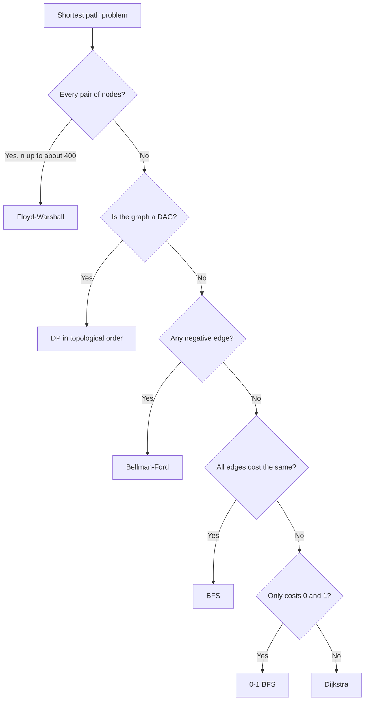
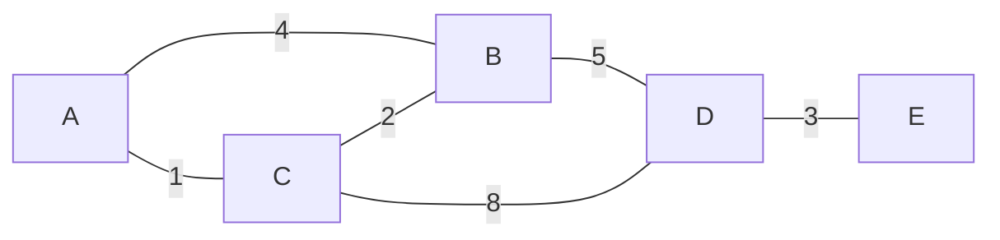
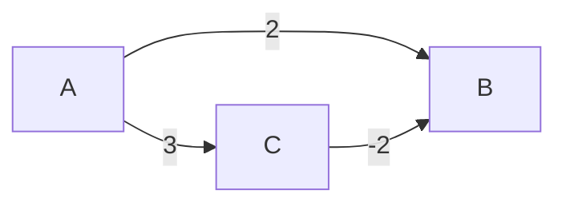
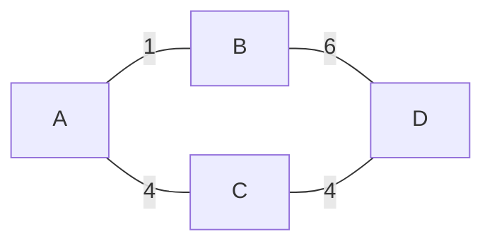
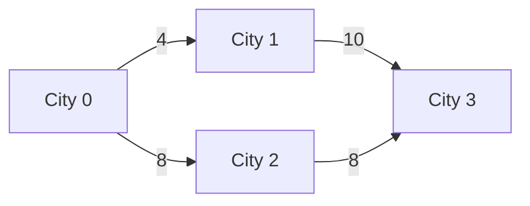

# Dijkstra's Algorithm

> **Level:** Intermediate · **Priority:** T1 · **Time:** 240 min · **Read first:** [BFS shortest path patterns](04-bfs-shortest-path-patterns.md), [Heaps and priority queues from zero](../07-trees/11-heap-from-zero.md) · **Next:** [Bellman-Ford and SPFA](09-bellman-ford-and-spfa.md)

Dijkstra's algorithm finds the cheapest path from one start node to every other node, when no edge has a negative cost. It is the standard answer to "shortest path with weights". With small changes to one template, it also solves minimax paths (where the worst edge must be as small as possible), path counting and paths with extra state.

## Quick revision

- Use it for the **cheapest path** in a **weighted graph**, where each edge has a number such as a time or a price. All weights must be **zero or positive**.
- `dist[v]` is the best distance found so far. Set `dist[start] = 0` and the rest to infinity.
- A **min-heap** holds `(distance, node)` pairs and always gives the smallest one.
- The loop never changes: pop `(d, u)`, skip it if it is stale, then relax every edge out of `u`.
- **Relax** the edge `u -> v`: if `d + w < dist[v]`, set `dist[v] = d + w` and push `(dist[v], v)`.
- **Stale check:** `if (d > dist[u]) continue;`. Old pairs stay in the heap and are skipped when they come out. This is **lazy deletion**.
- When a pair that is not stale is popped, that node's distance is **final**. So you may stop when the target is popped, but not when it is first reached.
- Time is O(E log V) and space is O(V + E). For a dense graph (almost every pair of nodes has an edge), an O(V^2) version with no heap is faster.
- **Negative edge:** Dijkstra can give a wrong answer. Use [Bellman-Ford](09-bellman-ford-and-spfa.md).
- **Path:** store `parent[v] = u` at each relaxation, then walk back from the target.
- **Count:** on `<`, set `ways[v] = ways[u]`. On `==`, add `ways[u]` to `ways[v]`.
- **Other costs:** minimax (make the largest edge small) uses `max(d, w)`. Maximin (make the smallest edge large) uses `min(d, w)` with a max-heap. Probability uses `d * p` with a max-heap.
- **Extra state:** when two arrivals at a node have different futures, use `dist[node][state]`.
- **A\*:** order the heap by `g + h`, where `g` is the cost so far and `h` is an estimate of the cost left. If `h` never overestimates, the answer is still the cheapest. With `h = 0`, A* is Dijkstra.

## How to recognize it

Ask these four questions. If all four answers are yes, use Dijkstra.

1. Can you see the problem as nodes joined by edges? The nodes may be cities, grid cells or states.
2. Do the edges have different costs? If they all cost the same, BFS is simpler.
3. Do you want the best cost of a path, from one start or from a few starts?
4. When you add an edge to a path, can the cost only stay the same or get worse? For a sum, this means no negative edge.

| Words in the problem | What they tell you |
|---|---|
| "shortest time", "cheapest", "minimum cost", with weights | Plain Dijkstra |
| "how long until all nodes receive the signal" | Plain Dijkstra, and the answer is the largest distance |
| "return the path", "print the route" | Add a parent array |
| "highest probability", "most reliable path" | Multiply along the path, with a max-heap |
| "minimize the maximum", "minimum effort", "lowest water level that lets you cross", on a path | Minimax: `max(d, w)` |
| "maximize the minimum", "safest path", "widest path" | Maximin: `min(d, w)`, with a max-heap |
| "number of shortest paths", "in how many ways ... in the shortest time" | Add a `ways` array |
| "at most k discounts", "within maxTime", "fuel" | Extra state: `dist[node][state]` |
| "how many nodes can you reach", "with at most maxMoves" | Run Dijkstra first, then count with `dist` |
| A grid with different costs and moves in four directions | Dijkstra on a grid, with each cell as a node |
| "the ball rolls until it hits a wall" | Edges are whole rolls with different lengths |
| "cannot enter before time t", "wait until it opens" | The cost depends on the arrival time. Dijkstra still works if arriving earlier never hurts |
| "second minimum", "k-th shortest" | Keep more than one value for each node |
| "reach one destination from two sources" | Several runs, some on the reversed graph |
| "the nearest hospital", "distance to the closest of several sources" | Push every source at distance 0 |
| "straight-line distance", "game map", "reach the goal faster" | A*, if you can estimate the remaining cost |

**Not this pattern if:**

| You see | Use instead | Why |
|---|---|---|
| All edges cost the same | [BFS](04-bfs-shortest-path-patterns.md) | A queue already visits nodes in order of distance, with no log factor. |
| Edges cost only 0 or 1 | [0-1 BFS](04-bfs-shortest-path-patterns.md) | A deque keeps the order with no heap. |
| Any negative edge | [Bellman-Ford](09-bellman-ford-and-spfa.md) | A node that looks finished can still get cheaper. |
| "at most k stops" with a small k | [Bellman-Ford with k rounds](09-bellman-ford-and-spfa.md) | The number of edges is a second limit, and k rounds handle it directly. |
| Distances between all pairs, with n up to about 400 | [Floyd-Warshall](10-floyd-warshall-and-all-pairs.md) | It is three short loops. |
| Connect all nodes at the least total cost | [Minimum spanning tree](11-minimum-spanning-tree.md) | You want a set of edges, not a path from a start. |
| The graph is a DAG (directed, with no cycles) | [Dynamic programming (DP) in topological order](06-topological-sort.md) | A topological order lists each node before the nodes its edges lead to, so each node is final when you reach it. It is O(V + E), and it also handles negative edges and longest paths. |
| Only "can I reach it?" or "are they connected?" | [BFS or DFS](02-bfs-and-dfs.md), [Union-Find](07-union-find.md) | Costs do not matter. |
| The longest path in a general graph | No fast method is known | Extending a path makes it better, so question 4 fails. |
| "minimize the maximum", but with no path, such as splitting an array into parts | [Binary search on the answer](../04-sorting-searching/07-binary-search-on-answer.md) | There are no moves between places, so there is no path to extend. You guess a limit and check it. |

This flowchart picks a shortest path algorithm. The full comparison is in [Floyd-Warshall and all-pairs paths](10-floyd-warshall-and-all-pairs.md).



## 1. The idea in plain English

Look at a road map. Cities are joined by roads, and each road has a length. You want the shortest driving distance from your city to every other city.

Now picture a fire that starts in your city. It spreads along every road at the same speed. A city starts burning the moment the first flame reaches it. So the time when a city starts burning is its shortest distance from you. A flame that took a longer road arrives later and changes nothing.

The fire reaches the nearest city first, then the next nearest, and so on. Dijkstra's algorithm copies this fire. It always continues from the closest city that it has not finished yet.

Here is a tiny map. Find the shortest distance from A to every city.



You keep two things:

- `dist`: the best distance to each city found so far. At the start, `dist[A] = 0`. Every other city is infinity (written `inf`), because you know no route yet.
- A **min-heap**: a structure that holds pairs `(distance, city)` and always gives you the pair with the smallest distance. Think of it as a to-do list sorted by distance.

Each step does the same thing. Take the smallest pair out of the heap. Look at every road out of that city. If a road gives a shorter way to a neighbor, update that neighbor's `dist` and add a new pair to the heap. This check is called **relaxing** an edge.

A pair can go out of date while it waits. A popped pair is **stale** when its distance is larger than the current `dist` of that city. It means a better route was found after the pair was pushed. You skip a stale pair.

| Step | Pop | Stale? | What happens | A | B | C | D | E | Heap after the step |
|---|---|---|---|---|---|---|---|---|---|
| start | | | set A to 0 | 0 | inf | inf | inf | inf | (0,A) |
| 1 | (0,A) | no | B gets 4, C gets 1 | 0 | 4 | 1 | inf | inf | (1,C) (4,B) |
| 2 | (1,C) | no | B improves to 1 + 2 = 3, D gets 1 + 8 = 9 | 0 | 3 | 1 | 9 | inf | (3,B) (4,B) (9,D) |
| 3 | (3,B) | no | D improves to 3 + 5 = 8 | 0 | 3 | 1 | 8 | inf | (4,B) (8,D) (9,D) |
| 4 | (4,B) | yes, 4 > 3 | skip it | 0 | 3 | 1 | 8 | inf | (8,D) (9,D) |
| 5 | (8,D) | no | E gets 8 + 3 = 11 | 0 | 3 | 1 | 8 | 11 | (9,D) (11,E) |
| 6 | (9,D) | yes, 9 > 8 | skip it | 0 | 3 | 1 | 8 | 11 | (11,E) |
| 7 | (11,E) | no | nothing improves | 0 | 3 | 1 | 8 | 11 | empty |

The answer is A = 0, B = 3, C = 1, D = 8, E = 11.

Look at three things in this table.

- **Step 2** found that the route A, C, B (cost 3) beats the direct road from A to B (cost 4). The direct road is not always the best road.
- **Steps 4 and 6** popped stale pairs. When B improved from 4 to 3, the pair (4,B) was still in the heap. It was out of date when it came out, so we threw it away.
- **Cities finish in order of distance:** A (0), C (1), B (3), D (8), E (11). This is the order in which the fire reaches them.

The slow way tries every route from A. The number of routes grows exponentially with the size of the map, which means each extra city can multiply the count. Dijkstra never lists the routes. It keeps only the best distance to each city.

## 2. Why the closest node is final

Dijkstra never goes back to a finished city. Why is that safe?

Look at step 3 of the table. The smallest pair in the heap is (3,B). Could another route reach B for less than 3?

Any other route starts in the finished part of the map, which is A and C. At some point it must leave the finished part and land on a waiting city. Reaching that city costs at least its `dist`, because every road out of a finished city was already relaxed. That `dist` is at least 3, because 3 is the smallest value in the heap. The rest of the route then adds 0 or more, because no road is negative. So the whole route costs at least 3. Nothing can beat it.

This gives the general rule.

**The rule:** when the smallest pair in the heap is `(d, u)` and it is not stale, `d` is the true shortest distance to `u`.

The argument used only two facts:

1. The heap gives the smallest value.
2. No edge is negative, so a route never gets cheaper as it gets longer.

[Section 4](#4-why-negative-edges-break-it) shows what happens without the second fact.

BFS is the same idea with every edge costing 1. There, a plain queue already gives nodes in order of distance. With different costs a queue cannot do that, so Dijkstra uses a heap. If all weights are 1, Dijkstra finishes nodes level by level, just like BFS. It is only slower.

## 3. The template

Here is the rule in words.

1. Set every distance to infinity, except `dist[start] = 0`. Push `(0, start)`.
2. Pop the smallest pair `(d, u)`. If it is stale, skip it.
3. For each edge from `u` to `v` with weight `w`: if `d + w < dist[v]`, update `dist[v]` and push the new pair.
4. Repeat until the heap is empty.

C++ gives you `priority_queue`. By default it is a max-heap, so `top()` is the largest item. Adding `greater<>` reverses it, so `top()` is the smallest. The middle argument, `vector<...>`, is the container that holds the items. C++ needs it whenever you give the third argument. A pair compares by its first item, then by its second. So the distance must come first in the pair.

```cpp
#include <bits/stdc++.h>
#include <cassert>
using namespace std;

using Graph = vector<vector<pair<int, int>>>;  // graph[u] holds (neighbor, weight) pairs

// Shortest distance from start to every node. Unreachable nodes stay at LLONG_MAX.
vector<long long> dijkstra(const Graph& graph, int start) {
    vector<long long> dist(graph.size(), LLONG_MAX);
    priority_queue<pair<long long, int>, vector<pair<long long, int>>, greater<>> heap;
    dist[start] = 0;
    heap.push({0, start});

    while (!heap.empty()) {
        auto [d, u] = heap.top();
        heap.pop();
        if (d > dist[u]) continue;  // stale: a shorter way to u was found after this pair was pushed

        for (auto [v, weight] : graph[u]) {
            long long candidate = d + weight;  // d is a real distance, so this cannot overflow
            if (candidate < dist[v]) {
                dist[v] = candidate;
                heap.push({candidate, v});  // the older pair for v goes stale inside the heap
            }
        }
    }
    return dist;
}

int main() {
    // The map from section 1, with A = 0, B = 1, C = 2, D = 3, E = 4.
    Graph graph(5);
    auto addRoad = [&](int a, int b, int weight) {
        graph[a].push_back({b, weight});
        graph[b].push_back({a, weight});  // a road works in both directions
    };
    addRoad(0, 1, 4);
    addRoad(0, 2, 1);
    addRoad(2, 1, 2);
    addRoad(1, 3, 5);
    addRoad(2, 3, 8);
    addRoad(3, 4, 3);
    assert(dijkstra(graph, 0) == vector<long long>({0, 3, 1, 8, 11}));

    assert(dijkstra(Graph(1), 0) == vector<long long>({0}));  // one node and no edges

    Graph split(3);  // no edge reaches node 2
    split[0].push_back({1, 5});
    assert(dijkstra(split, 0) == vector<long long>({0, 5, LLONG_MAX}));

    Graph zero(3);  // zero is allowed, only negative weights break the algorithm
    zero[0].push_back({1, 0});
    zero[1].push_back({2, 0});
    assert(dijkstra(zero, 0) == vector<long long>({0, 0, 0}));

    cout << "All tests passed\n";
}
```

The distances use `long long`, because a sum of many large weights can pass 2 billion. The line `auto [d, u] = heap.top();` unpacks the pair into two new variables. They are copies, and that matters, because `pop()` removes the original pair.

**Lazy deletion.** A `priority_queue` cannot change a pair that is already inside it. In step 2 of the table, B improved from 4 to 3, but (4,B) stayed in the heap. So you do not remove it. You push (3,B) as well. The smaller pair comes out first. When (4,B) comes out later, `dist[B]` is already 3. So the check `d > dist[u]` is true, and you skip it. This is called **lazy deletion**: you delete the old pair when it comes out, and not right now.

**Why keep the stale check?** Without it, this template still gives correct distances. But the run can be slow. A node would scan all of its edges once for every old pair. Take a node with 1,000 edges and 1,000 old pairs. It would do 1,000,000 edge checks instead of 1,000.

**Stopping early.** If you need only one target, stop when the target is popped. Do not stop when it is first relaxed. In the table, B first got 4 at step 1, but its true distance was 3. It was final only when it was popped at step 3.

```cpp snippet
auto [d, u] = heap.top();
heap.pop();
if (d > dist[u]) continue;
if (u == target) return d;  // popped, so d is final
```

**Other ways to hold the waiting nodes.** The heap with lazy deletion is the one to write in an interview. You should know the others exist.

| Structure | Waiting items at most | Time | Notes |
|---|---|---|---|
| `priority_queue` with lazy deletion | E + 1 | O(E log V) | Shortest code. The default choice. |
| `std::set`, with erase and insert | V | O(E log V) | No stale pairs, but a slower constant. |
| [Indexed heap](../07-trees/11-heap-from-zero.md) with decrease-key | V | O(E log V) | Changes a pair in place. Much more code. |
| [Fibonacci heap](../07-trees/12-advanced-heaps.md) | V | O(E + V log V) | Best in theory. Too slow and too long in practice. |
| Plain array scan | V | O(V^2) | Best for dense graphs. See [section 5](#5-the-cost-oe-log-v-and-the-dense-ov2-version). |
| Buckets indexed by distance (Dial's algorithm) | V | O(E + V * C) | Only when every weight is a small integer, at most C. |

Here is the `std::set` version. A set can erase any pair. So each waiting node has exactly one pair inside, and there are no stale pairs to skip.

```cpp
#include <bits/stdc++.h>
#include <cassert>
using namespace std;

using Graph = vector<vector<pair<int, int>>>;

vector<long long> dijkstraWithSet(const Graph& graph, int start) {
    vector<long long> dist(graph.size(), LLONG_MAX);
    set<pair<long long, int>> waiting;  // one pair for each node that still waits
    dist[start] = 0;
    waiting.insert({0, start});

    while (!waiting.empty()) {
        auto [d, u] = *waiting.begin();
        waiting.erase(waiting.begin());
        for (auto [v, weight] : graph[u]) {
            if (d + weight < dist[v]) {
                waiting.erase({dist[v], v});  // removes the old pair, does nothing if v is not inside
                dist[v] = d + weight;
                waiting.insert({dist[v], v});
            }
        }
    }
    return dist;
}

int main() {
    // A = 0, B = 1, C = 2. The direct road to B loses to the route through C.
    Graph graph = {{{1, 4}, {2, 1}}, {}, {{1, 2}}};
    assert(dijkstraWithSet(graph, 0) == vector<long long>({0, 3, 1}));

    assert(dijkstraWithSet(Graph(1), 0) == vector<long long>({0}));  // one node and no edges

    Graph split(2);  // no edge reaches node 1
    assert(dijkstraWithSet(split, 0) == vector<long long>({0, LLONG_MAX}));
    cout << "All tests passed\n";
}
```

## 4. Why negative edges break it

Here is the smallest graph that shows the problem. The roads are one-way now.



The true shortest distance from A to B is 1. The route is A, C, B, and 3 + (-2) = 1.

Trace the textbook version, which never touches a node again once it is finished.

| Step | Pop | What happens | dist of A, B, C |
|---|---|---|---|
| 1 | (0,A) | B gets 2, C gets 3 | 0, 2, 3 |
| 2 | (2,B) | B is finished. It has no roads out | 0, 2, 3 |
| 3 | (3,C) | The road to B gives 3 - 2 = 1, but B is already finished | 0, 2, 3 |

It answers 2. The truth is 1.

Go back to the argument in section 2. It said "the rest of the route adds 0 or more". Here the rest of the route adds -2. So the node that looked safe at step 2 was not safe.

**What about the template from section 3?** It has no finished set. At step 3 it sets `dist[B] = 1` and pushes (1,B), so B is processed a second time. On this tiny graph it ends with the right value. Do not trust this, for three reasons.

1. If you stop when the target is popped, you stop at step 2 with the wrong answer 2.
2. A node can be processed again and again. On unlucky graphs the number of steps grows exponentially, so the O(E log V) promise is gone.
3. A **negative cycle** is a loop whose total is below zero. Each trip around it lowers the distances again, so the program never ends.

```cpp
#include <bits/stdc++.h>
#include <cassert>
using namespace std;

using Graph = vector<vector<pair<int, int>>>;

// The textbook version: a finished node never changes again.
vector<int> withFinishedSet(const Graph& graph, int start) {
    vector<int> dist(graph.size(), INT_MAX);
    vector<bool> finished(graph.size(), false);
    priority_queue<pair<int, int>, vector<pair<int, int>>, greater<>> heap;
    dist[start] = 0;
    heap.push({0, start});
    while (!heap.empty()) {
        auto [d, u] = heap.top();
        heap.pop();
        if (finished[u]) continue;
        finished[u] = true;
        for (auto [v, weight] : graph[u]) {
            if (!finished[v] && d + weight < dist[v]) {
                dist[v] = d + weight;
                heap.push({dist[v], v});
            }
        }
    }
    return dist;
}

// The lazy template from section 3. With a target, it stops when the target is popped.
vector<int> lazyTemplate(const Graph& graph, int start, int target = -1) {
    vector<int> dist(graph.size(), INT_MAX);
    priority_queue<pair<int, int>, vector<pair<int, int>>, greater<>> heap;
    dist[start] = 0;
    heap.push({0, start});
    while (!heap.empty()) {
        auto [d, u] = heap.top();
        heap.pop();
        if (d > dist[u]) continue;
        if (u == target) break;
        for (auto [v, weight] : graph[u]) {
            if (d + weight < dist[v]) {
                dist[v] = d + weight;
                heap.push({dist[v], v});
            }
        }
    }
    return dist;
}

int main() {
    // A = 0, B = 1, C = 2. The true distance to B is 1, through C.
    Graph graph = {{{1, 2}, {2, 3}}, {}, {{1, -2}}};
    assert(withFinishedSet(graph, 0)[1] == 2);  // wrong
    assert(lazyTemplate(graph, 0, 1)[1] == 2);  // wrong: it stopped as soon as B was popped
    assert(lazyTemplate(graph, 0)[1] == 1);     // right, but only because B was processed twice
    cout << "All tests passed\n";
}
```

**You cannot fix it by adding a constant.** It is tempting to add a big number to every edge, so that none is negative. This changes the answer, because a path with more edges gains more than a path with fewer edges.

```text
Before:  A -> C costs 3.   A -> B -> C costs 4 + (-2) = 2.   The second path wins.
Add 2:   A -> C costs 5.   A -> B -> C costs 6 + 0 = 6.      The first path wins.
```

For negative edges, use [Bellman-Ford](09-bellman-ford-and-spfa.md). For all pairs with negative edges, [Johnson's algorithm](10-floyd-warshall-and-all-pairs.md) changes the weights in a careful way so that Dijkstra can run.

## 5. The cost: O(E log V), and the dense O(V^2) version

Count the work of the heap version. V is the number of nodes and E is the number of edges.

- The stale check means each node scans its edges only once. A push always lowers `dist`, so a node's first popped pair is its smallest, and all its later pairs are stale. All the scanning adds up to O(E).
- So each edge causes at most one push, and at most E + 1 pairs ever enter the heap.
- Each pair is popped once.
- A push or a pop on a heap of that size costs O(log E).
- E is at most V^2, so log E is at most 2 log V. That is O(log V).

The total is O((V + E) log V). People usually write O(E log V), because a connected graph has at least V - 1 edges. The space is O(V + E), for the graph, `dist` and the heap.

An undirected edge is stored twice, once for each direction. This doubles E, but it does not change the O().

**The dense version.** A graph is **dense** when almost every pair of nodes has an edge. Then E is close to V^2, and the heap version costs O(V^2 log V). You can do better by dropping the heap.

Repeat V times: scan the whole `dist` array for the closest unfinished node, which costs O(V). Then relax all of its edges, which also costs O(V). The total is O(V^2), with no log.

```cpp
#include <bits/stdc++.h>
#include <cassert>
using namespace std;

// weight[u][v] is the edge cost, or -1 if there is no edge.
vector<long long> dijkstraDense(const vector<vector<int>>& weight, int start) {
    int n = weight.size();
    vector<long long> dist(n, LLONG_MAX);
    vector<bool> finished(n, false);
    dist[start] = 0;

    for (int round = 0; round < n; round++) {
        int u = -1;
        for (int i = 0; i < n; i++) {
            if (!finished[i] && (u == -1 || dist[i] < dist[u])) u = i;
        }
        // The closest waiting node is unreachable, so all the others are too.
        // Stopping here also avoids adding to infinity below.
        if (dist[u] == LLONG_MAX) break;
        finished[u] = true;
        for (int v = 0; v < n; v++) {
            if (weight[u][v] >= 0 && dist[u] + weight[u][v] < dist[v]) {
                dist[v] = dist[u] + weight[u][v];
            }
        }
    }
    return dist;
}

int main() {
    // The map from section 1 as a matrix, with A = 0, B = 1, C = 2, D = 3, E = 4.
    vector<vector<int>> weight = {
        {-1,  4,  1, -1, -1},
        { 4, -1,  2,  5, -1},
        { 1,  2, -1,  8, -1},
        {-1,  5,  8, -1,  3},
        {-1, -1, -1,  3, -1},
    };
    assert(dijkstraDense(weight, 0) == vector<long long>({0, 3, 1, 8, 11}));
    assert(dijkstraDense(weight, 4) == vector<long long>({11, 8, 10, 3, 0}));  // start from E

    assert(dijkstraDense({{-1}}, 0) == vector<long long>({0}));  // one node

    vector<vector<int>> split = {{-1, -1}, {-1, -1}};  // no edges at all
    assert(dijkstraDense(split, 0) == vector<long long>({0, LLONG_MAX}));
    cout << "All tests passed\n";
}
```

Here is how the two versions compare.

| Graph | V | E | Heap: about E log2 V steps | Array: V^2 steps | Better |
|---|---|---|---|---|---|
| Sparse (few edges), such as a road map | 100,000 | 200,000 | 3.3 million | 10 billion | Heap |
| Dense, almost all pairs | 2,000 | 2,000,000 | 22 million | 4 million | Array |

The array wins when E is larger than about V^2 / log V. In an interview, use the heap. Use the array only when the graph is a matrix, or when every node has a direct edge to every other node.

## 6. Dijkstra on grids

A grid is a graph. Each cell is a node, and each cell has an edge to its neighbors. You do not need to build an adjacency list (the `graph[u]` lists of the template). You compute the neighbors with a direction array, as in [Grid graphs](03-grid-graphs.md).

| Moves | Costs | Use |
|---|---|---|
| Four directions | All the same | [BFS](04-bfs-shortest-path-patterns.md) |
| Four directions | Only 0 or 1 | [0-1 BFS](04-bfs-shortest-path-patterns.md) |
| Four directions | Different costs | Dijkstra |
| Only right and down | Any | [Grid DP](../09-dynamic-programming/03-grid-dp.md) |

Why is DP not enough with four directions? DP fills the table in a fixed order. With right and down moves, each cell depends only on cells above it and to its left. With four directions there is no such order, because the best path may go up or left.

Here each number is the cost of entering that cell, and the start cell is free. You go from the top-left cell to the bottom-left cell.

```text
S 1 1      S is the start, at (0,0)
9 9 1
T 1 1      T is the target, at (2,0), and entering it costs 1
```

Going straight down costs 9 + 1 = 10. The best path goes around: right, then down, then **left**. It costs 6. A DP that fills rows from left to right cannot see it.

| Pop (cost, cell) | What happens | Heap after the step |
|---|---|---|
| (0,(0,0)) | (0,1) gets 1, (1,0) gets 9 | (1,(0,1)) (9,(1,0)) |
| (1,(0,1)) | (0,2) gets 2, (1,1) gets 10 | (2,(0,2)) (9,(1,0)) (10,(1,1)) |
| (2,(0,2)) | (1,2) gets 3 | (3,(1,2)) (9,(1,0)) (10,(1,1)) |
| (3,(1,2)) | (2,2) gets 4 | (4,(2,2)) (9,(1,0)) (10,(1,1)) |
| (4,(2,2)) | (2,1) gets 5 | (5,(2,1)) (9,(1,0)) (10,(1,1)) |
| (5,(2,1)) | (2,0) gets 6 | (6,(2,0)) (9,(1,0)) (10,(1,1)) |
| (6,(2,0)) | target popped, the answer is 6 | |

The code is the template with `dist[r][c]` in place of `dist[u]`. The heap holds a tuple. A tuple compares by its first item, just like a pair.

```cpp
#include <bits/stdc++.h>
#include <cassert>
using namespace std;

// cost[r][c] is the price of entering that cell. The start cell (0,0) is free.
long long cheapestGridPath(const vector<vector<int>>& cost, int targetRow, int targetCol) {
    int rows = cost.size(), cols = cost[0].size();
    vector<vector<long long>> dist(rows, vector<long long>(cols, LLONG_MAX));
    using State = tuple<long long, int, int>;  // (cost so far, row, col)
    priority_queue<State, vector<State>, greater<>> heap;
    dist[0][0] = 0;
    heap.push({0, 0, 0});
    const int dr[4] = {0, 1, 0, -1};
    const int dc[4] = {1, 0, -1, 0};

    while (!heap.empty()) {
        auto [d, r, c] = heap.top();
        heap.pop();
        if (d > dist[r][c]) continue;
        if (r == targetRow && c == targetCol) return d;
        for (int k = 0; k < 4; k++) {
            int nr = r + dr[k], nc = c + dc[k];
            if (nr < 0 || nc < 0 || nr >= rows || nc >= cols) continue;
            long long candidate = d + cost[nr][nc];
            if (candidate < dist[nr][nc]) {
                dist[nr][nc] = candidate;
                heap.push({candidate, nr, nc});
            }
        }
    }
    return -1;  // only possible if the target is outside the grid
}

int main() {
    vector<vector<int>> grid = {{1, 1, 1}, {9, 9, 1}, {1, 1, 1}};
    assert(cheapestGridPath(grid, 2, 0) == 6);  // the path turns left at the end
    assert(cheapestGridPath(grid, 0, 0) == 0);  // already at the target
    assert(cheapestGridPath({{5}}, 0, 0) == 0); // one cell

    // Straight right costs 9 + 1 = 10. Down, right, right, up costs 4, so the path must go up.
    vector<vector<int>> detour = {{1, 9, 1}, {1, 1, 1}};
    assert(cheapestGridPath(detour, 0, 2) == 4);

    vector<vector<int>> big = {{0, 2000000000, 2000000000}};
    assert(cheapestGridPath(big, 0, 2) == 4000000000LL);  // the total does not fit in an int
    cout << "All tests passed\n";
}
```

## 7. Beyond sums: which costs work

The cost of a path does not have to be a sum. Think of a truck driving over mountain passes. What matters is the steepest climb of the trip, because the engine must handle it. The total of all climbs does not matter. So the cost of a trip is its **worst** edge.

A **minimax path** is a path whose largest edge is as small as possible. The name means "minimize the maximum".



The shortest path by sum is A, B, D, with total 7 and worst edge 6. The minimax path is A, C, D, with total 8 and worst edge 4. They are different paths.

Only one line of the template changes. Instead of `candidate = d + weight`, write `candidate = max(d, weight)`.

| Pop | What happens | A | B | C | D | Heap after the step |
|---|---|---|---|---|---|---|
| (0,A) | B gets max(0,1) = 1, C gets max(0,4) = 4 | 0 | 1 | 4 | inf | (1,B) (4,C) |
| (1,B) | D gets max(1,6) = 6 | 0 | 1 | 4 | 6 | (4,C) (6,D) |
| (4,C) | D improves to max(4,4) = 4 | 0 | 1 | 4 | 4 | (4,D) (6,D) |
| (4,D) | nothing improves | 0 | 1 | 4 | 4 | (6,D) |
| (6,D) | stale, 6 > 4 | 0 | 1 | 4 | 4 | empty |

Why does this work? Read the argument in section 2 again. It never needed a sum. It needed only this: "the rest of the route cannot make the cost lower". Adding an edge can never lower a maximum.

**The two rules.** Any cost works with Dijkstra if it obeys these two rules.

1. **Extending never helps.** Adding an edge to a path never makes its cost better.
2. **Better stays better.** If path X to `u` is at least as good as path Y to `u`, then after adding the same edge, X is still at least as good as Y.

Rule 1 lets you finish the closest node. Rule 2 lets you keep one value for each node, because you can forget the worse path.

The table below also has the opposite of minimax. A **maximin path** is a path whose smallest edge is as large as possible. Think of a truck on a route with weak bridges. The weakest bridge limits the load, so you want the route whose weakest bridge is as strong as possible.

| Cost of a path | Goal | Extend with | Heap | Start value | Rule 1 | Rule 2 | Result |
|---|---|---|---|---|---|---|---|
| Sum of weights, none negative | Smallest | `d + w` | Min | 0 | yes | yes | Plain Dijkstra |
| Largest edge | Smallest | `max(d, w)` | Min | 0 | yes | yes | Minimax |
| Smallest edge | Largest | `min(d, w)` | Max | infinity | yes | yes | **Maximin** ("widest path") |
| Product of values from 0 to 1 | Largest | `d * p` | Max | 1 | yes | yes | Best probability |
| Sum with negative edges | Smallest | `d + w` | Min | 0 | **no** | yes | [Bellman-Ford](09-bellman-ford-and-spfa.md) |
| Sum, longest path | Largest | `d + w` | Max | 0 | **no** | yes | Does not work |
| Product with values above 1 | Largest | `d * p` | Max | 1 | **no** | yes | Does not work |
| Total fee, with a time limit | Smallest | `d + fee` | Min | 0 | yes | **no** | Needs extra state, see [section 8](#8-extra-state-when-one-number-per-node-is-not-enough) |

The problems in this chapter use these costs: [P3](#p3-path-with-maximum-probability-leetcode-1514-medium) (product), [P5](#p5-path-with-minimum-effort-leetcode-1631-medium) and [P9](#p9-swim-in-rising-water-leetcode-778-hard) (minimax), and [P6](#p6-find-the-safest-path-in-a-grid-leetcode-2812-medium) (maximin).

Minimax and maximin also have other solutions: [binary search on the answer](../04-sorting-searching/07-binary-search-on-answer.md) with a BFS check, and [Union-Find](07-union-find.md) with edges sorted by weight. On an undirected graph, the path between two nodes in a [minimum spanning tree](11-minimum-spanning-tree.md) is always a minimax path.

## 8. Extra state: when one number per node is not enough

Sometimes rule 2 fails. Then the cheapest arrival at a node is not the best one for the future.

You drive from city 0 to city 3. Each road has a toll. You have one coupon, which halves the toll of one road.



Try plain Dijkstra with one number per city. The cheapest arrival at city 1 costs 2, with the coupon used on the first road. Then the road to city 3 costs the full 10, so the total is 12.

But there is a better plan. Pay the full 4 on the first road. Then use the coupon on the big road. The total is 4 + 5 = 9.

So arriving at city 1 with cost 2 and no coupon is worse than arriving with cost 4 and a coupon. The number alone does not tell the whole story.

**The fix:** make the coupon part of the node. A **state** is everything you need to know to decide what can happen next. Here a state is `(city, used)`, where `used` is 0 or 1. Each city now has two copies, and each copy has its own `dist`. A road from `u` to `v` with toll `w` gives these moves:

```text
(u, 0) -> (v, 0)   costs w       pay in full, keep the coupon
(u, 0) -> (v, 1)   costs w / 2   use the coupon on this road
(u, 1) -> (v, 1)   costs w       the coupon is already gone
```

You can picture this as two copies of the map, one above the other. Using the coupon moves you from the first copy to the second. This picture is called a **layered graph**.

Then you run plain Dijkstra on the states. Rule 2 now holds, because two arrivals at the same state have the same future. Here is the trace. A heap entry is `(cost, city, used)`.

| Pop | What happens | Heap after the step |
|---|---|---|
| (0,0,0) | (1,0) gets 4, (1,1) gets 2, (2,0) gets 8, (2,1) gets 4 | (2,1,1) (4,1,0) (4,2,1) (8,2,0) |
| (2,1,1) | (3,1) gets 2 + 10 = 12 | (4,1,0) (4,2,1) (8,2,0) (12,3,1) |
| (4,1,0) | (3,0) gets 14, (3,1) improves to 4 + 5 = 9 | (4,2,1) (8,2,0) (9,3,1) (12,3,1) (14,3,0) |
| (4,2,1) | (3,1) would be 12, no better | (8,2,0) (9,3,1) (12,3,1) (14,3,0) |
| (8,2,0) | (3,0) would be 16, (3,1) would be 12, no better | (9,3,1) (12,3,1) (14,3,0) |
| (9,3,1) | city 3 popped, the answer is 9 | |

```cpp
#include <bits/stdc++.h>
#include <cassert>
using namespace std;

using Graph = vector<vector<pair<int, int>>>;

// Cheapest trip from start to target when one road may be taken at half price.
long long cheapestWithCoupon(const Graph& graph, int start, int target) {
    int n = graph.size();
    // dist[city][used]: used is 1 once the coupon is gone.
    vector<array<long long, 2>> dist(n, {LLONG_MAX, LLONG_MAX});
    using State = tuple<long long, int, int>;  // (cost, city, used)
    priority_queue<State, vector<State>, greater<>> heap;
    dist[start][0] = 0;
    heap.push({0, start, 0});

    while (!heap.empty()) {
        auto [d, u, used] = heap.top();
        heap.pop();
        if (d > dist[u][used]) continue;
        if (u == target) return d;  // the first pop of the target has the smallest cost of both copies
        for (auto [v, toll] : graph[u]) {
            if (d + toll < dist[v][used]) {  // pay in full, the coupon stays as it is
                dist[v][used] = d + toll;
                heap.push({dist[v][used], v, used});
            }
            if (used == 0 && d + toll / 2 < dist[v][1]) {  // use the coupon on this road
                dist[v][1] = d + toll / 2;
                heap.push({dist[v][1], v, 1});
            }
        }
    }
    return -1;
}

int main() {
    Graph graph(4);
    graph[0] = {{1, 4}, {2, 8}};
    graph[1] = {{3, 10}};
    graph[2] = {{3, 8}};
    assert(cheapestWithCoupon(graph, 0, 3) == 9);   // 4 + 10 / 2, and not 4 / 2 + 10
    assert(cheapestWithCoupon(graph, 0, 0) == 0);   // already there
    assert(cheapestWithCoupon(graph, 3, 0) == -1);  // the roads are one-way

    Graph line(3);  // the coupon must wait for the second, bigger road
    line[0] = {{1, 2}};
    line[1] = {{2, 100}};
    assert(cheapestWithCoupon(line, 0, 2) == 52);
    cout << "All tests passed\n";
}
```

**How to find the state.** Ask yourself: two people stand at this node with the same cost so far. What else could make one of them better off? That thing goes into the state.

| The problem says | The state |
|---|---|
| "at most k discounts" | `(node, discounts used)` |
| "at most k stops" | `(node, edges used)` |
| A fuel tank | `(node, fuel left)` |
| "minimize the fee, within maxTime" | `(node, time used)` |
| Keys that open doors | `(node, bitmask of keys)`, where a bitmask is a number whose bits record the keys you hold |
| Moves that alternate between two kinds | `(node, parity of moves)`, where parity means even or odd |
| "cannot go the same way twice in a row" | `(node, last direction)` |

The number of states is the number of nodes times the number of values of the extra part. Check that this is small enough, about 10^6 at most for a heap. [P12](#p12-minimum-cost-to-reach-destination-in-time-leetcode-1928-hard) is a full problem of this kind. If every move costs the same, plain BFS works on the same states. See [BFS shortest path patterns](04-bfs-shortest-path-patterns.md).

## 9. Counting paths and recovering paths

Two common additions live inside the relax step.

**Recovering the path.** `dist` gives you the cost, but not the route. So each time a relaxation succeeds, remember where you came from: `parent[v] = u`. The last write is the best one, because `dist[v]` only goes down. At the end, walk from the target through the parents. Then reverse the list.

The parents form a tree rooted at the start. It is called the **shortest-path tree**, and every node's best route runs along it. [P2](#p2-recover-the-shortest-path-with-a-parent-array-classic-medium) does this in full.

**Counting shortest paths.** Keep `ways[v]`, the number of shortest paths to `v`. The relax step now has two cases.

```cpp snippet
long long candidate = d + weight;
if (candidate < dist[v]) {          // strictly better: all the old ways are useless now
    dist[v] = candidate;
    ways[v] = ways[u];
    heap.push({candidate, v});
} else if (candidate == dist[v]) {  // equally good: these are extra ways with the same cost
    ways[v] = (ways[v] + ways[u]) % MOD;
}
```

This is correct when every weight is positive. Then every way to `u` comes through nodes with a smaller distance. Those nodes have already been popped. So `ways[u]` is final when `u` is popped. [P7](#p7-number-of-ways-to-arrive-at-destination-leetcode-1976-medium) does this in full.

## 10. Several starts, and distances to a target

**Several starts.** Some problems have many starts, and ask for each node's distance to the nearest one. For example: which hospital is closest to each town? Push every start with distance 0, and change nothing else.

Why does this work? Imagine one extra node, joined to every start by an edge of cost 0. Dijkstra from that extra node pushes exactly the same pairs.

```cpp
#include <bits/stdc++.h>
#include <cassert>
using namespace std;

using Graph = vector<vector<pair<int, int>>>;

// For every node, the distance to the nearest source.
vector<long long> multiSource(const Graph& graph, const vector<int>& sources) {
    vector<long long> dist(graph.size(), LLONG_MAX);
    priority_queue<pair<long long, int>, vector<pair<long long, int>>, greater<>> heap;
    for (int source : sources) {  // the only change: every source starts at 0
        dist[source] = 0;
        heap.push({0, source});
    }
    while (!heap.empty()) {
        auto [d, u] = heap.top();
        heap.pop();
        if (d > dist[u]) continue;
        for (auto [v, weight] : graph[u]) {
            if (d + weight < dist[v]) {
                dist[v] = d + weight;
                heap.push({dist[v], v});
            }
        }
    }
    return dist;
}

int main() {
    // Towns in a line. The roads cost 2, 3, 1 and 4. Hospitals are in towns 0 and 4.
    Graph line(5);
    auto addRoad = [&](int a, int b, int weight) {
        line[a].push_back({b, weight});
        line[b].push_back({a, weight});
    };
    addRoad(0, 1, 2);
    addRoad(1, 2, 3);
    addRoad(2, 3, 1);
    addRoad(3, 4, 4);
    // Town 2 is 2 + 3 = 5 from town 0, and 4 + 1 = 5 from town 4.
    assert(multiSource(line, {0, 4}) == vector<long long>({0, 2, 5, 4, 0}));
    assert(multiSource(line, {2}) == vector<long long>({5, 3, 0, 1, 5}));  // one source
    assert(multiSource(Graph(2), {}) == vector<long long>({LLONG_MAX, LLONG_MAX}));  // no source
    cout << "All tests passed\n";
}
```

**Distance to one target.** Dijkstra gives distances **from** one node. To get the distance from every node **to** one target, reverse every edge and run from the target. A path `u -> ... -> t` in the graph is the path `t -> ... -> u` in the reversed graph, with the same cost. On an undirected graph you can skip the reversing.

**Both ends.** Run from the start on the graph, to get `fromStart`. Run from the target on the reversed graph, to get `toTarget`. Together they describe every shortest path.

- A node `x` lies on a shortest path when `fromStart[x] + toTarget[x] == fromStart[target]`.
- An edge `u -> v` of weight `w` lies on a shortest path when `fromStart[u] + w + toTarget[v] == fromStart[target]`.

[P10](#p10-minimum-weighted-subgraph-with-the-required-paths-leetcode-2203-hard) uses a reversed run.

## 11. A* search

Dijkstra spreads in all directions, like the fire. It does not know where the target is. When you have one known target, this wastes work.

Think of walking to a tall tower that you can see. You do not try every street equally. You prefer streets that go toward the tower, because you can estimate how far you still have to go.

**A\*** (say "A star") adds this estimate. For each node it uses three numbers:

- `g`: the real cost from the start to this node. This is `dist`.
- `h`: the **heuristic**, an estimate of the cost left from this node to the target.
- `f = g + h`: the estimated cost of the whole trip through this node.

The heap is ordered by `f` instead of `g`. That is the only real change. The stale check, the relax step and stopping at the target stay the same.

Take a grid with four moves, where each step costs at least 1. A good `h` there is the **Manhattan distance**: `abs(row - targetRow) + abs(col - targetCol)`. It is the number of steps left if there are no walls and every step costs 1.

Here S is the start and T is the target. Every step costs 1. A `*` marks a cell that was popped. S and T are popped too, so the counts below include them.

```text
Dijkstra pops 22 cells      A* pops 5 cells

* * * * . . .               . . . . . . .
* * * * * . .               . . . . . . .
* S * * * T .               . S * * * T .
* * * * . . .               . . . . . . .
* * * . . . .               . . . . . . .
```

Now put a wall (`#`) in the way. A* goes around it and still pops far fewer cells. Both searches find the same best cost, 6.

```text
Dijkstra pops 26 cells      A* pops 8 cells

* * * * * * .               . . . . . . .
* * * # * . .               . . * # . . .
* S * # * T .               . S * # * T .
* * * * * * .               . . * * * . .
* * * * * . .               . . . . . . .
```

**A small trace.** The numbers are the costs of entering each cell. Go from S at (0,0) to T at (0,3).

```text
S 1 5 1     the last cell here is T
1 1 1 1
```

The straight way costs 1 + 5 + 1 = 7. The way through the lower row costs 5. A heap entry is `(f, h, cell)`. When two entries have the same `f`, the smaller `h` comes first. That cell is closer to the target.

| Pop (f, h, cell) | g | What happens | Heap after the step |
|---|---|---|---|
| (3,3,(0,0)) | 0 | (0,1): g = 1, h = 2, f = 3. (1,0): g = 1, h = 4, f = 5 | (3,2,(0,1)) (5,4,(1,0)) |
| (3,2,(0,1)) | 1 | (0,2): g = 6, h = 1, f = 7. (1,1): g = 2, h = 3, f = 5 | (5,3,(1,1)) (5,4,(1,0)) (7,1,(0,2)) |
| (5,3,(1,1)) | 2 | (1,2): g = 3, h = 2, f = 5 | (5,2,(1,2)) (5,4,(1,0)) (7,1,(0,2)) |
| (5,2,(1,2)) | 3 | (1,3): g = 4, h = 1, f = 5 | (5,1,(1,3)) (5,4,(1,0)) (7,1,(0,2)) |
| (5,1,(1,3)) | 4 | (0,3): g = 5, h = 0, f = 5 | (5,0,(0,3)) (5,4,(1,0)) (7,1,(0,2)) |
| (5,0,(0,3)) | 5 | target popped, the answer is 5 | |

The first estimate was 3. It was too low, and that is fine. When the expensive cell raised `f` to 7, the search moved to the lower row. The cells (1,0) and (0,2) were never popped. Dijkstra pops 7 cells on this grid, and A* pops 6.

**When is A\* optimal?** It depends on `h`.

| Kind of `h` | What it means | Result |
|---|---|---|
| `h = 0` | No information | This is Dijkstra. Correct, but it explores the most |
| **Consistent** | `h(u) <= w + h(v)` for every edge `u -> v`, and `h(target) = 0` | Correct. A popped node is final, as in Dijkstra |
| **Admissible** | `h(u)` is never above the true cost left | Correct, if a node may be processed again, as in our template |
| Overestimates | `h(u)` can be above the true cost left | Fast, but the answer may be wrong |
| Exact | `h(u)` is the true cost left | Correct, and it goes straight to the target |

**Why admissible is enough.** Say A* pops the target with cost C, while a cheaper route with cost C' exists. Walk along that route from the start. A* has not finished this walk, or it would already hold the target at cost C'. So some node `x` on the route still waits in the heap, with its correct `g`. Its `f` is `g(x) + h(x)`. Since `h` never overestimates, that is at most C'. And C' is below C. So `x` should have come out before the target. This is a contradiction, so no cheaper route exists.

**Why consistent means "like Dijkstra".** Give each edge a new weight: `w' = w + h(v) - h(u)`. Consistency says `w'` is never negative. Along a path the `h` terms cancel. For example, the path `u -> v -> x` has the new cost `(w1 + h(v) - h(u)) + (w2 + h(x) - h(v))`, which is `w1 + w2 + h(x) - h(u)`. So the new cost of a path from the start to `v` is `g(v) + h(v) - h(start)`. That is `f` minus a constant. So A* is plain Dijkstra on the weights `w'`, and the proof in section 2 applies.

Every consistent `h` is admissible, but not the other way around. Manhattan distance is consistent on our grid, because one step changes it by at most 1 and costs at least 1.

**What an overestimate does.** Try `h = 10 * Manhattan` on the small grid. Cells near the target now look far better than the others. The search rushes along the top row and pops the target with cost 7, but the true answer is 5. [P8](#p8-a-search-on-a-grid-classic-medium) tests this. If you order the heap by `h` alone, you get **greedy best-first search**. It has the same problem.

**Good heuristics.** The best `h` is the largest one that never overestimates. The formulas below assume that each step costs at least 1. If the cheapest step costs `m`, multiply `h` by `m`. Otherwise it may overestimate.

| Moves | Heuristic | Formula, with `a = abs(dr)`, `b = abs(dc)` |
|---|---|---|
| 4 directions | Manhattan | `a + b` |
| 8 directions, each step costs 1 | Chebyshev | `max(a, b)` |
| 8 directions, a diagonal costs sqrt(2) | Octile | `max(a, b) + (sqrt(2) - 1) * min(a, b)` |
| Any direction | Euclidean, or straight line | `sqrt(a * a + b * b)` |

**Dijkstra or A\*?**

| | Dijkstra | A* |
|---|---|---|
| Heap order | `g` | `g + h` |
| Needs one known target | No | Yes |
| Gives distances to all nodes | Yes | No |
| Needs an estimate | No | Yes |
| Worst-case time | O(E log V) | O(E log V) with a consistent `h` |
| Nodes explored in practice | All nodes closer than the target | Usually far fewer |

In an interview, A* usually comes up as a follow-up question. It is useful when you search a huge space for one target and a simple estimate exists. Examples are map routing, game path finding and sliding puzzles.

## 12. Cheat sheet: what to change in the template

Every problem below is the same template with a small change.

| You need | Change | Shown in |
|---|---|---|
| One target only | `if (u == target) return d;` after the stale check | [P3](#p3-path-with-maximum-probability-leetcode-1514-medium) |
| The route | `parent[v] = u` in the relax step | [P2](#p2-recover-the-shortest-path-with-a-parent-array-classic-medium) |
| The largest product | Max-heap, `d * p`, start value 1 | [P3](#p3-path-with-maximum-probability-leetcode-1514-medium) |
| Edges that are not given | Compute the neighbors inside the loop | [P4](#p4-the-maze-ii-leetcode-505-medium-premium) |
| The smallest worst edge | `max(d, w)` | [P5](#p5-path-with-minimum-effort-leetcode-1631-medium), [P9](#p9-swim-in-rising-water-leetcode-778-hard) |
| The largest worst value | Max-heap, `min(d, w)` | [P6](#p6-find-the-safest-path-in-a-grid-leetcode-2812-medium) |
| The number of best paths | `ways`, with `<` and `==` branches | [P7](#p7-number-of-ways-to-arrive-at-destination-leetcode-1976-medium) |
| A faster search for one target | Order the heap by `g + h` | [P8](#p8-a-search-on-a-grid-classic-medium) |
| Distances to one target | Run on the reversed graph | [P10](#p10-minimum-weighted-subgraph-with-the-required-paths-leetcode-2203-hard) |
| To count what is reachable | Run first, then use `dist` in a formula | [P11](#p11-reachable-nodes-in-subdivided-graph-leetcode-882-hard) |
| A second limit | State `(node, extra)` | [P12](#p12-minimum-cost-to-reach-destination-in-time-leetcode-1928-hard) |
| Waiting or opening times | Compute the arrival time from `d` | [P13](#p13-minimum-time-to-visit-a-cell-in-a-grid-leetcode-2577-hard) |
| The second or k-th best | Several values for each node | [P14](#p14-second-minimum-time-to-reach-destination-leetcode-2045-hard) |
| Several starts | Push them all at distance 0 | [Section 10](#10-several-starts-and-distances-to-a-target) |

## 13. Solved problems

### P1. Network Delay Time ([LeetCode 743](https://leetcode.com/problems/network-delay-time/), Medium)

**Problem:** A network has `n` nodes, numbered 1 to `n`. Each `times[i] = [u, v, w]` means a signal takes time `w` to go from `u` to `v`. A signal starts at node `k`. Find the time until every node has it, or -1 if some node never gets it.

**Example:** `times = [[1,2,4],[1,3,1],[3,2,2],[2,4,1]]`, `n = 4`, `k = 1` gives `4`. Node 4 is the last to get the signal.

**Pattern:** Dijkstra

**How to recognize it:** The edges have different times, and you want the fastest arrival from one start. The signal runs along every edge at once, like the fire in section 1. So each node's arrival time is its shortest distance.

**Brute force:** Try every path from `k` with DFS. The number of paths can be exponential.

**Key idea:** This is the plain template. The network is done when the last node gets the signal, so the answer is the largest distance. If any distance is still infinity, the answer is -1.

**Dry run:** on the example. The `dist` column shows nodes 1 to 4.

| Pop | Stale? | What happens | dist | Heap after the step |
|---|---|---|---|---|
| (0,1) | no | 2 gets 4, 3 gets 1 | 0, 4, 1, inf | (1,3) (4,2) |
| (1,3) | no | 2 improves to 1 + 2 = 3 | 0, 3, 1, inf | (3,2) (4,2) |
| (3,2) | no | 4 gets 3 + 1 = 4 | 0, 3, 1, 4 | (4,2) (4,4) |
| (4,2) | yes, 4 > 3 | skip it | 0, 3, 1, 4 | (4,4) |
| (4,4) | no | no edges out | 0, 3, 1, 4 | empty |

The largest distance is 4.

```cpp
#include <bits/stdc++.h>
#include <cassert>
using namespace std;

class Solution {
public:
    int networkDelayTime(vector<vector<int>>& times, int n, int k) {
        vector<vector<pair<int, int>>> graph(n + 1);  // nodes are 1 to n, so index 0 stays unused
        for (auto& t : times) graph[t[0]].push_back({t[1], t[2]});

        vector<int> dist(n + 1, INT_MAX);
        priority_queue<pair<int, int>, vector<pair<int, int>>, greater<>> heap;
        dist[k] = 0;
        heap.push({0, k});

        while (!heap.empty()) {
            auto [d, u] = heap.top();
            heap.pop();
            if (d > dist[u]) continue;
            for (auto [v, weight] : graph[u]) {
                if (d + weight < dist[v]) {
                    dist[v] = d + weight;
                    heap.push({dist[v], v});
                }
            }
        }

        int slowest = 0;
        for (int node = 1; node <= n; node++) {
            if (dist[node] == INT_MAX) return -1;  // the signal never gets here
            slowest = max(slowest, dist[node]);
        }
        return slowest;
    }
};

int main() {
    Solution solution;
    vector<vector<int>> a = {{1, 2, 4}, {1, 3, 1}, {3, 2, 2}, {2, 4, 1}};
    assert(solution.networkDelayTime(a, 4, 1) == 4);

    vector<vector<int>> b = {{2, 1, 1}, {2, 3, 1}, {3, 4, 1}};
    assert(solution.networkDelayTime(b, 4, 2) == 2);

    vector<vector<int>> c = {{1, 2, 1}};
    assert(solution.networkDelayTime(c, 2, 2) == -1);  // edges are one-way, so node 1 is never reached

    vector<vector<int>> empty;
    assert(solution.networkDelayTime(empty, 1, 1) == 0);  // one node already has the signal

    vector<vector<int>> zero = {{1, 2, 0}, {2, 3, 0}};
    assert(solution.networkDelayTime(zero, 3, 1) == 0);   // zero-cost edges are fine
    cout << "All tests passed\n";
}
```

**Complexity:** O(E log V) time, because each edge causes at most one push and each heap step costs O(log V). O(V + E) space, for the graph, `dist` and the heap.

**Edge cases:** one node gives 0. A node that cannot be reached gives -1. The nodes start at 1, so the arrays need size `n + 1`.

**Follow-up:** "Which node gets the signal last?" Return the index of the largest distance.

### P2. Recover the Shortest Path With a Parent Array (Classic, Medium)

**Problem:** Given a weighted graph, a start and a target, return the nodes of a shortest path, in order. Return an empty list if the target cannot be reached.

**Example:** on the map from section 1, with A = 0, B = 1, C = 2, D = 3, E = 4, the shortest path from 0 to 4 is `[0, 2, 1, 3, 4]`. Its cost is 1 + 2 + 5 + 3 = 11.

**Pattern:** Dijkstra

**How to recognize it:** The problem wants the route, not only its cost. Look for "return the path" or "print the cities on the route".

**Brute force:** Store a full copy of the path in every heap pair. This works, but each push copies up to V nodes. That costs O(V) extra per push.

**Key idea:** Each node needs only one fact: the node just before it on its best route. Write `parent[v] = u` every time a relaxation succeeds. At the end, follow the parents from the target back to the start. Then reverse the list.

**Dry run:** on the map. The last column shows the parents of A, B, C, D and E.

| Pop | Successful relaxations | Parents after the step |
|---|---|---|
| (0,A) | B gets 4 from A, C gets 1 from A | -, A, A, -, - |
| (1,C) | B gets 3 from C, D gets 9 from C | -, C, A, C, - |
| (3,B) | D gets 8 from B | -, C, A, B, - |
| (4,B) | stale | -, C, A, B, - |
| (8,D) | E gets 11 from D | -, C, A, B, D |
| (9,D) | stale | -, C, A, B, D |
| (11,E) | none | -, C, A, B, D |

The parent of B changed from A to C, and the parent of D changed from C to B. The last write is the best one.

Now walk back from E: E, D, B, C, A. Reversed, the path is A, C, B, D, E.

```cpp
#include <bits/stdc++.h>
#include <cassert>
using namespace std;

using Graph = vector<vector<pair<int, int>>>;

vector<int> shortestPath(const Graph& graph, int start, int target) {
    int n = graph.size();
    vector<long long> dist(n, LLONG_MAX);
    vector<int> parent(n, -1);  // parent[v] is the node before v on its best route
    priority_queue<pair<long long, int>, vector<pair<long long, int>>, greater<>> heap;
    dist[start] = 0;
    heap.push({0, start});

    while (!heap.empty()) {
        auto [d, u] = heap.top();
        heap.pop();
        if (d > dist[u]) continue;
        if (u == target) break;  // its parent chain is final now
        for (auto [v, weight] : graph[u]) {
            if (d + weight < dist[v]) {
                dist[v] = d + weight;
                parent[v] = u;
                heap.push({dist[v], v});
            }
        }
    }

    if (dist[target] == LLONG_MAX) return {};  // never reached
    vector<int> path;
    for (int node = target; node != -1; node = parent[node]) path.push_back(node);
    reverse(path.begin(), path.end());  // the walk went from target to start
    return path;
}

int main() {
    Graph graph(5);
    auto addRoad = [&](int a, int b, int weight) {
        graph[a].push_back({b, weight});
        graph[b].push_back({a, weight});
    };
    addRoad(0, 1, 4);
    addRoad(0, 2, 1);
    addRoad(2, 1, 2);
    addRoad(1, 3, 5);
    addRoad(2, 3, 8);
    addRoad(3, 4, 3);
    assert(shortestPath(graph, 0, 4) == vector<int>({0, 2, 1, 3, 4}));
    assert(shortestPath(graph, 0, 1) == vector<int>({0, 2, 1}));  // the parent of 1 changed from 0 to 2
    assert(shortestPath(graph, 3, 3) == vector<int>({3}));        // start equals target

    Graph split(3);  // no edge reaches node 2
    split[0].push_back({1, 7});
    assert(shortestPath(split, 0, 2).empty());
    cout << "All tests passed\n";
}
```

**Complexity:** O(E log V) time for Dijkstra, plus O(V) for the walk back. O(V + E) space.

**Edge cases:** when the start equals the target, the path has one node. When the target cannot be reached, its parent is -1. The parent of the start is also -1. So check `dist[target]`, not the parent.

**Follow-up:** "Return all shortest paths." Keep a list of parents for each node. On `<`, clear the list and add `u`. On `==`, add `u`. Then list the routes with a DFS from the target over these lists. The number of routes can be exponential. This needs every weight to be positive. A 0-cost edge can make two nodes parents of each other, and the DFS would never end.

"Among all shortest paths, find one with the fewest edges." Keep the pair `(distance, edges)` for each node, and compare these pairs in the relax step. This cost obeys both rules of section 7, so Dijkstra still works.

### P3. Path with Maximum Probability ([LeetCode 1514](https://leetcode.com/problems/path-with-maximum-probability/), Medium)

**Problem:** An undirected graph has a success probability on each edge. Find the highest probability of going from `start_node` to `end_node`. The probability of a path is the product of its edge probabilities. Return 0 if there is no path.

**Example:** `n = 3`, edges 0-1 with 0.5, 1-2 with 0.8, 0-2 with 0.3, from 0 to 2 gives `0.4`. The two-edge path gives 0.5 * 0.8 = 0.4, which beats the direct 0.3.

**Pattern:** Dijkstra

**How to recognize it:** "Highest probability" of a path, on a graph with weights. Check the two rules from section 7. Each probability is at most 1, so multiplying can never raise the value. A better value stays better after the same edge. So this is Dijkstra with the direction flipped.

**Brute force:** Try every simple path (a path with no repeated node) with DFS. This is exponential.

**Key idea:** Change three things in the template. Use a max-heap, because bigger is better. Use `prob * edgeProb` in place of `d + w`. Start with 1 at the start node and 0 everywhere else.

**Dry run:** on the example. The `best` column shows nodes 0, 1 and 2.

| Pop (prob, node) | What happens | best | Heap after the step |
|---|---|---|---|
| (1.0, 0) | 1 gets 0.5, 2 gets 0.3 | 1, 0.5, 0.3 | (0.5,1) (0.3,2) |
| (0.5, 1) | 0 would be 0.25, no better. 2 improves to 0.4 | 1, 0.5, 0.4 | (0.4,2) (0.3,2) |
| (0.4, 2) | target popped, the answer is 0.4 | | |

```cpp
#include <bits/stdc++.h>
#include <cassert>
using namespace std;

class Solution {
public:
    double maxProbability(int n, vector<vector<int>>& edges, vector<double>& succProb, int start_node, int end_node) {
        vector<vector<pair<int, double>>> graph(n);
        for (int i = 0; i < (int)edges.size(); i++) {
            graph[edges[i][0]].push_back({edges[i][1], succProb[i]});
            graph[edges[i][1]].push_back({edges[i][0], succProb[i]});
        }

        vector<double> best(n, 0.0);
        priority_queue<pair<double, int>> heap;  // the default is a max-heap: biggest first
        best[start_node] = 1.0;
        heap.push({1.0, start_node});

        while (!heap.empty()) {
            auto [prob, u] = heap.top();
            heap.pop();
            if (prob < best[u]) continue;  // stale: the check is flipped, because bigger is better
            if (u == end_node) return prob;
            for (auto [v, edgeProb] : graph[u]) {
                double candidate = prob * edgeProb;
                if (candidate > best[v]) {
                    best[v] = candidate;
                    heap.push({candidate, v});
                }
            }
        }
        return 0.0;  // no path
    }
};

bool closeTo(double a, double b) { return fabs(a - b) < 1e-9; }

int main() {
    Solution solution;
    vector<vector<int>> edges = {{0, 1}, {1, 2}, {0, 2}};
    vector<double> a = {0.5, 0.8, 0.3};
    assert(closeTo(solution.maxProbability(3, edges, a, 0, 2), 0.4));

    vector<double> b = {0.5, 0.5, 0.3};
    assert(closeTo(solution.maxProbability(3, edges, b, 0, 2), 0.3));  // the direct edge wins: 0.25 < 0.3

    vector<vector<int>> one = {{0, 1}};
    vector<double> half = {0.5};
    assert(closeTo(solution.maxProbability(3, one, half, 0, 2), 0.0));  // node 2 is cut off

    vector<double> never = {0.0};
    assert(closeTo(solution.maxProbability(2, one, never, 0, 1), 0.0));  // an edge that always fails
    cout << "All tests passed\n";
}
```

**Complexity:** O(E log V) time, for the same reason as the plain template. O(V + E) space.

**Edge cases:** no path gives 0. An edge with probability 0 never improves `best`, so it behaves as if it were missing.

**Follow-up:** "How does this relate to a normal shortest path?" Take the logarithm: `log(a * b) = log a + log b`. Since each probability is at most 1, `-log p` is zero or positive. So the highest product is the smallest sum of `-log p`, which is plain Dijkstra. The code above avoids logs and their rounding.

### P4. The Maze II ([LeetCode 505](https://leetcode.com/problems/the-maze-ii/), Medium, Premium)

**Problem:** A ball sits in a maze of empty cells (0) and walls (1). It rolls in one of four directions and does not stop until it hits a wall or the border. Then it can pick a new direction. Find the fewest cells it must travel to stop at the destination, or -1 if it cannot stop there. The start cell does not count.

**Example:** in the maze below, the ball goes from S at (0,0) to T at (3,0). The answer is `5`.

```text
S . . .
. . # .
# . . .
T . . .
```

**Pattern:** Dijkstra

**How to recognize it:** "Rolls until it hits a wall" means one move can cover many cells. So the nodes are the cells where the ball can stop, and the edges are whole rolls with different lengths. Different edge lengths mean BFS is not enough.

**Brute force:** The obvious idea is a BFS that counts rolls. But it finds the fewest rolls, not the fewest cells. Here the route right, down, left has 3 rolls but 9 cells. The route down, right, down, left has 4 rolls and 5 cells. The second route is the answer, and BFS finds the first.

**Key idea:** Run Dijkstra with `dist[row][col]`. The graph is not given, so compute the edges inside the loop. For each direction, roll until the next cell is blocked. Count the steps. The stopping cell is the neighbor, and the steps are the edge weight.

**Dry run:** on the example.

| Pop (cells, cell) | Rolls that improve something | Heap after the step |
|---|---|---|
| (0,(0,0)) | right to (0,3), total 3. Down to (1,0), total 1 | (1,(1,0)) (3,(0,3)) |
| (1,(1,0)) | right to (1,1), total 2 | (2,(1,1)) (3,(0,3)) |
| (2,(1,1)) | down to (3,1), total 4. Up to (0,1), total 3 | (3,(0,1)) (3,(0,3)) (4,(3,1)) |
| (3,(0,1)) | none | (3,(0,3)) (4,(3,1)) |
| (3,(0,3)) | down to (3,3), total 6 | (4,(3,1)) (6,(3,3)) |
| (4,(3,1)) | left to (3,0), total 5 | (5,(3,0)) (6,(3,3)) |
| (5,(3,0)) | target popped, the answer is 5 | |

```cpp
#include <bits/stdc++.h>
#include <cassert>
using namespace std;

class Solution {
public:
    int shortestDistance(vector<vector<int>>& maze, vector<int>& start, vector<int>& destination) {
        int rows = maze.size(), cols = maze[0].size();
        vector<vector<int>> dist(rows, vector<int>(cols, INT_MAX));
        using State = tuple<int, int, int>;  // (cells travelled, row, col)
        priority_queue<State, vector<State>, greater<>> heap;
        dist[start[0]][start[1]] = 0;
        heap.push({0, start[0], start[1]});
        const int dr[4] = {0, 1, 0, -1};
        const int dc[4] = {1, 0, -1, 0};

        while (!heap.empty()) {
            auto [d, r, c] = heap.top();
            heap.pop();
            if (d > dist[r][c]) continue;
            if (r == destination[0] && c == destination[1]) return d;

            for (int k = 0; k < 4; k++) {
                int nr = r, nc = c, steps = 0;
                while (true) {  // the ball cannot stop until the next cell is blocked
                    int nextRow = nr + dr[k], nextCol = nc + dc[k];
                    if (nextRow < 0 || nextCol < 0 || nextRow >= rows || nextCol >= cols) break;
                    if (maze[nextRow][nextCol] == 1) break;
                    nr = nextRow;
                    nc = nextCol;
                    steps++;
                }
                if (d + steps < dist[nr][nc]) {
                    dist[nr][nc] = d + steps;
                    heap.push({dist[nr][nc], nr, nc});
                }
            }
        }
        return -1;  // the ball can never stop at the destination
    }
};

int main() {
    Solution solution;
    vector<vector<int>> a = {{0, 0, 0, 0}, {0, 0, 1, 0}, {1, 0, 0, 0}, {0, 0, 0, 0}};
    vector<int> start = {0, 0}, target = {3, 0};
    assert(solution.shortestDistance(a, start, target) == 5);

    vector<vector<int>> b = {{0, 0, 1, 0, 0}, {0, 0, 0, 0, 0}, {0, 0, 0, 1, 0}, {1, 1, 0, 1, 1}, {0, 0, 0, 0, 0}};
    vector<int> s1 = {0, 4}, t1 = {4, 4}, t2 = {3, 2};
    assert(solution.shortestDistance(b, s1, t1) == 12);
    assert(solution.shortestDistance(b, s1, t2) == -1);  // the ball rolls through (3,2) but cannot stop there

    vector<vector<int>> line = {{0, 0, 0}};
    vector<int> s2 = {0, 0}, t3 = {0, 1}, t4 = {0, 2};
    assert(solution.shortestDistance(line, s2, t3) == -1);  // rolling past the destination does not count
    assert(solution.shortestDistance(line, s2, t4) == 2);   // the border stops the ball here
    cout << "All tests passed\n";
}
```

**Complexity:** There are at most mn stopping cells, and each one tries 4 rolls of at most max(m, n) steps. That is O(mn * max(m, n)) for the rolling. Each roll pushes at most once, so the heap adds O(mn log(mn)). Space is O(mn).

**Edge cases:** the ball rolls over the destination without stopping, which gives -1. A roll that does not move has 0 steps and improves nothing, so no special case is needed.

**Follow-up:** "Can you speed up the rolling?" Precompute where the ball stops, for each cell and direction. Each roll then costs O(1), and the total is O(mn log(mn)).

### P5. Path With Minimum Effort ([LeetCode 1631](https://leetcode.com/problems/path-with-minimum-effort/), Medium)

**Problem:** A grid holds heights. You walk from the top-left to the bottom-right cell, moving in four directions. The effort of a path is the largest height difference between two neighboring cells on it. Find the smallest possible effort.

**Example:** `heights = [[1,4,9],[7,3,5]]` gives `3`. The path 1, 4, 3, 5 has differences 3, 1 and 2, so its effort is 3.

**Pattern:** Dijkstra

**How to recognize it:** "The largest difference on the path" and "smallest possible": you minimize a maximum. That is a minimax path. Moves go in four directions, so a right-and-down DP cannot work.

**Brute force:** Try every path with DFS. This is exponential.

**Key idea:** Each neighbor step is an edge whose weight is the height difference. Use the template with `max(d, weight)` in place of `d + weight`. This obeys the two rules of section 7, because a longer path can never lower its maximum.

**Dry run:** on the example. Each cell is written as (row, col).

| Pop (effort, cell) | What happens | Heap after the step |
|---|---|---|
| (0,(0,0)) | (0,1) gets 3, (1,0) gets 6 | (3,(0,1)) (6,(1,0)) |
| (3,(0,1)) | (0,2) gets max(3,5) = 5. (1,1) gets max(3,1) = 3 | (3,(1,1)) (5,(0,2)) (6,(1,0)) |
| (3,(1,1)) | (1,2) gets max(3,2) = 3. (1,0) improves to max(3,4) = 4 | (3,(1,2)) (4,(1,0)) (5,(0,2)) (6,(1,0)) |
| (3,(1,2)) | target popped, the answer is 3 | |

```cpp
#include <bits/stdc++.h>
#include <cassert>
using namespace std;

class Solution {
public:
    int minimumEffortPath(vector<vector<int>>& heights) {
        int rows = heights.size(), cols = heights[0].size();
        vector<vector<int>> effort(rows, vector<int>(cols, INT_MAX));
        using State = tuple<int, int, int>;  // (effort so far, row, col)
        priority_queue<State, vector<State>, greater<>> heap;
        effort[0][0] = 0;
        heap.push({0, 0, 0});
        const int dr[4] = {0, 1, 0, -1};
        const int dc[4] = {1, 0, -1, 0};

        while (!heap.empty()) {
            auto [d, r, c] = heap.top();
            heap.pop();
            if (d > effort[r][c]) continue;
            if (r == rows - 1 && c == cols - 1) return d;
            for (int k = 0; k < 4; k++) {
                int nr = r + dr[k], nc = c + dc[k];
                if (nr < 0 || nc < 0 || nr >= rows || nc >= cols) continue;
                int step = abs(heights[nr][nc] - heights[r][c]);
                int candidate = max(d, step);  // the path's cost is its worst step, not a sum
                if (candidate < effort[nr][nc]) {
                    effort[nr][nc] = candidate;
                    heap.push({candidate, nr, nc});
                }
            }
        }
        return 0;  // not reached: every cell of a grid is reachable
    }
};

int main() {
    Solution solution;
    vector<vector<int>> a = {{1, 4, 9}, {7, 3, 5}};
    assert(solution.minimumEffortPath(a) == 3);

    vector<vector<int>> b = {{1, 2, 2}, {3, 8, 2}, {5, 3, 5}};
    assert(solution.minimumEffortPath(b) == 2);

    vector<vector<int>> c = {{5}};
    assert(solution.minimumEffortPath(c) == 0);  // start and target are the same cell

    vector<vector<int>> d = {{1, 2, 10}};
    assert(solution.minimumEffortPath(d) == 8);  // one row, so the path is forced

    vector<vector<int>> e = {{1, 2, 1, 1, 1}, {1, 2, 1, 2, 1}, {1, 2, 1, 2, 1}, {1, 2, 1, 2, 1}, {1, 1, 1, 2, 1}};
    assert(solution.minimumEffortPath(e) == 0);  // a flat snake path exists
    cout << "All tests passed\n";
}
```

**Complexity:** The grid has V = mn cells and at most 4mn directed edges, so the time is O(mn log(mn)). The space is O(mn).

**Edge cases:** a single cell gives 0, because there are no steps. Start with `effort[0][0] = 0`, not the height of the first cell.

**Follow-up:** "Solve it without a heap." Binary search on the effort, and use BFS to check if the target is reachable with steps of at most that size. See [binary search on the answer](../04-sorting-searching/07-binary-search-on-answer.md). Or sort all edges by weight and join them with [Union-Find](07-union-find.md) until the two corners connect.

### P6. Find the Safest Path in a Grid ([LeetCode 2812](https://leetcode.com/problems/find-the-safest-path-in-a-grid/), Medium)

**Problem:** A square grid has thieves (1) and empty cells (0). The safeness of a path is the smallest Manhattan distance from any cell on the path to any thief. Find the largest safeness over all paths from the top-left to the bottom-right cell.

**Example:** `grid = [[0,0,0,1],[0,0,0,0],[0,0,0,0],[1,0,0,0]]` gives `2`. The path right, down, right, down, right, down stays at distance 2 or more from both thieves. No path can do better, because both neighbors of the start are at distance 2.

**Pattern:** Multi-source BFS, Dijkstra

**How to recognize it:** There are two steps hidden here. The distance from every cell to the nearest of several thieves is multi-source BFS. Then "the largest smallest value on a path" is maximin.

**Brute force:** For every cell, scan all thieves. That alone is O(n^4). Then try every path, which is exponential.

**Key idea:** First run BFS from all thieves at once, to get `safe[r][c]` for each cell. Then run Dijkstra with a max-heap, with `min(d, safe[nr][nc])` as the cost. A longer path can never raise its minimum, so the rules of section 7 hold.

**Dry run:** the BFS gives this `safe` grid.

```text
3 2 1 0
2 3 2 1
1 2 3 2
0 1 2 3
```

Now the max-heap runs. Ties go to the larger row, because that is how the tuples compare.

| Pop (value, cell) | What happens |
|---|---|
| (3,(0,0)) | (0,1) gets min(3,2) = 2. (1,0) gets 2 |
| (2,(1,0)) | (1,1) gets min(2,3) = 2. (2,0) gets min(2,1) = 1 |
| (2,(1,1)) | (1,2) gets 2. (2,1) gets 2 |
| (2,(2,1)) | (2,2) gets 2. (3,1) gets 1 |
| (2,(2,2)) | (2,3) gets 2. (3,2) gets 2 |
| (2,(3,2)) | (3,3) gets 2 |
| (2,(3,3)) | target popped, the answer is 2 |

```cpp
#include <bits/stdc++.h>
#include <cassert>
using namespace std;

class Solution {
public:
    int maximumSafenessFactor(vector<vector<int>>& grid) {
        int n = grid.size();
        const int dr[4] = {0, 1, 0, -1};
        const int dc[4] = {1, 0, -1, 0};

        // Step 1: multi-source BFS. All thieves start at distance 0.
        vector<vector<int>> safe(n, vector<int>(n, -1));
        queue<pair<int, int>> bfs;
        for (int r = 0; r < n; r++) {
            for (int c = 0; c < n; c++) {
                if (grid[r][c] == 1) {
                    safe[r][c] = 0;
                    bfs.push({r, c});
                }
            }
        }
        while (!bfs.empty()) {
            auto [r, c] = bfs.front();
            bfs.pop();
            for (int k = 0; k < 4; k++) {
                int nr = r + dr[k], nc = c + dc[k];
                if (nr < 0 || nc < 0 || nr >= n || nc >= n || safe[nr][nc] != -1) continue;
                safe[nr][nc] = safe[r][c] + 1;
                bfs.push({nr, nc});
            }
        }

        // Step 2: Dijkstra with a max-heap. A path is worth its smallest value.
        vector<vector<int>> best(n, vector<int>(n, -1));
        priority_queue<tuple<int, int, int>> heap;  // (safeness so far, row, col)
        best[0][0] = safe[0][0];
        heap.push({best[0][0], 0, 0});

        while (!heap.empty()) {
            auto [d, r, c] = heap.top();
            heap.pop();
            if (d < best[r][c]) continue;  // stale, with the check flipped for a max-heap
            if (r == n - 1 && c == n - 1) return d;
            for (int k = 0; k < 4; k++) {
                int nr = r + dr[k], nc = c + dc[k];
                if (nr < 0 || nc < 0 || nr >= n || nc >= n) continue;
                int candidate = min(d, safe[nr][nc]);
                if (candidate > best[nr][nc]) {
                    best[nr][nc] = candidate;
                    heap.push({candidate, nr, nc});
                }
            }
        }
        return 0;  // not reached: every cell of a grid is reachable
    }
};

int main() {
    Solution solution;
    vector<vector<int>> a = {{0, 0, 0, 1}, {0, 0, 0, 0}, {0, 0, 0, 0}, {1, 0, 0, 0}};
    assert(solution.maximumSafenessFactor(a) == 2);

    vector<vector<int>> b = {{0, 0, 1}, {0, 0, 0}, {0, 0, 0}};
    assert(solution.maximumSafenessFactor(b) == 2);

    vector<vector<int>> c = {{1, 0, 0}, {0, 0, 0}, {0, 0, 1}};
    assert(solution.maximumSafenessFactor(c) == 0);  // thieves on both end cells

    vector<vector<int>> d = {{1}};
    assert(solution.maximumSafenessFactor(d) == 0);  // one cell, and it holds a thief

    vector<vector<int>> e = {{0, 1}, {1, 0}};
    assert(solution.maximumSafenessFactor(e) == 0);  // every path steps on a thief

    vector<vector<int>> f = {{0, 0, 0}, {0, 1, 0}, {0, 0, 0}};
    assert(solution.maximumSafenessFactor(f) == 1);  // the path must pass next to the center
    cout << "All tests passed\n";
}
```

**Complexity:** The BFS is O(n^2). The heap part has n^2 cells and at most 4n^2 pushes, so it is O(n^2 log n). The space is O(n^2).

**Edge cases:** a thief on the start or on the target gives 0. Start `best[0][0]` with `safe[0][0]` and not with infinity. The first cell counts too.

**Follow-up:** "Solve it with no heap." Binary search on the safeness and check with BFS. Or add cells in order of falling `safe` value and join them with Union-Find. Stop when the two corners connect.

### P7. Number of Ways to Arrive at Destination ([LeetCode 1976](https://leetcode.com/problems/number-of-ways-to-arrive-at-destination/), Medium)

**Problem:** A city has `n` places and two-way roads, each with a travel time. Count the different paths from place 0 to place `n - 1` that take the shortest possible time. The answer can be large, so return it modulo 10^9 + 7.

**Example:** `n = 4`, `roads = [[0,1,1],[0,2,2],[1,2,1],[1,3,3],[2,3,1]]` gives `2`. The shortest time is 3, by the paths 0-2-3 and 0-1-2-3.

**Pattern:** Dijkstra

**How to recognize it:** "Number of ways" together with "shortest time". You need Dijkstra for the time, and a count on top of it.

**Brute force:** List every path with DFS and count those with the smallest time. This is exponential.

**Key idea:** Keep `ways[v]`, as in section 9. A strictly better route replaces the count. An equally good route adds to it. All times are at least 1. So when `u` is popped, every shortest way to `u` has already been counted, and `ways[u]` is final.

**Dry run:** on the example.

| Pop | What happens | dist of 0 to 3 | ways of 0 to 3 |
|---|---|---|---|
| (0,0) | 1 gets 1, ways 1. 2 gets 2, ways 1 | 0, 1, 2, inf | 1, 1, 1, 0 |
| (1,1) | 2: 1 + 1 = 2 is a tie, so ways[2] = 1 + 1 = 2. 3 gets 4, ways 1 | 0, 1, 2, 4 | 1, 1, 2, 1 |
| (2,2) | 3: 2 + 1 = 3 beats 4, so ways[3] is replaced by ways[2] = 2 | 0, 1, 2, 3 | 1, 1, 2, 2 |
| (3,3) | nothing improves | 0, 1, 2, 3 | 1, 1, 2, 2 |
| (4,3) | stale, 4 > 3 | 0, 1, 2, 3 | 1, 1, 2, 2 |

```cpp
#include <bits/stdc++.h>
#include <cassert>
using namespace std;

class Solution {
public:
    int countPaths(int n, vector<vector<int>>& roads) {
        const int MOD = 1000000007;
        vector<vector<pair<int, int>>> graph(n);
        for (auto& road : roads) {
            graph[road[0]].push_back({road[1], road[2]});
            graph[road[1]].push_back({road[0], road[2]});
        }

        vector<long long> dist(n, LLONG_MAX);  // the total time can pass 2 billion
        vector<long long> ways(n, 0);
        priority_queue<pair<long long, int>, vector<pair<long long, int>>, greater<>> heap;
        dist[0] = 0;
        ways[0] = 1;
        heap.push({0, 0});

        while (!heap.empty()) {
            auto [d, u] = heap.top();
            heap.pop();
            if (d > dist[u]) continue;  // each node must add its ways only once
            for (auto [v, weight] : graph[u]) {
                long long candidate = d + weight;
                if (candidate < dist[v]) {          // strictly better: all the old ways are useless now
                    dist[v] = candidate;
                    ways[v] = ways[u];
                    heap.push({candidate, v});
                } else if (candidate == dist[v]) {  // equally good: these are extra ways with the same cost
                    ways[v] = (ways[v] + ways[u]) % MOD;
                }
            }
        }
        return ways[n - 1];
    }
};

int main() {
    Solution solution;
    vector<vector<int>> a = {{0, 1, 1}, {0, 2, 2}, {1, 2, 1}, {1, 3, 3}, {2, 3, 1}};
    assert(solution.countPaths(4, a) == 2);

    vector<vector<int>> b = {{0, 6, 7}, {0, 1, 2}, {1, 2, 3}, {1, 3, 3}, {6, 3, 3},
                             {3, 5, 1}, {6, 5, 1}, {2, 5, 1}, {0, 4, 5}, {4, 6, 2}};
    assert(solution.countPaths(7, b) == 4);

    vector<vector<int>> empty;
    assert(solution.countPaths(1, empty) == 1);  // one place: the empty path counts as one way

    vector<vector<int>> big = {{0, 1, 1000000000}, {1, 2, 1000000000}, {2, 3, 1000000000}};
    assert(solution.countPaths(4, big) == 1);    // the total time, 3 billion, does not fit in an int

    // 40 diamonds in a row. Each one doubles the ways, so there are 2^40 ways in total.
    vector<vector<int>> diamonds;
    int n = 1;
    for (int i = 0; i < 40; i++) {
        int left = n - 1, up = n, down = n + 1, right = n + 2;
        diamonds.push_back({left, up, 1});
        diamonds.push_back({left, down, 1});
        diamonds.push_back({up, right, 1});
        diamonds.push_back({down, right, 1});
        n += 3;
    }
    assert(solution.countPaths(n, diamonds) == 511620083);  // 2^40 mod 1000000007
    cout << "All tests passed\n";
}
```

**Complexity:** O(E log V) time, as in the plain template. O(V + E) space.

**Edge cases:** one place gives 1. The time can pass 2 billion, so `dist` must be `long long`. Reset `ways[v]` on a strictly better route. Forgetting this keeps the counts of worse routes.

**Follow-up:** "What if a road can take 0 time?" Then the method can fail. Take the one-way edges 0 to a, 0 to b, a to b, and b to c, with costs 1, 1, 0 and 1. If `b` is popped before `a`, the count for `c` is too small. A new way into `b` appears after `b` was processed. To fix it, run Dijkstra first. Then count over the edges that lie on shortest paths, in topological order. This order exists only when the 0-time edges form no cycle.

### P8. A* Search on a Grid (Classic, Medium)

**Problem:** A grid holds the cost of entering each cell, which is at least 1. A 0 marks a wall. Find the cheapest path from a start cell to a target cell, with moves in four directions. The start cell is free. Return -1 if there is no path.

**Example:** in the grid `[[1,1,5,1],[1,1,1,1]]`, the cheapest path from (0,0) to (0,3) costs `5`. It uses the lower row and avoids the cell that costs 5.

**Pattern:** A* search

**How to recognize it:** There is one known target on a map or a grid, and you have a simple estimate of the cost left. Every step costs at least 1, so the Manhattan distance never overestimates.

**Brute force:** Plain Dijkstra solves this too. But it spreads in all directions, so it pops many cells that lie away from the target.

**Key idea:** Use the template with the heap ordered by `f = g + h`. Keep the stale check on `g`, not on `f`. The code takes a `scale` that multiplies `h`. With `scale = 0` it is Dijkstra, with `scale = 1` it is A*, and `scale = 10` shows what an overestimate does.

**Dry run:** See the table in [section 11](#11-a-search).

```cpp
#include <bits/stdc++.h>
#include <cassert>
using namespace std;

struct SearchResult {
    int cost;    // -1 when the target cannot be reached
    int popped;  // how many cells were processed
};

// grid[r][c] is the cost of entering a cell, and 0 means a wall.
SearchResult aStar(const vector<vector<int>>& grid, int startRow, int startCol,
                   int targetRow, int targetCol, int scale = 1) {
    int rows = grid.size(), cols = grid[0].size();
    auto heuristic = [&](int row, int col) {
        return scale * (abs(row - targetRow) + abs(col - targetCol));
    };

    vector<vector<int>> dist(rows, vector<int>(cols, INT_MAX));  // the best g found so far
    using Entry = tuple<int, int, int, int>;  // (f, h, row, col): equal f goes to the smaller h
    priority_queue<Entry, vector<Entry>, greater<>> heap;
    dist[startRow][startCol] = 0;
    heap.push({heuristic(startRow, startCol), heuristic(startRow, startCol), startRow, startCol});
    const int dr[4] = {0, 1, 0, -1};
    const int dc[4] = {1, 0, -1, 0};
    int popped = 0;

    while (!heap.empty()) {
        auto [f, h, r, c] = heap.top();
        heap.pop();
        int g = f - h;  // the entry stores f and h, and f = g + h
        if (g > dist[r][c]) continue;  // stale: compare g, because f also holds the estimate
        popped++;
        if (r == targetRow && c == targetCol) return {g, popped};
        for (int k = 0; k < 4; k++) {
            int nr = r + dr[k], nc = c + dc[k];
            if (nr < 0 || nc < 0 || nr >= rows || nc >= cols || grid[nr][nc] == 0) continue;
            int newG = g + grid[nr][nc];
            if (newG < dist[nr][nc]) {
                dist[nr][nc] = newG;
                int newH = heuristic(nr, nc);
                heap.push({newG + newH, newH, nr, nc});
            }
        }
    }
    return {-1, popped};
}

int main() {
    vector<vector<int>> small = {{1, 1, 5, 1}, {1, 1, 1, 1}};
    assert(aStar(small, 0, 0, 0, 3).cost == 5);
    assert(aStar(small, 0, 0, 0, 3).popped == 6);
    assert(aStar(small, 0, 0, 0, 3, 0).cost == 5);    // scale 0 is Dijkstra
    assert(aStar(small, 0, 0, 0, 3, 0).popped == 7);
    assert(aStar(small, 0, 0, 0, 3, 10).cost == 7);   // an overestimate gives a wrong answer

    vector<vector<int>> open(5, vector<int>(7, 1));
    assert(aStar(open, 2, 1, 2, 5).cost == 4);
    assert(aStar(open, 2, 1, 2, 5).popped == 5);      // only the straight line
    assert(aStar(open, 2, 1, 2, 5, 0).popped == 22);  // Dijkstra spreads in all directions

    vector<vector<int>> wall = open;
    wall[1][3] = 0;
    wall[2][3] = 0;
    assert(aStar(wall, 2, 1, 2, 5).cost == 6);        // the direct way is blocked
    assert(aStar(wall, 2, 1, 2, 5).popped == 8);
    assert(aStar(wall, 2, 1, 2, 5, 0).popped == 26);

    vector<vector<int>> blocked = {{1, 0, 1}};
    assert(aStar(blocked, 0, 0, 0, 2).cost == -1);    // the wall cuts the row in two
    assert(aStar(blocked, 0, 0, 0, 0).cost == 0);     // start equals target

    // Random grids: A* and Dijkstra must always agree on the cost.
    mt19937 rng(12345);
    for (int test = 0; test < 300; test++) {
        int rows = 1 + rng() % 8, cols = 1 + rng() % 8;
        vector<vector<int>> grid(rows, vector<int>(cols));
        for (auto& row : grid) {
            for (int& cell : row) cell = rng() % 10;  // 0 is a wall
        }
        grid[0][0] = 1;
        grid[rows - 1][cols - 1] = 1;
        int withEstimate = aStar(grid, 0, 0, rows - 1, cols - 1).cost;
        int withoutEstimate = aStar(grid, 0, 0, rows - 1, cols - 1, 0).cost;
        assert(withEstimate == withoutEstimate);
    }
    cout << "All tests passed\n";
}
```

**Complexity:** With a consistent `h`, each cell is processed once, just as in Dijkstra. So the worst case is O(mn log(mn)) time and O(mn) space. In practice it pops far fewer cells. A long wall across the straight line can make it pop almost as many as Dijkstra, because the estimate stays too low for a long time.

**Edge cases:** when the start equals the target, the cost is 0. When a wall cuts off the target, the heap empties and the answer is -1. In that case A* pops every reachable cell, so it saves nothing.

**Follow-up:** "What if there are several targets?" Use the smallest Manhattan distance to any target as `h`. It still never overestimates.

### P9. Swim in Rising Water ([LeetCode 778](https://leetcode.com/problems/swim-in-rising-water/), Hard)

**Problem:** An `n x n` grid holds the height of each cell. At time `t`, the water level everywhere is `t`. You can swim between two neighboring cells when both heights are at most `t`, and swimming itself takes no time. Find the smallest time at which you can get from the top-left to the bottom-right cell.

**Example:** `grid = [[0,6,2],[1,7,3],[5,8,4]]` gives `6`. The path 0, 6, 2, 3, 4 has its highest cell at 6.

**Pattern:** Dijkstra

**How to recognize it:** Remove the story. Swimming takes no time, so only the highest cell on your path matters. You want the path whose highest cell is as low as possible. That is a minimax path, like [P5](#p5-path-with-minimum-effort-leetcode-1631-medium). The cost is on cells instead of steps.

**Brute force:** For each time `t` from 0 upward, run a BFS over the cells with height at most `t`. Each BFS is O(n^2), and `t` can reach n^2. So this is O(n^4).

**Key idea:** Use the minimax template. Entering a cell gives `max(d, grid[nr][nc])`. The start value is `grid[0][0]` and not 0. You must also wait for the water to reach the start cell.

**Dry run:** on the example.

| Pop (time, cell) | What happens | Heap after the step |
|---|---|---|
| (0,(0,0)) | (0,1) gets 6, (1,0) gets 1 | (1,(1,0)) (6,(0,1)) |
| (1,(1,0)) | (1,1) gets 7, (2,0) gets 5 | (5,(2,0)) (6,(0,1)) (7,(1,1)) |
| (5,(2,0)) | (2,1) gets 8 | (6,(0,1)) (7,(1,1)) (8,(2,1)) |
| (6,(0,1)) | (0,2) gets max(6,2) = 6 | (6,(0,2)) (7,(1,1)) (8,(2,1)) |
| (6,(0,2)) | (1,2) gets max(6,3) = 6 | (6,(1,2)) (7,(1,1)) (8,(2,1)) |
| (6,(1,2)) | (2,2) gets max(6,4) = 6 | (6,(2,2)) (7,(1,1)) (8,(2,1)) |
| (6,(2,2)) | target popped, the answer is 6 | |

```cpp
#include <bits/stdc++.h>
#include <cassert>
using namespace std;

class Solution {
public:
    int swimInWater(vector<vector<int>>& grid) {
        int n = grid.size();
        vector<vector<int>> best(n, vector<int>(n, INT_MAX));
        using State = tuple<int, int, int>;  // (highest cell so far, row, col)
        priority_queue<State, vector<State>, greater<>> heap;
        best[0][0] = grid[0][0];  // you must wait for the water to reach the start cell too
        heap.push({best[0][0], 0, 0});
        const int dr[4] = {0, 1, 0, -1};
        const int dc[4] = {1, 0, -1, 0};

        while (!heap.empty()) {
            auto [d, r, c] = heap.top();
            heap.pop();
            if (d > best[r][c]) continue;
            if (r == n - 1 && c == n - 1) return d;
            for (int k = 0; k < 4; k++) {
                int nr = r + dr[k], nc = c + dc[k];
                if (nr < 0 || nc < 0 || nr >= n || nc >= n) continue;
                int candidate = max(d, grid[nr][nc]);
                if (candidate < best[nr][nc]) {
                    best[nr][nc] = candidate;
                    heap.push({candidate, nr, nc});
                }
            }
        }
        return -1;  // not reached: every cell of a grid is reachable
    }
};

int main() {
    Solution solution;
    vector<vector<int>> a = {{0, 6, 2}, {1, 7, 3}, {5, 8, 4}};
    assert(solution.swimInWater(a) == 6);

    vector<vector<int>> b = {{0, 2}, {1, 3}};
    assert(solution.swimInWater(b) == 3);  // the target itself is the highest cell

    vector<vector<int>> c = {{0}};
    assert(solution.swimInWater(c) == 0);  // one cell

    vector<vector<int>> d = {{3, 2}, {0, 1}};
    assert(solution.swimInWater(d) == 3);  // the start cell itself is the highest

    vector<vector<int>> e = {{0, 1, 2, 3, 4}, {24, 23, 22, 21, 5}, {12, 13, 14, 15, 16}, {11, 17, 18, 19, 20}, {10, 9, 8, 7, 6}};
    assert(solution.swimInWater(e) == 16);  // the path must snake around the high cells
    cout << "All tests passed\n";
}
```

**Complexity:** There are n^2 cells and at most 4n^2 pushes, so the time is O(n^2 log n). The space is O(n^2).

**Edge cases:** one cell gives `grid[0][0]`. When the start cell is the highest on the path, the answer is its height. That is why the start value is not 0.

**Follow-up:** "The heights are a permutation of 0 to n^2 - 1, so each value appears once. Can you use that?" Yes. Add cells in order of height, and join each to its added neighbors with [Union-Find](07-union-find.md). The answer is the height at which the two corners connect. No sorting is needed, so this is almost O(n^2).

### P10. Minimum Weighted Subgraph With the Required Paths ([LeetCode 2203](https://leetcode.com/problems/minimum-weighted-subgraph-with-the-required-paths/), Hard)

**Problem:** A directed graph has weighted edges. You are given `src1`, `src2` and `dest`. Choose some edges with the smallest total weight, so that both `src1` and `src2` can reach `dest` using only those edges. Return the total, or -1 if it is impossible.

**Example:** `n = 4`, `edges = [[0,2,1],[1,2,1],[2,3,5],[0,3,4],[1,3,4]]`, `src1 = 0`, `src2 = 1`, `dest = 3` gives `7`. The two routes share the edge from 2 to 3, so you pay for it once: 1 + 1 + 5.

**Pattern:** Dijkstra

**How to recognize it:** There are two sources, one destination, and the shared part is paid once. Here the two separate shortest paths cost 4 + 4 = 8, but paths that merge early cost 7. When the answer has a shape with one free choice, try every choice.

**Brute force:** Try every subset of edges. This is exponential.

**Key idea:** In the best answer, the two routes run separately until they meet at some node `m`. From `m` on, one route to `dest` is enough. So the answer has the shape of the letter Y.

```text
src1 ---\
         m ---> dest
src2 ---/
```

For a fixed `m`, each of the three arms should be a shortest path. Its cost is `fromSrc1[m] + fromSrc2[m] + toDest[m]`. Try every node as `m`. To get `toDest`, run Dijkstra from `dest` on the reversed graph. See [section 10](#10-several-starts-and-distances-to-a-target). This needs only three runs.

**Dry run:** on the example.

| Node m | fromSrc1 | fromSrc2 | toDest | Sum |
|---|---|---|---|---|
| 0 | 0 | inf | 4 | not possible |
| 1 | inf | 0 | 4 | not possible |
| 2 | 1 | 1 | 5 | 7 |
| 3 | 4 | 4 | 0 | 8 |

The smallest sum is 7, with `m = 2`.

```cpp
#include <bits/stdc++.h>
#include <cassert>
using namespace std;

class Solution {
    using Graph = vector<vector<pair<int, int>>>;
    const long long INF = LLONG_MAX;

    vector<long long> dijkstra(const Graph& graph, int start) {
        vector<long long> dist(graph.size(), INF);
        priority_queue<pair<long long, int>, vector<pair<long long, int>>, greater<>> heap;
        dist[start] = 0;
        heap.push({0, start});
        while (!heap.empty()) {
            auto [d, u] = heap.top();
            heap.pop();
            if (d > dist[u]) continue;
            for (auto [v, weight] : graph[u]) {
                if (d + weight < dist[v]) {
                    dist[v] = d + weight;
                    heap.push({dist[v], v});
                }
            }
        }
        return dist;
    }

public:
    long long minimumWeight(int n, vector<vector<int>>& edges, int src1, int src2, int dest) {
        Graph graph(n), reversed(n);
        for (auto& e : edges) {
            graph[e[0]].push_back({e[1], e[2]});
            reversed[e[1]].push_back({e[0], e[2]});  // a path to dest is a path from dest here
        }
        vector<long long> fromSrc1 = dijkstra(graph, src1);
        vector<long long> fromSrc2 = dijkstra(graph, src2);
        vector<long long> toDest = dijkstra(reversed, dest);

        long long best = INF;
        for (int meet = 0; meet < n; meet++) {
            // Skip infinity, or the sum below would overflow.
            if (fromSrc1[meet] == INF || fromSrc2[meet] == INF || toDest[meet] == INF) continue;
            best = min(best, fromSrc1[meet] + fromSrc2[meet] + toDest[meet]);
        }
        return best == INF ? -1 : best;
    }
};

int main() {
    Solution solution;
    vector<vector<int>> a = {{0, 2, 1}, {1, 2, 1}, {2, 3, 5}, {0, 3, 4}, {1, 3, 4}};
    assert(solution.minimumWeight(4, a, 0, 1, 3) == 7);

    vector<vector<int>> b = {{0, 2, 2}, {0, 5, 6}, {1, 0, 3}, {1, 4, 5}, {2, 1, 1}, {2, 3, 3}, {2, 3, 4}, {3, 4, 2}, {4, 5, 1}};
    assert(solution.minimumWeight(6, b, 0, 1, 5) == 9);

    vector<vector<int>> c = {{0, 1, 1}, {2, 1, 1}};
    assert(solution.minimumWeight(3, c, 0, 1, 2) == -1);  // no edge enters dest

    vector<vector<int>> d = {{0, 1, 1}, {1, 2, 1}};
    assert(solution.minimumWeight(3, d, 0, 1, 2) == 2);   // they meet at src2 itself

    vector<vector<int>> chain;  // 30000 edges of weight 100000 in a line
    for (int i = 0; i < 30000; i++) chain.push_back({i, i + 1, 100000});
    assert(solution.minimumWeight(30001, chain, 0, 1, 30000) == 3000000000LL);  // too big for an int
    cout << "All tests passed\n";
}
```

**Complexity:** Three runs at O(E log V) each, plus O(V) to try every meeting node. So the time is O(E log V), and the space is O(V + E).

**Edge cases:** the meeting node can be a source or `dest` itself. Adding infinities overflows, so skip those nodes. Totals can pass 2 billion, so use `long long`.

### P11. Reachable Nodes In Subdivided Graph ([LeetCode 882](https://leetcode.com/problems/reachable-nodes-in-subdivided-graph/), Hard)

**Problem:** Start with an undirected graph. Each edge `[u, v, cnt]` is split by `cnt` new nodes, so it becomes a chain of `cnt + 1` small edges. Starting at node 0, you can make at most `maxMoves` moves. Count all the nodes you can reach, both old and new.

**Example:** `edges = [[0,1,3],[0,2,1],[1,2,1]]`, `maxMoves = 3`, `n = 3` gives `7`.

```text
Edge 0-1 with 3 new nodes:   0 - a - b - c - 1
Edge 0-2 with 1 new node:    0 - d - 2
Edge 1-2 with 1 new node:    1 - e - 2
```

In 3 moves you reach 0, a, b, c, d, 2 and e. Node 1 needs 4 moves.

**Pattern:** Dijkstra

**How to recognize it:** Building the new graph is too big: 10^4 edges with up to 10^4 new nodes each is about 10^8 nodes. But "at most maxMoves" is a distance limit, and a chain of `cnt + 1` small edges is one big edge of weight `cnt + 1`. So you need shortest distances on the small graph.

**Brute force:** Build the whole new graph and run BFS. This can need 10^8 nodes.

**Key idea:** There are two parts.

1. Give each edge the weight `cnt + 1` and run Dijkstra. An old node is reachable when `dist <= maxMoves`.
2. Count the new nodes edge by edge. From `u` you have `maxMoves - dist[u]` moves left, so you can walk that far into the chain. From `v` you can do the same from the other end. Together they cover `min(cnt, fromU + fromV)` new nodes. The `min` is needed because the two walks may overlap in the middle.

**Dry run:** on the example. The weights are 4, 2 and 2, so `dist = [0, 4, 2]`. Nodes 0 and 2 are within 3 moves, which gives 2 old nodes.

| Edge | New nodes | Moves left from u | Moves left from v | Count |
|---|---|---|---|---|
| 0-1 | 3 | 3 - 0 = 3 | 0, because dist[1] = 4 > 3 | min(3, 3) = 3 |
| 0-2 | 1 | 3 - 0 = 3 | 3 - 2 = 1 | min(1, 4) = 1 |
| 1-2 | 1 | 0, because dist[1] = 4 > 3 | 3 - 2 = 1 | min(1, 1) = 1 |

The total is 2 + 3 + 1 + 1 = 7. The code does not even store the 4 for node 1. It drops every distance above `maxMoves`, so `dist[1]` stays at `INT_MAX`.

```cpp
#include <bits/stdc++.h>
#include <cassert>
using namespace std;

class Solution {
public:
    int reachableNodes(vector<vector<int>>& edges, int maxMoves, int n) {
        vector<vector<pair<int, int>>> graph(n);
        for (auto& e : edges) {
            graph[e[0]].push_back({e[1], e[2] + 1});  // cnt new nodes make cnt + 1 small edges
            graph[e[1]].push_back({e[0], e[2] + 1});
        }

        vector<int> dist(n, INT_MAX);
        priority_queue<pair<int, int>, vector<pair<int, int>>, greater<>> heap;
        dist[0] = 0;
        heap.push({0, 0});
        while (!heap.empty()) {
            auto [d, u] = heap.top();
            heap.pop();
            if (d > dist[u]) continue;
            for (auto [v, weight] : graph[u]) {
                int candidate = d + weight;
                if (candidate <= maxMoves && candidate < dist[v]) {  // nodes beyond the limit do not matter
                    dist[v] = candidate;
                    heap.push({candidate, v});
                }
            }
        }

        int reached = 0;
        for (int distance : dist) {
            if (distance <= maxMoves) reached++;
        }
        for (auto& e : edges) {
            long long fromU = dist[e[0]] <= maxMoves ? maxMoves - dist[e[0]] : 0;
            long long fromV = dist[e[1]] <= maxMoves ? maxMoves - dist[e[1]] : 0;
            reached += min((long long)e[2], fromU + fromV);  // the two walks may overlap
        }
        return reached;
    }
};

int main() {
    Solution solution;
    vector<vector<int>> a = {{0, 1, 3}, {0, 2, 1}, {1, 2, 1}};
    assert(solution.reachableNodes(a, 3, 3) == 7);
    assert(solution.reachableNodes(a, 0, 3) == 1);  // no moves: only node 0

    vector<vector<int>> b = {{0, 1, 10}, {0, 2, 1}, {1, 2, 2}};
    assert(solution.reachableNodes(b, 6, 3) == 13);

    vector<vector<int>> c = {{1, 2, 4}, {1, 4, 5}, {1, 3, 1}, {2, 3, 4}, {3, 4, 5}};
    assert(solution.reachableNodes(c, 17, 5) == 1);  // node 0 has no edges

    // The two walks overlap: 4 moves from node 0 and 2 from node 1, but the chain has only 5 nodes.
    vector<vector<int>> d = {{0, 1, 5}, {0, 2, 0}, {2, 1, 0}};
    assert(solution.reachableNodes(d, 4, 3) == 8);
    cout << "All tests passed\n";
}
```

**Complexity:** O(E log V) for Dijkstra, plus O(E) for the counting. So the time is O(E log V), and the space is O(V + E). The size of `cnt` does not matter.

**Edge cases:** `maxMoves = 0` gives 1. A node that cannot be reached has `dist = INT_MAX`, so its walk must count as 0. Do not compute `maxMoves - dist` for it. An edge with `cnt = 0` adds no new nodes.

### P12. Minimum Cost to Reach Destination in Time ([LeetCode 1928](https://leetcode.com/problems/minimum-cost-to-reach-destination-in-time/), Hard)

**Problem:** `n` cities are joined by two-way roads, each with a travel time. Each city has a passing fee. You pay it when you pass through the city, including the first and the last city. Go from city 0 to city `n - 1` in at most `maxTime` minutes. Find the smallest total fee, or -1 if it is impossible.

**Example:** `maxTime = 5`, `edges = [[0,1,4],[0,2,1],[2,1,1],[1,3,3]]`, `passingFees = [1,1,4,1]` gives `7`. The cheap route 0, 1, 3 has fee 3, but it takes 7 minutes. The route 0, 2, 1, 3 has fee 7 and takes exactly 5 minutes.

**Pattern:** Dijkstra

**How to recognize it:** Two numbers pull against each other: "minimum cost" and "within maxTime". The cheapest way to reach a city may be too slow to finish in time. That is rule 2 of section 7 failing. So one number per city is not enough, and the time must be part of the state.

**Brute force:** Try every path with DFS. This is exponential.

**Key idea:** Run Dijkstra ordered by fee, with states `(fee, time, city)`. Pops come in order of fee, so every earlier pop for a city has a fee that is no higher. So a new state for that city is useful only if it is **faster** than all earlier ones. Keep `bestTime[city]`, the smallest time popped so far. If a pop has `time >= bestTime[city]`, it is worse or equal on both numbers. We say it is **dominated**, and we skip it. The first pop of the last city has the smallest fee.

**Dry run:** on the example. Look at city 1. It is popped twice, because the more expensive arrival is also the faster one. Only that one can finish in time.

| Pop (fee, time, city) | Check | What happens |
|---|---|---|
| (1,0,0) | new best time | bestTime[0] = 0. Push (2,4,1) and (5,1,2) |
| (2,4,1) | new best time | bestTime[1] = 4. Push (6,5,2). City 3 would take until 7, too late |
| (5,1,2) | new best time | bestTime[2] = 1. Push (6,2,1) |
| (6,2,1) | 2 < 4, new best time | bestTime[1] = 2. Push (7,5,3) |
| (6,5,2) | 5 >= 1, dominated | skip it |
| (7,5,3) | new best time | last city popped, the answer is 7 |

```cpp
#include <bits/stdc++.h>
#include <cassert>
using namespace std;

class Solution {
public:
    int minCost(int maxTime, vector<vector<int>>& edges, vector<int>& passingFees) {
        int n = passingFees.size();
        vector<vector<pair<int, int>>> graph(n);
        for (auto& e : edges) {
            graph[e[0]].push_back({e[1], e[2]});
            graph[e[1]].push_back({e[0], e[2]});
        }

        using State = tuple<int, int, int>;  // (fee, time, city): the cheapest state comes first
        priority_queue<State, vector<State>, greater<>> heap;
        vector<int> bestTime(n, INT_MAX);    // the smallest time among popped states of each city
        heap.push({passingFees[0], 0, 0});

        while (!heap.empty()) {
            auto [fee, time, city] = heap.top();
            heap.pop();
            if (time >= bestTime[city]) continue;  // dominated: an earlier state was as cheap and as fast
            bestTime[city] = time;
            if (city == n - 1) return fee;
            for (auto [next, travel] : graph[city]) {
                int arrival = time + travel;
                if (arrival <= maxTime && arrival < bestTime[next]) {
                    heap.push({fee + passingFees[next], arrival, next});
                }
            }
        }
        return -1;
    }
};

int main() {
    Solution solution;
    vector<vector<int>> a = {{0, 1, 4}, {0, 2, 1}, {2, 1, 1}, {1, 3, 3}};
    vector<int> feesA = {1, 1, 4, 1};
    assert(solution.minCost(5, a, feesA) == 7);
    assert(solution.minCost(7, a, feesA) == 3);   // with more time the cheap route works
    assert(solution.minCost(4, a, feesA) == -1);  // even the fastest route takes 5

    vector<vector<int>> b = {{0, 1, 10}, {1, 2, 10}, {2, 5, 10}, {0, 3, 1}, {3, 4, 10}, {4, 5, 15}};
    vector<int> feesB = {5, 1, 2, 20, 20, 3};
    assert(solution.minCost(30, b, feesB) == 11);
    assert(solution.minCost(29, b, feesB) == 48);
    assert(solution.minCost(25, b, feesB) == -1);

    vector<vector<int>> c = {{0, 1, 1}};
    vector<int> feesC = {2, 3, 4};
    assert(solution.minCost(10, c, feesC) == -1);  // city 2 has no roads
    cout << "All tests passed\n";
}
```

**Complexity:** Each pop that is not dominated lowers `bestTime[city]`, so a city is processed at most `maxTime + 1` times. Each time, it pushes at most once per road. That gives O(maxTime * E) pushes, so the time is O(maxTime * E * log(maxTime * E)). The space is O(maxTime * E) for the heap.

**Edge cases:** the fees of the first and the last city both count, so start the fee at `passingFees[0]`. Two cities can be joined by several roads, and the code handles that. A city that cannot be reached in time gives -1.

**Follow-up:** "Solve it with DP." Let `dp[t][city]` be the smallest fee to be at `city` at exactly time `t`. Every road takes at least 1 minute, so time always grows. That means you can fill the table from `t = 0` up. This is O(maxTime * E) with no log.

### P13. Minimum Time to Visit a Cell In a Grid ([LeetCode 2577](https://leetcode.com/problems/minimum-time-to-visit-a-cell-in-a-grid/), Hard)

**Problem:** `grid[r][c]` is the earliest time at which you may enter that cell. You start at the top-left cell at time 0. Each second you must move to a neighboring cell, and you cannot stand still. Find the smallest time to reach the bottom-right cell, or -1 if it is impossible.

**Example:** `grid = [[0,1,4],[3,5,2]]` gives `5`. One way is (0,0), (0,1), (0,0), (0,1), (0,2), (1,2): you step back and forth once to use up time until (0,2) opens.

**Pattern:** Dijkstra

**How to recognize it:** "Earliest time you may enter" means the cost of a step depends on when you arrive. You want the smallest time on a grid with different costs, so think of Dijkstra. Then check that arriving earlier never hurts. It does not, as the key idea shows.

**Brute force:** A BFS over `(cell, time)` pairs. With 10^5 cells and times up to 10^5, that can be 10^10 states.

**Key idea:** There are two insights.

1. **Waiting.** You cannot stand still, but you can step to the previous cell and back. This uses 2 seconds. So after your first move you can always wait, but only in steps of 2. The only way to get stuck is at the very start. If `grid[0][1]` and `grid[1][0]` are both above 1, you can never move. Then the answer is -1.
2. **Arrival time.** Leaving a cell at time `t` normally arrives at `t + 1`. If the next cell opens later, let `gap = open - (t + 1)`. You must use up the gap in steps of 2. If `gap` is even, you arrive exactly at `open`. If `gap` is odd, you arrive at `open + 1`.

Why is Dijkstra still correct? Every move changes both the time and `row + col` by one step, so all arrivals at one cell have the same parity (all even or all odd). So an early arrival can waste time in steps of 2 and copy any later arrival. Arriving earlier never hurts, which is what rule 1 and rule 2 need.

**Dry run:** on the example.

| Pop (time, cell) | What happens | Heap after the step |
|---|---|---|
| (0,(0,0)) | (0,1): arrive 1, open. (1,0): arrive 1, opens at 3, gap 2 is even, so 3 | (1,(0,1)) (3,(1,0)) |
| (1,(0,1)) | (0,2): arrive 2, opens at 4, gap 2 is even, so 4. (1,1): arrive 2, opens at 5, gap 3 is odd, so 6 | (3,(1,0)) (4,(0,2)) (6,(1,1)) |
| (3,(1,0)) | (1,1): arrive 4, opens at 5, gap 1 is odd, so 6, no better | (4,(0,2)) (6,(1,1)) |
| (4,(0,2)) | (1,2): arrive 5, open | (5,(1,2)) (6,(1,1)) |
| (5,(1,2)) | target popped, the answer is 5 | |

```cpp
#include <bits/stdc++.h>
#include <cassert>
using namespace std;

class Solution {
public:
    int minimumTime(vector<vector<int>>& grid) {
        // With both first moves blocked you can never step away, so you can never use up time.
        if (grid[0][1] > 1 && grid[1][0] > 1) return -1;

        int rows = grid.size(), cols = grid[0].size();
        vector<vector<int>> dist(rows, vector<int>(cols, INT_MAX));
        using State = tuple<int, int, int>;  // (time, row, col)
        priority_queue<State, vector<State>, greater<>> heap;
        dist[0][0] = 0;
        heap.push({0, 0, 0});
        const int dr[4] = {0, 1, 0, -1};
        const int dc[4] = {1, 0, -1, 0};

        while (!heap.empty()) {
            auto [time, r, c] = heap.top();
            heap.pop();
            if (time > dist[r][c]) continue;
            if (r == rows - 1 && c == cols - 1) return time;
            for (int k = 0; k < 4; k++) {
                int nr = r + dr[k], nc = c + dc[k];
                if (nr < 0 || nc < 0 || nr >= rows || nc >= cols) continue;
                int arrive = time + 1;
                if (arrive < grid[nr][nc]) {
                    int gap = grid[nr][nc] - arrive;
                    arrive = grid[nr][nc] + gap % 2;  // time is used up 2 seconds at a time
                }
                if (arrive < dist[nr][nc]) {
                    dist[nr][nc] = arrive;
                    heap.push({arrive, nr, nc});
                }
            }
        }
        return -1;  // not reached: after the first check, the target can always be reached
    }
};

int main() {
    Solution solution;
    vector<vector<int>> a = {{0, 1, 4}, {3, 5, 2}};
    assert(solution.minimumTime(a) == 5);

    vector<vector<int>> b = {{0, 1, 3, 2}, {5, 1, 2, 5}, {4, 3, 8, 6}};
    assert(solution.minimumTime(b) == 7);

    vector<vector<int>> c = {{0, 2, 4}, {3, 2, 1}, {1, 0, 4}};
    assert(solution.minimumTime(c) == -1);  // both first moves are blocked

    vector<vector<int>> d = {{0, 1}, {1, 1}};
    assert(solution.minimumTime(d) == 2);   // nothing to wait for

    vector<vector<int>> e = {{0, 1}, {2, 101}};
    assert(solution.minimumTime(e) == 102);  // the target can only be entered at even times
    cout << "All tests passed\n";
}
```

**Complexity:** There are mn cells with at most 4 edges each, so the time is O(mn log(mn)). The space is O(mn).

**Edge cases:** the check on the two first moves is the only case that gives -1. The parity rule moves the arrival to `open + 1` when the gap is odd, as in the last test. A simple `max(time + 1, open)` gets this wrong.

### P14. Second Minimum Time to Reach Destination ([LeetCode 2045](https://leetcode.com/problems/second-minimum-time-to-reach-destination/), Hard)

**Problem:** A connected undirected graph has nodes 1 to `n`. Every edge takes `time` minutes. Each node has a traffic light. All lights start green, and they all switch every `change` minutes. You can leave a node only when its light is green, and you cannot wait at a green light. Find the second smallest time to go from node 1 to node `n`. It must be strictly larger than the smallest time. You may visit a node more than once.

**Example:** `n = 3`, `edges = [[1,2],[2,3],[1,3]]`, `time = 3`, `change = 2` gives `7`. The direct edge takes 3 minutes. The path 1, 2, 3 reaches node 2 at time 3, waits for green until time 4, and arrives at time 7.

**Pattern:** Dijkstra

**How to recognize it:** "Second minimum" means one value per node is not enough. You need two. The lights only add waiting. Waiting does not break Dijkstra, because arriving earlier never makes you leave later.

**Brute force:** List paths by length until you find two different times. The number of paths is exponential.

**Key idea:** Keep two values for each node: `best[v][0]`, the smallest arrival time, and `best[v][1]`, the strictly second smallest. A new time for `v` is useful when it beats one of them. A node can then be processed twice, once for each value. When the target's second value is popped, it is the answer.

To apply the light rule, take `t / change` with integer division. This counts the switches so far. If it is even, the light is green. If it is odd, the light is red. Then you wait until the next multiple of `change`.

Why are two values enough? All edges take the same time and all lights switch together, so the arrival time depends only on the number of edges used. So two different times at `u` stay different at `v`, and they keep their order. A third-best time at `u` can only give a third-best time or worse at `v`.

**Dry run:** on the example. The last column shows the two values of nodes 1, 2 and 3.

| Pop (time, node) | Light | Leave at | Arrive at | Values after the step |
|---|---|---|---|---|
| (0,1) | 0 / 2 = 0, green | 0 | 3 | 1: 0, -. 2: 3, -. 3: 3, - |
| (3,2) | 3 / 2 = 1, red | 4 | 7 | 1: 0, 7. 2: 3, -. 3: 3, 7 |
| (3,3) | 3 / 2 = 1, red | 4 | 7 | 1: 0, 7. 2: 3, 7. 3: 3, 7 |
| (7,1) | 7 / 2 = 3, red | 8 | 11 | no change |
| (7,2) | 7 / 2 = 3, red | 8 | 11 | no change |
| (7,3) | | | | second value of the target popped, the answer is 7 |

```cpp
#include <bits/stdc++.h>
#include <cassert>
using namespace std;

class Solution {
    // The moment you can leave a node that you reached at time t.
    int leaveTime(int t, int change) {
        int switches = t / change;
        if (switches % 2 == 0) return t;   // green: you must go now
        return (switches + 1) * change;    // red: wait for the next green
    }

public:
    int secondMinimum(int n, vector<vector<int>>& edges, int time, int change) {
        vector<vector<int>> graph(n + 1);
        for (auto& e : edges) {
            graph[e[0]].push_back(e[1]);
            graph[e[1]].push_back(e[0]);
        }

        // best[v][0] is the smallest arrival time, best[v][1] the strictly second smallest.
        vector<array<int, 2>> best(n + 1, {INT_MAX, INT_MAX});
        priority_queue<pair<int, int>, vector<pair<int, int>>, greater<>> heap;
        best[1][0] = 0;
        heap.push({0, 1});

        while (!heap.empty()) {
            auto [t, u] = heap.top();
            heap.pop();
            if (t > best[u][1]) continue;  // stale: this time is worse than both values
            if (u == n && t == best[n][1]) return t;

            int arrive = leaveTime(t, change) + time;
            for (int v : graph[u]) {
                if (arrive < best[v][0]) {
                    best[v][1] = best[v][0];
                    best[v][0] = arrive;
                    heap.push({arrive, v});
                } else if (arrive > best[v][0] && arrive < best[v][1]) {  // strictly between the two
                    best[v][1] = arrive;
                    heap.push({arrive, v});
                }
            }
        }
        return -1;  // not reached: going back and forth on an edge always gives a second time
    }
};

int main() {
    Solution solution;
    vector<vector<int>> a = {{1, 2}, {2, 3}, {1, 3}};
    assert(solution.secondMinimum(3, a, 3, 2) == 7);
    assert(solution.secondMinimum(3, a, 3, 5) == 6);   // no red lights on the way: 3 + 3

    vector<vector<int>> b = {{1, 2}, {1, 3}, {1, 4}, {3, 4}, {4, 5}};
    assert(solution.secondMinimum(5, b, 3, 5) == 13);

    vector<vector<int>> c = {{1, 2}};
    assert(solution.secondMinimum(2, c, 3, 2) == 11);  // the only way is to go back and forth
    assert(solution.secondMinimum(2, c, 3, 3) == 15);  // arriving just as it turns red means waiting
    cout << "All tests passed\n";
}
```

**Complexity:** Each node is processed at most twice, and each time it scans its edges once. So the heap gets O(V + E) pushes, and the time is O((V + E) log V). The space is O(V + E).

**Edge cases:** a graph with one edge forces you to go back and forth. Arriving exactly when the light turns red means you must wait, because `t / change` is then odd. Equal times must not fill the second value, because it must be strictly larger.

**Follow-up:** "Is the heap needed here?" No. All edges take the same time, so a plain queue already gives times in order. The two-value idea stays the same. "What about the k-th shortest walk?" Let each node be popped up to k times, and push every neighbor on each pop. The k-th pop of the target is the answer, with ties counted separately. This takes O(k E log(k E)) time.

## Common pitfalls

1. **Forgetting that `priority_queue` is a max-heap.** `priority_queue<pair<int, int>> heap;` pops the largest distance first, so far nodes are processed before near ones. The final `dist` may still look right on small tests. But the run can be extremely slow, and stopping at the target gives wrong answers. Use `greater<>`.
2. **Putting the node first in the pair.** `heap.push({v, dist[v]})` sorts by node number, not by distance. The order must be `(distance, node)`, because a pair compares its first item first.
3. **Marking a node as visited when you push it.** This is the BFS habit, and here it is wrong. The first distance found is not always the best one. In section 1, B was first found with 4, but its true distance is 3. A node is final when it is popped, not when it is pushed.
4. **Stopping when the target is first reached.** This is the same mistake. Put `if (u == target) return d;` after the pop, not inside the relax step.
5. **Dropping the stale check.** `if (d > dist[u]) continue;` protects the running time. In [P7](#p7-number-of-ways-to-arrive-at-destination-leetcode-1976-medium) it also makes sure each node adds its ways only once. In a max-heap problem, flip it: `if (prob < best[u]) continue;`.
6. **Keeping a reference to the top of the heap.** `auto& [d, u] = heap.top(); heap.pop();` leaves `d` and `u` pointing at memory that the pop has changed. Copy the values: `auto [d, u] = heap.top();`.
7. **Overflow.** A sum of many weights can pass 2 billion, so use `long long`. Also never add to infinity. In the dense version, `dist[u] + weight` overflows if `u` is unreachable. So stop when the closest node is at infinity.
8. **Using Dijkstra with a negative edge because the tests pass.** The lazy template often gets the right answer on small graphs. It can still be wrong with an early stop, and it can be very slow. Use [Bellman-Ford](09-bellman-ford-and-spfa.md).
9. **Adding only one direction of an undirected edge.** "Two-way road" needs `graph[a].push_back(...)` and `graph[b].push_back(...)`.
10. **Forgetting that nodes start at 1.** Many problems number nodes from 1. Size your arrays `n + 1`, or subtract 1 from every node.
11. **Using one number per node when there is a second limit.** The cheapest arrival may be too slow, or it may have used up the coupon. Add the second limit to the state, as in [section 8](#8-extra-state-when-one-number-per-node-is-not-enough).
12. **Forgetting to reset the count on a better path.** In a counting problem, `ways[v] += ways[u]` on `<` keeps the counts of worse paths. On `<`, assign. On `==`, add.
13. **Wrong start values for other costs.** Minimax starts at 0, or at the first cell when the cost is on cells. Maximin starts at infinity, or at the first cell. Probability starts at 1, and the other nodes start at 0.
14. **A\* with a stale check on `f`, or with an `h` that overestimates.** Compare `g` with `dist`, because `f` also holds the estimate. Check that `h` is never above the true cost left, or the answer may be wrong.

## Practice list

- [ ] [Find Minimum Time to Reach Last Room I](https://leetcode.com/problems/find-minimum-time-to-reach-last-room-i/) (LeetCode 3341, Medium): you may wait here, so the arrival time is `max(d, moveTime[nr][nc]) + 1`.
- [ ] [Find a Safe Walk Through a Grid](https://leetcode.com/problems/find-a-safe-walk-through-a-grid/) (LeetCode 3286, Medium): the cost of a path is its number of unsafe cells, then compare it with the health.
- [ ] [Minimum Time to Visit Disappearing Nodes](https://leetcode.com/problems/minimum-time-to-visit-disappearing-nodes/) (LeetCode 3112, Medium): refuse an arrival at or after the time the node disappears.
- [ ] [Path With Maximum Minimum Value](https://leetcode.com/problems/path-with-maximum-minimum-value/) (LeetCode 1102, Medium): maximin on a grid, with a max-heap.
- [ ] [Find Minimum Time to Reach Last Room II](https://leetcode.com/problems/find-minimum-time-to-reach-last-room-ii/) (LeetCode 3342, Medium): the cost of a move alternates between 1 and 2, so add the parity of the moves to the state.
- [ ] [Minimum Cost of a Path With Special Roads](https://leetcode.com/problems/minimum-cost-of-a-path-with-special-roads/) (LeetCode 2662, Medium): the nodes are the start, the target and the road ends, and the graph is dense.
- [ ] [Number of Restricted Paths From First to Last Node](https://leetcode.com/problems/number-of-restricted-paths-from-first-to-last-node/) (LeetCode 1786, Medium): run Dijkstra from the last node, then count paths in order of distance.
- [ ] [Design Graph With Shortest Path Calculator](https://leetcode.com/problems/design-graph-with-shortest-path-calculator/) (LeetCode 2642, Hard): store the edges and run a fresh Dijkstra for each query.
- [ ] [Find Edges in Shortest Paths](https://leetcode.com/problems/find-edges-in-shortest-paths/) (LeetCode 3123, Hard): run from both ends and use the edge rule of section 10.
- [ ] [Trapping Rain Water II](https://leetcode.com/problems/trapping-rain-water-ii/) (LeetCode 407, Hard): start the heap with all border cells. The water level of a cell is its minimax path to the border.
- [ ] [Modify Graph Edge Weights](https://leetcode.com/problems/modify-graph-edge-weights/) (LeetCode 2699, Hard): run Dijkstra twice, and raise the free edges in the second run.

## Interview questions

<details>
<summary><strong>Q1. Why does Dijkstra fail with negative edges?</strong></summary>

Dijkstra treats the closest node in the heap as final. The reason is that any other route to it must pass through a node that is at least as far, and the rest of that route adds 0 or more. A negative edge breaks the last part, because the rest of the route can lower the cost. Take A to B at 2, A to C at 3, and C to B at -2. B looks final at 2, but the true distance is 1. I would use Bellman-Ford instead.

</details>

<details>
<summary><strong>Q2. Can you fix negative edges by adding a constant to every edge?</strong></summary>

No. Adding a constant to every edge adds it once per edge, so a path with more edges gains more. That can change which path is the shortest. Johnson's algorithm does reweight the edges. But it gives each node its own number from a Bellman-Ford run, so that every path between two nodes changes by the same amount.

</details>

<details>
<summary><strong>Q3. What is the time complexity, and where does each part come from?</strong></summary>

It is O((V + E) log V), usually written O(E log V). Each edge causes at most one push, so the heap gets at most E + 1 pairs. Each push or pop costs O(log E), which is O(log V) because E is at most V^2. The stale check means each node scans its edges once. On a dense graph I would use the array version, which is O(V^2).

</details>

<details>
<summary><strong>Q4. What is lazy deletion, and why do you need the stale check?</strong></summary>

A `priority_queue` cannot change or remove a pair that is inside it. So when a distance improves, I push a new pair and leave the old one. When the old pair comes out, its distance is larger than `dist[u]`, so I skip it. Without this check, a node would scan all its edges again for every old pair. That can make the run much slower. In a counting problem it could also count the same paths twice.

</details>

<details>
<summary><strong>Q5. When can you stop early?</strong></summary>

Only when the target is popped, because that is when its distance becomes final. When the target is first relaxed, a better route may still appear. For example, a node can first get a distance of 4 through a direct road and then improve to 3 through another node.

</details>

<details>
<summary><strong>Q6. How do you choose between BFS, 0-1 BFS, Dijkstra and Bellman-Ford?</strong></summary>

I look at the edge costs. Equal costs mean BFS, and costs of only 0 and 1 mean 0-1 BFS with a deque. Both are O(V + E). Different costs with none negative mean Dijkstra at O(E log V), and any negative cost means Bellman-Ford at O(VE). On a DAG, DP in topological order is the simplest, and negative weights do not matter.

</details>

<details>
<summary><strong>Q7. How is Dijkstra different from Prim's algorithm?</strong></summary>

The code looks almost the same: a heap, a stale check and a relax step. The difference is the key in the heap. Dijkstra uses the total distance from the start, `d + w`. Prim uses only the weight of the edge into the tree, `w`. So Dijkstra builds a shortest-path tree, and Prim builds a minimum spanning tree. These are usually different trees.

</details>

<details>
<summary><strong>Q8. Which costs other than a sum work with Dijkstra?</strong></summary>

A cost works if it obeys two rules. Extending a path must never make it better, and a path that is better now must stay better after adding the same edge. The largest edge on a path (minimax), the smallest edge with a max-heap (maximin), and a product of probabilities all obey them. A longest path does not, because extending it makes it better.

</details>

<details>
<summary><strong>Q9. A problem has a cost to minimize and also a limit on fuel. What do you do?</strong></summary>

One number per node fails, because the cheapest arrival may have too little fuel left. I add the fuel to the state and run Dijkstra on `(node, fuel)`. The number of states is nodes times fuel values, so I check that it is small enough. If the states are too many, I can drop any state that is both more expensive and has less fuel than an earlier one.

</details>

<details>
<summary><strong>Q10. What is A*, and when is it optimal?</strong></summary>

A* is Dijkstra with the heap ordered by `g + h`, where `g` is the real cost so far and `h` is an estimate of the cost left. With `h = 0` it is exactly Dijkstra. It finds the cheapest path when `h` never overestimates. A consistent `h` drops by at most the edge cost on each step, and it makes a popped node final. If `h` overestimates, the search runs faster, but the answer may be wrong.

</details>

<details>
<summary><strong>Q11. The graph is the road map of a whole country. How do you make one query fast?</strong></summary>

First I would stop as soon as the target is popped. Then I would use A* with the straight-line distance as `h`. Another option is bidirectional Dijkstra, which runs one search from the start and one from the target on the reversed graph. Keep the best total found where the searches touch, and stop when the two heap tops add up to at least that total. Real map systems also preprocess the graph, so that queries can skip most small roads.

</details>

<details>
<summary><strong>Q12. Does Dijkstra work when the graph has cycles?</strong></summary>

Yes, as long as no edge is negative. A cycle can only add cost, so a best route never goes around one, and a finished node is not improved again. On an undirected graph, a single negative edge is already a negative cycle, because you can walk back and forth on it forever.

</details>

<!-- lint: no-size-limit -->
