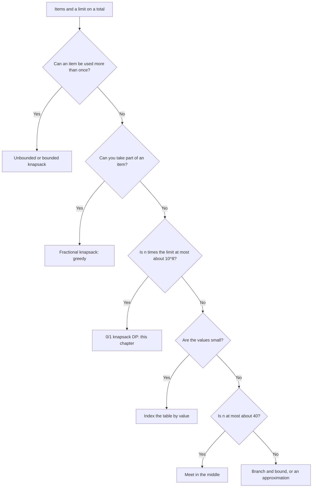
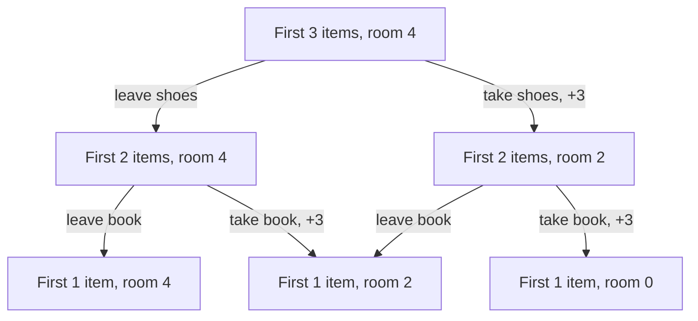

# 0/1 Knapsack

> **Level:** Intermediate · **Priority:** T1 · **Time:** 180 min · **Read first:** [DP from zero](01-dp-from-zero.md), [1D DP](02-one-dimensional-dp.md) · **Next:** [Unbounded knapsack](05-unbounded-knapsack.md)

In a 0/1 knapsack problem you go through a list of items, and for each item you choose: take it or leave it. This is one of the most common DP families in interviews. Many problems about subsets (any choice of items) and partitions (splits into groups) are this same problem with a new story.

## Quick revision

- **0/1 knapsack:** each item has a weight and a value, and you can use it at most once. Find the best total value that fits in a capacity.
- **State:** `dp[i][j]` is the best value using the first `i` items with capacity `j`.
- **Transition:** `dp[i][j] = max(dp[i-1][j], dp[i-1][j-w] + v)`. The first option leaves item `i`. The second takes it.
- **1D form:** `dp[j] = max(dp[j], dp[j-w] + v)`, with `j` going **down** from the capacity to `w`.
- **Why backwards:** the right side must still hold the values from before this item. A forward loop takes the same item many times, and that is [unbounded knapsack](05-unbounded-knapsack.md).
- **The question changes the operation:** `max` for the best value, OR for "is it possible", `+` for "how many", `min` for "cheapest".
- **The capacity type changes the start:** "at most" starts with all zeros. "Exactly" starts with only `dp[0]` valid. "At least" caps the index with `max(0, j - w)`.
- **Two equal groups:** subset sum with target `total / 2`. If `total` is odd, the answer is no.
- **Plus and minus signs:** count the subsets with sum `(total + target) / 2`.
- **Smallest difference between two groups:** find the largest subset sum `A` with `A <= total / 2`. The answer is `total - 2 * A`.
- **Two limits:** one table dimension and one backward loop for each limit.
- **One option per group:** capacity loop outside, option loop inside. This is group knapsack.
- **Bitset:** `bits |= bits << x` does one subset sum step in about `S / 64` operations.
- **List the chosen items:** keep the 2D table and walk back from `dp[n][W]`.
- **Cost:** O(n * W) time. This depends on the size of the number W, so W must be small. If W is huge, index by value or use [meet in the middle](../06-recursion-backtracking-greedy/08-meet-in-the-middle.md).

## How to recognize it

Ask these five questions. If all five answers are yes, use 0/1 knapsack.

1. Is there a list of items, and is each item a yes or no choice?
2. Can each item be used at most once?
3. Is there a limit or a target on a total (weight, sum, cost or time)?
4. Does only the chosen set matter, and not the position of the items? (The chosen items may have gaps between them.)
5. Is the limit small enough to be an array index? (n times the limit should be at most about 10^8.)

| Words in the problem | What they tell you |
|---|---|
| "each item at most once", "each number may be used once" | 0/1, so the loop runs backwards |
| "subset", "choose some of", "pick any number of" | Take or leave each item |
| "capacity", "budget", "weight limit", "at most W" | "At most" capacity: start with all zeros |
| "sum exactly to target", "fill exactly" | "Exactly" capacity: only `dp[0]` starts as valid |
| "at least minProfit", "at least n" | "At least" capacity: cap the index at the target |
| "can it be partitioned", "two groups with equal sum" | Subset sum with target `total / 2` |
| "put + or - before each number" | Count subsets with sum `(total + target) / 2` |
| "smallest possible difference", "smallest stone left" | Largest subset sum that is at most `total / 2` |
| "how many subsets", "number of ways" | Change `max` to `+` |
| "is it possible", "can you make" | Change `max` to OR |
| "at most m zeros and n ones", two budgets at once | Two capacities: a 2D table |
| "one from each group", "from each pile", "from each row" | Group knapsack |

**Read the constraints too.** They are often the fastest clue.

| Constraints | What they suggest |
|---|---|
| `n <= 200` and `sum <= 20000`, or `capacity <= 1000` | O(n * capacity) DP, as in this chapter |
| Capacity up to 10^9, but the sum of values is small | Index the table by value ([P10](#p10-knapsack-with-a-huge-capacity-classic-medium)) |
| Sum up to about 10^6, and the answer is only yes or no | Bitset ([section 8](#8-bitset-speed-up-for-subset-sum)) |
| `n <= 40`, and the numbers are huge | [Meet in the middle](../06-recursion-backtracking-greedy/08-meet-in-the-middle.md) |
| `n <= 20` | Trying all subsets is enough. Think of [bitmask DP](12-bitmask-dp.md) if the items affect each other. |

**Not this pattern if:**

| You see | Use instead | Why |
|---|---|---|
| "Unlimited supply", "use each coin any number of times" | [Unbounded knapsack](05-unbounded-knapsack.md) | The item stays available after you take it, so the loop runs forward. |
| Each item has a limited number of copies, such as "3 of each" | [Unbounded knapsack](05-unbounded-knapsack.md) | This is bounded knapsack. That chapter packs the copies into a few bundles, then runs the 0/1 loop on the bundles. |
| You may take a fraction of an item | [Fractional knapsack](../06-recursion-backtracking-greedy/07-greedy-classics.md) | Items can be cut, so nothing blocks a better pair. Greedy by value per weight is exact. |
| `n <= 40`, and the sum is too large for a table | [Meet in the middle](../06-recursion-backtracking-greedy/08-meet-in-the-middle.md) | There is no room for a table, but 2^(n/2) is small. |
| `n <= 20`, and the items affect each other (order, pairs) | [Bitmask DP](12-bitmask-dp.md) | A total is not enough to describe the state. You need the exact set of used items. |
| Split into k equal groups, with k above 2 | [Backtracking: constraint search](../06-recursion-backtracking-greedy/04-backtracking-constraint-search.md) | You must track several sums at once. |
| "List all subsets" | [Backtracking: subsets](../06-recursion-backtracking-greedy/02-backtracking-subsets.md) | You must print each one, so 2^n work cannot be avoided. |
| The chosen items must be contiguous (side by side, with no gaps) | [Prefix sums](../05-core-patterns/06-prefix-sums.md) or a [sliding window](../05-core-patterns/05-sliding-window-variable.md) | A subarray has no gaps, so there is no take or leave choice for each item. |
| "No two adjacent items" | [1D DP](02-one-dimensional-dp.md) | The rule depends on the previous item, not on a running total. |
| "Longest increasing subsequence" | [LIS](06-longest-increasing-subsequence.md) | The word "subsequence" appears, but each chosen item must fit the last chosen item. There is no running total. |
| Different orders count as different ways | [Unbounded knapsack](05-unbounded-knapsack.md) | That chapter shows how the loop order decides between combinations and permutations. |
| Taking an item forces you to take its parent in a tree | [Tree DP](11-tree-dp.md) | The items depend on each other through the tree. |
| "Smash the two heaviest stones" | [Top K with heaps](../05-core-patterns/14-top-k-and-heaps.md) | The rule fixes every move, so you only simulate. There are no choices to search. |

When a problem has items and a limit, this tree finds the tool:



## 1. The idea in plain English

You are packing a small bag for a flight. The bag holds 4 kg. You have three things at home:

| Item | Weight (kg) | Value to you |
|---|---|---|
| Laptop | 3 | 5 |
| Book | 2 | 3 |
| Shoes | 2 | 3 |

You cannot cut the laptop in half. You own only one of each thing. So for each thing you have two choices: take it or leave it. That is why this problem is called **0/1 knapsack**: you take 0 or 1 of each item. (A knapsack is a bag that you carry on your back.)

**Greedy fails.** The natural idea is to take the best thing first. The laptop has the highest value. It also has the best value per kg: 5 / 3 = 1.67, while the others have 3 / 2 = 1.5. So you take it. Now 1 kg of room is left, and nothing else fits. Your total is 5.

But the book and the shoes together weigh 4 kg and give 6. The laptop looked best on its own, but it blocked a better pair. A greedy rule never takes back a choice, so it cannot see this.

**The slow way tries every subset.** A **subset** is any choice of items, from none of them to all of them.

| Subset | Weight | Value | Fits in 4 kg? |
|---|---|---|---|
| nothing | 0 | 0 | yes |
| Laptop | 3 | 5 | yes |
| Book | 2 | 3 | yes |
| Shoes | 2 | 3 | yes |
| Laptop, Book | 5 | 8 | no |
| Laptop, Shoes | 5 | 8 | no |
| Book, Shoes | 4 | 6 | yes |
| Laptop, Book, Shoes | 7 | 11 | no |

The best subset that fits is the book and the shoes, with value 6. This method works, but n items have 2^n subsets. For n = 40, that is about a trillion.

**The idea that makes it fast.** Look at the last item, the shoes. There are only two cases.

- **Leave the shoes.** The answer is the best you can do with the laptop and the book in a 4 kg bag.
- **Take the shoes.** You get 3, and 2 kg of room is left. The answer is 3 plus the best you can do with the laptop and the book in a 2 kg bag.

Both cases are the same problem with one item fewer. To describe such a problem you need only two numbers: how many items are still in play, and how much room is left. You do not need to remember which items you took.



Look at the box `First 1 item, room 2`. Two different paths reach it: take the shoes and leave the book, or leave the shoes and take the book. Both paths lead to the same smaller problem, so you solve it once and reuse the answer.

Let W be the capacity, which is the most weight the bag can hold. There are only n + 1 choices for "how many items" and W + 1 choices for "how much room". So there are at most (n + 1)(W + 1) different problems. That is the whole trick: 2^n subsets collapse into a small table.

## 2. Take it or leave it: the recurrence

Use the five steps from [DP from zero](01-dp-from-zero.md). A **state** is the set of numbers that describes one smaller problem.

**Step 1: define the state in words.** `dp[i][j]` is the best total value using only the first `i` items, with capacity `j`.

**Step 2: write the transition.** Look at item number `i`. Call its weight `w` and its value `v`. There are two choices.

- **Leave it.** The capacity does not change, and `i - 1` items remain: `dp[i-1][j]`.
- **Take it.** This is possible only if `w <= j`. You gain `v`, and `j - w` of capacity remains for the earlier items: `dp[i-1][j-w] + v`.

```text
dp[i][j] = max( dp[i-1][j],          leave item i
                dp[i-1][j-w] + v )   take item i, only if w <= j
```

Look at the `i-1` in the take option. This is what makes it "0/1". After you take item `i`, only the items before it are available. So you cannot take it again.

**Step 3: base cases.** `dp[0][j] = 0` for every `j`, because no items give no value.

**Step 4: order of computation.** Row `i` reads only row `i - 1`. So fill the table from the top row down.

**Step 5: the answer.** `dp[n][W]`. All n items are allowed, and the full capacity is available. The best choice may still leave some items out.

One detail causes many bugs. Row `i` is about the first `i` items, but arrays start at 0. So item number `i` is stored at `weights[i - 1]`. Row 0 exists only to mean "no items yet".

## 3. The 2D table, filled by hand

Here is the tiny case again. The capacity is 4.

| Row | Item | Weight w | Value v |
|---|---|---|---|
| 1 | Laptop | 3 | 5 |
| 2 | Book | 2 | 3 |
| 3 | Shoes | 2 | 3 |

Row 0 is all zeros. Each other cell takes the better of two numbers:

- **Leave:** the cell straight above.
- **Take:** the cell in the row above, `w` columns to the left, plus `v`.

| Row | j | Does it fit? | Leave: `dp[i-1][j]` | Take: `dp[i-1][j-w] + v` | Result |
|---|---|---|---|---|---|
| 1 | 0, 1, 2 | no | 0 | | 0 |
| 1 | 3 | yes | 0 | `dp[0][0] + 5 = 5` | 5 |
| 1 | 4 | yes | 0 | `dp[0][1] + 5 = 5` | 5 |
| 2 | 0, 1 | no | 0 | | 0 |
| 2 | 2 | yes | 0 | `dp[1][0] + 3 = 3` | 3 |
| 2 | 3 | yes | 5 | `dp[1][1] + 3 = 3` | 5 |
| 2 | 4 | yes | 5 | `dp[1][2] + 3 = 3` | 5 |
| 3 | 0, 1 | no | 0 | | 0 |
| 3 | 2 | yes | 3 | `dp[2][0] + 3 = 3` | 3 |
| 3 | 3 | yes | 5 | `dp[2][1] + 3 = 3` | 5 |
| 3 | 4 | yes | 5 | `dp[2][2] + 3 = 6` | 6 |

The finished table:

| i \ j | 0 | 1 | 2 | 3 | 4 |
|---|---|---|---|---|---|
| 0 (no items) | 0 | 0 | 0 | 0 | 0 |
| 1 (Laptop) | 0 | 0 | 0 | 5 | 5 |
| 2 (Book) | 0 | 0 | 3 | 5 | 5 |
| 3 (Shoes) | 0 | 0 | 3 | 5 | 6 |

Read one cell aloud to check that you understand it. `dp[2][4] = 5` means that the best value is 5 when you use only the laptop and the book in a 4 kg bag. The answer is the bottom right cell, `dp[3][4] = 6`.

Every cell has the same shape:

```text
            j-w       j
row i-1      a        b
              \       |
               \ +v   |
row i            max(b, a + v)
```

Here are both ways to code it. **Top-down** means recursion with a memo table, which saves each answer the first time you compute it. **Bottom-up** means filling the table with loops. Both use the same recurrence and give the same answer.

```cpp
#include <bits/stdc++.h>
#include <cassert>
using namespace std;

// Top-down: the recurrence, written directly.
int knapsackMemo(const vector<int>& weights, const vector<int>& values, int capacity) {
    int n = (int)weights.size();
    vector<vector<int>> memo(n + 1, vector<int>(capacity + 1, -1));  // -1 means not computed yet
    function<int(int, int)> best = [&](int i, int j) {
        if (i == 0) return 0;  // no items, no value
        if (memo[i][j] != -1) return memo[i][j];
        int answer = best(i - 1, j);  // leave item i
        if (weights[i - 1] <= j) {    // take item i, if it fits
            answer = max(answer, best(i - 1, j - weights[i - 1]) + values[i - 1]);
        }
        memo[i][j] = answer;
        return answer;
    };
    return best(n, capacity);
}

// Bottom-up: the same table, filled row by row.
int knapsackTable(const vector<int>& weights, const vector<int>& values, int capacity) {
    int n = (int)weights.size();
    vector<vector<int>> dp(n + 1, vector<int>(capacity + 1, 0));  // row 0 means no items
    for (int i = 1; i <= n; i++) {
        int w = weights[i - 1], v = values[i - 1];  // row i is about item number i
        for (int j = 0; j <= capacity; j++) {
            dp[i][j] = dp[i - 1][j];  // leave item i
            if (w <= j) dp[i][j] = max(dp[i][j], dp[i - 1][j - w] + v);  // take item i
        }
    }
    return dp[n][capacity];
}

int main() {
    assert(knapsackMemo({3, 2, 2}, {5, 3, 3}, 4) == 6);
    assert(knapsackTable({3, 2, 2}, {5, 3, 3}, 4) == 6);
    assert(knapsackMemo({}, {}, 4) == 0);        // no items
    assert(knapsackTable({}, {}, 4) == 0);
    assert(knapsackMemo({5}, {9}, 4) == 0);      // the item is too heavy
    assert(knapsackTable({5}, {9}, 4) == 0);
    assert(knapsackMemo({2}, {3}, 4) == 3);      // one copy only, even if two would fit
    assert(knapsackTable({2}, {3}, 4) == 3);
    cout << "All tests passed\n";
}
```

Both are O(n * W) time and O(n * W) space, because the table has (n + 1)(W + 1) cells and each cell takes O(1) work. Top-down also uses O(n) space on the recursion stack, because each call goes down by one item.

Top-down visits only the cells it needs. Bottom-up has no recursion cost. It can also be reduced to one row, as the next section shows. In interviews, either one is fine for the first version.

## 4. From 2D to 1D, and why the loop runs backwards

Row `i` reads only row `i - 1`. So you do not need the whole table. Keep one array `dp`. Before item `i`, it holds row `i - 1`. After item `i`, it holds row `i`.

There is one danger. The update for `dp[j]` reads `dp[j - w]`, and that value must still be the old one from row `i - 1`. The loop direction decides whether it is.

Take one item with weight 2 and value 3, and capacity 4. You own one copy, so the right answer is 3.

**Forward loop (wrong):**

| j | Reads | Take gives | `dp` after this step |
|---|---|---|---|
| 2 | `dp[0] = 0` | 3 | `[0, 0, 3, 0, 0]` |
| 3 | `dp[1] = 0` | 3 | `[0, 0, 3, 3, 0]` |
| 4 | `dp[2] = 3`, which already holds the item | 6 | `[0, 0, 3, 3, 6]` |

At `j = 4`, the code reads a cell that it changed two steps ago. That cell already contains the item, so the item is counted twice.

**Backward loop (right):**

| j | Reads | Take gives | `dp` after this step |
|---|---|---|---|
| 4 | `dp[2] = 0` | 3 | `[0, 0, 0, 0, 3]` |
| 3 | `dp[1] = 0` | 3 | `[0, 0, 0, 3, 3]` |
| 2 | `dp[0] = 0` | 3 | `[0, 0, 3, 3, 3]` |

`dp[j - w]` always sits to the left of `dp[j]`. Going from right to left, the cells on the left are not touched yet. So they still hold the old row.

```text
a = old row, b = new row, and the item has weight 2.

Backward, from j = 4 down to j = 2:
  start:      a0  a1  a2  a3  a4
  after j=4:  a0  a1  a2  a3  b4     b4 read a2: old, good
  after j=3:  a0  a1  a2  b3  b4     b3 read a1: old, good
  after j=2:  a0  a1  b2  b3  b4     b2 read a0: old, good

Forward, from j = 2 up to j = 4:
  after j=2:  a0  a1  b2  a3  a4     b2 read a0: old, good
  after j=3:  a0  a1  b2  b3  a4     b3 read a1: old, good
  after j=4:  a0  a1  b2  b3  b4     b4 read b2: NEW, it may already hold this item
```

Now run the backward loop on the full tiny case. After each item, the array equals one row of the 2D table.

| After item | `dp[0..4]` | Same as row |
|---|---|---|
| none | `[0, 0, 0, 0, 0]` | 0 |
| Laptop (w=3, v=5) | `[0, 0, 0, 5, 5]` | 1 |
| Book (w=2, v=3) | `[0, 0, 3, 5, 5]` | 2 |
| Shoes (w=2, v=3) | `[0, 0, 3, 5, 6]` | 3 |

The rule is short:

- **Backward:** each item is used at most once. This is 0/1 knapsack.
- **Forward:** each item can be used many times. This is [unbounded knapsack](05-unbounded-knapsack.md).

```cpp
#include <bits/stdc++.h>
#include <cassert>
using namespace std;

// Backward: dp[j - w] is still the old row, so each item is used at most once.
int zeroOneKnapsack(const vector<int>& weights, const vector<int>& values, int capacity) {
    vector<int> dp(capacity + 1, 0);
    for (int i = 0; i < (int)weights.size(); i++) {
        for (int j = capacity; j >= weights[i]; j--) {
            dp[j] = max(dp[j], dp[j - weights[i]] + values[i]);
        }
    }
    return dp[capacity];
}

// Forward: dp[j - w] is already the new row, so an item can be taken again.
// This is a bug for 0/1 knapsack, and the correct loop for unbounded knapsack.
int forwardLoop(const vector<int>& weights, const vector<int>& values, int capacity) {
    vector<int> dp(capacity + 1, 0);
    for (int i = 0; i < (int)weights.size(); i++) {
        for (int j = weights[i]; j <= capacity; j++) {
            dp[j] = max(dp[j], dp[j - weights[i]] + values[i]);
        }
    }
    return dp[capacity];
}

int main() {
    assert(zeroOneKnapsack({2}, {3}, 4) == 3);     // one item, one copy
    assert(forwardLoop({2}, {3}, 4) == 6);         // the same item counted twice
    assert(zeroOneKnapsack({3, 2}, {5, 3}, 4) == 5);  // the laptop alone is best
    assert(forwardLoop({3, 2}, {5, 3}, 4) == 6);      // two copies of the book: wrong
    assert(zeroOneKnapsack({3, 2, 2}, {5, 3, 3}, 4) == 6);
    cout << "All tests passed\n";
}
```

Four more facts about this loop:

- **It stops at `w`.** Below `w` the item does not fit, so `dp[j]` keeps its old value. That is the "leave" choice, and it costs no work.
- **The item loop must be the outer loop.** If the capacity loop is outside, each `dp[j]` can pick only one item. [Section 10](#10-two-more-shapes-groups-and-differences) shows the one case where you want that.
- **The order of items does not matter.** Every subset is covered in any order, so the answer is the same.
- **Two arrays also work.** You can keep one array for the old row and one for the new row. That is always safe, but it uses twice the memory.

The cost is now O(n * W) time and O(W) space. The price of 1D is that you lose the history, so you cannot list the chosen items. [P8](#p8-recover-the-chosen-items-classic-medium) shows how to do that with the 2D table.

## 5. One template, many questions

The double loop stays the same in almost every problem of this chapter. Only three things change: what `dp[j]` stores, how it starts, and how the two options combine.

| You want | `dp[j]` means | Start | Update for an item of size `w` |
|---|---|---|---|
| Best value, weight at most W | Best value with capacity `j` | All 0 | `dp[j] = max(dp[j], dp[j-w] + v)` |
| Best value, weight exactly W | Best value with weight exactly `j` | `dp[0] = 0`, others impossible | The same, but skip `dp[j-w]` if it is impossible |
| Can a subset make sum S? | Can a subset make sum `j`? | `dp[0] = true`, others false | `dp[j] = dp[j] or dp[j-w]` |
| How many subsets make sum S? | Number of subsets with sum `j` | `dp[0] = 1`, others 0 | `dp[j] = dp[j] + dp[j-w]` |
| Cheapest subset with sum S | Lowest cost for sum `j` | `dp[0] = 0`, others infinity | `dp[j] = min(dp[j], dp[j-w] + c)` |

The logic is the same in every row. `dp[j]` on the right is "leave the item". `dp[j-w]` is "take the item". The row only says how to join the two options:

- For the best value, keep the larger one.
- For yes or no, either option is enough.
- For counting, add them. Leaving and taking can never be the same subset, so nothing is counted twice.

### At most or exactly: the start decides

Take one item with weight 2 and value 3, and capacity 3. Run the backward loop with two different starts.

| Start | `dp` before | `dp` after | What `dp[3]` says |
|---|---|---|---|
| All zeros | `[0, 0, 0, 0]` | `[0, 0, 3, 3]` | 3: the item fits, and 1 kg stays unused |
| Only `dp[0]` valid (`x` means impossible) | `[0, x, x, x]` | `[0, x, 3, x]` | Impossible: no subset weighs exactly 3 |

All zeros says that a bag of any size can start empty. So a chain of takes can begin at any capacity, and some room may stay unused. With only `dp[0]` valid, every chain of takes begins at weight 0. So the weights add up to exactly `j`.

### At least: cap the index

Sometimes a total must reach **at least** a target. Say you need at least 3 gold, and one item gives 5. Extra gold is worth nothing here. So 3, 4 and 100 gold all mean the same thing: enough. They can share one state.

Let `j` mean "I still need `j` more". After taking an item of size `w`, you need `max(0, j - w)` more. The index stops at 0, so it can never go negative. Start with `dp[0] = 0`, because needing nothing costs nothing. All other cells start at infinity.

```cpp snippet
for (int j = target; j >= 1; j--) {  // down to 1, not down to w
    dp[j] = min(dp[j], dp[max(0, j - w)] + cost);
}
```

Look at where the loop stops. In the other templates it stops at `w`, because an item larger than `j` does not fit. Here a large item is allowed, because going past the target is fine. [P13](#p13-painting-the-walls-leetcode-2742-hard) uses this loop. It stops at 1 because a minimum cost for 0 can never improve. [P12](#p12-profitable-schemes-leetcode-879-hard) uses the same idea for counting, and it runs down to 0, because the count for 0 changes too.

## 6. Turning a problem into knapsack

Most knapsack problems never say "knapsack". Ask four questions to find it.

1. **What is one item?** It is the thing you take or leave.
2. **What is its weight?** It is the number that adds up toward the limit.
3. **What is the capacity?** Is the total at most, exactly or at least some number?
4. **How do the options combine?** With `max`, OR, `+` or `min`?

Here are three classic disguises. A **disguise** is a new story around the same problem.

**Disguise 1: two equal groups.** Can `[1, 5, 11, 5]` be split into two groups with equal sums? This is a **partition**: each number goes into exactly one group. The total is 22, so each group must sum to 11. Here is the key point: if you find one subset with sum 11, the other numbers must also sum to 11. So the question becomes "is there a subset with sum `total / 2`?". If the total is odd, the answer is no. This is [P4](#p4-partition-equal-subset-sum-leetcode-416-medium).

**Disguise 2: plus and minus signs.** Put `+` or `-` before each number of `[1, 2, 3]` to make 2. Call the numbers with a plus sign group P. Call the numbers with a minus sign group N.

```text
sum(P) - sum(N) = target
sum(P) + sum(N) = total

Add the two lines:   2 * sum(P) = total + target
So:                  sum(P) = (total + target) / 2
```

Here `sum(P) = (6 + 2) / 2 = 4`. The only subset with sum 4 is `{1, 3}`, which gives `+1 -2 +3 = 2`. Each subset P fixes all the signs, so counting expressions means counting subsets. This is [P6](#p6-target-sum-leetcode-494-medium).

**Disguise 3: things that cancel out.** Take the stones `[1, 2, 4]`. When two stones smash, the lighter one vanishes and the heavier one loses that weight. Smash 4 and 2, and a stone of weight 2 remains. Smash 2 and 1, and a stone of weight 1 remains. The last stone is `4 - 2 - 1`. However you smash, the result is the stones with plus and minus signs. So the last stone is the difference between two groups. To make it small, make the groups as equal as you can. If the lighter group has sum `A`, the difference is `total - 2 * A`. So find the largest subset sum with `A <= total / 2`. This is [P5](#p5-last-stone-weight-ii-leetcode-1049-medium).

## 7. Two capacities

Sometimes an item uses two resources. For example, each string in [P9](#p9-ones-and-zeroes-leetcode-474-medium) uses some zeros and some ones. You have a limit on both.

The rule is: **each limit adds one dimension to the table and one nested loop.** `dp[a][b]` is the best value with at most `a` of the first resource and at most `b` of the second.

```cpp snippet
for (int i = 0; i < n; i++) {
    for (int a = limitA; a >= costA[i]; a--) {
        for (int b = limitB; b >= costB[i]; b--) {
            dp[a][b] = max(dp[a][b], dp[a - costA[i]][b - costB[i]] + value[i]);
        }
    }
}
```

Both loops run backwards, for the same reason as before. You might think that the outer loop alone is enough, because `dp[a - costA[i]]` is a row that this item has not touched. That fails when `costA[i]` is 0. Then `a - costA[i]` is `a`, which is the same row. Now only the inner loop protects you. [P9](#p9-ones-and-zeroes-leetcode-474-medium) shows this with one string. Running every loop backwards is always safe.

Three more facts about extra limits:

- A limit on the **number of items** is also a capacity. "Choose at most k items" gives each item a second weight of 1.
- You can mix capacity types. [P12](#p12-profitable-schemes-leetcode-879-hard) has "at most n members" in one dimension and "at least minProfit" in the other.
- The cost is O(n * A * B) time and O(A * B) space. Check that this product is at most about 10^8 before you write the code.

## 8. Bitset speed-up for subset sum

Subset sum asks only yes or no, so each cell needs only one bit. A **bitset** is an array of bits packed into 64-bit words. A **word** is a block of bits that the CPU can shift or OR in one step. So an operation on the whole bitset takes about `size / 64` steps, not `size` steps.

Let bit `j` mean "sum `j` can be made". Now look at what a left shift does. (Bit 0 is on the right.)

```text
reachable sums {0, 2}      00000000101
shift left by 3            00000101000     sums {3, 5}: each sum is 3 larger
OR with the original       00000101101     sums {0, 2, 3, 5}
```

Shifting by `x` adds `x` to every reachable sum. That is the "take" option for all capacities at once. The OR keeps the old sums, which is the "leave" option. So one step of subset sum is one line:

```cpp
#include <bits/stdc++.h>
#include <cassert>
using namespace std;

class Solution {
public:
    // Partition Equal Subset Sum with a bitset.
    // The total is at most 200 * 100, so half of it is at most 10000.
    bool canPartition(vector<int>& nums) {
        int total = accumulate(nums.begin(), nums.end(), 0);
        if (total % 2 != 0) return false;
        bitset<10001> reachable;
        reachable[0] = 1;  // the empty subset makes sum 0
        for (int x : nums) reachable |= reachable << x;  // leave x, or take x
        return reachable[total / 2];
    }
};

int main() {
    bitset<11> bits;
    bits[0] = 1;
    cout << "start    " << bits << "\n";
    for (int x : {2, 3, 5}) {
        bits |= bits << x;
        cout << "after " << x << "  " << bits << "\n";
    }

    Solution solution;
    vector<int> a = {1, 5, 11, 5};
    assert(solution.canPartition(a));
    vector<int> b = {1, 2, 5};
    assert(!solution.canPartition(b));  // the total is even, but no subset makes 4
    vector<int> c = {1, 2, 3, 5};
    assert(!solution.canPartition(c));  // the total is odd
    cout << "All tests passed\n";
}
```

```text output
start    00000000001
after 2  00000000101
after 3  00000101101
after 5  10110101101
All tests passed
```

The last bit pattern shows the sums {0, 2, 3, 5, 7, 8, 10}. Those are all the subset sums of 2, 3 and 5.

Why is there no backward loop? `bits << x` builds a new bitset from the old bits, and the OR happens after that. So each item is used once, and there is no direction to get wrong.

| n | Sum limit S | Plain loop steps (n * S) | Bitset steps (n * S / 64) |
|---|---|---|---|
| 200 | 10,000 | 2,000,000 | about 31,000 |
| 1,000 | 1,000,000 | 1,000,000,000 | about 15,600,000 |

The big-O is still O(n * S), because 64 is a constant. But in practice, that factor is the gap between "too slow" and "fast".

A bitset has limits:

- It holds only yes or no. It cannot count subsets or track the best value.
- Its size must be known when the code compiles. Use the largest size that the constraints allow.
- A local bitset lives on the stack, and a bitset with tens of millions of bits can overflow it. Make a huge one `static`, or allocate it on the heap.

**One more trick for experts.** Say all numbers add up to S. Then there are at most about `sqrt(2 * S)` different values, because 1 + 2 + ... + d is already about d^2 / 2. So when n is large, most numbers are repeats. Merge the repeats with the binary splitting from [Unbounded knapsack](05-unbounded-knapsack.md), and only O(sqrt(S)) items remain. With a bitset, this costs about O(S * sqrt(S) / 64).

[P14](#p14-maximum-total-reward-using-operations-ii-leetcode-3181-hard) is a real problem that needs a bitset. For more on shifts and masks, see [Bit manipulation](../05-core-patterns/17-bit-manipulation.md).

## 9. When the capacity is huge

The table needs W + 1 columns. If W is 10^9, you cannot build it. So look for what else is small.

| What is small | Method | Cost |
|---|---|---|
| n * W is at most about 10^8 | The normal table, indexed by capacity | O(n * W) |
| The sum of values V | Swap the roles: `dp[v]` is the smallest weight that gives value `v`. See [P10](#p10-knapsack-with-a-huge-capacity-classic-medium). | O(n * V) |
| n is at most about 40 | [Meet in the middle](../06-recursion-backtracking-greedy/08-meet-in-the-middle.md): split the items into two halves, list the weight and value of every subset of each half, then match the two lists | O(2^(n/2) * n) |
| The reachable totals are few | Keep a hash map or a sorted list of reachable states, not an array. Drop any state that is heavier and not better. | O(n * number of states) |
| Nothing, but the data is friendly | [Branch and bound](../06-recursion-backtracking-greedy/04-backtracking-constraint-search.md): search, and cut any branch that cannot beat the best so far | Exponential in the worst case, often fast |
| Nothing, and a near-best answer is enough | Scale all values down, then run the value DP. The result is within a chosen error e of the best. | O(n^3 / e) |

**Why O(n * W) is called pseudo-polynomial.** The running time grows with the **value** of W, not with the **length** of W. The number 1,000,000,000 takes only 10 digits to write, but the table needs a billion columns. Each new digit multiplies the work by 10. Polynomial time means a cost like L^2 or L^3, where L is the length of the input. This DP is not polynomial in that sense. It only looks polynomial, and that is what "pseudo-polynomial" means. 0/1 knapsack is NP-hard. In simple words, nobody knows an algorithm that stays fast for every input.

## 10. Two more shapes: groups and differences

### Group knapsack: one option from each group

Sometimes the items come in groups, and you may pick at most one item from each group. Think of a menu: one starter, one main dish, one dessert.

Treat each group as one decision. For each capacity, try every option in the group and keep the best.

```text
for each group:
    for j from capacity down to 1:          capacity loop outside
        for each option in the group:       option loop inside
            if option.weight <= j:
                dp[j] = max(dp[j], dp[j - option.weight] + option.value)
```

Inside the loop for one `j`, every option reads a smaller index. The backward loop has not changed that index yet, so it still holds the value from before this group. That is why two options from one group can never add up.

This works only when every option has a weight of at least 1. An option with weight 0 reads `dp[j]` itself, and that cell may already hold another option from this group. If a problem has such options, copy the array for each group, read only from the copy, and run `j` down to 0.

Try one group with two options: (weight 1, value 1) and (weight 1, value 2). The capacity is 2. The right answer is 2, because you may pick only one option.

| Loop order | `dp` after | Answer | Verdict |
|---|---|---|---|
| Capacity outside, options inside | `[0, 2, 2]` | 2 | Right: the best single option |
| Options outside, capacity inside | `[0, 2, 3]` | 3 | Wrong: it took both options, as if they were separate items |

If you must pick **exactly** one option from each group, there is no "leave" choice. So build a new array for each group, start it as all impossible, and fill it only from the array of the group before.

[P11](#p11-maximum-value-of-k-coins-from-piles-leetcode-2218-hard) uses this. Each pile is a group, and "take t coins from the top" is one option.

### When the index moves both ways: copy the array

So far, taking an item moved the index in one direction. So one backward loop was enough. In some problems the state is a **difference**, and an item can push it up or down. Say two stacks of rods differ in height by `d`. A new rod of length `r` gives a difference of `d + r` or `|d - r|`.

Now no loop direction is safe. Whichever way you go, you may read a cell that you already changed. Take a rod of length 3. If `d` goes up, `d = 1` writes to `d = 4`, and then `d = 4` reads that new value. So the same rod is used twice. If `d` goes down, `d = 5` writes to `d = 2`, and then `d = 2` reads that new value. The same thing happens.

The fix is to copy the array before each item:

```cpp snippet
vector<int> old = dp;  // freeze the values from before this rod
// Read only from old. Write only to dp.
```

The copy costs the same as the loop, so the big-O does not change. [P15](#p15-tallest-billboard-leetcode-956-hard) uses this.

If an index can go below zero, add the same number to every index. This number is called an **offset**. It must be big enough to lift the lowest possible sum to 0. In a plus-or-minus problem, the total of all numbers works. A hash map from the sum to its value also works.

## 11. Solved problems

Every problem below answers the same four questions from [section 6](#6-turning-a-problem-into-knapsack). Use this table to revise them.

| Problem | Item | Weight | Gain | Capacity | Combine |
|---|---|---|---|---|---|
| P1 Knapsack | object | its weight | its value | at most W | `max` |
| P2 Subset sum | number | the number | none | exactly target | OR |
| P3 Count subsets | number | the number | none | exactly target | `+` |
| P4 Partition | number | the number | none | exactly total / 2 | OR |
| P5 Last stone | stone | its weight | none | at most total / 2 | OR, then the largest true cell |
| P6 Target sum | number | the number | none | exactly (total + target) / 2 | `+` |
| P7 Longest subsequence | number | the number | 1 | exactly target | `max` |
| P8 Chosen items | object | its weight | its value | at most W | `max`, then walk back |
| P9 Ones and zeroes | string | zeros and ones | 1 | at most m and at most n | `max` |
| P10 Huge capacity | object | its value | its weight | exactly v | `min` |
| P11 Coins from piles | pile | coins taken | their sum | at most k | `max`, one option per pile |
| P12 Profitable schemes | crime | members, profit | none | at most n, at least minProfit | `+` |
| P13 Painting walls | wall | time + 1 | its cost | at least n | `min` |
| P14 Total reward | value | the value | none | only sums below the value | OR |
| P15 Billboard | rod | + or - its length | height | difference 0 | `max`, with a copy |

### P1. 0/1 Knapsack (Classic, Easy)

**Problem:** You have n items. Each item has a weight and a value, and you can take it at most once. Find the largest total value whose total weight is at most the capacity.

**Example:** `weights = [3, 2, 2]`, `values = [5, 3, 3]`, `capacity = 4` gives `6`, from the last two items.

**Pattern:** 0/1 knapsack

**How to recognize it:** Each item is used once. There is a limit on the total weight. You want the best total value. All five checklist answers are yes. Every other problem in this chapter is built from this one.

**Brute force:** Try all 2^n subsets and keep the best one that fits. With n = 40, that is about a trillion subsets.

**Key idea:** For each item, take it or leave it. Go through the capacities backwards, so that `dp[j - w]` still describes only the items before this one.

**Dry run:** See the table in [section 3](#3-the-2d-table-filled-by-hand) and the 1D trace in [section 4](#4-from-2d-to-1d-and-why-the-loop-runs-backwards).

```cpp
#include <bits/stdc++.h>
#include <cassert>
using namespace std;

long long knapsack(const vector<int>& weights, const vector<int>& values, int capacity) {
    vector<long long> dp(capacity + 1, 0);  // all zeros: a bag may stay partly empty
    for (int i = 0; i < (int)weights.size(); i++) {
        // Backwards, so that dp[j - weights[i]] does not include item i yet.
        for (int j = capacity; j >= weights[i]; j--) {
            dp[j] = max(dp[j], dp[j - weights[i]] + values[i]);
        }
    }
    return dp[capacity];
}

int main() {
    assert(knapsack({3, 2, 2}, {5, 3, 3}, 4) == 6);    // two small items beat the big one
    assert(knapsack({1, 3, 4}, {15, 20, 30}, 4) == 35);
    assert(knapsack({1, 2, 3}, {6, 10, 12}, 5) == 22);
    assert(knapsack({}, {}, 10) == 0);                  // no items
    assert(knapsack({5}, {10}, 4) == 0);                // the only item is too heavy
    assert(knapsack({2}, {3}, 0) == 0);                 // no capacity
    assert(knapsack({2}, {3}, 4) == 3);                 // one copy only: a forward loop gives 6
    cout << "All tests passed\n";
}
```

**Complexity:** O(n * W) time, because each of the n items updates up to W + 1 cells. O(W) space, because only one row is kept.

**Edge cases:** no items, capacity 0, or every item too heavy. In all three cases the answer is 0. The code needs no special check, because `dp` starts with zeros. Use `long long` when the total value can pass about 2 billion.

**Follow-up:** "What if you must list the items?" See [P8](#p8-recover-the-chosen-items-classic-medium). "What if the capacity is 10^9?" See [section 9](#9-when-the-capacity-is-huge).

### P2. Subset Sum (Classic, Easy)

**Problem:** Given positive numbers and a target, decide if some subset adds up to exactly the target.

**Example:** `nums = [2, 3, 5]`, `target = 8` gives `true`, from `3 + 5`. With `target = 4` the answer is `false`.

**Pattern:** 0/1 knapsack

**How to recognize it:** "Some subset" means take or leave each number. "Exactly the target" is an exact capacity. The answer is yes or no, so each cell holds a boolean.

**Brute force:** Try all 2^n subsets and add up each one. That is O(n * 2^n) time.

**Key idea:** `dp[j]` is true if a subset of the numbers seen so far makes the sum `j`. Start with only `dp[0]` true, because the empty subset makes 0. For a new number `x`, the sum `j` can be made in two ways: it could already be made (leave `x`), or `j - x` could already be made (take `x`).

**Dry run:** on `nums = [2, 3, 5]`, `target = 8`. `T` means the sum can be made.

| After item | 0 | 1 | 2 | 3 | 4 | 5 | 6 | 7 | 8 |
|---|---|---|---|---|---|---|---|---|---|
| start | T | F | F | F | F | F | F | F | F |
| 2 | T | F | T | F | F | F | F | F | F |
| 3 | T | F | T | T | F | T | F | F | F |
| 5 | T | F | T | T | F | T | F | T | T |

`dp[8]` is true. `dp[4]` and `dp[6]` stay false, because no subset makes them.

```cpp
#include <bits/stdc++.h>
#include <cassert>
using namespace std;

bool subsetSum(const vector<int>& nums, int target) {
    vector<bool> dp(target + 1, false);
    dp[0] = true;  // the empty subset makes sum 0
    for (int x : nums) {
        for (int j = target; j >= x; j--) {
            if (dp[j - x]) dp[j] = true;  // sum j - x was possible without x
        }
    }
    return dp[target];
}

int main() {
    assert(subsetSum({2, 3, 5}, 8) == true);
    assert(subsetSum({2, 3, 5}, 4) == false);
    assert(subsetSum({2, 3, 5}, 0) == true);   // the empty subset
    assert(subsetSum({}, 0) == true);          // no numbers, but sum 0 is still possible
    assert(subsetSum({}, 5) == false);
    assert(subsetSum({5}, 10) == false);       // 5 cannot be used twice
    assert(subsetSum({2, 2}, 4) == true);      // two different items with the same value
    cout << "All tests passed\n";
}
```

**Complexity:** O(n * target) time, because each of the n numbers updates up to target + 1 cells. O(target) space, because only one row is kept. For more speed, use a [bitset](#8-bitset-speed-up-for-subset-sum).

**Edge cases:** `target = 0` is always true, because of the empty subset. `[5]` with target 10 must be false, and a forward loop would wrongly say true.

**Follow-up:** "What if the numbers can be negative?" Shift every sum by the total of the negative numbers, so that each index is at least 0. The moves can now go up or down. So copy the array for each number, as in [section 10](#10-two-more-shapes-groups-and-differences).

### P3. Count Subsets With a Given Sum (Classic, Medium)

**Problem:** Given non-negative numbers and a target, count the subsets that add up to exactly the target. Equal numbers at different positions are different items.

**Example:** `nums = [1, 1, 2, 3]`, `target = 4` gives `3`: the first 1 with 3, the second 1 with 3, and 1 + 1 + 2.

**Pattern:** 0/1 knapsack, Counting DP

**How to recognize it:** "Count the subsets" asks for a number of ways, not a best value. So `max` becomes `+`.

**Brute force:** Try all 2^n subsets and count those with the right sum.

**Key idea:** The subsets with sum `j` are of two kinds: those without `x` (there are `dp[j]`) and those with `x` (there are `dp[j - x]`). No subset is of both kinds, so you add the two numbers. Start with `dp[0] = 1`, because there is one way to make 0: the empty subset.

**Dry run:** on `nums = [1, 1, 2, 3]`, `target = 4`.

| After item | `dp[0]` | `dp[1]` | `dp[2]` | `dp[3]` | `dp[4]` |
|---|---|---|---|---|---|
| start | 1 | 0 | 0 | 0 | 0 |
| 1 | 1 | 1 | 0 | 0 | 0 |
| 1 | 1 | 2 | 1 | 0 | 0 |
| 2 | 1 | 2 | 2 | 2 | 1 |
| 3 | 1 | 2 | 2 | 3 | 3 |

Look at the last row. `dp[4]` was 1, from the subset 1 + 1 + 2. The new 3 adds `dp[1] = 2` more subsets: each 1 with the 3. The total is 3.

```cpp
#include <bits/stdc++.h>
#include <cassert>
using namespace std;

long long countSubsets(const vector<int>& nums, int target) {
    vector<long long> dp(target + 1, 0);
    dp[0] = 1;  // one way to make 0: take nothing
    for (int x : nums) {
        // j stops at x, not at 1, so that x = 0 still updates dp[0].
        for (int j = target; j >= x; j--) {
            dp[j] += dp[j - x];  // subsets without x, plus subsets with x
        }
    }
    return dp[target];
}

int main() {
    assert(countSubsets({1, 1, 2, 3}, 4) == 3);
    assert(countSubsets({1, 2, 3}, 3) == 2);     // {1, 2} and {3}
    assert(countSubsets({}, 0) == 1);            // the empty subset
    assert(countSubsets({}, 3) == 0);
    assert(countSubsets({5}, 3) == 0);           // the number is too large
    assert(countSubsets({2, 2, 2}, 4) == 3);     // choose 2 of the 3 positions
    assert(countSubsets({0, 0, 1}, 1) == 4);     // each zero doubles the count
    assert(countSubsets({0, 0, 1}, 0) == 4);     // {}, {0}, {0}, {0, 0}
    cout << "All tests passed\n";
}
```

**Complexity:** O(n * target) time, because each of the n numbers updates up to target + 1 cells. O(target) space, because only one row is kept.

**Edge cases:** zeros. Taking or leaving a zero does not change the sum, so each zero doubles the count. The count can reach 2^n, so `long long` is safe only up to about n = 62. Larger problems ask for the answer [modulo](../11-math-geometry-games/03-modular-arithmetic.md) 10^9 + 7, which means the remainder after dividing by 10^9 + 7.

**Follow-up:** "For each item, how many subsets with this sum do not use it?" Build the full table once. For each item, take a copy of the table, so that the full table stays ready for the next item. To remove a positive number `x` from the copy, undo its update with a **forward** loop: `dp[j] -= dp[j - x]`, with `j` going up from `x`. It must run forward, because each step needs the restored value of `dp[j - x]`. A counting table can be undone like this. A `max` table cannot.

### P4. Partition Equal Subset Sum ([LeetCode 416](https://leetcode.com/problems/partition-equal-subset-sum/), Medium)

**Problem:** Decide if an array of positive numbers can be split into two groups with equal sums.

**Example:** `nums = [1, 5, 11, 5]` gives `true`: the groups are `[1, 5, 5]` and `[11]`.

**Pattern:** 0/1 knapsack

**How to recognize it:** "Two groups with equal sums" is Disguise 1 from [section 6](#6-turning-a-problem-into-knapsack). Each number goes into one group or the other, so it is take or leave for one group. The limits are `n <= 200` and `nums[i] <= 100`, so the total is at most 20,000. That is small enough to be an index.

**Brute force:** Try all 2^n ways to split. With n = 200, this never finishes.

**Key idea:** If one group sums to `total / 2`, the other group does too. So this is [subset sum](#p2-subset-sum-classic-easy) with target `total / 2`. An odd total cannot be split into two equal whole numbers.

**Dry run:** on `nums = [1, 5, 11, 5]`. The total is 22, so the target is 11.

| After item | Sums that can be made, up to 11 | Is 11 there? |
|---|---|---|
| start | 0 | no |
| 1 | 0, 1 | no |
| 5 | 0, 1, 5, 6 | no |
| 11 | 0, 1, 5, 6, 11 | yes |
| 5 | 0, 1, 5, 6, 10, 11 | yes |

```cpp
#include <bits/stdc++.h>
#include <cassert>
using namespace std;

class Solution {
public:
    bool canPartition(vector<int>& nums) {
        int total = accumulate(nums.begin(), nums.end(), 0);
        if (total % 2 != 0) return false;  // two equal whole numbers add up to an even number
        int half = total / 2;
        vector<bool> dp(half + 1, false);
        dp[0] = true;
        for (int x : nums) {
            for (int j = half; j >= x; j--) {
                if (dp[j - x]) dp[j] = true;
            }
        }
        return dp[half];
    }
};

int main() {
    Solution solution;
    vector<int> a = {1, 5, 11, 5};
    assert(solution.canPartition(a) == true);
    vector<int> b = {1, 2, 3, 5};
    assert(solution.canPartition(b) == false);  // the total is odd
    vector<int> c = {100};
    assert(solution.canPartition(c) == false);  // one number has no partner
    vector<int> d = {1, 1};
    assert(solution.canPartition(d) == true);
    vector<int> e = {1, 2, 5};
    assert(solution.canPartition(e) == false);  // even total, but 4 cannot be made
    vector<int> f = {2, 2, 3, 5};
    assert(solution.canPartition(f) == false);  // even total, but 6 cannot be made
    cout << "All tests passed\n";
}
```

**Complexity:** O(n * S) time, where S is `total / 2`. Each number updates up to S cells. O(S) space. The [bitset version](#8-bitset-speed-up-for-subset-sum) takes about O(n * S / 64) time.

**Edge cases:** one number; an odd total; an even total whose half cannot be made, such as `[1, 2, 5]`. A forward loop gets that last case wrong: it would make 4 as 1 + 1 + 1 + 1.

**Follow-up:** "What about k equal groups?" One running sum is no longer enough, because you must track k sums. See [backtracking: constraint search](../06-recursion-backtracking-greedy/04-backtracking-constraint-search.md).

### P5. Last Stone Weight II ([LeetCode 1049](https://leetcode.com/problems/last-stone-weight-ii/), Medium)

**Problem:** You have stones with positive weights. Each turn you pick any two stones and smash them. Equal stones both vanish. Otherwise the lighter one vanishes and the heavier one loses that weight. Find the smallest possible weight of the last stone, or 0 if no stone is left.

**Example:** `stones = [2, 7, 4, 1, 8, 1]` gives `1`. Smash 8 and 7 to get 1. Smash 4 and 2 to get 2. Smash that 2 with a 1 to get 1. Now three stones of weight 1 remain. Two of them vanish, and one stone of weight 1 is left.

**Pattern:** 0/1 knapsack

**How to recognize it:** The story is about smashing, but only the plus and minus signs matter. This is Disguise 3 from [section 6](#6-turning-a-problem-into-knapsack). You may pick "any two stones", so you have free choices to search. Compare [Last Stone Weight](../05-core-patterns/14-top-k-and-heaps.md), where the rule fixes every move. The total is at most 3,000, so a table fits.

**Brute force:** Try all 2^n ways to give the stones signs. With n = 30, that is about a billion.

**Key idea:** Every smash adds a minus sign. Smash 7 and 4 to get `7 - 4`. Smash that with 8 to get `8 - 7 + 4`. So the last stone is the difference between two groups: `total - 2 * A`, where `A` is the sum of the lighter group. To make it small, push `A` as close to `total / 2` as you can. Run subset sum up to `total / 2`, and pick the largest sum that can be made.

**Dry run:** on `stones = [2, 7, 4, 1, 8, 1]`. The total is 23, so the lighter group is at most 11.

| After stone | Sums that can be made, up to 11 |
|---|---|
| start | 0 |
| 2 | 0, 2 |
| 7 | 0, 2, 7, 9 |
| 4 | 0, 2, 4, 6, 7, 9, 11 |
| 1 | every sum from 0 to 11 |
| 8 | every sum from 0 to 11 |
| 1 | every sum from 0 to 11 |

The largest sum is 11, so the answer is `23 - 2 * 11 = 1`. For example, the groups are 7 + 4 = 11 and 2 + 1 + 8 + 1 = 12.

```cpp
#include <bits/stdc++.h>
#include <cassert>
using namespace std;

class Solution {
public:
    int lastStoneWeightII(vector<int>& stones) {
        int total = accumulate(stones.begin(), stones.end(), 0);
        int half = total / 2;  // the lighter group can never weigh more than half
        vector<bool> dp(half + 1, false);
        dp[0] = true;
        for (int stone : stones) {
            for (int j = half; j >= stone; j--) {
                if (dp[j - stone]) dp[j] = true;
            }
        }
        // The closer the lighter group is to half, the smaller the difference.
        int lighter = half;
        while (!dp[lighter]) lighter--;  // stops at 0 at the latest, because dp[0] is true
        return total - 2 * lighter;
    }
};

int main() {
    Solution solution;
    vector<int> a = {2, 7, 4, 1, 8, 1};
    assert(solution.lastStoneWeightII(a) == 1);
    vector<int> b = {31, 26, 33, 21, 40};
    assert(solution.lastStoneWeightII(b) == 5);
    vector<int> c = {5};
    assert(solution.lastStoneWeightII(c) == 5);    // one stone, nothing to smash
    vector<int> d = {3, 3};
    assert(solution.lastStoneWeightII(d) == 0);    // no stone is left
    vector<int> e = {1, 1, 100};
    assert(solution.lastStoneWeightII(e) == 98);   // one heavy stone cannot be balanced
    vector<int> f = {1, 2, 4};
    assert(solution.lastStoneWeightII(f) == 1);
    cout << "All tests passed\n";
}
```

**Complexity:** O(n * S) time, where S is `total / 2`, because each stone updates up to S + 1 cells. O(S) space, because only one row is kept.

**Edge cases:** one stone gives its own weight, because the only subset sum up to half is 0. Two equal stones give 0.

**Follow-up:** "Can the game always reach the best split?" Yes. Take the split with the smallest difference. Smash one stone from each group, and put what is left into the group of the heavier stone. The difference stays the same. Repeat until one group is empty. The other group now holds at most one stone, and its weight is the difference. Why not two stones? Each new stone is only the old stones with plus and minus signs, so a split of the new stones is also a split of the old ones. If the group held two stones, moving one across would make the difference smaller. That would beat the best split, which is impossible.

### P6. Target Sum ([LeetCode 494](https://leetcode.com/problems/target-sum/), Medium)

**Problem:** Put `+` or `-` before each number of an array. Count how many sign choices make the expression equal to a target.

**Example:** `nums = [1, 1, 1, 1, 1]`, `target = 3` gives `5`. The one minus sign can go on any of the five numbers.

**Pattern:** 0/1 knapsack, Counting DP

**How to recognize it:** Each number has a two-way choice, and you count the ways to reach a total. This is Disguise 2 from [section 6](#6-turning-a-problem-into-knapsack). The total of all numbers is at most 1,000, so a table fits.

**Brute force:** Try all 2^n sign choices. That is about a million for n = 20, so it passes here. But it stops working as soon as n grows, and the DP is much faster.

**Key idea:** `sum(P) = (total + target) / 2`, where P is the group with plus signs. So the answer is the number of subsets with that sum, as in [P3](#p3-count-subsets-with-a-given-sum-classic-medium). Two checks come first. If `|target| > total`, no signs can reach it. If `total + target` is odd, `sum(P)` would not be a whole number.

**Dry run:** on `nums = [1, 1, 1, 1, 1]`, `target = 3`. The total is 5, so `sum(P) = (5 + 3) / 2 = 4`.

| After item | `dp[0]` | `dp[1]` | `dp[2]` | `dp[3]` | `dp[4]` |
|---|---|---|---|---|---|
| start | 1 | 0 | 0 | 0 | 0 |
| 1 | 1 | 1 | 0 | 0 | 0 |
| 1 | 1 | 2 | 1 | 0 | 0 |
| 1 | 1 | 3 | 3 | 1 | 0 |
| 1 | 1 | 4 | 6 | 4 | 1 |
| 1 | 1 | 5 | 10 | 10 | 5 |

Each row is a line of Pascal's triangle, the number table where each number is the sum of the two above it. That happens here because all the numbers are 1. `dp[4] = 5` means there are 5 ways to pick four of the five numbers for the plus group.

```cpp
#include <bits/stdc++.h>
#include <cassert>
using namespace std;

class Solution {
public:
    int findTargetSumWays(vector<int>& nums, int target) {
        int total = accumulate(nums.begin(), nums.end(), 0);
        if (abs(target) > total) return 0;        // even all plus signs cannot reach it
        if ((total + target) % 2 != 0) return 0;  // sum(P) must be a whole number
        int plusSum = (total + target) / 2;

        vector<int> dp(plusSum + 1, 0);
        dp[0] = 1;  // one way to make 0: the empty plus group
        for (int x : nums) {
            // j stops at x, not at 1: x = 0 must double dp[0] as well.
            for (int j = plusSum; j >= x; j--) {
                dp[j] += dp[j - x];
            }
        }
        return dp[plusSum];
    }
};

int main() {
    Solution solution;
    vector<int> a = {1, 1, 1, 1, 1};
    assert(solution.findTargetSumWays(a, 3) == 5);
    vector<int> b = {1, 2, 3};
    assert(solution.findTargetSumWays(b, 2) == 1);   // +1 -2 +3
    assert(solution.findTargetSumWays(b, 0) == 2);   // +1 +2 -3 and -1 -2 +3
    assert(solution.findTargetSumWays(b, 7) == 0);   // beyond the total
    assert(solution.findTargetSumWays(b, 1) == 0);   // total + target is odd
    vector<int> c = {1};
    assert(solution.findTargetSumWays(c, -1) == 1);  // a negative target
    vector<int> d = {0, 0, 0};
    assert(solution.findTargetSumWays(d, 0) == 8);   // +0 and -0 are different choices
    vector<int> e = {1, 0};
    assert(solution.findTargetSumWays(e, 1) == 2);
    cout << "All tests passed\n";
}
```

**Complexity:** O(n * P) time, where P is `(total + target) / 2`, because each number updates up to P + 1 cells. O(P) space, because only one row is kept.

**Edge cases:** zeros. `+0` and `-0` are different choices with the same sum, so each zero doubles the answer. `target` can be negative. The formula still works, because `|target| <= total` keeps P at 0 or more.

**Follow-up:** "What if you do not see the algebra in the interview?" Index the table by the running sum plus `total`, so that sums from `-total` to `total` fit. Each number moves the index up or down, so build a new array for each number. Start the new array at zeros, because every number must take a sign and none can be left out. This is also O(n * total), only with a larger table.

### P7. Length of the Longest Subsequence That Sums to Target ([LeetCode 2915](https://leetcode.com/problems/length-of-the-longest-subsequence-that-sums-to-target/), Medium)

**Problem:** Find the length of the longest subsequence with sum exactly `target`, or -1 if there is none. A **subsequence** keeps the original order but may skip elements.

**Example:** `nums = [1, 2, 3, 4, 5]`, `target = 9` gives `3`, from `[1, 3, 5]` or `[2, 3, 4]`.

**Pattern:** 0/1 knapsack

**How to recognize it:** The word is "subsequence". But order does not change a sum, so this is a subset problem. "Exactly target" is an exact capacity. "Longest" means that each item has value 1.

**Brute force:** Try all 2^n subsequences.

**Key idea:** Each number has weight `x` and value 1. The sum must be exact, so start with `dp[0] = 0` and mark every other cell as impossible with -1. Never build on an impossible cell.

**Dry run:** on `nums = [1, 2, 3, 4, 5]`, `target = 9`. `x` means impossible.

| After item | 0 | 1 | 2 | 3 | 4 | 5 | 6 | 7 | 8 | 9 |
|---|---|---|---|---|---|---|---|---|---|---|
| start | 0 | x | x | x | x | x | x | x | x | x |
| 1 | 0 | 1 | x | x | x | x | x | x | x | x |
| 2 | 0 | 1 | 1 | 2 | x | x | x | x | x | x |
| 3 | 0 | 1 | 1 | 2 | 2 | 2 | 3 | x | x | x |
| 4 | 0 | 1 | 1 | 2 | 2 | 2 | 3 | 3 | 3 | 3 |
| 5 | 0 | 1 | 1 | 2 | 2 | 2 | 3 | 3 | 3 | 3 |

```cpp
#include <bits/stdc++.h>
#include <cassert>
using namespace std;

class Solution {
public:
    int lengthOfLongestSubsequence(vector<int>& nums, int target) {
        vector<int> dp(target + 1, -1);  // -1 means this exact sum cannot be made yet
        dp[0] = 0;                       // the empty subsequence makes 0
        for (int x : nums) {
            for (int j = target; j >= x; j--) {
                if (dp[j - x] != -1) dp[j] = max(dp[j], dp[j - x] + 1);
            }
        }
        return dp[target];
    }
};

int main() {
    Solution solution;
    vector<int> a = {1, 2, 3, 4, 5};
    assert(solution.lengthOfLongestSubsequence(a, 9) == 3);
    vector<int> b = {4, 1, 3, 2, 1, 5};
    assert(solution.lengthOfLongestSubsequence(b, 7) == 4);   // 1 + 3 + 2 + 1
    vector<int> c = {1, 1, 5, 4, 5};
    assert(solution.lengthOfLongestSubsequence(c, 3) == -1);  // no subset makes 3
    vector<int> d = {2};
    assert(solution.lengthOfLongestSubsequence(d, 3) == -1);  // zeros at the start would give 1
    vector<int> e = {5};
    assert(solution.lengthOfLongestSubsequence(e, 5) == 1);
    vector<int> f = {1, 1, 1};
    assert(solution.lengthOfLongestSubsequence(f, 3) == 3);   // every element is needed
    cout << "All tests passed\n";
}
```

**Complexity:** O(n * target) time, because each of the n numbers updates up to target + 1 cells. O(target) space, because only one row is kept.

**Edge cases:** no subset makes the target. If `dp` started with all zeros, `[2]` with target 3 would return 1: `dp[3]` would read `dp[1] = 0` and add 1. That is the "at most" meaning, and it is wrong here.

### P8. Recover the Chosen Items (Classic, Medium)

**Problem:** Solve 0/1 knapsack, but return the indexes of the chosen items.

**Example:** `weights = [3, 2, 2]`, `values = [5, 3, 3]`, `capacity = 4` gives `[1, 2]`, because items 1 and 2 give the best value, 6.

**Pattern:** 0/1 knapsack

**How to recognize it:** "Which items", "print the subset", "show the choice". The 1D array forgets how each value was made, so you need the full 2D table.

**Brute force:** Try all 2^n subsets and remember the best one.

**Key idea:** Build the 2D table, then walk back from `dp[n][W]`. At each row, compare the cell with the one straight above it. If they are equal, item `i` is not needed. Leave it. If they differ, leaving the item could not give this value. So it was taken. Subtract its weight from the room and go up one row.

**Dry run:** on the table from [section 3](#3-the-2d-table-filled-by-hand).

| Row i | room | `dp[i][room]` | `dp[i-1][room]` | Equal? | Decision | room after |
|---|---|---|---|---|---|---|
| 3 | 4 | 6 | 5 | no | take item index 2 | 2 |
| 2 | 2 | 3 | 0 | no | take item index 1 | 0 |
| 1 | 0 | 0 | 0 | yes | leave item index 0 | 0 |

The items were found from last to first, so reverse them to get `[1, 2]`.

```cpp
#include <bits/stdc++.h>
#include <cassert>
using namespace std;

// Returns the indexes of the chosen items, in increasing order.
vector<int> chooseItems(const vector<int>& weights, const vector<int>& values, int capacity) {
    int n = (int)weights.size();
    vector<vector<int>> dp(n + 1, vector<int>(capacity + 1, 0));
    for (int i = 1; i <= n; i++) {
        int w = weights[i - 1], v = values[i - 1];
        for (int j = 0; j <= capacity; j++) {
            dp[i][j] = dp[i - 1][j];
            if (w <= j) dp[i][j] = max(dp[i][j], dp[i - 1][j - w] + v);
        }
    }

    vector<int> chosen;
    int room = capacity;
    for (int i = n; i >= 1; i--) {
        // A change from the row above means that item i was needed for this value.
        if (dp[i][room] != dp[i - 1][room]) {
            chosen.push_back(i - 1);
            room -= weights[i - 1];
        }
    }
    reverse(chosen.begin(), chosen.end());
    return chosen;
}

int main() {
    assert(chooseItems({3, 2, 2}, {5, 3, 3}, 4) == vector<int>({1, 2}));
    assert(chooseItems({1, 2, 3}, {6, 10, 12}, 5) == vector<int>({1, 2}));
    assert(chooseItems({4, 1}, {10, 1}, 4) == vector<int>({0}));
    assert(chooseItems({}, {}, 5).empty());      // no items
    assert(chooseItems({5}, {9}, 4).empty());    // nothing fits
    assert(chooseItems({1, 1}, {5, 5}, 1) == vector<int>({0}));  // a tie: the later item is left
    cout << "All tests passed\n";
}
```

**Complexity:** O(n * W) time and O(n * W) space, because the walk needs every row. The walk itself is only O(n).

**Edge cases:** ties. When both options give the same value, this code leaves the item. Any best subset is correct, unless the problem asks for a specific one.

**Follow-up:** "Can you use less memory?" Keep the 1D array for the values, and store one bit `took[i][j]` for each cell. That is about 32 times smaller than a table of `int`. "What if ties must give the smallest indexes?" Build the table from the last item to the first, so that `dp[i][j]` describes items `i` to `n - 1`. Then walk from item 0 upward, and take each item whenever taking it still reaches the best total.

### P9. Ones and Zeroes ([LeetCode 474](https://leetcode.com/problems/ones-and-zeroes/), Medium)

**Problem:** You get a list of binary strings and two limits, `m` and `n`. Find the size of the largest subset of strings that together use at most `m` zeros and at most `n` ones.

**Example:** `strs = ["10", "0001", "111001", "1", "0"]`, `m = 5`, `n = 3` gives `4`, from `"10"`, `"0001"`, `"1"` and `"0"`.

**Pattern:** 0/1 knapsack

**How to recognize it:** "Largest subset" means take or leave each string. There are two limits at the same time, so each string has two weights: its zeros and its ones. That is [two capacities](#7-two-capacities).

**Brute force:** Try all 2^k subsets of the k strings. With k = 600, this never finishes.

**Key idea:** `dp[i][j]` is the largest subset with at most `i` zeros and at most `j` ones. Each string has value 1. Both loops run backwards, so that each string is used at most once.

**Dry run:** on `strs = ["10", "0", "1"]`, `m = 1`, `n = 1`. Rows are the zeros allowed, and columns are the ones allowed.

```text
start            after "10"       after "0"        after "1"
     j=0  j=1         j=0  j=1         j=0  j=1         j=0  j=1
i=0   0    0     i=0   0    0     i=0   0    0     i=0   0    1
i=1   0    0     i=1   0    1     i=1   1    1     i=1   1    2
```

`dp[1][1] = 2` means that one zero and one one are enough for two strings: `"0"` and `"1"`. The string `"10"` would use up both limits for only one string.

```cpp
#include <bits/stdc++.h>
#include <cassert>
using namespace std;

class Solution {
public:
    int findMaxForm(vector<string>& strs, int m, int n) {
        // dp[i][j]: the largest subset with at most i zeros and at most j ones.
        vector<vector<int>> dp(m + 1, vector<int>(n + 1, 0));
        for (const string& s : strs) {
            int zeros = (int)count(s.begin(), s.end(), '0');
            int ones = (int)s.size() - zeros;
            // Both loops run backwards: with zeros = 0, dp[i - zeros] is this same row.
            for (int i = m; i >= zeros; i--) {
                for (int j = n; j >= ones; j--) {
                    dp[i][j] = max(dp[i][j], dp[i - zeros][j - ones] + 1);
                }
            }
        }
        return dp[m][n];
    }
};

int main() {
    Solution solution;
    vector<string> a = {"10", "0001", "111001", "1", "0"};
    assert(solution.findMaxForm(a, 5, 3) == 4);
    vector<string> b = {"10", "0", "1"};
    assert(solution.findMaxForm(b, 1, 1) == 2);
    assert(solution.findMaxForm(b, 0, 0) == 0);  // no budget at all
    vector<string> c = {"0", "0"};
    assert(solution.findMaxForm(c, 1, 0) == 1);  // the budget pays for only one of the two
    vector<string> c2 = {"0"};
    assert(solution.findMaxForm(c2, 2, 0) == 1);  // one string only: a forward loop gives 2
    vector<string> d = {"111", "000"};
    assert(solution.findMaxForm(d, 3, 0) == 1);  // "111" costs no zeros, but it does not fit
    vector<string> e = {"1", "1", "1"};
    assert(solution.findMaxForm(e, 0, 2) == 2);  // no zeros needed
    cout << "All tests passed\n";
}
```

**Complexity:** O(L + k * m * n) time, where L is the total length of the strings and k is their number. Counting the characters costs L, and each string updates up to (m + 1)(n + 1) cells. O(m * n) space.

**Edge cases:** a string with no zeros, such as `"1"`. Then `i - zeros` is `i`, which is the same row. So the inner loop must run backwards too. With a forward inner loop, `strs = ["1"]`, `m = 0`, `n = 2` would count the one string twice.

### P10. Knapsack With a Huge Capacity (Classic, Medium)

**Problem:** Solve 0/1 knapsack with at most 100 items, where weights and the capacity can be as large as 10^9. Each value is at most 1,000.

**Example:** `weights = [3, 2, 2]`, `values = [5, 3, 3]`, `capacity = 4` gives `6`, from the last two items. The same code also solves `weights = [800000000, 600000000, 400000000]`, `values = [10, 7, 6]`, `capacity = 1000000000`, which gives `13`.

**Pattern:** 0/1 knapsack

**How to recognize it:** The capacity is 10^9, so a table with one column per capacity cannot exist. But the total value is at most 100 * 1,000 = 100,000. When one axis is too big, look for another axis that is small.

**Brute force:** Try all 2^n subsets. The normal DP would need 10^9 columns.

**Key idea:** Swap the roles of weight and value. `dp[v]` is the smallest total weight that gives a total value of exactly `v`. The answer is the largest `v` with `dp[v] <= capacity`.

**Dry run:** on the small example. Each pair `v:w` means that value `v` needs at least weight `w`.

| After item | Pairs `v:w` |
|---|---|
| start | 0:0 |
| weight 3, value 5 | 0:0, 5:3 |
| weight 2, value 3 | 0:0, 3:2, 5:3, 8:5 |
| weight 2, value 3 | 0:0, 3:2, 5:3, 6:4, 8:5, 11:7 |

With capacity 4, the pairs that fit are 0:0, 3:2, 5:3 and 6:4. The largest value is 6.

```cpp
#include <bits/stdc++.h>
#include <cassert>
using namespace std;

int knapsackHugeCapacity(const vector<long long>& weights, const vector<int>& values, long long capacity) {
    int totalValue = accumulate(values.begin(), values.end(), 0);
    const long long IMPOSSIBLE = LLONG_MAX / 2;  // small enough that adding a weight cannot overflow
    vector<long long> dp(totalValue + 1, IMPOSSIBLE);  // dp[v]: smallest weight for exactly value v
    dp[0] = 0;
    for (int i = 0; i < (int)weights.size(); i++) {
        for (int v = totalValue; v >= values[i]; v--) {
            dp[v] = min(dp[v], dp[v - values[i]] + weights[i]);
        }
    }
    int best = 0;
    for (int v = 0; v <= totalValue; v++) {
        if (dp[v] <= capacity) best = v;  // v only grows, so this keeps the largest one
    }
    return best;
}

int main() {
    assert(knapsackHugeCapacity({3, 2, 2}, {5, 3, 3}, 4) == 6);
    assert(knapsackHugeCapacity({800000000, 600000000, 400000000}, {10, 7, 6}, 1000000000) == 13);
    assert(knapsackHugeCapacity({}, {}, 1000000000) == 0);   // no items
    assert(knapsackHugeCapacity({5}, {9}, 4) == 0);          // nothing fits
    assert(knapsackHugeCapacity({1000000000, 1000000000}, {2, 3}, 2000000000) == 5);  // all fit exactly
    assert(knapsackHugeCapacity({1000000000, 1000000000}, {2, 3}, 1999999999) == 3);  // one short
    cout << "All tests passed\n";
}
```

**Complexity:** O(n * V) time, where V is the sum of all values, because each item updates up to V + 1 cells. O(V) space, because only one row is kept. The size of the weights no longer matters.

**Edge cases:** `IMPOSSIBLE` must leave room for an addition. With `LLONG_MAX`, the sum `dp[v - values[i]] + weights[i]` would overflow.

**Follow-up:** "What if the values are huge too?" Then both axes are too big. See the table in [section 9](#9-when-the-capacity-is-huge).

### P11. Maximum Value of K Coins From Piles ([LeetCode 2218](https://leetcode.com/problems/maximum-value-of-k-coins-from-piles/), Hard)

**Problem:** You have several piles of coins. In one move you take the top coin of any pile. Make exactly `k` moves, and find the largest total value.

**Example:** `piles = [[1, 100, 3], [7, 8, 9]]`, `k = 2` gives `101`: take the 1, then the 100 under it.

**Pattern:** 0/1 knapsack, Prefix sum

**How to recognize it:** You can only take from the top, so the only choice for a pile is **how many** coins to take. That is one decision per pile with several options, and a limit of k on the total. This is [group knapsack](#group-knapsack-one-option-from-each-group), and each pile is a group. Taking the largest top coin fails, because the 100 hides under the 1.

**Brute force:** Try every way to divide k moves among the piles. This grows exponentially with the number of piles.

**Key idea:** Taking `t` coins from a pile is one option, with weight `t` and a value equal to the sum of the top `t` coins. For each pile and each `j` going down, try every `t` and keep the best.

**Dry run:** on `piles = [[1, 100, 3], [7, 8, 9]]`, `k = 2`.

| Pile | j | t | `dp[j-t]` | Top t coins | Candidate | `dp[j]` after |
|---|---|---|---|---|---|---|
| [1, 100, 3] | 2 | 1 | 0 | 1 | 1 | 1 |
| [1, 100, 3] | 2 | 2 | 0 | 101 | 101 | 101 |
| [1, 100, 3] | 1 | 1 | 0 | 1 | 1 | 1 |
| [7, 8, 9] | 2 | 1 | 1 | 7 | 8 | 101 |
| [7, 8, 9] | 2 | 2 | 0 | 15 | 15 | 101 |
| [7, 8, 9] | 1 | 1 | 0 | 7 | 7 | 7 |

The final array is `[0, 7, 101]`, so the answer is 101. Look at the fourth row. `dp[1]` is still 1 from the first pile, because `j = 2` runs before `j = 1`. So an option never builds on another option from the same pile.

```cpp
#include <bits/stdc++.h>
#include <cassert>
using namespace std;

class Solution {
public:
    int maxValueOfCoins(vector<vector<int>>& piles, int k) {
        vector<int> dp(k + 1, 0);  // dp[j]: best value with at most j coins so far
        for (const vector<int>& pile : piles) {
            // Capacity outside, options inside: one pile gives only one option.
            for (int j = k; j >= 1; j--) {
                int topCoins = 0;  // the sum of the top t coins of this pile
                for (int t = 1; t <= min(j, (int)pile.size()); t++) {
                    topCoins += pile[t - 1];
                    dp[j] = max(dp[j], dp[j - t] + topCoins);  // dp[j - t] is from before this pile
                }
            }
        }
        return dp[k];
    }
};

int main() {
    Solution solution;
    vector<vector<int>> a = {{1, 100, 3}, {7, 8, 9}};
    assert(solution.maxValueOfCoins(a, 2) == 101);
    vector<vector<int>> b = {{100}, {100}, {100}, {100}, {100}, {100}, {1, 1, 1, 1, 1, 1, 700}};
    assert(solution.maxValueOfCoins(b, 7) == 706);  // the last pile alone beats six 100s
    vector<vector<int>> c = {{5}};
    assert(solution.maxValueOfCoins(c, 1) == 5);    // one coin
    vector<vector<int>> d = {{1, 1, 100}, {50}};
    assert(solution.maxValueOfCoins(d, 3) == 102);  // dig down for the 100
    assert(solution.maxValueOfCoins(d, 1) == 50);   // too few moves to reach the 100
    vector<vector<int>> e = {{3, 2, 1}};
    assert(solution.maxValueOfCoins(e, 3) == 6);    // k equals the number of coins
    cout << "All tests passed\n";
}
```

**Complexity:** O(k * C) time, where C is the total number of coins. A pile of size s costs k * s steps. O(k) space, because only one row is kept.

**Edge cases:** `min(j, pile size)` stops `t` from reading past the end of a pile. The problem says "exactly k", but `dp` means "at most". This is safe here: all coins are positive and k is at most the number of coins, so the best choice always uses all k moves.

### P12. Profitable Schemes ([LeetCode 879](https://leetcode.com/problems/profitable-schemes/), Hard)

**Problem:** A gang has `n` members. Crime `i` needs `group[i]` members and earns `profit[i]`. A member can join only one crime. Count the subsets of crimes that use at most `n` members and earn at least `minProfit`. Return the count modulo 10^9 + 7.

**Example:** `n = 5`, `minProfit = 3`, `group = [2, 2]`, `profit = [2, 3]` gives `2`: crime 1 alone, or both crimes.

**Pattern:** 0/1 knapsack, Counting DP

**How to recognize it:** "Subset of crimes" is take or leave. Two totals have rules: members are "at most" and profit is "at least". So there are [two capacities](#7-two-capacities), and one of them is the [at-least kind](#at-least-cap-the-index). "Count" means `+`, and the modulo is a sign that the count is huge.

**Brute force:** Try all 2^k subsets of the k crimes. With k = 100, this never finishes.

**Key idea:** `dp[i][j]` is the number of schemes with at most `i` members and at least `j` profit. If a crime earns more than `j`, the other crimes need to earn nothing. So the profit still needed is `max(0, j - profit)`. This keeps the second index between 0 and `minProfit`.

The start needs care. With no crimes, the only scheme is the empty one. It uses 0 members, so it counts for every `i`. It earns 0, so it counts only for `j = 0`. So `dp[i][0] = 1`, and all other cells are 0.

**Dry run:** on the example. Rows are the member limit `i`, and columns are the profit target `j`.

```text
start                     after crime 0             after crime 1
                          (2 members, profit 2)     (2 members, profit 3)
     j=0 j=1 j=2 j=3           j=0 j=1 j=2 j=3           j=0 j=1 j=2 j=3
i=0   1   0   0   0       i=0   1   0   0   0       i=0   1   0   0   0
i=1   1   0   0   0       i=1   1   0   0   0       i=1   1   0   0   0
i=2   1   0   0   0       i=2   2   1   1   0       i=2   3   2   2   1
i=3   1   0   0   0       i=3   2   1   1   0       i=3   3   2   2   1
i=4   1   0   0   0       i=4   2   1   1   0       i=4   4   3   3   2
i=5   1   0   0   0       i=5   2   1   1   0       i=5   4   3   3   2
```

Read two cells. `dp[2][0] = 3` means that 3 schemes use at most 2 members: nothing, crime 0, and crime 1. `dp[4][3] = 2` means that 2 schemes use at most 4 members and earn at least 3: crime 1, and both crimes. The answer is `dp[5][3] = 2`.

```cpp
#include <bits/stdc++.h>
#include <cassert>
using namespace std;

class Solution {
public:
    int profitableSchemes(int n, int minProfit, vector<int>& group, vector<int>& profit) {
        const int MOD = 1000000007;
        // dp[i][j]: the number of schemes with at most i members and at least j profit.
        vector<vector<int>> dp(n + 1, vector<int>(minProfit + 1, 0));
        // The empty scheme fits in any number of members, and it earns only 0.
        for (int i = 0; i <= n; i++) dp[i][0] = 1;

        for (int crime = 0; crime < (int)group.size(); crime++) {
            for (int i = n; i >= group[crime]; i--) {
                for (int j = minProfit; j >= 0; j--) {
                    // Profit beyond the target is not needed, so the index stops at 0.
                    int stillNeeded = max(0, j - profit[crime]);
                    dp[i][j] = (dp[i][j] + dp[i - group[crime]][stillNeeded]) % MOD;
                }
            }
        }
        return dp[n][minProfit];
    }
};

int main() {
    Solution solution;
    vector<int> group1 = {2, 2}, profit1 = {2, 3};
    assert(solution.profitableSchemes(5, 3, group1, profit1) == 2);

    vector<int> group2 = {2, 3, 5}, profit2 = {6, 7, 8};
    assert(solution.profitableSchemes(10, 5, group2, profit2) == 7);  // every non-empty subset

    vector<int> group3 = {1, 1}, profit3 = {0, 0};
    assert(solution.profitableSchemes(1, 0, group3, profit3) == 3);   // the empty scheme counts

    vector<int> group4 = {2}, profit4 = {100};
    assert(solution.profitableSchemes(1, 1, group4, profit4) == 0);   // too few members

    vector<int> group5 = {1, 1}, profit5 = {1, 0};
    assert(solution.profitableSchemes(2, 1, group5, profit5) == 2);   // a zero-profit crime can join

    vector<int> group6(100, 1), profit6(100, 0);
    long long expected = 1;  // every subset of 100 crimes works, so the answer is 2^100
    for (int i = 0; i < 100; i++) expected = expected * 2 % 1000000007;
    assert(solution.profitableSchemes(100, 0, group6, profit6) == expected);
    cout << "All tests passed\n";
}
```

**Complexity:** O(k * n * minProfit) time, where k is the number of crimes. Each crime updates up to (n + 1)(minProfit + 1) cells. O(n * minProfit) space.

**Edge cases:** `minProfit = 0`, where the empty scheme counts. A crime that needs more than `n` members, where the loop on `i` never runs. Two values below 10^9 + 7 add up to less than 2^31, so `int` is safe before the modulo.

### P13. Painting the Walls ([LeetCode 2742](https://leetcode.com/problems/painting-the-walls/), Hard)

**Problem:** There are `n` walls. A paid painter paints wall `i` in `time[i]` units of time for `cost[i]` money. A free painter paints any wall in 1 unit of time for free, but only while the paid painter is busy. Find the minimum cost to paint all the walls.

**Example:** `cost = [1, 2, 3, 2]`, `time = [1, 2, 3, 2]` gives `3`. The paid painter does walls 0 and 1, which takes 3 units of time. In that time, the free painter does walls 2 and 3.

**Pattern:** 0/1 knapsack

**How to recognize it:** Two painters and a timeline look like a scheduling problem. Look for the real choice: each wall is either paid or free, and that is take or leave. Then look for the real rule: the paid walls must buy enough time for all the others. A total that must reach a target at the minimum cost is an ["at least" knapsack](#at-least-cap-the-index).

**Brute force:** Try all 2^n ways to choose the paid walls. With n = 500, this never finishes.

**Key idea:** If you pay for wall `i`, that wall is done. The free painter also gets `time[i]` units of time, so `time[i]` more walls are done. So paying for wall `i` covers `time[i] + 1` walls. The order of the paid walls does not matter, because only their total time counts. So each wall is an item with weight `time[i] + 1` and cost `cost[i]`, and you want the cheapest set with total weight at least `n`. `dp[j]` is the minimum cost to cover at least `j` walls.

**Dry run:** on the example, with `n = 4`.

| Wall | Covers | Cost | `dp[0]` | `dp[1]` | `dp[2]` | `dp[3]` | `dp[4]` |
|---|---|---|---|---|---|---|---|
| start | | | 0 | inf | inf | inf | inf |
| 0 | 2 | 1 | 0 | 1 | 1 | inf | inf |
| 1 | 3 | 2 | 0 | 1 | 1 | 2 | 3 |
| 2 | 4 | 3 | 0 | 1 | 1 | 2 | 3 |
| 3 | 3 | 2 | 0 | 1 | 1 | 2 | 3 |

Look at wall 1 and `j = 4`. It reads `dp[max(0, 4 - 3)] = dp[1] = 1` and adds 2, which gives 3. That means: pay for walls 0 and 1. The other two walls cannot beat it, so the answer is `dp[4] = 3`.

```cpp
#include <bits/stdc++.h>
#include <cassert>
using namespace std;

class Solution {
public:
    int paintWalls(vector<int>& cost, vector<int>& time) {
        int n = (int)cost.size();
        const int IMPOSSIBLE = 1000000000;  // above any real total, and safe to add to
        vector<int> dp(n + 1, IMPOSSIBLE);  // dp[j]: minimum cost to cover at least j walls
        dp[0] = 0;
        for (int i = 0; i < n; i++) {
            int covered = time[i] + 1;  // this wall, plus the walls the free painter does
            // j runs down to 1, not down to covered: going past the target is allowed.
            for (int j = n; j >= 1; j--) {
                dp[j] = min(dp[j], dp[max(0, j - covered)] + cost[i]);
            }
        }
        return dp[n];
    }
};

int main() {
    Solution solution;
    vector<int> cost1 = {1, 2, 3, 2}, time1 = {1, 2, 3, 2};
    assert(solution.paintWalls(cost1, time1) == 3);
    vector<int> cost2 = {2, 3, 4, 2}, time2 = {1, 1, 1, 1};
    assert(solution.paintWalls(cost2, time2) == 4);   // pay for the two cheapest walls
    vector<int> cost3 = {5}, time3 = {1};
    assert(solution.paintWalls(cost3, time3) == 5);   // one wall must be paid for
    vector<int> cost4 = {10, 1}, time4 = {1, 2};
    assert(solution.paintWalls(cost4, time4) == 1);   // one wall covers more than n
    vector<int> cost5 = {1, 1, 100}, time5 = {1, 1, 2};
    assert(solution.paintWalls(cost5, time5) == 2);   // two cheap walls beat one slow wall
    cout << "All tests passed\n";
}
```

**Complexity:** O(n^2) time, because each of the n walls updates up to n cells. O(n) space.

**Edge cases:** one paid wall can cover more than `n`. The index then reaches 0 through `max(0, ...)`. `IMPOSSIBLE + cost[i]` is at most 1,001,000,000, so it fits in an `int`.

### P14. Maximum Total Reward Using Operations II ([LeetCode 3181](https://leetcode.com/problems/maximum-total-reward-using-operations-ii/), Hard)

**Problem:** You start with a total `x = 0`. You may pick each element of an array at most once, but only if it is greater than the current `x`. It is then added to `x`. Find the largest total you can reach.

**Example:** `rewardValues = [1, 6, 4, 3, 2]` gives `11`: take 1, then 4, then 6.

**Pattern:** 0/1 knapsack, Sorting, Bitset speed-up

**How to recognize it:** Each value is take or leave, and the state is a total. That is subset sum. The twist is that a value can join only totals smaller than itself. There are up to 5 * 10^4 values, and each is at most 5 * 10^4. So a plain table costs about 5 * 10^9 steps. Yes-or-no cells with limits like that point to a [bitset](#8-bitset-speed-up-for-subset-sum).

**Brute force:** Try all 2^n subsets in all orders.

**Key idea:** Three facts make this simple.

1. **Sort first.** After you take a value `v`, the total is at least `v`. So the next value must be larger than `v`. The chosen values always increase, so you can go through them in sorted order.
2. **Remove duplicates.** The chosen values strictly increase, so two equal values can never both be taken.
3. **Bound the answer.** The last value taken is at most `max`, and the total before it is below that value. So the answer is below `2 * max`. Since `max` is at most 50,000, the answer is below 100,000.

Let bit `s` of `reachable` mean "total `s` can be made". For a value `v`, only totals below `v` may take it. So keep the low `v` bits, shift them left by `v`, and OR them in.

```text
Example with SIZE = 8 and v = 3. Bits are written with bit 0 on the right.
reachable                   00001011     totals {0, 1, 3}
shift left by SIZE - v      01100000     only bits below v survive, at the top
shift right by SIZE - v     00000011     totals {0, 1}: the low bits, back in place
shift left by v             00011000     totals {3, 4}: each one plus v
OR into reachable           00011011     totals {0, 1, 3, 4}
```

**Dry run:** on `[1, 6, 4, 3, 2]`, which is `[1, 2, 3, 4, 6]` after sorting.

| Value v | Totals below v | After adding v | Reachable totals |
|---|---|---|---|
| start | | | 0 |
| 1 | 0 | 1 | 0, 1 |
| 2 | 0, 1 | 2, 3 | 0 to 3 |
| 3 | 0, 1, 2 | 3, 4, 5 | 0 to 5 |
| 4 | 0, 1, 2, 3 | 4, 5, 6, 7 | 0 to 7 |
| 6 | 0 to 5 | 6 to 11 | 0 to 11 |

The largest reachable total is 11.

```cpp
#include <bits/stdc++.h>
#include <cassert>
using namespace std;

class Solution {
public:
    int maxTotalReward(vector<int>& rewardValues) {
        const int SIZE = 100000;  // the answer is below 2 * 50000
        sort(rewardValues.begin(), rewardValues.end());
        rewardValues.erase(unique(rewardValues.begin(), rewardValues.end()), rewardValues.end());

        bitset<SIZE> reachable;
        reachable[0] = 1;  // the start: total 0
        for (int value : rewardValues) {
            // Push the bits at or above value off the top, then bring the low bits back.
            bitset<SIZE> belowValue = (reachable << (SIZE - value)) >> (SIZE - value);
            reachable |= belowValue << value;  // these totals may take value
        }
        int best = SIZE - 1;
        while (!reachable[best]) best--;  // stops at 0 at the latest, because bit 0 is set
        return best;
    }
};

int main() {
    Solution solution;
    vector<int> a = {1, 6, 4, 3, 2};
    assert(solution.maxTotalReward(a) == 11);
    vector<int> b = {1, 1, 3, 3};
    assert(solution.maxTotalReward(b) == 4);       // duplicates: take 1, then 3
    vector<int> c = {5};
    assert(solution.maxTotalReward(c) == 5);       // one value
    vector<int> d = {3, 5, 6};
    assert(solution.maxTotalReward(d) == 11);      // 5 + 6: after 3 + 5 = 8, the 6 is not allowed
    vector<int> e = {2, 3, 100};
    assert(solution.maxTotalReward(e) == 105);     // all three can be taken
    vector<int> f = {7, 7, 7};
    assert(solution.maxTotalReward(f) == 7);       // an equal value is never greater than x
    vector<int> g = {49999, 50000};
    assert(solution.maxTotalReward(g) == 99999);   // the largest possible answer: the top bit
    vector<int> large(5000);
    iota(large.begin(), large.end(), 1);           // 1, 2, ..., 5000
    assert(solution.maxTotalReward(large) == 9999);  // 4999 + 5000
    cout << "All tests passed\n";
}
```

**Complexity:** O(n log n) to sort, plus O(n * M / 64) for the bitset steps, where M is 100,000. Each value costs three shifts and one OR, and each of those touches about M / 64 = 1,600 words. With n = 50,000 that is about 300 million word operations in total, which still runs in a fraction of a second. O(M / 64) space, which is about 12.5 KB.

**Edge cases:** `[3, 5, 6]` shows that taking everything is not always allowed. After 3 + 5 = 8, the 6 is too small. The best total is 5 + 6 = 11.

### P15. Tallest Billboard ([LeetCode 956](https://leetcode.com/problems/tallest-billboard/), Hard)

**Problem:** You want to build a billboard on two supports of equal height. You have rods that you can weld together, which means join them end to end. Each rod goes on one support, or it stays unused. Find the largest possible height, or 0 if the two supports can never be equal.

**Example:** `rods = [1, 2, 3, 6]` gives `6`: the supports are `{1, 2, 3}` and `{6}`.

**Pattern:** 0/1 knapsack

**How to recognize it:** Each rod has a few choices: left support, right support or unused. That is take or leave with one extra option. "Equal sums" reminds you of [P4](#p4-partition-equal-subset-sum-leetcode-416-medium). But here rods may stay unused and you want the largest height, so there is no fixed target. The sum of all rods is at most 5,000, so a state based on a sum fits.

**Brute force:** Try all 3^n ways to place the rods. With n = 20, that is about 3.5 billion.

**Key idea:** You do not need both heights. Only their **difference** decides what can happen next. If two ways have the same difference, the one with the taller supports is better in every future. So the state is the difference `d`, and `dp[d]` is the largest height of the shorter support.

For a rod `r`, starting from shorter height `h` and difference `d`:

| Choice | New difference | New shorter height |
|---|---|---|
| Leave the rod unused | `d` | `h` |
| Weld it to the taller support | `d + r` | `h` |
| Weld it to the shorter support | `abs(d - r)` | `h + min(d, r)` |

Why `min(d, r)`? If `r <= d`, the shorter support grows by `r` and stays shorter. If `r > d`, it passes the other support. The new shorter height is then the old taller height, `h + d`. In both cases the shorter height is `h + min(d, r)`.

The index can go up or down, so [copy the array](#when-the-index-moves-both-ways-copy-the-array) for each rod.

**Dry run:** on `rods = [1, 2, 3]`. Each entry `d:h` means difference `d` with shorter height `h`.

| After rod | States `d:h` |
|---|---|
| start | 0:0 |
| 1 | 0:0, 1:0 |
| 2 | 0:0, 1:1, 2:0, 3:0 |
| 3 | 0:3, 1:2, 2:2, 3:0, 4:1, 5:0, 6:0 |

Follow the answer. State `3:0` after rod 2 means the rods 1 and 2 are on one support, and the other support is empty. Rod 3 goes on the shorter support, so both supports have height 3. That is state `0:3`, and `dp[0] = 3` is the answer.

```cpp
#include <bits/stdc++.h>
#include <cassert>
using namespace std;

class Solution {
public:
    int tallestBillboard(vector<int>& rods) {
        int total = accumulate(rods.begin(), rods.end(), 0);
        // dp[diff]: the largest height of the shorter support. -1 means impossible.
        vector<int> dp(total + 1, -1);
        dp[0] = 0;
        for (int rod : rods) {
            vector<int> old = dp;  // diff can go up or down, so no loop direction is safe
            for (int diff = 0; diff <= total; diff++) {
                if (old[diff] == -1) continue;
                int shorter = old[diff];
                // diff is at most the sum of the earlier rods, so diff + rod stays in range.
                dp[diff + rod] = max(dp[diff + rod], shorter);
                int newDiff = abs(diff - rod);
                dp[newDiff] = max(dp[newDiff], shorter + min(diff, rod));
            }
        }
        return dp[0];
    }
};

int main() {
    Solution solution;
    vector<int> a = {1, 2, 3, 6};
    assert(solution.tallestBillboard(a) == 6);
    vector<int> b = {1, 2, 3, 4, 5, 6};
    assert(solution.tallestBillboard(b) == 10);
    vector<int> c = {1, 2};
    assert(solution.tallestBillboard(c) == 0);   // no equal pair
    vector<int> d = {5};
    assert(solution.tallestBillboard(d) == 0);   // one rod cannot make two supports
    vector<int> e = {5, 5};
    assert(solution.tallestBillboard(e) == 5);
    vector<int> f = {1, 2, 3};
    assert(solution.tallestBillboard(f) == 3);
    vector<int> g = {3, 4, 3, 3, 2};
    assert(solution.tallestBillboard(g) == 6);   // one rod stays unused: 3 + 3 and 4 + 2
    vector<int> h = {1, 2, 4, 8};
    assert(solution.tallestBillboard(h) == 0);   // no two subsets of these have equal sums
    cout << "All tests passed\n";
}
```

**Complexity:** O(n * S) time, where S is the sum of the rods. Each of the n rods scans S + 1 states. O(S) space.

**Edge cases:** a state with `-1` must be skipped, or the code would build on something impossible. Height 0 with no rods used is always valid, so `dp[0]` is never -1.

**Follow-up:** "Is there another way?" Yes, [meet in the middle](../06-recursion-backtracking-greedy/08-meet-in-the-middle.md). Split the rods into two halves. For each half, try all 3^(n/2) placements and keep the best height for each difference. Then join two opposite differences. A hash map from difference to height also works in place of the array.

## Common pitfalls

1. **Looping forward in the 1D form.** `for (int j = w; j <= capacity; j++)` reads cells that already hold the current item, so the item can be taken again. With one item of weight 2 and capacity 4, it counts the item twice. For 0/1, always write `for (int j = capacity; j >= w; j--)`.
2. **Reading the current row in the 2D form.** `dp[i][j - w] + v` is the same bug, because row `i` already contains item `i`. Write `dp[i - 1][j - w] + v`.
3. **Swapping the two loops.** With the capacity loop outside, each `dp[j]` reads cells that are still empty. So it picks at most one item in total. Keep the item loop outside. The one exception is [group knapsack](#group-knapsack-one-option-from-each-group), where you want this.
4. **Using the wrong start.** All zeros means "at most". For an exact sum, this makes [P7](#p7-length-of-the-longest-subsequence-that-sums-to-target-leetcode-2915-medium) return 1 on `[2]` with target 3. Start with `dp[0] = 0`, mark the other cells as impossible, and skip impossible cells.
5. **Forgetting the checks in Target Sum.** Take `nums = [1, 2]` and `target = 2`. `(3 + 2) / 2` rounds down to 2, and the code counts the subset `{2}`. The true answer is 0, because `total + target` is odd. If `target < -total`, the index is negative. Check both before the loop.
6. **Stopping the loop at `j >= 1`.** A number 0 must also update `dp[0]`. For `[0]` with target 0, a loop that stops at 1 gives 1. The answer is 2: `+0` and `-0`. Stop at `j >= x`.
7. **Mixing up rows and items.** In the 2D form, row `i` uses `weights[i - 1]`. Writing `weights[i]` skips the first item and reads past the end of the array.
8. **Using a greedy rule.** On the tiny case, "largest value first" and "best value per weight" both give 5. The answer is 6. "Lightest first" fails on `weights = [1, 3]`, `values = [1, 5]`, capacity 3. It gives 1, and the answer is 5. No sorting rule is correct for 0/1.
9. **Overflow.** A count can reach 2^n, so use `long long` or a modulo. Never use `INT_MAX` as infinity and then add to it, because `INT_MAX + cost` overflows. Use a smaller number such as `1000000000`, or `LLONG_MAX / 2`.
10. **Trying to list the items from the 1D array.** It keeps only the last row, and it does not record how each value was made. Keep the 2D table, as in [P8](#p8-recover-the-chosen-items-classic-medium).
11. **Putting the option loop outside in group knapsack.** The options then act like separate items, so you can take two from one group. In [section 10](#10-two-more-shapes-groups-and-differences), that gives 3 where the answer is 2. Keep the capacity loop outside.
12. **Using one array when the index moves both ways.** In [P15](#p15-tallest-billboard-leetcode-956-hard), a rod can raise or lower the difference. So a backward loop does not protect you. Copy the array before each rod.
13. **Treating "at least" like "at most".** Writing `dp[j - w]` without `max(0, ...)` reads a negative index. Stopping the loop at `j >= w` ignores big items, but going past the target is allowed here. See [section 5](#at-least-cap-the-index).
14. **Giving a bitset a size that is not a constant.** `bitset<n>` does not compile when `n` is a variable, because the size is part of the type. Use the largest size from the constraints, as in [P14](#p14-maximum-total-reward-using-operations-ii-leetcode-3181-hard).

## Practice list

- [ ] [Ways to Express an Integer as Sum of Powers](https://leetcode.com/problems/ways-to-express-an-integer-as-sum-of-powers/) (LeetCode 2787, Medium): the items are `1^x`, `2^x` and so on, each used once. Count the subsets with sum n.
- [ ] [Maximum Total Reward Using Operations I](https://leetcode.com/problems/maximum-total-reward-using-operations-i/) (LeetCode 3180, Medium): P14 with smaller limits, so a plain boolean array is fast enough.
- [ ] [Greatest Sum Divisible by Three](https://leetcode.com/problems/greatest-sum-divisible-by-three/) (LeetCode 1262, Medium): the state is the remainder. It wraps around, so copy the array for each number.
- [ ] [Closest Dessert Cost](https://leetcode.com/problems/closest-dessert-cost/) (LeetCode 1774, Medium): one base, then each topping 0, 1 or 2 times. Keep a table of reachable costs.
- [ ] [Maximum Points in an Archery Competition](https://leetcode.com/problems/maximum-points-in-an-archery-competition/) (LeetCode 2212, Medium): winning section `i` costs `aliceArrows[i] + 1` arrows. You must return the choice, so walk back as in P8.
- [ ] [Minimize the Difference Between Target and Chosen Elements](https://leetcode.com/problems/minimize-the-difference-between-target-and-chosen-elements/) (LeetCode 1981, Medium): one number from each row is group knapsack. Keep the reachable sums in a bitset.
- [ ] [Zero Array Transformation IV](https://leetcode.com/problems/zero-array-transformation-iv/) (LeetCode 3489, Medium): for each index, run subset sum over the queries that cover it. Note the first query that reaches `nums[i]`.
- [ ] [Number of Great Partitions](https://leetcode.com/problems/number-of-great-partitions/) (LeetCode 2518, Hard): count the subsets with sum below k, then subtract the bad partitions from 2^n.
- [ ] [Find the Sum of the Power of All Subsequences](https://leetcode.com/problems/find-the-sum-of-the-power-of-all-subsequences/) (LeetCode 3082, Hard): each number is out, in the outer subsequence only, or in both. So `dp[j] = 2 * dp[j] + dp[j - x]`.
- [ ] [Number of Ways to Earn Points](https://leetcode.com/problems/number-of-ways-to-earn-points/) (LeetCode 2585, Hard): group knapsack with counting. Each question type is a group, and each option is how many questions you solve.

## Interview questions

<details>
<summary><strong>Q1. Why does the 1D loop run backwards?</strong></summary>

Because `dp[j]` must be built from the values before the current item. `dp[j - w]` sits at a smaller index. When `j` goes down, that cell has not changed yet, so it still holds the old row. If `j` went up, `dp[j - w]` would already include the item. Then the item could be taken again. That forward loop is the correct one for unbounded knapsack.

</details>

<details>
<summary><strong>Q2. Greedy works for fractional knapsack. Why not for 0/1?</strong></summary>

In the fractional version you can cut the last item to fill the bag exactly. So no room is ever wasted, and the best value per weight always wins. In 0/1, a good item can leave a gap that nothing fits in. Take capacity 4 and the items (weight 3, value 5), (2, 3) and (2, 3). Greedy takes the first item and gets 5, but the other two give 6. You must compare whole combinations, and DP does that.

</details>

<details>
<summary><strong>Q3. Your solution is O(n * W). Is that polynomial?</strong></summary>

No, it is pseudo-polynomial. The time grows with the value of W, but W takes only about log W bits to write in the input. Adding one digit to W multiplies the table by 10. 0/1 knapsack is NP-hard, so nobody knows an algorithm that is polynomial in the input length. The DP is fast only when W is small.

</details>

<details>
<summary><strong>Q4. The capacity is 10^9. What do you do?</strong></summary>

I look for what else is small. If the sum of the values is small, I index the table by value: `dp[v]` is the smallest weight that gives value `v`, and the answer is the largest `v` with `dp[v] <= W`. If n is at most about 40, I use meet in the middle: list every subset of two halves with its weight and value, then match them. If neither is small, I use branch and bound. If a near-best answer is enough, I use a scaled approximation.

</details>

<details>
<summary><strong>Q5. How do you find which items were chosen?</strong></summary>

I keep the full 2D table and walk back from `dp[n][W]`. If a cell equals the one above it, the item was not needed. If it differs, the item was taken. So I subtract its weight from the room and go up. The 1D array cannot do this, because it forgets how each value was made. To save memory, I can store one bit per cell that says whether taking the item improved it.

</details>

<details>
<summary><strong>Q6. What changes in the code between "at most W" and "exactly W"?</strong></summary>

Only the start, plus one check. For "at most", all cells start at 0. A bag of any size can start empty, so room may stay unused. For "exactly", only `dp[0]` starts at 0 and the other cells are impossible. So every chain of takes begins at weight 0. In the update, I must skip impossible cells.

</details>

<details>
<summary><strong>Q7. Does the order of the items matter?</strong></summary>

Not in plain knapsack. The table covers every subset, and the total of a subset does not depend on the order. It matters only when the rule for an item depends on what came before. An example is Maximum Total Reward, where a value must be larger than the current total. There I first prove that sorted order is enough. Then I run the DP in that order.

</details>

<details>
<summary><strong>Q8. Top-down or bottom-up: which do you prefer?</strong></summary>

I usually write bottom-up, because it can shrink to one row and it has no recursion cost. Top-down is easier when the state is unusual, and it visits only the states it needs. So with large weights and few reachable states, top-down with a hash map can be much faster. Both have the same worst case.

</details>

<details>
<summary><strong>Q9. How does Target Sum become a subset problem?</strong></summary>

Let P be the numbers with a plus sign and N the numbers with a minus sign. Then `sum(P) - sum(N) = target` and `sum(P) + sum(N) = total`. Adding them gives `sum(P) = (total + target) / 2`. Each valid expression matches exactly one subset with that sum, so I count those subsets. First I return 0 if `total + target` is odd or if `|target| > total`.

</details>

<details>
<summary><strong>Q10. Why can Tallest Billboard not use the backward loop?</strong></summary>

A backward loop works when every update reads from a smaller index, because those cells have not changed yet. In Tallest Billboard the state is a difference, and a rod can move it up or down. So some updates read from a larger index, and no single direction keeps all of them safe. I copy the array before each rod, read from the copy and write to the main array. The big-O does not change.

</details>

<details>
<summary><strong>Q11. What does a bitset give you for subset sum?</strong></summary>

It stores one bit per sum, packed into 64-bit words. Then `bits |= bits << x` does a whole subset sum step at once: the shift is the take option and the OR is the leave option. The time is still O(n * S) in theory, but it is about 64 times faster in practice. It works only for yes or no questions, so it cannot count subsets.

</details>

<!-- lint: no-size-limit -->
